# Gateway error channel trong Spring Integration

> **Chương:** Messaging gateway  
> **Bài học:** Gateway error channel  
> **Module:** `SPRING_INTEGRATION_PATTERN` — triển khai Enterprise Integration Patterns với Spring Integration để tạo luồng thông điệp ít phụ thuộc và dễ mở rộng. Bài học kết nối Messaging Gateway với Router, Filter, Transformer, Splitter, Aggregator, retry, error channel, correlation, cùng cách kiểm thử và theo dõi từng nhánh.
>
> **Phạm vi:** Spring Integration / Spring Messaging với Java 17+, Java DSL và `@MessagingGateway`. Ví dụ trình bày hợp đồng kỹ thuật và nghiệp vụ; API chi tiết cần được kiểm chứng với phiên bản dependency thực tế khi thực hành.

## 1. Tình huống: caller gọi Gateway nhưng backend xảy ra lỗi

Một ứng dụng cần cho lớp API gọi xử lý đơn hàng bằng giao diện Java dễ dùng:

```java
OrderResult result = orderGateway.submit(
    new SubmitOrder(
        "shop-01", "ORD-101", "REQ-901", 125_000L));
```

Phía sau lời gọi này, Messaging Gateway biến một lời gọi Java thành message được gửi qua Spring Integration flow:

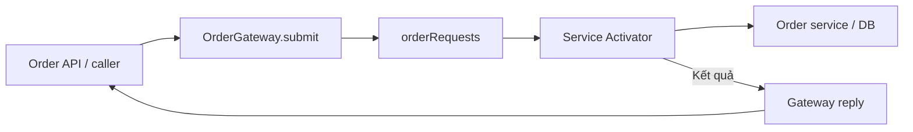

Khi mọi thứ thành công, handler trả `OrderResult` và Gateway trả giá trị đó cho caller. Nhưng khi database timeout, message không được route, hoặc handler ném exception, câu hỏi chuyển thành:

- Caller có nhận được **Java exception** hay không?
- Có tạo **`ErrorMessage`** không?
- Error message được gửi đến channel nào?
- Có thể biến lỗi thành **typed `OrderResult`** để Gateway trả lời không?
- Nếu error flow thất bại hoặc không tạo reply thì caller sẽ gặp điều gì?
- Gateway timeout có đồng nghĩa backend chưa xử lý không?
- Một async adapter có tự động báo lỗi về đúng caller không?

**Gateway error channel** là một điểm cấu hình để điều phối những lỗi mà Messaging Gateway xử lý, nhưng **không phải công tắc khiến mọi exception của mọi message tự được bắt, ghi log và chuyển thành kết quả thành công**.

## 2. Mục tiêu học tập

Sau bài này, bạn có thể:

1. Phân biệt Gateway request channel, reply channel và error channel.
2. Giải thích vai trò của `ErrorMessage` và `MessagingException`.
3. Hiểu lỗi đồng bộ khác lỗi phát sinh sau async boundary.
4. Cấu hình `@MessagingGateway(errorChannel = "...")` và một error-handling flow.
5. Trả về kết quả nghiệp vụ có cấu trúc hoặc quyết định ném lỗi cho caller.
6. Phân biệt một **domain rejection** với lỗi kỹ thuật, retryable error và unknown outcome.
7. Không nhầm reply timeout, request send timeout và downstream operation timeout.
8. Xử lý correlation, request ID, reply channel và late replies.
9. Kiểm thử success, handler exception, error-channel reply, thiếu reply, filter/drop, timeout và concurrency.
10. Tổ chức retry/error channel/DLQ/idempotency/transaction đúng boundary.
11. Biết khi nào nên dùng Gateway đồng bộ và khi nào trả `ACCEPTED/PENDING`.
12. Thiết lập observability có thể phát hiện lỗi nằm ở Gateway, flow hay adapter.

## 3. Messaging Gateway che giấu message infrastructure

**Messaging Gateway** là EIP cho phép caller sử dụng một giao diện quen thuộc trong khi logic bên dưới giao tiếp bằng message.

```java
@MessagingGateway(
    defaultRequestChannel = "orderRequests")
public interface OrderGateway {

    OrderResult submit(SubmitOrder command);
}
```

Caller không cần trực tiếp tạo `Message<SubmitOrder>`, đặt reply channel, subscribe channel hoặc chờ response queue. Gateway proxy thực hiện phần chuyển đổi giữa method invocation và message exchange.

### Request-reply lifecycle cơ bản

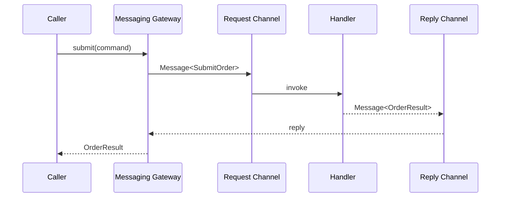

### Gateway khác Service Activator thế nào?

| Thành phần | Chiều giao tiếp chủ yếu | Vai trò |
| --- | --- | --- |
| **Messaging Gateway** | Java method ↔ Spring Message | Cổng gọi vào/ra message flow |
| **Service Activator** | Spring Message → service method | Thực hiện nghiệp vụ và có thể tạo reply |
| **Transformer** | Message/payload → message/payload khác | Biến đổi dữ liệu |
| **Router** | Message → channel được chọn | Chọn nhánh |
| **Filter** | Message → pass/reject | Sàng lọc |
| **Error flow** | ErrorMessage → logging/handling/reply | Xử lý sự cố theo chính sách |

Gateway không thay thế service, transaction hay error handler. Nó chỉ tạo một abstraction về invocation và reply.

## 4. Ba kênh hay bị nhầm: request, reply, error

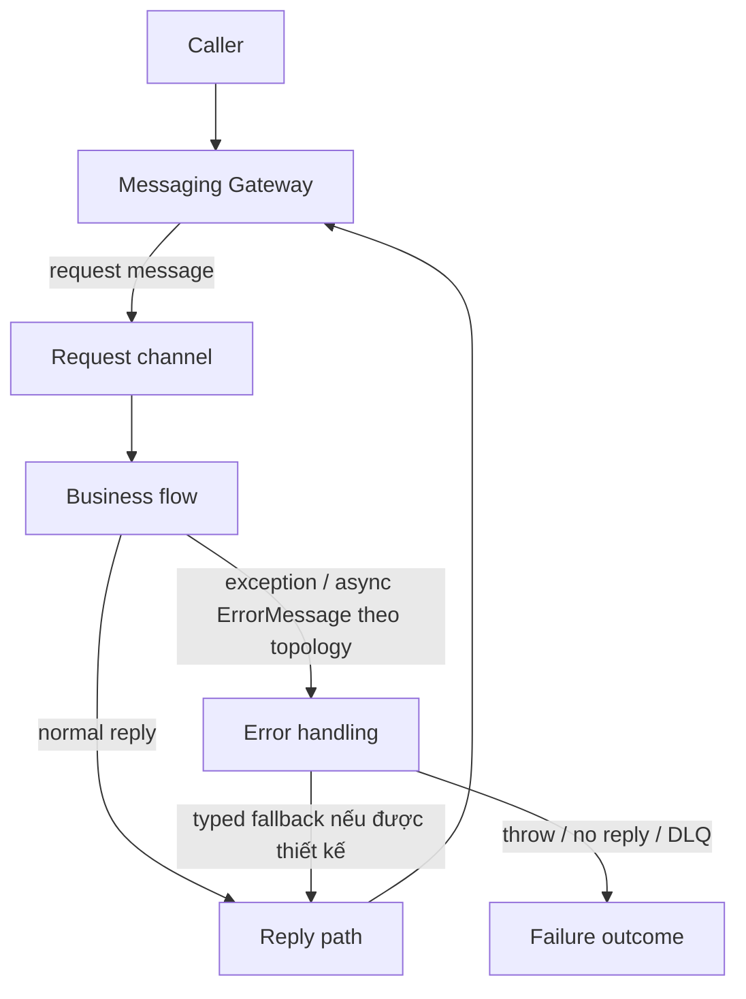

### Request channel

Nơi Gateway gửi message để bắt đầu pipeline. Ví dụ `orderRequests`.

### Reply channel

Nơi một reply-producing endpoint gửi kết quả. Có thể được khai báo tường minh, hoặc Gateway gắn một **temporary reply channel** vào message để ghép reply với lời gọi đang chờ.

### Error channel

Nơi lỗi được chuyển vào quá trình xử lý lỗi. Một Gateway có thể khai báo `errorChannel`; một message bên dưới cũng có thể mang `errorChannel` header; inbound adapter có thể dùng error channel riêng; ứng dụng có thể có global `errorChannel`.

**Chúng không mặc nhiên là cùng channel hoặc có cùng phạm vi bắt lỗi.**

| Kênh / cấu hình | Tác dụng | Điều không được suy ra |
| --- | --- | --- |
| `defaultRequestChannel` | Đích gửi request từ Gateway | Handler chắc chắn đã commit |
| `defaultReplyChannel` hoặc reply header | Đích phản hồi của Gateway | Bất kỳ handler nào cũng tạo reply |
| Gateway `errorChannel` | Đường xử lý lỗi trong phạm vi Gateway | Mọi lỗi async sau đó đều quay về caller |
| Header `errorChannel` | Gợi ý routing lỗi gắn với message, tùy endpoint | Luôn thắng mọi cấu hình khác |
| Global `errorChannel` | Cơ chế lỗi mặc định cho các thành phần dùng nó | Mọi exception synchronous đều đi qua đây |
| Adapter-specific error channel | Xử lý lỗi nhận/gửi qua adapter | Tự trả một business reply |

**Luôn xác định lỗi phát sinh ở thread/boundary nào, endpoint nào bắt nó, và ai chịu trách nhiệm tạo response.**

## 5. `ErrorMessage` trong Spring Messaging

Spring Messaging biểu diễn lỗi bằng một message chuyên biệt:

```java
org.springframework.messaging.support.ErrorMessage
```

`ErrorMessage` bản chất là một `Message<Throwable>`. Payload thường là một throwable như `MessagingException`, có thể chứa failed message để phục vụ điều tra.

```text
ErrorMessage
  payload:
    Throwable / MessagingException
      message: "DB timeout"
      cause: ...
      failedMessage: Message<SubmitOrder> (nếu có)
  headers:
    framework/error metadata
  originalMessage:
    may be present
```

### Không nên giả định luôn có failedMessage

Lỗi có thể phát sinh trước khi request được xây dựng hoàn chỉnh, trong adapter, khi chuyển đổi payload hoặc sau khi một message không còn được giữ lại trong exception. Vì thế:

- `MessagingException.getFailedMessage()` có thể `null`.
- `ErrorMessage.getOriginalMessage()` có thể thiếu.
- Throwable có thể được wrap nhiều lần.
- Payload của failed message có thể là một DTO khác kỳ vọng.
- Không log raw failed payload nếu chứa PII/credentials.

### Cách đọc lỗi thận trọng

```java
import org.springframework.messaging.Message;
import org.springframework.messaging.MessagingException;
import org.springframework.messaging.support.ErrorMessage;

public final class ErrorInspection {

    public static String failedEventId(ErrorMessage error) {
        Throwable failure = error.getPayload();

        if (failure instanceof MessagingException messaging) {
            Message<?> failed = messaging.getFailedMessage();

            if (failed != null
                    && failed.getPayload()
                        instanceof SubmitOrder order) {
                return order.requestId();
            }
        }

        Message<?> original = error.getOriginalMessage();
        if (original != null
                && original.getPayload() instanceof SubmitOrder order) {
            return order.requestId();
        }

        return "unavailable";
    }
}
```

Đây là một helper minh họa, không phải API mặc định của Gateway. Nó chỉ truy xuất request ID nếu dữ liệu gốc thực sự có mặt. Với một hệ thống cần correlation chắc chắn, phải có message envelope/tracing context được thiết kế để tồn tại qua các boundary.

## 6. Có lỗi không có nghĩa caller sẽ nhận một ErrorMessage

Nếu một Service Activator đồng bộ ném exception, caller của Gateway thường muốn thấy **exception ở Java call site** hoặc một **business result** có cấu trúc, không phải tự xử lý đối tượng `ErrorMessage`.

```text
Caller:
  gateway.submit(command)

Possible outcome A:
  returns OrderResult

Possible outcome B:
  throws Gateway/Message handling exception

Possible outcome C:
  returns a typed fallback/rejection after error flow mapping

Possible outcome D:
  reply timeout / no reply

Possible outcome E:
  void/one-way gateway, no result expected
```

Error channel là **một đường đi bên trong integration infrastructure**. Caller không tự động nhận một `ErrorMessage` làm Java return value. Nếu method khai báo `OrderResult`, error flow trả một object không tương thích có thể gây lỗi chuyển kiểu hoặc reply conversion.

### Hai lựa chọn hợp đồng

**Lựa chọn 1: error là exception**

```java
OrderResult result = gateway.submit(command);
// on failure: exception propagates / is rethrown by contract
```

**Lựa chọn 2: error được chuyển thành typed result**

```java
OrderResult result = gateway.submit(command);
// result.status() = FAILED_RETRYABLE / REJECTED / COMPLETED
```

Cách thứ hai yêu cầu error flow **tạo reply đúng kiểu và đúng reply route**. Không chỉ cấu hình tên error channel là đủ.

## 7. Domain rejection và infrastructure failure không cùng nghĩa

Giả sử API nhận đơn có amount âm:

```text
SubmitOrder(amount=-1)
  -> business validation rejects
```

Đó là một lỗi/nhánh nghiệp vụ có tính **dự đoán được**. Nó có thể được biểu diễn bằng `OrderResult(status=REJECTED, reason=INVALID_AMOUNT)` mà không cần đưa vào error channel framework.

Ngược lại:

```text
SubmitOrder(amount=125000)
  -> database connection timeout
```

Đây có thể là lỗi tạm thời nhưng outcome chưa chắc đã biết. Nếu đã commit trước khi kết nối bị mất, retry mù có nguy cơ tạo duplicate.

### Ma trận chính sách

| Tình huống | Loại | Kết quả hợp lý |
| --- | --- | --- |
| Amount âm | Domain validation | `REJECTED / INVALID_AMOUNT` |
| Tenant không được phép | Security | Reject + audit; không leak dữ liệu |
| Schema không hỗ trợ | Protocol/data contract | Error có cấu trúc, quarantine nếu cần |
| DB connection refused trước effect | Infrastructure transient | Retry có giới hạn |
| DB commit outcome không xác định | Uncertain outcome | Reconcile theo idempotency key |
| Service Activator trả `null` dù reply bắt buộc | Contract error | Reply-required failure / timeout tùy config |
| Gateway chờ quá hạn | Timing/reply failure | Timeout, không suy ra rollback |
| Reply đến sau timeout | Late reply | Discard/reconcile theo policy |
| Duplicate đã hoàn tất | Idempotency | Replay stored result / acknowledge |
| Error flow ném exception | Error-handling failure | Fail fast/fallback theo contract, không vòng lặp vô hạn |

### Nguyên tắc phân tầng

- **Domain result:** caller có thể xử lý như một trạng thái nghiệp vụ.
- **Technical exception:** lỗi hệ thống không nằm trong các trạng thái domain thông thường.
- **ErrorMessage:** envelope lỗi tại middleware.
- **DLQ record:** dữ liệu phục vụ phục hồi/điều tra, không phải lời trả lời đồng bộ cho API caller.

## 8. Lỗi đồng bộ và lỗi bất đồng bộ đi khác đường

### Luồng đồng bộ qua `DirectChannel`

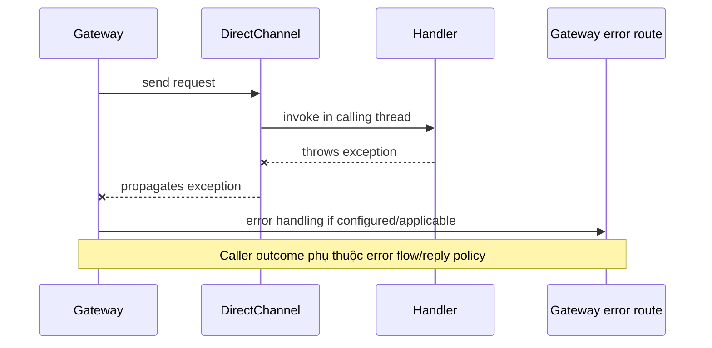

Trong kiểu dispatch đồng bộ, exception có thể quay về call stack của Gateway. Cấu hình error channel tại Gateway là một cơ chế để xử lý trường hợp đó, tùy error routing contract của phiên bản/framework.

### Luồng bất đồng bộ qua executor/broker

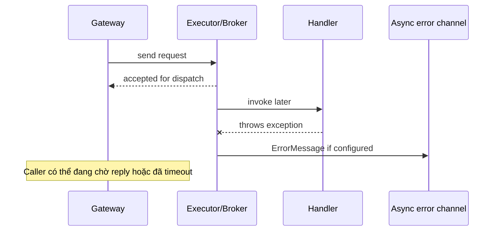

Lỗi xuất hiện sau khi thread Gateway đã gửi request có thể không còn nằm trong call stack ban đầu. Việc error message có thể được đưa về đúng Gateway hay không phụ thuộc:

- Endpoint/channel/adapters hỗ trợ chuyển lỗi đến đâu.
- `errorChannel` header có được giữ hay đã bị drop khi serialize.
- Reply context còn sống hay đã timeout.
- Middleware có ghi persistent correlation ID hay không.
- Error flow có tạo reply phù hợp hoặc báo lỗi theo hợp đồng không.

**Không suy ra “đã có gateway errorChannel nên mọi async exception sẽ tới đúng caller”.**

## 9. Gateway reply timeout không phải downstream rollback

Một Gateway đồng bộ có thể timeout trong khi handler vẫn đang chạy, hoặc kết quả vừa được commit nhưng reply bị mất.

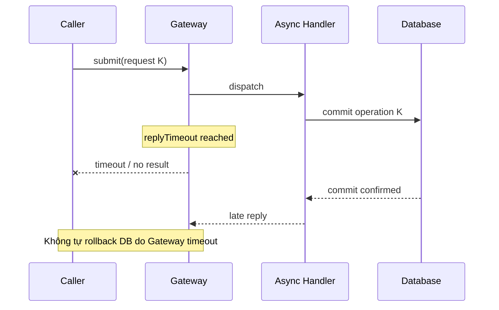

### Ba timeout thường gặp

| Timeout | Giới hạn cái gì? | Không khẳng định được |
| --- | --- | --- |
| Request/send timeout | Thời gian cố gửi message tới request channel | Handler đã/không đã hoàn thành |
| Reply timeout | Thời gian Gateway chờ reply | Business effect chưa commit |
| Downstream I/O timeout | Thời gian gọi DB/API/middleware | External effect chưa xảy ra |

Những timeout có thể được cấu hình ở các lớp khác nhau, không nên dùng một con số cho mọi nghĩa.

### Cách thiết kế an toàn hơn

Nếu caller retry sau timeout, gửi **cùng idempotency key** và truy vấn trạng thái operation trước khi tạo side effect mới. Nếu operation đã completed, trả stored result; nếu outcome chưa biết, trả pending/reconcile theo hợp đồng.

## 10. Một error handler nhận lỗi cũng phải có contract phản hồi

Khi triển khai Gateway error channel, đội phát triển cần trả lời:

1. Error handler sẽ **trả typed business result** hay ném exception?
2. Với `ErrorMessage` không có failed message, có tìm được request ID không?
3. Tình huống lỗi có thể được **retry** không?
4. Nếu retry, ai sở hữu retry budget và backoff?
5. Error flow có đang ghi audit hoặc side effect không?
6. Nếu error flow ném tiếp exception, error đó đi đâu?
7. Nếu error flow trả `null`, Gateway có timeout không?
8. Nếu error flow trả wrong type, Gateway có lỗi conversion không?
9. Nếu caller đã timeout, ai dọn **late reply**?
10. Khi có transaction, có thể đã commit trước khi error xuất hiện không?

Một error flow không phải là một “thùng rác” chứa mọi lỗi; đó là **một nhánh pipeline có đầu vào/đầu ra và chính sách riêng**.

## 11. Ví dụ domain xuyên bài: SubmitOrder và OrderResult

Chúng ta thiết kế ví dụ gồm ba trạng thái:

- `COMPLETED`: nghiệp vụ được xác nhận hoàn thành.
- `REJECTED`: input không hợp lệ theo business rule.
- `FAILED_RETRYABLE`: xảy ra lỗi kỹ thuật đã được phân loại, caller có thể tra cứu/retry theo quy tắc.

Các trạng thái được dùng làm **kết quả mô phỏng** trong bài. Với side effect ở hệ thống thật, không được trả `FAILED_RETRYABLE` nếu outcome thực sự chưa biết; có thể cần `PENDING_RECONCILIATION`.

### `SubmitOrder.java`

```java
package example.integration;

public record SubmitOrder(
    String tenantId,
    String orderId,
    String requestId,
    long amountMinorUnits
) {
    public SubmitOrder {
        if (tenantId == null || tenantId.isBlank()
                || orderId == null || orderId.isBlank()
                || requestId == null || requestId.isBlank()) {
            throw new IllegalArgumentException(
                "Missing order identity");
        }
    }
}
```

### `OrderResult.java`

```java
package example.integration;

public record OrderResult(
    String requestId,
    String status,
    String reasonCode
) {
    public OrderResult {
        if (requestId == null || requestId.isBlank()
                || status == null || status.isBlank()) {
            throw new IllegalArgumentException(
                "Missing order result fields");
        }
    }

    public static OrderResult completed(String requestId) {
        return new OrderResult(
            requestId, "COMPLETED", null);
    }

    public static OrderResult rejected(
            String requestId,
            String reasonCode) {
        return new OrderResult(
            requestId, "REJECTED", reasonCode);
    }

    public static OrderResult retryableFailure(
            String requestId) {
        return new OrderResult(
            requestId, "FAILED_RETRYABLE",
            "DEPENDENCY_UNAVAILABLE");
    }
}
```

### Vì sao một result type thống nhất có ích?

Gateway khai báo:

```java
OrderResult submit(SubmitOrder command);
```

Mọi success hoặc business rejection đều trả `OrderResult`. Nếu error flow chủ động chuyển lỗi kỹ thuật thành result, nó cũng phải trả đúng type này. Nhờ đó caller không phải cast một `ErrorMessage` hoặc `Throwable` thành business object.

Tuy nhiên, **không bắt buộc** mọi lỗi kỹ thuật đều được biến thành successful Java return. Với lỗi nghiêm trọng, nhiều API chọn ném exception và để HTTP/API boundary map sang 5xx phù hợp.

## 12. Hợp đồng error channel rõ ràng hơn một `catch(Exception)`

Một triển khai đơn giản có thể bắt mọi exception rồi trả `FAILED_RETRYABLE`:

```java
// Phản mẫu: đừng áp dụng nguyên trạng.
try {
    return orderService.process(command);
} catch (Exception any) {
    return OrderResult.retryableFailure(command.requestId());
}
```

Đoạn này nguy hiểm vì:

- Lỗi validation/authorization bị nhầm thành lỗi tạm thời.
- Lỗi lập trình (NullPointerException, ClassCastException) bị che.
- Caller có thể retry dù operation đã commit.
- Không có error reason code cụ thể.
- Không xác định được transaction rollback hay commit.
- Không có alert/trace cho lỗi bất thường.
- Hệ thống có thể bị request flood do retry vô hạn.

Thiết kế đúng bắt đầu bằng **taxonomy lỗi** và **reply policy**, sau đó mới chọn handler/channel/advice.

## 13. Service giả lập: tách lỗi nghiệp vụ khỏi lỗi hạ tầng

Để kiểm tra Gateway error channel mà không phụ thuộc database thật, tạo service xử lý theo dữ liệu đầu vào:

- `amountMinorUnits < 0` → trả `REJECTED`.
- `orderId` bắt đầu `DB-DOWN-` → ném lỗi kỹ thuật có thể phân loại.
- Trường hợp còn lại → trả `COMPLETED`.

### `DependencyUnavailableException.java`

```java
package example.integration;

public final class DependencyUnavailableException
        extends RuntimeException {

    public DependencyUnavailableException(String message) {
        super(message);
    }
}
```

### `OrderApplicationService.java`

```java
package example.integration;

import java.util.concurrent.atomic.AtomicInteger;

public final class OrderApplicationService {

    private final AtomicInteger invocations =
        new AtomicInteger();

    public OrderResult process(SubmitOrder command) {
        invocations.incrementAndGet();

        if (command.amountMinorUnits() < 0) {
            return OrderResult.rejected(
                command.requestId(),
                "INVALID_AMOUNT");
        }

        if (command.orderId().startsWith("DB-DOWN-")) {
            throw new DependencyUnavailableException(
                "Simulated dependency outage");
        }

        return OrderResult.completed(
            command.requestId());
    }

    public int invocationCount() {
        return invocations.get();
    }
}
```

Đây là **test double**, không phải một repository thật. Không có DB commit, transaction, broker ACK hay external API. Mục tiêu là tạo các nhánh deterministic để phân biệt **return value** với **exception**.

### Tại sao không ném exception khi amount âm?

Với hợp đồng của ví dụ, amount âm là input nghiệp vụ không hợp lệ và caller có thể xử lý bằng `REJECTED`. Ta không cần chuyển mọi kết quả domain sang error channel.

Một API khác có thể chọn ném `OrderValidationException` và map ở application/API boundary. Điểm cần thống nhất là **phân loại theo nghĩa nghiệp vụ**, không phải “bất kỳ status khác COMPLETED đều là lỗi hạ tầng”.

## 14. Khai báo `@MessagingGateway` với error channel

Spring Integration hỗ trợ interface-level Messaging Gateway qua `@MessagingGateway`.

### `OrderGateway.java`

```java
package example.integration;

import org.springframework.integration.annotation.MessagingGateway;

@MessagingGateway(
    name = "orderGateway",
    defaultRequestChannel = "orderRequests",
    errorChannel = "orderGatewayErrors",
    defaultReplyTimeout = "2000")
public interface OrderGateway {

    OrderResult submit(SubmitOrder command);
}
```

### Đọc annotation

- `name="orderGateway"`: tên Gateway bean.
- `defaultRequestChannel="orderRequests"`: nơi gửi request.
- `errorChannel="orderGatewayErrors"`: đường xử lý lỗi được chỉ định cho Gateway.
- `defaultReplyTimeout="2000"`: thời gian chờ reply mặc định theo đơn vị/tham số mà phiên bản API quy định; trong cấu hình thông dụng, giá trị timeout biểu diễn milliseconds.
- `submit(...)`: hợp đồng Java synchronous request-reply trả `OrderResult`.

**Lưu ý:** attribute, cách diễn giải timeout expression và xử lý exception có thể có khác biệt theo phiên bản Spring Integration. Khi triển khai trong project thực, đối chiếu annotation API của dependency và chạy integration tests để xác nhận kết quả. Không dựa vào mỗi tên cấu hình để khẳng định mọi nhánh lỗi tự được bắt.

### Gateway không phải error handler

Khai báo `errorChannel` mới chỉ **định tuyến lỗi trong phạm vi Gateway**. Phải có một subscriber/error flow phù hợp ở `orderGatewayErrors`. Nếu không có subscriber, handler ném lỗi hoặc error flow không trả reply, caller không nhận được business result mong muốn.

## 15. Một ErrorMessage có thể chứa exception được wrap

Khi service ném `DependencyUnavailableException`, Gateway hoặc endpoint có thể nhận một throwable được bọc trong `MessagingException`.

```text
ErrorMessage.payload
  -> MessagingException
       -> cause: DependencyUnavailableException
       -> failedMessage: Message<SubmitOrder>
```

Hoặc tùy vị trí lỗi:

```text
ErrorMessage.payload
  -> DependencyUnavailableException
```

Không nên viết:

```java
// Phản mẫu: assume exact type và failedMessage.
DependencyUnavailableException failure =
    (DependencyUnavailableException) error.getPayload();

SubmitOrder command =
    (SubmitOrder) ((MessagingException) failure)
        .getFailedMessage().getPayload();
```

Đoạn này sai cả assumptions về kiểu và nullability. Một error handler production nên:

1. Duyệt cause chain có giới hạn để phân loại exception.
2. Tìm failed/original message nếu được cung cấp.
3. Kiểm tra payload type trước khi ép kiểu.
4. Nếu thiếu correlation, ghi log một reason code và xử lý an toàn.
5. Không deserialize tùy ý object từ raw error headers.
6. Không nhét nguyên raw exception message chứa credentials/SQL vào response.

## 16. Viết GatewayErrorMapper: chuyển lỗi đã biết thành OrderResult

### `GatewayErrorMapper.java`

```java
package example.integration;

import org.springframework.messaging.Message;
import org.springframework.messaging.MessagingException;
import org.springframework.messaging.support.ErrorMessage;

public final class GatewayErrorMapper {

    public OrderResult toResult(ErrorMessage error) {
        Throwable failure = error.getPayload();

        if (!hasCause(
                failure, DependencyUnavailableException.class)) {
            throw new IllegalStateException(
                "UNEXPECTED_GATEWAY_ERROR", failure);
        }

        SubmitOrder command = findSubmitOrder(error);

        if (command == null) {
            // Không thể tạo một OrderResult giả với requestId
            // đoán mò, vì nó có thể bị gán nhầm caller.
            throw new IllegalStateException(
                "MISSING_REQUEST_CONTEXT", failure);
        }

        // Trong ví dụ, đây là lỗi service giả lập
        // xác định chưa commit. Với DB/network thật,
        // outcome có thể cần trạng thái UNKNOWN/REVIEW.
        return OrderResult.retryableFailure(
            command.requestId());
    }

    private static boolean hasCause(
            Throwable throwable,
            Class<? extends Throwable> expected) {

        Throwable current = throwable;
        int depth = 0;

        while (current != null && depth++ < 20) {
            if (expected.isInstance(current)) {
                return true;
            }
            current = current.getCause();
        }

        return false;
    }

    private static SubmitOrder findSubmitOrder(
            ErrorMessage error) {

        Message<?> original = error.getOriginalMessage();

        if (original != null
                && original.getPayload() instanceof SubmitOrder order) {
            return order;
        }

        Throwable current = error.getPayload();
        int depth = 0;

        while (current != null && depth++ < 20) {
            if (current instanceof MessagingException messaging) {
                Message<?> failed = messaging.getFailedMessage();

                if (failed != null
                        && failed.getPayload()
                            instanceof SubmitOrder order) {
                    return order;
                }
            }

            current = current.getCause();
        }

        return null;
    }
}
```

### Vì sao không trả “FAILED” cho mọi lỗi?

Một `ClassCastException` trong mapping code, một lỗi schema không hỗ trợ và một `SecurityException` không nhất thiết được phép retry. `toResult` chỉ xử lý một nhóm lỗi đã biết. Lỗi bất ngờ được **nêu ra rõ ràng** để không bị ngụy trang thành trạng thái nghiệp vụ bình thường.

### Vì sao requestId quan trọng?

Hai Gateway calls đồng thời có thể cùng order ID nhưng có request ID khác nhau. Nếu error handler không tìm được request hiện tại, nó không nên tự sinh một `OrderResult` gắn vào request ngẫu nhiên. **Correlation đúng là điều kiện để tạo phản hồi có ý nghĩa.**

### Vì sao có depth limit?

Cause graph bình thường là một chuỗi hữu hạn, nhưng mã xử lý lỗi nên tránh traversal vô hạn trong trường hợp throwable chain bất thường. Giới hạn 20 ở ví dụ là policy kỹ thuật minh họa, không phải một requirement của Spring Integration.

## 17. Tạo IntegrationFlow cho request và error

### `OrderGatewayConfiguration.java`

```java
package example.integration;

import org.springframework.context.annotation.Bean;
import org.springframework.context.annotation.Configuration;
import org.springframework.integration.annotation.IntegrationComponentScan;
import org.springframework.integration.channel.DirectChannel;
import org.springframework.integration.config.EnableIntegration;
import org.springframework.integration.dsl.IntegrationFlow;
import org.springframework.messaging.MessageChannel;

@Configuration
@EnableIntegration
@IntegrationComponentScan(
    basePackageClasses = OrderGateway.class)
public class OrderGatewayConfiguration {

    @Bean
    public MessageChannel orderRequests() {
        return new DirectChannel();
    }

    @Bean
    public MessageChannel orderGatewayErrors() {
        return new DirectChannel();
    }

    @Bean
    public OrderApplicationService orderApplicationService() {
        return new OrderApplicationService();
    }

    @Bean
    public GatewayErrorMapper gatewayErrorMapper() {
        return new GatewayErrorMapper();
    }

    @Bean
    public IntegrationFlow processOrders(
            OrderApplicationService service) {

        return IntegrationFlow.from("orderRequests")
            .handle(service, "process")
            .get();
    }

    @Bean
    public IntegrationFlow handleGatewayErrors(
            GatewayErrorMapper errorMapper) {

        return IntegrationFlow.from("orderGatewayErrors")
            .handle(errorMapper, "toResult")
            .get();
    }
}
```

### Hai flows có vai trò khác nhau

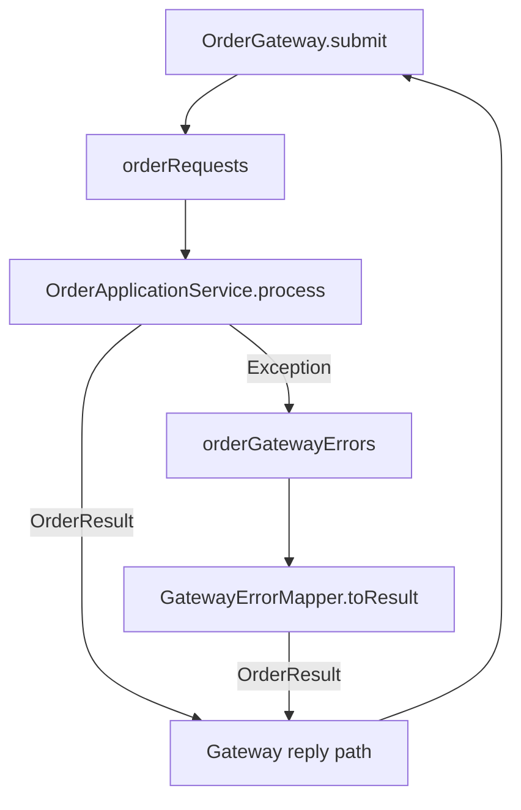

Đây là **kiến trúc mục tiêu cần xác minh bằng integration test** trên version Spring Integration đang sử dụng. Đường error reply có thể được framework gắn temporary reply context hoặc cần cấu hình routing bổ sung ở một số biến thể endpoint/adapter. Đừng tự tạo một output channel cố định rồi giả định nó chắc chắn quay về đúng Gateway.

### Những giả định của ví dụ

- Gateway và handler nằm trong cùng application context.
- Request được gửi qua `DirectChannel` đồng bộ.
- Service ném exception trước bất kỳ business commit nào (vì là giả lập).
- Error flow tạo `OrderResult` cho lỗi đã biết.
- Gateway method trả `OrderResult`, không trả một `Throwable`.
- Không có HTTP/Kafka/AMQP adapter hoặc transaction thật trong demo.
- Gateway interface nằm trong package được `@IntegrationComponentScan` quét.

Nếu chuyển `orderRequests` sang một broker hoặc ExecutorChannel, behavior của exception/error routing cần được kiểm chứng lại: không thể giữ nguyên giả định “exception đồng bộ quay về Gateway”.

## 18. Error flow là reply-producing endpoint, không chỉ logger

So sánh hai cách xử lý:

### Cách A: logger-only

```java
public void log(ErrorMessage error) {
    logFailureSafely(error);
}
```

Nó không tạo reply payload. Nếu Gateway đang chờ một result mà không có nhánh khác trả lời, caller có thể gặp no-reply/timeout hoặc lỗi theo Gateway policy.

### Cách B: trả typed result

```java
public OrderResult toResult(ErrorMessage error) {
    // classify + recover request ID
    return OrderResult.retryableFailure(requestId);
}
```

Nó có một object để gửi theo reply path **nếu error flow/gateway đã được nối đúng**.

### Cách C: ném lỗi tới caller

```java
public OrderResult rethrow(ErrorMessage error) {
    throw new IllegalStateException(
        "ORDER_PROCESSING_FAILED",
        error.getPayload());
}
```

Cách này phù hợp khi caller hợp đồng chấp nhận exception. Nhưng error flow ném lỗi cũng có thể kích hoạt error handling khác, nên phải thiết kế để tránh **recursive error routing** và dùng một terminal failure policy.

### Một nhánh có thể ghi log rồi trả result

```java
public OrderResult logAndMap(ErrorMessage error) {
    safeLogger.logCode("DEPENDENCY_UNAVAILABLE");
    return toResult(error);
}
```

Nên tránh log raw payload/headers nếu chứa tenant data, token hoặc PII. Audit có thể dùng message reference và reason code.

## 19. Unit test business service trước khi test Gateway

Không cần Spring context để kiểm thử Service Activator service logic:

```java
package example.integration;

import static org.junit.jupiter.api.Assertions.*;

import org.junit.jupiter.api.Test;

class OrderApplicationServiceTest {

    private final OrderApplicationService service =
        new OrderApplicationService();

    @Test
    void validCommandProducesCompletedResult() {
        OrderResult result = service.process(
            new SubmitOrder(
                "shop-01", "ORD-101", "REQ-901", 125_000L));

        assertEquals("REQ-901", result.requestId());
        assertEquals("COMPLETED", result.status());
        assertNull(result.reasonCode());
        assertEquals(1, service.invocationCount());
    }

    @Test
    void domainValidationReturnsRejectedResult() {
        OrderResult result = service.process(
            new SubmitOrder(
                "shop-01", "ORD-102", "REQ-902", -1L));

        assertEquals("REQ-902", result.requestId());
        assertEquals("REJECTED", result.status());
        assertEquals(
            "INVALID_AMOUNT", result.reasonCode());
        assertEquals(1, service.invocationCount());
    }

    @Test
    void simulatedDependencyOutageThrows() {
        SubmitOrder command = new SubmitOrder(
            "shop-01", "DB-DOWN-103",
            "REQ-903", 10_000L);

        assertThrows(
            DependencyUnavailableException.class,
            () -> service.process(command));

        assertEquals(1, service.invocationCount());
    }
}
```

### Ba assertions phục vụ ba mục tiêu

1. Service bình thường tạo reply đúng.
2. Domain rejection là typed result, không cần error infrastructure.
3. Dependency outage tạo exception để Gateway/error flow xử lý.

Nhờ tách unit test và integration test, nếu một bài Gateway test fail, ta xác định được lỗi ở **gateway wiring/error routing** hay **domain service**.

## 20. Unit test GatewayErrorMapper với ErrorMessage chứa failed message

Ta chủ động tạo một `MessagingException` có failed message, sau đó bọc thành `ErrorMessage`.

```java
package example.integration;

import static org.junit.jupiter.api.Assertions.*;

import org.junit.jupiter.api.Test;
import org.springframework.messaging.Message;
import org.springframework.messaging.MessagingException;
import org.springframework.messaging.support.ErrorMessage;
import org.springframework.messaging.support.MessageBuilder;

class GatewayErrorMapperTest {

    private final GatewayErrorMapper mapper =
        new GatewayErrorMapper();

    @Test
    void knownDependencyErrorMapsToTypedReply() {
        SubmitOrder request = new SubmitOrder(
            "shop-01", "ORD-101",
            "REQ-901", 125_000L);

        Message<SubmitOrder> failed =
            MessageBuilder.withPayload(request).build();

        MessagingException wrapped =
            new MessagingException(
                failed,
                "Processing error",
                new DependencyUnavailableException(
                    "Simulated outage"));

        ErrorMessage error = new ErrorMessage(wrapped);

        OrderResult result = mapper.toResult(error);

        assertEquals("REQ-901", result.requestId());
        assertEquals(
            "FAILED_RETRYABLE", result.status());
        assertEquals(
            "DEPENDENCY_UNAVAILABLE",
            result.reasonCode());
    }
}
```

### Test này không chứng minh Gateway đã route exception

Đây là unit test của mapper. Nó chứng minh **với ErrorMessage có failedMessage**, mapper có thể phân loại lỗi và lấy request ID. Cần thêm integration test để xác minh Gateway error channel thực tế nhận một loại ErrorMessage tương ứng.

### Nếu failed message bị thiếu?

Đó là một nhánh quan trọng cần negative test, không nên giả định mọi error path đều kèm original command.

## 21. Unit test: không tạo reply khi không có request context

```java
@Test
void knownErrorWithoutRequestContextIsNotGuessed() {
    ErrorMessage error = new ErrorMessage(
        new DependencyUnavailableException(
            "Simulated outage"));

    IllegalStateException exception =
        assertThrows(
            IllegalStateException.class,
            () -> mapper.toResult(error));

    assertEquals(
        "MISSING_REQUEST_CONTEXT",
        exception.getMessage());
}
```

Method này đặt trong `GatewayErrorMapperTest`.

### Vì sao fail thay vì tạo OrderResult("UNKNOWN", ...) ?

Một Gateway có thể có nhiều callers đang chờ. Một result không có request identity có thể gây lỗi đối chiếu/reconciliation hoặc khiến audit gắn sai request. Với contract yêu cầu ID, **missing context là một error condition khác**.

Trong production, nếu hệ thống vẫn có temporary reply channel nhưng mất payload, có thể trả một error result không chứa request ID theo API protocol riêng. Tuy nhiên, cần **được định nghĩa và kiểm thử**; không phát minh request ID từ timestamp/thread name.

## 22. Unit test: lỗi bất ngờ không được âm thầm biến thành retryable

```java
@Test
void unexpectedErrorIsNotMisclassifiedAsRetryable() {
    ErrorMessage error = new ErrorMessage(
        new IllegalArgumentException(
            "Bug in downstream mapping"));

    IllegalStateException exception =
        assertThrows(
            IllegalStateException.class,
            () -> mapper.toResult(error));

    assertEquals(
        "UNEXPECTED_GATEWAY_ERROR",
        exception.getMessage());
}
```

### Tại sao quan trọng?

Nếu mọi lỗi được map thành `FAILED_RETRYABLE`:

- Programming bug có thể bị che hàng giờ.
- Client retry không giới hạn làm hệ thống quá tải.
- Lỗi security có thể bị xử lý như lỗi mạng.
- Một transaction đã commit có thể bị thực thi lại.
- Dashboard có thể báo “API trả result bình thường” dù backend hỏng.

Nên có exception taxonomy rõ và log/metric riêng cho `UNEXPECTED_GATEWAY_ERROR`.

## 23. Integration test: Gateway trả OrderResult khi thành công

Sử dụng context đã khai báo trong `OrderGatewayConfiguration`:

```java
package example.integration;

import static org.junit.jupiter.api.Assertions.*;

import org.junit.jupiter.api.Test;
import org.springframework.beans.factory.annotation.Autowired;
import org.springframework.test.annotation.DirtiesContext;
import org.springframework.test.context.junit.jupiter.SpringJUnitConfig;

@SpringJUnitConfig(OrderGatewayConfiguration.class)
@DirtiesContext(
    classMode = DirtiesContext.ClassMode.AFTER_EACH_TEST_METHOD)
class OrderGatewayIntegrationTest {

    @Autowired
    private OrderGateway gateway;

    @Autowired
    private OrderApplicationService service;

    @Test
    void gatewayReturnsCompletedBusinessResult() {
        OrderResult result = gateway.submit(
            new SubmitOrder(
                "shop-01", "ORD-101",
                "REQ-901", 125_000L));

        assertNotNull(result);
        assertEquals("REQ-901", result.requestId());
        assertEquals("COMPLETED", result.status());
        assertNull(result.reasonCode());
        assertEquals(1, service.invocationCount());
    }
}
```

Trong flow đồng bộ của ví dụ, một request thành công đi qua `orderRequests`, service trả một object và Gateway chuyển reply thành Java `OrderResult`.

**Nhưng test vẫn chưa nói gì về error channel:** do đó cần một case riêng ném exception có chủ đích.

## 24. Integration test: Domain rejection không cần đi qua error channel

Thêm method vào `OrderGatewayIntegrationTest`:

```java
@Test
void businessRejectionIsNormalTypedReply() {
    OrderResult result = gateway.submit(
        new SubmitOrder(
            "shop-01", "ORD-102",
            "REQ-902", -10L));

    assertNotNull(result);
    assertEquals("REQ-902", result.requestId());
    assertEquals("REJECTED", result.status());
    assertEquals(
        "INVALID_AMOUNT", result.reasonCode());
    assertEquals(1, service.invocationCount());
}
```

### Vì sao không ném exception cho mọi rejection?

Trong bài này, `REJECTED` là trạng thái domain hợp lệ. Gateway error channel dành cho lỗi mà integration/application chọn xử lý theo error route. Việc phân chia có thể khác ở một dự án khác, nhưng phải thống nhất để consumers không phải đoán một `REJECTED` là timeout hay validation failure.

### Kiểm tra error handler không bị gọi

Một test chuyên sâu có thể thêm counter vào `GatewayErrorMapper` và assert nó không được gọi đối với `REJECTED`. Bài không thêm state vào mapper minh họa để giữ code thuần; khi thực hành, có thể dùng Mockito spy hoặc meter riêng.

## 25. Integration test: lỗi backend được map thành typed reply

Đây là test quan trọng nhất của **Gateway error channel** trong ví dụ. Dựa trên `OrderGatewayConfiguration` ở mục 17, gửi một request khiến service ném `DependencyUnavailableException`:

```java
@Test
void dependencyFailureUsesGatewayErrorFlow() {
    SubmitOrder command = new SubmitOrder(
        "shop-01",
        "DB-DOWN-103",
        "REQ-903",
        125_000L);

    OrderResult result = gateway.submit(command);

    assertNotNull(result);
    assertEquals("REQ-903", result.requestId());
    assertEquals(
        "FAILED_RETRYABLE", result.status());
    assertEquals(
        "DEPENDENCY_UNAVAILABLE",
        result.reasonCode());

    // Service được gọi đúng một lần trong ví dụ,
    // không có retry advice.
    assertEquals(1, service.invocationCount());
}
```

Method trên đặt trong `OrderGatewayIntegrationTest` của mục 23.

### Điều test được dùng để xác nhận

1. Gateway gửi command vào `orderRequests`.
2. Service Activator thực sự ném một lỗi kỹ thuật.
3. Lỗi được xử lý qua error configuration của Gateway.
4. `GatewayErrorMapper` phân loại lỗi và truy xuất `requestId`.
5. Một `OrderResult` phù hợp quay về đúng Gateway invocation.
6. Test không chuyển outcome thành một `Throwable`/wrong type.

### Nếu test không trả được `OrderResult`

Cần kiểm tra **thực tế runtime**, không sửa bừa `replyTimeout`:

- Gateway interface có được register thành proxy không?
- `errorChannel` trên Gateway đã thực sự là `orderGatewayErrors` chưa?
- Error flow có subscriber không?
- Service method có đang chạy **synchronous** không?
- ErrorMessage payload có loại/cause chain nào?
- `failedMessage` hoặc `originalMessage` có còn chứa command không?
- Error handler có tạo `OrderResult` hay ném tiếp lỗi?
- Reply destination được framework thiết lập/propagate qua error flow đúng chưa?
- Có fixed output channel chặn đường về Gateway không?
- Có `ExecutorChannel`, broker hoặc transaction boundary nào làm mất synchronous error context không?

**Không có quyền khẳng định mọi phiên bản/cấu hình đều hoạt động giống sơ đồ chỉ bằng mắt.** Test này là hợp đồng cần đạt và phát hiện sai lệch API hoặc topology trước khi chạy production.

## 26. Kiểm thử khi error flow không tạo reply

Giả sử error flow chỉ ghi log:

```java
public void logOnly(ErrorMessage error) {
    auditLogger.record(
        "GATEWAY_ERROR",
        error.getPayload().getClass().getSimpleName());
}
```

Một handler `void` như vậy không tạo business reply. Nếu Gateway method yêu cầu `OrderResult`, phải có nhánh khác trả lời hoặc caller có thể gặp timeout/no-result/exception theo error handling contract.

### Case outline

```java
// Pseudocode: chạy với test configuration có
// errorFlow chỉ gọi void logOnly(error).
//
// @Test
// void loggerOnlyErrorFlowDoesNotProduceOrderResult() {
//     OrderResult result = gateway.submit(DB_DOWN_COMMAND);
//
//     // Không assert kết quả success;
//     // kiểm tra timeout/error outcome theo version
//     // và defaultReplyTimeout đã cấu hình.
// }
```

### Vì sao không viết một assertion cố định rằng luôn throw?

Tùy Messenger Gateway, error handling, reply timeout và method signature, caller có thể thấy exception hoặc kết quả no-reply được xử lý theo API/framework. Trên một kiến trúc nhất định, việc phát sinh lỗi trong error flow cũng có thể được propagate ngay.

Điều bất biến là **`void` logger không tự tạo `OrderResult`**. Vì vậy, nếu contract cần result, một error handler chỉ log là **chưa đủ**.

### Không sửa bằng cách trả chuỗi "FAILED"

Nếu Java method khai báo `OrderResult`, error flow trả một `String` có thể gây type conversion/cast failure. Cần typed `OrderResult` hoặc exception policy rõ.

## 27. Khi error flow lại ném lỗi: tránh vòng lặp

Một lỗi thứ cấp có thể xảy ra ngay trong error handler:

```text
Business handler throws DependencyUnavailableException
    |
    v
Gateway error channel
    |
    v
Error handler tries to save audit
    |
    v
Audit database is also down
```

Nếu lỗi của error handler lại được gửi vào cùng error channel vô điều kiện, hệ thống có thể tạo vòng lỗi, tăng backlog hoặc làm mất nguyên nhân ban đầu.

### Chính sách an toàn

- Error handler giữ logic **nhỏ, bounded và ít dependency**.
- Tách ghi log/metrics không thiết yếu khỏi logic tạo reply.
- Với failure terminal, báo/throw một exception có cấu trúc; không lặp vô hạn.
- Không để error mapping phụ thuộc một service vốn có thể đã gây lỗi.
- Nếu cần ghi audit bền vững, dùng một kênh hoặc outbox có retry/backpressure riêng.
- Giữ original failure code/correlation reference khi ném secondary exception.
- Đặt rate limit/alert nếu một error source tạo quá nhiều errors.

### Sơ đồ tránh recursive error handling

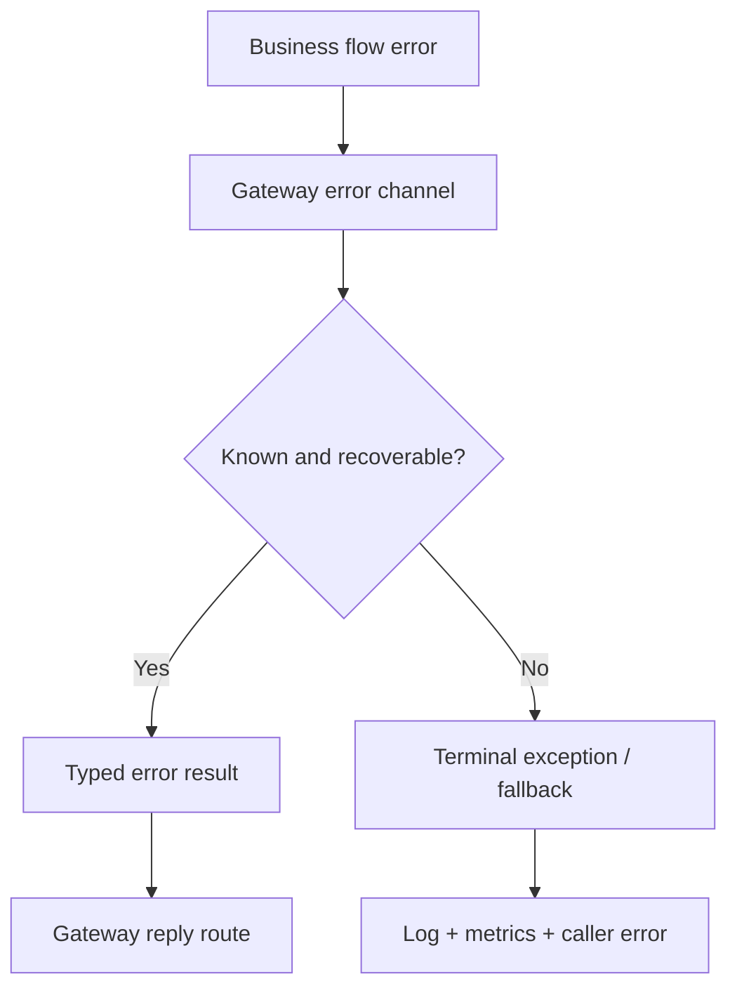

Không biến một failure thành một success result chỉ để “Gateway không throw nữa”. Điều này làm observability và retry policy sai lệch.

## 28. Lỗi từ Router và Filter có thể khác lỗi từ Service Activator

Không phải error nào cũng là Java exception ném từ database service.

### Router không xác định được channel

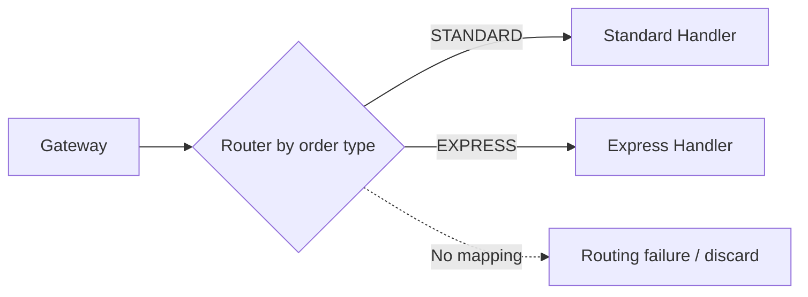

Hai cấu hình có thể tạo outcome khác nhau:

- Router yêu cầu channel đích và **throw** khi không tìm được.
- Router/Filter được cấu hình **drop** message mà không tạo reply.

Trong trường hợp thứ hai, error channel không nhất thiết được gọi, vì **không có exception**. Gateway có thể chờ đến reply timeout.

### Filter loại message

```text
Gateway -> Filter -> (reject)
                   -> no Service Activator
                   -> no normal reply
```

Nếu “input không hợp lệ” cần báo ngay cho API, đừng chỉ discard. Có thể:

1. Dùng `ValidationResult(REJECTED)` như một normal reply.
2. Gửi discard channel tới một endpoint tạo typed rejection result và reply route đúng.
3. Ném một exception validation rồi map theo chính sách lỗi.
4. Tách validation ở API layer trước khi gọi Gateway.

### Bảng so sánh

| Downstream outcome | Có throwable? | Error channel chắc chắn nhận? | Gateway reply? |
| --- | --- | --- | --- |
| Handler trả `OrderResult` | Không | Không cần | Có |
| Handler ném lỗi đồng bộ | Có | Tùy Gateway/error configuration | Exception hoặc mapped result |
| Filter discard không throw | Không | Không tự động | Có thể timeout |
| Router resolution failure throw | Có | Tùy error boundary | Exception hoặc mapped result |
| Router không chọn route và discard | Không | Không tự động | Có thể timeout |
| Handler trả `null` | Không nhất thiết | Không tự động | Không có normal reply |
| Handler trả wrong type | Có thể conversion error | Tùy boundary | Lỗi/chuyển đổi |

**Gateway error channel không thay thế việc thiết kế từng route có nghĩa nghiệp vụ.**

## 29. `requiresReply` và Gateway: hai cơ chế khác nhau

Một reply-producing endpoint có thể được cấu hình **`requiresReply`** để xem `null` là violation.

```text
Service Activator returns null
  -> requiresReply=false
       => no normal reply; Gateway may wait
  -> requiresReply=true
       => reply-required exception at endpoint
       => error handling can classify it
```

### Khi nào dùng?

Nếu một API `submitOrder` luôn cần kết quả, việc yêu cầu reply có thể phát hiện lỗi lập trình sớm thay vì đợi Gateway timeout.

### Khi nào không dùng?

Một one-way Service Activator làm side effect và không trả result là hợp đồng hợp lệ. Bật `requiresReply` có thể khiến completion đúng trở thành lỗi.

### Vị trí requiresReply quan trọng

Đặt điều kiện ở **endpoint** có trách nhiệm tạo result. Nó không làm các Filter upstream tự tạo kết quả hoặc các async workers gửi reply. Cần kiểm thử **nhánh không có output**, không chỉ test handler trả result thành công.

### Chọn exception mapping

Nếu thiếu reply là bug của flow, không nên map nó thành `FAILED_RETRYABLE` rồi khuyến khích caller retry. Nếu lỗi do Filter drop invalid input, nên trả `REJECTED` có reason code rõ.

## 30. Request send timeout và Reply timeout: test hai thứ riêng

### Send/request timeout

Một request channel có thể bị block vì queue đầy, dispatcher bận, hoặc broker adapter không chấp nhận message.

```text
Gateway request
  -> channel.send(message, timeout)
  -> send cannot complete in policy window
```

Đây là lỗi ở bước **đưa message vào pipeline**; business handler có thể chưa nhận, hoặc transport outcome chưa chắc chắn tùy adapter.

### Reply timeout

```text
Gateway request successfully dispatched
  -> downstream does not produce reply in time
```

Handler có thể đã xử lý, đang xử lý hoặc result đã mất trên return path.

### Test kế hoạch

| Test | Setup | Assertion quan trọng |
| --- | --- | --- |
| Request channel không có subscriber | DirectChannel thiếu handler | Dispatch/send failure, không có commit |
| Bounded queue đầy | Producer không gửi được trong timeout | Cấu hình send timeout được tuân thủ |
| Handler không tạo reply | `void` hoặc Filter discard | No-reply/timeout theo Gateway policy |
| Handler chậm hơn reply timeout | Async handler giữ work | Caller hết hạn, worker outcome riêng |
| Handler trả reply đúng hạn | Reply-producing endpoint | Caller nhận đúng result |
| Reply tới sau timeout | Delayed async response | Không gán nhầm reply cho caller khác |

Cách các timeout biểu hiện cụ thể qua method return/exception tùy `@MessagingGateway`, request/reply types và version. Đừng viết một test assert exception class từ trí nhớ mà không chạy thực tế.

## 31. Async boundary làm phức tạp error routing

### ExecutorChannel

Nếu request flow dùng `ExecutorChannel`, handler chạy trong executor thread. Lỗi từ handler **không tự trở thành exception synchronous** của thread gọi Gateway.

Có thể triển khai async error handling, nhưng phải kiểm tra:

- `errorChannel` header có được propagated không?
- Executor có gửi lỗi tới error channel đã cấu hình không?
- Original request có còn reply/correlation info không?
- Gateway có đang chờ reply không và timeout bao lâu?
- Error handler có thể tạo reply trong thời hạn không?
- Thread pool có bị saturated và error queue có backpressure không?

### Queue/broker boundary

Khi request được publish sang Kafka/AMQP, hệ thống khác có thể xử lý sau đó. Gateway error channel tại ứng dụng caller **không tự kiểm soát** exception trong một JVM khác.

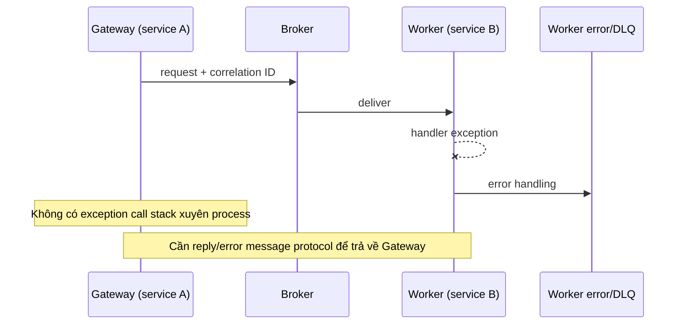

**Nếu muốn caller nhận lỗi từ remote worker**, thiết kế một response message (ví dụ `OrderProcessingReply` với trạng thái) hoặc một error response event, có reply topic/destination, correlation và timeout. Đừng chỉ cấu hình cùng tên `errorChannel` ở cả hai services rồi kỳ vọng hai channel objects kết nối tự động.

## 32. Correlation ID của Gateway khác business correlation

Một order có thể có nhiều requests:

```text
Request A: submit order ORD-101
Request B: get status ORD-101
Request C: retry status check ORD-101
```

Cả ba có thể chia sẻ:

```text
businessCorrelationId = order:shop-01:ORD-101
```

nhưng các Gateway invocations có **request IDs khác nhau**:

```text
REQ-901
REQ-902
REQ-903
```

### Tại sao phải phân biệt?

Nếu hai callers cùng chờ reply và downstream chỉ dùng `orderId` để định tuyến replies, kết quả của request A có thể bị ghép nhầm cho B.

### Header namespaces

| Metadata | Phạm vi |
| --- | --- |
| `requestId` | Một Gateway invocation / logical request |
| `businessCorrelationId` | Toàn workflow/order |
| `MessageHeaders.id` | Một Spring Message instance |
| `replyChannel` | Đích reply tại runtime/boundary hiện tại |
| `errorChannel` | Đích xử lý lỗi theo endpoint/adapter |
| `sourceEventId` | Identity logical event từ producer |
| `idempotencyKey` | Business operation không được lặp |
| `correlationId` của Aggregator | Nhóm child messages ở một Aggregator |

**Đừng dùng một key cho tất cả các mục đích này.**

### Cần giữ correlation xuyên Transformer

Nếu Transformer tạo một Spring Message mới và bỏ `replyChannel`/`errorChannel` nội bộ, Gateway có thể không nhận được reply/error. Nếu cần lưu qua broker, chuyển các **portable protocol fields** như request ID/reply destination được whitelist, không serialize `MessageChannel` object.

## 33. Splitter/Aggregator có thể làm Gateway error handling bị “kẹt”

Gateway gọi xử lý batch:

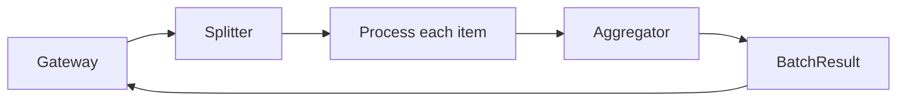

Nếu một child ném lỗi hoặc bị Filter loại:

- Aggregator có thể không có đủ logical parts.
- Error flow có thể nhận exception từ một child.
- Nhưng Gateway vẫn đang chờ `BatchResult` cuối cùng.
- Nếu error handler chỉ log, Gateway có thể timeout.
- Nếu error handler tạo reply sai nhóm/request, một caller khác có thể nhận nhầm result.

### Các hợp đồng batch hợp lý

**Fail-fast:**

```text
Any child invalid -> fail entire batch
                  -> reply BatchFailure to Gateway
                  -> cleanup/cancel group by policy
```

**Aggregate outcomes:**

```text
Each child returns PartOutcome(success|failure)
  -> Aggregator waits N unique outcomes
  -> BatchResult(success/partial/failure)
```

**Asynchronous job:**

```text
Gateway -> ACCEPTED(jobId)
Children processed later
Status store tracks partial/results
```

Không tự giả định `Gateway errorChannel` làm Aggregator release group. Đó là hai EIP có trách nhiệm và vòng đời khác nhau.

### ErrorMessage có thể mất sequence context

Khi lỗi xảy ra trong một child, `failedMessage` có thể cung cấp correlation/sequence headers; nhưng không phải mọi adapter/version sẽ luôn giữ chúng. Một production flow cần explicit group ID, part ID, request ID và policies cho late/missing children.

## 34. Idempotency khi caller retry sau Gateway timeout

Giả sử lần đầu:

```text
Gateway request K
  -> handler commits order
  -> reply lost
  -> Gateway times out
```

Caller retry:

```text
Gateway request K again
  -> without idempotency: duplicate order
  -> with idempotency: load stored result
```

### Chọn key

Một idempotency key ví dụ:

```text
(tenantId, requestId, operationType)
= (shop-01, REQ-901, SUBMIT_ORDER)
```

Nếu `requestId` được tạo **mới mỗi lần HTTP retry**, nó không phù hợp để dedup cùng logical operation. Cần client-stable idempotency key hoặc business operation identity thực.

### Kết quả đã hoàn thành

```text
IdempotencyRecord:
  key=K
  state=COMPLETED
  result=OrderResult(REQ-901, COMPLETED)
```

Khi retry `K` với cùng fingerprint, trả **stored result**. Khi cùng key nhưng amount/order khác, báo conflict thay vì tự ghi operation mới.

### Không coi Gateway error channel là idempotency store

Error channel tiếp nhận/điều phối lỗi; nó không tự lưu completion state, không bảo đảm transaction và không tự ngăn duplicate effects.

## 35. Retry advice và error channel: thứ tự làm thay đổi hành vi

Một pipeline có thể gồm:

```text
Gateway
  -> RequestHandlerRetryAdvice
  -> Service Activator
  -> Gateway error channel (if still failing)
```

Nhưng scope retry phụ thuộc **advice chain** áp dụng quanh endpoint nào.

### Retry trước khi report lỗi

Một policy thường muốn:

1. Service throw transient exception.
2. Retry advice thực hiện tối đa N attempts với backoff.
3. Nếu một attempt thành công, trả `OrderResult`.
4. Nếu hết budget, exception tới Gateway error handling.
5. Error flow trả typed error hoặc cho caller nhận exception.

### Rủi ro retry sau commit

Nếu attempt đầu đã commit DB nhưng response throw/timeout, retry có thể nhân đôi operation. Cần business-side idempotency/transaction unique constraint hoặc reconciliation.

### Rủi ro retry advice + idempotent advice

Thứ tự các advice quyết định selector kiểm tra key ở mỗi retry hay chỉ một lần trước retry inner handler. Một cấu hình claim key trước effect rồi ngăn mọi attempt sau có thể làm operation bị mất nếu attempt đầu thất bại.

**Không cấu hình retry bằng cách bật một annotation rồi coi mọi trạng thái đã an toàn.** Test failure injection ở các điểm trước/sau commit, reply dispatch và broker ACK.

## 36. DLQ/quarantine không thay thế reply cho caller

Một worker có thể đưa message vào Dead Letter Queue sau khi hết retry budget. Đó là một cơ chế xử lý **công việc chưa thành công**, nhưng Gateway đồng bộ vẫn cần hợp đồng trả lời.

```text
Gateway caller:
  submitOrder(REQ-901)

Async worker:
  processing fails
  -> retry exhausted
  -> DLQ

Caller:
  must receive timeout/pending/failure result
  or query status later
```

### DLQ record nên có gì?

- Stable business/request ID.
- Authenticated tenant/source metadata.
- Reason code và exception category.
- Retry count thật, last attempt time.
- Source schema version và raw message reference.
- Idempotency key và processing state reference.
- Correlation/group ID nếu thuộc batch.
- Thông tin người sở hữu việc replay và deadline/SLA.

Không cần lưu nguyên headers chứa credentials, raw payload PII hoặc Java stack trace đầy đủ vào kênh có nhiều consumer truy cập.

### Không retry vô hạn tại error flow

Một poison message có schema sai sẽ tiếp tục lỗi nếu input không đổi. Error channel nên phân loại deterministic input failures và transient infrastructure failures, đặt **bounded retry** và đưa sang quarantine đúng policy.

## 37. Một sơ đồ quyết định cho Gateway error policy

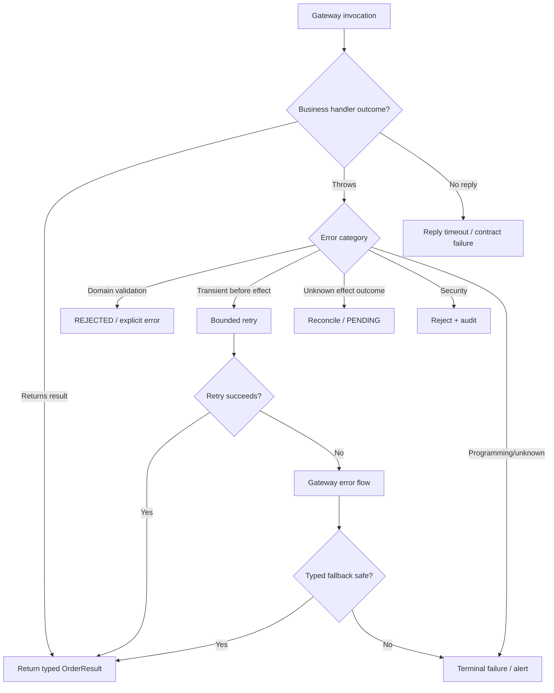

### Checklist nhanh khi chọn error channel

- Có caller đang chờ **business reply** không?
- Error flow có đủ request context để trả đúng caller không?
- Có thể xác định effect **chưa commit** hay outcome unknown?
- Có nên trả typed result hay throw?
- Nếu typed result, có phù hợp Gateway return type không?
- Có async/broker boundary khiến error không tự quay về Gateway không?
- Error channel có subscriber và terminal failure policy không?
- Có tránh recursive error handling và retry storm không?
- Có metrics/reason code để biết nhánh nào thường lỗi không?

## 38. Test nhiều Gateway calls đồng thời: không trả nhầm lỗi

Một hệ thống API thường có nhiều callers gọi cùng Gateway proxy. Khi một số requests thất bại, **error flow phải giữ đúng request identity**.

Ví dụ ba requests cùng mô phỏng dependency outage:

```text
Caller A -> REQ-A -> Error A -> Reply A
Caller B -> REQ-B -> Error B -> Reply B
Caller C -> REQ-C -> Error C -> Reply C
```

Không được có:

```text
Caller A receives result for REQ-C
Caller B receives result for REQ-A
```

### JUnit 5 concurrency test

Đặt method sau vào `OrderGatewayIntegrationTest` của mục 23:

```java
@Test
void concurrentGatewayErrorsPreserveRequestIdentity()
        throws Exception {

    var commands = java.util.List.of(
        new SubmitOrder(
            "shop-01", "DB-DOWN-A", "REQ-A", 100L),
        new SubmitOrder(
            "shop-01", "DB-DOWN-B", "REQ-B", 200L),
        new SubmitOrder(
            "shop-02", "DB-DOWN-C", "REQ-C", 300L)
    );

    var pool = java.util.concurrent.Executors
        .newFixedThreadPool(commands.size());

    var ready = new java.util.concurrent.CountDownLatch(
        commands.size());

    var start = new java.util.concurrent.CountDownLatch(1);

    var futures = new java.util.ArrayList<
        java.util.concurrent.Future<OrderResult>>();

    try {
        for (SubmitOrder command : commands) {
            futures.add(pool.submit(() -> {
                ready.countDown();

                if (!start.await(5,
                        java.util.concurrent.TimeUnit.SECONDS)) {
                    throw new IllegalStateException(
                        "Start gate timeout");
                }

                return gateway.submit(command);
            }));
        }

        assertTrue(ready.await(
            5, java.util.concurrent.TimeUnit.SECONDS));

        start.countDown();

        var replies = new java.util.HashMap<
            String, OrderResult>();

        for (var future : futures) {
            OrderResult reply = future.get(
                5, java.util.concurrent.TimeUnit.SECONDS);

            assertNotNull(reply);

            assertNull(replies.put(
                reply.requestId(), reply));
        }

        assertEquals(
            java.util.Set.of("REQ-A", "REQ-B", "REQ-C"),
            replies.keySet());

        for (OrderResult reply : replies.values()) {
            assertEquals(
                "FAILED_RETRYABLE", reply.status());

            assertEquals(
                "DEPENDENCY_UNAVAILABLE",
                reply.reasonCode());
        }

        assertEquals(
            commands.size(), service.invocationCount());
    } finally {
        start.countDown();
        pool.shutdownNow();
    }
}
```

### Test xác minh những gì?

- Các lời gọi đồng thời không dùng một mutable `currentRequestId` toàn cục.
- Error handler lấy request identity từ message/error context của **từng invocation**.
- Một failure không được trả nhầm cho caller khác.
- Gateway response type nhất quán với `OrderResult`.
- Có chính sách timeout cho test để không treo vô hạn.

### Những gì test không chứng minh

- Inter-process reply correlation qua Kafka/AMQP.
- Persistent idempotency state giữa nhiều pods.
- DB commit/rollback đúng trong trường hợp timeout.
- Thứ tự replies giữa các requests độc lập.
- Error message sống sót qua restart hoặc worker crash.

Đó là các thuộc tính khác và cần test riêng trên production-like infrastructure.

## 39. One-way Gateway không cần reply nhưng vẫn cần error policy

Không phải Gateway nào cũng là synchronous request-reply. Một method có thể chỉ gửi command:

```java
void submitAudit(AuditCommand command);
```

Nếu Gateway được thiết kế one-way, không có `OrderResult` để chờ. Tuy nhiên, điều đó **không có nghĩa lỗi bị bỏ qua**.

### Với dispatch đồng bộ

Nếu Service Activator one-way ném exception trong cùng call stack, caller hoặc error infrastructure có thể nhận lỗi theo cấu hình.

### Với dispatch bất đồng bộ

Gateway có thể đã trả về trước khi handler bắt đầu. Lỗi sau đó cần được ghi vào error flow, DLQ, retry state hoặc operation status store.

### Bảng so sánh

| Gateway contract | Có chờ reply? | Error handling cần gì? |
| --- | --- | --- |
| `OrderResult submit(...)` | Có | Reply đúng type hoặc exception |
| `void submitAudit(...)` | Không có business result | Error channel/observability/ack policy |
| `CompletionStage<OrderResult> ...` | Async reply theo support/API | Completion, timeout, error propagation |
| `String submitAndGetJobId(...)` | Trả acceptance/job ID | Persistent job status và retry |
| Publish command qua broker | Thường one-way | Broker ACK + consumer DLQ, không đồng nghĩa effect success |

**Đừng gắn success semantics vào một `void` method** nếu caller thực sự cần biết operation đã commit.

## 40. Gateway error channel khác inbound HTTP error handling

Một HTTP Inbound Gateway có thể nhận request từ bên ngoài rồi tạo Spring Message nội bộ. Một annotated `@MessagingGateway` là **Java interface proxy** cho code trong ứng dụng. Chúng có liên hệ nhưng không phải cùng một endpoint.

```text
HTTP Client
    |
    v
HTTP Inbound Gateway / REST Controller
    |
    v
Java @MessagingGateway proxy
    |
    v
IntegrationFlow
    |
    v
Service Activator
```

### Lỗi có thể xuất hiện ở những boundary nào?

- HTTP parse/authentication **trước** khi gọi Java Gateway.
- Java Gateway dispatch/request/reply.
- Transformer/Router/Filter/Service Activator trong flow.
- External DB/API.
- Error flow của Gateway.
- HTTP response serialization **sau** Gateway.

### Vì sao phân biệt quan trọng?

Một exception JSON parse tại HTTP controller **không nhất thiết** đi qua `@MessagingGateway(errorChannel=...)` nếu Java Gateway chưa được gọi.

Tương tự, Gateway trả một `OrderResult` thành công nhưng HTTP response converter ném lỗi khi serialize, thì error channel của Gateway không thể tự sửa lỗi ở lớp HTTP phía sau.

### HTTP response mapping

Nếu chọn typed result, API boundary có thể map:

| `OrderResult` status | HTTP outcome minh họa |
| --- | --- |
| `COMPLETED` | 200/201 tùy contract |
| `REJECTED / INVALID_AMOUNT` | 400 hoặc 422 tùy API |
| `FAILED_RETRYABLE` | 503 hoặc trạng thái operation riêng |
| `PENDING_RECONCILIATION` | 202 + operation ID nếu hỗ trợ |
| `UNKNOWN/SECURITY` | 401/403/5xx tùy failure và trust policy |

Đây là **ví dụ về application contract**, không phải status codes mà Spring Integration tự ánh xạ chỉ từ `OrderResult.status()`.

## 41. ErrorMessage và bảo mật thông tin

Một ErrorMessage có thể chứa:

- Exception message từ DB/API.
- Failed message payload.
- Original Spring Message headers.
- Request ID, tenant, correlation.
- Thông tin nội bộ của application server.
- Đôi khi có dữ liệu nhạy cảm nếu ứng dụng đưa vào payload/headers.

### Những thứ không nên đưa vào reply cho caller

- Raw SQL query hoặc credentials.
- Access tokens, cookies, authorization header.
- Internal connection strings.
- Toàn bộ stack trace.
- Payload của tenant khác.
- Spring `MessageChannel` object hoặc internal topology.
- Metadata chứa implementation details không thuộc API contract.

### Thiết kế error response

Một public response nên có reason code ổn định:

```json
{
  "requestId": "REQ-903",
  "status": "FAILED_RETRYABLE",
  "reasonCode": "DEPENDENCY_UNAVAILABLE"
}
```

Còn logs/traces nội bộ có thể chứa error class, sanitized cause, operation stage và reference tới dữ liệu gốc trong storage được bảo vệ.

### Tenant validation và error context

Không dùng `tenantId` từ failed message như một bằng chứng đã xác thực. Nếu error handler quyết định có tiết lộ resource existence hay không, nó cần authenticated principal/context được bảo tồn đúng. Thiếu trusted context thì nên trả thông báo an toàn, không đoán quyền dựa trên untrusted payload.

## 42. Tránh mất lỗi khi errorChannel không có subscriber

Nếu một Gateway trỏ tới `orderGatewayErrors` nhưng channel không có handler:

```text
Gateway sends ErrorMessage to orderGatewayErrors
    |
    v
No subscriber / no processing endpoint
    |
    v
Error routing failure or no mapped reply
```

Cần kiểm tra:

- Bean channel name đúng chính tả.
- Error flow thực sự được register vào context.
- Với `DirectChannel`, subscriber có tồn tại.
- Không có hai handlers cạnh tranh trên cùng channel khi mong cả hai cùng nhận event.
- Error handler trả đúng reply type nếu cần.
- Không dùng một `QueueChannel` mà không có consumer khiến lỗi nằm mãi trong queue.
- Không chỉ ghi log mà bỏ quên request completion.
- Startup health/test có phát hiện thiếu wiring không.

### Một test cấu hình có ích

```java
// Contract integration test outline:
@Test
void errorFlowIsRegisteredAndCanReturnTypedResult() {
    OrderResult actual = gateway.submit(
        new SubmitOrder(
            "shop-01", "DB-DOWN-999",
            "REQ-999", 1L));

    assertNotNull(actual);
    assertEquals(
        "FAILED_RETRYABLE", actual.status());
}
```

Nó không cần đọc private channel internals mà kiểm tra **hành vi đầu cuối**. Nếu error handler không được gọi hoặc không route đúng, test sẽ thất bại.

## 43. Error channel dùng chung hay theo từng Gateway?

Giả sử ứng dụng có ba Gateways:

```text
OrderGateway
PaymentGateway
ShipmentGateway
```

### Một error channel chung

```text
sharedGatewayErrors
  -> classify error
  -> resolve request type
  -> map to proper result
```

Ưu điểm: dễ tập trung metrics, rate limiting và common error policy.

Nhược điểm: phải phân biệt request/result types, exception taxonomy và reply routing; wrong-type reply dễ gây lỗi.

### Error channel riêng theo bounded context

```text
orderGatewayErrors
paymentGatewayErrors
shipmentGatewayErrors
```

Ưu điểm:

- Typed error handlers rõ ràng.
- Tránh mapping sai `OrderResult` sang Gateway mong `PaymentResult`.
- Có thể đặt retry/reconciliation policy theo domain.
- Dễ cô lập lỗi của một subsystem.

Nhược điểm: cần giữ common infrastructure code để tránh lặp behavior và metrics.

### Khuyến nghị thực dụng

Đối với application có nhiều Gateway với return types khác nhau, cân nhắc **tách error channels theo domain/protocol** nhưng dùng chung helpers cho exception classification, sanitized logging và correlation extraction.

Không gom hết vào một handler khổng lồ chỉ để có “một nơi xử lý mọi lỗi”.

## 44. Gateway error channel và transaction boundary

Đây là phần rất dễ hiểu sai trong hệ thống nghiệp vụ có DB.

### Crash trước DB transaction commit

```text
Receive request
Begin DB transaction
Write business data
Exception
Rollback
Error channel receives failure
```

Nếu chắc chắn rollback, retry có thể được phép theo policy.

### Crash sau DB commit nhưng trước reply

```text
Receive request
Write business data
Commit
Exception / network error before reply
Gateway sees failure or timeout
```

Lúc này trả `FAILED_RETRYABLE` rồi caller retry không có idempotency có thể tạo duplicate effect.

### Một ví dụ transaction cùng DB

```text
BEGIN
  INSERT orders (...) ON CONFLICT (...) DO NOTHING
  INSERT idempotency_record (...)
  INSERT outbox_event (...)
COMMIT
```

Các write cần được thiết kế với unique business constraints, isolation, row-count checks và transaction boundary đúng. Đây là **mô hình minh họa**, không phải SQL độc lập đủ chạy production.

### External side effect

Nếu handler gọi API thanh toán bên ngoài:

- Timeout không chứng minh API chưa capture.
- Error channel có thể nhìn thấy `IOException` nhưng không biết outcome.
- Cần provider idempotency key và reconciliation.
- Có thể cần state `UNKNOWN_OUTCOME`/`PENDING_REVIEW` thay vì `FAILED_RETRYABLE`.

**Không để error mapper quyết định replay chỉ dựa trên tên exception** khi side effect có thể đã commit.

## 45. Observability: error channel cần đo cả phần mất reply

Một hệ thống chỉ đếm `gateway.error.messages` có thể bỏ sót các tình huống **không tạo ErrorMessage**:

- Filter drop message.
- Void handler thành công nhưng Gateway đang chờ.
- Router không chọn route và cấu hình discard.
- Late reply sau timeout.
- Error flow trả `null`.
- Reply channel bị cấu hình sai.

### Metrics đề xuất

| Metric | Ý nghĩa |
| --- | --- |
| `gateway.requests.received` | Tổng Gateway invocations |
| `gateway.requests.completed` | Số calls có typed result |
| `gateway.requests.failed` | Calls kết thúc bằng exception |
| `gateway.error.messages` | Số ErrorMessages vào error flow |
| `gateway.error.mapped` | Lỗi đã được map thành typed result |
| `gateway.error.unexpected` | Lỗi không thuộc allowlist |
| `gateway.error.no_context` | ErrorMessage thiếu request context |
| `gateway.request.send_timeout` | Gửi request không thành công theo timeout |
| `gateway.reply.timeout` | Gateway không nhận reply đúng hạn |
| `gateway.reply.late` | Reply đến sau caller deadline |
| `gateway.reply.wrong_type` | Reply không phù hợp method return type |
| `gateway.router.unresolved` | Message không có route được yêu cầu |
| `gateway.filter.discarded` | Message bị Filter loại |
| `gateway.retries.attempted` | Retry count thật |
| `gateway.idempotency.duplicates` | Logical duplicate bị nhận diện |
| `gateway.error.dlq_backlog` | Lỗi cần xử lý sau |
| `gateway.error_handler.failures` | Chính error flow thất bại |

Tên metrics là **đề xuất application-level**, không mặc định Spring Integration phát nguyên tất cả.

### Logs có cấu trúc

```text
stage=GATEWAY_REQUESTED
gateway=OrderGateway
requestId=REQ-903
tenant=shop-01

stage=BUSINESS_HANDLER_FAILED
gateway=OrderGateway
requestId=REQ-903
errorCategory=DEPENDENCY_UNAVAILABLE
outcome=NOT_COMMITTED_KNOWN_IN_DEMO

stage=GATEWAY_ERROR_MAPPED
requestId=REQ-903
returnStatus=FAILED_RETRYABLE
reasonCode=DEPENDENCY_UNAVAILABLE
```

Với DB/network thật, không ghi `NOT_COMMITTED_KNOWN` trừ khi có transaction evidence. Dùng `UNKNOWN_OUTCOME` khi không thể xác minh.

### Cardinality và privacy

Không đặt `requestId`, `orderId`, raw tenant tokens hoặc exception message làm metrics labels có cardinality cao. Dùng structured logs/traces có access control, retention và sanitization.

## 46. Troubleshooting: vì sao Gateway error channel không hoạt động?

Khi báo cáo “Gateway bị timeout dù đã khai báo errorChannel”, điều tra theo thứ tự:

1. Gateway interface có thật sự được scan/register thành proxy không?
2. Method Gateway đang gọi request channel nào?
3. Request đã đến handler chưa, hay Filter/Router drop trước đó?
4. Channel đang là DirectChannel, ExecutorChannel, QueueChannel hay broker?
5. Lỗi có thực sự là exception hay chỉ là **no reply**?
6. Exception có xảy ra trong thread Gateway hay sau một async boundary?
7. Error channel được cấu hình tại Gateway, adapter hay message header?
8. Error channel có bean/subscriber và tên đúng không?
9. ErrorMessage có được tạo, và payload throwable type nào?
10. `getFailedMessage()/getOriginalMessage()` có còn command/correlation không?
11. Error handler có trả reply hay là `void` logger?
12. Reply type có phù hợp Gateway Java return type không?
13. Có fixed outputChannel đánh cắp normal/error reply route không?
14. Gateway đã timeout trước khi error handler trả chưa?
15. Late reply có bị gán nhầm caller khác không?
16. `requiresReply` có bật ở đúng endpoint không?
17. Retry advice có đang giữ exception đến khi hết retry budget không?
18. Side effect có thể đã commit trước lỗi không?
19. Có conflict/duplicate idempotency key khi caller retry không?
20. Có metric/trace cho gateway, business, error mapping và outbound reply không?

### Decision tree

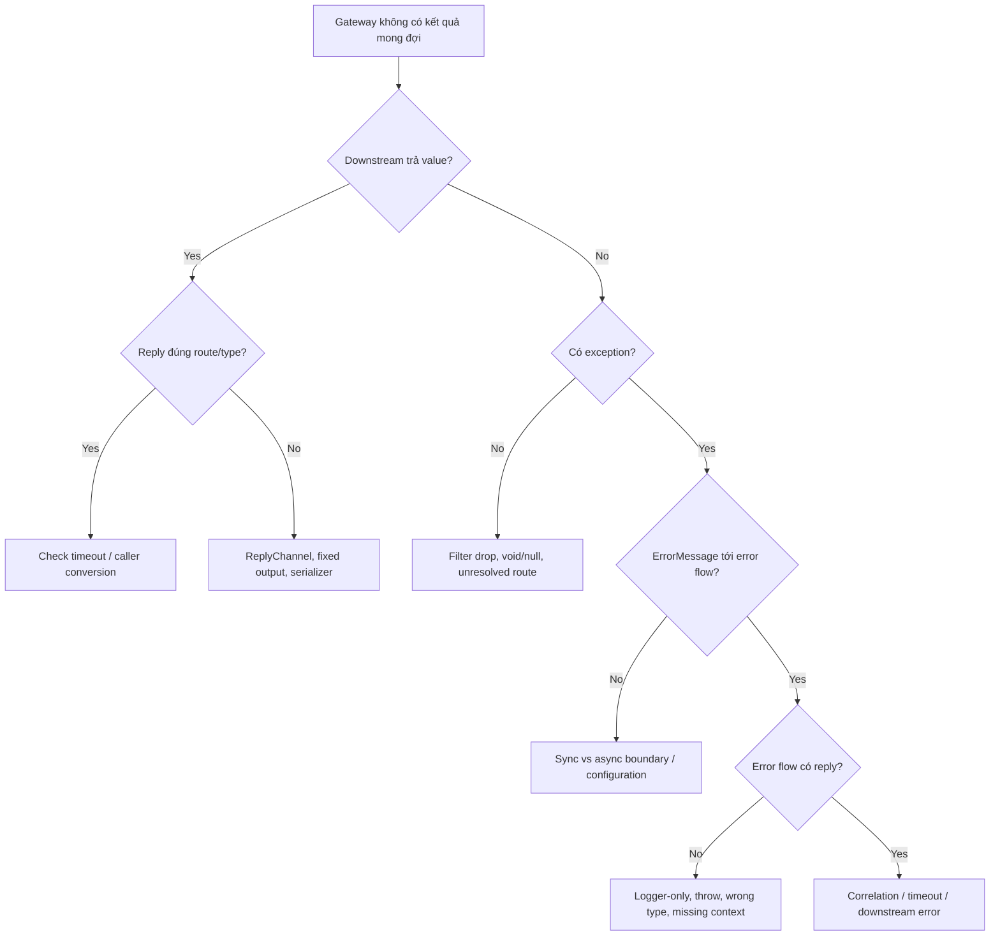

### Debug theo phase, không theo cảm giác

Đừng chỉ thêm `Thread.sleep(...)` vào integration test hoặc tăng timeout lên 60 giây. Điều đó có thể che lỗi wiring và tạo API latency lớn. Hãy đo từng event: request accepted, handler invoked, error routed, result produced, reply dispatched và caller completed.

## 47. Anti-patterns thường gặp

### 47.1. Coi `errorChannel` là nơi mọi exception tự xuất hiện

Lỗi đồng bộ, lỗi async, lỗi HTTP parse, lỗi trong worker khác process có boundary khác nhau.

### 47.2. Chỉ ghi log trong error flow nhưng Gateway cần OrderResult

Logger `void` không tạo reply. Caller có thể timeout hoặc nhận error/no-result.

### 47.3. Coi `ErrorMessage` là Java return value của Gateway

Gateway method cần type theo contract; ErrorMessage là integration infrastructure message.

### 47.4. Trả `"FAILED"` cho method khai báo `OrderResult`

Wrong reply type có thể gây converter/cast failure.

### 47.5. Bắt tất cả exception và trả `FAILED_RETRYABLE`

Bug, security và unknown transaction outcome bị che; retry storm hoặc duplicate effect.

### 47.6. Timeout nghĩa là transaction rollback

Sai. Handler có thể commit rồi reply mất. Cần idempotency/result lookup.

### 47.7. Dùng businessCorrelationId để trả reply cho mọi caller

Nhiều requests của cùng order cần request/reply correlation riêng.

### 47.8. Copy `replyChannel` Java object qua Kafka/HTTP

Channel object không portable qua JVM/process/restart.

### 47.9. Error handler assume `getFailedMessage()` luôn non-null

Nhiều error origins không có request payload. Null-safe classification là bắt buộc.

### 47.10. Retry trực tiếp sau lỗi external API outcome unknown

Có thể nhân đôi thanh toán. Reconcile hoặc dùng provider idempotency key.

### 47.11. Filter drop nhưng chờ error channel

Không có exception thì không tự có ErrorMessage. Cần explicit rejection result.

### 47.12. Bật `requiresReply` cho mọi void endpoint

Một one-way handler hợp lệ trở thành lỗi. Constraint phải đúng contract.

### 47.13. Dùng error channel như một global DLQ không consumer

Không có terminal handler/replay policy, lỗi tích tụ hoặc mất dấu.

### 47.14. Gửi error-handler exception lại vào cùng error channel vô hạn

Recursive errors tạo overload và che original failure. Có terminal failure path.

### 47.15. Một test Gateway success rồi kết luận error path đúng

Phải có test service throw, error mapper, correlation, timeout và negative cases.

### 47.16. Dùng `MessageHeaders.id` làm idempotency key

Redelivery có thể tạo Message ID mới; dùng logical business operation ID.

### 47.17. Coi `FAILED_RETRYABLE` là business result đã xác minh rollback

Khi outcome unknown, trạng thái này có thể sai. Cần policy riêng.

### 47.18. Không kiểm thử nhiều calls đồng thời

Error response có thể bị gán sai request nếu correlation/temporary channel bị xử lý sai.

## 48. Bài thực hành: Gateway error channel từ đơn giản đến production

### Phần A — Xây hợp đồng request/reply

1. Tạo `SubmitOrder` với tenant, orderId, requestId và amount.
2. Tạo `OrderResult` với trạng thái `COMPLETED/REJECTED/FAILED_RETRYABLE`.
3. Tạo `OrderApplicationService.process` để trả result hợp lệ.
4. Thêm nhánh amount âm → `REJECTED`, không ném lỗi.
5. Thêm nhánh `DB-DOWN-` để ném `DependencyUnavailableException`.
6. Cấu hình `@MessagingGateway(defaultRequestChannel="orderRequests")`.
7. Test Gateway success và domain rejection.

### Phần B — Gateway error flow

8. Cấu hình `errorChannel="orderGatewayErrors"`.
9. Tạo `DirectChannel` và `IntegrationFlow.from("orderGatewayErrors")`.
10. Tạo `GatewayErrorMapper.toResult(ErrorMessage)`.
11. Phân loại exception qua cause chain.
12. Lấy requestId từ failed/original message khi có.
13. Chỉ map dependency outage đã biết sang typed failure.
14. Test error mapper bằng ErrorMessage tự tạo.
15. Test thiếu failed message gây explicit error.
16. Test unexpected exception không bị nhầm là retryable.
17. Test Gateway exception path qua IntegrationFlow.
18. Nếu test không đạt, điều tra reply route và API version.

### Phần C — Missing reply / timeout / correlation

19. Thêm một error handler chỉ log rồi trả `void`.
20. Chứng minh Gateway không tự có `OrderResult`.
21. Thử handler return `null` và `requiresReply`.
22. Tạo Filter discard message không throw.
23. So sánh missing reply với handler exception.
24. Thử reply timeout có giới hạn và late reply.
25. Tạo hai Gateway requests cùng order nhưng request IDs khác.
26. Test nhiều Gateway calls đồng thời không tráo kết quả.
27. Đưa request qua ExecutorChannel rồi kiểm tra async error routing.
28. Nếu dùng broker, tạo explicit reply topic/ID protocol.

### Phần D — Retry và production reliability

29. Thêm local retry policy có bounded attempts/backoff.
30. Kiểm thử lỗi transient thành công ở lần retry thứ hai.
31. Kiểm thử hết budget và error flow tạo typed result.
32. Giả lập DB commit thành công nhưng reply bị mất.
33. Retry cùng idempotency key, assert không nhân đôi order.
34. Dùng unique constraint hoặc persisted operation record.
35. Giả lập external API timeout với unknown outcome; reconcile.
36. Thiết kế DLQ có requestId, reasonCode, tenant reference và owner.
37. Test batch Splitter/Aggregator có child failure.
38. Thiết kế result `PENDING_RECONCILIATION` khi cần.
39. Đo metrics cho gateway timeout, error mapped, late replies.
40. Viết runbook phân biệt no-reply, synchronous exception và async error.

### Bảng kết quả chấp nhận

| Trường hợp | Kỳ vọng |
| --- | --- |
| SubmitOrder hợp lệ | `OrderResult(COMPLETED)` |
| Amount âm | `OrderResult(REJECTED, INVALID_AMOUNT)` |
| Dependency outage đã biết, error flow map thành công | Typed failure result đúng requestId |
| ErrorMessage không có request context | Không tự tạo request ID giả |
| Exception không thuộc allowlist | Terminal error/alert |
| Logger-only error flow | Không tự tạo reply |
| Filter drop không exception | Không tự tạo ErrorMessage |
| Handler trả `null` + requiresReply | Reply-required failure |
| Gateway reply timeout | Không tự chứng minh rollback |
| Async handler throw | Async error route theo cấu hình, không chắc cùng call stack |
| Hai calls cùng order ID | Reply theo request identity riêng |
| Ba calls thất bại đồng thời | Không trả nhầm requestId |
| Worker khác process throw | Không tự quay về Gateway Java proxy |
| Caller retry sau commit | Không thêm duplicate effect |
| Unknown external outcome | Reconcile, không retry mù |
| DLQ nhận poison message | Có failure record, không thay reply |
| Error flow throw tiếp | Terminal policy, không recursive loop |

## 49. Câu hỏi tự đánh giá

**Câu 1.** Gateway error channel có phải là reply channel không?

*Không. Error channel là đường xử lý lỗi; reply channel là nơi caller nhận normal reply. Error flow có thể tạo typed reply nếu được nối đúng vào Gateway reply path.*

**Câu 2.** `ErrorMessage` mang payload gì?

*Throwable, thường có thể là MessagingException; failed/original message có thể có nhưng không được giả định luôn hiện diện.*

**Câu 3.** Nếu Filter drop request mà không throw, Gateway error channel có tự nhận lỗi không?

*Không. Không có throwable hoặc error signal được tạo tự động; caller có thể chờ reply đến timeout.*

**Câu 4.** Tại sao error handler trả `void` không đáp ứng method `OrderResult submit(...)`?

*Vì void không tạo OrderResult reply. Cần một reply-producing handler hoặc exception contract.*

**Câu 5.** Domain rejection có bắt buộc đi qua error channel không?

*Không. Một validation rejection có thể là normal typed business result, miễn là contract rõ.*

**Câu 6.** Gateway reply timeout có chứng minh DB chưa commit không?

*Không. Timeout chỉ cho thấy caller không nhận reply trong khoảng chờ; effect có thể đã commit.*

**Câu 7.** Tại sao không trả `FAILED_RETRYABLE` cho tất cả exceptions?

*Vì lỗi security, bug và unknown outcome có policies khác; retry mù có thể che lỗi và nhân đôi side effects.*

**Câu 8.** Gateway error channel có bắt được exception từ worker trên pod khác không?

*Không tự động. Cần error reply protocol, destination, request ID và correlation xuyên broker.*

**Câu 9.** RequestId và businessCorrelationId khác nhau như thế nào?

*RequestId định danh một invocation; businessCorrelationId liên kết toàn workflow. Nhiều requests của cùng order có thể chia sẻ businessCorrelationId.*

**Câu 10.** `requiresReply` giải quyết điều gì?

*Biến việc thiếu normal reply ở endpoint bắt buộc trả kết quả thành một failure sớm; nó không tự tạo reply.*

**Câu 11.** Nếu ErrorMessage không có failedMessage thì làm gì?

*Không ép kiểu mù; tìm original context có kiểm soát hoặc dùng một terminal error policy, tránh tạo reply gắn sai request.*

**Câu 12.** Error flow trả wrong payload type gây ra điều gì?

*Gateway method có thể gặp conversion/cast failure; các nhánh cần trả type đúng hoặc chủ động throw.*

**Câu 13.** Vì sao cần thử hai Gateway calls đồng thời?

*Để phát hiện trộn request identity/reply destination hoặc state mutable dùng chung.*

**Câu 14.** Khi một child trong Splitter lỗi, Gateway error channel có tự làm Aggregator release không?

*Không. Aggregator có group/release policy riêng; phải fail batch hoặc trả per-part outcomes theo contract.*

**Câu 15.** DLQ có phải là reply cho Gateway caller không?

*Không. DLQ dành cho lưu lỗi và phục hồi; caller vẫn cần trạng thái/trả lời theo API contract.*

**Câu 16.** Làm thế nào an toàn hơn khi caller retry sau timeout?

*Dùng một idempotency key ổn định, business uniqueness, stored result và reconciliation khi outcome chưa rõ.*

## 50. Checklist triển khai production

- **Gateway contract:** biết method là one-way hay request-reply và return type là gì.
- **Request channel:** kiểm tra wiring, dispatch semantics và send timeout.
- **Reply channel:** không xung đột fixed output với temporary Gateway reply.
- **Error channel:** cấu hình đúng scope, có subscriber và error flow.
- **Exception taxonomy:** domain, security, transient, uncertain outcome và programming error.
- **ErrorMessage:** đọc cause chain, failedMessage và originalMessage null-safe.
- **Typed mapping:** error flow trả đúng Gateway return type hoặc throw rõ ràng.
- **No-reply:** Filter/Router/void/null được xử lý theo contract, không chỉ kéo dài timeout.
- **requiresReply:** dùng ở đúng endpoint, không áp lên legitimate one-way handlers.
- **Timeouts:** request send, reply và external I/O được phân biệt.
- **Async:** lỗi sau ExecutorChannel/broker có route riêng và late reply policy.
- **Cross-process:** request/reply protocol có portable correlation, không serialize MessageChannel.
- **Idempotency:** stable business key và persisted completion state khi có side effects.
- **Transactions:** biết commit/rollback/unknown outcome trước khi cho retry.
- **Retry:** bounded, backoff, advice order và error handling sau exhausted attempts.
- **DLQ:** reason codes, ownership, retention, replay policy và access control.
- **Splitter/Aggregator:** group completion/failure outcome tách khỏi Gateway error routing.
- **Router/Filter:** unknown route và discard policy không gây timeout vô nghĩa.
- **Security:** không log raw exception/credentials, không tin tenant chưa xác thực.
- **Observability:** đo request, typed reply, error mapped, unexpected, timeout và late reply.
- **Concurrency:** tests không gán nhầm request IDs khi nhiều callers cùng chờ.
- **QA:** unit service/error mapper, integration Gateway/error flow, async/broker/DB fault injection.
- **Version:** xác minh API `@MessagingGateway` và Java DSL theo dependency thực tế.
- **Runbook:** có quyết định fail-fast/retry/reconcile cho từng error category.

## 51. Kết luận

**Gateway error channel** là một cơ chế quan trọng để tổ chức nhánh lỗi của Messaging Gateway trong Spring Integration, nhưng phải hiểu đúng vai trò: nó giúp đưa lỗi vào **một error-handling flow có cấu hình**, chứ **không tự biến mọi exception thành business reply**, không tự bắt các lỗi nằm ngoài scope của Gateway và không thay thế transaction, idempotency hay recovery.

Một thiết kế tốt phân biệt **normal typed result**, **business rejection**, **technical exception**, **no reply**, **Gateway timeout** và **lỗi bất đồng bộ**. Với `@MessagingGateway(errorChannel="...")`, có thể xây error flow nhận `ErrorMessage`, phân loại Throwable và trả `OrderResult` khi an toàn — miễn là reply context được giữ đúng và các integration tests xác nhận hành vi trên phiên bản Spring Integration đang dùng.

Khi áp dụng cùng Router, Filter, Splitter, Aggregator, Service Activator, retry và error channel, hãy kiểm thử cả **đường thành công lẫn từng nhánh thất bại**, đặc biệt lỗi sau commit, late reply và concurrent callers. Những điều đó giúp Gateway trở thành ranh giới request/reply có thể dự đoán, dễ theo dõi, và giảm rủi ro “caller tưởng thất bại nhưng backend đã xử lý” trong các hệ thống EIP.
