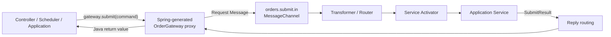
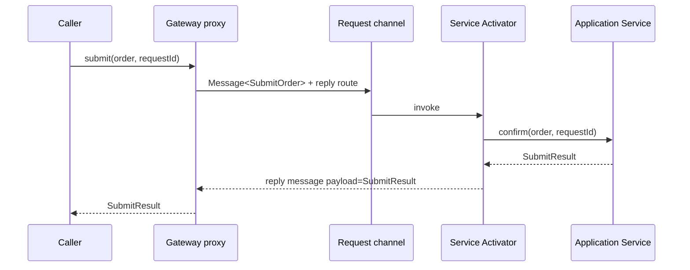
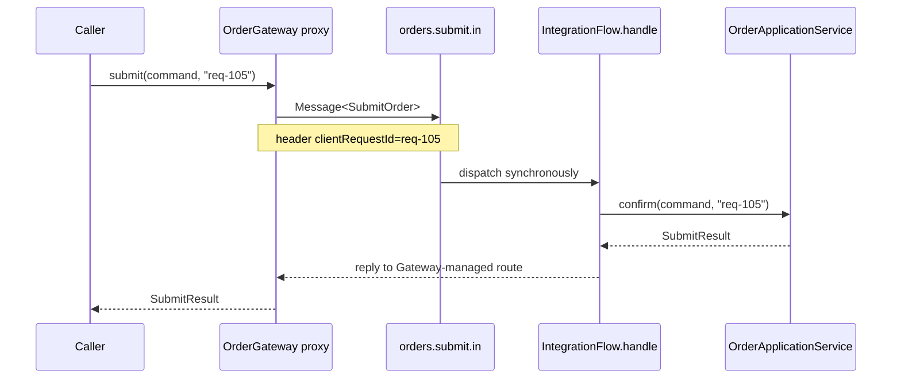
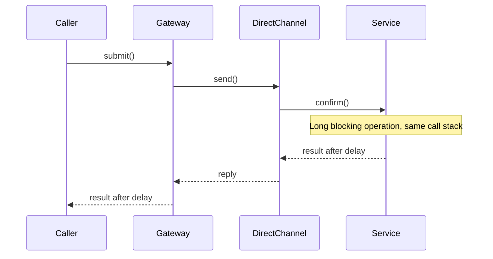
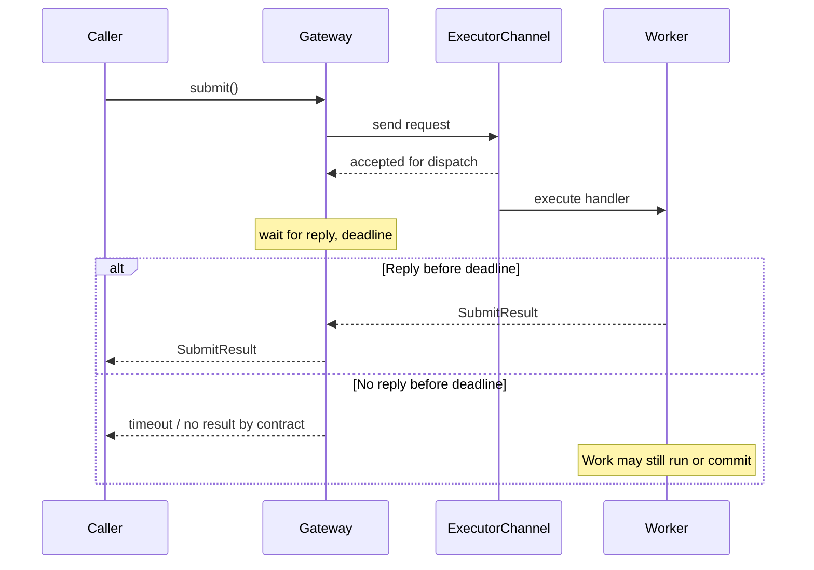
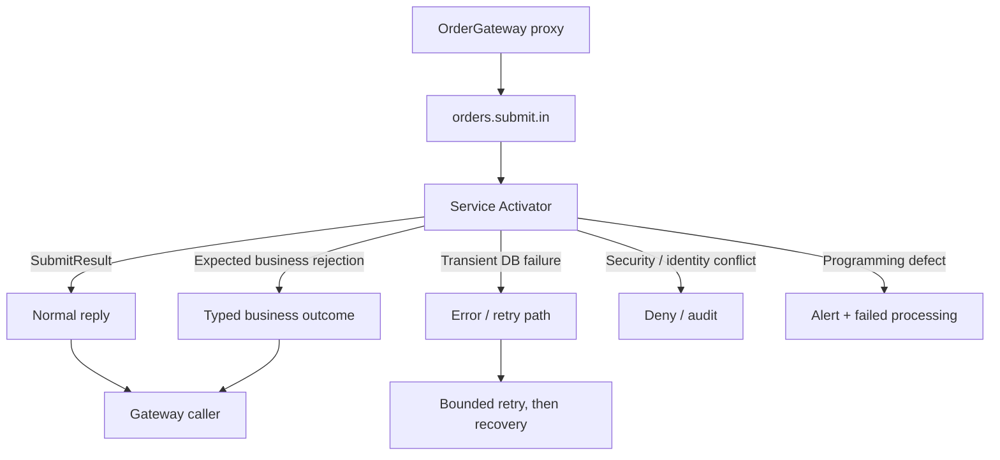
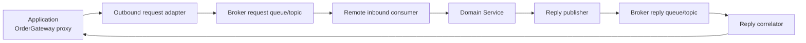
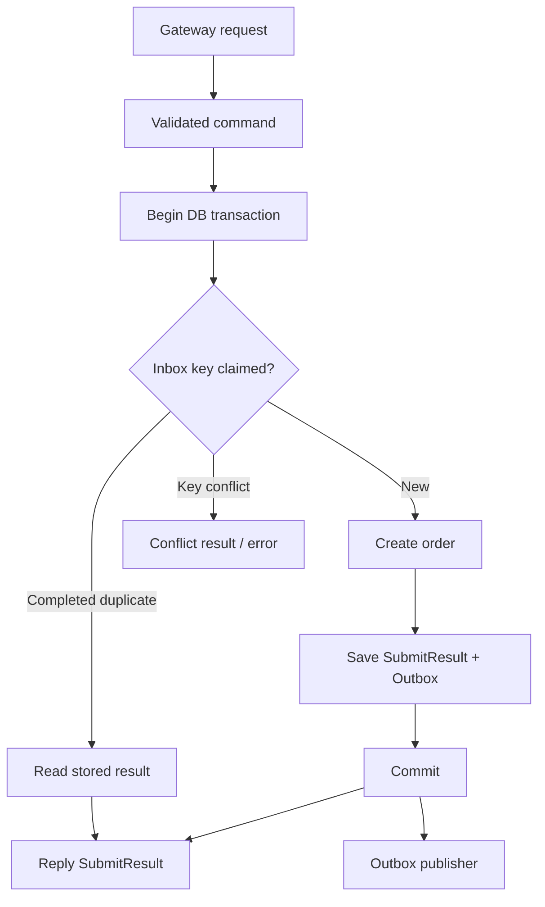
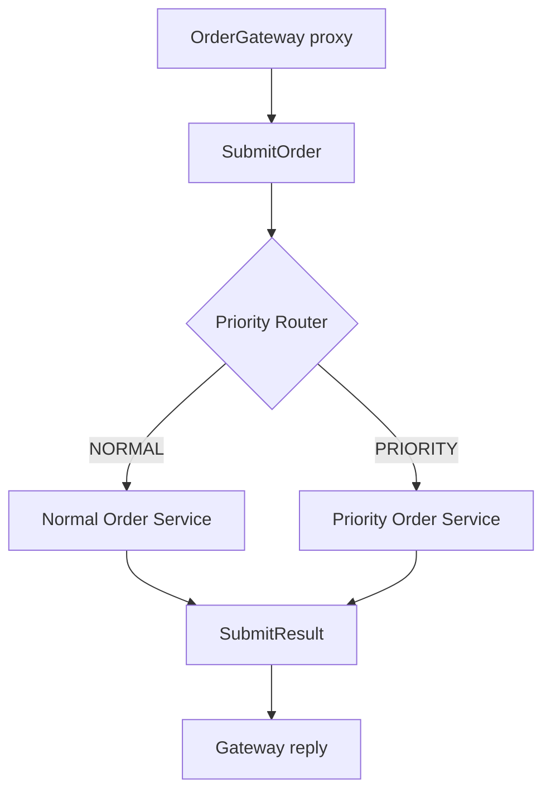
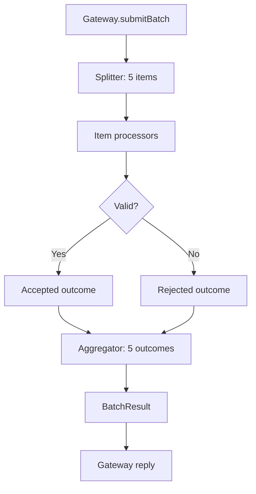

# Gateway với interface proxy

## 1. Vì sao cần một Gateway thay vì gọi MessageChannel trực tiếp?

Giả sử module đặt hàng cung cấp một use case cho tầng ứng dụng: gửi yêu cầu đặt hàng và nhận mã xác nhận. Bên trong hệ thống, logic này chạy qua các endpoint của Spring Integration: Transformer chuẩn hóa dữ liệu, Filter kiểm tra đầu vào, Service Activator gọi ứng dụng, và một nhánh trả kết quả.

Nếu mọi caller đều phải thao tác trực tiếp với `MessageChannel`, chúng sẽ phải biết tên kênh, cấu trúc `Message<?>`, `replyChannel`, xử lý timeout và cách lấy payload từ reply:

```java
// Cách gọi ở mức messaging hạ tầng; không nên lan ra mọi caller.
Message<SubmitOrder> message = MessageBuilder
        .withPayload(command)
        .setHeader("clientRequestId", "req-105")
        .build();
requests.send(message);
// Chưa có contract trả SubmitResult cho caller ở đây.
```

Cách sử dụng thuận tiện hơn:

```java
SubmitResult result = orderGateway.submit(
        new SubmitOrder("tenant-a", "evt-105", "ORD-105", 2),
        "req-105");
```

`orderGateway` nhìn như một Java interface thông thường. Tuy nhiên, Spring Integration tạo **proxy** cho interface đó: mỗi lời gọi method được chuyển thành một message request, gửi vào integration flow, rồi chuyển reply thành giá trị trả về.

**Messaging Gateway** là Enterprise Integration Pattern (EIP) cung cấp lối vào bằng API quen thuộc cho code ứng dụng, trong khi chi tiết messaging được che ở phía sau. Bài **“Gateway với interface proxy”** thuộc chương **Messaging gateway** của module **SPRING_INTEGRATION_PATTERN** — học triển khai Enterprise Integration Patterns bằng Spring Integration để tạo luồng thông điệp ít phụ thuộc, dễ mở rộng, kết hợp Router, Filter, Transformer, Splitter, Aggregator, Gateway, retry, error channel, correlation, kiểm thử và theo dõi các nhánh xử lý.



**Cốt lõi:** interface proxy là **adapter giao tiếp**, không phải một phép gọi RPC qua mạng mặc định và không tự tạo transaction, retry, durability hoặc exactly-once. Những đặc tính đó phụ thuộc các channel, endpoint và adapter mà Gateway được nối vào.

## 2. Phân biệt interface Gateway, proxy, channel và service

Một Gateway ứng dụng có bốn lớp trách nhiệm:

| Thành phần | Định nghĩa | Ai quản lý? |
| --- | --- | --- |
| **Gateway interface** | Các method mà caller được phép gọi | Nhóm thiết kế API |
| **Gateway proxy** | Object runtime biến method invocation thành request/reply messages | Spring Integration |
| **Message channel & integration flow** | Định tuyến request, chạy Transformer/Router/handler | Spring Integration |
| **Application/domain service** | Kiểm tra nghiệp vụ, transaction và side effect | Ứng dụng |

Ví dụ:
- `OrderGateway.submit(command, clientRequestId)` là API của caller.
- `orders.submit.in` là channel nhận message do proxy tạo.
- `.handle(...)` hoặc `@ServiceActivator` biến payload thành lời gọi service.
- `OrderApplicationService.confirm(...)` là method nghiệp vụ không cần import Spring Messaging.

### 2.1. Proxy là gì trong trường hợp này?

Với Java interface, Spring có thể tạo một object động thực hiện hợp đồng interface ở runtime. Caller có thể injection bằng chính kiểu interface, không viết class `implements OrderGateway` để xây message thủ công.

```text
Java caller                         Spring IoC context
    |                                     |
    | @Autowired OrderGateway             |
    |------------------------------------>|
    |                                     |
    |                        Gateway proxy bean
    |                                     |
    | gateway.submit(...)                |
    |------------------------------------>|
    |         request channel, reply      |
    |<------------------------------------|
    |        SubmitResult                 |
```

Khác với một service implementation thông thường, proxy không thực thi logic đặt hàng ngay trong body của interface method; nó gửi message đến flow đã cấu hình. Vì vậy việc interface tồn tại trong classpath **chưa đủ**: Spring phải đăng ký proxy bean và tìm được request channel cùng subscriber phù hợp.

### 2.2. Messaging Gateway khác Service Activator

- **Gateway:** Cửa vào từ lời gọi Java method đến messaging flow.
- **Service Activator:** Cửa nối từ messaging flow đến một method ứng dụng.

Chúng thường đi thành cặp nhưng đứng ở **hai phía khác nhau**:

```text
Caller --Java API--> Gateway --Message--> Channel/Flow
                                          |
                                          v
                                    Service Activator
                                          |
                                     Java service
                                          |
                        reply Message <--+-- return value
                                          |
Caller <--Java return value-- Gateway <--+
```

Không viết toàn bộ logic nghiệp vụ trong Gateway proxy. Nếu cần authorization, deduplication, business validation và transaction, hãy đặt chúng ở boundary/service thích hợp.

### 2.3. Messaging Gateway khác HTTP API Gateway

Tên “gateway” không nhất thiết nói về một reverse proxy, load balancer, cloud API Gateway hay REST endpoint. Trong bài này, Spring Integration Gateway là **Java method interface** mở ra một integration flow. Nó có thể giao tiếp với HTTP, JMS, Kafka hay hệ thống ngoài ở phía sau, nhưng bản thân interface proxy không tự chọn transport.

### 2.4. Một interface có thể biểu diễn nhiều use cases

Có thể khai báo các method trả kết quả, method không cần reply hoặc method hướng đến những request channels khác nhau. Nhưng hãy thiết kế rõ **semantics của từng method**, tránh đặt quá nhiều use cases không liên quan trong một “god gateway”.

## 3. Request–reply: điều gì xảy ra khi gọi interface method?

Giả sử caller gọi:

```java
SubmitResult receipt = gateway.submit(order, "req-105");
```

Một Gateway đồng bộ với request–reply hoạt động về mặt khái niệm như sau:

1. Chọn Gateway method mapping.
2. Tạo Spring `Message<?>` có payload là `order`.
3. Ánh xạ tham số method, ví dụ `clientRequestId`, vào headers được khai báo.
4. Tạo/thiết lập reply routing context cho lời gọi.
5. Gửi message tới request channel.
6. Đợi hoặc nhận reply tùy channel/handler và timeout policy.
7. Chuyển reply payload về đúng kiểu trả về `SubmitResult` của method.
8. Nếu error/timeout xảy ra, xử lý theo hợp đồng Gateway và cấu hình error flow, **không tự giả success**.



**Không nhất thiết có broker hoặc mạng:** Nếu request channel là `DirectChannel` và handler cũng đồng bộ, tất cả có thể chạy trên cùng call stack của caller.

### 3.1. Reply channel được dùng để làm gì?

Gateway cần biết reply thuộc về lời gọi nào. Spring Integration có thể gắn một reply destination với request để handler hoặc các endpoint trả message về đúng caller. Phần lớn ví dụ request–reply đơn giản không cần tự tạo `QueueChannel` tại caller; proxy quản lý đường nhận reply theo cơ chế Gateway.

```text
Request:
  payload = SubmitOrder(...)
  headers = {
    clientRequestId = "req-105",
    replyChannel = gateway-managed destination,
    ...
  }

Reply:
  payload = SubmitResult(...)
  route -> original Gateway invocation
```

**Tránh tự ghi đè `replyChannel`** trong Transformer hoặc Router khi không nắm contract. Nếu message đi qua broker, một channel object trong JVM không thể tự biến thành một địa chỉ reply bền vững qua process khác; cần cấu hình request/reply transport cụ thể với correlation ID, reply destination và timeout.

### 3.2. Gateway đồng bộ không có nghĩa backend luôn đồng bộ

Gateway method có thể có API đồng bộ, nhưng flow ở sau sử dụng ExecutorChannel, JMS request–reply, HTTP outbound gateway hoặc broker reply. Điều quyết định là **có reply về đúng destination trước deadline hay không**, và handler có tạo reply hợp lệ không.

### 3.3. Khác biệt giữa reply result và lỗi

| Sự kiện | Gateway caller nhận được |
| --- | --- |
| Handler trả `SubmitResult` hợp lệ | Value tương ứng contract |
| Handler ném exception | Exception có thể lan ra hoặc được error flow map |
| Handler trả `null` hoặc không có reply | Không được mặc định có result |
| Reply tới sau deadline | Timeout/late reply policy |
| Reply payload khác kiểu method | Có thể gặp conversion/type mismatch |
| Caller hủy chờ | Backend có thể vẫn xử lý tiếp |

Không coi timeout là bằng chứng DB đã rollback. Một lời gọi gửi request thành công không chứng minh nghiệp vụ đã commit, trừ khi receipt contract nói và handler thật sự bảo đảm điều đó.

## 4. Định nghĩa payload và domain port trước khi tạo Gateway

Ta dùng một use case đơn giản nhưng có business identity để minh họa.

### 4.1. Command và kết quả là Java records

```java
record SubmitOrder(
        String tenantId,
        String eventId,
        String orderId,
        int quantity) {

    SubmitOrder {
        if (tenantId == null || tenantId.isBlank()
                || eventId == null || eventId.isBlank()
                || orderId == null || orderId.isBlank()
                || quantity <= 0) {
            throw new IllegalArgumentException(
                    "INVALID_SUBMIT_ORDER");
        }
    }
}

record SubmitResult(
        String eventId,
        String orderId,
        String confirmationId,
        String status) {}
```

Với một ứng dụng thật, `status` nên là enum hoặc kiểu kết quả đã được version hóa; record dùng String cho ngắn gọn. Một command hợp lệ về cấu trúc **không tự chứng minh** caller có quyền tạo đơn cho `tenantId` đó.

### 4.2. Port ứng dụng không phụ thuộc Spring Messaging

```java
interface OrderApplicationService {

    SubmitResult confirm(
            SubmitOrder command,
            String clientRequestId);
}
```

Domain/application service có thể áp dụng authentication/authorization, transaction, idempotency, tính giá và lưu order. Chữ ký không có `Message<?>`, `MessageHeaders`, channel hoặc broker metadata. `clientRequestId` ở đây dùng để đối soát request, **không tự được coi là idempotency key đáng tin**.

### 4.3. Một implementation giả lập cho demo

```java
import org.springframework.stereotype.Service;

@Service
class DemoOrderApplicationService
        implements OrderApplicationService {

    @Override
    public SubmitResult confirm(
            SubmitOrder command,
            String clientRequestId) {
        // Chỉ dùng để minh họa request -> reply.
        // Production phải có authorization, transactional
        // idempotency và business validation riêng.
        return new SubmitResult(
                command.eventId(),
                command.orderId(),
                "CONF-" + command.orderId(),
                "ACCEPTED");
    }
}
```

Implementation này **không ghi DB**, không reserve inventory và không chứng minh exactly-once. Nó giúp thấy rõ cách Gateway proxy kết nối tới handler rồi nhận một kiểu kết quả xác định.

## 5. Khai báo @MessagingGateway trên một interface

Cơ chế thông dụng trong Spring Integration là đặt `@MessagingGateway` lên Java interface:

```java
import org.springframework.integration.annotation.Gateway;
import org.springframework.integration.annotation.MessagingGateway;
import org.springframework.messaging.handler.annotation.Header;
import org.springframework.messaging.handler.annotation.Payload;

@MessagingGateway(
        name = "orderGateway",
        defaultRequestChannel = "orders.submit.in",
        defaultReplyTimeout = "5000")
public interface OrderGateway {

    @Gateway
    SubmitResult submit(
            @Payload SubmitOrder command,
            @Header("clientRequestId") String clientRequestId);
}
```

**Giải thích từng thành phần:**

- `@MessagingGateway`: đánh dấu interface để Spring Integration tạo proxy bean.
- `name = "orderGateway"`: tên bean rõ ràng để phân biệt các Gateway.
- `defaultRequestChannel = "orders.submit.in"`: channel mặc định nhận message tạo từ method.
- `defaultReplyTimeout = "5000"`: cấu hình thời gian chờ reply theo milliseconds cho những tình huống thật sự đợi reply; cần hiểu giới hạn ở mục 10.
- `@Gateway`: cho phép method có cấu hình Gateway riêng; ở method này sử dụng default settings.
- `@Payload`: chọn `SubmitOrder` làm payload.
- `@Header("clientRequestId")`: ánh xạ tham số thứ hai thành Spring Message header.
- `SubmitResult`: kỳ vọng một reply payload tương thích với kiểu này.

**Tổ chức file Java:** Vì đây là `public interface`, code ví dụ đặt trong `OrderGateway.java`, cùng package với application configuration hoặc package được chỉ định rõ cho component scan.

### 5.1. Không phải implementation viết tay

Tránh viết:

```java
// PHẢN MẪU: caller phải tự biết messaging details.
class HandWrittenOrderGateway implements OrderGateway {
    private final MessageChannel channel;

    @Override
    public SubmitResult submit(
            SubmitOrder order, String requestId) {
        channel.send(MessageBuilder.withPayload(order)
                .setHeader("clientRequestId", requestId)
                .build());
        return null; // Không có reply contract!
    }
}
```

Có thể viết adapter thủ công nếu thật sự cần logic đặc thù, nhưng khi học Messaging Gateway interface proxy, hãy để Spring cung cấp bean dựa trên metadata; việc tự implements interface mà bỏ reply handling đánh mất mục đích của Gateway.

### 5.2. Proxy không cần interface chứa business code

Interface khai báo API, nhưng không cần default method thực thi nghiệp vụ. Phần vận chuyển tới `orders.submit.in` thuộc proxy. Nếu cần validate trước gửi, có thể dùng facade/service ở boundary và kiểm tra ở consumer; đừng nhầm method validation với security authorization hay gateway invocation.

## 6. Đăng ký interface proxy trong Spring context

Chỉ có `@MessagingGateway` trên interface **chưa chắc đủ** nếu context không quét package có interface ấy. Một cấu hình minh họa:

```java
import org.springframework.context.annotation.Configuration;
import org.springframework.integration.annotation.IntegrationComponentScan;
import org.springframework.integration.config.EnableIntegration;

@Configuration
@EnableIntegration
@IntegrationComponentScan(
        basePackageClasses = OrderGateway.class)
class GatewayProxyRegistration {
    // Proxy của @MessagingGateway trong package được scan
    // sẽ được Spring Integration đăng ký làm bean.
}
```

`@EnableIntegration` bật hạ tầng Spring Integration phù hợp; `@IntegrationComponentScan` tìm các Gateway interfaces theo phạm vi đã chỉ định. Spring Boot có thể cung cấp auto-configuration liên quan, nhưng trong ví dụ độc lập nên khai báo điều kiện cần thiết một cách tường minh.

**Với code cấu trúc package khác**, chỉnh base package cho đúng. Không suy từ việc class service có `@Service` rằng Gateway interface cũng tự động được component scan đăng ký; test context phải thực sự có bean `OrderGateway`.

### 6.1. Kiểm tra bean qua dependency injection

```java
import org.springframework.stereotype.Component;

@Component
class OrderSubmissionUseCase {

    private final OrderGateway gateway;

    OrderSubmissionUseCase(OrderGateway gateway) {
        this.gateway = gateway;
    }

    SubmitResult submit(SubmitOrder command) {
        return gateway.submit(
                command,
                "req-" + command.eventId());
    }
}
```

Trong production, request ID nên được tạo ở inbound boundary hay lấy từ một trusted request context, kèm quy tắc correlation. Giá trị `"req-" + eventId` chỉ minh họa; **không thay thế** nguồn identity xác thực hoặc chính sách uniqueness của business event.

### 6.2. Không tự new interface, không gọi proxy ngoài IoC

```java
// Không hợp lệ:
OrderGateway gateway = new OrderGateway(); // Interface.

// Không phải cách sử dụng:
OrderGateway gateway = new DemoOrderApplicationService(); // Khác contract.
```

Lấy bean từ Spring DI hoặc ApplicationContext dành cho use case. Nếu có hơn một bean cùng kiểu Gateway, giải quyết bằng bean name/qualifier hoặc phân tách interface rõ; không dựa vào thứ tự component scanning.

## 7. Nối Gateway proxy với Spring Integration Java DSL

Để lời gọi `gateway.submit(...)` tạo ra reply, phải có một flow nhận `orders.submit.in` và trả `SubmitResult`. Configuration dưới đây dùng `DirectChannel` và `.handle(...)` làm Service Activator.

```java
import org.springframework.context.annotation.Bean;
import org.springframework.context.annotation.Configuration;
import org.springframework.integration.channel.DirectChannel;
import org.springframework.integration.dsl.IntegrationFlow;
import org.springframework.messaging.MessageChannel;

@Configuration
class OrderGatewayFlowConfiguration {

    @Bean("orders.submit.in")
    MessageChannel submitRequests() {
        return new DirectChannel();
    }

    @Bean
    IntegrationFlow submitOrderFlow(
            OrderApplicationService service) {

        return IntegrationFlow.from("orders.submit.in")
                .handle(SubmitOrder.class, (command, headers) -> {
                    String clientRequestId =
                            (String) headers.get("clientRequestId");

                    return service.confirm(
                            command, clientRequestId);
                })
                .get();
    }
}
```

**Đường gọi đầy đủ:**



Khi `.handle(...)` trả một object, endpoint có thể gửi result như reply tới destination phù hợp trong request message. Không cần caller tự tạo `QueueChannel` trong ví dụ Gateway interface đơn giản.

### 7.1. Điều kiện để ví dụ hoạt động

Cần có:
1. Java 17 trở lên cho record/sealed types được dùng trong bài.
2. Spring Integration và Spring Messaging dependencies.
3. `GatewayProxyRegistration` hoặc cấu hình scan tương đương.
4. `OrderGatewayFlowConfiguration` đăng ký channel và IntegrationFlow.
5. Bean hiện thực `OrderApplicationService`, ví dụ `DemoOrderApplicationService`.
6. Interface `OrderGateway` thực sự nằm trong package được scan.
7. Không có một handler khác cạnh tranh subscriber trên channel `orders.submit.in` ngoài ý muốn.

**Lưu ý topology:** `DirectChannel` thường điều phối mỗi message tới một subscriber. Nếu vô tình đăng ký cả `@ServiceActivator(inputChannel="orders.submit.in")` và `submitOrderFlow` trên cùng channel, không được mặc định cả hai cùng chạy; chúng có thể cạnh tranh. Chọn một topology cho đường request/reply.

### 7.2. Tại sao không đặt entire business logic trong lambda DSL?

Ví dụ dùng lambda chỉ để chuyển `SubmitOrder` và một header đã chọn tới application service. Không nên nhét kiểm tra tồn kho, ghi DB, retry thủ công hay serialization vào cùng đoạn lambda dài hàng trăm dòng. Dễ unit-test và version hóa hơn khi business service độc lập với wiring.

### 7.3. Nếu app đã có @ServiceActivator

Có thể thay `IntegrationFlow.handle(...)` bằng method được annotate `@ServiceActivator` nhận `SubmitOrder` và trả `SubmitResult`. Nhưng **không đăng ký đồng thời cả hai** như hai subscribers cạnh tranh trên cùng request channel. Một Gateway proxy chỉ quan tâm có một đường xử lý hợp lệ trả reply đúng contract.

## 8. Cấu hình Gateway theo từng method

Một interface có thể có nhiều method, mỗi method có use case và request channel riêng. `@MessagingGateway` cung cấp default settings, còn `@Gateway` có thể chọn channel/timeout ở cấp method.

### 8.1. Ví dụ hai loại request có hợp đồng khác nhau

```java
import org.springframework.integration.annotation.Gateway;
import org.springframework.integration.annotation.MessagingGateway;
import org.springframework.messaging.handler.annotation.Payload;

record AuditNotice(
        String eventId,
        String description) {}

@MessagingGateway
interface OperationsGateway {

    @Gateway(
            requestChannel = "orders.priority.in",
            replyTimeout = "3000")
    SubmitResult submitPriority(@Payload SubmitOrder order);

    @Gateway(requestChannel = "audit.events.in")
    void publishAudit(@Payload AuditNotice notice);
}
```

`submitPriority` là request–reply: cần handler tạo result. `publishAudit` là command/event one-way: không nên thiết kế caller phụ thuộc vào một receipt chưa được contract yêu cầu.

**Quan trọng:** Để chạy ví dụ, ứng dụng phải tạo `orders.priority.in` và `audit.events.in`, đăng ký endpoint tương ứng, đồng thời quét interface `OperationsGateway`. Ví dụ này là một Gateway interface **bổ sung**, không phải một thay thế tự động cho channel `orders.submit.in` ở mục 7.

### 8.2. Cẩn thận với method void

Một `void` Gateway có thể chỉ biểu thị **không cần reply payload**. Nó không có nghĩa:
- Message đã được ghi vào broker một cách bền vững.
- Domain service đã commit transaction.
- Mọi consumer đã hoàn thành.
- Errors trong worker thread tự quay lại người gọi.
- Delivery là exactly-once.

Nếu muốn xác nhận chắc chắn tác vụ đã xử lý, hãy định nghĩa một return type có trạng thái hoặc query/status event riêng; không làm `void` nhưng lại tuyên bố nó có semantics request–reply.

### 8.3. Khi nào tách nhiều Gateway interfaces?

Tách interface khi:
- Các nhóm nghiệp vụ có quyền truy cập khác nhau.
- Một nhóm synchronous request–reply, nhóm khác event-driven fire-and-forget.
- Mỗi nhóm có timeout/retry/error policies khác nhau.
- Nhiều teams có contract evolution độc lập.
- Testing không nên khởi tạo toàn bộ hệ thống chỉ để kiểm một use case.

Tránh một interface hàng trăm methods dùng chung một `defaultRequestChannel` rồi Route bằng nhiều điều kiện không được kiểm thử.

### 8.4. Method overload và kiểu payload

Nếu hai methods overload cùng tên nhưng nhận payload khác kiểu, Gateway vẫn phải xây đúng message từ signature. Tuy nhiên tránh các overload mà method resolution chỉ dựa vào `Object`, null hoặc generic type bị xóa vì sẽ khó phân biệt ở endpoint. Nên dùng tên use case, typed payload và explicit request channels.

## 9. Mapping arguments và headers qua interface proxy

Một ưu điểm của Gateway proxy là có thể trình bày các trường định tuyến như tham số Java thường, không buộc caller tự xây Spring Message.

### 9.1. @Payload và @Header

Trong `OrderGateway` ở mục 5:

```java
SubmitResult submit(
        @Payload SubmitOrder command,
        @Header("clientRequestId") String clientRequestId);
```

Gateway tạo một request có:
- Payload là `SubmitOrder`.
- Header `clientRequestId` có giá trị do caller truyền.
- Thông tin reply/error routing do framework thiết lập theo lời gọi và cấu hình.

Nếu method có nhiều tham số, nên chỉ rõ mục đích từng tham số bằng annotation phù hợp. Không mong proxy tự đoán một String thứ hai là idempotency key hay correlation header khi contract chưa chỉ định.

### 9.2. Headers và business fields khác nhau

| Giá trị | Nơi phù hợp | Lưu ý |
| --- | --- | --- |
| `SubmitOrder.orderId` | Payload command | Business entity ID |
| `SubmitOrder.eventId` | Payload và/hoặc controlled header | Stable logical event ID |
| `clientRequestId` | Header tracing/request context | Không mặc nhiên là eventId |
| `tenantId` | Verified identity + command | Không tin caller tự khai |
| `replyChannel` | Gateway/framework routing | Không sửa tùy tiện |
| `errorChannel` | Internal error routing | Không cho client tùy chọn arbitrary channel |
| `CORRELATION_ID` | Group/request correlation | Không nhầm với idempotency |
| `traceparent` | Tracing context | Theo trust/propagation policy |
| Broker delivery tag | Transport adapter | Không chuyển vào domain API |

**Security boundary:** Một header được truyền qua `@Header` chỉ là một giá trị do caller cung cấp. Nó **không tự xác thực tenant**, không biến một client request ID thành idempotency key đáng tin, và không cho phép ghi bất kỳ tên channel nào tùy ý.

### 9.3. Đặt tên header ổn định

Một vài nguyên tắc:
- Chọn tên nhất quán, ví dụ `clientRequestId`, không đổi tùy source.
- Phân biệt `eventId` bền vững với `traceId` và `MessageHeaders.ID`.
- Bảo đảm Router/Filter chỉ truy cập headers có contract rõ.
- Nếu header do source ngoài gửi vào, validate và sanitize trước khi dùng.
- Khi qua transport hoặc database, dùng representation có thể serialize.
- Không phát raw credentials/PII vào header trừ khi thật sự cần và có chính sách bảo vệ.

### 9.4. Gateway có tự validate @Valid hay không?

Không nên giả định chỉ cần đặt constraint trên DTO hoặc `@Valid` lên method là mọi Gateway invocation được kiểm tra như HTTP MVC controller. Method validation phụ thuộc provider, AOP/proxy configuration, annotation placement và call path. Để làm rõ trust boundary, có thể validate command ở ingress hoặc trong application service; không dựa vào việc proxy messaging tự thực hiện business authorization.

### 9.5. Null argument và reply type

Một số phiên bản API hỗ trợ nhiều kiểu method argument, headers maps và payload expression. Tuy nhiên một request message trong Spring Messaging **không nên có null payload** mà không có contract đặc biệt. Nếu `SubmitOrder` là bắt buộc, từ chối null trước invocation hoặc tại application boundary thay vì để lỗi conversion xảy ra muộn và không rõ.

**Reply type cũng có ý nghĩa:** Gateway khai báo `SubmitResult` nhưng handler trả `String` hay `ErrorMessage` thì không nên mặc định framework tự biến chúng thành một receipt đúng nghiệp vụ.

## 10. Timeout: request timeout khác reply timeout

Đây là phần dễ hiểu nhầm nhất của Gateway proxy.

### 10.1. Hai timeout có trách nhiệm khác nhau

| Timeout | Ý nghĩa | Ví dụ |
| --- | --- | --- |
| **Request/send timeout** | Giới hạn chờ khi gửi request tới một channel có thể block | Channel có capacity thấp, QueueChannel đầy |
| **Reply timeout** | Giới hạn chờ reply trên một đường nhận có thể block | Backend async chưa trả result |
| **Business deadline** | Hạn chót nghiệp vụ hoặc SLA của use case | Đơn phải được xác nhận trong 10 giây |
| **HTTP/broker timeout** | Thời hạn ở adapter/transport ngoài | Remote response hoặc broker request–reply |
| **Transaction timeout** | Thời hạn transaction DB theo cấu hình | DB operation quá lâu |

Không dùng một con số duy nhất rồi cho rằng nó kiểm soát đồng thời mọi loại thời gian.

### 10.2. Bẫy với DirectChannel và handler chậm

Với `DirectChannel`, Gateway gửi request và handler đồng bộ thực thi trên **cùng thread**. Nếu `OrderApplicationService.confirm(...)` block 20 giây, thread có thể bị giữ 20 giây trước khi lời gọi send hoàn tất. Trong trường hợp đó, cấu hình `defaultReplyTimeout="5000"` **không bảo đảm method sẽ bị cắt sau đúng 5 giây**: reply timeout không phải cơ chế interrupt một handler đang chạy đồng bộ.



Nếu cần kiểm soát total duration của thao tác, phải thiết kế thêm timeout ở service/remote client, cancellation/deadline propagation khi phù hợp, hoặc tách đường xử lý async; không nghĩ reply timeout là một circuit breaker cho mọi call.

### 10.3. Khi flow async, reply timeout có ý nghĩa chờ kết quả

Với `ExecutorChannel`, Gateway có thể gửi request để worker xử lý rồi chờ reply:



**Hết reply timeout không chứng minh backend đã rollback.** Reply đến muộn có thể không còn consumer đang chờ; xử lý late reply, idempotency và status inquiry phải là một phần của reliability design.

### 10.4. Gửi request không thành công

Một số channels có send timeout hoặc từ chối message nếu không có capacity/subscriber. Error và loại exception có thể khác theo implementation. Đừng coi `gateway.submit(...)` trả `null` là mặc định “không còn hàng” nếu lỗi thực là request chưa được deliver, và cũng không bắt mọi exception rồi retry bằng `eventId` mới.

### 10.5. Không hardcode timeout rồi xem là SLA

Giá trị `"5000"` trong annotation minh họa 5 giây. Production cần xác định:
- P95/P99 latency của handler và downstream.
- Budget còn lại từ caller/API Gateway.
- Retry attempts/backoff làm tăng thời gian tổng.
- Transaction/remote HTTP timeout.
- Concurrency limits, queue saturation, backpressure.
- Hành vi khi caller disconnect hoặc request bị cancel.
- Các trường hợp reply đã commit nhưng thất lạc.

Giới hạn timeout nên được cấu hình/quan sát theo SLA, không lấy giá trị ví dụ làm chuẩn cho mọi hệ thống.

## 11. Error flow: exception của handler không tự thành reply nghiệp vụ

Khi Service Activator gọi domain method và ném exception, có nhiều đường đi phụ thuộc topology.



### 11.1. Đồng bộ: exception có thể lan về caller

Trên `DirectChannel`, lời gọi Gateway và handler thường nằm trong cùng call stack. Nếu service ném `OutOfStockException`, Gateway có thể ném ngoại lệ đó hoặc một wrapper dạng messaging exception chứa cause tùy phiên bản/cấu hình. Khi test, nên kiểm tra **loại lỗi trong cause chain** thay vì chỉ assert đúng một wrapper class cố định.

Một exception không tự tạo `ErrorMessage` ở global `errorChannel` trong tất cả topology đồng bộ.

### 11.2. Bất đồng bộ: ErrorMessage cần được cấu hình

Trên `ExecutorChannel`, poller hoặc adapter bất đồng bộ, lỗi có thể được đưa tới ErrorMessage/error channel thông qua error handling strategy được cấu hình. Nhưng `errorChannel`:
- Không tự lưu message bền vững.
- Không tự gửi ACK/NACK cho broker.
- Không tự tạo typed `SubmitResult`.
- Không tự trả reply cho Gateway đang chờ.
- Không tự mở lại transaction sau rollback.
- Không mặc định chống duplicate.

Nếu cấu hình Gateway error channel để tạo reply thay thế, hãy xác định handler thật sự trả về **đúng kiểu method return contract** và không che lỗi hạ tầng thành thành công.

### 11.3. Khi business rejection là outcome bình thường

Ví dụ thiếu hàng là một kết quả nghiệp vụ dự kiến. Có thể định nghĩa một contract khác với `SubmitResult` success-only:

```java
sealed interface SubmitOutcome
        permits AcceptedOrder, RejectedOrder {}

record AcceptedOrder(SubmitResult result)
        implements SubmitOutcome {}

record RejectedOrder(
        String eventId,
        String reasonCode)
        implements SubmitOutcome {}

final class OutOfStockException extends RuntimeException {
    OutOfStockException() {
        super("OUT_OF_STOCK");
    }
}
```

Gateway lúc này phải khai báo trả **`SubmitOutcome`**, và một handler chuyển business rejection thành `RejectedOrder` một cách rõ ràng. Không để method khai báo `SubmitResult` nhưng bất ngờ gửi `RejectedOrder` như reply khi caller không thể cast.

### 11.4. Một adapter dịch business exception thành outcome

```java
final class OrderOutcomeAdapter {

    private final OrderApplicationService service;

    OrderOutcomeAdapter(OrderApplicationService service) {
        this.service = service;
    }

    SubmitOutcome confirm(
            SubmitOrder command,
            String requestId) {
        try {
            return new AcceptedOrder(
                    service.confirm(command, requestId));
        } catch (OutOfStockException knownBusinessRejection) {
            return new RejectedOrder(
                    command.eventId(),
                    "OUT_OF_STOCK");
        }
    }
}
```

**Chỉ bắt exception có ý nghĩa nghiệp vụ được công bố.** Một `DataAccessException`, `SecurityException` hay `NullPointerException` bất ngờ phải đi qua failure path theo chính sách. Không dùng `catch (Exception) { return new RejectedOrder(...); }`, vì điều đó có thể ACK mất một giao dịch chưa được xử lý.

### 11.5. Không biến Gateway timeout thành business rejection

Một timeout có thể nghĩa là:
- Handler chưa được dispatch.
- Handler đang xử lý.
- Handler đã commit nhưng reply thất lạc.
- Reply đến sau deadline.
- replyChannel/correlation bị cấu hình sai.

Đừng tự trả `RejectedOrder("TIMED_OUT")` như một business verdict cuối cùng khi hệ thống chưa xác minh kết quả. Có thể trả status `PENDING/UNKNOWN` và hướng dẫn caller truy vấn bằng stable business event ID.

## 12. Gateway proxy và các kiểu lời gọi bất đồng bộ

### 12.1. API đồng bộ: dễ dùng nhưng có thể giữ thread

```java
SubmitResult submit(SubmitOrder command, String requestId);
```

Method này tạo trải nghiệm Java gọi rồi đợi kết quả. Với web controller, thread của request có thể bị giữ tới lúc Gateway return/throw. Chọn phù hợp khi luồng nhanh và SLA ổn định.

### 12.2. API void: không chờ reply payload

```java
void publishAudit(AuditNotice notice);
```

Đây là một API khác semantics. Caller không nhận typed business result; nếu cần durability phải dùng broker/outbox, không dựa vào chữ `void`.

### 12.3. Future/CompletableFuture/reactive return types

Các phiên bản Spring Integration có hỗ trợ những mẫu Gateway asynchronous khác nhau, ví dụ method trả `Future`, `CompletableFuture` hoặc kiểu reactive trong các cấu hình tương ứng. **Không nên tự đổi signature từ `SubmitResult` sang `CompletableFuture<SubmitResult>` và tin rằng mọi endpoint, phiên bản, timeout/error policy sẽ hoạt động đúng không cần thay đổi.**

Khi chọn asynchronous Gateway, cần đối chiếu tài liệu/API phiên bản thực tế và integration tests cho:
- Lời gọi trả control sớm hay vẫn block ở send phase.
- Exception được hoàn thành trong future/reaction pipeline thế nào.
- Cancellation có tác động lên worker không.
- Deadline và late reply.
- Tracing/correlation propagation.
- Backpressure, thread pool exhaustion và graceful shutdown.

### 12.4. Java interface proxy không phải remote service stub tự động

Gateway proxy có thể gửi message tới một integration flow mà bên trong dùng outbound HTTP, JMS, AMQP hoặc Kafka. Nhưng **interface không tự biết** network destination, serializer, retry và authentication. Phải cấu hình adapter phù hợp; nếu chuyển request/reply qua process boundary, cần wire protocol và reply correlation rõ.

## 13. Kiến trúc khi Gateway gọi flow qua broker

Một hệ thống có thể cần API đồng bộ nhưng backend xử lý qua broker. Khi đó Gateway proxy ở process A cần request channel/outbound adapter; process B có consumer và đường reply.



### 13.1. Correlation và routing reply

Phải phân biệt:
- **Business event ID:** Dùng cho idempotency và truy vết nghiệp vụ.
- **Request correlation ID:** Ghép reply với một lần gọi Gateway cụ thể.
- **Message ID:** Envelope ID có thể khác giữa các hops.
- **Broker delivery/offset:** Metadata transport không phải business identity.
- **Trace/span IDs:** Quan sát phân tán.

Nếu hai requests cùng lúc có reply về đảo thứ tự, correlator phải trả đúng caller. Không ghép reply chỉ theo `orderId` nếu nhiều operations trên cùng order có thể đang chạy song song.

### 13.2. ReplyChannel của một JVM không thay cho broker reply destination

Một header chứa object `MessageChannel` trong process A không thể được coi là serializable, addressable destination trong process B. Hãy dùng các metadata/headers mà broker protocol và Spring Integration outbound/inbound adapters có thể truyền/correlate; xác định reply topic/queue, routing key, timeout và retention.

### 13.3. Late replies và duplicate replies

Nếu Gateway caller timeout rồi broker reply đến sau, hệ thống cần quyết định:
- Drop late reply có log/metric, không gửi nhầm tới request mới.
- Lưu outcome để caller query theo business event ID.
- Dedupe replies nếu broker redeliver.
- Không tạo một sự kiện nghiệp vụ mới chỉ để “khớp” request correlation cũ.

Không giả định hai lần gửi cùng `orderId` là hai lời gọi giống nhau nếu event ID/revision khác.

### 13.4. Những giới hạn của synchronous façade

Một Gateway trả Java result không làm một workflow nhiều phút trở nên phù hợp với HTTP synchronous request. Với nghiệp vụ dài như thanh toán, approval, fulfillment, có thể thiết kế:
- Submit trả `PENDING`/accepted tracking ID.
- Backend chạy async và phát status events.
- Caller query trạng thái hoặc nhận callback.
- Idempotent result từ store thay vì chờ worker không giới hạn.

**Messaging Gateway vẫn có ích** để tạo façade Java cho bước “submit request” hoặc “get current result”, nhưng lựa chọn synchronous/asynchronous phải theo SLA thực.

## 14. Bảo mật, validation và dữ liệu nhạy cảm tại gateway

Gateway proxy tạo abstraction sạch cho caller, nhưng **không tự làm security boundary**.

### 14.1. Header từ caller chưa phải identity đáng tin

Nếu method có:

```java
SubmitResult submit(
        @Payload SubmitOrder command,
        @Header("tenantId") String tenantId);
```

thì `tenantId` chỉ là giá trị được caller gửi vào method. Phải kiểm tra nó với security principal/tenant scope đã xác thực từ tầng trên. Không cho một caller tự thay `tenantId="other-tenant"` mà domain service tin chỉ vì header có annotation.

### 14.2. Validation cần diễn ra ở chỗ xác định rõ

Một số quy tắc:
- Payload không null, quantity dương, format của IDs hợp lệ.
- Tenant và source được xác thực.
- Idempotency key ổn định.
- Field length và message size có giới hạn.
- Headers gửi ra broker được allowlist.
- Business authorization/phân quyền nằm trong service boundary phù hợp.
- Validation failure được map thành error contract, không silently drop.

Nếu dùng Bean Validation `@Valid`, hãy xác minh cấu hình method validation/AOP và test thực tế; không cho rằng mọi method của `@MessagingGateway` tự nhận HTTP controller validation semantics.

### 14.3. Tránh log toàn bộ Message

Spring Messaging exceptions đôi khi chứa tham chiếu `failedMessage`, kèm payload/headers. Không in toàn bộ `Exception.toString()` hoặc `MessageHeaders` khi chúng có credential, PII hoặc dữ liệu thanh toán. Nên log trusted tracking ID, exception category và trace reference; dữ liệu phục hồi cần secure quarantine với ACL/retention.

### 14.4. Một Gateway interface có thể là API nội bộ nhưng vẫn cần authorization

Nếu một Spring bean khác cùng JVM có thể inject Gateway, không có nghĩa nó có quyền chạy mọi business command. Đặc biệt trong ứng dụng multi-tenant, kiểm tra quyền ở entrypoint/application service và kiểm tra event scope lại ở consumer nếu dữ liệu đi qua broker không tin cậy.

## 15. Retry, transaction và idempotency khi caller gọi Gateway

Gateway proxy giúp code gọi thuận tiện, nhưng **không bảo đảm chỉ gọi backend đúng một lần**. Một request có thể gặp timeout, caller retry, broker redelivery, hoặc Service Activator được retry bởi advice.

### 15.1. Stable business eventId khác request attempt

Giả sử caller muốn tạo đơn:

```text
tenantId = tenant-a
eventId  = evt-105
orderId  = ORD-105

Attempt 1:
  gateway.submit(command, "request-attempt-1")
  backend commits order
  reply lost -> caller sees timeout

Attempt 2:
  gateway.submit(command, "request-attempt-2")
  backend sees same business eventId
  returns saved SubmitResult without duplicate side effect
```

`clientRequestId` có thể thay đổi giữa attempts để quan sát từng request; `eventId` phải giữ ổn định nếu hai attempts đại diện **cùng một logical operation**. Nếu caller thay eventId mỗi khi timeout, Idempotent Receiver có thể coi chúng là hai đơn hàng riêng.

### 15.2. Thiết kế Idempotent Receiver ở bên service

Một khóa ví dụ:

```java
record OrderEventKey(
        String consumerName,
        String tenantId,
        String eventId) {}

OrderEventKey keyFor(SubmitOrder command) {
    return new OrderEventKey(
            "order-creator",
            command.tenantId(),
            command.eventId());
}
```

Nếu mỗi producer có namespace event ID riêng, thêm `sourceSystem` đã được xác thực. Cùng key với cùng business content có thể trả saved result; **cùng key với nội dung khác** là conflict phải xử lý theo policy, không được coi là duplicate hợp lệ.

### 15.3. Lựa chọn transaction boundary

Một service thao tác với DB có thể thực hiện:
1. Kiểm tra authorization và contract.
2. Bắt đầu DB transaction.
3. Atomic claim inbox/idempotency key.
4. Tạo đơn hoặc phát hiện duplicate/conflict.
5. Lưu receipt và outbox event cùng transaction.
6. Commit.
7. Gateway trả result hoặc adapter ACK theo quy tắc transport.



Một transaction rollback sẽ không tự “unsend” email, payment call hay broker event đã phát ra ngoài. Dùng outbox cho events phát sinh cùng DB state; dùng idempotency key ở external provider khi có giao dịch bên ngoài.

### 15.4. Retry cần có budget và classifier

| Lỗi | Có nên retry cùng request? | Lý do |
| --- | --- | --- |
| DB connection timeout | Có giới hạn | Có thể phục hồi |
| Service tạm unavailable | Có giới hạn, backoff | Tránh quá tải |
| Payload sai contract | Không hot-retry | Cùng payload vẫn sai |
| Tenant chưa được authorize | Không | Vấn đề bảo mật |
| Out of stock | Thường không; tùy business backorder | Business decision |
| Same event ID nhưng payload khác | Không | Identity conflict |
| Gateway timeout sau commit không rõ | Query result/status rồi retry cùng key nếu cho phép | Tránh double effect |
| Programming error | Alert/fix | Retry nóng không sửa bug |

Không chạy đồng thời nhiều lớp retry vô hạn. Nếu cả Gateway caller, Service Activator advice và broker listener đều retry, tổng attempts có thể tăng rất mạnh. Phải có overall deadline và stable idempotency.

### 15.5. Timeout không tự cancel transaction

Trên flow asynchronous, caller có thể hết 5 giây chờ nhưng worker vẫn tiếp tục tới commit. Nếu ứng dụng cần cancellation, phải thiết kế signal/deadline propagation và service kiểm tra cancellation một cách an toàn; không dựa vào `replyTimeout` để hủy DB transaction.

## 16. Gateway kết hợp Router, Filter, Splitter và Aggregator

Messaging Gateway là **đầu vào**, còn các pattern khác có thể được đặt phía sau. Nhưng nếu có nhánh không tạo reply, cần thiết kế rõ liveness của Gateway.

### 16.1. Router chọn xử lý ưu tiên/thông thường



Cả hai nhánh **phải tuân theo reply contract** nếu method `submit` yêu cầu `SubmitResult`. Nếu một nhánh thiếu handler hoặc trả kiểu khác, caller có thể timeout/conversion error.

### 16.2. Filter loại message: silent discard rất nguy hiểm

Nếu Filter reject một `SubmitOrder` nhưng không phát rejection reply:

```text
Gateway submit() -> Filter(valid=false) -> message discarded
Gateway waits ... timeout (no explicit validation error)
```

Người dùng không biết đơn bị từ chối ngay lập tức vì quantity sai hay hệ thống bị chậm. Với request–reply, nên:
- Trả typed `RejectedOrder(reasonCode)`.
- Hoặc ném validation exception được API boundary map rõ.
- Hoặc gửi message tới nhánh rejection có khả năng trả reply.

Không dùng `filter(false)` silent như một business error protocol.

### 16.3. Splitter và Aggregator trong một Gateway call

Ví dụ một Gateway gửi lệnh batch có 5 item. Flow Splitter tạo 5 child messages; Aggregator gom 5 outcomes thành một `BatchResult` để Gateway trả về.



Nếu 2 items sai bị Filter silently drop, Aggregator vẫn đợi `sequenceSize=5` có thể không release. Giải pháp là gom **tất cả accepted/rejected outcomes**, hoặc thiết kế completion marker/expected count được xác thực. Đừng tự thay `correlationId` thành eventId nếu group là một batch.

### 16.4. Correlation phải giữ khi đi qua Transformer

Một Transformer trả payload mới có thể giữ các headers định tuyến; nhưng nếu code tự xây `Message<?>` mới và bỏ `replyChannel`, `correlationId` hoặc sequence headers cần thiết, Gateway/Aggregator có thể không nhận result. Hãy kiểm thử trên **message thật sau transformation**, đặc biệt khi dùng broker và serialization.

### 16.5. Publish–Subscribe không thể tự chọn một reply tùy ý

Nếu một Gateway request được broadcast tới ba subscribers, có thể có ba results. Không nên mặc định framework chọn một reply hợp lệ theo thứ tự tùy ý. Thiết kế rõ:
- Một subscriber là chủ sở hữu reply.
- Hoặc kết quả nhiều nhánh được Aggregator/Coordinator gom thành một reply.
- Các nhánh audit/telemetry là one-way, không vô tình gửi reply thứ hai.

Một Gateway method trả một `SubmitResult` thông thường cần **một kết quả hợp lệ được xác định rõ**.

## 17. Unit test Gateway contract và integration test proxy thật

Test quan trọng nhất cho chủ đề này là **gọi chính interface Gateway**, không chỉ gửi message trực tiếp tới channel. Điều đó xác minh proxy bean đã được tạo, arguments được map, handler nhận message và caller nhận typed reply.

### 17.1. Integration test với JUnit 5, Spring Test và Mockito

Đoạn test giả định các classes từ mục 4–7 được đặt trong package phù hợp, và integration scan chỉ đưa những gateway interfaces mà test mong muốn vào context. Bean `OrderApplicationService` được mock để loại side effect của DB.

```java
import org.junit.jupiter.api.AfterEach;
import org.junit.jupiter.api.Test;
import org.springframework.beans.factory.annotation.Autowired;
import org.springframework.context.ApplicationContext;
import org.springframework.context.annotation.Bean;
import org.springframework.context.annotation.Configuration;
import org.springframework.test.context.junit.jupiter.SpringJUnitConfig;

import static org.junit.jupiter.api.Assertions.*;
import static org.mockito.Mockito.*;

@SpringJUnitConfig(classes = {
        GatewayProxyRegistration.class,
        OrderGatewayFlowConfiguration.class,
        OrderGatewayIT.TestDependencies.class
})
class OrderGatewayIT {

    @Autowired
    OrderGateway gateway;

    @Autowired
    OrderApplicationService service;

    @Autowired
    ApplicationContext context;

    private final SubmitOrder command =
            new SubmitOrder(
                    "tenant-a", "evt-105", "ORD-105", 2);

    @AfterEach
    void clearMocks() {
        reset(service);
    }

    @Test
    void gatewayInterfaceIsRegisteredAsSpringBean() {
        assertNotNull(gateway);
        assertTrue(context.containsBean("orderGateway"));
    }

    @Test
    void methodArgumentsAreMappedAndReplyIsTyped() {
        var expected = new SubmitResult(
                "evt-105", "ORD-105",
                "CONF-105", "ACCEPTED");

        when(service.confirm(command, "req-105"))
                .thenReturn(expected);

        SubmitResult reply =
                gateway.submit(command, "req-105");

        assertEquals(expected, reply);
        verify(service, times(1))
                .confirm(command, "req-105");
    }

    @Test
    void serviceExceptionIsNotSilentlyConvertedToSuccess() {
        when(service.confirm(command, "req-105"))
                .thenThrow(new OutOfStockException());

        RuntimeException failure = assertThrows(
                RuntimeException.class,
                () -> gateway.submit(command, "req-105"));

        assertTrue(hasCause(
                failure, OutOfStockException.class));
        verify(service).confirm(command, "req-105");
    }

    private static boolean hasCause(
            Throwable failure,
            Class<? extends Throwable> expected) {
        Throwable current = failure;
        for (int i = 0; i < 12 && current != null; i++) {
            if (expected.isInstance(current)) {
                return true;
            }
            current = current.getCause();
        }
        return false;
    }

    @Configuration
    static class TestDependencies {

        @Bean
        OrderApplicationService orderApplicationService() {
            return mock(OrderApplicationService.class);
        }
    }
}
```

### 17.2. Điều gì test trên chứng minh?

| Test | Điều được xác minh |
| --- | --- |
| Spring bean tồn tại | Gateway interface proxy được đăng ký trong context |
| Mock confirm nhận đủ params | Payload và `@Header("clientRequestId")` được map đúng |
| SubmitResult trả về đúng | Reply channel và return-type mapping hoạt động |
| Exception không thành success | Lỗi service không bị mất trên flow đồng bộ |
| Call count bằng một | Trong testcase này không có retry được cấu hình |

**Không suy rộng quá mức:** Call count bằng một ở test đồng bộ không chứng minh broker xử lý exactly-once. Test này không có DB, message broker, Gateway async hay retry. Cũng không chứng minh token/tenant đã được authentication; đó là test riêng của ingress/security boundary.

### 17.3. Vì sao không chỉ test MessageChannel.send()?

Gửi `MessageBuilder.withPayload(...).build()` trực tiếp vào `orders.submit.in` bỏ qua:
- Quá trình Spring tạo Gateway proxy.
- Chữ ký interface và method mapping.
- `@Header` argument mapping.
- Gateway-managed reply route.
- Return type conversion.
- Timeout và error behavior của lời gọi `gateway.submit(...)`.

Test message channel vẫn có ích cho endpoint, nhưng **không thay thế** integration test trên interface proxy.

### 17.4. Kiểm thử annotation scanning/bean naming

Bổ sung trường hợp:
- `OrderGateway` không có trong scan → context thiếu bean hoặc injection thất bại.
- Có hai gateway interfaces cần phân biệt → kiểm tra bean name/qualifier.
- Channel `orders.submit.in` bị đổi tên → Gateway startup/invocation fail.
- Có nhiều handlers cạnh tranh trên DirectChannel → test phát hiện reply inconsistent.
- Gateway method mới chưa được route → test fail thay vì fallback sai.
- Caller đưa payload sai type/null → kiểm tra contract lỗi.

Tránh sửa lỗi thiếu bean bằng việc tự new một implementation giả của Gateway: như thế test có thể xanh nhưng bỏ hoàn toàn cơ chế proxy cần học.

## 18. Testing timeout, async reply, errors và correlation

### 18.1. Kiểm thử timeout đúng topology

Để kiểm `replyTimeout`, cần một scenario có **đường chờ reply thực sự có thể block**, thường là asynchronous request channel/transport. Một handler DirectChannel tự block không thể được kiểm như thể reply timeout ngắt method ngay ở giây thứ năm.

Ví dụ kịch bản (mang tính thiết kế test):

```text
Given:
  Gateway request channel -> ExecutorChannel
  Gateway replyTimeout = bounded value
  Backend waits on CountDownLatch
  No reply before deadline

When:
  gateway.submit(...)

Then:
  Caller observes timeout/no-reply behavior
  Worker may continue after caller has stopped waiting
  Late reply follows defined policy
  Stable eventId remains same on retry
```

Dùng `CountDownLatch`/controlled future và deadline hữu hạn. Không dùng `Thread.sleep(...)` để đoán lịch executor; cũng không assert quá chặt thời gian thực tế trên CI nhiều tải.

### 18.2. Kiểm thử lỗi nghiệp vụ và lỗi hạ tầng tách biệt

| Trường hợp | Assertion |
| --- | --- |
| Handler trả `SubmitResult` | Gateway nhận typed result |
| Stock unavailable có typed outcome | Gateway nhận `RejectedOrder` nếu contract là `SubmitOutcome` |
| DB timeout | Error/retry path, không biến thành `ACCEPTED` |
| Security failure | Deny + audit, không retry như DB |
| Handler trả `null` | Không xuất hiện receipt giả |
| Reply wrong payload type | Test phát hiện conversion/type mismatch |
| Missing reply channel | Timeout/error rõ |
| Gateway timeout sau domain commit | Status query nhận result đã commit |
| Retry sau timeout với cùng eventId | Idempotent receiver không tạo order hai lần |
| Same eventId khác payload | Conflict thay vì duplicate |
| Async error channel không có subscriber | Không giả định failure đã được lưu |
| Transport ACK lost | Broker redelivery không chạy side effect lặp |

### 18.3. Correlation khi có hai request đồng thời

Tạo hai lời gọi Gateway cùng lúc, mỗi lời gọi có unique request correlation, sau đó cho backend trả replies theo thứ tự ngược. Assert:
- Caller A nhận reply A.
- Caller B nhận reply B.
- Không có reply bị gắn nhầm eventId/orderId.
- Late reply không bị đưa tới một invocation mới.
- Tracing vẫn liên kết request và reply.

Nếu backend đi qua broker, test cả adapter serializing headers, routing reply destination và reply correlation theo transport. Cùng `orderId` không đủ để ghép request nếu hai sự kiện hoặc hai attempts đang song song.

### 18.4. Test restart và phục hồi

Một `DirectChannel` in-memory không lưu message qua crash. Nếu use case yêu cầu durability, test:
1. Message được publish vào broker hoặc outbox.
2. Process restart sau khi DB commit nhưng trước ACK.
3. Broker redelivers.
4. Inbox nhận ra event đã hoàn thành.
5. Caller/status query đọc saved result.
6. Không sinh order, payment hoặc email trùng.

Mục tiêu không phải test mọi thứ trong một unit test. Hãy tách **Gateway proxy integration test** (API mapping), **transport test** (correlation/ACK/reply), **transaction test** (DB/inbox/outbox) và **business test** (logic).

## 19. Observability và troubleshooting cho Gateway interface proxy

Khi Gateway caller chỉ thấy timeout, việc chẩn đoán không nên dừng ở “service chậm”. Cần phân tích từng hop:

```text
caller
 -> proxy method mapping
 -> request channel
 -> router/filter/transformer
 -> service activator
 -> business service/transaction
 -> reply creation
 -> reply routing
 -> proxy return
```

### 19.1. Metric nên theo dõi

| Metric gợi ý | Ý nghĩa |
| --- | --- |
| `gateway.requests.total` | Số lời gọi interface theo method/use case |
| `gateway.success.total` | Typed replies thành công |
| `gateway.business.reject.total` | Typed business rejections |
| `gateway.errors.total` | Failures theo nhóm exception |
| `gateway.request.send.fail.total` | Không gửi request được |
| `gateway.reply.timeout.total` | Calls hết hạn chờ |
| `gateway.reply.late.total` | Replies tới sau deadline |
| `gateway.duration` | P50/P95/P99 toàn lời gọi |
| `gateway.request.channel.queue.depth` | Backpressure ở channel nếu có queue |
| `gateway.reply.type.mismatch.total` | Reply sai contract |
| `gateway.correlation.missing.total` | Không ghép được reply |
| `gateway.duplicate.request.total` | Duplicate logical operations |
| `gateway.idempotency.conflict.total` | Same key khác business facts |
| `gateway.outbox.backlog` | Downstream events chưa publish |

Các tên trên là **gợi ý metric ứng dụng**, không mặc định Spring Integration xuất toàn bộ. Metric labels chỉ nên dùng tên method, stage, error category và version trong tập giá trị nhỏ; **không dùng eventId, tenantId, clientRequestId hoặc raw headers làm labels cardinality cao**.

### 19.2. Bảng xử lý sự cố

| Triệu chứng | Khả năng | Hướng kiểm tra |
| --- | --- | --- |
| Không inject được `OrderGateway` | Interface không được scan/đăng ký | `@IntegrationComponentScan`, package, bean name |
| Gateway method gọi nhưng không tới handler | Request channel sai hoặc thiếu subscriber | Channel name, startup logs, wiring |
| Caller nhận reply sai kiểu | Handler trả type không khớp | Return contract/conversion |
| Một số request timeout do Filter | Silent drop nhánh rejected | Tạo rejection outcome |
| Gateway timeout sau 5s nhưng worker vẫn chạy | Async deadline chỉ giới hạn chờ reply | Worker status, cancellation policy |
| DirectChannel chậm quá timeout | Handler block trên sender thread | Remote I/O timeout, channel semantics |
| Gateway nhận nhầm reply | Reply correlation sai | Request IDs, transport headers |
| Hai consumers xử lý cùng request | Duplicate subscriber/retry | DirectChannel dispatch, Inbox key |
| Lỗi DB bị trả như business rejection | Catch-all exception | Typed classifier và transaction |
| Token xuất hiện trong error log | Log raw Message/headers | Redaction, allowlist |
| Broker reply không tới | Reply queue/topic/ACL sai | Transport adapter, correlation |
| Restart làm mất request | In-memory channel được dùng như durable queue | Broker/outbox design |
| Domain logic bị duplicate sau retry | Thiếu stable eventId/idempotency | Inbox, unique constraint |
| Handler trả null, Gateway không có result | One-way handler cho request–reply | Return typed reply |
| Gateway bean bị tạo hai bản | Duplicate config/scanning | Bean registration boundaries |
| Một Gateway method mới lỗi ở production | Không test method-level routing | Contract tests cho từng method |

### 19.3. Quy trình điều tra một request

1. Xác định Gateway bean/method caller gọi và contract return type.
2. Kiểm tra request channel được chọn theo `@MessagingGateway`/`@Gateway`.
3. Kiểm tra message payload đúng kiểu và headers được map đủ chưa.
4. Xác minh source/tenant identity nếu request đi qua trust boundary.
5. Xem flow có Filter silently drop hoặc Router thiếu nhánh không.
6. Xác minh handler đã tạo reply đúng kiểu, không trả null bất ngờ.
7. Nếu async, kiểm tra reply destination và correlation IDs giữa các hops.
8. Phân biệt request-send timeout với reply-wait timeout.
9. Kiểm tra business commit/inbox/outbox trước khi kết luận failure.
10. Nếu caller retry, dùng cùng eventId và kiểm tra duplicate/conflict.
11. Kiểm tra ErrorMessage/error channel/recovery path khi service fail.
12. So metrics/traces ở từng stage để tìm điểm mất reply.

**Không dùng log duy nhất ở phía Gateway caller** để kết luận backend đã hoặc chưa commit. Với giao dịch quan trọng, business ledger/status endpoint là nguồn xác minh kết quả.

## 20. Những phản mẫu phổ biến

1. **Quên đăng ký `@IntegrationComponentScan`**, interface tồn tại nhưng không có proxy bean.
2. **Tự implement Gateway rồi bỏ reply routing**, method trả null dù service đã trả result.
3. **Tự new Gateway interface**, không dùng IoC proxy.
4. **Gateway request channel sai tên** hoặc chưa có subscriber.
5. **Đăng ký nhiều subscribers cạnh tranh trên DirectChannel** rồi mong cả hai cùng chạy.
6. **Cho method trả `SubmitResult` nhưng handler trả `RejectedOrder`**, phá return contract.
7. **Tạo Gateway đồng bộ với handler one-way trả null**, khiến caller chờ timeout.
8. **Dùng `replyTimeout` như interrupt của DirectChannel handler**, đánh giá sai SLA.
9. **Coi Gateway timeout đồng nghĩa DB rollback**, retry tạo side effect trùng.
10. **Tạo eventId mới cho mỗi attempt**, làm Idempotent Receiver không chặn duplicate.
11. **Sử dụng `MessageHeaders.ID` làm business idempotency key** qua broker redelivery.
12. **Copy raw request headers sang downstream không allowlist**, rò token/PII.
13. **Tin @Header tenantId là đã xác thực**, cho phép cross-tenant spoofing.
14. **Filter silently discard request invalid**, caller chỉ nhận timeout.
15. **Đổi `replyChannel` trong Transformer không kiểm soát**, reply mất đích.
16. **Không bảo toàn correlation khi qua broker**, hai caller nhận nhầm reply.
17. **Dùng PublishSubscribeChannel trả nhiều replies nhưng không có aggregator/chủ reply**, kết quả không xác định.
18. **Catch mọi exception thành business rejection**, làm mất lỗi DB tạm thời.
19. **Dùng một transaction bao cả retries dài**, nguy cơ aborted transaction và lock contention.
20. **Coi return từ method `void` là durable commit**, trong khi worker còn chạy.
21. **Không có timeout/retry budgets**, khiến thread pool/backlog bị quá tải.
22. **Dùng response type quá chung như `Object` cho mọi method**, mất contract safety.
23. **Chỉ test Service Activator bằng MessageChannel.send**, bỏ qua Gateway proxy mapping.
24. **Test timeout với DirectChannel rồi mong exactly 5 seconds**, không hiểu call stack.
25. **Xem ErrorMessage trong JVM là DLQ bền vững**, mất failure sau process crash.
26. **Không test late reply và concurrent requests**, gặp lỗi correlation khi production tải cao.
27. **Không kiểm tra returned status với trạng thái DB**, trả success khi nghiệp vụ chưa commit.
28. **Thay channel type từ DirectChannel sang ExecutorChannel mà không sửa error/transaction tests**, tạo lỗi lặng.

## 21. Bài tập thực hành và tự đánh giá

**Bài tập:** Tạo module xử lý lệnh `ReserveInventory`. Một REST controller gọi Java interface `InventoryGateway` để gửi lệnh giữ hàng qua Spring Integration. Service có thể nhận đơn, từ chối vì thiếu hàng, bị lỗi database tạm thời hoặc trả result chậm.

1. Tạo `ReserveInventoryCommand` bất biến chứa tenantId, eventId, orderId, sku và quantity.
2. Tạo typed result/closed outcome cho thành công và từ chối nghiệp vụ.
3. Khai báo `@MessagingGateway` trên `InventoryGateway` với request channel riêng.
4. Dùng `@Gateway` khi một method cần override timeout hoặc channel khác.
5. Dùng `@Payload` và `@Header` ánh xạ command và clientRequestId.
6. Đăng ký interface proxy bằng `@IntegrationComponentScan` và `@EnableIntegration`.
7. Nối `DirectChannel` tới một Service Activator qua Java DSL `.handle(...)`.
8. Inject `InventoryGateway` vào controller/application service, không tạo hand-written adapter.
9. Viết test kiểm tra interface bean thực sự tồn tại và handler nhận đủ header.
10. Viết test nhận typed result thành công từ Gateway, không chỉ xác minh `send()`.
11. Thử handler trả wrong type/null; quan sát lỗi hoặc timeout theo contract.
12. Thiết kế business rejection reply thay vì Filter silently drop.
13. Ném DB timeout và xác minh nó không thành business `REJECTED`.
14. Đổi request channel sang `ExecutorChannel`, test reply timeout với worker bị giữ bởi latch.
15. Giải thích vì sao reply timeout không tự interrupt service chạy đồng bộ.
16. Giữ stable eventId khi caller retry sau timeout, tạo Idempotent Receiver.
17. Mô phỏng DB commit thành công nhưng reply thất lạc; status lookup phải trả kết quả đã lưu.
18. Thiết kế Gateway gửi qua broker và dùng correlation IDs để trả reply đúng caller.
19. Cho hai requests cùng orderId nhưng eventId khác nhau trả reply đảo thứ tự; không được ghép nhầm.
20. Tích hợp Router ưu tiên, Filter validation, Splitter và Aggregator cho batch.
21. Test một child invalid không làm Aggregator chờ thiếu `sequenceSize`.
22. Đặt header allowlist, không cho caller giả mạo tenant/security context.
23. Gắn metrics timeouts, error classification, latency, queue depth và duplicate rate.
24. Viết runbook để xử lý Gateway timeout nhưng business result đang ở trạng thái UNKNOWN.
25. Thiết kế contract versioning cho Gateway method và reply payload khi producer/consumer deploy độc lập.

**Câu hỏi tự kiểm tra:** Gateway interface được biến thành proxy như thế nào? Vì sao có `@MessagingGateway` nhưng vẫn có thể thiếu bean? `@Gateway` trên method được dùng khi nào? `@Header("clientRequestId")` có làm giá trị trở thành trusted identity không? Service Activator khác Gateway ở đâu? Vì sao `defaultReplyTimeout="5000"` không chắc cắt được một DirectChannel handler block 20 giây? Một Filter silently drop gây tác động gì với request–reply? Khi backend commit nhưng reply thất lạc, caller nên retry bằng eventId nào? Error channel và DLQ khác nhau thế nào? Vì sao unit test handler không thay thế được integration test interface proxy?

**Gateway với interface proxy** giúp ứng dụng sử dụng messaging thông qua các method Java có kiểu rõ ràng thay vì thao tác trực tiếp với kênh, header và reply plumbing. Với Spring Integration, `@MessagingGateway` cùng `@IntegrationComponentScan` tạo proxy bean; `@Gateway`, `@Payload` và `@Header` định nghĩa cách method invocation thành message; Service Activator/Java DSL xử lý và trả typed reply. Thiết kế Gateway chất lượng cần hiểu rõ timeout, error contract, correlation, idempotency, security và transport boundaries, đồng thời kiểm thử **chính interface proxy** cùng các luồng đồng bộ/bất đồng bộ để bảo đảm caller nhận đúng kết quả và không tạo side effect trùng.
