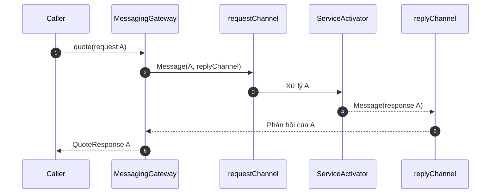

# Request–Reply pattern: ghép request với response trong Spring Integration

## Mục tiêu bài học

Sau bài này, bạn có thể:

- Giải thích vì sao một thông điệp yêu cầu phải nhận đúng thông điệp phản hồi của nó, kể cả khi nhiều yêu cầu chạy đồng thời.
- Nhận biết vai trò của `requestChannel`, `replyChannel`, `errorChannel`, message ID và correlation ID.
- Xây dựng luồng Request–Reply bằng `@MessagingGateway` và `@ServiceActivator` trong Spring Integration.
- Phân biệt trường hợp đồng bộ trong cùng ứng dụng với trường hợp bất đồng bộ hoặc đi qua message broker.
- Thiết kế timeout, xử lý lỗi, kiểm thử sự ghép cặp và theo dõi luồng thông điệp.

Trong mô-đun **SPRING_INTEGRATION_PATTERN**, chúng ta thực hành các *Enterprise Integration Patterns* để tạo luồng thông điệp ít phụ thuộc, dễ mở rộng. Request–Reply là nền tảng để hiểu cách Gateway liên hệ với Service Activator, cách Router/Transformer giữ thông tin định tuyến và cách một hệ thống xử lý lỗi hoặc retry mà vẫn trả kết quả về đúng nơi yêu cầu.

## 1. Vấn đề: phản hồi nào thuộc yêu cầu nào?

Giả sử dịch vụ báo giá nhận hai yêu cầu gần như cùng lúc:

| Yêu cầu | Nội dung | Phản hồi đúng |
| --- | --- | --- |
| A | Báo giá 2 cuốn `BOOK-01` | Báo giá của `BOOK-01` cho A |
| B | Báo giá 5 bút `PEN-02` | Báo giá của `PEN-02` cho B |

Nếu dịch vụ B hoàn tất trước dịch vụ A, hệ thống vẫn phải trả kết quả B cho người gọi B và kết quả A cho người gọi A. Không thể dựa vào thứ tự đến hay thứ tự hoàn thành để ghép cặp.

**Request–Reply** là mẫu trao đổi trong đó bên gửi phát một *request* và kỳ vọng nhận một *reply* liên quan đến request đó. So với luồng *fire-and-forget* (gửi rồi không chờ kết quả), mẫu này cần một cơ chế định tuyến phản hồi, ghép tương quan và xác định phải làm gì khi phản hồi không đến.

Trong Spring Integration, `Message<T>` chứa **payload** (dữ liệu nghiệp vụ) và **headers** (siêu dữ liệu điều phối). Headers cho phép hệ thống vận chuyển request và reply qua các kênh mà không buộc logic nghiệp vụ phải biết caller là ai.



Sơ đồ mô tả một lượt gọi. Khi nhiều request đồng thời, mỗi lượt gọi phải có đường trả lời hoặc khóa tương quan đủ để phản hồi không bị trao nhầm.

## 2. Những thành phần thực sự ghép request với reply

| Thành phần | Ý nghĩa | Lưu ý khi triển khai |
| --- | --- | --- |
| `requestChannel` | Điểm vào của thông điệp yêu cầu | Có thể dùng `DirectChannel`, `ExecutorChannel`, broker adapter... tùy cách xử lý |
| `replyChannel` / header `replyChannel` | Địa chỉ mà phản hồi phải được gửi tới | Gateway thường gắn kênh trả lời tạm cho từng lượt gọi; handler không cần tự tìm caller |
| `errorChannel` | Đích xử lý thông điệp lỗi trong các luồng hỗ trợ định tuyến lỗi | Ngoại lệ đồng bộ có thể truyền thẳng về caller thay vì tạo `ErrorMessage` |
| `id` của message | Nhận dạng **một message** cụ thể | Reply thường là message mới với ID mới; không dùng ID này làm khóa nghiệp vụ xuyên hệ thống |
| `correlationId` | Khóa liên hệ các message cùng một hoạt động | Quan trọng với broker, xử lý phân tán, nhiều reply; cũng được Splitter/Aggregator sử dụng cho nhóm |
| `requestId` nghiệp vụ | Mã yêu cầu do hệ thống thiết kế | Hữu ích cho tracing, idempotency và kiểm toán xuyên tiến trình |

**Hai cách ghép cặp cần phân biệt:**

1. **Reply channel theo lời gọi (in-process):** Gateway tạo hoặc quản lý kênh nhận reply và chờ đúng phản hồi của lời gọi đó. Trong trường hợp cơ bản, ứng dụng không cần tự tạo `correlationId`.
2. **Correlation ID xuyên dịch vụ:** Khi request và reply đi qua queue/topic hoặc những tiến trình khác nhau, phía gửi ghi một khóa ổn định vào envelope/header; phía nhận giữ khóa đó trong reply; bên gửi tra bảng *pending requests* để hoàn tất đúng yêu cầu.

Một `correlationId` chỉ là dữ liệu nếu không có thành phần thực sự dùng nó để ánh xạ request → reply. Ngược lại, đặt `replyChannel` theo từng lời gọi có thể đã đủ trong cùng một ứng dụng. **Không giả định mọi reply đều tự động có correlation ID phù hợp**, và không nhầm correlation dùng để gom nhóm của Aggregator với correlation dùng để trả lời một RPC.

## 3. Ví dụ chạy trong Spring Integration: báo giá đơn hàng

Xây dựng một API Java `QuoteGateway.quote(...)` cho phép controller/service gọi như một phương thức thông thường. Phía sau, Spring Integration chuyển lời gọi thành message, gửi đến Service Activator và chuyển kết quả trở lại caller.

Ví dụ dùng Java 17+, Spring Framework/Spring Integration 6.x và các dependency Spring Integration cần thiết. Các lớp Java ở những khối mã dưới đây đặt trong **cùng package** và trong những file tương ứng.

### 3.1. DTO request và response

```java
// QuoteRequest.java
public record QuoteRequest(String sku, int quantity) {}

// QuoteResponse.java
import java.math.BigDecimal;

public record QuoteResponse(
        String sku,
        int quantity,
        BigDecimal unitPrice,
        BigDecimal total
) {}
```

### 3.2. Khai báo channel và bật gateway scan

```java
import org.springframework.context.annotation.Bean;
import org.springframework.context.annotation.Configuration;
import org.springframework.integration.annotation.IntegrationComponentScan;
import org.springframework.integration.channel.DirectChannel;
import org.springframework.integration.config.EnableIntegration;
import org.springframework.messaging.MessageChannel;

@Configuration
@EnableIntegration
@IntegrationComponentScan
public class QuoteIntegrationConfig {
    @Bean
    public MessageChannel quoteRequests() {
        return new DirectChannel();
    }
}
```

`DirectChannel` gọi handler trong luồng thực thi của bên gửi. Cách này thích hợp để quan sát rõ request → handler → reply và xử lý ngắn. `@IntegrationComponentScan` giúp phát hiện interface được đánh dấu `@MessagingGateway` trong phạm vi quét component phù hợp.

### 3.3. Gateway: điểm vào kiểu phương thức

```java
import org.springframework.integration.annotation.MessagingGateway;

@MessagingGateway(defaultRequestChannel = "quoteRequests")
public interface QuoteGateway {
    QuoteResponse quote(QuoteRequest request);
}
```

Ứng dụng có thể inject `QuoteGateway` và gọi `quote(...)`. Spring Integration sinh proxy để biến tham số thành request message, thiết lập cơ chế nhận reply và trả payload phản hồi về kiểu `QuoteResponse`. Caller không phải tự tạo channel cho mỗi yêu cầu.

### 3.4. Service Activator: xử lý nghiệp vụ rồi trả kết quả

```java
import java.math.BigDecimal;
import org.springframework.integration.annotation.ServiceActivator;
import org.springframework.stereotype.Component;

@Component
public class QuoteService {

    @ServiceActivator(inputChannel = "quoteRequests")
    public QuoteResponse handle(QuoteRequest request) {
        if (request.quantity() <= 0) {
            throw new IllegalArgumentException("quantity must be positive");
        }

        BigDecimal unitPrice = switch (request.sku()) {
            case "BOOK-01" -> new BigDecimal("120000");
            case "PEN-02"  -> new BigDecimal("15000");
            default -> throw new IllegalArgumentException("Unknown SKU");
        };

        return new QuoteResponse(
                request.sku(),
                request.quantity(),
                unitPrice,
                unitPrice.multiply(BigDecimal.valueOf(request.quantity()))
        );
    }
}
```

Handler trả về một object thay vì tự gửi message đến tên kênh cố định. Trong luồng request–reply thông thường, Spring Integration đưa giá trị trả về vào reply và dùng thông tin định tuyến reply của request để đưa về Gateway. Đây chính là tính ít phụ thuộc: `QuoteService` không cần biết REST controller hay job nào gọi nó.

### 3.5. Caller sử dụng gateway

```java
import org.springframework.stereotype.Service;

@Service
public class CheckoutService {
    private final QuoteGateway quoteGateway;

    public CheckoutService(QuoteGateway quoteGateway) {
        this.quoteGateway = quoteGateway;
    }

    public QuoteResponse preview() {
        return quoteGateway.quote(new QuoteRequest("BOOK-01", 2));
        // unitPrice = 120000, total = 240000
    }
}
```

**Dòng chảy:** `CheckoutService` gọi gateway → gateway gửi request vào `quoteRequests` → `QuoteService` xử lý → gateway nhận reply → phương thức trả `QuoteResponse`. Nếu request B xử lý trước A, Spring Integration vẫn phải sử dụng đường trả lời gắn với mỗi lượt gọi, thay vì dựa vào thứ tự các reply.

## 4. Quan sát header `replyChannel` khi không dùng gateway

Để thấy cơ chế nền tảng, một bên gửi có thể tự chỉ định `replyChannel`. Đoạn minh họa dưới đây dùng bean `quoteRequests` đã khai báo ở trên và handler `QuoteService` đã đăng ký với nó:

```java
import org.springframework.integration.channel.QueueChannel;
import org.springframework.messaging.Message;
import org.springframework.messaging.MessageChannel;
import org.springframework.messaging.MessageHeaders;
import org.springframework.messaging.support.MessageBuilder;

public QuoteResponse requestManually(MessageChannel quoteRequests) {
    QueueChannel replies = new QueueChannel();

    Message<QuoteRequest> request = MessageBuilder
            .withPayload(new QuoteRequest("PEN-02", 5))
            .setHeader(MessageHeaders.REPLY_CHANNEL, replies)
            .build();

    if (!quoteRequests.send(request)) {
        throw new IllegalStateException("Cannot send quote request");
    }

    Message<?> answer = replies.receive(3_000);
    if (answer == null) {
        throw new IllegalStateException("Timed out waiting for quote");
    }
    return (QuoteResponse) answer.getPayload();
}
```

`QueueChannel` ở đây dùng làm hộp thư nhận một reply, còn `DirectChannel` chuyển request tới handler. Phương thức `receive(3_000)` đợi tối đa 3.000 ms **tại điểm nhận**. Trong ví dụ đồng bộ, handler chạy ngay trong `send()`; nếu handler bị chặn rất lâu thì `receive()` chưa được gọi và timeout tại `receive()` không giới hạn thời gian chạy handler.

Đây là minh họa cơ chế, không phải lý do để tự xây lại Gateway trong ứng dụng thật. Khi chuyển qua Router, Filter hoặc Transformer, cần bảo toàn thông tin trả lời; tự tạo một message hoàn toàn mới mà bỏ mất header reply có thể làm phản hồi không quay lại caller. Khi trả về payload từ endpoint do Spring Integration quản lý, framework thường đảm nhận việc chuyển tiếp header/định tuyến phản hồi theo cấu hình flow.

## 5. Request–Reply đồng bộ và bất đồng bộ

| Tình huống | Cách ghép và nhận phản hồi | Điểm cần kiểm soát |
| --- | --- | --- |
| `DirectChannel` + `@MessagingGateway` | Gateway chờ kết quả qua cơ chế reply của framework; handler chạy cùng call stack | Handler chậm hoặc treo làm caller chậm; timeout nhận reply không tự ngắt I/O đang chạy |
| `ExecutorChannel` / flow bất đồng bộ nội bộ | Request được bàn giao sang executor; Gateway có thể chờ reply trên luồng caller | Thread pool, giới hạn chờ, lỗi phát sinh ở thread khác, reply đến muộn |
| RabbitMQ/Kafka/JMS hoặc dịch vụ bên ngoài | Dùng reply destination và correlation ID hoặc request ID có quy ước rõ ràng | Serialization, persist pending requests, trùng lặp, thứ tự không bảo đảm, timeout, retry |
| Một request tạo nhiều kết quả | Gom đủ kết quả theo khóa và điều kiện hoàn tất rồi mới reply | `Splitter`/`Aggregator`, correlation ID nhóm, sequence number, partial result |

**Lưu ý về thời gian chờ:**

- *Request timeout* liên quan đến thời gian cố gắng gửi request vào channel khi thao tác gửi có thể chặn.
- *Reply timeout* liên quan đến thời gian Gateway chờ phản hồi sau khi gửi. Giá trị cụ thể được cấu hình trên Gateway hoặc endpoint tùy cách khai báo.
- Một timeout không có nghĩa là phép xử lý phía sau đã bị hủy. Late reply cần được xử lý có chủ đích; không tự động gắn phản hồi muộn với request mới.
- Với `DirectChannel` đồng bộ, tổng thời gian method bị chặn có thể phụ thuộc trực tiếp vào thời gian chạy handler; cần timeout riêng cho các lời gọi I/O thực tế.

Khi chỉ cần thông báo "đã nhận yêu cầu" và xử lý về sau, hãy cân nhắc một luồng bất đồng bộ trả **acknowledgment** rồi phát kết quả ở kênh khác. Đó là một hợp đồng khác với việc chờ kết quả nghiệp vụ cuối cùng trong cùng một lời gọi.

## 6. Ghép phản hồi xuyên tiến trình bằng correlation ID

Khi request và reply đi qua message broker, một địa chỉ `replyChannel` kiểu object Java trong bộ nhớ không thể được gửi nguyên trạng đến process khác. Cần một giao thức trao đổi có thể truyền qua mạng:

```text
Service A                              Broker                        Service B
  | publish request                     |                              |
  | {requestId:"q-204",                 |                              |
  |  replyTo:"quotes.reply",            |                              |
  |  payload:{sku:"BOOK-01"}}           |----------------------------->|
  |                                      |                              | tính giá
  |<-------------------------------------|<-----------------------------|
  | reply {correlationId:"q-204",       |                              |
  |        payload:{total:120000}}      |                              |
  |                                      |                              |
  | lookup pending["q-204"]             |                              |
  | -> hoàn tất đúng yêu cầu q-204      |                              |
```

Ví dụ này là **giao thức minh họa**. Tên header thực tế, cách đặt reply destination, cơ chế correlation và độ bền hàng đợi tùy adapter/broker. Cần triển khai đủ các bước sau:

1. Bên gửi tạo `requestId` duy nhất theo phạm vi hệ thống, ghi lại yêu cầu đang chờ cùng deadline và reply destination.
2. Bên nhận xử lý request, sao chép khóa tương quan vào response, gửi response về đích đã thỏa thuận.
3. Bên gửi kiểm tra correlation ID, tìm yêu cầu đang chờ và hoàn tất đúng promise/future hoặc cập nhật trạng thái nghiệp vụ.
4. Khi hết hạn, đánh dấu yêu cầu timeout; reply đến muộn được xử lý theo chính sách riêng (bỏ qua có log, lưu đối soát hoặc cập nhật trạng thái nếu nghiệp vụ cho phép).
5. Nếu broker giao lại message, dùng idempotency key để tránh xử lý/tạo tác dụng phụ hai lần; chỉ retry khi có chiến lược rõ ràng.

Không dùng một hàng đợi trả lời chung rồi lấy "message đầu tiên" cho "request đầu tiên". Nếu nhiều caller chờ cùng lúc, việc này dễ ghép sai khi tốc độ xử lý khác nhau. Trong môi trường nhiều instance, cần tính cả phân vùng tiêu thụ reply, nơi lưu pending requests và trường hợp instance chờ reply bị khởi động lại.

## 7. Lỗi, retry và ranh giới trách nhiệm

Một request có ít nhất bốn kết cục cần thiết kế:

| Kết cục | Ví dụ | Cách xử lý điển hình |
| --- | --- | --- |
| Thành công | SKU hợp lệ, trả giá | Trả reply tương ứng cho caller |
| Lỗi nghiệp vụ | SKU không tồn tại, số lượng sai | Trả lỗi có cấu trúc hoặc phát ngoại lệ theo hợp đồng của Gateway |
| Lỗi hạ tầng tạm thời | DB/message broker tạm mất kết nối | Retry có giới hạn, backoff; bảo đảm idempotency trước khi retry |
| Không có reply đúng hạn | Consumer treo hoặc mất reply | Timeout, ghi trace/correlation ID, quyết định xử lý late reply |

Với `DirectChannel` và handler đồng bộ, ngoại lệ từ `QuoteService` thường truyền về lời gọi Gateway. Khi flow xử lý bằng executor hoặc messaging transport, lỗi có thể đi qua `errorChannel` dưới dạng `ErrorMessage` nếu đã cấu hình luồng lỗi phù hợp. **Không coi `errorChannel` là nơi mọi ngoại lệ tự động xuất hiện**; cách truyền lỗi phụ thuộc loại endpoint và ranh giới bất đồng bộ.

Nếu thêm `Filter`, cần định nghĩa rõ hành vi khi message bị loại: một request bị lọc mà không có reply hoặc tín hiệu lỗi có thể khiến caller phải chờ hết timeout. Nếu dùng `Router`, mọi nhánh có nghĩa vụ trả kết quả phải có đường phản hồi hợp lệ. Nếu dùng `Splitter`, không trả một phần tử ngẫu nhiên như thể đó là kết quả cuối; hãy dùng `Aggregator` với điều kiện hoàn tất khi nghiệp vụ cần một reply hợp nhất.

## 8. Kiểm thử và quan sát khả năng ghép cặp

Một bài test tích hợp cơ bản có thể xác nhận gateway thực sự nhận đúng payload:

```java
import static org.assertj.core.api.Assertions.assertThat;

import org.junit.jupiter.api.Test;
import org.springframework.beans.factory.annotation.Autowired;
import org.springframework.boot.test.context.SpringBootTest;

@SpringBootTest
class QuoteFlowTest {
    @Autowired
    private QuoteGateway gateway;

    @Test
    void replyMatchesRequest() {
        QuoteResponse book = gateway.quote(new QuoteRequest("BOOK-01", 2));
        QuoteResponse pen = gateway.quote(new QuoteRequest("PEN-02", 5));

        assertThat(book.sku()).isEqualTo("BOOK-01");
        assertThat(book.total()).isEqualByComparingTo("240000");
        assertThat(pen.sku()).isEqualTo("PEN-02");
        assertThat(pen.total()).isEqualByComparingTo("75000");
    }
}
```

Để kiểm tra tính đúng đắn khi tải tăng, kiểm thử thêm các kịch bản:

- **Đồng thời và đảo thứ tự:** gửi nhiều request có request ID khác nhau, cố ý cho một request xử lý chậm hơn; xác nhận reply vẫn về đúng caller.
- **Trễ và không có reply:** mô phỏng handler không phản hồi, xác nhận timeout và không có rò rỉ mục đang chờ.
- **Lỗi bất đồng bộ:** bảo đảm lỗi được truyền đến đúng lời gọi hoặc được ghi nhận theo hợp đồng xử lý lỗi.
- **Trùng lặp hoặc reply muộn:** xác nhận một request không hoàn tất hai lần và kết quả cũ không bị gán cho request khác.
- **Biến đổi/định tuyến:** xác nhận các header hoặc khóa tương quan cần thiết còn nguyên qua các endpoint.

Khi theo dõi production, nên log/tracing theo `requestId` hoặc `correlationId` cùng trạng thái, thời điểm gửi, thời điểm nhận reply, độ trễ và kết quả timeout. Không cần log toàn bộ payload nếu chứa dữ liệu nhạy cảm. Một dashboard có thể theo dõi số request đang chờ, tỷ lệ timeout, độ trễ p95/p99 và số reply không tìm thấy request tương ứng.

## 9. Sai lầm thường gặp và cách tự kiểm tra

**Sai lầm 1: Dùng thứ tự phản hồi để ghép cặp.** Hai consumer xử lý song song có thể hoàn thành theo thứ tự bất kỳ. Hãy dùng cơ chế reply của Gateway hoặc khóa tương quan rõ ràng.

**Sai lầm 2: Nghĩ message ID luôn bằng request ID.** Message mới sau xử lý có thể có ID mới. Hãy dùng khóa nghiệp vụ hoặc correlation ID được bảo toàn giữa request và reply khi cần theo dõi xuyên hệ thống.

**Sai lầm 3: Chỉ đặt reply timeout rồi tưởng toàn bộ xử lý đã có deadline.** Với handler đồng bộ chặn I/O, thread caller vẫn có thể bị chặn trong lúc gửi. Đặt deadline ở từng lời gọi phụ thuộc và kiểm soát tài nguyên xử lý.

**Sai lầm 4: Đổi channel mà làm mất thông tin reply.** Khi tự dựng `Message`, cần xem các header định tuyến có được bảo toàn không; khi qua process khác, phải ánh xạ chúng sang định dạng message có thể truyền qua mạng.

**Sai lầm 5: Retry request có tác dụng phụ mà không chống trùng.** Request có thể xử lý thành công nhưng reply thất lạc; retry có thể chạy nghiệp vụ hai lần. Dùng idempotency key và trạng thái xử lý phù hợp.

Tự trả lời ba câu hỏi trước khi hoàn tất thiết kế:

1. Nếu 100 yêu cầu hoàn thành theo thứ tự ngược lại, thành phần nào bảo đảm reply thuộc đúng request?
2. Nếu một request timeout nhưng thực tế đã thực hiện thành công, caller và server sẽ đối soát bằng khóa nào?
3. Nếu flow có Router, Filter, Splitter hoặc Aggregator, mọi nhánh có tạo ra đúng loại reply hoặc kết quả lỗi đã cam kết không?

## Kết luận

Request–Reply ghép một yêu cầu với phản hồi thuộc về yêu cầu đó. Trong Spring Integration, **Messaging Gateway + Service Activator + reply channel** giúp triển khai mẫu này gọn trong một ứng dụng; khi vượt qua ranh giới tiến trình, cần bổ sung **reply destination + correlation/request ID + quản lý timeout, retry và idempotency**. Thiết kế đúng sự tương quan là điều kiện để các luồng Router, Transformer, Gateway và Aggregator mở rộng mà vẫn trả kết quả chính xác về caller.
