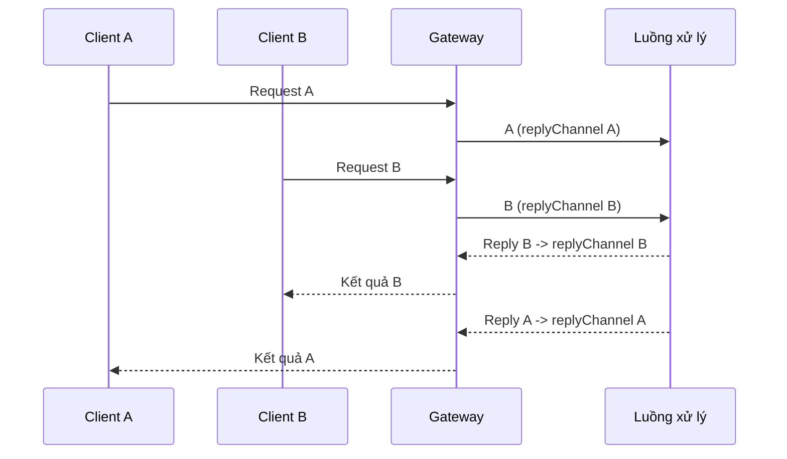
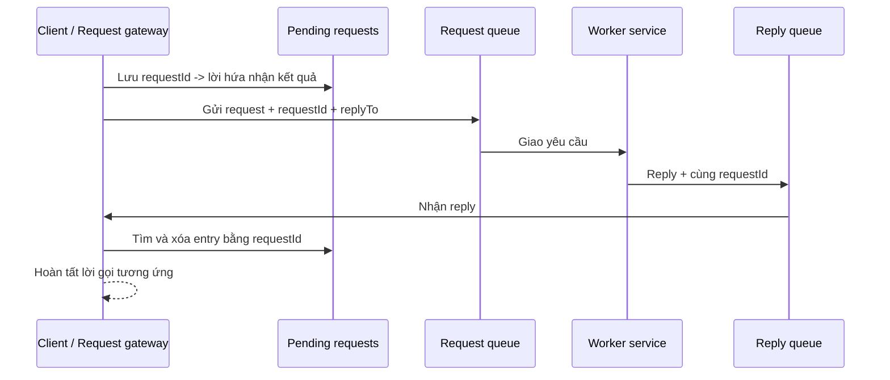

# Message correlation trong request-reply

Trong chương **Request reply** của module **SPRING_INTEGRATION_PATTERN**, một yêu cầu được gửi vào luồng thông điệp và bên gọi cần nhận đúng phản hồi tương ứng. Đây là một phần quan trọng của Enterprise Integration Patterns khi xây dựng các luồng Spring Integration ít phụ thuộc, có thể thêm Router, Filter, Transformer, Gateway, retry hoặc error channel mà vẫn theo dõi được từng yêu cầu.

**Message correlation** là cơ chế nhận diện mối liên hệ giữa yêu cầu và phản hồi (hoặc giữa các thông điệp con cùng một tác vụ). Khi nhiều yêu cầu chạy đồng thời, thứ tự phản hồi có thể khác thứ tự gửi. Nếu ứng dụng chỉ dựa vào thứ tự, nó có thể trả kết quả của khách hàng A cho khách hàng B.

Sau bài này, bạn có thể:

- Phân biệt địa chỉ nhận phản hồi, khóa tương quan và mã theo dõi phân tán.
- Giải thích Spring Integration Gateway ghép phản hồi với đúng lần gọi như thế nào.
- Thiết kế correlation xuyên tiến trình, kể cả khi phản hồi đến muộn, trùng hoặc không đến.
- Nhận biết khi nào `correlationId`, `sequenceNumber`, `sequenceSize` phục vụ Splitter/Aggregator thay vì request-reply đơn lẻ.
- Kiểm thử các nhánh thành công, timeout và lỗi mà không phụ thuộc vào thứ tự xử lý.

## 1. Vì sao cần correlation?

Giả sử hệ thống bán hàng gửi hai yêu cầu báo giá gần như cùng lúc:

| Thời điểm | Sự kiện | Ý nghĩa |
| --- | --- | --- |
| T1 | Client A gửi yêu cầu `requestId=R-101`, mã hàng A | A bắt đầu đợi |
| T2 | Client B gửi yêu cầu `requestId=R-102`, mã hàng B | B bắt đầu đợi |
| T3 | Dịch vụ trả lời `R-102` trước | Chỉ B được nhận phản hồi này |
| T4 | Dịch vụ trả lời `R-101` sau | Chỉ A được nhận phản hồi này |

Thứ tự đến không phải tiêu chí ghép cặp. Cần có một cơ chế xác định *phản hồi này thuộc yêu cầu nào* và một nơi có thể chuyển kết quả về đúng bên đang chờ.



Ở ví dụ trên, các kênh phản hồi dành cho từng lần gọi giúp Gateway trả đúng kết quả, dù thứ tự xử lý thay đổi.

## 2. Phân biệt các định danh và header

Không phải mọi trường có chữ “ID” đều dùng để ghép request với reply. Trong Spring Integration, cần tách ba trách nhiệm:

| Thành phần | Công dụng | Lưu ý |
| --- | --- | --- |
| `replyChannel` | Chỉ kênh nhận phản hồi của một message. Gateway thường tạo/đặt kênh phản hồi tạm cho lần gọi đồng bộ. | Là thông tin định tuyến; có thể là đối tượng `MessageChannel` trong JVM, không mặc nhiên truyền được qua broker. |
| `correlationId` | Nhóm các thông điệp có quan hệ, đặc biệt khi Splitter chia một message thành nhiều phần để Aggregator gom lại. | Không bắt buộc phải có trên mọi request-reply; đừng giả định Gateway chỉ dựa vào header này để trả kết quả. |
| `requestId` (header tự định nghĩa) | Khóa duy nhất của một yêu cầu nghiệp vụ khi cần ghép reply ở hai tiến trình hoặc hai dịch vụ. | Bên trả lời phải mang lại đúng khóa; bên nhận phải quản lý các yêu cầu đang chờ. |
| `sequenceNumber`, `sequenceSize` | Vị trí và số lượng phần của một nhóm message. | Hữu ích cho Splitter/Aggregator, không thay cho `requestId` của cuộc trao đổi. |
| `id` của `MessageHeaders` | Định danh của một *message* cụ thể. | Khi tái tạo/chuyển đổi message có thể xuất hiện ID mới; không nên lấy làm khóa nghiệp vụ dài hạn. |
| `traceId` (theo hệ tracing) | Liên kết các span/log của một giao dịch phân tán. | Hữu ích để quan sát; không tự động giải quyết nơi gửi reply hoặc bảng yêu cầu đang đợi. |

**Quy tắc thiết kế:** Với trao đổi bên trong một ứng dụng qua Messaging Gateway, ưu tiên cơ chế `replyChannel` mà Gateway đã cung cấp. Với trao đổi bất đồng bộ qua broker hoặc nhiều tiến trình, cần hợp đồng correlation rõ ràng, ví dụ `requestId` + địa chỉ reply + timeout. Với luồng Splitter/Aggregator, dùng khóa nhóm tương quan phù hợp và bảo toàn ngữ cảnh reply của yêu cầu ban đầu.

## 3. Correlation tự động qua Spring Integration Gateway

Ví dụ một ứng dụng Java dùng Spring Integration Java DSL để xử lý báo giá:

```java
import java.math.BigDecimal;

import org.springframework.context.annotation.Bean;
import org.springframework.context.annotation.Configuration;
import org.springframework.integration.annotation.IntegrationComponentScan;
import org.springframework.integration.annotation.MessagingGateway;
import org.springframework.integration.dsl.IntegrationFlow;

record QuoteRequest(String sku, int quantity) {}
record QuoteReply(String sku, BigDecimal amount) {}

@MessagingGateway(
    defaultRequestChannel = "quotes.requests",
    defaultReplyTimeout = "5000"
)
interface QuoteGateway {
    QuoteReply quote(QuoteRequest request);
}

@Configuration
@IntegrationComponentScan
class QuoteIntegrationConfig {

    @Bean
    IntegrationFlow quoteFlow() {
        return IntegrationFlow.from("quotes.requests")
            .handle(QuoteRequest.class, (request, headers) -> {
                // Đơn giá cố định chỉ để minh họa request-reply.
                BigDecimal unitPrice = new BigDecimal("42.00");
                return new QuoteReply(
                    request.sku(),
                    unitPrice.multiply(BigDecimal.valueOf(request.quantity()))
                );
            })
            .get();
    }
}
```

Ở phía gọi:

```java
QuoteReply result = quoteGateway.quote(new QuoteRequest("SKU-01", 3));
// Ví dụ: QuoteReply[sku=SKU-01, amount=126.00]
```

Luồng xử lý:

1. Lời gọi `quote(...)` tạo request message gửi vào `quotes.requests`. Gateway chuẩn bị nơi nhận reply tương ứng với **lần gọi đó**.
2. Service Activator trong `handle(...)` tính toán và trả về payload `QuoteReply`.
3. Cơ chế request-reply của Spring Integration chuyển kết quả về reply channel thích hợp để Gateway hoàn tất lời gọi.
4. Nếu hai lời gọi diễn ra đồng thời, mỗi lời gọi nhận reply của chính nó; không cần mã hóa “request thứ nhất nhận reply thứ nhất”.

Ví dụ sử dụng một handler trả về giá trị trực tiếp, vì vậy Spring Integration có thể tạo reply message và quản lý headers của luồng. Nếu tự tạo message mới ở giữa luồng, cần đặc biệt chú ý giữ đúng địa chỉ reply và các header có ý nghĩa; một Transformer/Router tùy biến làm mất `replyChannel` có thể khiến Gateway đợi đến timeout.

**Giới hạn:** `defaultReplyTimeout` là thời gian chờ phản hồi; nó không đồng nghĩa hủy tác vụ đang chạy ở phía xử lý. Ứng dụng gọi phải xác định hành vi khi hết thời gian chờ (ví dụ kết quả rỗng, ngoại lệ hoặc fallback tùy cấu hình), và không được mặc định là công việc phía sau đã dừng.

## 4. Khi request và reply đi qua broker hoặc nhiều tiến trình

Gateway nội bộ có thể định tuyến qua kênh tạm trong bộ nhớ. Khi gửi request qua RabbitMQ, Kafka hoặc một giao thức bên ngoài, không thể giả định một đối tượng `MessageChannel` trong JVM sẽ đi qua biên mạng. Cần thiết kế correlation dưới dạng dữ liệu có thể truyền, thường gồm:

- **`requestId`**: sinh duy nhất cho mỗi lần yêu cầu (ví dụ UUID), ổn định xuyên suốt các bước xử lý và retry của cùng yêu cầu.
- **`replyTo`**: tên hàng đợi/topic hoặc endpoint trả lời, nếu giao thức và thiết kế cần chỉ rõ địa chỉ.
- **Payload và trạng thái**: kết quả thành công hoặc lỗi, được gắn với chính `requestId`.
- **Deadline/timeout**: chính sách kết thúc việc chờ, dọn trạng thái và xử lý reply muộn.

Ví dụ hợp đồng ở ranh giới vận chuyển (JSON chỉ minh họa; cách map thành broker header tùy adapter):

```json
{
  "requestId": "77a3c49b-08b5-4a4c-a247-922b9dff102a",
  "replyTo": "quotes.replies",
  "payload": {
    "sku": "SKU-01",
    "quantity": 3
  }
}
```

```json
{
  "requestId": "77a3c49b-08b5-4a4c-a247-922b9dff102a",
  "status": "OK",
  "payload": {
    "sku": "SKU-01",
    "amount": 126.00
  }
}
```

Hai message có thể có `MessageHeaders.ID` khác nhau nhưng *cùng* `requestId`. Chính khóa này cho phép bên nhận ghép reply với yêu cầu ban đầu.



Một registry chờ trong bộ nhớ có thể được phác họa bằng Java như sau. Đây là **phần minh họa logic correlation**, chưa bao gồm gửi/nhận message qua adapter thực tế:

```java
import java.util.UUID;
import java.util.concurrent.CompletableFuture;
import java.util.concurrent.ConcurrentHashMap;
import java.util.concurrent.ConcurrentMap;
import java.util.concurrent.TimeUnit;
import org.springframework.messaging.Message;

class PendingQuotes {
    private final ConcurrentMap<String, CompletableFuture<QuoteReply>> pending =
        new ConcurrentHashMap<>();

    CompletableFuture<QuoteReply> register(String requestId) {
        var future = new CompletableFuture<QuoteReply>();
        if (pending.putIfAbsent(requestId, future) != null) {
            throw new IllegalArgumentException("Trùng requestId");
        }

        future.orTimeout(5, TimeUnit.SECONDS)
            .whenComplete((value, error) -> pending.remove(requestId, future));
        return future;
    }

    void onReply(Message<QuoteReply> reply) {
        Object value = reply.getHeaders().get("requestId");
        if (!(value instanceof String requestId)) {
            // Ghi nhận reply không có khóa; không đoán người nhận.
            return;
        }

        var waiter = pending.remove(requestId);
        if (waiter != null) {
            waiter.complete(reply.getPayload());
        } else {
            // Reply trễ, trùng hoặc requestId không tồn tại.
        }
    }
}

// Ở luồng gửi:
// String requestId = UUID.randomUUID().toString();
// CompletableFuture<QuoteReply> reply = registry.register(requestId);
// Gửi request vào broker cùng requestId và replyTo.
// Nếu gửi thất bại, hoàn tất future bằng lỗi và dọn entry ngay.
```

Trong hệ nhiều instance, registry trong bộ nhớ của một instance không đủ nếu reply có thể đi vào instance khác. Cần bảo đảm reply được trả về đúng instance, hoặc dùng cơ chế phối hợp/trạng thái chung phù hợp với độ tin cậy yêu cầu. Một adapter hỗ trợ request-reply có thể cung cấp sẵn một phần cơ chế này; hãy dùng hợp đồng và cấu hình của adapter trước khi tự duy trì registry.

## 5. Correlation khi Splitter và Aggregator xuất hiện

Trong Enterprise Integration Patterns, “correlation” còn có nghĩa **nhóm các message thuộc cùng một tập công việc**. Ví dụ một yêu cầu tính tổng giá giỏ hàng được Splitter tách thành ba dòng hàng:

```text
Request CART-7
       |
       v
    Splitter
       |
       +--> item A: correlationId=CART-7, sequenceNumber=1, sequenceSize=3
       +--> item B: correlationId=CART-7, sequenceNumber=2, sequenceSize=3
       +--> item C: correlationId=CART-7, sequenceNumber=3, sequenceSize=3
       |
       v
    Aggregator (nhóm theo correlationId; đủ điều kiện release)
       |
       v
    Tổng hợp một reply của CART-7
```

Trong Spring Integration, Splitter có thể cung cấp thông tin chuỗi; Aggregator thường sử dụng thông tin tương quan và chiến lược hoàn tất nhóm để xây dựng kết quả. Điều kiện release phụ thuộc cấu hình và đặc điểm luồng: biết `sequenceSize=3` không đảm bảo luôn nhận đủ ba phần, nhất là khi có filter, lỗi hoặc retry.

Điểm cần phân biệt: `correlationId` để Aggregator biết *phần nào thuộc cùng nhóm*; `replyChannel` hoặc hợp đồng reply bên ngoài lại cho biết *kết quả cuối cùng phải trả về đâu*. Nếu một request tạo ra nhiều nhóm con, có thể cần hai tầng khóa: khóa nhóm nội bộ và `requestId` của giao dịch gốc.

## 6. Timeout, retry, lỗi và reply trùng

| Tình huống | Hành vi cần thiết | Hậu quả nếu bỏ qua |
| --- | --- | --- |
| Reply tới sai thứ tự | Tìm yêu cầu đang đợi bằng correlation key hoặc reply channel tương ứng. | Trả nhầm kết quả cho client. |
| Reply tới sau timeout | Xóa trạng thái chờ đúng hạn; nhận diện và ghi nhận reply trễ. | Rò rỉ bộ nhớ, trả kết quả vào lời gọi đã kết thúc. |
| Reply bị gửi hai lần sau retry | Hoàn tất một yêu cầu đúng một lần; xử lý reply trùng theo idempotency. | Tác động nghiệp vụ lặp lại. |
| Reply không có ID hoặc ID lạ | Không đoán yêu cầu; chuyển xử lý lỗi/quan sát phù hợp. | Mất tính đúng đắn khi có nhiều yêu cầu đồng thời. |
| Worker trả lỗi | Giữ khóa tương quan trong kết quả lỗi hoặc định tuyến qua `errorChannel` có cấu hình rõ ràng. | Bên gửi chỉ biết đợi đến timeout, khó điều tra lỗi. |
| Một phần sau Splitter bị mất | Xác định timeout, release/expire của nhóm và cách báo lỗi hoặc trả kết quả một phần. | Aggregator giữ nhóm vô thời hạn hoặc trả dữ liệu thiếu. |
| Service khởi động lại | Quy định nơi lưu trạng thái chờ và cách phục hồi/hủy yêu cầu. | Reply còn trên broker nhưng không còn bên chờ. |

**Retry không có nghĩa tạo request mới.** Khi thực hiện lại một thao tác của cùng yêu cầu, thường cần giữ `requestId` để nhận diện và chống xử lý trùng; một yêu cầu nghiệp vụ mới thực sự mới có khóa mới. Nếu gửi nhiều attempt song song hoặc cần đo từng lần thử, có thể thêm `attemptId` riêng.

Với luồng gom nhóm, hãy xem xét `groupTimeout`, chiến lược release và chính sách nhóm hết hạn của Aggregator. Các thiết lập như trả kết quả một phần khi hết hạn có thể làm thay đổi ý nghĩa nghiệp vụ, vì vậy phải quyết định rõ: trả thiếu, trả lỗi, hay thử lại.

## 7. Cách kiểm tra correlation

Một kiểm thử đúng cần tạo được **cạnh tranh thực sự** giữa nhiều request và kiểm tra kết quả theo khóa, thay vì giả định thứ tự:

1. Gửi đồng thời A và B; cố ý cho B trả trước A; xác nhận A chỉ nhận reply A, B chỉ nhận reply B.
2. Đặt hai request có payload giống nhau nhưng `requestId` khác nhau; xác nhận chúng vẫn độc lập.
3. Gửi reply không mang `requestId`, sai ID hoặc trùng ID; xác nhận quy tắc xử lý lỗi/duplicate.
4. Cho service chậm hơn timeout; xác nhận bên gửi kết thúc chờ và registry được dọn sạch.
5. Bật retry và quan sát các attempt giữ khóa nghiệp vụ, không làm hoàn tất request nhiều lần.
6. Nếu dùng Splitter/Aggregator, trả các phần theo thứ tự ngẫu nhiên và làm mất một phần; xác nhận điều kiện release và timeout đúng thiết kế.

Khi theo dõi production, nên log `requestId`, trạng thái gửi/nhận, độ trễ, số lần retry, nhánh error channel và `traceId` (nếu có). Không cần log toàn bộ payload có dữ liệu nhạy cảm. Các chỉ số hữu ích gồm số yêu cầu đang chờ, tỷ lệ timeout, reply không có người nhận, reply trùng và thời gian hoàn tất.

## 8. Lỗi thiết kế thường gặp

- **Dựa vào FIFO:** Hàng đợi có thứ tự gửi không đồng nghĩa các dịch vụ xử lý và trả phản hồi cùng thứ tự.
- **Dùng `MessageHeaders.ID` làm mã nghiệp vụ bền vững:** Message mới có thể được tạo qua Transformer/handler; hãy truyền một khóa tương quan có chủ đích khi qua biên tiến trình.
- **Cho rằng `correlationId` luôn được Gateway sinh và dùng để ghép reply:** Với Gateway nội bộ, `replyChannel` và cơ chế gateway request-reply mới là trọng tâm.
- **Làm mất `replyChannel` khi tự dựng reply:** Gateway không còn đường nhận kết quả; cần bảo toàn ngữ cảnh hoặc thiết kế lại định tuyến reply.
- **Không dọn request timeout:** Registry ngày càng lớn và reply trễ trở thành trường hợp không xác định.
- **Nhầm correlation với tracing:** Trace cho phép tìm vết, còn correlation và định tuyến reply quyết định phản hồi thuộc về lời gọi nào.

## Kết luận

Message correlation giúp request-reply giữ được tính đúng đắn khi luồng Spring Integration mở rộng thành xử lý đồng thời, chia nhánh, gọi dịch vụ ngoài và retry. Bên trong ứng dụng, Messaging Gateway thường quản lý reply channel cho từng lời gọi. Qua biên tiến trình, hãy thiết kế khóa `requestId`, địa chỉ reply, timeout, xử lý trùng và cơ chế dọn trạng thái rõ ràng. Khi thêm Splitter/Aggregator, phân biệt khóa nhóm `correlationId` với khóa của yêu cầu ban đầu để cả việc **gom đúng kết quả** và **trả đúng người gọi** đều được bảo đảm.
