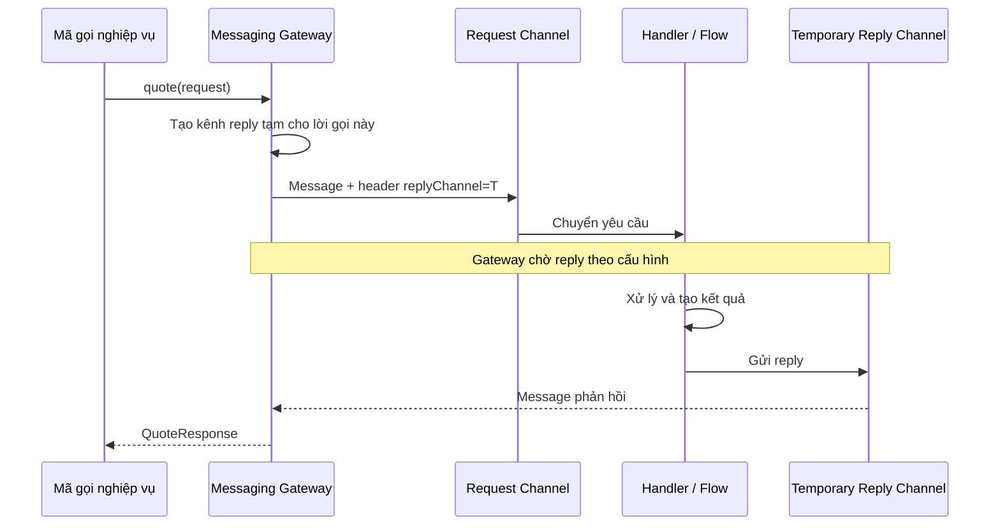
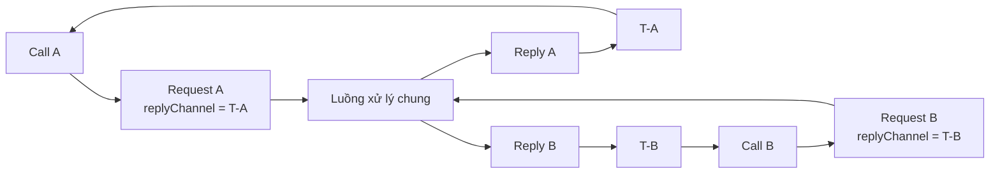

# Temporary reply channel trong Request–Reply với Spring Integration

## 1. Bối cảnh và mục tiêu

Trong mô hình **Request–Reply**, một thành phần gửi yêu cầu và cần nhận đúng một kết quả tương ứng. Với Spring Integration, luồng xử lý có thể đi qua Gateway, Channel, Filter, Router, Transformer, Service Activator hoặc nhiều thành phần khác trước khi tạo ra kết quả.

**Temporary reply channel** (kênh trả lời tạm thời) giải quyết câu hỏi: *Làm sao Gateway biết phản hồi nào thuộc về lời gọi đang chờ, nhất là khi nhiều lời gọi xảy ra đồng thời?*

Sau bài này, bạn có thể:

- Giải thích vì sao Gateway tạo một kênh nhận phản hồi tạm thời cho từng lời gọi.
- Theo dõi vai trò của header `replyChannel` trong hành trình của một `Message`.
- Xây dựng Gateway nhận kết quả từ Service Activator mà không cần tự khai báo một kênh phản hồi dùng chung.
- Phân biệt thời gian chờ gửi yêu cầu và thời gian chờ nhận kết quả.
- Nhận diện tình huống mất header, không có reply, trả lời trễ hoặc trả về nhiều reply.

Phạm vi bài học thuộc module **SPRING_INTEGRATION_PATTERN**: vận dụng Enterprise Integration Patterns để tạo luồng thông điệp ít phụ thuộc, dễ mở rộng và kiểm thử được. Temporary reply channel là một cơ chế hạ tầng giúp hiện thực hóa **Request–Reply**, thường xuất hiện khi đi cùng Messaging Gateway và các thành phần xử lý thông điệp khác.

## 2. Temporary reply channel là gì?

Khi ứng dụng gọi một phương thức Gateway cần giá trị trả về, Spring Integration có thể thực hiện chu trình:

1. Tạo một kênh phản hồi tạm thời cho **lời gọi hiện tại**.
2. Đặt tham chiếu đến kênh đó trong header `replyChannel` của thông điệp yêu cầu.
3. Gửi yêu cầu vào `requestChannel`.
4. Chờ một thông điệp phản hồi được gửi đến kênh tạm.
5. Lấy payload phản hồi, chuyển đổi về kiểu trả về phù hợp rồi hoàn tất lời gọi Gateway.

Kênh tạm thời là một cơ chế nội bộ của lời gọi request–reply; nó **không đòi hỏi phải được định nghĩa thành bean có tên**. Trong các đường xử lý chuẩn, Spring Integration dùng thông tin `replyChannel` đã được giữ lại trong message để định tuyến reply về đúng nơi đang chờ.

> **Phân biệt:** `requestChannel` là điểm nhận yêu cầu mà nhiều lời gọi có thể cùng sử dụng. Temporary reply channel là điểm nhận phản hồi gắn với từng lần gửi–nhận cụ thể.

### Sơ đồ luồng



Trong sơ đồ, Handler không phải biết Gateway nào đang gọi. Handler chỉ cần tạo reply đúng theo hợp đồng của luồng. Cơ chế phản hồi của framework sẽ sử dụng kênh đích đã mang theo yêu cầu.

## 3. Các thành phần tham gia

| Thành phần | Vai trò |
|---|---|
| **Messaging Gateway** | Biến lời gọi phương thức Java thành việc gửi message và nhận kết quả. |
| **Request channel** | Nơi Gateway chuyển yêu cầu đến luồng xử lý; thường được khai báo rõ ràng. |
| **Header `replyChannel`** | Cho biết nơi reply cần được gửi về. Giá trị có thể là tham chiếu kênh; framework cũng hỗ trợ phân giải tên kênh trong những cấu hình phù hợp. |
| **Temporary reply channel** | Điểm nhận reply dành cho một lời gọi gửi–nhận. |
| **Service Activator / Transformer / Flow** | Xử lý yêu cầu và tạo thông điệp hoặc payload phản hồi. |
| **Reply timeout** | Giới hạn thời gian chờ phản hồi ở pha nhận reply, tùy cơ chế gửi và mô hình thực thi. |

### Vì sao không luôn dùng một reply channel cố định?

Một `replyChannel` cố định có thể hữu ích khi cần tích hợp với một topology cụ thể, nhưng nếu nhiều Gateway call cùng chờ trên một kênh chung thì người thiết kế phải quan tâm đến việc phân phối và ghép đúng phản hồi cho từng lời gọi.

Temporary reply channel cho phép Gateway tự quản lý nơi nhận kết quả của mỗi lần gọi. Đây là lựa chọn thông dụng cho request–reply theo kiểu gọi phương thức Java, đặc biệt khi phía gọi không cần biết topology phản hồi nội bộ.

Kênh tạm **không thay thế** correlation trong mọi bài toán. Nếu bên trong luồng có Splitter, Aggregator, xử lý song song hay bước trao đổi với hệ thống ngoài, bạn vẫn phải quản lý khóa tương quan của các thông điệp trung gian sao cho một yêu cầu cuối cùng tạo ra kết quả đúng.

## 4. Ví dụ hoàn chỉnh: Gateway yêu cầu tính báo giá

Giả sử ứng dụng cần phương thức `quote(...)` trả về giá cho một số lượng sản phẩm. Yêu cầu được đưa qua `quoteRequests`, một Service Activator tính toán rồi gửi kết quả về Gateway.

Ví dụ sử dụng Java 17 trở lên, Spring Boot có Spring Integration và JUnit 5.

### 4.1. DTO của yêu cầu và phản hồi

```java
// QuoteRequest.java
package com.example.integration;

public record QuoteRequest(String productId, int quantity) {
}
```

```java
// QuoteResponse.java
package com.example.integration;

import java.math.BigDecimal;

public record QuoteResponse(String productId, BigDecimal total) {
}
```

### 4.2. Khai báo request channel

```java
// IntegrationChannels.java
package com.example.integration;

import org.springframework.context.annotation.Bean;
import org.springframework.context.annotation.Configuration;
import org.springframework.integration.channel.DirectChannel;
import org.springframework.messaging.MessageChannel;

@Configuration
public class IntegrationChannels {

    @Bean
    public MessageChannel quoteRequests() {
        return new DirectChannel();
    }
}
```

Ở đây chỉ khai báo **request channel**. Không tạo bean như `temporaryReplyChannel` vì Gateway tự quản lý kênh nhận phản hồi cho lời gọi khi cần.

### 4.3. Khai báo Messaging Gateway

```java
// QuoteGateway.java
package com.example.integration;

import org.springframework.integration.annotation.MessagingGateway;

@MessagingGateway(
    defaultRequestChannel = "quoteRequests",
    defaultReplyTimeout = "5000"
)
public interface QuoteGateway {

    QuoteResponse quote(QuoteRequest request);
}
```

Khi gọi `quote(request)`, Gateway tạo message và gửi đến `quoteRequests`. Với lời gọi cần kết quả và không cấu hình một kênh reply rõ ràng khác, Gateway sử dụng cơ chế kênh trả lời tạm thời để tiếp nhận kết quả.

Giá trị `defaultReplyTimeout = "5000"` thể hiện thời gian chờ reply tính bằng mili giây theo cấu hình Gateway. Nó **không phải** giới hạn tuyệt đối năm giây cho toàn bộ thao tác trong mọi topology; xem phần timeout bên dưới.

### 4.4. Service Activator tạo reply

```java
// QuoteService.java
package com.example.integration;

import java.math.BigDecimal;

import org.springframework.integration.annotation.ServiceActivator;
import org.springframework.stereotype.Component;

@Component
public class QuoteService {

    private static final BigDecimal UNIT_PRICE = new BigDecimal("12.50");

    @ServiceActivator(inputChannel = "quoteRequests")
    public QuoteResponse calculate(QuoteRequest request) {
        if (request == null || request.productId() == null
                || request.productId().isBlank()
                || request.quantity() <= 0) {
            throw new IllegalArgumentException("Invalid quote request");
        }

        BigDecimal total = UNIT_PRICE.multiply(
            BigDecimal.valueOf(request.quantity())
        );
        return new QuoteResponse(request.productId(), total);
    }
}
```

Method `calculate` trả về một payload; Spring Integration tạo reply phù hợp và dùng đích phản hồi từ ngữ cảnh message đang được xử lý. Ta không cần truyền đối tượng `TemporaryReplyChannel` vào `QuoteService`, cũng không cần tự viết logic tìm đúng client để trả kết quả.

### 4.5. Bật quét Gateway

```java
// Application.java
package com.example.integration;

import org.springframework.boot.SpringApplication;
import org.springframework.boot.autoconfigure.SpringBootApplication;
import org.springframework.integration.annotation.IntegrationComponentScan;
import org.springframework.integration.config.EnableIntegration;

@SpringBootApplication
@EnableIntegration
@IntegrationComponentScan
public class Application {

    public static void main(String[] args) {
        SpringApplication.run(Application.class, args);
    }
}
```

`@IntegrationComponentScan` giúp đăng ký interface `@MessagingGateway` trong package được quét. Các cấu hình bean và component khác vẫn được Spring quản lý theo cách thông thường.

### 4.6. Gọi Gateway và kiểm thử

```java
// QuoteFlowTest.java
package com.example.integration;

import static org.junit.jupiter.api.Assertions.assertEquals;

import java.math.BigDecimal;

import org.junit.jupiter.api.Test;
import org.springframework.beans.factory.annotation.Autowired;
import org.springframework.boot.test.context.SpringBootTest;

@SpringBootTest
class QuoteFlowTest {

    @Autowired
    private QuoteGateway gateway;

    @Test
    void replyReturnsToTheCallingGateway() {
        QuoteResponse actual = gateway.quote(
            new QuoteRequest("SKU-01", 3)
        );

        assertEquals(
            new QuoteResponse("SKU-01", new BigDecimal("37.50")),
            actual
        );
    }
}
```

Với request này, kết quả mong đợi là `3 × 12.50 = 37.50`. Bài kiểm thử xác nhận từ góc nhìn caller rằng Gateway trả về giá trị do Service Activator xử lý; việc tạo và sử dụng reply channel diễn ra trong hạ tầng.

**Điều kiện chạy:** có các dependency Spring Boot, Spring Integration tương thích và Spring Boot Test/JUnit 5; đặt các lớp trên trong package được ứng dụng quét. Ví dụ minh họa một luồng nội bộ trên `DirectChannel`, chưa kết nối tới broker hay dịch vụ ngoài.

## 5. Reply đi đúng lời gọi bằng cách nào?

Giả sử có hai lời gọi cùng lúc:

- Call A gửi `QuoteRequest("A", 2)` và chờ ở kênh tạm `T-A`.
- Call B gửi `QuoteRequest("B", 4)` và chờ ở kênh tạm `T-B`.

Mỗi thông điệp mang `replyChannel` tương ứng. Nếu B hoàn tất trước A, reply của B vẫn đi đến `T-B`, không bị tráo với kết quả của A.



Sơ đồ thể hiện cách định tuyến reply theo kênh đã gắn trong request, không ngụ ý các nhánh hoàn tất theo thứ tự. Với các bước bất đồng bộ hoặc chia–gộp, khả năng giữ liên hệ giữa request và reply còn phụ thuộc thiết kế luồng và metadata tương quan.

### Header `replyChannel` cần được giữ qua các bước

Các thành phần Spring Integration thông dụng thường bảo toàn header cần thiết trong chuỗi xử lý. Tuy nhiên, nếu tự tạo một `Message` hoàn toàn mới rồi gửi thủ công, bạn có thể vô tình bỏ mất header `replyChannel`.

Ví dụ, trong một handler tự xử lý message:

```java
import org.springframework.messaging.Message;
import org.springframework.messaging.support.MessageBuilder;

// "incoming" là Message<?> nhận từ luồng trước.
// "newPayload" là kết quả biến đổi.
Message<?> outgoing = MessageBuilder.withPayload(newPayload)
    .copyHeaders(incoming.getHeaders())
    .build();
```

Đoạn minh họa cho thấy cách giữ các header khi cần xây dựng message thủ công. Không nên sao chép header một cách máy móc sang hệ thống ngoài: hãy xác định header nào thực sự cần truyền, cách ánh xạ chúng và quy tắc bảo mật. Khi chỉ cần đổi payload trong một Transformer chuẩn, ưu tiên để framework quản lý việc tạo và chuyển tiếp message.

### Ai gửi reply?

Trong ví dụ, ta trả về một đối tượng `QuoteResponse` từ Service Activator. Framework thực hiện bước gửi reply. Trong cấu hình phức tạp hơn, nếu một thành phần tự gửi `Message` thay vì trả về giá trị, nó phải xác định đích phản hồi đúng theo hợp đồng của luồng. Không thể giả định rằng việc gửi tùy ý đến một channel khác sẽ tự quay về Gateway.

## 6. Thời gian chờ và ranh giới đồng bộ

Hai khái niệm dễ nhầm lẫn:

| Cấu hình | Điều nó kiểm soát |
|---|---|
| **Request timeout** | Thời gian chờ khi gửi request vào channel trong trường hợp thao tác send có thể phải chờ, chẳng hạn một số kênh có giới hạn dung lượng. |
| **Reply timeout** | Thời gian Gateway chờ một phản hồi sau khi yêu cầu đã được gửi, theo ngữ nghĩa của Gateway và dạng channel sử dụng. |

Đặc biệt lưu ý với `DirectChannel`: Handler có thể chạy **ngay trên luồng gọi Gateway**. Nếu Handler mất 10 giây mới trả về, lời gọi có thể bị giữ trong pha gửi và xử lý đồng bộ. Vì thế, cấu hình `replyTimeout = 5000` không bảo đảm toàn bộ thời gian thực thi sẽ dừng sau 5 giây.

Nếu luồng chuyển sang xử lý trên một luồng khác thông qua một kênh bất đồng bộ, Gateway có thể bắt đầu chờ reply trong khi công việc tiếp tục ở phía sau. Khi đó reply timeout trở nên đặc biệt quan trọng.

Khi quá thời gian chờ mà không có reply, ứng dụng phải có hợp đồng xử lý rõ ràng: kết quả rỗng/`null`, lỗi được ánh xạ, retry ở cấp gọi hoặc phản hồi dự phòng, tùy cách định nghĩa Gateway và xử lý lỗi. **Đừng giả định** mọi dạng Gateway sẽ ném cùng một loại exception khi timeout.

### Reply đến sau timeout

Sau khi caller đã ngừng chờ, phản hồi muộn có thể không còn đích nhận hợp lệ theo vòng đời của kênh tạm, dẫn tới thất bại khi gửi hoặc được ghi nhận qua cơ chế lỗi/giám sát của luồng, tùy cấu hình và phiên bản.

Thiết kế xử lý trễ cần chú ý:

- Có deadline và timeout phù hợp với khả năng xử lý thực tế.
- Có chính sách idempotency nếu client có thể gửi lại cùng yêu cầu.
- Ghi log các ID nghiệp vụ/tracing để tìm được request và reply liên quan.
- Không dùng kênh reply tạm như một hàng đợi lưu kết quả dài hạn.

Nếu phải nhận kết quả sau hàng phút, hàng giờ, hoặc sau khi ứng dụng gọi đã ngắt kết nối, nên thiết kế **asynchronous request–reply** bằng định danh giao dịch và nơi lưu kết quả bền vững. Temporary reply channel của một lời gọi đang chờ không phù hợp cho bài toán đó.

## 7. Tương tác với các Enterprise Integration Patterns khác

Temporary reply channel là phần hạ tầng của Gateway. Cách reply được tạo ra vẫn phụ thuộc vào các pattern trong luồng.

| Pattern / thành phần | Điều cần bảo đảm |
|---|---|
| **Transformer** | Biến đổi payload nhưng vẫn giữ ngữ cảnh header định tuyến reply. |
| **Filter** | Nếu thông điệp bị loại, cần xác định Gateway sẽ timeout hay nhận phản hồi nghiệp vụ theo nhánh discard. |
| **Router** | Nhánh được chọn phải dẫn đến một kết quả hoặc một cách xử lý lỗi đã định nghĩa. |
| **Splitter / Aggregator** | Gắn correlation và release strategy đúng để tạo ra **một** phản hồi cuối cho một lời gọi. |
| **Service Activator** | Trả về payload/message phù hợp; nếu không tạo output thì caller có thể không nhận reply. |
| **Retry / Error channel** | Xác định lỗi được đưa về caller thế nào, tránh chờ vô hạn hay retry sau khi deadline đã hết. |
| **Gateway** | Đặt timeout và hợp đồng kiểu dữ liệu trả về phù hợp. |

Một trường hợp đáng chú ý là **nhiều nhánh cùng gửi reply về một temporary reply channel**. Gateway request–reply thông thường chờ một kết quả cho một lời gọi. Nếu một luồng publish–subscribe hoặc splitter làm phát sinh nhiều reply độc lập, bạn không nên coi kênh tạm là nơi thu thập tất cả; hãy dùng Aggregator hoặc một cơ chế thu kết quả có chủ đích trước khi trả về Gateway.

## 8. Những lỗi thường gặp và cách kiểm tra

### Gateway gửi được request nhưng không nhận reply

**Biểu hiện:** Caller chờ đến timeout, nhận kết quả không như mong đợi hoặc không nhận được kết quả.

**Kiểm tra:**

1. Handler cuối có thật sự trả về giá trị hay đã trả `null`/không tạo message?
2. Filter hay Router có đưa request vào nhánh không tạo reply không?
3. Luồng có bị lỗi trước khi đến bước trả kết quả không?
4. Sau khi tạo message mới, header `replyChannel` còn được giữ không?
5. Với bước bất đồng bộ, reply có đến trước deadline không?

### Reply bị đưa về sai nơi

**Nguyên nhân có thể:** Handler gửi thủ công đến một channel cố định ngoài thiết kế, hoặc code tự thay header `replyChannel`. Nên kiểm tra những bước xây dựng message và các thiết lập output/reply channel, thay vì mặc định coi kênh tạm là nguyên nhân.

### Tắc nghẽn dù đã cấu hình reply timeout

**Nguyên nhân có thể:** `DirectChannel` đang thực thi Service Activator đồng bộ, hoặc thao tác gửi request bị chặn trước khi tới pha chờ reply. Cần xác định ranh giới đồng bộ–bất đồng bộ và sử dụng timeout phù hợp ở cấp xử lý nghiệp vụ, I/O hoặc HTTP/database client.

### Nhiều phản hồi cho một request

**Nguyên nhân có thể:** nhiều nhánh hoàn tất độc lập và cùng gửi về `replyChannel`. Cần định nghĩa rõ một kết quả cuối cùng, sử dụng Aggregator khi thực sự cần gộp nhiều thông điệp.

### Lỗi trên luồng bất đồng bộ không được trả về caller

**Nguyên nhân có thể:** lỗi chỉ đi qua một đường xử lý error mà caller không quan sát. Cần xây dựng error flow có khả năng phản hồi theo hợp đồng hoặc trả về trạng thái lỗi rõ ràng; không coi `errorChannel` và `replyChannel` là cùng một khái niệm.

## 9. Chiến lược kiểm thử và quan sát

Trong một bài học hoặc dự án thực tế, nên kiểm tra theo các tầng:

| Tình huống | Điều cần xác nhận |
|---|---|
| Request hợp lệ | Gateway nhận đúng payload do Handler tạo. |
| Nhiều request song song | Mỗi caller nhận kết quả khớp dữ liệu của nó, ngay cả khi thứ tự hoàn tất khác nhau. |
| Handler không tạo reply | Ứng dụng xử lý timeout hoặc kết quả thiếu theo hợp đồng đã thống nhất. |
| Handler trả lời chậm | Timeout được đánh giá đúng tại ranh giới thực thi, không suy luận từ mỗi con số `replyTimeout`. |
| Router/Filter loại message | Có nhánh phản hồi hoặc xử lý lỗi có chủ đích. |
| Splitter/Aggregator | Các thông điệp được tương quan đúng và chỉ tạo một reply cuối. |
| Reply đến muộn | Có log, metric và chính sách xử lý lỗi hoặc yêu cầu đã hết hạn. |

Khi gỡ lỗi, nên log `requestId` hoặc `correlationId` nghiệp vụ, thời điểm gửi, thời điểm bắt đầu xử lý và thời điểm hoàn tất. Không cần in toàn bộ đối tượng kênh tạm hoặc payload chứa dữ liệu nhạy cảm. Với luồng nhiều nhánh, có thể quan sát handler, channel và error flow bằng công cụ giám sát Spring Integration phù hợp với phiên bản ứng dụng.

Một bài kiểm thử đồng thời có thể gửi hàng chục `QuoteRequest` với mã sản phẩm và số lượng khác nhau, sau đó đối chiếu `productId` và `total` của từng kết quả. Điều cần chứng minh là **không bị ghép nhầm reply giữa các caller**, chứ không phải mọi request luôn được xử lý theo đúng thứ tự gửi.

## 10. Khi nào nên sử dụng?

**Phù hợp:** một Gateway có hợp đồng gọi–trả về rõ ràng, một yêu cầu tạo đúng một phản hồi, và caller tiếp tục tồn tại trong thời gian chờ. Đây là cách viết ứng dụng Java gần với gọi phương thức thông thường trong khi vẫn tổ chức phần xử lý dưới dạng message flow.

**Cần thiết kế khác hoặc bổ sung:** kết quả cần lưu trữ bền vững, phản hồi có thể đến rất muộn, mỗi yêu cầu có nhiều kết quả độc lập, quy trình cần sống qua lần khởi động lại ứng dụng, hoặc cần giao tiếp phân tán với correlation ở cấp hệ thống. Trong các trường hợp đó, bổ sung giao thức phản hồi, correlation ID, storage/broker và quy tắc hết hạn rõ ràng.

## 11. Câu hỏi tự kiểm tra

1. Tại sao hai lời gọi Gateway đồng thời có thể dùng chung `requestChannel` nhưng cần phân biệt nơi nhận reply?
2. Header nào của message giúp phản hồi quay về đúng nơi Gateway đang chờ?
3. Vì sao `defaultReplyTimeout = "5000"` không phải lúc nào cũng giới hạn toàn bộ lời gọi ở mức năm giây khi sử dụng `DirectChannel`?
4. Nếu Filter loại một yêu cầu mà không tạo reply, người gọi có thể quan sát điều gì?
5. Vì sao Splitter tạo nhiều kết quả thường cần Aggregator trước khi hoàn tất một lời gọi Gateway?
6. Khi tự tạo message mới, bạn cần làm gì để không đánh mất thông tin định tuyến phản hồi?

**Ghi nhớ:** Temporary reply channel là địa chỉ phản hồi tạm thời của một lần trao đổi request–reply. Spring Integration có thể tạo và quản lý nó tự động cho Messaging Gateway; luồng xử lý chỉ cần giữ đúng ngữ cảnh thông điệp và tạo ra kết quả theo hợp đồng. Timeout, xử lý bất đồng bộ và correlation trong các nhánh phức tạp vẫn phải được thiết kế và kiểm thử riêng.
