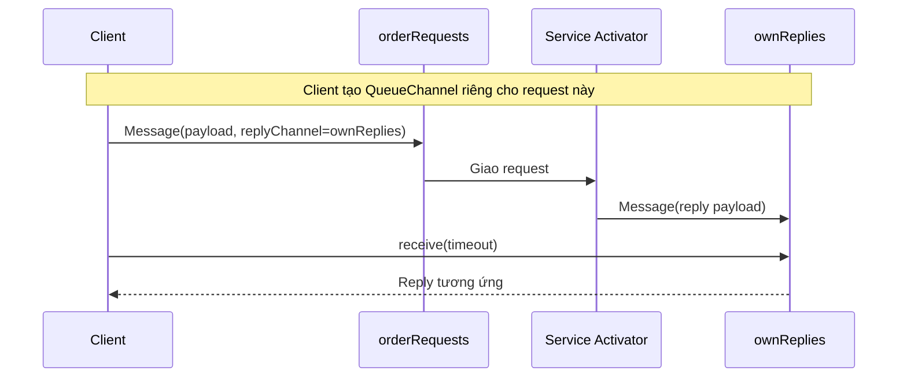

# Request reply — Explicit reply channel trong Spring Integration

## Mục tiêu học tập

Sau bài này, bạn có thể:

- Giải thích vì sao một thông điệp request cần chỉ rõ nơi nhận reply và phân biệt `replyChannel` với kênh nhận request.
- Đặt kênh phản hồi tường minh bằng header `replyChannel`, đọc phản hồi bằng `PollableChannel`, và chọn mô hình kênh riêng cho từng yêu cầu hoặc kênh cố định.
- Hiểu ảnh hưởng của `outputChannel`, `@MessagingGateway`, DirectChannel, kênh bất đồng bộ, timeout và correlation đối với đường đi phản hồi.
- Viết kiểm thử chứng minh reply được chuyển về đúng kênh; nhận diện các trường hợp mất reply, nhận nhầm reply và lỗi xử lý.

Bài thuộc chương **Request reply** của **SPRING_INTEGRATION_PATTERN**. Đây là một phần của Enterprise Integration Patterns trong Spring Integration: thay vì gọi trực tiếp một đối tượng và nhận giá trị trả về qua stack Java, bên gửi phát một `Message` vào kênh, các thành phần có thể Router, Filter, Transformer hoặc Service Activator xử lý nó, rồi một thông điệp khác được gửi về nơi nhận phản hồi. Việc tách các bước này làm luồng ít phụ thuộc và dễ mở rộng, nhưng yêu cầu định nghĩa đường phản hồi rõ ràng.

## 1. Explicit reply channel là gì?

Trong mô hình **Request–Reply**, bên gửi cần biết phản hồi tương ứng sẽ đến đâu. **Explicit reply channel** là kênh nhận reply được chỉ định rõ, thường qua header chuẩn `replyChannel` trên *request message*, thay vì trông chờ một đường phản hồi ngầm định.

Một request gồm hai phần chính:

| Thành phần | Vai trò |
| --- | --- |
| `payload` | Dữ liệu nghiệp vụ, chẳng hạn mã đơn hàng cần kiểm tra. |
| `headers.replyChannel` | Địa chỉ mà thành phần xử lý có thể dùng để gửi thông điệp phản hồi. Giá trị thường là `MessageChannel` hoặc tên kênh được Spring Integration phân giải. |
| `headers.errorChannel` (tùy chọn) | Địa chỉ cho thông điệp lỗi trong những luồng có hỗ trợ gửi lỗi theo kênh; không đồng nghĩa reply thành công. |
| Correlation ID (khi cần) | Khóa giúp đối chiếu request với reply, đặc biệt khi có nhiều yêu cầu đồng thời hoặc kênh phản hồi dùng chung. |

Ví dụ: khách hàng gửi yêu cầu lấy báo giá vào `quoteRequests`, đồng thời gắn `replyChannel = customerAReplies`. Service Activator xử lý yêu cầu và phát `QuoteResponse` về `customerAReplies`. Khách hàng khác có thể dùng cùng kênh request nhưng nhận kết quả qua `customerBReplies`.



Điểm then chốt: **`replyChannel` là thông tin định tuyến trên request**, không phải nơi gửi request. Bên xử lý có thể trả về một giá trị Java; Spring Integration chuyển giá trị đó thành message reply và định tuyến qua kênh phản hồi hợp lệ.

## 2. Cách Spring Integration chọn đường trả lời

Với một handler có khả năng sinh reply, quy tắc thực tế cần nhớ:

1. Nếu endpoint được cấu hình **`outputChannel` tường minh** (ví dụ `@ServiceActivator(outputChannel = "fixedReplies")` hoặc một bước `.channel("fixedReplies")` sau handler trong IntegrationFlow), reply đi theo đường output đó.
2. Nếu không có output channel được cấu hình trên đường phát kết quả, handler thường dùng **`replyChannel` trong header** của request.
3. Nếu không có đường nhận reply hợp lệ, kết quả không tự tìm được bên gọi. Tùy loại endpoint/cấu hình, việc phát reply có thể thất bại hoặc người gọi chờ hết thời gian.
4. Nếu handler trả về `null`, không có payload reply để phát; đây là nguyên nhân thường gặp của timeout.

Tên `replyChannel` là một hằng chuẩn: `MessageHeaders.REPLY_CHANNEL` trong Spring Messaging. Ví dụ đặt kênh trực tiếp:

```java
Message<String> request = MessageBuilder.withPayload("ORD-104")
    .setHeader(MessageHeaders.REPLY_CHANNEL, myReplyChannel)
    .build();
```

Khi `myReplyChannel` là một đối tượng `MessageChannel`, handler có thể gửi phản hồi tới đúng kênh đó trong cùng ứng dụng. Một tên kênh dạng `String` cũng có thể được phân giải từ cấu hình Spring Integration. Tuy nhiên, đối tượng channel không phải một địa chỉ có thể mang nguyên vẹn qua Kafka, HTTP hoặc một process khác; qua biên hệ thống cần thiết kế riêng cơ chế reply destination và correlation.

**Phân biệt quan trọng:** `replyChannel` là địa chỉ mà bên gửi đề nghị sử dụng cho *request cụ thể*, còn `outputChannel` là cấu hình định tuyến của *endpoint xử lý*. Nếu cùng một flow đặt output channel cố định, đừng mặc định header của từng request sẽ thắng cấu hình đó.

## 3. Ví dụ hoàn chỉnh: mỗi request sở hữu một reply channel

Bài toán: nhiều thành phần cùng gửi mã đơn hàng vào `orderRequests`; mỗi lần gọi phải nhận đúng chuỗi `ACCEPTED:<mã đơn>`. Ta dùng một `DirectChannel` cho request và tạo `QueueChannel` riêng cho từng lời gọi.

### 3.1. Cấu hình xử lý request

Ví dụ sử dụng Spring Integration Java DSL và Spring configuration. Cần có dependency Spring Integration trong ứng dụng.

```java
import org.springframework.context.annotation.Bean;
import org.springframework.context.annotation.Configuration;
import org.springframework.integration.annotation.EnableIntegration;
import org.springframework.integration.channel.DirectChannel;
import org.springframework.integration.dsl.IntegrationFlow;
import org.springframework.messaging.MessageChannel;

@Configuration
@EnableIntegration
public class ReplyChannelConfig {

    @Bean("orderRequests")
    public MessageChannel orderRequests() {
        return new DirectChannel();
    }

    @Bean
    public IntegrationFlow orderProcessingFlow() {
        return IntegrationFlow.from("orderRequests")
            .handle(String.class, (orderCode, headers) -> {
                if (orderCode.isBlank()) {
                    throw new IllegalArgumentException("Order code is required");
                }
                return "ACCEPTED:" + orderCode;
            })
            .get();
    }
}
```

Trong ví dụ này, handler sinh `String` làm kết quả và **không khai báo output channel cố định**. Spring Integration có thể định tuyến kết quả đó dựa vào header `replyChannel` trên request đầu vào.

`DirectChannel` gọi subscriber trên luồng thực thi của bên gửi, nếu không có cơ chế bất đồng bộ khác trong flow. Vì vậy lời gọi `send()` có thể đợi đến khi handler hoàn tất. Điều này khác với một kênh có executor, nơi `send()` có thể trả về trước khi reply được tạo.

### 3.2. Client chỉ định nơi nhận reply

```java
import java.util.UUID;

import org.springframework.beans.factory.annotation.Qualifier;
import org.springframework.integration.channel.QueueChannel;
import org.springframework.messaging.Message;
import org.springframework.messaging.MessageChannel;
import org.springframework.messaging.MessageHeaders;
import org.springframework.messaging.support.MessageBuilder;
import org.springframework.stereotype.Component;

@Component
public class OrderClient {
    private final MessageChannel orderRequests;

    public OrderClient(@Qualifier("orderRequests") MessageChannel orderRequests) {
        this.orderRequests = orderRequests;
    }

    public String submitAndAwait(String orderCode) {
        // Mỗi request có một hộp thư phản hồi của riêng mình.
        QueueChannel ownReplies = new QueueChannel(1);

        Message<String> request = MessageBuilder.withPayload(orderCode)
            .setHeader(MessageHeaders.REPLY_CHANNEL, ownReplies)
            .setHeader("businessCorrelationId", UUID.randomUUID().toString())
            .build();

        boolean sent = orderRequests.send(request, 2_000);
        if (!sent) {
            throw new IllegalStateException("Cannot dispatch order request");
        }

        Message<?> reply = ownReplies.receive(3_000);
        if (reply == null) {
            throw new IllegalStateException("Timed out waiting for order reply");
        }

        return (String) reply.getPayload();
    }
}
```

Ví dụ gọi `submitAndAwait("ORD-104")` trả về `"ACCEPTED:ORD-104"`. Những yếu tố tạo nên đường request–reply là:

- `MessageBuilder` gắn **đối tượng** `ownReplies` vào `MessageHeaders.REPLY_CHANNEL`.
- `orderRequests.send(...)` đưa request vào flow xử lý.
- Handler trả kết quả; Spring Integration định tuyến reply đến `ownReplies` do caller chỉ định.
- `ownReplies.receive(3_000)` đọc reply tối đa 3 giây **tính từ lúc bắt đầu gọi `receive`**. Nếu không có reply, nó trả về `null`.

`QueueChannel(1)` thích hợp ở đây vì mỗi lời gọi kỳ vọng đúng **một** reply. Không cần khai báo `ownReplies` thành Spring bean hoặc gắn poller cho việc `receive()` thủ công. Một channel được cấp riêng cho mỗi request cũng tránh việc nhiều caller cùng tiêu thụ nhầm một queue dùng chung.

**Giới hạn timeout:** với `DirectChannel`, phần xử lý đồng bộ diễn ra ngay trong `send()`. Tham số timeout của `send()` không bảo đảm giới hạn tổng thời gian chạy handler; nếu handler chậm, có thể tốn nhiều thời gian trước khi đến `receive()`. Muốn giới hạn toàn bộ nghiệp vụ, cần đặt deadline/timeout phù hợp ở các lời gọi phụ thuộc và điểm thực thi. Trong flow bất đồng bộ, `receive(timeout)` mới là giới hạn chờ phản hồi tại client.

## 4. Kiểm thử reply đến đúng kênh

Đây là phép thử tích hợp nhỏ, kiểm tra việc **định tuyến thực sự** thay vì chỉ kiểm tra phương thức xử lý trả chuỗi đúng. Đoạn kiểm thử giả định `ReplyChannelConfig` ở mục trước đã nằm trong test classpath, cùng JUnit 5 và `spring-test`.

```java
import static org.junit.jupiter.api.Assertions.assertEquals;
import static org.junit.jupiter.api.Assertions.assertNotNull;
import static org.junit.jupiter.api.Assertions.assertTrue;

import org.junit.jupiter.api.Test;
import org.springframework.beans.factory.annotation.Autowired;
import org.springframework.beans.factory.annotation.Qualifier;
import org.springframework.integration.channel.QueueChannel;
import org.springframework.messaging.Message;
import org.springframework.messaging.MessageChannel;
import org.springframework.messaging.MessageHeaders;
import org.springframework.messaging.support.MessageBuilder;
import org.springframework.test.context.junit.jupiter.SpringJUnitConfig;

@SpringJUnitConfig(ReplyChannelConfig.class)
class ReplyChannelIntegrationTest {

    @Autowired
    @Qualifier("orderRequests")
    MessageChannel orderRequests;

    @Test
    void returnsReplyToRequestedChannel() {
        QueueChannel replyA = new QueueChannel(1);
        QueueChannel replyB = new QueueChannel(1);

        assertTrue(orderRequests.send(MessageBuilder.withPayload("A-001")
            .setHeader(MessageHeaders.REPLY_CHANNEL, replyA)
            .build()));

        assertTrue(orderRequests.send(MessageBuilder.withPayload("B-002")
            .setHeader(MessageHeaders.REPLY_CHANNEL, replyB)
            .build()));

        Message<?> resultA = replyA.receive(1_000);
        Message<?> resultB = replyB.receive(1_000);

        assertNotNull(resultA);
        assertNotNull(resultB);
        assertEquals("ACCEPTED:A-001", resultA.getPayload());
        assertEquals("ACCEPTED:B-002", resultB.getPayload());
    }
}
```

Ở đây cùng một request channel xử lý cả hai message, nhưng mỗi reply được trả về channel riêng. Đối với hệ thống thực, nên bổ sung tình huống handler chậm, handler ném exception, request không có `replyChannel`, và nhiều request chạy đồng thời.

## 5. So sánh các cách cấu hình reply

| Cách | Định tuyến | Phù hợp khi | Điều cần quản lý |
| --- | --- | --- | --- |
| Header `replyChannel` là channel riêng | Mỗi request đưa vào một địa chỉ reply riêng | Caller trong cùng ứng dụng cần chủ động gửi/nhận message | Timeout, vòng đời queue, một reply trên mỗi request |
| Header `replyChannel` là tên channel | Caller gửi tên kênh đã đăng ký | Nhiều flow nội bộ dùng các reply endpoint biết trước | Phân giải tên, quyền truy cập, tránh nhầm giữa caller |
| Output channel cố định | Endpoint luôn gửi kết quả ra kênh đã cấu hình | Một consumer/dispatcher trung tâm sẽ thu mọi reply | Correlation và phân phối lại theo caller |
| `@MessagingGateway` | Gateway quản lý việc gọi và nhận reply theo cấu hình | Cần API Java kiểu `submit(): Response` | Timeout, lỗi, giao kèo của gateway |

### 5.1. Khi nào chọn output channel cố định?

Một flow có thể chỉ định rõ kênh phản hồi ở **đầu ra của handler**, thay cho việc phụ thuộc header của từng request. Ví dụ sau là một phương án cấu hình **độc lập** với ví dụ ở mục 3, dùng các kênh `fixedRequests` và `fixedReplies` khác:

```java
@Bean("fixedRequests")
public MessageChannel fixedRequests() {
    return new DirectChannel();
}

@Bean("fixedReplies")
public QueueChannel fixedReplies() {
    return new QueueChannel();
}

@Bean
public IntegrationFlow fixedReplyFlow() {
    return IntegrationFlow.from("fixedRequests")
        .handle(String.class, (code, headers) -> "ACCEPTED:" + code)
        .channel("fixedReplies")
        .get();
}
```

Tất cả reply đi qua `fixedReplies` vì flow đã chỉ định output channel. Nếu nhiều caller cùng gọi `fixedReplies.receive()`, caller A có thể lấy reply của B: `QueueChannel` không tự phân luồng theo correlation ID. Để dùng kênh chung an toàn, cần một **consumer/dispatcher duy nhất** đọc reply, tra khóa correlation rồi chuyển mỗi reply tới đúng yêu cầu đang chờ.

Giá trị `businessCorrelationId` trong ví dụ client là header chủ động đặt để theo dõi nghiệp vụ; không nên giả định một correlation ID sẽ luôn tự sinh hoặc tự tồn tại ở mọi bước xử lý. Nếu có Transformer, Router, Splitter hay Aggregator, hãy kiểm tra rằng khóa đối chiếu còn được bảo toàn qua toàn bộ flow. Nếu request được chia thành nhiều nhánh, thường phải tổng hợp kết quả bằng Aggregator trước khi trả **một** reply cho caller.

### 5.2. Quan hệ với Messaging Gateway

`@MessagingGateway` cung cấp giao diện Java có kiểu dữ liệu rõ ràng, ví dụ:

```java
@MessagingGateway(defaultRequestChannel = "orderRequests")
public interface OrderGateway {
    String submit(String orderCode);
}
```

Khi gateway được đăng ký bằng cấu hình quét/khai báo Spring Integration phù hợp, caller chỉ việc gọi `gateway.submit("ORD-104")`. Gateway sẽ phối hợp gửi request và nhận reply; thông thường nó tự quản lý đường phản hồi của lời gọi. Vì vậy không cần tạo `QueueChannel` thủ công chỉ để thực hiện một lời gọi Java request–reply thông thường.

**Explicit reply channel** đặc biệt hữu ích khi tự làm việc với API `MessageChannel`, muốn một kênh đầu ra xác định, hoặc cần thiết kế đường phản hồi giữa các thành phần độc lập. Gateway là lớp trừu tượng ở phía người gọi, không thay thế nhu cầu hiểu reply routing của flow bên dưới.

## 6. Timeout, lỗi và các tình huống dễ sai

| Hiện tượng | Nguyên nhân thường gặp | Cách kiểm tra/xử lý |
| --- | --- | --- |
| `receive(timeout)` trả `null` | Handler trả `null`, bị Filter loại, chưa chạy, hoặc reply đi kênh khác | Theo dõi request ID; xem output channel và header `replyChannel`; kiểm tra bước trả kết quả |
| Request xử lý thành công nhưng client không nhận | Flow đặt output channel cố định khác với header; hoặc header bị thay đổi | Kiểm tra đường định tuyến cuối cùng và các bước chỉnh sửa header |
| Caller nhận sai kết quả | Nhiều caller cùng `receive()` từ shared queue | Dùng channel riêng cho từng request hoặc dispatcher correlation |
| `send()` ném exception | Handler đồng bộ lỗi qua `DirectChannel` | Bắt và xử lý exception tại caller; đừng chờ một normal reply vốn chưa được tạo |
| Flow bất đồng bộ báo lỗi nhưng không có normal reply | Lỗi có thể gửi thành `ErrorMessage` theo cơ chế error channel | Thiết kế rõ error channel, timeout và chính sách phản hồi lỗi nghiệp vụ |
| Gửi reply tới `DirectChannel` không có subscriber | Kênh phản hồi cần một handler đăng ký nhận | Dùng `QueueChannel` cho `receive()` chủ động, hoặc đăng ký subscriber trước khi phát reply |
| Reply xuất hiện sau timeout | Handler chậm hoặc job đã chạy nhưng caller ngừng chờ | Có deadline, theo dõi late reply, dọn trạng thái pending và quyết định retry an toàn |
| Qua broker/HTTP bị mất thông tin kênh | Đối tượng `MessageChannel` nội bộ không dùng được trực tiếp ở process khác | Dùng địa chỉ reply của transport và correlation ID, cấu hình serialize/resolve header khi phù hợp |

### Phân biệt reply lỗi và error channel

Khi handler có lỗi, có hai kiểu cần tách bạch:

- **Lỗi đồng bộ**: với `DirectChannel`, exception của handler thường lan về lời gọi `send()`. Không thể mặc định sẽ có một reply thông thường trong `replyChannel`.
- **Lỗi bất đồng bộ**: tùy adapter/endpoint, lỗi có thể được đóng gói thành `ErrorMessage` và gửi qua error channel được cấu hình. Client phải có cơ chế quan sát nó, hoặc chuyển thành thông điệp phản hồi nghiệp vụ có schema rõ ràng.

Một thiết kế tốt có thể trả `OrderResponse(status, errorCode, correlationId)` cho lỗi nghiệp vụ dự kiến, đồng thời giữ error channel cho lỗi hạ tầng và xử lý kỹ thuật. Không nên dùng việc `receive()` hết hạn như cách duy nhất để phân loại lỗi.

### Correlation và bảo toàn header

Header `replyChannel` chỉ nói **gửi đến đâu**; correlation ID nói **reply thuộc về request nào**. Với kênh riêng cho từng request, danh tính của kênh đã tách luồng vật lý nên có thể không cần lookup correlation để nhận một phản hồi. Tuy nhiên vẫn nên dùng mã tương quan nghiệp vụ để log, trace và nối request–reply qua nhiều dịch vụ.

Khi tạo một message mới bằng tay, chú ý giữ lại những header được phép truyền tiếp. Ví dụ:

```java
Message<String> forwarded = MessageBuilder
    .withPayload("normalized-" + originalRequest.getPayload())
    .copyHeaders(originalRequest.getHeaders())
    .build();
```

Cách này sao chép các header hiện hữu, trong đó có `replyChannel` (các header hệ thống như ID/timestamp có quy tắc riêng), trừ header nào được cập nhật hay bị thành phần khác loại bỏ. Đừng dùng `MessageBuilder.withPayload(...)` mà bỏ qua `copyHeaders(...)` ở từng bước rồi vô tình đánh mất đường reply và correlation.

## 7. Lựa chọn channel và giới hạn vận hành

**DirectChannel** thích hợp để một handler chạy ngay trong lời gọi gửi; nó dễ hiểu và ít cần đồng bộ dữ liệu. Nhưng một thao tác phụ thuộc chậm trong handler cũng có thể giữ thread của caller. **ExecutorChannel** tách việc gửi khỏi thời điểm xử lý; khi đó caller cần chờ reply và chuẩn bị cho việc kết quả đến muộn. **QueueChannel** là `PollableChannel` cho phía nhận muốn chủ động gọi `receive(timeout)`.

Một vài quy tắc thiết kế:

1. Với lời gọi nội bộ mong đợi đúng một reply, tạo `QueueChannel(1)` cho từng request hoặc dùng Messaging Gateway để framework quản lý.
2. Nếu reply có nhiều bản tin, đừng sử dụng mù quáng một queue dung lượng một; xác định rõ giao kèo multi-reply hoặc gom kết quả bằng Aggregator.
3. Với nhiều caller dùng chung một channel, có một điểm phân phối theo correlation thay vì để nhiều caller tranh nhau `receive()`.
4. Đặt timeout ở đúng lớp: network/client, request processing, chờ reply, và xử lý retry. Retry có thể gửi lặp cùng request; nghiệp vụ cần idempotency khi cần.
5. Quan sát các số liệu chính: request đã gửi, reply thành công, timeout, lỗi theo kênh, late reply, thời gian xử lý và correlation ID. Tránh ghi toàn bộ payload nhạy cảm vào log.

## 8. Bài tập thực hành

Hãy mở rộng ví dụ `OrderClient` theo các bước:

1. Thay payload `String` bằng `OrderRequest(orderId, customerId)` và trả `OrderResponse(orderId, accepted, message)`.
2. Thêm một `Filter` từ chối request thiếu `orderId`. Quyết định rõ trường hợp bị từ chối sẽ tạo reply lỗi nghiệp vụ hay chuyển vào discard channel, tránh để caller chỉ biết timeout.
3. Gửi đồng thời ít nhất 20 request có mã khác nhau, mỗi request sở hữu một `QueueChannel`; xác nhận không có reply bị chuyển nhầm.
4. Thử flow có `ExecutorChannel` và cố ý làm chậm handler để phân biệt thời gian `send()` với thời gian `receive()`.
5. Thử output channel cố định và xây dựng một dispatcher đơn nhận reply theo correlation ID; chứng minh hai client không nhận nhầm phản hồi.

**Tiêu chí hoàn thành:** giải thích được đường đi của một reply cụ thể từ handler đến caller, nêu được channel hay header quyết định đường đi đó, và minh chứng bằng kiểm thử cả trường hợp thành công lẫn timeout/lỗi.

## 9. Ghi nhớ

- Gắn `MessageHeaders.REPLY_CHANNEL` vào request cho biết **kênh nhận kết quả**; nó có thể là một `MessageChannel` hoặc tên kênh được phân giải trong ứng dụng.
- Handler sinh reply không khai báo output channel cố định có thể trả lời theo header này. Một output channel tường minh trên endpoint sẽ điều khiển đường phát kết quả.
- Kênh riêng theo request giúp tránh lẫn reply khi nhiều caller, trong khi kênh dùng chung đòi hỏi correlation và dispatcher đúng.
- Timeout không tự nói lên nguyên nhân: reply có thể bị lọc, trả `null`, đến muộn, gửi sai kênh hoặc handler đã lỗi.
- `@MessagingGateway` thường là lựa chọn gọn cho API request–reply có kiểu; hiểu explicit reply channel vẫn cần thiết để thiết kế, kiểm thử và gỡ lỗi luồng thông điệp Spring Integration.
