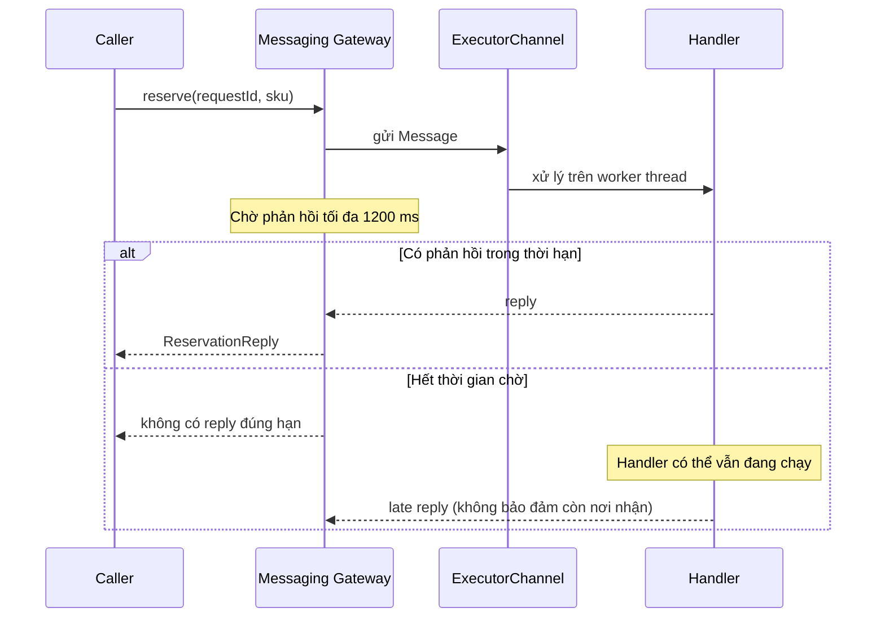

# Reply timeout và xử lý quá hạn trong Spring Integration

## 1. Vì sao request–reply cần giới hạn thời gian chờ?

Trong chương **Request reply** của mô-đun **SPRING_INTEGRATION_PATTERN**, một thành phần gửi thông điệp yêu cầu và mong đợi nhận lại thông điệp phản hồi. Mô hình này giúp tách biệt nơi gọi với nơi xử lý, nhưng cũng đặt ra một câu hỏi quan trọng: **nếu phản hồi không đến thì bên gọi phải làm gì?**

Ví dụ, API đặt hàng gửi yêu cầu giữ hàng sang một luồng Spring Integration. Dịch vụ kho có thể xử lý nhanh, xử lý chậm vì cơ sở dữ liệu quá tải, hoặc không phản hồi vì sự cố. Nếu phía API cứ chờ vô hạn, tài nguyên và trải nghiệm người dùng đều bị ảnh hưởng. Nếu API kết luận “đặt hàng thất bại” ngay khi hết thời gian chờ, trong khi dịch vụ kho vẫn hoàn tất việc giữ hàng, hai phía có thể bất đồng về trạng thái nghiệp vụ.

**Reply timeout** là giới hạn thời gian một thành phần request–reply sẵn sàng đợi phản hồi. Khi hết hạn, phía chờ phải đưa ra quyết định rõ ràng: trả về trạng thái chưa xác định, trả lỗi có ngữ nghĩa thích hợp, sử dụng kết quả dự phòng, hoặc khởi động quy trình tra cứu/bù trừ.

Sau bài này, bạn có thể:

- Phân biệt timeout khi **gửi request**, timeout khi **chờ reply**, và thời hạn xử lý nghiệp vụ.
- Cấu hình reply timeout tại messaging gateway của Spring Integration.
- Giải thích vì sao hết thời gian chờ **không đồng nghĩa** công việc phía sau đã dừng.
- Thiết kế cách xử lý phản hồi đến muộn, retry, idempotency, correlation và khả năng quan sát.
- Kiểm thử các tình huống nhanh, chậm, lỗi và sát ranh giới timeout.

## 2. Timeout diễn ra tại đâu trong luồng thông điệp?

Một luồng request–reply điển hình có các bước sau:

1. Caller gọi phương thức gateway với dữ liệu nghiệp vụ.
2. Gateway chuyển dữ liệu thành `Message`, gửi đến request channel và chuẩn bị một `replyChannel` để nhận phản hồi.
3. Handler xử lý yêu cầu, có thể gọi cơ sở dữ liệu hay hệ thống bên ngoài.
4. Handler gửi kết quả về reply channel; gateway chuyển kết quả thành giá trị trả về cho caller.



Đặt `replyTimeout = 1200 ms` có nghĩa là gateway giới hạn thời gian chờ *sau khi request đã được gửi theo cơ chế của channel*. Nó **không** tự áp dụng deadline lên mọi thao tác phía sau, không bảo đảm ngắt truy vấn SQL và không bảo đảm thu hồi request đã được hệ thống khác tiếp nhận.

### Ba khái niệm dễ bị nhầm lẫn

| Khái niệm | Bắt đầu và kết thúc | Mục đích |
| --- | --- | --- |
| **Request timeout** (`requestTimeout`) | Thời gian được phép chờ để gửi thông điệp vào request channel, khi thao tác gửi có thể chặn | Tránh kẹt ở bước chuyển giao request |
| **Reply timeout** (`replyTimeout`) | Thời gian gateway chờ một reply sau bước gửi | Giới hạn thời gian caller đợi kết quả |
| **Business deadline** | Mốc thời gian nghiệp vụ mà tất cả thành phần cần tôn trọng | Tránh xử lý một yêu cầu đã không còn giá trị |

Ngoài ra, timeout của HTTP client, JDBC, transaction, message broker hoặc các API downstream có thể khác hoàn toàn reply timeout. Mỗi timeout bảo vệ một đoạn xử lý; cấu hình ở gateway không thay thế cấu hình ở các tầng còn lại.

> **Điểm then chốt về `DirectChannel`:** handler của `DirectChannel` thường được gọi ngay trên thread gửi. Nếu handler chặn hai giây thì caller có thể chờ hai giây ngay trong lệnh `send`, dù cấu hình `replyTimeout` là một giây. Để thử nghiệm đúng ý nghĩa của thời gian chờ reply độc lập với thời gian thực thi handler, ví dụ dưới đây dùng `ExecutorChannel`.

## 3. Ví dụ: gateway chờ tối đa 1,2 giây để giữ hàng

Giả sử một ứng dụng quản lý kho nhận yêu cầu giữ hàng. Trả lời trong thời hạn thì caller nhận mã giữ hàng; quá thời hạn thì caller phải coi kết quả là **chưa xác định**, bởi handler vẫn có thể hoàn thành sau đó.

Ví dụ sử dụng Spring Integration với Java 17+ và cấu hình dạng annotation. Các lớp nằm trong cùng package (hoặc package con được quét bởi Spring); tách mỗi `public` type vào file Java riêng khi đưa vào dự án.

### Bước 1 — Tách việc xử lý sang executor

```java
import org.springframework.context.annotation.Bean;
import org.springframework.context.annotation.Configuration;
import org.springframework.integration.annotation.IntegrationComponentScan;
import org.springframework.integration.channel.ExecutorChannel;
import org.springframework.integration.config.EnableIntegration;
import org.springframework.messaging.MessageChannel;
import org.springframework.scheduling.concurrent.ThreadPoolTaskExecutor;

@Configuration
@EnableIntegration
@IntegrationComponentScan
public class ReservationIntegrationConfig {

    @Bean
    public ThreadPoolTaskExecutor reservationExecutor() {
        ThreadPoolTaskExecutor executor = new ThreadPoolTaskExecutor();
        executor.setCorePoolSize(4);
        executor.setMaxPoolSize(8);
        executor.setQueueCapacity(100);
        executor.setThreadNamePrefix("reservation-");
        executor.initialize();
        return executor;
    }

    @Bean("reservationRequests")
    public MessageChannel reservationRequests(
            ThreadPoolTaskExecutor reservationExecutor) {
        return new ExecutorChannel(reservationExecutor);
    }
}
```

`ExecutorChannel` chuyển việc gọi handler sang một worker thread. Sau khi request được chấp nhận để xử lý, gateway có thể chờ reply trong khi handler tiếp tục chạy độc lập. Đây là **bất đồng bộ về thực thi handler**, dù phương thức gateway ở phía caller vẫn có giao diện gọi đồng bộ.

Executor trong ví dụ có hàng đợi giới hạn. Nếu quá tải, request có thể bị từ chối ngay khi gửi; đây là **lỗi chuyển giao/quá tải**, cần được phân biệt với trường hợp đã gửi thành công nhưng không có reply đúng hạn. `requestTimeout` không bắt mọi executor phải chờ có chỗ trống: khả năng chờ tùy theo loại channel và cách executor nhận tác vụ.

### Bước 2 — Cấu hình gateway với hai timeout riêng biệt

```java
import org.springframework.integration.annotation.Gateway;
import org.springframework.integration.annotation.MessagingGateway;

@MessagingGateway(
    defaultRequestChannel = "reservationRequests",
    defaultRequestTimeout = "200",
    defaultReplyTimeout = "1200"
)
public interface ReservationGateway {

    @Gateway
    ReservationReply reserve(ReservationRequest request);
}
```

Các giá trị timeout trên được tính bằng **mili giây**: `200` cho bước gửi request (khi channel có hỗ trợ chờ gửi) và `1200` cho việc chờ reply. Annotation `@Gateway` cũng có thể dùng để ghi đè cấu hình ở từng phương thức khi ứng dụng có nhiều loại yêu cầu.

Với phương thức trả về một object như ví dụ, nếu không có reply trong thời gian chờ, gateway thường trả về `null`. Lỗi gửi message, exception từ handler hoặc cấu hình luồng lỗi có thể tạo ra exception riêng. Vì vậy caller phải xử lý **cả trường hợp không có reply lẫn trường hợp có lỗi**; không giả định mọi thất bại đều được biểu diễn bằng một exception timeout.

### Bước 3 — Handler tạo phản hồi

```java
public record ReservationRequest(
    String requestId,
    String sku,
    int quantity,
    long simulatedDelayMs
) {}

public record ReservationReply(
    String requestId,
    String reservationId,
    String state
) {}
```

```java
import org.springframework.integration.annotation.ServiceActivator;
import org.springframework.stereotype.Component;

@Component
public class ReservationHandler {

    @ServiceActivator(inputChannel = "reservationRequests")
    public ReservationReply reserve(ReservationRequest request) {
        try {
            // Chỉ mô phỏng độ trễ để quan sát timeout.
            Thread.sleep(request.simulatedDelayMs());
        } catch (InterruptedException ex) {
            Thread.currentThread().interrupt();
            throw new IllegalStateException("Reservation was interrupted", ex);
        }

        return new ReservationReply(
            request.requestId(),
            "RSV-" + request.requestId(),
            "RESERVED"
        );
    }
}
```

Spring Integration dùng thông tin reply channel đi cùng message để định tuyến kết quả từ service activator về gateway. Ở ví dụ cơ bản này không cần khai báo một output channel cố định. Trong hệ thống thực, thay `Thread.sleep` bằng thao tác giữ hàng có transaction, kiểm tra tồn kho và cơ chế chống xử lý trùng yêu cầu.

### Bước 4 — Diễn giải hai lần gọi

```java
ReservationReply fast = gateway.reserve(
    new ReservationRequest("req-101", "SKU-01", 2, 100)
);
// Thường có reply với state = RESERVED.

ReservationReply slow = gateway.reserve(
    new ReservationRequest("req-102", "SKU-01", 2, 2000)
);
if (slow == null) {
    // Chưa có phản hồi trong 1200 ms.
    // Ghi nhận requestId=req-102 và tra cứu trạng thái sau.
    // KHÔNG kết luận chắc chắn rằng giữ hàng đã thất bại.
}
```

Kết quả minh họa có tính thời gian tương đối: độ trễ scheduler, tình trạng executor và máy chạy có thể làm thời gian đo được khác con số cấu hình. Ví dụ thứ hai cố ý để handler chạy lâu hơn thời gian gateway chờ. **Gateway ngừng đợi** và **handler ngừng xử lý** là hai sự kiện khác nhau.

## 4. Điều gì xảy ra khi phản hồi đến muộn?

Giả sử luồng diễn ra như sau:

| Thời điểm tương đối | Sự kiện | Quan sát |
| --- | --- | --- |
| `t = 0 ms` | Caller gửi `req-102` | Gateway tạo phiên chờ reply |
| `t ≈ 1200 ms` | Chưa có reply | Gateway hết thời gian chờ; caller nhận kết quả vắng mặt |
| `t ≈ 2000 ms` | Handler hoàn thành giữ hàng | Trạng thái kho có thể đã thay đổi |
| Sau đó | Handler cố gửi reply | Caller ban đầu đã hết thời gian chờ |

Gateway thường dùng reply channel tạm thời cho lời gọi đồng bộ. Khi lời gọi hết hạn, không được giả định phản hồi đến muộn vẫn có người tiêu thụ. Tùy channel và cấu hình, late reply có thể không được nhận, bị loại bỏ hoặc phát sinh lỗi khi gửi. Cần kiểm tra hành vi cụ thể theo phiên bản và topology đang sử dụng, đặc biệt nếu thêm aggregator, queue hoặc broker.

Nếu hệ thống cần **lưu được kết quả đến muộn**, hãy thiết kế một luồng kết quả độc lập với phiên chờ tạm thời:

```text
Client --requestId--> Gateway --> Xử lý giữ hàng
   |                                  |
   |--- hết hạn chờ ------------------|
   |                                  v
   |                         Lưu trạng thái theo requestId
   |
   +-- GET /reservations/{requestId} --> PENDING / RESERVED / REJECTED
```

Trong thiết kế này, `requestId` là khóa nghiệp vụ ổn định để tra cứu, chống trùng và đối soát. Không nên coi header `replyChannel` tạm thời là kho lưu trữ kết quả, cũng không nên mặc định header correlation của một số endpoint sẽ trùng với mã yêu cầu nghiệp vụ. Nếu cần theo dõi xuyên service hoặc broker, chủ động truyền `requestId` (hoặc `correlationId` do ứng dụng quy định) cùng thông điệp và log.

### Phản hồi HTTP nào hợp lý?

- Với truy vấn chỉ đọc, caller có thể trả lỗi timeout phù hợp hoặc dùng cache nếu dữ liệu cũ vẫn chấp nhận được.
- Với thao tác thay đổi trạng thái (giữ hàng, thanh toán, phát lệnh), **không có reply chưa chứng minh thao tác thất bại**. Có thể trả `202 Accepted` kèm `requestId` khi hệ thống **đã xác nhận tiếp nhận, có lưu trạng thái và hỗ trợ tra cứu**. Nếu chưa có bằng chứng request đã được nhận, phải diễn đạt tình trạng bất định đúng với thực tế.
- Nếu ứng dụng dùng thông báo bất đồng bộ, có thể cung cấp webhook hoặc sự kiện hoàn tất thay cho việc bắt caller chờ quá lâu.

Chọn cách phản hồi dựa trên cam kết nghiệp vụ và khả năng lưu trạng thái thực có, không chỉ dựa vào một giá trị `replyTimeout`.

## 5. Thiết kế chính sách xử lý quá hạn

### 5.1. Dự trù thời gian từ đầu đến cuối

Hãy xác định **deadline tổng** từ điểm nhận yêu cầu (ví dụ API cho phép 3 giây), rồi chia ngân sách cho từng bước. Một phương án minh họa:

| Công đoạn | Ngân sách minh họa |
| --- | ---: |
| Xác thực và chuẩn hóa request | 150 ms |
| Gửi vào integration channel | 100 ms |
| Chờ reply tại gateway | 1800 ms |
| Dự phòng cho mạng, serialize và response | 450 ms |
| **Tổng đã phân bổ** | **2500 ms** |

Phần còn lại của deadline tổng cho phép sai lệch scheduler và tầng hạ tầng. Các số trên chỉ là ví dụ; chọn timeout thực tế từ SLO và dữ liệu latency (đặc biệt p95/p99) của dịch vụ. Một timeout ở tầng ngoài ngắn hơn tổng thời gian bên trong sẽ làm phản hồi bị cắt trước khi các thành phần hoàn tất.

Đối với xử lý nhiều chặng, có thể truyền `deadlineAt` theo thời gian tuyệt đối hoặc `remainingBudgetMs` để những chặng sau không bắt đầu công việc đã hết giá trị. Chú ý đồng hồ giữa các máy có thể lệch nhau; cần có chính sách nhất quán khi truyền deadline qua service.

### 5.2. Phân loại outcome, tránh gộp thành một lỗi chung

| Outcome | Điều đã biết | Phản ứng khuyến nghị |
| --- | --- | --- |
| Reply thành công | Có kết quả đúng hạn | Trả dữ liệu, ghi success metric |
| Reply lỗi nghiệp vụ | Handler đã trả trạng thái từ chối rõ ràng | Trả mã nghiệp vụ phù hợp; thường không retry mù |
| Gửi request thất bại | Bước chuyển giao có lỗi | Xem xét backpressure/retry gửi với chính sách chống trùng |
| Hết thời gian chờ reply | Caller không nhận được kết quả đúng hạn | Ghi trạng thái bất định, tra cứu hoặc nhận kết quả về sau |
| Handler phát sinh exception | Có lỗi xử lý được báo qua đường lỗi | Phân loại lỗi, xử lý theo error flow |
| Late reply | Xử lý hoàn thành sau khi caller ngừng đợi | Đối soát theo requestId; không cập nhật nhầm một phiên chờ khác |

**Timeout không tự sinh ra một reply nghiệp vụ `FAILED`.** Nếu muốn thống nhất contract cho API, lớp ứng dụng nên ánh xạ `null`, exception và trạng thái từ kho dữ liệu thành các loại kết quả riêng như `SUCCESS`, `REJECTED`, `PENDING`, `UNKNOWN`.

### 5.3. Retry chỉ an toàn khi có idempotency

Một lỗi thường gặp:

1. Caller gửi yêu cầu giữ hàng `req-102`.
2. Gateway timeout ở 1,2 giây.
3. Caller tự retry với một mã yêu cầu mới.
4. Lần đầu và lần hai đều giữ hàng thành công.

Để tránh xử lý trùng:

- Gán một `requestId` hoặc `idempotencyKey` duy nhất cho **ý định nghiệp vụ** và giữ nguyên khóa đó qua các lần retry.
- Tại điểm thay đổi trạng thái, kiểm tra khóa trong nơi lưu trữ có tính nguyên tử (ví dụ unique constraint hoặc giao dịch phù hợp); trả lại kết quả cũ cho yêu cầu đã xử lý.
- Phân biệt lỗi tạm thời có thể retry với lỗi từ chối nghiệp vụ; giới hạn số lần retry, thêm backoff và jitter, không retry vô hạn.
- Kiểm tra deadline còn hiệu lực trước khi thực hiện retry. Nếu caller không biết kết quả của lần trước, ưu tiên truy vấn trạng thái theo khóa thay vì gửi lệnh mới ngay.

Một `RequestHandlerRetryAdvice` hoặc retry ở client có thể hỗ trợ lỗi tạm thời, nhưng retry chỉ là cơ chế gọi lại. Nó **không tự đảm bảo** exactly-once effect cho thao tác nghiệp vụ.

### 5.4. Cancellation, bù trừ và độ bền dữ liệu

Hết hạn tại gateway không tự hủy worker thread, không rollback một giao dịch đã commit và không hoàn tác request đã gửi cho hệ thống ngoài. Nếu nghiệp vụ cần dừng công việc quá hạn, hãy cho handler kiểm tra deadline/hủy ở những điểm an toàn, cấu hình timeout của client downstream và quản lý transaction. Ngắt thread chỉ có tác dụng khi đoạn mã và thư viện bên dưới hỗ trợ.

Khi thao tác có thể đã hoàn thành, một lệnh “hủy” cũng phải là thao tác nghiệp vụ có kiểm soát: kiểm tra trạng thái hiện tại, dùng khóa idempotency và có thể phải thực hiện bù trừ (ví dụ giải phóng phần hàng đã giữ). Với công việc cần tồn tại qua khởi động lại, dùng message broker hoặc persistent store thích hợp; riêng `ExecutorChannel` trong ví dụ chỉ có hàng đợi trong bộ nhớ.

## 6. Kết hợp với các pattern khác của Spring Integration

Reply timeout thường xuất hiện cùng những pattern sau:

| Pattern | Vai trò trong xử lý quá hạn |
| --- | --- |
| **Gateway** | Giao diện request–reply đồng bộ, có `requestTimeout` và `replyTimeout` |
| **Router / Filter** | Phân luồng request đã quá deadline hoặc yêu cầu không hợp lệ |
| **Transformer** | Chuẩn hóa `requestId`, deadline và dữ liệu lỗi trước khi gửi tiếp |
| **Splitter / Aggregator** | Gộp nhiều reply; phải có correlation và chiến lược timeout/partial result riêng |
| **Error channel** | Nhận và xử lý các lỗi thực thi được chuyển thành error message theo cấu hình |
| **Retry advice** | Thử lại lỗi tạm thời trong giới hạn; cần idempotency và ngân sách thời gian |

Đặc biệt, timeout của **aggregator** (ví dụ thời gian chờ đủ các mảnh sau khi split) và timeout của **gateway** là hai cơ chế khác nhau. Aggregator có thể quyết định phát kết quả từng phần hoặc hết nhóm; gateway chỉ biết nó có nhận được reply đúng lúc hay không. Tương tự, error channel có nhiệm vụ xử lý exception; trường hợp không có reply trước deadline không nhất thiết tự động trở thành error message.

## 7. Theo dõi và kiểm thử

Một hệ thống có reply timeout cần đủ bằng chứng để phân biệt “chưa nhận được” với “đã thất bại”. Các log và metric hữu ích gồm:

- `requestId`/`correlationId`, loại thao tác, channel, thời điểm gửi, deadline và thời điểm xử lý hoàn tất.
- Thời gian từ gửi đến reply, số request thành công, số gateway timeout, số lỗi gửi, số exception từ handler và số late reply.
- Độ dài hàng đợi, số worker đang chạy, số lần executor từ chối request, p95/p99 latency theo loại thao tác.
- Trạng thái nghiệp vụ cuối cùng để điều tra những request đã timeout nhưng sau đó vẫn hoàn tất.

Khi ghi log, tránh đưa payload nhạy cảm hoặc token vào thông điệp; chỉ log các trường phục vụ tương quan và chẩn đoán.

### Ma trận kiểm thử nên có

| Kịch bản | Kỳ vọng |
| --- | --- |
| Handler phản hồi trước `replyTimeout` | Gateway trả reply đúng nội dung |
| Handler chậm hơn `replyTimeout` | Caller không phải đợi đến khi handler kết thúc; kết quả được coi là chưa xác định |
| Độ trễ sát ngưỡng | Không phụ thuộc vào thời gian chính xác tuyệt đối; kiểm tra ranh giới và hành vi race |
| Executor đầy hoặc từ chối công việc | Lỗi gửi/quá tải được phân loại riêng với reply timeout |
| Handler ném exception | Đường xử lý lỗi được xác minh độc lập |
| Reply đến sau khi gateway đã timeout | Không gán nhầm kết quả cho request khác; có cơ chế đối soát nếu cần |
| Retry cùng `requestId` | Chỉ có một tác động nghiệp vụ, trả lại kết quả phù hợp |
| Worker hoặc ứng dụng restart | Hành vi khôi phục phù hợp với yêu cầu độ bền dữ liệu |

Khi kiểm thử timeout, dùng handler được kiểm soát bằng latch/future hoặc đồng hồ giả lập ở tầng phù hợp nếu có thể; tránh phụ thuộc hoàn toàn vào `Thread.sleep` và kỳ vọng chính xác từng mili giây trên CI. Với ví dụ có `ExecutorChannel`, cần xác nhận handler thực sự chạy trên thread khác, vì nếu vô tình đổi về `DirectChannel`, ý nghĩa kiểm thử `replyTimeout` có thể thay đổi.

## 8. Những lỗi thiết kế cần tránh

**Cho rằng `replyTimeout` luôn là giới hạn thời gian thực thi tổng.** Trên luồng đồng bộ qua `DirectChannel`, thời gian handler chặn có thể nằm ngoài thời gian gateway chờ reply. Hãy nhìn vào topology thực, không chỉ annotation.

**Đồng nhất timeout với nghiệp vụ thất bại.** Một thao tác ghi có thể thành công sau khi caller đã ngừng chờ. Cần có trạng thái bất định, khóa yêu cầu và khả năng đối soát.

**Retry bằng request mới.** Nếu không có idempotency, một lần timeout có thể dẫn đến nhiều lần ghi dữ liệu hoặc đặt hàng trùng.

**Bỏ qua lỗi trước giai đoạn chờ reply.** Executor từ chối việc, channel gửi lỗi, handler exception hoặc lỗi chuyển đổi message phải được xử lý theo nguồn gốc.

**Chỉ log lỗi gateway.** Không có `requestId` và trạng thái hoàn tất phía handler thì khó biết request quá hạn có thực sự gây tác động nghiệp vụ hay không.

**Dùng hàng đợi trong bộ nhớ cho tác vụ buộc phải sống sót khi tiến trình chết.** `ExecutorChannel` phù hợp để tách thread; yêu cầu durable delivery cần cơ chế lưu bền khác.

## 9. Bài thực hành tự kiểm tra

1. Chạy ví dụ với `simulatedDelayMs = 100`, rồi `2000`; ghi lại giá trị caller nhận, thời điểm handler hoàn thành và requestId.
2. Đổi `ExecutorChannel` thành `DirectChannel`; so sánh tổng thời gian caller bị chặn và giải thích vì sao reply timeout không còn biểu hiện như trước.
3. Thêm một nơi lưu trạng thái theo `requestId` với các trạng thái `PENDING`, `RESERVED`, `REJECTED`; để caller tra cứu sau khi hết hạn.
4. Gửi hai lần cùng `requestId`, mô phỏng một lần reply bị trễ; kiểm tra rằng nghiệp vụ chỉ giữ hàng một lần.
5. Làm đầy executor và xác nhận hệ thống báo lỗi quá tải tách biệt với tình huống reply quá hạn.

Để đánh giá bài làm, hãy tự trả lời: *“Nếu caller ngừng chờ lúc 1,2 giây nhưng handler giữ hàng thành công lúc 2 giây, dữ liệu nào chứng minh được kết quả cuối cùng, và client phải làm gì để không tạo lệnh trùng?”* Một thiết kế request–reply chịu lỗi tốt phải có câu trả lời rõ ràng cho tình huống đó.

## Ghi nhớ

- `requestTimeout` liên quan bước **gửi**; `replyTimeout` liên quan bước **chờ nhận**; deadline nghiệp vụ cần được kiểm soát xuyên các thành phần.
- Dùng ranh giới xử lý bất đồng bộ thích hợp khi muốn gateway có thể ngừng đợi trong lúc handler còn chạy.
- Reply đến muộn và timeout tạo ra **trạng thái chưa chắc chắn** đối với caller, nhất là các thao tác thay đổi dữ liệu.
- `requestId`, idempotency, lưu trạng thái, retry có kiểm soát và observability giúp biến một timeout khó chẩn đoán thành một luồng có thể đối soát.
