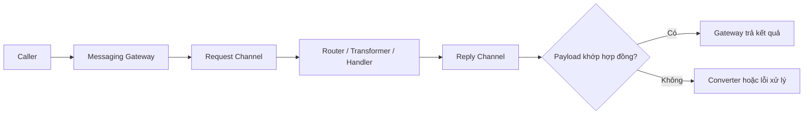
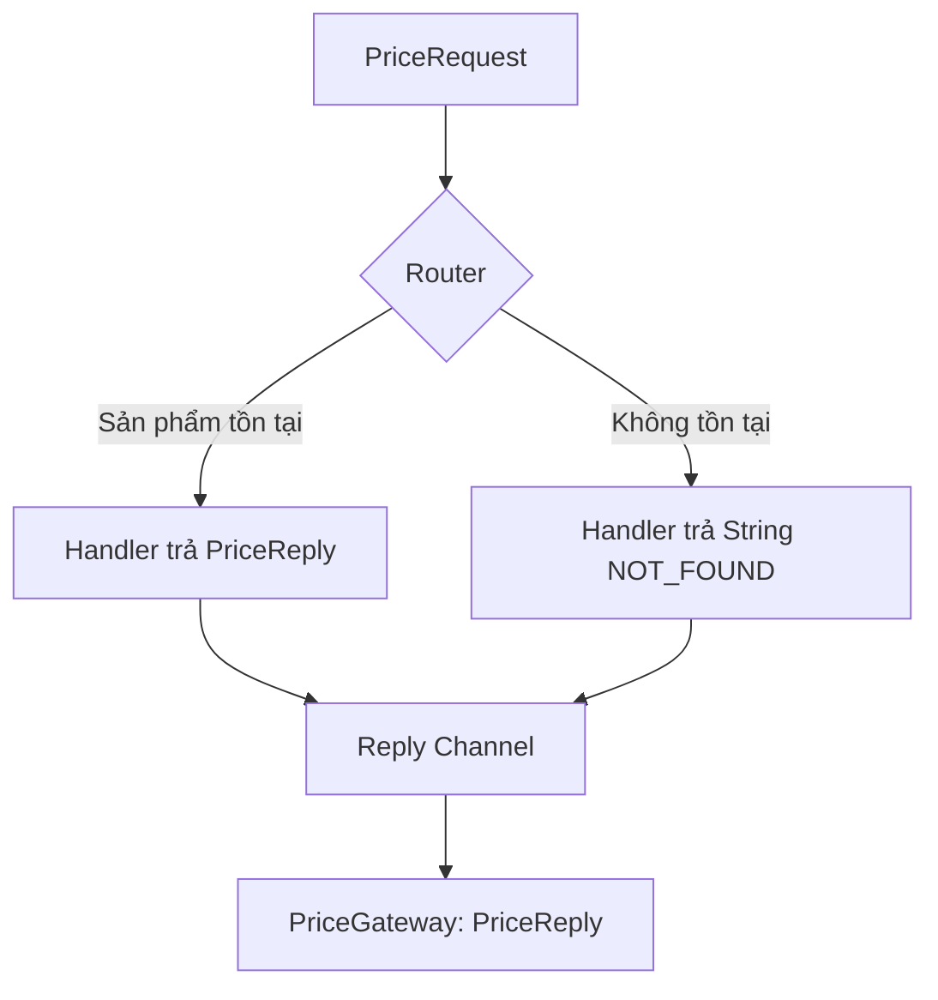

# Reply message không đúng kiểu

Trong chương **Request reply** của module **SPRING_INTEGRATION_PATTERN**, Gateway gửi yêu cầu vào luồng Spring Integration rồi chờ nhận kết quả để trả cho bên gọi. Khi triển khai Enterprise Integration Patterns với Router, Filter, Transformer, Service Activator, Splitter/Aggregator và các kết nối ngoài, phản hồi có thể đi qua nhiều thành phần trước khi về Gateway. Một sự cố thường gặp là **reply có payload không phù hợp với kiểu dữ liệu bên gọi mong đợi**.

Lỗi này có thể xuất hiện ngay cả khi request đã xử lý xong, reply đã tới đúng kênh và correlation không sai. Mục tiêu của bài là phát hiện đúng nguyên nhân, chuẩn hóa hợp đồng dữ liệu và kiểm thử các nhánh phản hồi trong luồng thông điệp ít phụ thuộc, dễ mở rộng.

Sau bài học, bạn có thể:

- Xác định **kiểu trả về của Gateway** và **kiểu payload reply thực tế**.
- Phân biệt sai kiểu dữ liệu, sai định dạng tuần tự hóa, lỗi chuyển đổi và reply gửi nhầm kênh.
- Thiết kế Transformer/adapter để tạo phản hồi đúng hợp đồng.
- Xử lý lỗi chuyển đổi, timeout và error channel mà không làm mất thông tin chẩn đoán.
- Kiểm thử kiểu payload sau những nhánh xử lý khác nhau.

## 1. “Reply không đúng kiểu” nghĩa là gì?

Giả sử API của ứng dụng khai báo:

```java
PriceReply quote(PriceRequest request);
```

Đối với bên gọi, kết quả hợp lệ là một `PriceReply`. Nhưng handler cuối luồng trả về chuỗi `"OK"`, một `Map`, một DTO phiên bản cũ, hoặc một đối tượng lỗi. Khi Gateway nhận reply, nó phải đáp ứng kiểu trả về đã khai báo. Nếu không có phép chuyển đổi phù hợp, lời gọi có thể thất bại vì kiểu không tương thích hoặc vì không chuyển đổi được thông điệp.

Đừng coi mọi reply dạng `String` đều là lỗi: nếu hợp đồng thực sự yêu cầu `String` thì `String` là đúng. Vấn đề nằm ở **sự không khớp giữa hợp đồng của bên nhận và dữ liệu thực tế của bên gửi**.

| Hợp đồng/điều kiện | Reply thực tế | Đánh giá |
| --- | --- | --- |
| Gateway trả `PriceReply` | `PriceReply` đúng cấu trúc | Phù hợp |
| Gateway trả `PriceReply` | `String "OK"` | Sai kiểu, trừ khi có bộ chuyển đổi được cấu hình và kết quả chuyển đổi hợp lệ |
| Gateway trả `PriceReply` | JSON dạng `String` | Cần deserialization sang `PriceReply`; JSON hợp lệ chưa có nghĩa đã đúng kiểu Java |
| Gateway trả `Message<PriceReply>` | Message có payload `PriceReply` | Phù hợp và bên gọi còn truy cập được headers |
| Gateway trả `PriceReply` | `ErrorMessage`/exception đi vào đường reply nghiệp vụ | Sai hợp đồng phản hồi; cần đường xử lý lỗi được định nghĩa rõ |
| Gateway trả `PriceReply` | Không có reply trước timeout | Là lỗi thiếu/chậm phản hồi, **không phải** lỗi sai kiểu |

### Dấu hiệu dễ nhận biết

- Lời gọi Gateway ném ngoại lệ chuyển đổi/ép kiểu sau khi phía xử lý đã trả về dữ liệu.
- Message trên kênh reply có payload là `String` hoặc `Map`, còn Java method trả kiểu DTO.
- Luồng hoạt động với một nhánh Router nhưng lỗi ở nhánh khác vì hai nhánh trả kiểu khác nhau.
- Lỗi chỉ xuất hiện khi payload lấy từ broker, HTTP hoặc JSON có trường khác so với DTO nội bộ.
- Sau Splitter/Aggregator, dữ liệu trả về là một `List` các phần tử trong khi Gateway chỉ nhận một đối tượng tổng hợp.

**Lưu ý:** Thông báo ngoại lệ cụ thể có thể là lỗi chuyển đổi message, lỗi xử lý hoặc lỗi ép kiểu ở caller; điều này phụ thuộc kiểu khai báo, cấu hình converter và vị trí phát sinh lỗi. Không nên dựa duy nhất vào tên exception để kết luận.

## 2. Xác định đúng điểm xảy ra sai kiểu

Một luồng request-reply có thể hình dung như sau:



Trong Spring Integration, cần tách **envelope của Message** khỏi **payload**:

```text
Message<PriceReply>
  headers
    id
    replyChannel
    errorChannel  (nếu có)
    contentType   (nếu có)
    ...custom headers
  payload
    PriceReply(...)
```

- `Message<?>.getPayload()` trả dữ liệu nghiệp vụ, với kiểu runtime có thể là `PriceReply`, `String`, `byte[]`, `Map`...
- `Message<?>.getHeaders()` chứa thông tin kênh trả lời, định danh, kiểu nội dung và metadata khác. Header `contentType` là thông tin về biểu diễn; nó **không tự biến** một chuỗi JSON thành DTO nếu không có bước chuyển đổi tương ứng.
- Method Gateway trả `PriceReply` thường cần payload tương thích `PriceReply`; method trả `Message<PriceReply>` mang theo cả message. Định nghĩa method cần phù hợp với phần caller thực sự cần.
- `replyChannel` xác định **reply gửi về đâu**; correlation xác định **reply thuộc yêu cầu nào**. Cả hai cơ chế này không bảo đảm payload đã đúng kiểu.

Ví dụ log chẩn đoán an toàn ở một điểm biên xử lý reply:

```java
void inspectReply(org.springframework.messaging.Message<?> message) {
    Object payload = message.getPayload();
    String actualType = payload.getClass().getName();
    Object contentType = message.getHeaders().get("contentType");

    log.info("replyPayloadType={}, contentType={}", actualType, contentType);
    // Có thể ghi thêm correlation/request ID; tránh log dữ liệu nhạy cảm.
}
```

Đừng chỉ log giá trị `toString()` của payload. Một `String` chứa `"{\"amount\":100}"` và một `PriceReply` có thể trông tương tự trong log nhưng là hai kiểu Java hoàn toàn khác nhau.

## 3. Ví dụ Spring Integration: handler trả sai kiểu

Giả sử hệ thống yêu cầu báo giá và Gateway cần trả `PriceReply`. Trong ví dụ Java 17+ dưới đây, hai `record` mô tả hợp đồng:

```java
package example.pricing;

import java.math.BigDecimal;

record PriceRequest(String sku, int quantity) {}
record PriceReply(String sku, BigDecimal total) {}
```

Gateway:

```java
package example.pricing;

import org.springframework.integration.annotation.MessagingGateway;

@MessagingGateway(
    defaultRequestChannel = "pricing.requests",
    defaultReplyTimeout = "3000"
)
interface PriceGateway {
    PriceReply quote(PriceRequest request);
}
```

**Lỗi điển hình:** một handler trong `IntegrationFlow` xử lý yêu cầu nhưng trả chuỗi trạng thái:

```java
// Đoạn handler KHÔNG phù hợp với kiểu trả về PriceReply của Gateway:
.handle(PriceRequest.class, (request, headers) -> "PRICE_OK")
```

Về nghiệp vụ, chuỗi này có thể nói “đã xử lý xong”, nhưng nó không chứa `sku` và `total` để tạo báo giá. Nếu không có converter phù hợp, Gateway không thể đáp ứng hợp đồng trả `PriceReply`.

**Sửa tại nguồn tạo reply:** trả dữ liệu đã được tính toán và đóng gói thành đúng DTO.

```java
package example.pricing;

import java.math.BigDecimal;

import org.springframework.context.annotation.Bean;
import org.springframework.context.annotation.Configuration;
import org.springframework.integration.annotation.IntegrationComponentScan;
import org.springframework.integration.dsl.IntegrationFlow;

@Configuration
@IntegrationComponentScan
class PricingFlowConfiguration {

    @Bean
    IntegrationFlow pricingFlow() {
        return IntegrationFlow.from("pricing.requests")
            .handle(PriceRequest.class, (request, headers) -> {
                if (request.quantity() <= 0) {
                    throw new IllegalArgumentException("quantity phải > 0");
                }

                BigDecimal unitPrice = new BigDecimal("19.90");
                BigDecimal total = unitPrice.multiply(
                    BigDecimal.valueOf(request.quantity())
                );

                return new PriceReply(request.sku(), total);
            })
            .get();
    }
}
```

Lời gọi:

```java
PriceReply reply = priceGateway.quote(new PriceRequest("SKU-01", 3));
// reply.sku()   == "SKU-01"
// reply.total() == 59.70
```

Ở đây, Service Activator luôn trả `PriceReply` khi thành công; lỗi dữ liệu đầu vào đi theo cơ chế exception của flow. Tránh “sửa” bằng cách đổi return type của Gateway thành `Object` chỉ để che giấu sự bất nhất; caller sẽ phải tự đoán các kiểu kết quả và lỗi có thể chuyển đến giai đoạn muộn hơn.

## 4. Khi cần chuyển đổi kiểu: chuyển đổi ở ranh giới có chủ đích

Không phải hệ thống ngoài nào cũng trả trực tiếp một Java DTO nội bộ. REST có thể trả JSON, broker có thể đưa `byte[]`, dịch vụ khác có thể trả DTO chứa chuỗi tiền tệ. Cách xử lý là **xác định schema của bên ngoài, kiểm tra và chuyển đổi một lần ở ranh giới**.

Ví dụ dịch vụ ngoài trả:

```json
{
  "sku": "SKU-01",
  "total": "59.70",
  "currency": "VND"
}
```

Trong khi ứng dụng dùng `PriceReply(String sku, BigDecimal total)`. Ta có thể dùng DTO riêng cho hợp đồng bên ngoài:

```java
record ExternalPriceReply(String sku, String total, String currency) {}

static PriceReply normalize(ExternalPriceReply external) {
    if (external == null || external.sku() == null ||
        external.total() == null || !"VND".equals(external.currency())) {
        throw new IllegalArgumentException("Reply ngoài không hợp lệ");
    }

    try {
        return new PriceReply(
            external.sku(),
            new java.math.BigDecimal(external.total())
        );
    } catch (NumberFormatException exception) {
        throw new IllegalArgumentException(
            "total trong reply không phải số hợp lệ", exception
        );
    }
}
```

Thứ tự các bước nên là:

1. Adapter nhận bytes/JSON theo hợp đồng với dịch vụ ngoài.
2. Deserializer chuyển sang `ExternalPriceReply` (hoặc một dạng đã xác thực).
3. Transformer kiểm tra các trường bắt buộc, quy tắc nghiệp vụ, định dạng số và đơn vị tiền tệ.
4. Transformer tạo `PriceReply` cho phần còn lại của flow.
5. Gateway trả `PriceReply` cho caller.

Trong ví dụ, `currency` được kiểm tra là VND và không có bước đổi tiền tệ; hệ thống thực tế cần đưa đơn vị vào DTO hoặc thực hiện chuyển đổi có quy tắc nếu có nhiều loại tiền. Việc chuyển JSON thành DTO có thể thực hiện bằng converter/serializer theo adapter được dùng hoặc Transformer do mình cấu hình. Một header `contentType=application/json` không thay thế cho việc cấu hình này.

### Các lựa chọn và giới hạn

| Cách làm | Khi thích hợp | Điểm cần lưu ý |
| --- | --- | --- |
| Handler trả đúng DTO | Mọi bước xử lý chạy trong JVM và cùng hợp đồng | Đơn giản, dễ kiểm tra kiểu |
| Transformer trước reply | Bên ngoài trả biểu diễn khác hoặc cần chuẩn hóa dữ liệu | Cần xác thực định dạng, null và sai schema |
| Message converter | Adapter/gateway có hỗ trợ conversion theo cấu hình | Kiểm tra converter nào thực sự được áp dụng, không giả định tự động hỗ trợ mọi kiểu |
| Gateway trả `Message<PriceReply>` | Caller cần cả payload và headers | Payload vẫn cần đúng hợp đồng |
| Trả kiểu `Object` | Chỉ khi API được thiết kế rõ để hỗ trợ nhiều kiểu | Phải mô tả và kiểm tra tập kiểu kết quả; không dùng để né việc chuẩn hóa |

**Không nên ép kiểu mù quáng:**

```java
// Dễ lỗi khi payload thực tế là String, byte[] hoặc Map:
PriceReply reply = (PriceReply) message.getPayload();
```

Nếu chưa chắc dữ liệu đã qua Transformer, hãy kiểm tra kiểu có chủ đích:

```java
static PriceReply requirePriceReply(Object payload) {
    if (payload instanceof PriceReply reply) {
        return reply;
    }
    throw new IllegalArgumentException(
        "Unexpected reply payload type: " +
        (payload == null ? "null" : payload.getClass().getName())
    );
}
```

Với `Message<?>.getPayload()`, Spring Messaging thường yêu cầu payload không null; trả `null` từ một handler cần được xem xét riêng vì trong một số cấu hình điều đó có thể mang ý nghĩa **không sinh reply**. Đừng dùng giá trị `null` để đại diện cho “reply lỗi” khi caller mong đợi DTO thành công.

## 5. Router, Filter, Splitter/Aggregator và nhiều kiểu reply

Khi luồng có nhiều nhánh, hãy kiểm tra **mọi đường dẫn đi đến reply channel**:



Trong sơ đồ trên, nhánh thành công hợp lệ nhưng nhánh không tìm thấy hàng trả `String`, khiến Gateway gặp reply khác kiểu. Có hai cách thiết kế rõ ràng:

- **Lỗi là ngoại lệ:** nhánh lỗi ném exception có chủ đích (ví dụ `ProductNotFoundException`) và được xử lý ở nhánh error tương ứng.
- **Lỗi là kết quả nghiệp vụ:** định nghĩa một hợp đồng nhất quán, chẳng hạn `PriceResult` có trạng thái và dữ liệu, rồi *cả hai nhánh* cùng trả `PriceResult`.

Ví dụ hợp đồng kết quả rõ ràng:

```java
sealed interface PriceResult permits PriceSuccess, PriceNotFound {}

record PriceSuccess(String sku, java.math.BigDecimal total)
    implements PriceResult {}

record PriceNotFound(String sku, String reason)
    implements PriceResult {}

// Gateway phải khai báo: PriceResult quote(PriceRequest request);
```

Điểm cốt lõi là lựa chọn một trong các mô hình và áp dụng xuyên suốt. Không để nhánh thành công trả DTO, nhánh lỗi trả chuỗi tùy ý, rồi hy vọng Gateway tự suy ra ý nghĩa.

Các pattern khác cũng có rủi ro tương tự:

- **Filter:** message bị loại có thể không có reply; hiện tượng đó thường là timeout hoặc không có kết quả, không đồng nghĩa sai kiểu. Nếu cần phản hồi từ chối, hãy thiết kế rõ payload từ chối.
- **Transformer:** dễ làm đổi `PriceReply` thành `String`/JSON hoặc ngược lại. Hãy kiểm tra kiểu đầu ra sau bước chuyển đổi.
- **Splitter/Aggregator:** Splitter phát nhiều phần; Aggregator có thể trả `Collection`, danh sách hoặc một kết quả tổng hợp tùy strategy. Nếu Gateway cần một DTO, hãy chuyển kết quả đã gom thành DTO trước khi reply.
- **Gateway gọi dịch vụ khác:** gateway lồng nhau hoặc outbound adapter có thể trả response có kiểu khác; cần map giữa hợp đồng của hai ranh giới.

## 6. Phân biệt lỗi sai kiểu với timeout, correlation và error channel

Để xử lý chính xác, cần quan sát từng giai đoạn:

| Hiện tượng | Câu hỏi chẩn đoán | Hướng xử lý |
| --- | --- | --- |
| Không nhận reply | Handler có trả kết quả không? Filter có bỏ message không? Có tới `replyChannel` không? | Kiểm tra đường đi và timeout |
| Reply của yêu cầu khác | Correlation/reply-to có đúng với request đang đợi? | Sửa ghép cặp hoặc định tuyến |
| Reply tới đúng nơi nhưng sai kiểu | `payload.getClass()` là gì? Gateway khai báo trả kiểu gì? | Chuẩn hóa payload, kiểm tra converter |
| JSON/bytes hợp lệ nhưng vẫn lỗi | Adapter đã deserialize chưa? Schema/version có khớp? | Thêm/chỉnh converter và validation |
| Exception được nhận như reply nghiệp vụ | Luồng có gửi `ErrorMessage`/exception vào kênh reply thường không? | Tách hợp đồng thành công/lỗi |
| Lỗi chỉ trên một nhánh | Các nhánh Router/Aggregator có trả cùng loại kết quả? | Thống nhất hợp đồng đầu ra |

**Timeout:** `defaultReplyTimeout` là giới hạn chờ reply của Gateway. Việc trả một payload sai kiểu và việc hoàn toàn không trả reply là hai nhánh sự cố riêng. Tăng timeout không sửa được lỗi sai kiểu.

**Correlation:** một reply gắn đúng `requestId` hoặc đi đúng `replyChannel` vẫn có thể chứa `String` thay vì `PriceReply`. Không đổi correlation ID nhằm “sửa” lỗi chuyển đổi.

**Error channel:** lỗi trong handler/converter có thể được ném về phía caller hoặc chuyển thành `ErrorMessage` qua cơ chế xử lý lỗi, tùy loại flow và cấu hình đồng bộ/bất đồng bộ. `ErrorMessage` là thông điệp lỗi, không mặc nhiên là DTO reply thành công. Khi có xử lý retry, cần phân biệt exception tạm thời (có thể thử lại) với schema không hợp lệ (thử lại y nguyên thường vẫn thất bại).

Trong production, nên ghi log tối thiểu:

```text
requestId=REQ-2048
stage=reply-validation
expectedType=example.pricing.PriceReply
actualType=java.lang.String
contentType=application/json
route=external-price-adapter
outcome=TYPE_MISMATCH
```

Khi có thể, liên kết thêm trace ID, thời gian xử lý, số lần retry và tên channel. Không ghi dữ liệu tài chính hoặc thông tin khách hàng vào log chỉ để xác định kiểu payload.

## 7. Kiểm thử và xác minh hợp đồng reply

Một kiểm thử tốt kiểm tra cả **giá trị** và **kiểu payload**, đồng thời bao phủ các nhánh có thể trả kết quả. Với cấu hình handler đúng ở phần 3, có thể viết bài test mức ứng dụng (ví dụ dùng Spring Boot Test và JUnit):

```java
package example.pricing;

import static org.assertj.core.api.Assertions.assertThat;

import org.junit.jupiter.api.Test;
import org.springframework.beans.factory.annotation.Autowired;
import org.springframework.boot.test.context.SpringBootTest;

@SpringBootTest
class PriceGatewayIntegrationTest {

    @Autowired
    PriceGateway gateway;

    @Test
    void returnsExpectedPriceReply() {
        PriceReply reply = gateway.quote(
            new PriceRequest("SKU-01", 3)
        );

        assertThat(reply).isInstanceOf(PriceReply.class);
        assertThat(reply.sku()).isEqualTo("SKU-01");
        assertThat(reply.total()).isEqualByComparingTo("59.70");
    }
}
```

Đoạn test này là **ví dụ tham khảo** để áp dụng trong một dự án có dependency Spring Boot Test, JUnit và AssertJ; bài viết không thực thi test. Với luồng thực tế, nên kiểm tra thêm:

1. **Reply đúng kiểu:** handler trả `PriceReply`, Gateway trả được đầy đủ dữ liệu.
2. **Reply sai kiểu:** cố ý cấu hình handler trả `String` hoặc `Map`; xác nhận hệ thống báo lỗi rõ ràng hoặc sử dụng converter đúng như thiết kế. Không phụ thuộc cứng vào tên exception nếu có nhiều tầng chuyển đổi.
3. **Reply từ mỗi nhánh Router:** nhánh thành công và nhánh lỗi đều tuân thủ hợp đồng đã chọn.
4. **Reply từ broker:** payload dạng bytes/JSON được deserialization, xác thực, chuyển đổi rồi mới đến Gateway.
5. **Dữ liệu lỗi:** thiếu trường bắt buộc, sai `contentType`, số tiền không parse được hoặc schema phiên bản cũ phải có cách xử lý xác định.
6. **Không có reply:** Filter/timeout sinh hành vi khác với sai kiểu, tránh gộp chung thành một loại lỗi.
7. **Reply đồng thời:** nhiều request hoàn thành trái thứ tự vẫn được định tuyến đúng người gọi và mỗi payload đúng kiểu.
8. **Aggregator:** kết quả gom nhóm cuối cùng trùng kiểu trả về của Gateway, kể cả khi nhóm hết hạn hoặc trả kết quả một phần.

Ở mức unit test, hàm `normalize(...)` có thể được kiểm tra mà không cần khởi tạo toàn bộ Spring context. Ở mức integration test, cần quan sát đúng endpoint và kênh reply. Đối với hệ thống có message broker, thêm kiểm thử hợp đồng giữa producer/consumer nhằm phát hiện thay đổi schema trước khi triển khai.

## 8. Checklist điều tra nhanh khi gặp lỗi

Khi caller báo “nhận reply không đúng kiểu”, lần lượt:

1. Mở **chữ ký method Gateway**: trả DTO, primitive, `Message<T>`, `Collection<T>`, hay kiểu khác?
2. Xác định **đối tượng cuối cùng được gửi về reply channel**: payload runtime và content type là gì?
3. Kiểm tra các **Transformer, Router, Filter, Service Activator và Aggregator** trước điểm reply; nhánh nào tạo kiểu khác?
4. Nếu đi qua adapter hoặc broker, xác nhận **quy tắc serialization/deserialization**, schema, tên trường và phiên bản API.
5. Kiểm tra **converter** thực sự được cấu hình và được gọi tại điểm nào; đừng giả định phép đổi kiểu tồn tại.
6. Kiểm tra **error channel, timeout và correlation** để loại trừ lỗi đường đi hoặc reply thiếu.
7. Sửa ở **điểm tạo/chuẩn hóa dữ liệu**, ghi rõ hợp đồng reply và thêm kiểm thử cho nhánh gây lỗi.

## Kết luận

Trong Spring Integration, Gateway có thể nhận reply đúng kênh nhưng vẫn không trả được kết quả vì **payload không khớp kiểu mà caller khai báo**. Phòng tránh bằng cách thống nhất hợp đồng dữ liệu, chuyển đổi ở ranh giới, kiểm tra toàn bộ nhánh của Router/Aggregator và tách rõ lỗi nghiệp vụ với payload thành công. Khi điều tra, hãy xem kiểu thực tế của payload cùng nơi converter chạy; nhờ đó có thể sửa đúng điểm phát sinh lỗi và tiếp tục mở rộng luồng message mà không làm suy yếu tính đúng đắn của request-reply.
