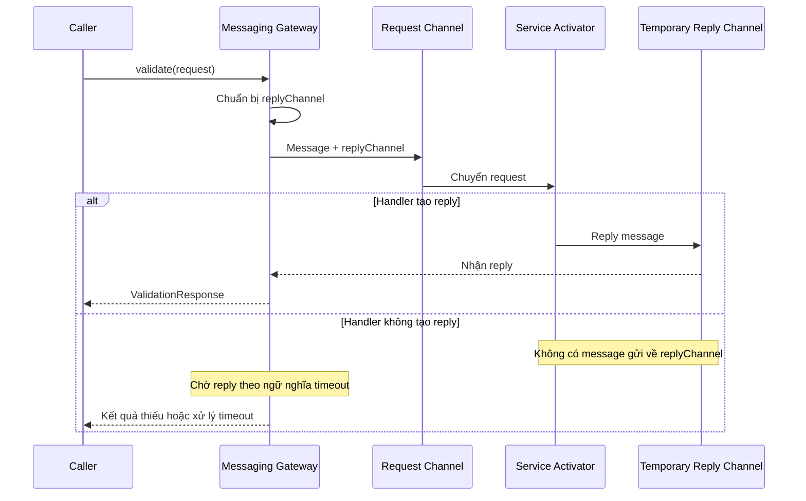
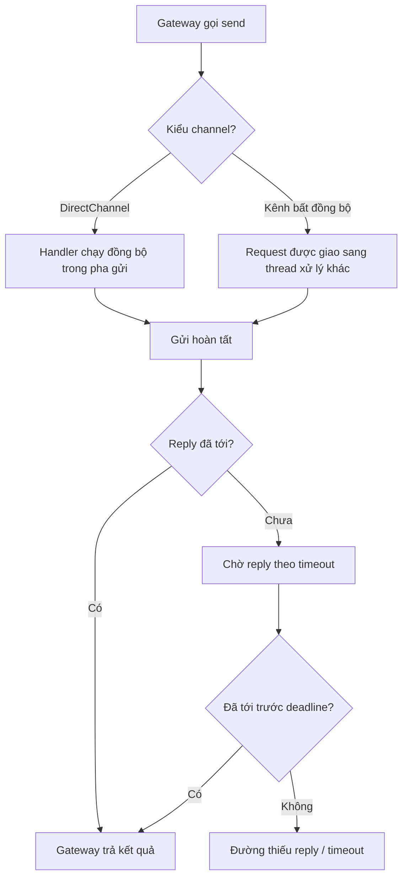

# Không có handler trả reply trong Spring Integration Request–Reply

## 1. Vấn đề: request đã gửi nhưng không thấy phản hồi

Trong mô hình **Request–Reply**, phía gọi gửi một yêu cầu và mong nhận một phản hồi tương ứng. Với **Spring Integration**, yêu cầu có thể được gửi qua `Messaging Gateway`, đi vào `MessageChannel`, trải qua một hay nhiều thành phần của luồng, sau đó trả kết quả về Gateway qua `replyChannel`.

Một lỗi thường gặp là **có thành phần đã nhận hoặc xử lý request nhưng không có reply được tạo ra**. Người gọi có thể chờ đến timeout, nhận `null`, hoặc nhận lỗi nếu luồng được cấu hình bắt buộc trả lời. Hành vi quan sát được còn phụ thuộc kiểu Gateway, cấu hình timeout, đường đi của message và nơi xảy ra lỗi.

Chủ đề này thuộc chương **Request reply** của module **SPRING_INTEGRATION_PATTERN**. Các kiến thức Router, Filter, Transformer, Splitter, Aggregator, Gateway, retry, error channel và correlation đều có liên quan: chỉ cần một nhánh không tạo kết quả hoặc làm mất đường trả reply, hợp đồng request–reply có thể bị phá vỡ.

Sau khi học, bạn có thể:

- Phân biệt **không có handler nhận request** với **có handler nhưng không tạo reply**.
- Giải thích vai trò của `replyChannel`, temporary reply channel và reply timeout.
- Tạo ví dụ tái hiện hiện tượng Gateway không nhận được reply.
- Dùng `requiresReply`, nhánh phản hồi nghiệp vụ, error flow và kiểm thử để xử lý có chủ đích.
- Điều tra một request bị mất phản hồi mà không nhầm lẫn timeout với lỗi xử lý.

## 2. Request–Reply hoạt động như thế nào?

Với phương thức Gateway cần giá trị trả về, luồng thông thường gồm:

1. Gateway tạo `Message` chứa payload và các header cần thiết.
2. Gateway gửi message đến request channel, đồng thời xác định kênh nhận phản hồi; nhiều cấu hình sử dụng một **temporary reply channel** cho từng lời gọi.
3. Một message handler nhận và xử lý yêu cầu.
4. Thành phần xử lý tạo một reply (payload hoặc message) và framework chuyển reply về kênh thích hợp.
5. Gateway lấy reply và trả kết quả cho lời gọi Java.



**Điểm mấu chốt:** đưa request đến handler **không đồng nghĩa** đã hoàn tất request–reply. Một lời gọi có kiểu trả về cần một kết quả cuối cùng, hoặc một cách thông báo lỗi được thiết kế rõ ràng.

### Temporary reply channel không tự tạo ra phản hồi

Temporary reply channel chỉ cung cấp nơi nhận kết quả cho một lời gọi. Nó không sinh payload, không tự gọi handler bị thiếu và không tự sửa một nhánh bị lọc mất request. Nếu mọi thành phần của flow kết thúc mà không tạo reply, kênh phản hồi vẫn không có message để trả về.

### Header `replyChannel` quan trọng ở đâu?

Header `replyChannel` định danh đích gửi phản hồi. Khi một `ServiceActivator` trả về đối tượng, framework có thể dùng ngữ cảnh message đến để gửi kết quả về Gateway. Nếu một bước xử lý tự tạo message mới rồi bỏ header cần thiết hoặc ghi đè routing, reply có thể đi sai nơi hoặc không tới caller.

## 3. Phân biệt các lỗi dễ bị gọi chung là “không có reply”

| Tình huống | Request đã vào handler? | Hiện tượng điển hình | Hướng điều tra |
|---|---|---|---|
| **Không có subscriber/handler cho request channel** | Chưa | Với `DirectChannel`, gửi request thường thất bại ngay bằng lỗi delivery | Kiểm tra tên channel, đăng ký bean, subscription, component scan |
| **Handler trả `null` hoặc không sinh output** | Có | Gateway có thể chờ hết reply timeout rồi nhận kết quả rỗng | Kiểm tra giá trị trả về và `requiresReply` |
| **Filter loại request** | Có thể bị chặn trước handler sau | Không có reply nếu không thiết kế nhánh discard/rejection | Kiểm tra tiêu chí lọc, `discardChannel` hoặc chính sách từ chối |
| **Router chuyển vào nhánh không có terminal reply** | Có thể | Caller không nhận được kết quả dự kiến | Kiểm tra tất cả các nhánh và đích định tuyến |
| **Reply được gửi sai channel** | Có | Handler đã tạo kết quả nhưng Gateway vẫn không nhận | Kiểm tra `replyChannel`, `outputChannel` và code gửi thủ công |
| **Handler lỗi, lỗi bị xử lý ở nơi khác** | Có | Gateway nhận exception hoặc chờ tiếp, tùy error flow | Kiểm tra exception, error channel và error handling |
| **Handler chạy quá chậm** | Đang hoặc đã | Hết hạn chờ hoặc caller bị giữ trong xử lý đồng bộ | Kiểm tra ranh giới thread và timeout thực tế |
| **Nhiều reply cho một request** | Có | Reply đầu tiên được dùng, những reply còn lại không khớp hợp đồng | Thiết kế Aggregator hoặc thu thập kết quả trước khi trả |

Hai tình huống đầu đặc biệt quan trọng:

- **Không có handler nào nhận:** request có thể chưa được gửi thành công. Đây là vấn đề dispatch/subscription.
- **Có handler nhận nhưng không trả:** request đã được tiêu thụ; vấn đề nằm ở hợp đồng output, routing phản hồi hoặc thời gian xử lý.

Vì vậy, trước khi sửa `replyTimeout`, hãy xác nhận request thực sự đã tới handler hay chưa.

## 4. Ví dụ tái hiện: Service Activator trả `null`

Ta xây dựng một luồng kiểm tra đơn hàng đơn giản. Lệnh có `orderId = "SILENT"` cố tình không tạo phản hồi, để quan sát ảnh hưởng lên Gateway. Đây là **nhánh mô phỏng lỗi phục vụ học tập**, không phải cách xử lý đơn hàng khuyến nghị.

Ví dụ dùng Java 17+, Spring Boot, Spring Integration và Spring Boot Test tương thích. Các lớp dưới đây được đặt trong cùng package `com.example.requestreply`.

### 4.1. Request và response

```java
// ValidationRequest.java
package com.example.requestreply;

public record ValidationRequest(String orderId, int quantity) {
}
```

```java
// ValidationResponse.java
package com.example.requestreply;

public record ValidationResponse(
        String orderId,
        boolean accepted,
        String reason) {
}
```

Response có `accepted` và `reason` để về sau có thể biểu diễn cả trường hợp nghiệp vụ bị từ chối mà vẫn trả về một kết quả đầy đủ.

### 4.2. Request channel

```java
// ValidationChannels.java
package com.example.requestreply;

import org.springframework.context.annotation.Bean;
import org.springframework.context.annotation.Configuration;
import org.springframework.integration.channel.DirectChannel;
import org.springframework.messaging.MessageChannel;

@Configuration
public class ValidationChannels {

    @Bean
    public MessageChannel validationRequests() {
        return new DirectChannel();
    }
}
```

`DirectChannel` chuyển message trực tiếp đến subscriber trên thread gọi, nếu không có cầu nối bất đồng bộ nào khác. Nó có một yêu cầu thiết yếu: **phải có handler đăng ký nhận** để dispatch request thành công.

### 4.3. Messaging Gateway

```java
// ValidationGateway.java
package com.example.requestreply;

import org.springframework.integration.annotation.MessagingGateway;

@MessagingGateway(
        defaultRequestChannel = "validationRequests",
        defaultReplyTimeout = "750"
)
public interface ValidationGateway {

    ValidationResponse validate(ValidationRequest request);
}
```

Phương thức trả về `ValidationResponse` cho biết caller mong một kết quả. Ở đây cấu hình reply timeout 750 mili giây cho bài thực hành; trong thực tế cần chọn thời gian theo độ trễ của luồng, yêu cầu nghiệp vụ và mô hình chạy đồng bộ/bất đồng bộ.

### 4.4. Handler có nhánh không tạo reply

```java
// ValidationService.java
package com.example.requestreply;

import org.springframework.integration.annotation.ServiceActivator;
import org.springframework.stereotype.Component;

@Component
public class ValidationService {

    @ServiceActivator(inputChannel = "validationRequests")
    public ValidationResponse validate(ValidationRequest request) {
        if ("SILENT".equals(request.orderId())) {
            // Mô phỏng lỗi: request đã được nhận nhưng không sinh reply.
            return null;
        }

        if (request.quantity() <= 0) {
            return new ValidationResponse(
                    request.orderId(), false, "Quantity must be positive");
        }

        return new ValidationResponse(
                request.orderId(), true, "Accepted");
    }
}
```

Có ba nhánh quan sát được:

1. Đơn hàng thông thường có số lượng dương → trả `ValidationResponse(..., true, ...)`.
2. Số lượng không hợp lệ → vẫn trả `ValidationResponse(..., false, ...)`, thể hiện nghiệp vụ đã từ chối.
3. Mã `SILENT` → trả `null`; Service Activator mặc định không bắt buộc có reply và không phát ra thông điệp phản hồi từ nhánh này.

Trường hợp 2 là cách diễn đạt từ chối theo hợp đồng request–reply. Trường hợp 3 là trạng thái không hoàn tất hợp đồng.

### 4.5. Kích hoạt Spring Integration

```java
// RequestReplyApplication.java
package com.example.requestreply;

import org.springframework.boot.SpringApplication;
import org.springframework.boot.autoconfigure.SpringBootApplication;
import org.springframework.integration.annotation.IntegrationComponentScan;
import org.springframework.integration.config.EnableIntegration;

@SpringBootApplication
@EnableIntegration
@IntegrationComponentScan
public class RequestReplyApplication {

    public static void main(String[] args) {
        SpringApplication.run(RequestReplyApplication.class, args);
    }
}
```

`@IntegrationComponentScan` đăng ký interface Gateway, `@ServiceActivator` được phát hiện qua bean component và kênh có tên `validationRequests` được tạo trong cấu hình.

### 4.6. Kiểm thử đường có reply và đường thiếu reply

```java
// ValidationGatewayTest.java
package com.example.requestreply;

import static org.junit.jupiter.api.Assertions.assertEquals;
import static org.junit.jupiter.api.Assertions.assertNull;

import org.junit.jupiter.api.Test;
import org.springframework.beans.factory.annotation.Autowired;
import org.springframework.boot.test.context.SpringBootTest;

@SpringBootTest
class ValidationGatewayTest {

    @Autowired
    ValidationGateway gateway;

    @Test
    void returnsBusinessReplyWhenHandlerProducesOne() {
        ValidationResponse reply =
                gateway.validate(new ValidationRequest("A-101", 2));

        assertEquals(
                new ValidationResponse("A-101", true, "Accepted"),
                reply);
    }

    @Test
    void missingReplyCanEndWithNullAfterReplyTimeout() {
        ValidationResponse reply =
                gateway.validate(new ValidationRequest("SILENT", 2));

        assertNull(reply);
    }
}
```

Trong luồng minh họa này, `validate("SILENT")` không sinh reply và Gateway có thể trả `null` khi thời gian chờ kết thúc. Bài kiểm thử được viết cho cấu hình cụ thể đã khai báo; kết quả ở luồng khác có thể là exception nếu đã bật `requiresReply`, sử dụng error flow khác, hoặc xảy ra lỗi ngay lúc gửi request.

**Lưu ý:** bài kiểm thử trên nhằm tái hiện lỗi. Kiểm thử của một ứng dụng thực nên xác nhận trường hợp nghiệp vụ bị từ chối **nhận được một response rõ ràng**, thay vì coi `null` là trạng thái nghiệp vụ bình thường.

## 5. Cách xử lý 1: luôn tạo một kết quả nghiệp vụ

Đối với request–reply có kiểu trả về không rỗng, giải pháp dễ hiểu nhất là **xây dựng hợp đồng trả lời cho mọi nhánh nghiệp vụ hợp lệ**. Ví dụ, thay nhánh `SILENT` bằng:

```java
if ("SILENT".equals(request.orderId())) {
    return new ValidationResponse(
            request.orderId(),
            false,
            "Order cannot be validated");
}
```

Ở đây response thể hiện một kết quả *từ chối*. Nó khác với việc không có reply: caller có thể ghi log, hiển thị lỗi, retry theo quy tắc nghiệp vụ hoặc quyết định không tiếp tục.

Ưu điểm của phản hồi có cấu trúc:

- Caller phân biệt thành công, bị từ chối và lỗi hạ tầng.
- Không phải chờ hết reply timeout để biết một quyết định nghiệp vụ đã có kết quả.
- Có thể kiểm thử đầy đủ các nhánh bằng các assertion trên `accepted` và `reason`.
- Dễ ánh xạ sang HTTP response, event hoặc lớp dịch vụ phía ngoài.

Đừng gửi một response giả thành công chỉ để thoát timeout. Nếu hệ thống phụ thuộc thực sự gặp lỗi, hãy biểu diễn lỗi theo chính sách đã thống nhất, hoặc cho exception lan về đường xử lý lỗi phù hợp.

## 6. Cách xử lý 2: bắt buộc Service Activator có reply

Nếu một Service Activator **luôn phải tạo reply theo thiết kế**, có thể cấu hình `requiresReply` để phát hiện sớm trường hợp handler trả `null`:

```java
@ServiceActivator(
        inputChannel = "validationRequests",
        requiresReply = "true"
)
public ValidationResponse validate(ValidationRequest request) {
    if ("SILENT".equals(request.orderId())) {
        return null;
    }

    return new ValidationResponse(
            request.orderId(), true, "Accepted");
}
```

Đây là **phiên bản thay thế** của handler ở phần 4, không phải handler thứ hai cùng đăng ký vào `validationRequests`. Khi nhánh trả `null`, framework có thể phát sinh `ReplyRequiredException` thay vì âm thầm kết thúc xử lý mà không có reply.

Sự khác biệt về ngữ nghĩa:

| Thiết lập handler | Handler trả `null` | Ý nghĩa |
|---|---|---|
| `requiresReply` không bật | Không tạo reply | Phù hợp với một số consumer một chiều, nhưng dễ gây timeout cho Gateway cần kết quả |
| `requiresReply = "true"` | Phát sinh lỗi thiếu reply | Hữu ích khi muốn lỗi hợp đồng được phát hiện ngay |

Cơ chế này không có nghĩa mọi lỗi đều trở thành response nghiệp vụ. Với luồng đồng bộ, lỗi có thể lan về caller; với luồng bất đồng bộ, cách bắt và định tuyến lỗi còn phụ thuộc error channel và cấu hình tương ứng. Hãy chọn chính sách xử lý exception rõ ràng.

## 7. Filter, Router và Splitter cũng có thể làm “mất” reply

### 7.1. Filter từ chối request

`Filter` có thể loại bỏ message trước khi nó đến handler tiếp theo. Trong request–reply, một message bị loại mà không có chính sách trả lời sẽ tạo ra một nhánh không có kết quả.

Có ba hướng xử lý phổ biến:

- **Trả về response từ chối:** chuyển nhánh discard đến handler tạo response có cấu trúc.
- **Ném lỗi khi bị từ chối:** sử dụng tính năng rejection của Filter, rồi ánh xạ lỗi theo hợp đồng ứng dụng.
- **Chấp nhận không có phản hồi:** chỉ khi lời gọi thực sự có ngữ nghĩa một chiều hoặc caller đã định nghĩa chính sách timeout.

Ví dụ nghiệp vụ: đơn hàng số lượng không hợp lệ cần trả `ValidationResponse(accepted=false)`; không nên thả message rồi buộc caller đoán nguyên nhân sau timeout.

### 7.2. Router chọn nhánh không dẫn tới reply

Một Router có thể đưa request đến các kênh xử lý khác nhau. Nếu nhánh A có Service Activator trả response nhưng nhánh B chỉ log rồi kết thúc, chỉ request vào A đáp ứng hợp đồng request–reply.

Cần xét **mọi nhánh**: success, validation error, unknown type, default route và exception path. Với tình huống không có route phù hợp, chọn cách trả lỗi rõ ràng thay vì lặng lẽ bỏ request.

### 7.3. Splitter tạo nhiều message, Aggregator chưa hoàn tất

Sau khi tách một request thành nhiều message, không nên để mỗi nhánh tự ý trả về temporary reply channel của Gateway. Nếu hợp đồng yêu cầu **một kết quả tổng hợp**, dùng Aggregator với correlation và release strategy phù hợp để tạo một reply cuối.

Nếu Aggregator chờ thiếu một phần hoặc điều kiện release không bao giờ đạt, Gateway có thể chờ reply vô ích. Cần kiểm tra `correlationId`, `sequenceSize`, điều kiện release, timeout và chính sách đối với nhóm thiếu thành phần.

### 7.4. Transformer hoặc custom MessageHandler làm mất `replyChannel`

Một số xử lý tự tạo `Message` mà không giữ header từ request ban đầu sẽ làm mất địa chỉ trả lời. Khi phải xây dựng message thủ công, cần bảo toàn các header phục vụ routing/correlation theo hợp đồng của flow.

```java
import org.springframework.messaging.Message;
import org.springframework.messaging.support.MessageBuilder;

// incoming: message gốc; result: payload mới.
Message<?> outgoing = MessageBuilder.withPayload(result)
        .copyHeaders(incoming.getHeaders())
        .build();
```

Đây là cách minh họa việc bảo toàn header ở luồng nội bộ. Khi đi qua broker hoặc dịch vụ ngoài, không tự động chuyển toàn bộ header: cần chọn và ánh xạ header được phép truyền. Một reply trả về qua hệ thống ngoài có thể cần correlation ID bền vững thay cho tham chiếu trực tiếp tới kênh trong bộ nhớ.

## 8. Timeout: vì sao “750 ms” chưa chắc là giới hạn của cả lời gọi?

Gateway thường có hai pha quan trọng:

1. **Gửi request:** đưa message vào request channel, có thể bao gồm cả thực thi handler đồng bộ.
2. **Chờ reply:** đợi thông điệp phản hồi trên reply channel, với giới hạn chờ tương ứng.

Với `DirectChannel`, handler chạy cùng thread gửi theo kiểu đồng bộ. Nếu handler thực hiện một truy vấn mất năm giây trước khi trả `null`, lời gọi có thể đã bị giữ năm giây ở pha gửi; reply timeout 750 ms **không tự ngắt** truy vấn hay cắt toàn bộ lời gọi tại mốc 750 ms.



Sơ đồ giản lược mốc thời gian; cơ chế send/reply thực tế còn tùy loại channel và gateway.

Để đặt deadline toàn bộ có ý nghĩa, cần kết hợp timeout ở các tầng phù hợp, ví dụ timeout cho I/O, HTTP client, database, tác vụ bất đồng bộ và chính sách hủy công việc. Đừng chỉ tăng reply timeout để che một handler không sinh output.

### Reply đến muộn thì sao?

Khi một caller đã hết thời gian chờ, temporary reply channel gắn với lời gọi đó có thể không còn chấp nhận reply như trước. Reply muộn có thể gây lỗi gửi hoặc được đưa qua cơ chế xử lý lỗi; hành vi cụ thể tùy vào loại channel, timing và cấu hình framework.

Nếu nghiệp vụ cho phép xử lý kéo dài lâu hơn vòng đời lời gọi, nên sử dụng một thiết kế bất đồng bộ có `requestId`/correlation ID, trạng thái công việc, nơi lưu kết quả và cách tra cứu hoặc thông báo kết quả; không dựa vào temporary reply channel để lưu kết quả bền vững.

## 9. Lỗi xử lý và error channel khác với “không có reply”

Giả sử handler ném `IllegalStateException`:

```java
if ("BROKEN".equals(request.orderId())) {
    throw new IllegalStateException("Validation service failed");
}
```

Đây là **lỗi thực thi**, không phải handler trả `null`. Trên đường xử lý đồng bộ, exception thường có thể được đưa ngược về Gateway và caller. Ở đường bất đồng bộ, lỗi có thể được bọc trong `ErrorMessage` và đi theo error channel. Nếu error flow chỉ ghi log mà không cung cấp kết quả cho caller, lời gọi vẫn có thể hết thời gian chờ phản hồi.

| Trường hợp | Nên quan sát |
|---|---|
| Handler trả `null` | Có output reply hay không, cấu hình `requiresReply` |
| Handler ném exception | Stack trace, exception wrapping, error channel |
| Request gửi thất bại | Channel subscription, dispatcher, send timeout |
| Reply sinh ra nhưng mất | Header `replyChannel`, output channel, lỗi gửi reply |
| Reply trễ | Timestamp của request, xử lý, reply và deadline |

Một error channel không tự động đóng vai trò của reply channel. Nếu cần trả một response lỗi qua Gateway, hãy thiết kế đường chuyển đổi lỗi thành kết quả hoặc cơ chế ném exception đúng cách.

## 10. Quy trình chẩn đoán thực tế

Khi nhận báo cáo “API chờ mãi không có kết quả”, đi theo thứ tự dưới đây.

### Bước 1: Xác nhận hợp đồng Gateway

- Method trả `void` hay một kiểu kết quả?
- Caller yêu cầu một reply, một tập kết quả, hay chỉ cần xác nhận đã nhận request?
- Request channel có đúng tên và được đăng ký?
- Có `defaultReplyTimeout`/`replyTimeout` rõ ràng không?
- Có cấu hình `defaultReplyChannel` hoặc reply/output channel cố định khác không?

Với method một chiều trả `void`, không chờ reply có thể là hành vi dự kiến. Chỉ xác định lỗi thiếu reply khi hợp đồng thực sự yêu cầu nhận kết quả.

### Bước 2: Xem request đã đi đến đâu

Thêm log ở trước và sau các điểm xử lý quan trọng (Gateway, Router, Filter, Service Activator). Log ID nghiệp vụ hoặc correlation ID cùng timestamp, không in payload nhạy cảm. Nếu request chưa vào handler, kiểm tra dispatcher và subscription trước.

### Bước 3: Kiểm tra mọi đường kết thúc

Tìm `return null`, method `void`, Filter discard, Router không có route, Aggregator không phát kết quả và nhánh catch exception chỉ log. Một đường request–reply hợp lệ nên kết thúc bằng **reply** hoặc **lỗi có chủ đích**.

### Bước 4: Kiểm tra việc gửi reply

Nếu handler đã tạo output, theo dõi cách framework xác định đích gửi. Xem các điểm tự tạo `Message`, thay header, gửi thủ công đến channel khác và các bước tích hợp bên ngoài có thể làm mất địa chỉ trả lời.

### Bước 5: Xác định timeout thuộc pha nào

Với xử lý đồng bộ, đo thời gian thực thi handler. Với xử lý bất đồng bộ, theo dõi lúc request được giao đi, lúc bắt đầu xử lý, lúc kết thúc và lúc gửi reply. Từ đó mới điều chỉnh deadline hợp lý.

### Bước 6: Xử lý trường hợp reply đến muộn

Cần xác định liệu retry có tạo request trùng, kết quả cũ còn cần thiết không, và callback/error flow ghi nhận phản hồi trễ như thế nào. Dùng idempotency key hoặc request ID khi một thao tác có thể được gọi lại.

## 11. Ma trận kiểm thử cần có

| Test case | Input / tác động | Kết quả kỳ vọng |
|---|---|---|
| Có reply thành công | Request hợp lệ | Nhận đúng response, bao gồm correlation nghiệp vụ nếu dùng |
| Bị từ chối nghiệp vụ | `quantity <= 0` | Nhận response `accepted=false` có lý do |
| Handler trả `null` | Nhánh `SILENT` | Quan sát được timeout/kết quả rỗng như cấu hình thử nghiệm |
| Bắt buộc reply | Bật `requiresReply`, handler trả `null` | Có lỗi thiếu reply; không bị coi là thành công |
| Channel không có subscriber | Gửi request vào `DirectChannel` chưa có consumer | Lỗi gửi/dispatch được nhận biết |
| Filter loại message | Request không vượt qua predicate | Có policy discard hoặc error như thiết kế |
| Router thiếu nhánh | Kiểu request chưa được xử lý | Không mất request âm thầm |
| Chậm đồng bộ | Handler ngủ/chờ I/O | Đo deadline thực, kiểm tra timeout của tầng I/O |
| Bất đồng bộ + chậm | Reply đến sau deadline | Caller và error flow xử lý có chủ đích |
| Nhiều request đồng thời | Nhiều request ID | Không tráo reply; một reply cuối cho mỗi request |

Không cần dựa vào `Thread.sleep` trong toàn bộ test suite. Với nhánh timeout, có thể dùng primitive đồng bộ hóa hoặc test fixture có kiểm soát để tránh test không ổn định do tải máy. Test trực tiếp trên contract của Gateway hữu ích hơn việc chỉ mock handler và khẳng định rằng method đã được gọi.

## 12. Những sai lầm cần tránh

**Sai lầm 1: tăng reply timeout cho tất cả yêu cầu.** Nếu handler không có nhánh trả reply, timeout dài chỉ làm caller đợi lâu hơn. Sửa luồng xử lý trước.

**Sai lầm 2: coi `null` là một kết quả nghiệp vụ hợp lệ mà không tài liệu hóa.** Khi `null` đồng thời có thể biểu thị timeout, thiếu output hay “không tìm thấy”, caller khó phân biệt và khó giám sát. Response rõ ràng hoặc exception có chủ đích giúp giảm nhập nhằng.

**Sai lầm 3: giả định Service Activator luôn phải trả giá trị.** Một số flow một chiều cố ý không tạo output. Cấu hình `requiresReply` cần phù hợp với hợp đồng, không bật tùy tiện trên mọi consumer.

**Sai lầm 4: nhầm lỗi không có subscriber với timeout vì thiếu reply.** Với `DirectChannel`, không có subscriber thường gây lỗi dispatch ngay; đó là hướng điều tra khác với handler đã nhận mà trả `null`.

**Sai lầm 5: cho rằng error channel là nơi Gateway tự nhận response.** Error flow có thể chỉ ghi log hoặc chuyển lỗi sang nơi khác. Cần chỉ rõ lỗi nào trở lại caller và theo định dạng gì.

**Sai lầm 6: mỗi nhánh Splitter tự trả reply trực tiếp.** Một Gateway kiểu request–reply thông thường chờ một kết quả. Khi có nhiều nhánh, hãy xác định cách tổng hợp và tương quan trước khi tạo reply cuối.

## 13. Câu hỏi ôn tập

1. Một `DirectChannel` không có subscriber khác thế nào với một Service Activator đã nhận message nhưng trả `null`?
2. Vì sao temporary reply channel không thể tự giải quyết việc thiếu reply?
3. Vì sao Filter có thể làm Gateway timeout dù không có exception nào trong handler?
4. `requiresReply = "true"` thay đổi cách xử lý khi Service Activator trả `null` ra sao?
5. Với handler chạy trên `DirectChannel`, vì sao reply timeout không nhất thiết giới hạn toàn bộ thời gian gọi Gateway?
6. Nên dùng phản hồi nghiệp vụ `accepted=false` hay bỏ request khi validation không đạt? Vì sao?
7. Khi handler đã tạo response nhưng caller không nhận, những header và channel nào cần kiểm tra?
8. Với Splitter/Aggregator, điều kiện nào bảo đảm chỉ một reply cuối được trả cho mỗi request?

## 14. Checklist áp dụng vào dự án

- [ ] Gateway có hợp đồng một chiều hay hai chiều được mô tả rõ.
- [ ] Mọi nhánh nghiệp vụ cần phản hồi đều tạo reply hoặc phát lỗi rõ ràng.
- [ ] Filter/Router có chính sách khi từ chối hoặc không tìm được nhánh.
- [ ] Handler cần reply có `requiresReply` phù hợp.
- [ ] Địa chỉ trả reply và header correlation được giữ qua các bước cần thiết.
- [ ] Timeout được đặt đúng cho pha gửi, xử lý I/O và chờ reply.
- [ ] Nhánh async và error channel được kiểm thử như đường thành công.
- [ ] Có log/tracing đủ để lần theo request và reply bằng ID nghiệp vụ.
- [ ] Các kịch bản thiếu reply, exception và reply đến muộn đều có kiểm thử.

**Ghi nhớ:** “Không có handler trả reply” mô tả một **khoảng trống trong hợp đồng Request–Reply**, nhưng phải xác định chính xác khoảng trống xuất hiện ở đâu. Nếu request không có subscriber, hãy sửa dispatch. Nếu handler không sinh output, hãy định nghĩa reply hoặc phát lỗi rõ ràng. Nếu reply đã có nhưng caller không nhận, hãy kiểm tra channel, header và thời gian xử lý. Spring Integration cung cấp các cơ chế truyền thông điệp; việc bảo đảm mỗi yêu cầu có kết cục đúng vẫn thuộc thiết kế của luồng tích hợp.
