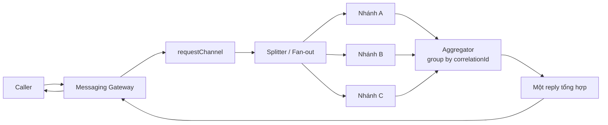

# Nhiều reply cho một request trong Spring Integration

## Mục tiêu bài học

Sau bài này, bạn có thể:

- Phân biệt **một request – một reply** với **một request – nhiều reply**, bao gồm trường hợp trả nhiều kết quả riêng lẻ và trường hợp gom thành một kết quả tổng hợp.
- Giải thích cách **Splitter**, **Publish–Subscribe**, **Recipient List Router** và **Aggregator** tham gia một luồng yêu cầu nhiều phản hồi.
- Xác định vai trò của `correlationId`, `sequenceNumber`, `sequenceSize` và `replyChannel` khi nhiều yêu cầu chạy cùng lúc.
- Xây dựng một luồng Spring Integration trong đó một request tạo nhiều công việc, nhiều kết quả được gom lại và một reply cuối cùng quay về Gateway.
- Thiết kế chính sách hoàn tất khi đủ kết quả, khi đạt quorum hoặc khi hết hạn; xử lý phản hồi lỗi, trễ, thiếu và trùng lặp.
- Kiểm thử tính đúng đắn của việc ghép nhóm và theo dõi vòng đời từng request.

Chủ đề này thuộc chương **Request reply** của mô-đun **SPRING_INTEGRATION_PATTERN**: thực hành Enterprise Integration Patterns với Spring Integration để tạo luồng thông điệp ít phụ thuộc, dễ mở rộng. Kiến thức về Router, Filter, Transformer, Splitter, Aggregator, Gateway, retry, error channel và correlation được kết nối trong một bài toán cụ thể: **nhiều bên xử lý cùng một yêu cầu và kết quả phải trở về đúng ngữ cảnh ban đầu**.

## 1. “Nhiều reply” thực sự có nghĩa gì?

Giả sử một hệ thống thương mại điện tử hỏi giá vận chuyển cho một đơn hàng ở ba đơn vị `A`, `B`, `C`. Mỗi đơn vị gửi một kết quả, có thể hoàn tất theo thứ tự bất kỳ:

| Mốc xử lý minh họa | Sự kiện | Request liên quan |
| --- | --- | --- |
| 0 ms | Gửi yêu cầu `Q-101` tới A, B, C | `Q-101` |
| 70 ms | B trả giá 36.000 đồng | `Q-101` |
| 130 ms | Có yêu cầu mới `Q-102` | `Q-102` |
| 180 ms | C trả giá 41.000 đồng | `Q-101` |
| 210 ms | A trả giá 39.000 đồng | `Q-101` |
| 250 ms | A trả kết quả cho yêu cầu khác | `Q-102` |

Các thời điểm chỉ để minh họa; trật tự phản hồi **không** phải cơ chế ghép cặp. `Q-101` phải nhận đủ kết quả thuộc `Q-101`, không lấy nhầm kết quả của `Q-102`.

Có ba hợp đồng phản hồi thường gặp:

| Hợp đồng | Bên gọi nhìn thấy | Kỹ thuật phù hợp |
| --- | --- | --- |
| **Collect all** | Chờ các kết quả rồi nhận **một** response tổng hợp | Splitter/Fan-out → Aggregator → Gateway |
| **Quorum / first acceptable** | Trả một response khi đủ số phiếu hoặc có kết quả chấp nhận được | Aggregator có release strategy phù hợp, chính sách với kết quả đến muộn |
| **Streaming nhiều sự kiện** | Nhận từng reply ngay khi xuất hiện, sau đó có tín hiệu kết thúc | Kênh sự kiện, SSE, WebSocket, broker hoặc reactive stream, có correlation ID |

Trong một phương thức Gateway thông thường trả về `QuoteSummary`, hợp đồng là **một kết quả cho một lần gọi**. Các reply từ nhiều nhánh nên được **gom thành một message cuối cùng** trước khi trả về Gateway. Nếu muốn caller nhận lần lượt ba message, phải thiết kế một API streaming hoặc một cơ chế subscribe; không giả định rằng việc một Gateway trả object đơn lẻ sẽ tự chuyển thành stream nhiều reply.

## 2. Những thành phần tham gia ghép nhóm

Một cấu trúc điển hình:



**Splitter** chia một message yêu cầu thành nhiều message con. Spring Integration có thể thêm metadata của chuỗi message để các message con được ghép lại:

| Header / khóa | Ý nghĩa | Lưu ý |
| --- | --- | --- |
| `MessageHeaders.CORRELATION_ID` | Nhận dạng nhóm message có cùng nguồn gốc xử lý | Splitter thường sinh correlation từ message cha; không đồng nhất với ID nghiệp vụ |
| `MessageHeaders.SEQUENCE_NUMBER` | Vị trí của phần tử trong nhóm | Có ích khi cần khôi phục thứ tự logic |
| `MessageHeaders.SEQUENCE_SIZE` | Số phần tử dự kiến trong nhóm | Cho phép release strategy mặc định biết khi nào đã nhận đủ, nếu metadata được duy trì chính xác |
| `MessageHeaders.REPLY_CHANNEL` | Nơi gửi kết quả sau khi xử lý | Gateway thường cung cấp đường nhận phản hồi; không dùng làm khóa gom nhóm |
| `requestId` nghiệp vụ | Mã yêu cầu do ứng dụng tạo, chẳng hạn `Q-101` | Dùng để tracing, idempotency và đối soát khi đi qua process/broker |

**Aggregator** giữ các message có cùng khóa tương quan trong một *message group* và quyết định khi nào phát kết quả. Với chuỗi do Splitter tạo và có đủ `sequenceSize`, cách cấu hình Aggregator thông thường có thể chờ đến khi đủ thành viên. Aggregator còn cần một chiến lược tính kết quả tổng hợp (*message group processor*) và nơi lưu trạng thái nhóm (*message group store*).

**Publish–Subscribe** hoặc **Recipient List Router** phù hợp khi cần phát cùng một yêu cầu tới nhiều người nhận khác nhau. Trường hợp này **không được giả định** rằng cơ chế fan-out nào cũng tự gắn số thứ tự/kích thước nhóm giống Splitter. Nếu dự định gom bằng Aggregator, phải cấu hình tạo/bảo toàn metadata nhóm tương ứng hoặc định nghĩa correlation strategy cùng release strategy riêng.

**Gateway** chuyển một lời gọi Java thành request message và chờ reply theo hợp đồng phương thức. Trong ví dụ bên dưới, chính Aggregator tạo reply cuối; mỗi nhà cung cấp chỉ tạo **kết quả trung gian**.

## 3. Luồng mẫu: lấy giá từ ba nhà cung cấp rồi chọn giá thấp nhất

Chúng ta xây một luồng nội bộ, dùng Java 17+ và Spring Integration 6.x. Ví dụ có ba nhà cung cấp giả lập; mỗi request được chia thành ba `VendorTask`, có ba `VendorReply` và cuối cùng tạo một `QuoteSummary`.

Các đoạn mã Java được đặt trong **cùng package**, mỗi `public record`, interface hoặc class ở file Java riêng. Ứng dụng Spring Boot cần các dependency Spring Integration và Spring Boot Test tương ứng với phiên bản dự án; ví dụ chỉ tập trung vào cách tổ chức flow.

### 3.1. Kiểu dữ liệu

```java
// QuoteRequest.java
public record QuoteRequest(
        String requestId,
        String productCode,
        int quantity
) {}

// VendorTask.java
public record VendorTask(
        String requestId,
        String vendor,
        String productCode,
        int quantity
) {}

// VendorReply.java
import java.math.BigDecimal;

public record VendorReply(
        String requestId,
        String vendor,
        BigDecimal total,
        String errorCode
) {
    public boolean successful() {
        return total != null && errorCode == null;
    }
}

// QuoteSummary.java
import java.util.List;

public record QuoteSummary(
        String requestId,
        List<VendorReply> replies,
        VendorReply cheapest
) {}
```

Mỗi `VendorReply` mang `requestId` để đối soát, kể cả khi message đi qua nhiều hệ thống. `errorCode` minh họa trường hợp một nhánh trả kết quả thất bại có cấu trúc. Trong sản phẩm thật, nên định nghĩa kiểu kết quả rõ ràng (ví dụ sealed result hoặc status enum) thay vì để các trường hợp lệ/null phụ thuộc vào quy ước miệng.

### 3.2. Channel, executor và Gateway

```java
// MultiReplyConfig.java
import org.springframework.context.annotation.Bean;
import org.springframework.context.annotation.Configuration;
import org.springframework.core.task.TaskExecutor;
import org.springframework.integration.annotation.IntegrationComponentScan;
import org.springframework.integration.channel.DirectChannel;
import org.springframework.integration.channel.ExecutorChannel;
import org.springframework.integration.config.EnableIntegration;
import org.springframework.messaging.MessageChannel;
import org.springframework.scheduling.concurrent.ThreadPoolTaskExecutor;

@Configuration
@EnableIntegration
@IntegrationComponentScan
public class MultiReplyConfig {

    @Bean
    public MessageChannel quoteRequests() {
        return new DirectChannel();
    }

    @Bean
    public TaskExecutor vendorTaskExecutor() {
        ThreadPoolTaskExecutor pool = new ThreadPoolTaskExecutor();
        pool.setCorePoolSize(4);
        pool.setMaxPoolSize(8);
        pool.setQueueCapacity(100);
        pool.setThreadNamePrefix("vendor-quote-");
        pool.initialize();
        return pool;
    }

    @Bean
    public MessageChannel vendorTasks(TaskExecutor vendorTaskExecutor) {
        return new ExecutorChannel(vendorTaskExecutor);
    }

    @Bean
    public MessageChannel vendorReplies() {
        return new DirectChannel();
    }
}
```

`ExecutorChannel` cho phép các công việc con được xử lý trên pool, nên reply từ A/B/C có thể đến không theo thứ tự. `DirectChannel` ở đầu và ở bước đưa reply vào Aggregator giúp theo dõi tuyến thông điệp đơn giản.

```java
// MultiQuoteGateway.java
import org.springframework.integration.annotation.MessagingGateway;

@MessagingGateway(
    defaultRequestChannel = "quoteRequests",
    defaultReplyTimeout = "5000"
)
public interface MultiQuoteGateway {
    QuoteSummary compare(QuoteRequest request);
}
```

Gateway chờ **một reply tổng hợp**, tối đa theo timeout cấu hình của Gateway khi đã chuyển sang pha nhận reply. Một reply timeout **không có nghĩa** các task ở executor bị hủy. Chính sách tổng thể còn cần timeout ở thao tác I/O của từng nhà cung cấp và giới hạn thời gian giữ nhóm tại Aggregator.

### 3.3. Splitter tạo ba thông điệp con

```java
// VendorQuoteFlow.java
import java.math.BigDecimal;
import java.util.Comparator;
import java.util.List;
import org.springframework.integration.annotation.Aggregator;
import org.springframework.integration.annotation.ServiceActivator;
import org.springframework.integration.annotation.Splitter;
import org.springframework.stereotype.Component;

@Component
public class VendorQuoteFlow {

    @Splitter(inputChannel = "quoteRequests", outputChannel = "vendorTasks")
    public List<VendorTask> split(QuoteRequest request) {
        if (request.quantity() <= 0) {
            throw new IllegalArgumentException("quantity must be positive");
        }
        return List.of(
            new VendorTask(
                request.requestId(), "A", request.productCode(), request.quantity()),
            new VendorTask(
                request.requestId(), "B", request.productCode(), request.quantity()),
            new VendorTask(
                request.requestId(), "C", request.productCode(), request.quantity())
        );
    }

    @ServiceActivator(inputChannel = "vendorTasks",
                      outputChannel = "vendorReplies")
    public VendorReply askVendor(VendorTask task) {
        try {
            // Adapter giả lập: thay bằng REST/JMS/HTTP gateway trong hệ thống thật.
            BigDecimal unitPrice = switch (task.vendor()) {
                case "A" -> new BigDecimal("120000");
                case "B" -> new BigDecimal("118000");
                case "C" -> new BigDecimal("125000");
                default -> throw new IllegalArgumentException("Unknown vendor");
            };
            BigDecimal total = unitPrice.multiply(
                BigDecimal.valueOf(task.quantity()));
            return new VendorReply(task.requestId(), task.vendor(), total, null);
        } catch (RuntimeException ex) {
            // Trả một kết quả thất bại để nhóm vẫn nhận đủ số phản hồi.
            return new VendorReply(
                task.requestId(), task.vendor(), null, "QUOTE_FAILED");
        }
    }

    @Aggregator(inputChannel = "vendorReplies")
    public QuoteSummary gather(List<VendorReply> replies) {
        List<VendorReply> ordered = replies.stream()
            .sorted(Comparator.comparing(VendorReply::vendor))
            .toList();

        VendorReply cheapest = ordered.stream()
            .filter(VendorReply::successful)
            .min(Comparator.comparing(VendorReply::total))
            .orElse(null);

        return new QuoteSummary(
            ordered.get(0).requestId(), ordered, cheapest);
    }
}
```

Trong flow này, Splitter tạo các phần tử có **correlation ID** chung và metadata sequence tương ứng. Mỗi `VendorTask` được gửi tới `vendorTasks`, một worker tính giá rồi trả `VendorReply` vào `vendorReplies`. Aggregator mặc định sử dụng thông tin tương quan và kích thước chuỗi của Splitter để gom ba phản hồi trước khi gọi `gather(...)`, sau đó đưa reply cuối về đường trả lời của Gateway.

**Điểm quan trọng:** `requestId` trong `VendorReply` là khóa nghiệp vụ do ta tự định nghĩa; việc Aggregator mặc định ghép nhóm trong ví dụ dựa vào **message headers do Splitter tạo**, không dựa vào trường `requestId` trong payload. Nếu tự tạo một `Message` hoàn toàn mới, thay adapter hoặc đi qua broker, phải đảm bảo metadata tương quan không bị mất; nếu không, cần khai báo correlation/release strategy tường minh.

Phương thức `gather(...)` sắp xếp theo vendor vì thứ tự message đến có thể thay đổi. Với request `Q-101`, số lượng 2 và giá giả lập ở trên, ba tổng lần lượt là A = 240.000, B = 236.000, C = 250.000 đồng. Kết quả được chọn là B với giá 236.000 đồng. Khi tất cả nhà cung cấp đều lỗi, `cheapest` bằng `null`; API thật nên biểu diễn trạng thái **NO_VALID_QUOTE** rõ ràng.

### 3.4. Caller nhận một kết quả tổng hợp

```java
import org.springframework.stereotype.Service;

@Service
public class ShippingQuoteService {
    private final MultiQuoteGateway gateway;

    public ShippingQuoteService(MultiQuoteGateway gateway) {
        this.gateway = gateway;
    }

    public QuoteSummary quoteShipping() {
        return gateway.compare(
            new QuoteRequest("Q-101", "BOOK-01", 2));
    }
}
```

Kết quả phương thức là **một** `QuoteSummary` chứa **nhiều** `VendorReply`. Tại ranh giới API, caller không phải biết có bao nhiêu task nội bộ đang chạy.

## 4. Điều kiện hoàn tất: chờ đủ, chờ quorum hay trả kết quả đầu tiên?

Việc có bao nhiêu reply được phép tạo ra khác với việc **khi nào được trả kết quả cuối**. Đây là trách nhiệm của *release strategy*.

| Chiến lược | Điều kiện phát kết quả | Ưu điểm | Vấn đề cần xử lý |
| --- | --- | --- | --- |
| **All replies** | Nhận đủ `N` kết quả hợp lệ về mặt vận chuyển | Có thể so sánh toàn bộ | Một nhánh treo khiến cả nhóm đợi |
| **Quorum** | Ví dụ đủ 2/3 nhà cung cấp trả lời | Giảm thời gian đợi | Phản hồi thứ ba sẽ đi đâu và có thay đổi quyết định không? |
| **First acceptable** | Có kết quả vượt ngưỡng nghiệp vụ | Độ trễ thấp | Có thể bỏ lỡ một kết quả tốt hơn đến sau |
| **Deadline / partial** | Hết hạn và có ít nhất một phản hồi | Đáp ứng SLA | Phải nói rõ kết quả chưa đầy đủ |

Ở ví dụ Java trên, mỗi nhánh thường tạo ra **đúng một** `VendorReply`, kể cả khi không tính được giá. Nhờ đó chiến lược mặc định “đợi đủ số phần tử Splitter” có thể hoàn thành. Nếu một nhánh thực sự **không gửi message nào**, nhóm không tự coi là đủ chỉ vì Gateway đã timeout.

Khi áp dụng quota/quorum hoặc giới hạn thời gian nhóm, nên dùng Aggregator với cấu hình **custom release strategy** và **group timeout/expiry** phù hợp. Nếu trả kết quả từng phần, response nên có những trường như `receivedCount`, `expectedCount`, `complete` và `deadlineReached` để caller hiểu chính xác kết quả. Mọi reply đến sau khi nhóm đã phát kết quả cần chính sách rõ ràng: bỏ qua có log, lưu đối soát, hoặc gửi sự kiện cập nhật riêng; không trả lại tùy tiện vào Gateway của lượt gọi đã kết thúc.

Ví dụ giao kèo cho kết quả từng phần:

```json
{
  "requestId": "Q-101",
  "expectedCount": 3,
  "receivedCount": 2,
  "complete": false,
  "deadlineReached": true,
  "replies": [
    {"vendor": "B", "total": 236000},
    {"vendor": "A", "total": 240000}
  ]
}
```

JSON trên là **hợp đồng minh họa** cho một hệ thống chấp nhận partial result; không phải output của class `QuoteSummary` trong ví dụ mặc định.

## 5. Nếu request được nhân bản tới nhiều người nhận

Ví dụ trên dùng Splitter vì một request được biến thành ba task có nội dung khác nhau (`vendor=A/B/C`). Một luồng khác có thể đưa **cùng payload** tới ba handler, sử dụng:

- **Publish–Subscribe Channel:** phát message cho nhiều subscriber; có thể thiết lập `applySequence` để hỗ trợ việc ghép nhóm khi phù hợp với cấu hình subscriber.
- **Recipient List Router:** chọn danh sách đích dựa trên nội dung request, ví dụ gửi thêm tới nhà cung cấp D khi đơn hàng ở vùng đặc biệt.
- **Scatter–Gather:** scatter một request tới các nhánh, gather các phản hồi trở lại; trong Spring Integration có thể xây dựng từ Publish–Subscribe/Router và Aggregator.

Khi số nhánh thay đổi theo request, không được hard-code `expectedCount = 3` hoặc giả định luôn có ba subscriber. Người thiết kế flow phải biết số nhánh thực sự được gửi đi, chọn group key đúng và cấu hình cách xác định nhóm hoàn tất. Với Publish–Subscribe, thời điểm subscriber được đăng ký và hình thức xử lý đồng bộ/bất đồng bộ cũng ảnh hưởng tới kỳ vọng về các response.

Một **Filter** có thể bỏ thông điệp. Nếu Filter chặn một nhánh mà không phát reply hoặc một kết quả `SKIPPED` có chủ đích, Aggregator chờ đủ `sequenceSize` có thể không bao giờ hoàn tất. Nên định nghĩa một trong ba phương án: phản hồi thất bại/từ chối được tính là một kết quả, điều chỉnh chiến lược hoàn tất, hoặc dùng timeout để kết thúc nhóm.

## 6. Correlation khi nhiều request xen kẽ

Tưởng tượng hai yêu cầu cùng fan-out:

```text
Q-101 -> A1, B1, C1   (correlation: group-101)
Q-102 -> A2, B2, C2   (correlation: group-102)

Thứ tự đến: B2, C1, A2, B1, C2, A1

Aggregator group-101 = [C1, B1, A1] -> summary của Q-101
Aggregator group-102 = [B2, A2, C2] -> summary của Q-102
```

Trong Spring Integration, mỗi message có `id` riêng. ID của một message con hoặc reply mới không tự động là khóa nhóm xuyên hệ thống. Splitter tạo metadata correlation/sequence cho chuỗi trong ví dụ; khi sử dụng external service hoặc broker, định danh nhóm phải được **serialize và khôi phục** theo quy ước.

Phân biệt ba loại ID:

1. **Message ID:** nhận dạng message cụ thể trong Spring Messaging.
2. **Correlation ID:** xác định nhóm cần ghép, thường dùng ở Aggregator hoặc các thành phần correlation khác.
3. **Business request ID:** nhận dạng một tác vụ nghiệp vụ xuyên nhiều dịch vụ và qua các lần retry.

Ba ID có thể có liên hệ nhưng không nên bị đồng nhất theo thói quen. Một giao thức đa dịch vụ cần nói rõ bên nào tạo request ID, tên trường trên wire, phạm vi duy nhất, cách truy vết và thời hạn lưu. Nếu tạo `correlationId` theo request ID nghiệp vụ, phải bảo đảm không xung đột với các correlation group nội bộ khác như Splitter/Aggregator lồng nhau.

## 7. Những trường hợp biên cần thiết kế trước

| Trường hợp | Nguy cơ | Cách xử lý |
| --- | --- | --- |
| Một nhánh không trả reply | Gateway hết hạn, nhóm còn dang dở | Timeout ở I/O và nhóm; trả partial/failure theo hợp đồng |
| Một nhánh trả hai lần vì retry | Nhóm đếm thừa, kết quả trùng | Dedupe theo `requestId + vendor` hoặc ID nhánh ổn định |
| Một reply đến sau khi đã release | Không còn caller đợi; nhóm có thể được tái tạo không mong muốn | Chính sách late reply, lưu idempotency/tombstone theo thời hạn phù hợp |
| Quá nhiều request đồng thời | Nhiều message group giữ trong bộ nhớ; nghẽn thread pool | Giới hạn concurrency, backpressure, group expiry, giám sát dung lượng store |
| Một nhánh ném exception trong executor | Reply bị thiếu, Gateway timeout dù lỗi xuất hiện ở worker | Định tuyến `errorChannel` đúng cách hoặc đổi lỗi thành result có cấu trúc |
| Các nhánh có tác dụng phụ | Retry có thể tạo đơn/thu tiền nhiều lần | Idempotency, transaction boundary, retry có giới hạn |
| Flow qua nhiều instance/broker | Correlation và group state có thể mất khi restart | Thiết kế persistent/distributed message group store và reply routing phù hợp |

**Cẩn trọng với error channel:** ngoại lệ đồng bộ có thể truyền thẳng về caller; ở phần bất đồng bộ, lỗi có thể được chuyển thành `ErrorMessage` qua kênh lỗi được cấu hình. Nếu một worker lỗi trước khi gửi `VendorReply`, Aggregator sẽ không tự hiểu lỗi đó là kết quả thứ ba. Nên thiết kế một adapter chuyển lỗi thành `VendorReply` thất bại, hoặc đưa lỗi vào luồng xử lý có điều kiện phát kết quả được xác định.

**Cẩn trọng với group store:** Aggregator phải lưu message group trước khi hoàn tất. Store mặc định phù hợp nhiều ví dụ nội bộ nhưng không nên mặc nhiên coi là đủ bền cho dịch vụ chạy nhiều instance. Khi lưu state bền vững, cũng phải kiểm soát duplicate, group expiry và quá trình restart.

## 8. Khi nào phải trả *từng* reply thay vì tổng hợp?

Đối với hệ thống gợi ý AI, truy vấn nhiều nguồn dữ liệu hoặc tìm giá theo thời gian thực, caller có thể muốn nhận kết quả ngay:

```text
POST /quotes -> 202 Accepted, requestId=Q-101
event: quote.received  {requestId:"Q-101", vendor:"B", total:236000}
event: quote.received  {requestId:"Q-101", vendor:"A", total:240000}
event: quote.received  {requestId:"Q-101", vendor:"C", total:250000}
event: quote.completed {requestId:"Q-101", received:3, expected:3}
```

Đây là **hợp đồng event** (có thể triển khai bằng SSE, WebSocket hoặc broker), khác với `MultiQuoteGateway.compare(...)` trả về một `QuoteSummary`. Ở dạng này, mỗi sự kiện phải mang request ID/correlation ID; subscriber lọc theo request và xác định khi nào stream hoàn tất. Phải tính đến client mất kết nối, sự kiện bị gửi lại, replay sau reconnect, bảo mật phạm vi request và sự kiện hoàn tất khi timeout.

Một lựa chọn khác là trả **202 Accepted + requestId**, sau đó cho caller truy vấn tiến độ bằng API polling. Kiểu này hữu ích khi quy trình dài, không thể bảo đảm caller giữ kết nối liên tục.

## 9. Kiểm thử để phát hiện ghép nhầm và kẹt nhóm

Test tích hợp tối thiểu cho các thành phần đã khai báo:

```java
import static org.assertj.core.api.Assertions.assertThat;

import java.util.List;
import org.junit.jupiter.api.Test;
import org.springframework.beans.factory.annotation.Autowired;
import org.springframework.boot.test.context.SpringBootTest;

@SpringBootTest
class MultiQuoteFlowTest {
    @Autowired
    private MultiQuoteGateway gateway;

    @Test
    void oneRequestProducesThreeRepliesAndOneSummary() {
        QuoteSummary summary = gateway.compare(
            new QuoteRequest("Q-101", "BOOK-01", 2));

        assertThat(summary).isNotNull();
        assertThat(summary.requestId()).isEqualTo("Q-101");
        assertThat(summary.replies()).hasSize(3);
        assertThat(summary.replies())
            .extracting(VendorReply::vendor)
            .containsExactly("A", "B", "C");
        assertThat(summary.cheapest().vendor()).isEqualTo("B");
        assertThat(summary.cheapest().total())
            .isEqualByComparingTo("236000");
    }
}
```

Trường hợp cần kiểm thử tải đồng thời và correlation có thể mở rộng cùng lớp test:

```java
import java.util.concurrent.ExecutorService;
import java.util.concurrent.Executors;
import java.util.concurrent.TimeUnit;
import java.util.stream.IntStream;
import java.util.concurrent.Future;

@Test
void concurrentRequestsAreNotMixed() throws Exception {
    ExecutorService callers = Executors.newFixedThreadPool(6);
    try {
        List<Future<QuoteSummary>> futures = IntStream.range(0, 20)
            .mapToObj(i -> callers.submit(() -> gateway.compare(
                new QuoteRequest("Q-" + i, "BOOK-01", i + 1))))
            .toList();

        for (int i = 0; i < futures.size(); i++) {
            QuoteSummary summary = futures.get(i).get(10, TimeUnit.SECONDS);
            String expectedRequestId = "Q-" + i;
            assertThat(summary).isNotNull();
            assertThat(summary.requestId()).isEqualTo(expectedRequestId);
            assertThat(summary.replies()).hasSize(3)
                .allMatch(reply ->
                    expectedRequestId.equals(reply.requestId()));
        }
    } finally {
        callers.shutdownNow();
    }
}
```

Đoạn trên bổ sung các `import` và phương thức vào cùng class test trước. Giá trị timeout trong test chỉ là ví dụ; môi trường CI cần ngân sách thời gian phù hợp. Phép kiểm chứng quan trọng là **không một reply nào từ request khác lọt vào summary hiện tại**.

Khi kiểm thử lỗi/timeout, nên thêm kịch bản cố ý chặn một nhánh, một nhánh phát hai reply, và một nhánh hoàn thành muộn hơn deadline. Xác nhận đúng trạng thái mà API công bố, nhóm được dọn theo chính sách, và lỗi/late reply được ghi nhận. Với collect-all, kiểm tra rằng Aggregator không trả kết quả sớm nếu chỉ nhận 2/3 reply.

Để theo dõi production, gắn các thông tin `requestId`, correlation ID, vendor, trạng thái, thời điểm gửi/nhận và số reply đã gom vào trace/log/metric. Các số đo hữu ích gồm:

- Số nhóm đang chờ, thời gian sống của nhóm, tỷ lệ nhóm hết hạn.
- Độ trễ từng nhà cung cấp, độ trễ toàn bộ request, p95/p99 và tỷ lệ Gateway timeout.
- Số reply đến trễ, reply trùng, reply không xác định được nhóm và lỗi gửi phản hồi.

Không cần ghi đầy đủ payload chứa thông tin nhạy cảm; các mã tương quan và số đo thường đã đủ để tìm nguyên nhân.

## 10. Checklist thiết kế trước khi đưa vào production

1. **Caller nhận gì?** Một summary cuối cùng, summary từng phần hay nhiều event nối tiếp?
2. **Có bao nhiêu nhánh thực tế?** Danh sách cố định, động theo Router hay phụ thuộc subscriber?
3. **Ghép bằng khóa nào?** Correlation ID từ Splitter hay khóa do bạn định nghĩa? Header có được giữ nguyên qua adapter không?
4. **Khi nào release?** Đủ `N`, đạt quorum, kết quả đầu tiên hay hết deadline?
5. **Thất bại có được tính là reply không?** Một nhánh lỗi hoặc bị Filter bỏ có khiến nhóm chờ vô hạn không?
6. **Làm gì với late/duplicate reply?** Có chính sách dedupe, retry và dọn group rõ ràng chưa?
7. **Tài nguyên được quản lý ra sao?** Thread pool, số message group, message store, deadline và khả năng restart đã được tính chưa?

## Kết luận

**Nhiều reply cho một request** là bài toán vừa tạo nhiều công việc, vừa ghép đúng các kết quả bất kể thứ tự hoàn thành. Trong Spring Integration, **Splitter hoặc fan-out**, **correlation metadata**, **Aggregator** và **Messaging Gateway** tạo thành một luồng collect-all dễ kiểm soát. Khi muốn hoàn tất sớm hoặc gửi kết quả theo dòng sự kiện, phải định nghĩa rõ release strategy và hợp đồng giao tiếp; xử lý timeout, lỗi nhánh, reply trễ và trùng lặp là phần không thể tách rời của tính đúng đắn.
