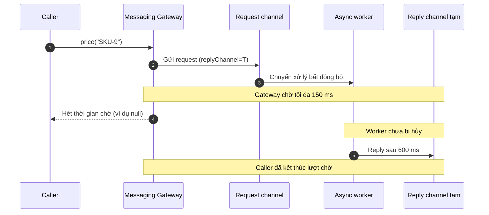
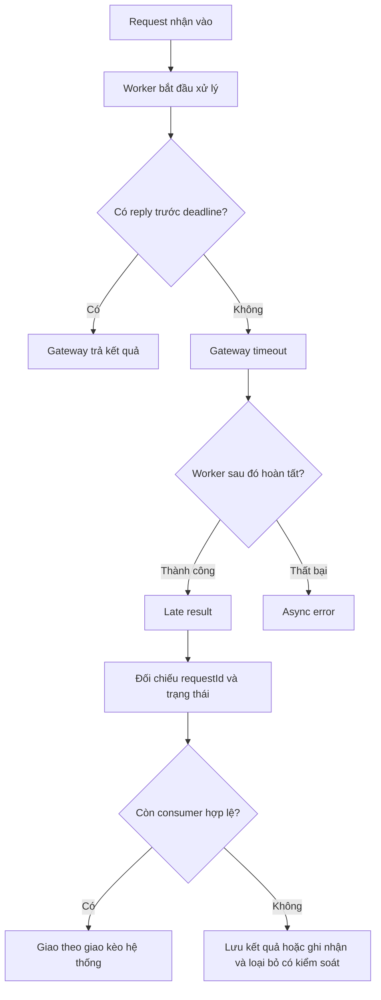
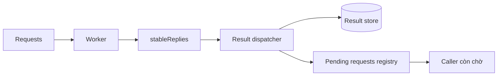

# Request reply — Late reply sau khi gateway timeout

## Mục tiêu học tập

Sau bài này, bạn có thể:

- Giải thích **late reply** là gì và tại sao một xử lý phía sau vẫn có thể hoàn thành sau khi Messaging Gateway ngừng chờ.
- Phân biệt `requestTimeout`, `replyTimeout`, thời gian xử lý thực tế và việc **hủy tác vụ**.
- Dự đoán khác biệt giữa flow dùng `DirectChannel` và flow có ranh giới bất đồng bộ như `ExecutorChannel`.
- Thiết lập một ví dụ Spring Integration có reply đến sau thời hạn, quan sát được gateway timeout và xác minh tác vụ vẫn hoàn tất.
- Thiết kế correlation, timeout, retry, idempotency, error channel và cách xử lý kết quả đến muộn để tránh mất dữ liệu hoặc cập nhật sai trạng thái.

Đây là bài thuộc chương **Request reply** trong module **SPRING_INTEGRATION_PATTERN**. Module thực hành Enterprise Integration Patterns với Spring Integration để tạo luồng thông điệp ít phụ thuộc, dễ mở rộng và có thể theo dõi được. Late reply là tình huống rất dễ gặp khi Request–Reply đi qua Router, Filter, Transformer, Service Activator, Gateway, broker, retry hay các bước xử lý song song. Bài tập trung vào đường đi của phản hồi và những quyết định cần có khi caller đã hết thời gian chờ.

## 1. Late reply là gì?

Trong Request–Reply, một bên gọi gửi request và đợi reply. Giả sử gateway chờ tối đa 150 ms, nhưng handler cần 600 ms để tính toán:

1. Caller gọi gateway, gateway gửi request vào luồng Spring Integration.
2. Một worker bất đồng bộ bắt đầu xử lý request.
3. Sau 150 ms mà chưa thấy reply, gateway **ngừng chờ** và kết thúc lời gọi theo giao kèo timeout.
4. Worker vẫn tiếp tục công việc; đến khoảng 600 ms, nó tạo ra reply.
5. Reply này xuất hiện **sau khi lời gọi ban đầu không còn đợi kết quả**. Đó là *late reply*.



**Điều quan trọng:** *Gateway timeout* nói về **thời hạn chờ của bên gọi**, không tự động xác nhận tác vụ đã thất bại, đã rollback hoặc đã bị hủy. Một lệnh đặt hàng, ghi cơ sở dữ liệu hay gọi API thanh toán có thể đã thành công sau thời điểm timeout. Vì vậy retry thiếu kiểm soát có thể tạo tác dụng phụ trùng lặp.

### Phân biệt các trạng thái

| Thuật ngữ | Ý nghĩa |
| --- | --- |
| **On-time reply** | Kết quả được định tuyến về nơi nhận khi caller vẫn đang chờ. |
| **Late reply** | Kết quả xuất hiện sau thời hạn mà caller/gateway cho phép chờ. |
| **Gateway timeout** | Gateway không nhận reply hợp lệ kịp thời; giá trị trả về/cách báo lỗi tùy chữ ký phương thức và cấu hình. |
| **Processing failure** | Worker thực sự xử lý thất bại. Có thể xảy ra trước hoặc sau timeout. |
| **Cancellation** | Cơ chế riêng yêu cầu dừng công việc; timeout đơn thuần không đảm bảo điều này. |
| **Error message** | Một message mô tả exception, thường được chuyển qua cơ chế error channel; không nhất thiết là reply nghiệp vụ. |

Không nên gộp tất cả các trạng thái trên thành một nhãn `FAILED`. Ví dụ, từ góc nhìn caller là `TIMED_OUT`, nhưng từ góc nhìn backend request có thể vẫn `PROCESSING` rồi chuyển sang `SUCCEEDED`.

## 2. Timeout nào đang được áp dụng?

Spring Integration có hai khái niệm thường gặp trên Messaging Gateway:

| Thiết lập | Giới hạn điều gì? | Không bảo đảm điều gì? |
| --- | --- | --- |
| `requestTimeout` | Thời gian gateway có thể chờ để **gửi** request vào kênh khi thao tác gửi hỗ trợ timeout. | Không phải giới hạn tổng thời gian xử lý của handler. |
| `replyTimeout` | Thời gian gateway chờ **nhận** reply sau khi đã gửi request theo cơ chế gateway. | Không tự ngắt worker, hủy transaction hay thu hồi message đã gửi. |

Trên `@Gateway`, các timeout được khai báo bằng **chuỗi**, ví dụ `replyTimeout = "150"`, đơn vị mặc định là **mili giây**. `@MessagingGateway` cũng cho phép cấu hình mặc định cho các phương thức, chẳng hạn `defaultReplyTimeout = "150"`.

### Vì sao cùng `replyTimeout` nhưng thời gian gọi lại khác nhau?

Khi toàn bộ handler chạy đồng bộ trên `DirectChannel`, lời gọi `send()` có thể phải chờ handler xong. Một handler mất 600 ms có thể giữ thread của gateway khoảng 600 ms *trước cả lúc bước chờ reply riêng trở nên có ý nghĩa*. Không nên coi `replyTimeout = "150"` là cam kết mọi lời gọi sẽ kết thúc sau đúng 150 ms.

Khi thêm một ranh giới bất đồng bộ, ví dụ `ExecutorChannel`, request có thể được bàn giao cho worker và thao tác gửi trả quyền điều khiển cho gateway sớm. Gateway lúc này có thể chờ reply theo `replyTimeout`, trong khi worker vẫn chạy phía sau.

```text
Luồng A — DirectChannel (đồng bộ)
Gateway --> DirectChannel --> Handler 600 ms --> Reply
             send() có thể bị giữ trong thời gian handler chạy

Luồng B — ExecutorChannel (bất đồng bộ)
Gateway --> DirectChannel --> ExecutorChannel --> Worker 600 ms
                send() trả sớm              |
Gateway chờ replyTimeout 150 ms              +--> Reply đến muộn
```

Thời điểm thực tế phụ thuộc scheduler, kênh, adapter, môi trường chạy và cơ chế phát reply. Các con số trong bài là tình huống minh họa, không phải cam kết thời gian tuyệt đối.

## 3. Gateway nhận late reply bằng cách nào?

Với **Messaging Gateway request–reply thông thường**, Spring Integration tạo hoặc quản lý một đường chờ reply riêng cho lời gọi. Request mang thông tin `replyChannel` để downstream biết nơi gửi kết quả. Handler không khai báo output channel cố định thường có thể trả giá trị và framework dựa trên header này để phát reply.

Khi gateway đã timeout:

- Lời gọi ở caller đã rời trạng thái chờ. Một reply xuất hiện sau đó **không thể tự động biến thành giá trị trả về cho lời gọi cũ**.
- Worker vẫn có thể cố gửi reply về đường phản hồi đã gắn trên request.
- Việc reply muộn bị từ chối, được ghi log, tạo exception hay có hành vi khác phụ thuộc loại reply channel, endpoint, phiên bản và cách xử lý lỗi. Không nên viết nghiệp vụ dựa trên giả định rằng mọi late reply đều được tự động lưu, hoặc đều được giao cho lần gọi tiếp theo.
- Nếu flow dùng **kênh reply cố định dùng chung** thay vì kênh chờ riêng, cần correlation và một dispatcher để tránh người nhận khác lấy nhầm kết quả cũ.

Header chuẩn `MessageHeaders.REPLY_CHANNEL` mô tả **địa chỉ nhận**, còn khóa correlation nghiệp vụ (ví dụ `requestId`) mô tả **reply thuộc lượt yêu cầu nào**. Chúng giải quyết hai vấn đề khác nhau.

> Một kết quả đến muộn không đương nhiên là một lỗi tính toán. Nó chỉ đến quá hạn cho giao kèo đồng bộ đã chọn.

## 4. Ví dụ Spring Integration: reply đến sau thời hạn

Ví dụ dùng Spring Integration Java DSL, một Messaging Gateway trả `String`, một `ExecutorChannel` và service chờ tín hiệu để mô phỏng công việc chậm. Các lớp dưới đây đặt trong cùng package ứng dụng. Các dependency chính là Spring Integration, Spring Context; phần kiểm thử dùng JUnit 5 và Spring Test.

### 4.1. Khai báo giao diện gateway

`PricingGateway.java`:

```java
import org.springframework.integration.annotation.Gateway;
import org.springframework.integration.annotation.MessagingGateway;

@MessagingGateway
public interface PricingGateway {

    @Gateway(requestChannel = "pricingRequests", replyTimeout = "150")
    String price(String sku);
}
```

`replyTimeout = "150"` yêu cầu gateway chỉ chờ reply tối đa 150 ms ở giai đoạn chờ phản hồi. Với phương thức trả `String`, trường hợp không nhận được reply trong thời hạn thường cho kết quả `null`. Khi dùng kiểu trả về khác, advice hoặc cấu hình khác, phải xác nhận giao kèo timeout thực tế; đừng mặc định mọi gateway luôn trả `null`.

### 4.2. Cấu hình kênh và IntegrationFlow

`PricingFlowConfig.java`:

```java
import java.util.concurrent.ExecutorService;
import java.util.concurrent.Executors;

import org.springframework.beans.factory.annotation.Qualifier;
import org.springframework.context.annotation.Bean;
import org.springframework.context.annotation.Configuration;
import org.springframework.integration.annotation.EnableIntegration;
import org.springframework.integration.annotation.IntegrationComponentScan;
import org.springframework.integration.channel.DirectChannel;
import org.springframework.integration.channel.ExecutorChannel;
import org.springframework.integration.dsl.IntegrationFlow;
import org.springframework.messaging.MessageChannel;

@Configuration
@EnableIntegration
@IntegrationComponentScan(basePackageClasses = PricingGateway.class)
public class PricingFlowConfig {

    @Bean("pricingRequests")
    public MessageChannel pricingRequests() {
        return new DirectChannel();
    }

    @Bean(name = "pricingExecutor", destroyMethod = "shutdown")
    public ExecutorService pricingExecutor() {
        return Executors.newFixedThreadPool(2);
    }

    @Bean("pricingWorkers")
    public MessageChannel pricingWorkers(
            @Qualifier("pricingExecutor") ExecutorService executor) {
        return new ExecutorChannel(executor);
    }

    @Bean
    public ControlledPricingService controlledPricingService() {
        return new ControlledPricingService();
    }

    @Bean
    public IntegrationFlow pricingFlow(ControlledPricingService service) {
        return IntegrationFlow.from("pricingRequests")
            // Bàn giao message cho worker; caller không đợi handler chạy xong.
            .channel("pricingWorkers")
            .handle(String.class, (sku, headers) -> service.calculate(sku))
            // Không khai báo output channel cố định:
            // handler có thể trả reply theo replyChannel của request.
            .get();
    }
}
```

`DirectChannel` ở đầu vào giúp gateway gửi request vào flow. `ExecutorChannel` tạo ranh giới bất đồng bộ giữa caller và handler, nhờ đó timeout chờ reply của gateway có thể xuất hiện khi worker còn bận.

Khi handler trả về `String`, Spring Integration sẽ cố định tuyến giá trị trả về thành reply theo thông tin reply channel của request. Nếu gateway đã ngừng chờ, đây chính là trường hợp late reply cần quan sát.

### 4.3. Service được điều khiển bằng CountDownLatch

`ControlledPricingService.java`:

```java
import java.util.concurrent.CountDownLatch;
import java.util.concurrent.TimeUnit;

public class ControlledPricingService {

    private final CountDownLatch started = new CountDownLatch(1);
    private final CountDownLatch allowCompletion = new CountDownLatch(1);
    private final CountDownLatch computed = new CountDownLatch(1);

    public String calculate(String sku) {
        started.countDown();
        try {
            if (!allowCompletion.await(5, TimeUnit.SECONDS)) {
                throw new IllegalStateException("Worker was not released");
            }
            return "PRICE:" + sku;
        } catch (InterruptedException ex) {
            Thread.currentThread().interrupt();
            throw new IllegalStateException("Worker interrupted", ex);
        } finally {
            computed.countDown();
        }
    }

    public boolean awaitStarted() throws InterruptedException {
        return started.await(2, TimeUnit.SECONDS);
    }

    public void release() {
        allowCompletion.countDown();
    }

    public boolean awaitComputed() throws InterruptedException {
        return computed.await(2, TimeUnit.SECONDS);
    }
}
```

Ở đây `CountDownLatch` cho phép bài kiểm thử kiểm soát chính xác lúc worker được giải phóng, tránh phụ thuộc hoàn toàn vào `Thread.sleep()`. `computed` ghi nhận việc phương thức nghiệp vụ kết thúc, **không khẳng định reply đã được giao thành công đến caller**. Đây là phân biệt quan trọng khi chẩn đoán late reply.

### 4.4. Kiểm thử tích hợp

`LateReplyIntegrationTest.java`:

```java
import static org.junit.jupiter.api.Assertions.assertNull;
import static org.junit.jupiter.api.Assertions.assertTrue;

import org.junit.jupiter.api.Test;
import org.springframework.beans.factory.annotation.Autowired;
import org.springframework.test.context.junit.jupiter.SpringJUnitConfig;

@SpringJUnitConfig(PricingFlowConfig.class)
class LateReplyIntegrationTest {

    @Autowired
    PricingGateway gateway;

    @Autowired
    ControlledPricingService service;

    @Test
    void processingCanFinishAfterGatewayReplyTimeout() throws Exception {
        // Worker bị chặn trên latch, lâu hơn replyTimeout 150 ms.
        String reply = gateway.price("SKU-9");

        try {
            // Gateway không nhận được reply trong thời hạn chờ.
            assertNull(reply);
            assertTrue(service.awaitStarted());
        } finally {
            // Đảm bảo giải phóng worker ngay cả khi assertion thất bại.
            service.release();
        }

        // Handler vẫn hoàn thành sau khi gateway hết thời gian chờ.
        assertTrue(service.awaitComputed());
    }
}
```

**Kiểm thử này chứng minh:** việc gateway ngừng chờ không hủy tự động tính toán phía sau. Nó **chưa chứng minh** reply đã tới tay caller sau timeout: trên một lời gọi đồng bộ đã kết thúc không còn vị trí để trả kết quả đó. Để kiểm chứng cách hệ thống vận hành xử lý late reply, cần bổ sung quan sát log/error channel hoặc một điểm thu kết quả riêng, tùy kiến trúc triển khai.

Trong dự án thực, không tái sử dụng một `ControlledPricingService` chứa các latch một lần cho nhiều test case độc lập nếu không tạo mới trạng thái. Test trên chỉ biểu diễn một request có chủ đích.

## 5. Điều gì có thể xảy ra sau timeout?

Cần tách **trạng thái chờ của caller** và **trạng thái thực thi nghiệp vụ**:



Một vài biến thể cần nhận diện:

| Tình huống | Caller biết gì tại timeout? | Backend có thể đã làm gì? |
| --- | --- | --- |
| Worker đang tính toán | Chưa có kết quả | Vẫn đang chạy, có thể sẽ thành công |
| DB commit xong nhưng reply chưa đến | Chưa nhận xác nhận | Ghi dữ liệu đã thành công |
| HTTP downstream chậm | Không nhận kịp reply | Dịch vụ khác có thể đã hoàn tất |
| Filter loại message | Không nhận reply | Request bị loại theo cấu hình, không có normal reply |
| Handler ném exception sau timeout | Không nhận reply | Có lỗi thật; có thể xuất hiện trong error channel |
| Retry gửi lại cùng nghiệp vụ | Lời gọi mới có trạng thái riêng | Tác dụng phụ có thể thực thi hai lần nếu thiếu idempotency |

Vì vậy **timeout ở tầng giao tiếp không đủ bằng chứng để kết luận giao dịch thất bại**. Trước khi gửi lại lệnh có tác dụng phụ, cần tra trạng thái qua một idempotency key hoặc request ID đã được hệ thống ghi nhận.

## 6. Thiết kế xử lý late reply

Không có một chính sách duy nhất phù hợp mọi nghiệp vụ. Hãy chọn rõ hành vi trước khi đưa flow vào vận hành.

### Cách 1 — Bỏ reply muộn có kiểm soát

Áp dụng cho truy vấn có thể thực hiện lại an toàn, ví dụ tìm kiếm gợi ý hoặc tra cứu dữ liệu không có tác dụng phụ. Khi caller không còn chờ:

- Ghi metric `late_reply_total` và thời gian vượt deadline.
- Không chuyển reply cũ sang một lời gọi mới chỉ vì trùng loại request hoặc dùng chung kênh.
- Chấp nhận loại bỏ kết quả nếu nghiệp vụ đã quy định như vậy; worker vẫn có thể tiêu tốn tài nguyên cho đến lúc hoàn thành.

Cần quyết định vị trí loại bỏ: nếu gateway sở hữu kênh chờ tạm, không thể mặc định mọi reply đến muộn đều được framework thu hộ. Để kiểm soát rõ, dùng một **output channel/dispatcher do ứng dụng sở hữu** và áp dụng chính sách kết quả muộn tại đó.

### Cách 2 — Ghi kết quả bền vững, để caller truy vấn lại

Phù hợp cho xử lý lâu, có tác dụng phụ hoặc bắt buộc lưu kết quả. Đổi API sang mô hình bất đồng bộ:

1. Caller gửi lệnh với `requestId` hoặc `idempotencyKey` ổn định.
2. Hệ thống xác nhận đã nhận, trả `202 Accepted` kèm `requestId` (nếu giao tiếp HTTP) hoặc gửi receipt tương đương.
3. Worker xử lý và ghi trạng thái `PROCESSING / SUCCEEDED / FAILED` vào kho lưu trữ.
4. Caller truy vấn `GET /operations/{requestId}`, nhận webhook hoặc sự kiện khi hoàn tất.
5. Kết quả đến sau deadline không bị nhầm với một reply đang chờ; nó được xử lý bằng ID và trạng thái nghiệp vụ.

```text
Client --submit(idempotencyKey)--> Command API
Client <--requestId----------- Command API

Command API --> Queue --> Worker --> Results store
Client --GET /operations/id--------------> Results store
Client <--PENDING / SUCCEEDED / FAILED---- Results store
```

Đây là mô hình nên ưu tiên khi công việc thường dài hơn giới hạn chờ đồng bộ, nhất là thanh toán, xuất báo cáo, xử lý batch hoặc tích hợp hệ thống ngoài.

### Cách 3 — Kênh reply cố định và dispatcher theo correlation

Khi cần duy trì kiến trúc message nội bộ, có thể cho worker xuất kết quả vào **kênh kết quả ổn định** do ứng dụng quản lý; một consumer duy nhất nhận kết quả và đối chiếu `requestId`.



Dispatcher nên thực hiện các bước sau một cách nhất quán:

```java
// Pseudocode mô tả chính sách; không phải API có sẵn của Spring Integration.
void onResult(Result result) {
    Result saved = resultStore.completeOnce(
        result.requestId(), result
    ); // Chống kết quả lặp và ghi trạng thái bền vững.

    PendingCall pending = pendingCalls.remove(result.requestId());
    if (pending != null && clock.instant().isBefore(pending.deadline())) {
        pending.deliver(saved);
    } else {
        metrics.increment("late_reply_total");
        // Không gửi tới một gateway call đã hết hạn.
        // Client có thể lấy kết quả qua resultStore bằng requestId.
    }
}
```

`completeOnce`, `PendingCall` và `resultStore` ở đây là **API ứng dụng tự thiết kế**, không phải class dựng sẵn trong Spring Integration. Một phiên bản production cần xử lý tranh chấp giữa timeout và reply gần sát deadline, bảo toàn trạng thái bằng thao tác nguyên tử, dọn registry hết hạn, giới hạn kích thước bộ nhớ và khôi phục sau restart.

**Chú ý về output channel:** một `outputChannel` cố định trên endpoint có thể quyết định đường phát reply thay cho `replyChannel` từ request. Nếu chuyển reply sang `stableReplies`, hãy thiết kế dispatcher có trách nhiệm cấp kết quả đúng người nhận, thay vì kỳ vọng gateway tự nhận reply từ một kênh khác mà nó chưa được cấu hình nghe.

### Cách 4 — Điều chỉnh deadline hoặc retry

Nếu phần lớn request chỉ chậm hơn timeout một chút, có thể tăng `replyTimeout` dựa trên latency thực tế và SLO. Tuy nhiên, tăng thời gian chờ có thể làm số thread/giao tiếp chờ đồng thời tăng lên.

Nếu retry:

- Gửi **cùng idempotency key** cho cùng một thao tác nghiệp vụ, thay vì sinh lệnh mới không liên hệ.
- Giới hạn số lần thử, thời gian tổng và backoff.
- Kiểm tra trạng thái tác vụ trước khi retry lệnh có tác dụng phụ.
- Khi reply của lượt đầu đến sau khi lượt hai đã bắt đầu, đối chiếu `requestId` và phiên thực thi để tránh cập nhật UI/trạng thái bằng dữ liệu cũ.
- Với side effect như ghi tiền hoặc tạo đơn, xử lý idempotency ở **nơi sở hữu dữ liệu/transaction**, không chỉ ở caller.

## 7. Correlation, header và error channel

Một hệ thống quan sát được cần giữ đủ thông tin liên kết giữa lần gửi, lần nhận và kết quả.

| Trường | Mục đích | Lưu ý |
| --- | --- | --- |
| `requestId` | Nhận diện một yêu cầu nghiệp vụ qua nhiều bước | Gán trước khi gửi; dùng khi tra trạng thái và log |
| `idempotencyKey` | Ngăn xử lý trùng lặp cùng lệnh | Khóa theo phạm vi nghiệp vụ; kiểm tra nguyên tử |
| `replyChannel` | Chỉ định đường gửi reply trong flow | Kênh tạm của gateway không phải kho kết quả bền vững |
| `errorChannel` | Đường xử lý lỗi của những luồng có cơ chế chuyển `ErrorMessage` | Không đồng nhất với normal reply |
| `deadline` | Mốc cuối mà caller còn cần reply đồng bộ | Sử dụng thời gian/clock nhất quán khi qua nhiều máy |
| `attempt` | Phân biệt lần thử lại khi chẩn đoán | Giữ cùng idempotency key cho cùng thao tác |

**Không mặc định header được bảo toàn qua mọi adapter.** Với flow trong cùng ứng dụng, Spring Integration thường mang headers giữa các endpoint phù hợp, nhưng Transformer tùy biến hoặc cầu nối HTTP/JMS/Kafka có thể thay đổi, ánh xạ, lọc hoặc không serialize một header nào đó. Đặc biệt một đối tượng Java `MessageChannel` trong header không tự trở thành địa chỉ reply hợp lệ khi qua process khác. Nếu đi qua broker, thiết kế reply destination và correlation phù hợp với transport.

Phân biệt hai lỗi sau:

- **Handler ném exception trước khi trả reply:** với flow đồng bộ, exception thường lan ra caller; trong luồng bất đồng bộ, lỗi có thể được gửi tới `errorChannel` nếu endpoint/adapter hỗ trợ và cấu hình phù hợp.
- **Handler chạy xong nhưng phát late reply thất bại:** dữ liệu nghiệp vụ có thể đã tạo thành công, song bước giao message về nơi chờ đã hết hạn có thể báo lỗi hoặc chỉ để lại dấu vết theo implementation.

Do đó, `errorChannel` và một kênh kết quả bền vững phục vụ các mục đích khác nhau. Error channel giúp phân tích lỗi kỹ thuật; result store và correlation giúp xác nhận **trạng thái nghiệp vụ cuối cùng**.

## 8. Quan sát và chẩn đoán trong production

Muốn phân biệt timeout với xử lý thất bại, ghi các mốc sau cho cùng `requestId`:

```text
request.accepted_at
request.dispatched_at
worker.started_at
gateway.deadline_at
gateway.timeout_at         // nếu caller hết hạn
worker.completed_at        // có thể sau timeout
reply.dispatch_attempt_at
result.persisted_at
```

Những chỉ số nên có: `gateway_timeout_total`, `late_reply_total`, `worker_error_total`, `reply_delivery_error_total`, độ trễ p50/p95/p99, số request đang xử lý và tuổi của các request đang pending. Một request timeout ở gateway chưa chắc là một failed job; biểu đồ nên phân biệt các trạng thái này.

Ví dụ về log có cấu trúc:

```json
{"event":"gateway_timeout","requestId":"req-91","replyTimeoutMs":150}
{"event":"worker_complete","requestId":"req-91","processingMs":610}
{"event":"late_result_saved","requestId":"req-91","status":"SUCCEEDED"}
```

Chỉ log mã tương quan và metadata cần thiết; tránh ghi payload chứa dữ liệu cá nhân hoặc bí mật nghiệp vụ. Nếu dùng retry, log `attempt` giúp giải thích vì sao nhiều execution cùng liên hệ một lệnh.

## 9. Các lỗi thiết kế thường gặp

| Sai lầm | Rủi ro | Cách khắc phục |
| --- | --- | --- |
| Coi `replyTimeout` là cơ chế kill worker | Worker vẫn tiếp tục sau khi caller ngừng chờ | Dùng cơ chế cancellation riêng nếu có thể, và xử lý trường hợp đã commit |
| Retry lệnh tạo đơn sau timeout mà không kiểm tra | Tạo trùng đơn hoặc charge hai lần | Idempotency key, tra trạng thái cuối cùng |
| Dùng chung `QueueChannel` rồi để mọi caller `receive()` | Caller A đọc nhầm reply B | Dispatcher theo correlation hoặc reply channel riêng |
| Tăng timeout mà không theo dõi độ trễ | Giữ tài nguyên chờ lâu, che nguyên nhân chậm | Đo p95/p99, phân chia deadline theo các bước |
| Mặc định late reply sẽ được lưu | Có thể mất kết quả hoặc lỗi khi phát về kênh tạm | Kênh kết quả ổn định, lưu kết quả và quan sát rõ |
| Chỉ dựa vào `replyChannel` làm correlation | Không đủ khi chia nhánh, retry, qua broker | Header `requestId` riêng và bảo toàn theo hợp đồng |
| Filter bỏ request mà không có đường báo từ chối | Gateway chỉ quan sát timeout | Gửi reply lỗi nghiệp vụ hoặc cấu hình discard/error flow |
| Dùng correlation ID nhưng không bảo vệ cập nhật trạng thái | Kết quả cũ ghi đè kết quả mới | Cập nhật có điều kiện, kiểm tra phiên/attempt và trạng thái cuối |

## 10. Bài tập thực hành

1. Chạy thử `PricingGateway` với flow bất đồng bộ ở mục 4. Dùng latch để giữ worker vượt `replyTimeout`, sau đó thả latch và kiểm tra worker có hoàn thành.
2. Thay `ExecutorChannel` bằng xử lý đồng bộ trực tiếp. So sánh tổng thời gian lời gọi gateway với giá trị `replyTimeout` đã đặt. Giải thích tại sao kết quả khác nhau.
3. Tạo `requestId` ở đầu flow và ghi log các mốc `gateway_timeout`, `worker_complete`. Trình bày một trace cho request hoàn thành sau hạn.
4. Thiết kế một `stableReplies` và result store giả lập. Khi caller đã timeout, dispatcher lưu kết quả và không phát reply trở lại lời gọi cũ.
5. Gửi lại cùng lệnh với cùng `idempotencyKey`; kiểm tra rằng backend chỉ thực hiện side effect một lần dù hai lượt gọi đều có thể timeout.
6. Bổ sung nhánh lỗi kỹ thuật sau timeout và quan sát error channel. Phân biệt rõ **tác vụ thất bại** với **tác vụ thành công nhưng reply muộn**.

**Tiêu chí hoàn thành:** với một request cụ thể, chỉ ra được thời điểm gateway hết hạn, thời điểm worker hoàn thành, kênh mà handler cố gửi reply, kết quả cuối cùng được lưu ở đâu, và cách ngăn retry gây side effect trùng.

## 11. Ghi nhớ

- **Late reply** là phản hồi đến sau thời điểm caller/gateway ngừng chờ; timeout không tự hủy công việc.
- `requestTimeout` giới hạn việc gửi trong điều kiện phù hợp, còn `replyTimeout` giới hạn giai đoạn chờ reply. Với xử lý đồng bộ, thời gian gọi có thể dài hơn `replyTimeout`.
- Gateway request–reply thường có đường chờ reply riêng; khi lời gọi đã timeout, không được xem reply muộn là kết quả của lời gọi đồng bộ đó.
- Để vận hành an toàn, cần **correlation, idempotency, theo dõi trạng thái, xử lý lỗi** và chính sách late reply được xác định trước.
- Với công việc dài hoặc có side effect quan trọng, ưu tiên **trả mã yêu cầu và ghi kết quả bền vững** để caller truy vấn hoặc nhận thông báo sau khi hoàn tất.
