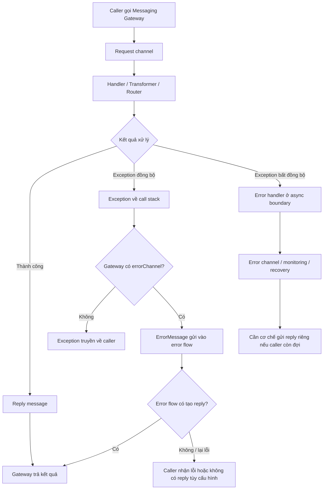
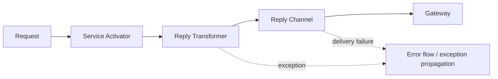

# Xử lý exception trong reply flow với Spring Integration

## 1. Đặt vấn đề: Khi reply flow không trả về kết quả bình thường

Trong chương **Request reply** của mô-đun **SPRING_INTEGRATION_PATTERN**, một thành phần gửi yêu cầu rồi chờ phản hồi từ luồng xử lý thông điệp. Spring Integration giúp kết nối các thành phần bằng **Enterprise Integration Patterns** như Gateway, Router, Filter, Transformer, Splitter, Aggregator và Service Activator; đồng thời hỗ trợ retry, error channel, correlation và khả năng theo dõi luồng.

Nhưng request–reply không chỉ có hai khả năng “có reply” và “không có reply”. Khi xử lý thất bại, exception có thể phát sinh tại nhiều điểm:

- Handler đang xử lý request thì ném exception.
- Transformer không chuyển đổi được payload hoặc kiểu dữ liệu.
- Router không tìm được đích hợp lệ; channel không gửi được message.
- Adapter gặp lỗi mạng, cơ sở dữ liệu, broker hoặc dịch vụ bên ngoài.
- Aggregator không thể ghép các phần phản hồi, hoặc một nhánh xử lý bị lỗi.
- Reply được tạo nhưng không gửi về được reply channel.
- Error handler tự gặp lỗi, hoặc không trả lời kịp thời để gateway nhận được.

Nếu không thiết kế rõ, caller có thể thấy exception, `null`, phản hồi lỗi nghiệp vụ, hoặc chỉ một timeout. Những trường hợp này có **ý nghĩa khác nhau** và cần được kiểm soát.

**Mục tiêu bài học** là hiểu đường đi của exception trong request–reply, phân biệt exception với phản hồi nghiệp vụ và timeout, cấu hình xử lý lỗi đúng nơi, xây dựng reply contract dễ sử dụng và kiểm thử các đường lỗi.

## 2. Exception đi theo đường nào?

Mô hình cơ bản:



Sơ đồ cho thấy hai yếu tố quan trọng: **ranh giới thread** và **địa chỉ nhận lỗi**. Exception được ném ngay trên thread của gateway có thể truyền theo call stack; exception trên worker thread không thể tự động “nhảy” về thread caller.

### 2.1. Các loại kết quả cần phân biệt

| Trường hợp | Gateway/caller có thể quan sát | Ý nghĩa |
| --- | --- | --- |
| Handler trả reply thành công | Object hoặc message phản hồi | Công việc hoàn thành theo contract |
| Handler từ chối nghiệp vụ và tạo reply có trạng thái `REJECTED` | Object phản hồi có cấu trúc | Yêu cầu đã được xử lý và bị từ chối rõ ràng |
| Exception trên đường đồng bộ, không có xử lý lỗi riêng | Exception truyền về caller (thường qua lớp bọc của Spring Messaging) | Luồng xử lý gặp lỗi |
| Exception được chuyển đến error flow tạo reply thay thế | Reply dự phòng/có trạng thái lỗi | Chính sách lỗi đã được áp dụng |
| Lỗi ở thread bất đồng bộ nhưng không có reply hợp lệ | Gateway có thể chờ hết `replyTimeout` | Caller chưa biết kết quả sau cùng |
| Reply đến muộn hoặc gửi reply thất bại | Caller có thể không nhận được kết quả | Cần đối soát trạng thái thực của tác vụ |

**Exception không đồng nghĩa với reply nghiệp vụ thất bại.** Một exception có thể biểu thị rằng chưa xác định được giao dịch có thành công hay chưa. Ví dụ, timeout mạng sau khi hệ thống thanh toán nhận lệnh không đủ để kết luận rằng tiền chưa bị trừ.

### 2.2. Một số exception thường gặp

- `MessageHandlingException`: lỗi trong quá trình handler xử lý một message.
- `MessageDeliveryException`: lỗi trong quá trình chuyển message đến đích, ví dụ channel không có subscriber phù hợp hoặc quá trình gửi gặp vấn đề.
- `MessageTransformationException` và các exception chuyên biệt khác: lỗi trong bước chuyển đổi, tùy endpoint và tình huống.
- Exception nghiệp vụ do ứng dụng tự định nghĩa, ví dụ `InvalidAmountException`, `InsufficientStockException`.
- Exception từ thư viện downstream như lỗi kết nối, timeout hoặc ràng buộc dữ liệu.

Nhiều exception được bọc trong `org.springframework.messaging.MessagingException`, trong đó `getFailedMessage()` có thể giúp truy ngược message liên quan. Vì vậy, khi phân loại lỗi, cần kiểm tra **chuỗi `cause`** và message gốc, không chỉ so sánh tên lớp của exception ngoài cùng.

## 3. Ranh giới đồng bộ và bất đồng bộ quyết định khả năng bắt lỗi

### DirectChannel: lỗi cùng call stack

```text
Caller -> Gateway -> DirectChannel -> Handler
                                   X throw exception
Caller <- Gateway <- exception ------+
```

`DirectChannel` thường gọi subscriber trên cùng thread với người gửi. Nếu handler ném exception trước khi sinh reply, lỗi có thể quay ngược về gateway và caller. Bạn có thể:

1. Cho lỗi lan ra ngoài và bắt exception ở lớp ứng dụng.
2. Cấu hình `errorChannel` tại gateway để chuyển exception vào luồng xử lý lỗi.
3. Chủ động bắt một số exception nghiệp vụ ở handler và trả về reply có trạng thái xác định.

### ExecutorChannel: lỗi ở worker thread

```text
Caller -> Gateway -> ExecutorChannel --enqueue--> Worker -> Handler
                         |                         X exception
                         |                          |
                         v                          v
                   chờ reply                  error handler
                         |                          |
                    replyTimeout             error channel/log
```

`ExecutorChannel` chuyển xử lý sang executor. Exception từ handler xảy ra trên worker thread, vì thế nó cần được error handler xử lý và gửi về kênh lỗi thích hợp. Nếu không có phản hồi theo đường mà gateway đang chờ, caller có thể chỉ nhận `null` hoặc kết quả timeout, tùy contract gateway.

**Không nên cho rằng đặt `errorChannel` trên gateway là đủ để bắt mọi lỗi ở mọi thread.** Phải xác minh error handling tại từng ranh giới bất đồng bộ, bao gồm channel, executor, adapter, broker và reply routing. Với một message có header `errorChannel`, thành phần hỗ trợ cơ chế xử lý lỗi có thể ưu tiên kênh được chỉ định; nếu không có địa chỉ phù hợp, cơ chế fallback phụ thuộc vào loại endpoint và cấu hình của ứng dụng.

Một điểm nữa: `DirectChannel` có thể chặn caller trong chính lời gọi handler. Khi đó `replyTimeout` của gateway **không giới hạn toàn bộ thời gian thực thi handler**, vì quá trình gửi request chưa hoàn tất theo nghĩa của lời gọi đồng bộ. Nếu muốn gateway dừng chờ độc lập với thời gian chạy handler, cần thiết kế asynchronous boundary đúng chỗ.

## 4. Những công cụ xử lý lỗi của Spring Integration

### 4.1. `errorChannel` và `ErrorMessage`

Spring Integration có cơ chế biểu diễn lỗi bằng một message chứa `Throwable`. Lớp `org.springframework.messaging.support.ErrorMessage` có payload là exception, đồng thời có thể mang thông tin về message gốc.

Ví dụ chữ ký xử lý lỗi:

```java
import org.springframework.integration.annotation.ServiceActivator;
import org.springframework.messaging.Message;
import org.springframework.messaging.MessagingException;
import org.springframework.messaging.support.ErrorMessage;

@ServiceActivator(inputChannel = "myGatewayErrors")
public void inspect(ErrorMessage errorMessage) {
    Throwable error = errorMessage.getPayload();
    Message<?> source = errorMessage.getOriginalMessage();

    if (source == null && error instanceof MessagingException me) {
        source = me.getFailedMessage();
    }

    // Log mã tương quan và loại lỗi; xử lý tiếp theo policy.
}
```

Ví dụ trên minh họa cách nhận `ErrorMessage`. Hàm `void` **không tạo reply thay thế**, vì thế không thể dùng riêng nó để đảm bảo phương thức gateway sẽ nhận kết quả. Đường xử lý lỗi phải được thiết kế theo nhu cầu: chỉ ghi log, phát sự kiện, retry, chuyển dead-letter, tạo fallback reply hoặc đẩy exception ra caller.

### 4.2. Gateway-level error channel

Messaging gateway có thể được cấu hình kênh lỗi, chẳng hạn `@MessagingGateway(errorChannel = "myGatewayErrors")`. Khi lỗi đồng bộ từ luồng request được gateway đưa vào kênh này, error flow có thể phân loại và cung cấp reply thay thế.

Cơ chế này phù hợp khi caller cần một **contract phản hồi nhất quán**. Error flow phải sinh dữ liệu có kiểu tương thích với phương thức gateway nếu muốn trả về một object thay thế. Nếu error flow chỉ ghi log, chặn xử lý hoặc lại ném exception, caller không thể mặc định nhận được fallback.

### 4.3. Global error channel và error flow riêng

Ứng dụng Spring Integration có thể có kênh lỗi chung tên `errorChannel`. Đây là một điểm tập trung phổ biến để xử lý `ErrorMessage`, đặc biệt cho các lỗi được phát qua cơ chế message-driven/async. Cách message được đưa đến global error channel phụ thuộc vào endpoint và cấu hình error handler; không phải **mọi** exception trên mọi call stack đều tự động được publish vào đó.

Với nghiệp vụ có contract riêng, nên đặt tên kênh rõ ràng, ví dụ `paymentGatewayErrors`, `reservationWorkerErrors`. Điều này giúp tránh trộn lỗi của các luồng có SLA, chính sách retry và cách trả lời khác nhau.

### 4.4. RequestHandlerAdvice và retry

Spring Integration hỗ trợ advice quanh handler, ví dụ retry advice và các advice đánh giá biểu thức thành công/thất bại. Chúng phù hợp để áp dụng chính sách tại handler. Tuy nhiên:

- Retry có thể làm tăng tổng latency và khiến gateway đã hết thời gian chờ khi xử lý vẫn tiếp diễn.
- Retry của thao tác có side effect cần `idempotencyKey` để tránh thực hiện trùng.
- Advice phát message lỗi sang một channel **không tự biến message đó thành reply của gateway**.
- Cần xác định thứ tự áp dụng advice, cách exception được bọc và điều kiện nào được phép retry.

## 5. Ví dụ đầy đủ: trả phản hồi lỗi có cấu trúc từ gateway

Giả sử một hệ thống nhận lệnh thanh toán. Khi số tiền không hợp lệ, caller cần nhận một kết quả từ chối rõ ràng. Với lỗi xử lý chưa rõ kết quả, hệ thống không được tự khẳng định giao dịch thất bại.

Ví dụ dưới đây sử dụng **`DirectChannel`** để kiểm soát đường exception trên cùng call stack. Cấu hình này nhằm minh họa việc gateway chuyển lỗi đồng bộ sang error flow tạo reply. Trong ứng dụng thực, tách từng `public` type ra file Java riêng, tổ chức package phù hợp và sử dụng nghiệp vụ/transaction thay cho xử lý mô phỏng.

### Bước 1 — Định nghĩa contract

```java
public record PaymentCommand(
    String requestId,
    long amountCents
) {}

public record PaymentResult(
    String requestId,
    String status,
    String code
) {}
```

Chọn các trạng thái nhất quán:

| `status` | Khi nào dùng | Caller nên làm gì |
| --- | --- | --- |
| `SUCCEEDED` | Có bằng chứng xử lý hoàn thành | Tiếp tục luồng thành công |
| `REJECTED` | Quy tắc nghiệp vụ đã xác định từ chối | Hiển thị lý do hợp lệ, thường không retry |
| `UNKNOWN` | Lỗi khiến kết quả thực chưa xác định | Tra cứu bằng `requestId`, tránh gửi lệnh mới tùy tiện |

Đặc biệt, `UNKNOWN` không phải từ đồng nghĩa của `FAILED`. Nó yêu cầu một cơ chế đối soát độc lập.

### Bước 2 — Cấu hình channel và gateway

```java
import org.springframework.context.annotation.Bean;
import org.springframework.context.annotation.Configuration;
import org.springframework.integration.annotation.IntegrationComponentScan;
import org.springframework.integration.channel.DirectChannel;
import org.springframework.integration.config.EnableIntegration;
import org.springframework.messaging.MessageChannel;

@Configuration
@EnableIntegration
@IntegrationComponentScan
public class PaymentIntegrationConfig {

    @Bean("paymentRequests")
    public MessageChannel paymentRequests() {
        return new DirectChannel();
    }

    @Bean("paymentGatewayErrors")
    public MessageChannel paymentGatewayErrors() {
        return new DirectChannel();
    }
}
```

```java
import org.springframework.integration.annotation.MessagingGateway;

@MessagingGateway(
    defaultRequestChannel = "paymentRequests",
    errorChannel = "paymentGatewayErrors",
    defaultReplyTimeout = "3000"
)
public interface PaymentGateway {

    PaymentResult pay(PaymentCommand command);
}
```

`defaultReplyTimeout` được tính bằng mili giây. Gateway nhận reply đúng kiểu `PaymentResult` khi handler hoạt động bình thường hoặc khi error flow tạo được reply hợp lệ. `errorChannel` ở đây phục vụ việc xử lý exception tại gateway cho luồng đồng bộ; không thay thế cấu hình error handling ở các ranh giới bất đồng bộ khác.

### Bước 3 — Xử lý yêu cầu

```java
import org.springframework.integration.annotation.ServiceActivator;
import org.springframework.stereotype.Component;

@Component
public class PaymentHandler {

    @ServiceActivator(inputChannel = "paymentRequests")
    public PaymentResult process(PaymentCommand command) {
        if (command.amountCents() <= 0) {
            throw new InvalidAmountException("Amount must be positive");
        }

        // Minh họa: chỉ trả kết quả sau khi thao tác nghiệp vụ
        // thực sự được xác nhận thành công.
        return new PaymentResult(
            command.requestId(),
            "SUCCEEDED",
            "OK"
        );
    }
}

class InvalidAmountException extends RuntimeException {
    InvalidAmountException(String message) {
        super(message);
    }
}
```

`InvalidAmountException` minh họa exception nghiệp vụ. Trong luồng này, handler ném lỗi thay vì trả reply; gateway đã được cấu hình để đưa lỗi đồng bộ vào `paymentGatewayErrors`.

### Bước 4 — Biến một số exception thành reply

```java
import org.springframework.integration.annotation.ServiceActivator;
import org.springframework.messaging.Message;
import org.springframework.messaging.MessagingException;
import org.springframework.messaging.support.ErrorMessage;
import org.springframework.stereotype.Component;

@Component
public class PaymentErrorReplyHandler {

    @ServiceActivator(inputChannel = "paymentGatewayErrors")
    public PaymentResult handle(ErrorMessage errorMessage) {
        Throwable cause = deepestCause(errorMessage.getPayload());

        Message<?> failed = errorMessage.getOriginalMessage();
        if (failed == null
                && errorMessage.getPayload() instanceof MessagingException me) {
            failed = me.getFailedMessage();
        }

        String requestId = "UNKNOWN_REQUEST";
        if (failed != null
                && failed.getPayload() instanceof PaymentCommand command) {
            requestId = command.requestId();
        }

        if (cause instanceof InvalidAmountException) {
            return new PaymentResult(
                requestId,
                "REJECTED",
                "INVALID_AMOUNT"
            );
        }

        // Với lỗi không xác định, không tự nhận là thanh toán thất bại.
        return new PaymentResult(
            requestId,
            "UNKNOWN",
            "PROCESSING_UNCERTAIN"
        );
    }

    private static Throwable deepestCause(Throwable error) {
        Throwable current = error;
        while (current.getCause() != null
                && current.getCause() != current) {
            current = current.getCause();
        }
        return current;
    }
}
```

**Vì sao cần truy vết `failedMessage`?** Error flow đang nhận một `ErrorMessage`, trong khi mã yêu cầu nằm trên request ban đầu. `MessagingException#getFailedMessage()` và `ErrorMessage#getOriginalMessage()` là hai nguồn có thể cung cấp ngữ cảnh. Chúng không được bảo đảm luôn có thông tin đầy đủ ở mọi loại exception, vì thế khi triển khai cần lưu `requestId` trong request và trong nguồn dữ liệu đối soát, thay vì phụ thuộc hoàn toàn vào cấu trúc exception.

**Vì sao không trả exception text cho caller?** Thông báo exception kỹ thuật và stack trace thường không ổn định, có thể lộ nội dung nội bộ hoặc chứa dữ liệu nhạy cảm. Reply công khai nên dùng mã lỗi có kiểm soát; log nội bộ mới lưu stack trace và thông tin kỹ thuật cần thiết.

**Giới hạn của ví dụ:** Nếu một nhánh đã hoàn tất thanh toán nhưng mất kết nối trước khi xác nhận, reply `UNKNOWN` chỉ biểu thị mức độ hiểu biết của caller; nó không tự rollback hay hủy giao dịch. Một ứng dụng thanh toán thực phải có nơi ghi nhận trạng thái, khóa idempotency và API đối soát.

### Bước 5 — Caller sử dụng kết quả

```java
PaymentResult result = gateway.pay(
    new PaymentCommand("pay-2048", -100)
);

switch (result.status()) {
    case "SUCCEEDED" -> {
        // Chuyển sang bước xác nhận thành công.
    }
    case "REJECTED" -> {
        // Yêu cầu sai quy tắc nghiệp vụ; thông báo mã từ chối.
    }
    case "UNKNOWN" -> {
        // Tra cứu trạng thái bằng requestId.
        // Không tạo lệnh thanh toán mới một cách mù quáng.
    }
    default -> throw new IllegalStateException(
        "Unexpected payment status: " + result.status()
    );
}
```

Lớp gọi cũng cần xử lý trường hợp **không nhận được reply** và exception xảy ra trong chính error flow. Nếu phương thức gateway trả về object nullable và chờ reply quá hạn, `null` có thể xuất hiện; code production phải kiểm tra kết quả trước khi gọi `result.status()`. Có thể bổ sung adapter ở biên ứng dụng để chuyển exception, `null` và reply thành một contract API nhất quán.

## 6. Nếu lỗi xảy ra ở reply flow thay vì request handler?

“Reply flow” có thể gồm nhiều bước sau khi công việc chính hoàn thành: transformer định dạng response, enrich header, aggregator tập hợp các kết quả, router chọn reply channel hoặc adapter gửi kết quả ra ngoài.

Ví dụ:



### 6.1. Transformer lỗi khi chuyển reply

Giả sử handler đã trả về dữ liệu hợp lệ nhưng reply transformer lại parse sai định dạng. Nếu tất cả chạy trên cùng thread qua `DirectChannel`, exception có thể quay về gateway và đi vào gateway error channel. **Không được hiểu đó là bằng chứng handler nghiệp vụ chưa chạy.**

Giải pháp:

- Truy vết requestId và bước phát sinh exception.
- Tách mã lỗi “xử lý nghiệp vụ thất bại” khỏi “không dựng được response”.
- Giữ kết quả nghiệp vụ trong storage độc lập nếu có side effect.
- Kiểm thử riêng conversion/serialization để giảm khả năng mất reply sau khi commit.

### 6.2. Header reply bị mất khi dựng lại message

Một reply flow có thể dùng header `replyChannel` hoặc metadata correlation để trả kết quả về đúng caller. Nếu code tự tạo `Message` mới mà làm mất header cần thiết, phản hồi có thể đi sai channel hoặc không tới người chờ. Trong handler bình thường, Spring Integration có thể quản lý việc chuyển tiếp reply channel, nhưng khi viết custom component hoặc bridge qua broker phải chủ động kiểm tra quy tắc bảo toàn header.

Ví dụ giữ header từ message gốc khi chuyển đổi payload có kiểm soát:

```java
import org.springframework.messaging.Message;
import org.springframework.messaging.support.MessageBuilder;

public Message<?> convertReply(Message<?> original, Object newPayload) {
    return MessageBuilder.fromMessage(original)
        .setPayload(newPayload)
        .build();
}
```

Không sao chép nguyên xi mọi header qua ranh giới không tin cậy. Ở broker hoặc service boundary, một số header chứa đối tượng channel nội bộ, không thể serialize như dữ liệu nghiệp vụ. Hãy dùng mã tương quan có thể truyền tải và cấu hình reply destination phù hợp.

### 6.3. Aggregator thiếu mảnh hoặc gặp lỗi

Với mô hình Splitter–Aggregator, gateway có thể đang đợi một kết quả tổng hợp. Có ít nhất ba kiểu sự cố khác nhau:

- Một nhánh con ném exception.
- Các mảnh đều hợp lệ nhưng thiếu một số mảnh trước thời hạn.
- Aggregator nhận đủ mảnh nhưng chính logic tổng hợp ném exception.

Timeout/cơ chế phát partial result của aggregator **khác** với `replyTimeout` ở gateway. Nếu cần trả về kết quả từng phần, phải định nghĩa rõ điều kiện phát group, correlation key và trạng thái `PARTIAL` trong reply contract. Đừng tự động coi bất kỳ kết quả tổng hợp thiếu mảnh nào là thành công đầy đủ.

### 6.4. Reply không chuyển được về caller

Khi gateway đã hết thời gian chờ, reply channel tạm thời có thể không còn nơi nhận. Lỗi gửi late reply phụ thuộc vào channel, version và topology. Một lời gọi đồng bộ đã hoàn tất không thể được “trả lời lại” bằng cách gửi message trễ vào đối tượng chờ cũ. Hệ thống cần một luồng lưu kết quả và thông báo/tra cứu độc lập nếu muốn hỗ trợ late reply.

## 7. Thiết kế chính sách error handling có thể dự đoán

### 7.1. Phân loại trước khi xử lý

| Nhóm lỗi | Ví dụ | Phản ứng đề xuất |
| --- | --- | --- |
| Lỗi xác thực/validation | Số tiền âm, thiếu trường bắt buộc | Reply `REJECTED`, mã lỗi cố định |
| Từ chối nghiệp vụ có kết quả rõ | Không đủ hàng, vượt hạn mức | Reply `REJECTED`, không retry mù |
| Lỗi tạm thời trước side effect | Downstream chưa nhận request, tài nguyên quá tải | Retry có giới hạn nếu còn deadline |
| Kết quả downstream chưa xác định | Mất kết nối sau khi gửi lệnh ghi | Reply `UNKNOWN` và đối soát |
| Lỗi lập trình/contract | `ClassCastException`, mapper sai | Ghi log/alert, sửa lỗi nguồn; không che mất triệu chứng |
| Lỗi gửi reply sau khi commit | Reply channel unavailable | Giữ trạng thái nghiệp vụ và cho phép tra cứu kết quả |

Một exception cùng tên có thể cần cách xử lý khác nhau tùy thời điểm xuất hiện. Ví dụ network timeout **trước khi gửi lệnh** khác với timeout **sau khi downstream đã tiếp nhận lệnh**. Chính sách phải dựa trên mức độ chắc chắn của trạng thái nghiệp vụ.

### 7.2. Giới hạn retry và chống xử lý trùng

Nếu handler ghi dữ liệu hoặc gửi lệnh thanh toán, retry thiếu kiểm soát có thể tạo duplicate. Hãy:

1. Dùng một `requestId`/`idempotencyKey` ổn định cho cùng ý định nghiệp vụ, kể cả sau timeout và retry.
2. Kiểm tra khóa trong nơi lưu có tính nguyên tử, ví dụ unique constraint hoặc giao dịch phù hợp.
3. Chỉ retry lỗi tạm thời có thể phục hồi; đặt max attempts, backoff và jitter.
4. Chừa ngân sách thời gian cho gateway và downstream; tránh retry sau khi deadline nghiệp vụ đã qua.
5. Truy vấn trạng thái theo khóa khi kết quả của lần gửi trước chưa xác định.

Retry advice hỗ trợ gọi lại handler; nó không tự bảo đảm **exactly-once business effect**. Idempotency phải được thực hiện tại nơi phát sinh side effect.

### 7.3. Đưa thông tin lỗi ra biên ứng dụng

Không nên để API phụ thuộc trực tiếp vào `MessageHandlingException`, tên channel hoặc chi tiết exception của vendor. Một hợp đồng dễ dùng có thể gồm:

```json
{
  "requestId": "pay-2048",
  "status": "UNKNOWN",
  "code": "PROCESSING_UNCERTAIN",
  "message": "Chưa xác nhận được kết quả. Hãy tra cứu bằng requestId."
}
```

Đây là **ví dụ về payload nghiệp vụ**, không phải response mặc định của Spring Integration. Biên API có thể ánh xạ các trạng thái thành HTTP status phù hợp với contract đã thiết kế. Chỉ sử dụng phản hồi kiểu “đã tiếp nhận” khi có bằng chứng tiếp nhận và cơ chế tra cứu trạng thái. Với lỗi hạ tầng làm mất kết quả, tránh báo “thất bại chắc chắn” nếu không có bằng chứng.

## 8. Observability: Từ exception tới nguyên nhân

Khi có nhiều Router, Transformer, Splitter, Aggregator và Gateway, một dòng log “MessageHandlingException” thường chưa đủ để chẩn đoán. Hãy gắn cùng một mã tương quan xuyên suốt request và reply.

Thông tin nên theo dõi:

- `requestId` và `correlationId` (nếu cả hai tồn tại, phải biết cách ánh xạ).
- `messageId`, tên logical flow, endpoint, channel, thời điểm bắt đầu và thời điểm tạo reply.
- Nhóm exception, loại lỗi gốc (root cause), số lần retry và thời điểm deadline.
- Phân biệt số lỗi ở handler, lỗi chuyển reply, lỗi gửi message, reply timeout và late reply.
- Kết quả nghiệp vụ thực tế, đặc biệt khi caller đã nhận `UNKNOWN`.
- Độ sâu queue và mức sử dụng executor nếu có xử lý bất đồng bộ.

Một cách biểu diễn timeline để điều tra:

```text
12:00:00.100 requestId=pay-2048  gateway REQUEST_SENT
12:00:00.170 requestId=pay-2048  handler PAYMENT_ACCEPTED
12:00:00.210 requestId=pay-2048  replyTransformer ERROR
12:00:00.215 requestId=pay-2048  errorFlow UNKNOWN
12:00:00.300 requestId=pay-2048  reconciliation SUCCEEDED
```

Ví dụ cho thấy lỗi reply có thể xuất hiện **sau** khi nghiệp vụ đã được tiếp nhận. Kết quả đối soát về sau mới quyết định trạng thái cuối cùng. Cần tránh đưa token, dữ liệu thanh toán nhạy cảm hoặc toàn bộ payload vào log.

## 9. Kiểm thử theo từng đường lỗi

| Kịch bản | Thiết lập | Kỳ vọng |
| --- | --- | --- |
| Reply bình thường | Handler trả kết quả thành công | Gateway trả đúng kiểu `PaymentResult` |
| Exception nghiệp vụ đồng bộ | Số tiền không hợp lệ | Error flow trả `REJECTED` và `INVALID_AMOUNT` |
| Exception không rõ kết quả | Handler ném lỗi kỹ thuật | Error flow trả `UNKNOWN` hoặc chính sách lỗi đã định |
| Error handler lỗi | Cố tình ném exception trong error flow | Caller nhận lỗi/timeout theo contract; không báo thành công giả |
| Transformer lỗi sau handler | Ném lỗi trong bước dựng reply | Ghi nhận đúng bước lỗi và bảo toàn trạng thái nghiệp vụ |
| Channel không có subscriber | Gửi đến channel chưa được xử lý | Phân biệt lỗi gửi/chuyển giao với lỗi nghiệp vụ |
| Xử lý bằng `ExecutorChannel` | Handler ném lỗi trên worker thread | ErrorMessage được xử lý tại async boundary; không giả định lỗi đồng bộ quay về caller |
| Handler trả kết quả quá hạn | Reply đến sau `replyTimeout` | Caller không được coi là đã nhận thành công; late result được đối soát |
| Retry cùng idempotency key | Gửi lại sau lỗi tạm thời | Side effect chỉ xảy ra một lần |
| Splitter/Aggregator có một nhánh lỗi | Một nhánh ném exception | Chính sách group/partial reply được thực thi rõ ràng |

Ví dụ kiểm thử tích hợp nhánh nghiệp vụ (JUnit 5, Spring Test; cần khởi động context chứa các bean ở trên):

```java
import static org.junit.jupiter.api.Assertions.assertEquals;
import static org.junit.jupiter.api.Assertions.assertNotNull;

import org.junit.jupiter.api.Test;
import org.springframework.beans.factory.annotation.Autowired;
import org.springframework.boot.test.context.SpringBootTest;

@SpringBootTest
class PaymentGatewayIntegrationTest {

    @Autowired
    PaymentGateway gateway;

    @Test
    void invalidAmountMapsToRejectedReply() {
        PaymentResult result = gateway.pay(
            new PaymentCommand("pay-test-01", -1)
        );

        assertNotNull(result);
        assertEquals("pay-test-01", result.requestId());
        assertEquals("REJECTED", result.status());
        assertEquals("INVALID_AMOUNT", result.code());
    }

    @Test
    void validPaymentReturnsSuccessReply() {
        PaymentResult result = gateway.pay(
            new PaymentCommand("pay-test-02", 5000)
        );

        assertNotNull(result);
        assertEquals("SUCCEEDED", result.status());
    }
}
```

Vì đây là ví dụ sử dụng `@SpringBootTest`, project chạy thử cần có dependency Spring Boot Test; trong ứng dụng Spring Framework thuần có thể thay bằng `@SpringJUnitConfig` với cấu hình tương ứng. Thêm test riêng cho exception trên worker thread, error channel không có handler và reply quá hạn. Những test thời gian nên dùng latch hoặc cơ chế kiểm soát bất đồng bộ thay vì phụ thuộc vào một giá trị `Thread.sleep` sát ngưỡng trên CI.

## 10. Các lỗi thiết kế thường gặp

**Bắt mọi exception rồi trả `SUCCESS` hoặc một giá trị mặc định.** Việc này che dấu lỗi và có thể tạo dữ liệu sai. Phân loại lỗi trước khi tạo fallback.

**Đăng ký error channel nhưng không có chính sách reply.** Log lỗi giúp quan sát, nhưng gateway có thể vẫn đợi reply nếu không có kênh nào gửi phản hồi hợp lệ.

**Giả định exception ở worker thread quay về caller.** Exception không tự vượt qua ranh giới thread. Phải có ErrorMessage/error flow, recovery và đường reply chủ động.

**Ném lại exception kỹ thuật như lỗi nghiệp vụ.** Caller cần error code ổn định; chi tiết kỹ thuật dành cho log/monitoring.

**Bỏ mất correlation khi dùng custom transformer.** Khi không gắn được lỗi với request, retry và đối soát dễ nhầm trạng thái.

**Cho rằng timeout sẽ hủy side effect.** Gateway ngừng chờ không đồng nghĩa transaction downstream đã rollback. Cần deadline, idempotency và cơ chế đối soát/hủy nghiệp vụ thích hợp.

**Chỉ kiểm thử handler thành công.** Error handler, lỗi chuyển reply và late reply đều là một phần của request–reply contract.

## 11. Bài thực hành

1. Dùng ví dụ `PaymentGateway`, gửi request có `amountCents <= 0`. Theo dõi đường đi từ exception ở handler tới `paymentGatewayErrors` và reply `REJECTED`.
2. Tạo một exception kỹ thuật trong handler. Giải thích vì sao error flow trả `UNKNOWN` thay vì khẳng định giao dịch thất bại.
3. Thêm một reply transformer có thể ném exception. Ghi log `requestId` và phân biệt trạng thái nghiệp vụ với trạng thái dựng reply.
4. Chuyển request channel sang một asynchronous boundary. Kiểm tra cách error message được gửi đến error channel của worker, và thiết kế riêng đường phản hồi cho gateway.
5. Cấu hình `replyTimeout`, mô phỏng reply đến muộn và xây dựng API tra cứu trạng thái theo `requestId`.
6. Bổ sung retry có giới hạn và khóa idempotency. Kiểm chứng rằng gửi lại cùng một yêu cầu không tạo thêm side effect.

**Câu hỏi tự đánh giá:** Nếu handler đã lưu giao dịch thành công nhưng reply transformer ném exception, caller sẽ thấy gì? Làm thế nào error flow ghi nhận đúng nguồn lỗi và giúp caller tra cứu trạng thái đã commit, ngay cả khi gateway không nhận được reply?

## Ghi nhớ

- Với luồng **đồng bộ**, exception có thể lan ngược qua call stack; gateway có thể chuyển một số lỗi vào `errorChannel` đã cấu hình.
- Với luồng **bất đồng bộ**, xử lý exception phụ thuộc vào error handler và error channel tại ranh giới thực thi; muốn có reply phải thiết kế đường trả lời phù hợp.
- `ErrorMessage` giúp mô tả lỗi và truy vết message liên quan; việc tạo **reply có cấu trúc** là quyết định của error flow.
- Lỗi xử lý request, lỗi dựng reply, lỗi gửi reply và `replyTimeout` không có cùng ý nghĩa nghiệp vụ.
- Correlation, idempotency, retry có giới hạn, deadline và observability là nền tảng để xử lý exception mà vẫn giữ trạng thái nghiệp vụ nhất quán.
