# Phân biệt Request-Reply với Event Notification trong Spring Integration

> **Chương:** Request reply  
> **Bài học:** Phân biệt request-reply với event notification  
> **Module:** `SPRING_INTEGRATION_PATTERN` — học triển khai Enterprise Integration Patterns với Spring Integration để xây dựng luồng thông điệp ít phụ thuộc và dễ mở rộng. Bài học liên hệ Router, Filter, Transformer, Splitter, Aggregator, Gateway, retry, error channel, correlation và cách kiểm thử, theo dõi các nhánh xử lý.  
> **Ngữ cảnh kỹ thuật:** Java 17+, Spring Messaging, Spring Integration Java DSL, `@MessagingGateway`, `Service Activator` và `PublishSubscribeChannel`. Các đoạn mã hướng dẫn cần được kiểm thử compile/runtime với phiên bản dependency thực tế trước khi triển khai.

## 1. Vấn đề: “gửi message” không nói lên người gửi cần phản hồi hay không

Một hệ thống thương mại có hai nhu cầu khác nhau:

1. API Checkout gọi **“Hãy tạo đơn hàng này và trả kết quả”**. Caller muốn biết yêu cầu hợp lệ, có được tiếp nhận/hoàn tất hay bị từ chối.
2. Sau khi đơn đã được ghi nhận, hệ thống công bố **“Đơn hàng ORD-101 đã được tạo”**. Các dịch vụ Audit, Email, Analytics có thể quan tâm và tự xử lý.

Cả hai đều có thể truyền `Message<?>` trong Spring Integration, nhưng **nghĩa vụ đối với người gửi hoàn toàn khác nhau**.

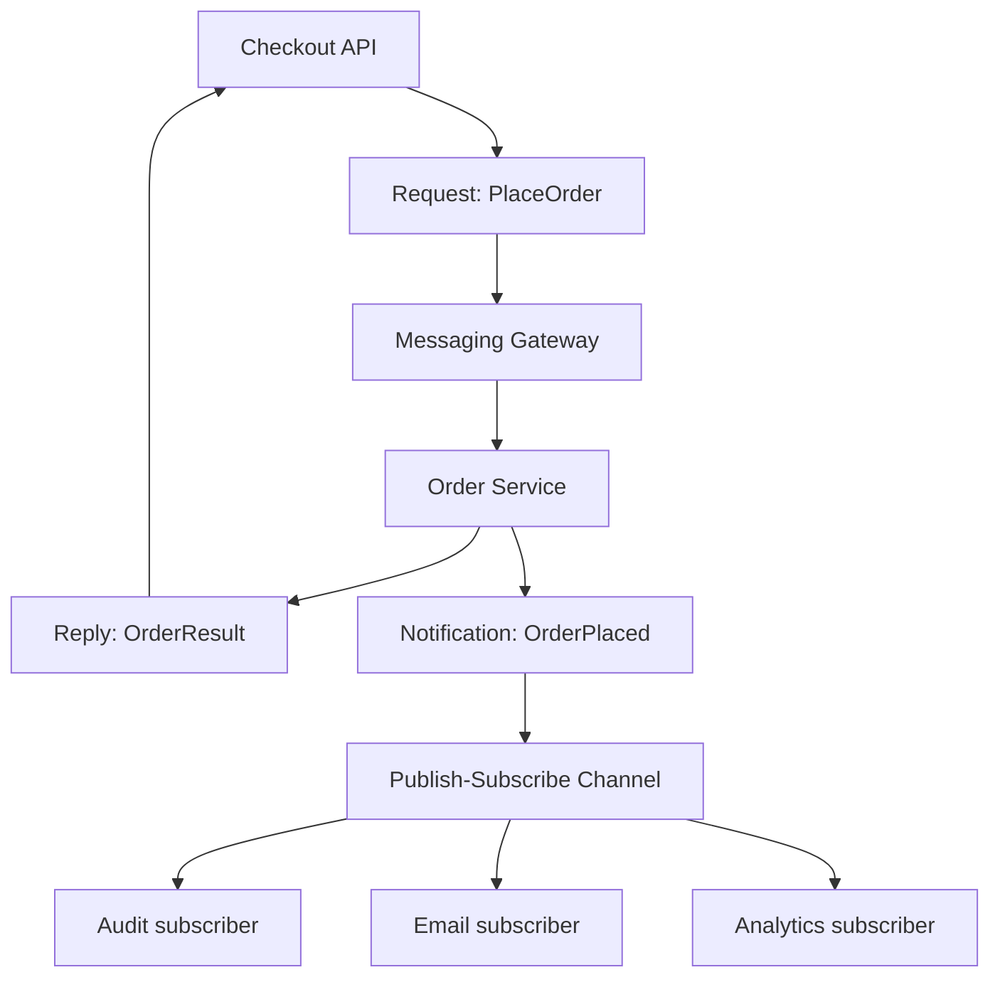

Trong nhánh Request-Reply, người gọi có một **request đang chờ một kết quả**. Trong nhánh Event Notification, producer thông báo **một fact nghiệp vụ đã xảy ra**; việc mỗi subscriber xử lý thành công hay thất bại là câu chuyện riêng.

### Câu hỏi cốt lõi

> Sau khi gửi message, người gửi **có quyền kỳ vọng một kết quả dành riêng cho lời gọi đó** hay chỉ đang **thông báo một sự kiện** để các bên khác tự phản ứng?

Câu trả lời này định hướng API, channel topology, retry, timeout, correlation, failure handling và cách kiểm thử.

## 2. Mục tiêu học tập

Sau bài học, bạn có thể:

1. Giải thích Request-Reply và Event Notification theo hợp đồng tương tác.
2. Phân biệt **ý nghĩa nghiệp vụ** với synchronous/asynchronous execution.
3. Phân biệt command, query, event và acknowledgement.
4. Biết khi nào chọn Messaging Gateway, khi nào publish notification.
5. Hiểu `requestChannel`, `replyChannel`, `errorChannel` và subscriber channel.
6. Thực hiện request-reply bằng Java DSL và `@MessagingGateway`.
7. Thực hiện event notification fan-out bằng `PublishSubscribeChannel`.
8. Kiểm thử Gateway trả `OrderResult` và event được hai subscribers nhận.
9. Không nhầm return value từ Service Activator `void` với một business reply.
10. Phân biệt request ID, business correlation, event ID, causation và trace ID.
11. Thiết kế timeout, late reply, error channel, retry và idempotency phù hợp.
12. Biết dùng outbox và eventual consistency cho notifications đáng tin cậy.
13. Xử lý Router/Filter/Splitter/Aggregator theo đúng hợp đồng.
14. Đo lường kết quả riêng cho request, publish, delivery và business effect.

## 3. Request-Reply là gì?

**Request-Reply** là mô hình giao tiếp trong đó một bên gửi yêu cầu và mong nhận **phản hồi có tương quan với yêu cầu đó**.

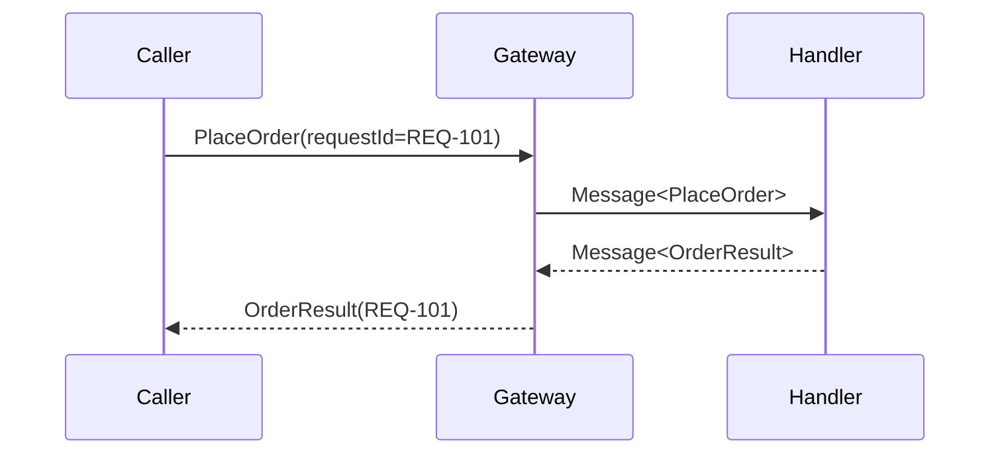

Các yếu tố định nghĩa:

- **Request:** command/query gửi cho một dịch vụ có trách nhiệm xử lý.
- **Reply:** kết quả, quyết định hoặc lỗi theo hợp đồng của request.
- **Correlation:** cần biết reply thuộc request nào.
- **Timeout/deadline:** caller không thể chờ mãi.
- **Failure policy:** phải biết xử lý exception, missing reply và unknown outcome.
- **Cardinality:** với API request-reply thông thường, một lời gọi đợi một logical final response; một service có thể có nhiều internal messages nhưng phải tổng hợp về response theo contract.

### Ví dụ đời thực

```java
OrderResult result = orderGateway.place(
    new PlaceOrder(
        "shop-01", "ORD-101", "REQ-101", 125_000L));
```

`result` là thông tin dành cho **đúng lời gọi**. Nó có thể là `ACCEPTED`, `REJECTED` hoặc `COMPLETED` tùy business contract.

**Không đồng nhất trả reply với commit cuối:** một result `ACCEPTED` có thể chỉ xác nhận công việc đã được tiếp nhận. `COMPLETED` nên chỉ được dùng khi hệ thống thực sự có bằng chứng của trạng thái mà contract cam kết.

## 4. Event Notification là gì?

**Event Notification** là mô hình công bố **một sự kiện đã xảy ra** để các subscribers tự quyết định có cần phản ứng hay không. Producer thường **không mong mỗi subscriber trả một business reply cho lời publish**.

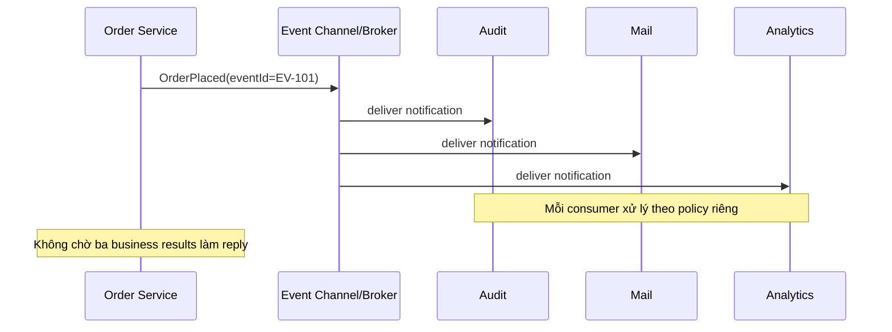

Các đặc trưng:

- **Fact ở thì quá khứ:** `OrderPlaced`, `PaymentCaptured`, `InventoryReserved`.
- **Publisher** không cần biết toàn bộ subscribers.
- **Subscriber** có thể xuất hiện thêm theo thời gian mà không đổi contract của producer.
- Producer không tự động biết downstream effect đã hoàn tất.
- Một subscriber gặp lỗi không biến event ban đầu thành “chưa từng xảy ra”.
- Reliability phụ thuộc transport, consumer ACK, retry, idempotency và persistence riêng.

### Ví dụ

```java
eventChannel.send(MessageBuilder
    .withPayload(
        new OrderPlaced(
            "shop-01", "ORD-101", "EV-101",
            "REQ-101", Instant.now()))
    .build());
```

Đoạn trên minh họa thao tác publish; `send(...)` trả về thành công trong một channel **không đồng nghĩa** email đã gửi, analytics đã cập nhật hoặc audit đã commit. Trong production, timestamp cần có semantics rõ và event ID phải ổn định qua retry.

## 5. Bảng so sánh chính

| Khía cạnh | Request-Reply | Event Notification |
| --- | --- | --- |
| Ý định | Yêu cầu dịch vụ thực hiện/trả lời | Thông báo một fact đã xảy ra |
| Ngôn ngữ thường gặp | “Hãy làm...”, “Hãy cho biết...” | “Đã xảy ra...” |
| Ví dụ | `PlaceOrder → OrderResult` | `OrderPlaced` |
| Nghĩa vụ người nhận | Tạo kết quả hoặc failure theo API | Xử lý event theo subscription contract |
| Người gửi mong business reply? | Có | Thường không |
| Correlation | Request ↔ reply | Event ↔ workflow/causation/tracing |
| Timeout ở producer | Quan trọng cho reply | Có thể chỉ là publish/transport timeout |
| Subscriber count | Một logical responder hoặc aggregator | Thường một-nhiều, nhưng không bắt buộc |
| Điểm mạnh | Caller có quyết định ngay | Loose coupling, mở rộng subscribers |
| Rủi ro | Latency, timeout, response coupling | Eventual consistency, replay/ordering |
| Lỗi consumer | Ảnh hưởng response nếu trong request path | Có thể xử lý độc lập tại consumer |
| Retry | Cần idempotency của operation | Cần idempotency theo event/consumer action |
| Kênh điển hình Spring | Gateway → request channel → handler → reply | Event channel/broker → subscribers |
| Test chính | Reply đúng request/type/deadline | Subscribers nhận đúng event, dedup/recovery |

**Các cột là mặc định thiết kế, không phải ràng buộc về công nghệ.** Event notification có thể chỉ có một subscriber. Request-reply có thể bất đồng bộ qua broker; điểm phân biệt là **hợp đồng trao đổi**, không phải tên channel.

## 6. Đừng nhầm pattern với synchronous/asynchronous

Một trong những nhầm lẫn lớn nhất: “Request-Reply là đồng bộ, Event Notification là bất đồng bộ”.

Không đúng hoàn toàn.

### Request-Reply đồng bộ

Java caller chờ method `gateway.place(...)` trả result:

```text
Caller blocks -> request -> handler -> reply -> caller resumes
```

### Request-Reply bất đồng bộ

Caller tạo request rồi nhận response sau qua callback, future, reply topic hoặc polling; **vẫn là request-reply** vì mỗi response tương quan một request.

```text
Caller -> requestId=R1 -> Broker -> Worker
Caller continues other work
Worker -> reply(requestId=R1) -> Reply Channel
Caller correlates result R1
```

### Event Notification chạy đồng bộ trong JVM

Một `PublishSubscribeChannel` không cấu hình executor có thể dispatch subscriber ngay trên thread gửi. Producer có thể bị chặn khi các subscriber xử lý. **Nó vẫn là event notification** vì không có contract business reply cho event.

### Event Notification chạy bất đồng bộ

Qua executor/broker, consumer xử lý sau, có retry, DLQ và eventual consistency.

| Semantic | Dispatch đồng bộ | Dispatch bất đồng bộ |
| --- | --- | --- |
| Request-Reply | Gateway + DirectChannel | Request/reply queue/topic, correlation ID |
| Event Notification | PublishSubscribeChannel không executor | ExecutorPubSub / broker consumers |

**Trục 1:** có cần business reply?  
**Trục 2:** xử lý ở thread nào và khi nào?  

Hai quyết định độc lập và cần được kiểm thử riêng.

## 7. Command, Query, Event, Reply và ACK

Những khái niệm liên quan nhưng không thể thay nhau:

| Loại | Ý nghĩa | Ví dụ |
| --- | --- | --- |
| **Command** | Yêu cầu thay đổi trạng thái | `PlaceOrder` |
| **Query** | Yêu cầu cung cấp dữ liệu | `GetOrderStatus` |
| **Event** | Một fact trạng thái đã xảy ra | `OrderPlaced` |
| **Reply** | Kết quả của command/query | `OrderResult` |
| **Transport ACK** | Xác nhận giao/nhận message ở tầng transport | Broker ACK |
| **Business commit** | State/side effect được ghi nhận theo contract | DB commit |

### Một command có thể one-way không?

Có. `RebuildSearchIndex` có thể là command one-way được queue, nhưng **không vì thế trở thành event notification**. Nó vẫn yêu cầu một hành động chưa xảy ra, không thông báo một fact quá khứ.

### Một event có thể dẫn đến reply không?

Consumer có thể chủ động phát một event mới hoặc một status message, nhưng đó là **một interaction khác**. Không nên gắn business reply của mỗi subscriber vào việc publish event, trừ khi thực sự thiết kế request-reply/aggregation protocol.

### ACK có phải OrderResult không?

Không. Một broker chấp nhận message chỉ biết nó đã nhận/giao theo protocol, không biết Order Service đã validate và commit. `send(...) == true` hoặc publisher confirm **không phải** `OrderResult(COMPLETED)`.

## 8. Ví dụ sai: dùng Event Notification để giả lập RPC

Giả sử client cần một xác nhận tạo đơn ngay, nhưng producer chỉ phát `OrderCreatedRequested` lên topic rồi kỳ vọng event email processor sẽ đưa về kết quả.

```text
HTTP Caller
   -> publish "OrderRequested"
   -> wait until someone somewhere emits "OrderResult"
```

Nếu không có request/reply protocol, thiết kế mơ hồ:

- Ai là responder chính?
- Reply topic/destination ở đâu?
- Correlation ID nào liên kết response với caller?
- Có bao nhiêu replies có thể tới?
- Nếu một subscriber lỗi và một subscriber thành công, response cuối là gì?
- Timeout/late reply được xử lý thế nào?
- Retry operation có tạo đơn hai lần không?

**Nếu API cần result**, hãy dùng Request-Reply hoặc một asynchronous operation protocol rõ (ví dụ trả `202 Accepted + operationId` và tra cứu trạng thái sau), không dựa vào may mắn của event bus.

## 9. Ví dụ sai chiều ngược: dùng RPC cho mọi notification

Order Service vừa ghi đơn xong, lại gọi đồng bộ:

```text
Order Service
  -> Audit RPC
  -> Email RPC
  -> Analytics RPC
  -> Fraud Metrics RPC
  -> finally return Checkout response
```

Hậu quả:

- Latency của Checkout phụ thuộc mọi downstream subscriber.
- Một dịch vụ analytics không sẵn sàng có thể làm khách hàng tưởng đặt hàng thất bại.
- Thêm subscriber cần sửa producer.
- Coupling tăng, availability giảm.
- Retry Checkout vì email lỗi có thể tạo đơn trùng.

**Nếu các side effects là phản ứng phụ độc lập**, Event Notification/Outbox thường phù hợp hơn. Chỉ giữ trong Request-Reply path những bước thật sự phải hoàn thành trước khi được phép tuyên bố kết quả.

## 10. Khi nào nên chọn Request-Reply?

Ưu tiên Request-Reply khi caller cần **một quyết định hoặc kết quả có thể dùng ngay**:

- Xác thực một yêu cầu và trả accepted/rejected.
- Tra cứu trạng thái đơn tại thời điểm gọi.
- Tính phí trước khi xác nhận checkout.
- Kiểm tra quota/eligibility trước khi cấp quyền.
- Đặt chỗ đồng bộ khi SLA rất ngắn và có transaction/recovery phù hợp.
- Gọi service chuyên trách để nhận canonical data phục vụ bước tiếp theo của workflow.
- Một Gateway là boundary dùng cho HTTP/RPC API có response contract rõ.

### Câu hỏi ra quyết định

1. Caller có cần biết kết quả **trước khi tiếp tục** không?
2. Có deadline phù hợp không?
3. Có thể trả `PENDING` thay vì block không?
4. Hành động có side effect không; nếu timeout, có thể retry an toàn không?
5. Có responder xác định và reply routing rõ không?
6. Nếu nhiều responders, ai tổng hợp thành một logical result?

Nếu những câu hỏi này chưa rõ, đừng chỉ đặt tên interface `...Gateway` và giả định phần còn lại đã có.

## 11. Khi nào nên chọn Event Notification?

Ưu tiên Event Notification khi một business fact đã được xác lập và **nhiều bên có thể quan tâm mà producer không cần chờ họ trả kết quả**:

- `OrderPlaced` → gửi email, cập nhật báo cáo, audit.
- `PaymentCaptured` → kích hoạt giao hàng và ledger/reporting.
- `ShipmentDelivered` → cập nhật loyalty, chăm sóc khách hàng.
- `CustomerProfileChanged` → vô hiệu hóa cache, cập nhật search index.
- `StockAdjusted` → cập nhật projection theo eventual consistency.
- `DocumentApproved` → kích hoạt indexing và notifications.

### Điều kiện quan trọng

- Event có ID và nghĩa nghiệp vụ ổn định.
- Consumer biết có thể nhận duplicate/out-of-order.
- Producer có publish reliability contract.
- Event schema/version và retention/replay được quản lý.
- Không nhầm việc event được phát với việc mọi subscribers đã xử lý xong.
- Nếu một subscriber quan trọng tới transaction chính, cân nhắc lại việc đưa nó vào đường event bất đồng bộ.

## 12. Cách phối hợp phổ biến: Reply trước, Event sau commit

Một kiến trúc là:

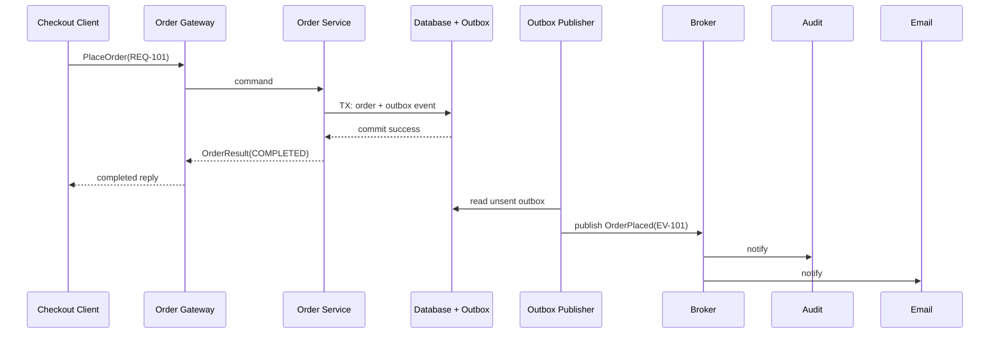

Đây là thiết kế tách **business decision/completion** với **downstream reaction**:

- Caller có một reply hữu ích.
- Các subscribers không kéo dài Checkout latency.
- Outbox record gắn với transaction ghi đơn để giảm nguy cơ commit rồi mất event.
- Publisher có thể gửi lại, nên consumers vẫn cần idempotency.
- Event Notification không đồng nghĩa email đã gửi.
- Nếu database/order commit thất bại, không được phát `OrderPlaced` như một fact đã xảy ra.

### Có bắt buộc trả COMPLETED rồi mới publish?

Không. Nếu service chỉ chấp nhận một workflow dài, có thể trả `ACCEPTED` cùng operation ID rồi xử lý thành công/thất bại sau. Khi đó event phát lúc business fact thực sự xảy ra; không gọi `OrderPlaced` cho một yêu cầu mới được queue mà chưa tạo đơn.

## 13. Bắt đầu ví dụ Java 17: command và result bất biến

Ta xây demo trong package `example.integration`. Một `PlaceOrder` là **command**; một `OrderResult` là **reply**.

### `PlaceOrder.java`

```java
package example.integration;

public record PlaceOrder(
    String tenantId,
    String orderId,
    String requestId,
    long amountMinorUnits
) {
    public PlaceOrder {
        if (tenantId == null || tenantId.isBlank()
                || orderId == null || orderId.isBlank()
                || requestId == null || requestId.isBlank()) {
            throw new IllegalArgumentException(
                "PlaceOrder thiếu tenant/order/request ID");
        }
    }
}
```

### `OrderResult.java`

```java
package example.integration;

public record OrderResult(
    String requestId,
    String status,
    String reasonCode
) {
    public OrderResult {
        if (requestId == null || requestId.isBlank()
                || status == null || status.isBlank()) {
            throw new IllegalArgumentException(
                "OrderResult thiếu requestId/status");
        }
    }

    public static OrderResult accepted(String requestId) {
        return new OrderResult(requestId, "ACCEPTED", null);
    }

    public static OrderResult rejected(
            String requestId, String reasonCode) {
        return new OrderResult(
            requestId, "REJECTED", reasonCode);
    }
}
```

### Vì sao reply là ACCEPTED chứ không phải COMPLETED?

Bản demo chỉ ghi nhận một invocation và quyết định input được chấp nhận. Nó **chưa kết nối database**. Trả `COMPLETED` ở đây sẽ dễ bị hiểu là đã persist order thành công, trong khi test không chứng minh được điều đó. Trong dự án thật:

- `ACCEPTED`: công việc được tiếp nhận theo contract.
- `REJECTED`: input/business rule không được chấp nhận.
- `COMPLETED`: trạng thái nghiệp vụ đã được xác nhận hoàn tất theo điều kiện định nghĩa trước.
- `PENDING/UNKNOWN_OUTCOME`: cần truy vấn trạng thái/reconciliation.

Một số API dùng exception cho validation thay vì typed `REJECTED`; điều đó là lựa chọn contract, không làm thay đổi bản chất Request-Reply.

## 14. Domain event cho Event Notification

Sau khi order thực sự được tạo, producer có thể phát:

### `OrderPlaced.java`

```java
package example.integration;

import java.time.Instant;

public record OrderPlaced(
    String tenantId,
    String orderId,
    String eventId,
    String causationRequestId,
    Instant occurredAt
) {
    public OrderPlaced {
        if (tenantId == null || tenantId.isBlank()
                || orderId == null || orderId.isBlank()
                || eventId == null || eventId.isBlank()
                || occurredAt == null) {
            throw new IllegalArgumentException(
                "OrderPlaced thiếu identity/time");
        }
    }
}
```

### Tại sao event có `eventId` thay vì chỉ `orderId`?

Một order có thể sinh nhiều events:

```text
OrderPlaced(EV-1, orderId=ORD-101)
PaymentCaptured(EV-2, orderId=ORD-101)
OrderShipped(EV-3, orderId=ORD-101)
```

`orderId` nhận diện entity; `eventId` nhận diện một sự kiện logic. Hai events cùng order ID không phải duplicates.

### `causationRequestId` là gì?

Trong demo, trường này liên kết `OrderPlaced` với command/request đã tạo điều kiện cho sự kiện. Một hệ thống lớn có thể lưu `causationId` là **event ID của parent event** thay vì request ID; phải công bố contract rõ. Nó không bắt buộc bằng `businessCorrelationId` và không thay thế idempotency key.

### Event Notification có bắt buộc mang full entity state?

Không. Có nhiều phong cách:

- **Event Notification:** mang ID và metadata tối thiểu để subscriber biết một fact; consumer có thể query thêm nếu cần.
- **Event-Carried State Transfer:** mang phần dữ liệu cần thiết để consumer xây projection mà không query producer.
- **Event Sourcing event:** lưu thay đổi domain như một phần lịch sử có semantics chặt.

Ở đây `OrderPlaced` mang một số ID và timestamp để minh họa. Không cần sao chép mọi field nhạy cảm của đơn hàng vào event bus.

## 15. Request handler: nhận command và trả result

Tạo một service giả lập có số lần invocation để test:

### `DemoOrderService.java`

```java
package example.integration;

import java.util.concurrent.atomic.AtomicInteger;

public final class DemoOrderService {

    private final AtomicInteger calls = new AtomicInteger();

    public OrderResult place(PlaceOrder command) {
        calls.incrementAndGet();

        if (command.amountMinorUnits() < 0) {
            return OrderResult.rejected(
                command.requestId(), "INVALID_AMOUNT");
        }

        return OrderResult.accepted(
            command.requestId());
    }

    public int callCount() {
        return calls.get();
    }
}
```

### Tại sao không publish Event ở trong method này?

Để dạy đúng hai semantics, demo tách hai operations:

1. Gateway call trả `OrderResult` cho request.
2. Event producer publish `OrderPlaced` khi fact đã xảy ra.

Nếu tự động phát `OrderPlaced` trong `place(...)` lúc chưa có DB commit, test có thể vô tình truyền đạt sai rằng “ACCEPTED = OrderPlaced”. Trong production, xem phần Outbox để phát đúng fact sau transaction.

### Result trả cho một caller cụ thể

Hai calls cùng order ID nhưng khác request IDs:

```java
place(new PlaceOrder(
    "shop-01", "ORD-101", "REQ-A", 100L));

place(new PlaceOrder(
    "shop-01", "ORD-101", "REQ-B", 100L));
```

được kỳ vọng có results tương quan `REQ-A` và `REQ-B` riêng. Bản demo chưa thực thi idempotency nên không thể dùng để suy ra hai calls có phải cùng logical operation hay không.

## 16. Subscriber cho event notification: hai side effects độc lập

Một event có thể được hai listeners nhận:

- Projection subscriber ghi nhận một bản cập nhật read model.
- Audit subscriber ghi nhận thông tin sự kiện phục vụ đối soát.

Trong demo, dùng một `ConcurrentLinkedQueue` để dễ kiểm tra số lượng message đã nhận. Đây không phải durable database.

### `OrderProjectionSubscriber.java`

```java
package example.integration;

import java.util.List;
import java.util.concurrent.ConcurrentLinkedQueue;

public final class OrderProjectionSubscriber {

    private final ConcurrentLinkedQueue<OrderPlaced> observed =
        new ConcurrentLinkedQueue<>();

    public void onPlaced(OrderPlaced event) {
        observed.add(event);
    }

    public List<OrderPlaced> snapshot() {
        return List.copyOf(observed);
    }
}
```

### `OrderAuditSubscriber.java`

```java
package example.integration;

import java.util.List;
import java.util.concurrent.ConcurrentLinkedQueue;

public final class OrderAuditSubscriber {

    private final ConcurrentLinkedQueue<OrderPlaced> observed =
        new ConcurrentLinkedQueue<>();

    public void onPlaced(OrderPlaced event) {
        observed.add(event);
    }

    public List<OrderPlaced> snapshot() {
        return List.copyOf(observed);
    }
}
```

### Vì sao cả hai methods trả void?

Vì đây là các handlers xử lý **one-way event notifications**. Mục tiêu không phải tạo một `OrderResult` trả producer, mà là thực hiện công việc tương ứng.

Điều đó không có nghĩa kết quả xử lý bị bỏ qua: trong production, subscribers cần logs, metrics, retry, ACK, DLQ và idempotency riêng.

### Nếu subscriber muốn phát một event khác?

Audit subscriber có thể phát `AuditRecorded` như **một sự kiện mới**, không phải reply mặc định cho publisher của `OrderPlaced`. Nó cần event ID và causation/correlation riêng.

## 17. Messaging Gateway cho Request-Reply

### `OrderCommandGateway.java`

```java
package example.integration;

import org.springframework.integration.annotation.MessagingGateway;

@MessagingGateway(
    name = "orderCommandGateway",
    defaultRequestChannel = "placeOrderRequests",
    defaultReplyTimeout = "2000")
public interface OrderCommandGateway {

    OrderResult place(PlaceOrder command);
}
```

### Những gì Gateway làm

- Caller gọi method Java `place`.
- Gateway tạo request message từ command.
- Gateway gửi vào `placeOrderRequests`.
- Reply-producing handler trả `OrderResult`.
- Gateway map reply về Java return value cho đúng caller.

### Những gì Gateway không tự làm

- Không tự tạo order trong database.
- Không tự phát `OrderPlaced` event.
- Không bảo đảm mỗi request chỉ xử lý một lần.
- Không thể xác định business commit chỉ nhờ reply channel.
- Không tự gửi lỗi của remote broker worker về đúng caller nếu không có reply protocol/correlation.

### Timeout có ý nghĩa gì?

`defaultReplyTimeout` giới hạn việc chờ reply trong contract/framework. Khi một handler không phát reply, caller có thể gặp timeout, null/exception/no-result tùy method signature và cấu hình. Không suy ra timeout nghĩa là business effect chưa xảy ra.

## 18. Java DSL: một flow Request-Reply và hai Event Notification subscribers

### `InteractionStyleConfiguration.java`

```java
package example.integration;

import org.springframework.context.annotation.Bean;
import org.springframework.context.annotation.Configuration;
import org.springframework.integration.annotation.IntegrationComponentScan;
import org.springframework.integration.channel.DirectChannel;
import org.springframework.integration.channel.PublishSubscribeChannel;
import org.springframework.integration.config.EnableIntegration;
import org.springframework.integration.dsl.IntegrationFlow;
import org.springframework.messaging.MessageChannel;

@Configuration
@EnableIntegration
@IntegrationComponentScan(
    basePackageClasses = OrderCommandGateway.class)
public class InteractionStyleConfiguration {

    @Bean
    public MessageChannel placeOrderRequests() {
        return new DirectChannel();
    }

    @Bean
    public MessageChannel orderNotifications() {
        return new PublishSubscribeChannel();
    }

    @Bean
    public DemoOrderService demoOrderService() {
        return new DemoOrderService();
    }

    @Bean
    public OrderProjectionSubscriber orderProjection() {
        return new OrderProjectionSubscriber();
    }

    @Bean
    public OrderAuditSubscriber orderAudit() {
        return new OrderAuditSubscriber();
    }

    @Bean
    public IntegrationFlow placeOrderFlow(
            DemoOrderService service) {

        return IntegrationFlow.from("placeOrderRequests")
            .handle(service, "place")
            .get();
    }

    @Bean
    public IntegrationFlow projectionNotificationFlow(
            OrderProjectionSubscriber projection) {

        return IntegrationFlow.from("orderNotifications")
            .handle(projection, "onPlaced")
            .get();
    }

    @Bean
    public IntegrationFlow auditNotificationFlow(
            OrderAuditSubscriber audit) {

        return IntegrationFlow.from("orderNotifications")
            .handle(audit, "onPlaced")
            .get();
    }
}
```

### Đọc cấu hình theo contract

`placeOrderRequests` là `DirectChannel`. Một Gateway gọi service, service **trả `OrderResult`**, framework có thể dùng request `replyChannel` để trả kết quả.

`orderNotifications` là `PublishSubscribeChannel`. Hai IntegrationFlows cùng subscribe channel này và gọi hai `void` handler. Channel chủ động fan-out **một event tới các subscribers**.

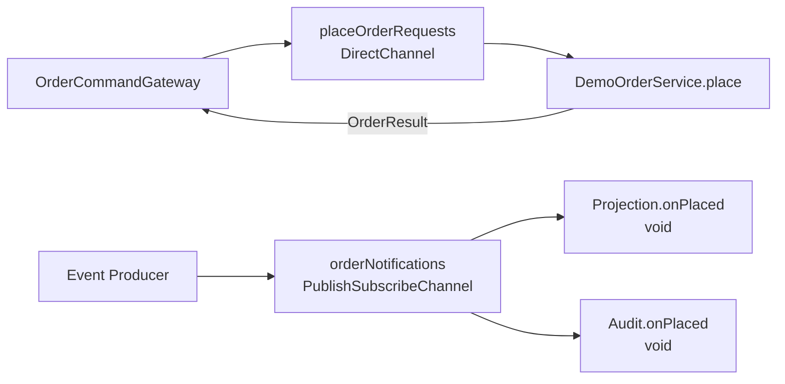

**Không có một cạnh tự động từ `DemoOrderService.place` sang `orderNotifications` trong cấu hình này.** Đó là chủ ý: các test sẽ publish một domain event riêng để minh họa semantics; production nên dùng transaction/outbox thay cho sự kiện tự tạo tùy tiện sau response.

### Vì sao không đặt output channel cho event handlers?

Vì cả hai trả `void`. Trong mô hình Event Notification này, chúng là terminal subscribers, không có business reply cho publisher.

### Lưu ý về API framework

Ví dụ sử dụng Java DSL và `@MessagingGateway` phổ biến trong Spring Integration. Cấu hình method resolution, annotation scanning, timeout và tests cần được chạy với phiên bản thư viện thực tế. Bài STEP 4 NEW tạo nội dung, chưa tiến hành compile/integration QA.

## 19. Kiểm thử Request-Reply: Gateway trả result đúng request

### `InteractionStyleTest.java`

```java
package example.integration;

import static org.junit.jupiter.api.Assertions.*;

import java.time.Instant;

import org.junit.jupiter.api.Test;
import org.springframework.beans.factory.annotation.Autowired;
import org.springframework.beans.factory.annotation.Qualifier;
import org.springframework.messaging.MessageChannel;
import org.springframework.messaging.support.MessageBuilder;
import org.springframework.test.annotation.DirtiesContext;
import org.springframework.test.context.junit.jupiter.SpringJUnitConfig;

@SpringJUnitConfig(InteractionStyleConfiguration.class)
@DirtiesContext(
    classMode = DirtiesContext.ClassMode.AFTER_EACH_TEST_METHOD)
class InteractionStyleTest {

    @Autowired
    private OrderCommandGateway gateway;

    @Autowired
    private DemoOrderService service;

    @Autowired
    @Qualifier("orderNotifications")
    private MessageChannel notifications;

    @Autowired
    private OrderProjectionSubscriber projection;

    @Autowired
    private OrderAuditSubscriber audit;

    @Test
    void requestReplyReturnsResultToCaller() {
        PlaceOrder request = new PlaceOrder(
            "shop-01", "ORD-101", "REQ-101", 125_000L);

        OrderResult result = gateway.place(request);

        assertNotNull(result);
        assertEquals("REQ-101", result.requestId());
        assertEquals("ACCEPTED", result.status());
        assertNull(result.reasonCode());
        assertEquals(1, service.callCount());

        // Bản demo KHÔNG tự phát event khi nhận command.
        assertTrue(projection.snapshot().isEmpty());
        assertTrue(audit.snapshot().isEmpty());
    }
}
```

### Test xác minh những gì?

- Request có `requestId=REQ-101` được xử lý bởi một handler.
- Handler tạo một reply `OrderResult` có cùng logical request ID.
- Gateway trả giá trị cho Java caller.
- Không có event notification bị phát nhầm chỉ vì API có reply.
- Callback/notifications không cần tham gia để Gateway có result.

### Những gì test không chứng minh

- DB order thực sự được tạo.
- Gateway reply đồng nghĩa với transaction commit.
- Hệ thống retry đúng khi mất response.
- Kafka/RabbitMQ event đã được publish.
- Exactly-once side effects trong nhiều pods.

## 20. Kiểm thử domain rejection vẫn có reply

Thêm method vào `InteractionStyleTest`:

```java
@Test
void rejectedCommandStillHasTypedReply() {
    OrderResult result = gateway.place(
        new PlaceOrder(
            "shop-01", "ORD-102", "REQ-102", -10L));

    assertNotNull(result);
    assertEquals("REQ-102", result.requestId());
    assertEquals("REJECTED", result.status());
    assertEquals("INVALID_AMOUNT", result.reasonCode());
    assertEquals(1, service.callCount());

    // REJECTED không phải fact OrderPlaced.
    assertEquals(0, projection.snapshot().size());
    assertEquals(0, audit.snapshot().size());
}
```

### Phân biệt rejection với exception

Trong ví dụ này, `REJECTED` là **một reply bình thường** theo API contract, không cần error channel. Nếu service ném exception kỹ thuật, caller có thể nhận lỗi hoặc result do error flow tạo theo cấu hình Gateway.

Không nên phát `OrderPlaced` khi input bị reject: nó khẳng định một business fact chưa xảy ra.

## 21. Kiểm thử Event Notification: một event tới hai subscribers

Thêm vào `InteractionStyleTest`:

```java
@Test
void oneNotificationIsDeliveredToTwoSubscribers() {
    OrderPlaced event = new OrderPlaced(
        "shop-01", "ORD-101", "EV-101",
        "REQ-101", Instant.parse("2026-11-21T08:30:00Z"));

    boolean dispatched = notifications.send(
        MessageBuilder.withPayload(event)
            .setHeader("sourceEventId", event.eventId())
            .setHeader(
                "businessCorrelationId",
                "order:shop-01:ORD-101")
            .build());

    assertTrue(dispatched);

    // PublishSubscribeChannel không có executor ở demo:
    // hai handlers được gọi trong flow đồng bộ.
    assertEquals(
        java.util.List.of(event), projection.snapshot());
    assertEquals(
        java.util.List.of(event), audit.snapshot());

    // Không hề gọi Gateway trong test này.
    assertEquals(0, service.callCount());
}
```

### Kết quả nói lên điều gì?

- Một `OrderPlaced` message được gửi tới event channel.
- Hai subscriber independent nhận cùng giá trị event.
- Không có lời gọi `OrderCommandGateway.place` tương ứng.
- `send(...)` cho biết dispatch tại channel theo semantics cấu hình; **không phải `OrderResult`**.
- Trong test đồng bộ, listener methods đã chạy khi send hoàn thành. Với executor/broker, cần đồng bộ khác và không được assert tức thì.

### Event notification không cần nhiều subscriber mới đúng pattern

Nếu chỉ có Audit subscriber, `OrderPlaced` vẫn là notification. Số lượng subscriber là đặc trưng topology, không quyết định liệu producer có mong một **business reply** hay không.

## 22. Kiểm thử gửi nhiều events: logical identity và subscriber state

```java
@Test
void independentEventsKeepDistinctEventIds() {
    OrderPlaced first = new OrderPlaced(
        "shop-01", "ORD-101", "EV-101", "REQ-101",
        Instant.parse("2026-11-21T08:30:00Z"));

    OrderPlaced second = new OrderPlaced(
        "shop-01", "ORD-101", "EV-102", "REQ-101",
        Instant.parse("2026-11-21T08:30:01Z"));

    assertTrue(notifications.send(
        MessageBuilder.withPayload(first).build()));

    assertTrue(notifications.send(
        MessageBuilder.withPayload(second).build()));

    assertEquals(
        java.util.List.of(first, second),
        projection.snapshot());

    assertEquals(
        java.util.List.of(first, second),
        audit.snapshot());
}
```

### Vì sao hai events cùng order ID không mặc nhiên duplicate?

`orderId` đại diện cho entity, còn `eventId` đại diện cho một logical event. Hai event IDs khác nhau có thể biểu diễn hai facts khác nhau — trong ví dụ cả hai dùng `OrderPlaced` để minh họa identity, nhưng trong domain thực cần xem liệu có **được phép phát hai OrderPlaced facts cho cùng order** hay không. Nếu không, business invariant/unique constraint phải ngăn việc đó.

### Thứ tự trong test có được bảo đảm?

Bản demo gửi tuần tự trên một `PublishSubscribeChannel` đồng bộ, do đó fixture quan sát theo thứ tự gửi. Qua executor hoặc nhiều Kafka partitions, global order không tự được bảo đảm. Đừng đưa test ordering local thành cam kết cross-service.

## 23. Service Activator trả void và Event Notification

Trong cấu hình demo:

```java
public void onPlaced(OrderPlaced event) {
    observed.add(event);
}
```

mỗi subscriber là một `void` Service Activator. Nó có thể thực hiện side effect mà không tạo normal reply:

```text
orderNotifications
  -> Projection.onPlaced(event): void
  -> Audit.onPlaced(event): void
```

Một lỗi thiết kế là nối:

```text
Event Channel -> void handler -> next reply stage
```

rồi kỳ vọng event gốc tự đi tiếp như result của handler. Method `void` không có reply payload. Nếu cần nhiều consumers, dùng Publish-Subscribe Channel, Recipient List hoặc Wire Tap thay vì dựa vào return value không tồn tại.

### Khi subscriber phát event mới

Một handler có thể phát `ProjectionUpdated` sau khi commit projection; đó là **event khác** có `eventId`/`causationId` riêng. Không nên đặt nó vào “replyChannel” của producer `OrderPlaced` trừ khi có hẳn request/reply protocol.

## 24. Khi Request-Reply có nhiều downstream workers

Một request có thể cần dữ liệu từ nhiều nguồn trước khi trả một result:

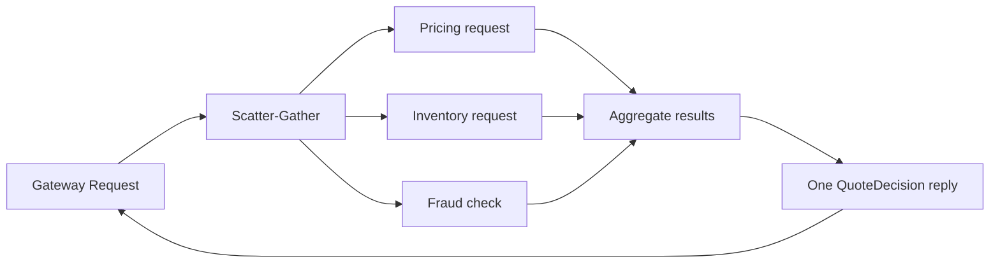

**Đây vẫn là Request-Reply**: Gateway chờ **một logical final result**. Internally, có nhiều branches và partial replies; correlation, release strategy và timeout quyết định khi nào final result được tạo.

### Phân biệt với Event Notification fan-out

```text
Request-Reply fan-out:
  Request -> N worker contributions
          -> Aggregator -> 1 business reply

Event Notification fan-out:
  Event -> N independent subscribers
        -> không có yêu cầu Aggregator trả result
```

Fan-out giống nhau về topology nhưng **completion contract** khác nhau. Chỉ vì có ba subscribers không có nghĩa bắt buộc dựng Aggregator.

## 25. Một chiều ngược lại: Event Notification có cần ACK không?

Có thể cần transport-level acknowledgement. Ví dụ:

- Kafka producer nhận broker acknowledgement.
- RabbitMQ publisher nhận publisher confirm.
- Consumer ACK/nack message sau khi xử lý.
- HTTP webhook nhận 2xx/4xx/5xx sau delivery attempt.

Những ACK này xác nhận **một bước truyền/nhận/xử lý theo giao thức**, không tự là business reply cho Order Gateway.

```text
Publisher -> Broker
  broker ACK
  != Email sent
  != Audit committed
  != Analytics projection updated
```

### Nếu consumer HTTP webhook trả 200?

Nó thường báo đã nhận/xử lý notification theo webhook contract. Producer không nên hiểu đó là một reply tương đương `OrderResult(REQ-101)` của PlaceOrder command.

### Nếu notification yêu cầu tất cả subscribers xác nhận?

Khi nghiệp vụ thật sự yêu cầu **N confirmations trước khi tiếp tục**, bạn đang xây một **completion/aggregation protocol** trên event bus. Cần nhận diện nó rõ (correlation, quorum, deadline, failures), không giả vờ đó là fire-and-forget notification thuần túy.

## 26. Correlation: request ID, event ID, business ID và causation

Hai patterns đều cần identity, nhưng **không phải cùng một kiểu identity**.

| Khái niệm | Request-Reply | Event Notification |
| --- | --- | --- |
| `requestId` | Ghép reply với request | Có thể dùng để lưu nguyên nhân, không phải event ID |
| `eventId` | Có thể không áp dụng với một query | Định danh logical event để dedup/replay |
| `businessCorrelationId` | Liên kết các requests cùng workflow | Liên kết events cùng workflow |
| `causationId` | Lệnh/cha tạo ra bước tiếp | Sự kiện/command gây ra event này |
| `MessageHeaders.id` | Runtime Spring Message instance | Runtime Spring Message instance |
| `replyChannel` | Destination để trả về caller | Thường không có business reply |
| `errorChannel` | Nhánh lỗi trong request/reply flow | Nhánh lỗi của publisher/subscriber tùy boundary |
| `traceId`/`traceparent` | Observability | Observability |

### Ví dụ một order đi từ request sang events

```text
PlaceOrder request:
  requestId = REQ-101
  businessCorrelationId = order:shop-01:ORD-101

Reply:
  requestId = REQ-101
  status = COMPLETED

OrderPlaced notification:
  eventId = EV-201
  causationRequestId = REQ-101
  businessCorrelationId = order:shop-01:ORD-101

EmailScheduled notification:
  eventId = EV-202
  causationId = EV-201
  businessCorrelationId = order:shop-01:ORD-101
```

Không nên lấy `EV-201` làm reply ID của `REQ-101` hay lấy `ORD-101` làm event ID cho mọi notification. Một entity có nhiều lifecycle events, một workflow có thể gồm nhiều commands và requests.

### Correlation ID của Aggregator là trường hợp riêng

Một Splitter có thể tạo `correlationId=group-G` và `sequenceNumber=1..N` để Aggregator gom message. Đó là group identity của một EIP endpoint; nó không mặc nhiên bằng `businessCorrelationId`.

**Quy tắc:** giữ rõ namespace, scope và owner của từng ID; đừng ghi đè một header kỹ thuật chỉ vì tên gần giống.

## 27. Reply channel và event channel không có cùng vòng đời

Một Gateway đồng bộ có thể gắn temporary reply channel theo invocation:

```text
Request A -> replyChannelA
Request B -> replyChannelB
```

Reply channel cần tồn tại và nhận được reply **trong deadline**. Sau timeout, temporary channel/request state có thể không còn phù hợp.

Event notification thì khác:

```text
OrderPlaced(EV-201) -> orderNotifications topic
  -> Audit consumer group
  -> Email consumer group
  -> Analytics consumer group
```

Không có một temporary `replyChannel` cho từng subscriber theo mặc định. Các subscriptions có **lifecycle độc lập**, có thể sống sau producer restart và replay theo broker retention.

### Khi Gateway response bị gửi vào event channel

Nếu handler dùng `outputChannel="orderNotifications"` một cách vô ý, một `OrderResult` có thể bị publish như event. Hậu quả:

- Caller không nhận reply và timeout.
- Subscribers nhận payload type không phù hợp.
- Một response riêng của caller bị phát đến nhóm rộng hơn.
- Có thể rò rỉ thông tin nghiệp vụ/PII.

**Đừng dùng chung một channel tên “results” cho reply lẫn notifications mà không có message type và routing contract rõ ràng.**

### Khi event bị gửi vào reply channel

Ngược lại, một `OrderPlaced` gửi vào Gateway reply destination có thể tạo type conversion failure khi Gateway method khai báo `OrderResult`. Response type và event type cần được phân biệt ngay từ thiết kế.

## 28. Error semantics của Request-Reply

Một Request-Reply caller cần biết response hoặc failure trong thời hạn. Các kết quả có thể gồm:

```text
PlaceOrder(REQ-101)
  -> ACCEPTED
  -> REJECTED(INVALID_AMOUNT)
  -> COMPLETED
  -> PENDING_RECONCILIATION
  -> timeout
  -> technical exception
```

### Những loại failure

| Tình huống | Phản ứng phù hợp |
| --- | --- |
| Input invalid theo business rule | Typed `REJECTED` hoặc validation exception |
| Missing required reply | Reply-required error/timeout |
| Handler throw trước effect | Technical exception, có thể retry theo policy |
| DB commit rồi reply mất | Unknown caller outcome, cần idempotency/result lookup |
| Reply wrong type | Conversion failure, sửa contract |
| Reply của request khác | Correlation bug, cần fail/sửa routing |
| Gateway reply timeout | Deadline exceeded, không tự rollback |
| Request channel saturated | Send timeout/backpressure |
| Remote worker crash | Timeout/async reply protocol/reconciliation |

### Error channel của Gateway

`@MessagingGateway(errorChannel="...")` có thể điều phối lỗi trong phạm vi Gateway. Một error flow nhận `ErrorMessage` và **trả typed result** nếu muốn caller nhận business response, hoặc ném lỗi/ghi nhận terminal failure theo contract.

Nhưng:

- Filter drop không throw không tự tạo `ErrorMessage`.
- Method `void` không sinh reply.
- Lỗi ở một worker nằm trên process khác không tự quay về Java caller.
- Error flow logger-only không tạo `OrderResult`.
- Không mọi error channel đều có scope như nhau; phân biệt Gateway, adapter và async endpoint.

Event Notification có một cách quản lý lỗi khác, xem mục kế tiếp.

## 29. Error semantics của Event Notification

Notification subscriber xử lý event theo subscription contract:

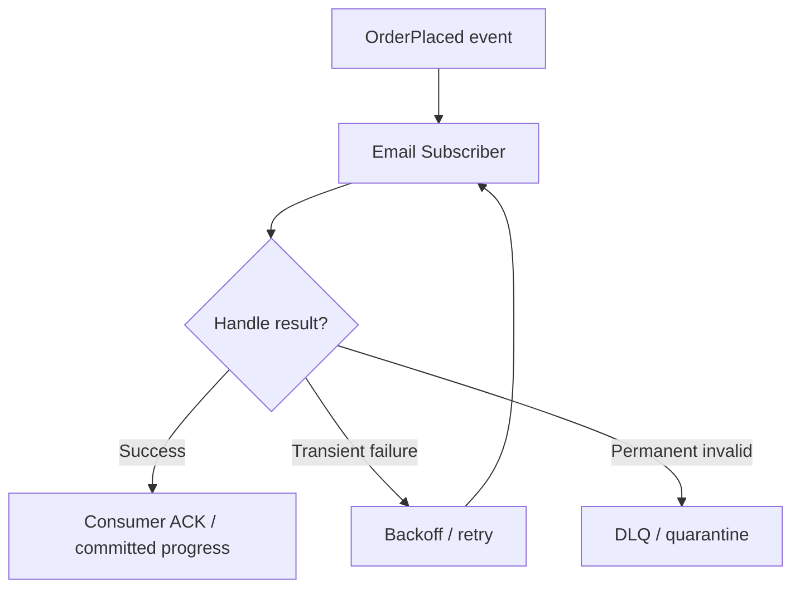

Khi Email subscriber lỗi:

- `OrderPlaced` **vẫn là một fact đã xảy ra**.
- Audit subscriber có thể đã xử lý xong.
- Producer không nên “tạo lại order” chỉ vì email thất bại.
- Retry ở Email consumer nên tập trung vào **gửi email**, không lặp business transaction của Order Service.
- DLQ/alert cần xác định người chịu trách nhiệm và replay policy.
- Idempotency key của email có thể gồm `eventId + notificationTemplate + recipient`, không chỉ `orderId`.

### Lưu ý về PublishSubscribeChannel đồng bộ

Với `PublishSubscribeChannel` trong cùng JVM không có executor, một subscriber ném exception có thể làm `send(...)` thấy exception và ảnh hưởng quá trình dispatch tới subscribers khác, tùy configuration/error handling. Điều này **không biến event notification thành Request-Reply**; nó cho thấy dispatch mechanics có thể synchronous và không tự cô lập failure.

Muốn các subscribers có failure isolation tốt hơn, cân nhắc các queue/consumer groups hoặc flow tách biệt, executor/error channel có kiểm soát và bảo đảm độ tin cậy phù hợp.

## 30. So sánh Timeout: reply deadline với retry/delivery delay

| Khái niệm | Request-Reply | Event Notification |
| --- | --- | --- |
| **Request send timeout** | Có thể không gửi được vào request channel | Có thể không publish được vào broker/channel |
| **Reply timeout** | Caller chờ một final reply | Thường không có |
| **Consumer processing timeout** | Ảnh hưởng đáp ứng nếu nằm trong reply path | Consumer tự retry/fail |
| **Late reply** | Reply đến sau caller deadline | Không phải khái niệm reply mặc định |
| **Retention/replay window** | Có thể dùng cho async result/idempotency | Quan trọng cho broker/event replay |
| **SLA** | Deadline của API/operation | Delay xử lý event và subscription lag |

### Ví dụ Gateway timeout nhưng event vẫn phát

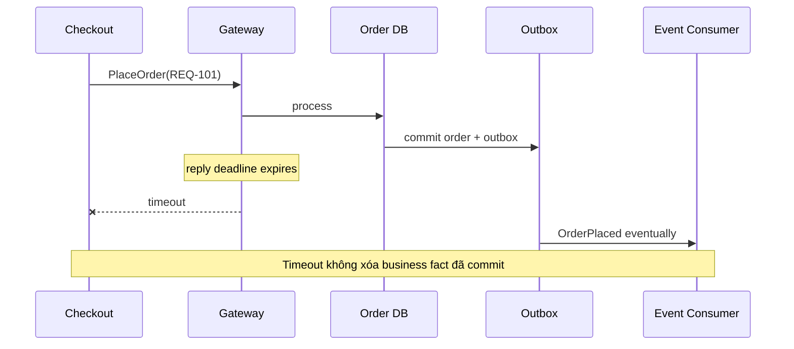

Nếu caller retry cùng logical operation, database/business layer cần idempotency. Không được suy từ timeout rằng **order chưa tạo**.

### Event Notification không có “đã xử lý xong mọi nơi” ngầm định

Producer publish thành công nhưng một subscriber có backlog 20 phút. Nếu business yêu cầu mọi subscriber hoàn thành trước một deadline, phải thêm **completion tracking/job orchestration** hoặc phân loại đó là một workflow khác, không chỉ nhìn publisher confirm.

## 31. Retry policy không thể dùng chung mù quáng

### Request-Reply retry

Caller có thể retry do timeout. Nhưng nếu operation có side effect, cùng request có thể đã commit. Cần:

- Idempotency key ổn định qua những lần retry.
- Stored result/operation status.
- Unique constraint hoặc transaction guard.
- Phân loại **known-not-committed** với **unknown outcome**.
- Giới hạn retries/backoff/circuit breaker.

### Event Notification retry

Một subscriber có thể retry **xử lý event**:

- Cùng event ID được nhận lại.
- Operation của subscriber cần idempotency riêng.
- Retry count không cần quay về publisher như business reply.
- Một subscriber lỗi không có nghĩa các subscribers khác cần chạy lại.
- Có retry budget và DLQ riêng cho từng consumer group.

### Một bảng so sánh key

| Side effect | Idempotency key minh họa |
| --- | --- |
| Tạo order từ command | `tenantId + stableCommandId + PLACE_ORDER` |
| Gửi email OrderPlaced | `eventId + recipient + emailTemplate` |
| Cập nhật projection | `projectionName + eventId` |
| Ghi audit từ event | `consumerName + eventId + auditAction` |
| Thanh toán bên ngoài | Provider idempotency token theo payment operation |

**Không dùng `MessageHeaders.id` làm business idempotency key**, vì message instance mới có thể có ID mới trong redelivery.

## 32. Event Notification và Transactional Outbox

Đây là một trong những khác biệt vận hành quan trọng nhất. Nếu Order Service đã commit order nhưng crash trước khi publish `OrderPlaced`, subscribers không biết fact đó.

### Mẫu thất bại khi publish trực tiếp

```text
BEGIN DB TX
  create order
COMMIT
process crashes
publish OrderPlaced never happens
```

### Outbox

```text
BEGIN DB TX
  create order
  insert outbox_event(eventId=EV-201)
COMMIT

Outbox publisher:
  read unprocessed event
  publish OrderPlaced(EV-201)
  mark published / retry as needed
```

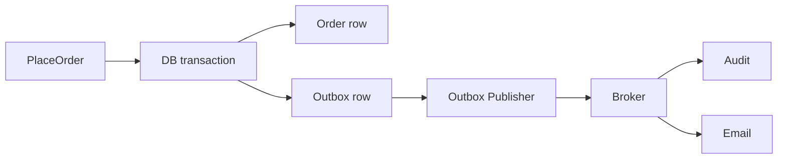

### Outbox không tạo exactly-once delivery

Publisher có thể:

1. Publish thành công.
2. Crash trước khi đánh dấu outbox row published.
3. Publish lại sau restart.

Consumer cần xử lý duplicate logical event IDs. Outbox giúp **không mất ý định publish sau commit**, không loại bỏ mọi trường hợp duplicate.

### Tại sao không phát OrderPlaced từ API layer sau khi nhận ACCEPTED?

Bởi `ACCEPTED` không nhất thiết nghĩa order đã được tạo. Chỉ producer nắm được business transaction mới nên xác nhận fact `OrderPlaced`; không cho caller đoán và phát event thay backend.

## 33. Event schema và event ownership

Event Notification tạo coupling qua **event contract** dù giảm coupling trực tiếp giữa producer và subscribers.

### Một event schema cần có

- `eventId` ổn định.
- `eventType` có ý nghĩa cụ thể.
- `eventSchemaVersion` hoặc registry ID.
- `tenantId` từ nguồn đáng tin.
- `occurredAt` với timezone/UTC rõ.
- `producer/sourceSystem`.
- `businessCorrelationId` và `causationId` khi cần.
- Payload tối thiểu hoặc event-carried state được version hóa.
- Retention/replay expectations.
- Tính tương thích với consumers cũ.

### Ví dụ envelope tối giản

```json
{
  "eventId": "EV-201",
  "eventType": "order.placed",
  "eventSchemaVersion": 1,
  "tenantId": "shop-01",
  "businessCorrelationId": "order:shop-01:ORD-101",
  "causationId": "REQ-101",
  "occurredAt": "2026-11-21T08:30:00Z",
  "payload": {
    "orderId": "ORD-101"
  }
}
```

Một event envelope như vậy có thể được xây bằng **Envelope Wrapper** trước khi publish; không bắt buộc lưu tất cả metadata trong Spring internal headers. Khi qua Kafka/HTTP, cần schema/serializer và allowlist header mapping đúng.

### Khi đổi version

- Producer không tự thay ngữ nghĩa event type mà giữ nguyên schema version.
- Consumer không deserialize class name từ untrusted payload.
- Có contract tests giữa các languages.
- Khi bỏ version cũ, cần xét DLQ/replay data còn trong retention window.
- Bổ sung field bắt buộc có thể là breaking change.

## 34. Event Notification không phải Event Sourcing

Đây là một nhầm lẫn khác:

**Event Notification:** phát một thông báo để người khác phản ứng. Nó có thể được lưu ở broker và replay, nhưng không bắt buộc là source of truth của toàn bộ state.

**Event Sourcing:** trạng thái domain được xây dựng từ một chuỗi events có semantics và ordering chặt; event store là nguồn dữ liệu gốc.

```text
Notification model:
  Order DB is source of truth
  -> OrderPlaced event informs others

Event sourcing model:
  Event stream may be source of truth
  -> projections derive state
```

Không nên nghĩ “dùng PublishSubscribeChannel là đã làm Event Sourcing”. Hai mô hình có yêu cầu lưu trữ, versioning, replay, ordering và consistency khác nhau.

## 35. Event Notification và eventual consistency

Khi Order Service commit và publish event:

```text
Order DB:
  ORD-101 = CREATED

Analytics projection:
  ORD-101 = not yet visible

Event consumer catches up:
  ORD-101 = CREATED
```

Khoảng trễ này là một hệ quả có thể chấp nhận của eventual consistency, nếu business/API contract cho phép.

### Khi caller cần “read-your-writes”

Một API đặt đơn xong rồi truy vấn trạng thái ngay có thể muốn thấy result tức thì. Có vài lựa chọn:

- Trả dữ liệu authoritative từ Order Service trong Request-Reply.
- Query trực tiếp authoritative store.
- Thêm version/offset/watermark để consumer projection báo đã catch up.
- Dùng `PENDING` nếu projection chưa đồng bộ.
- Không giả định mọi event consumer đã cập nhật xong ngay lúc producer publish.

### Nếu downstream effect bắt buộc trước khi trả checkout success

Ví dụ inventory reservation là điều kiện để xác nhận đơn. Khi đó đưa nó vào **request processing decision** hoặc một orchestrated workflow có kết quả rõ. Không đẩy nó thành “fire-and-forget notification” rồi báo COMPLETED trước khi business invariant được bảo vệ.

## 36. Ordering: reply correlation khác event ordering

### Request-Reply

Hai requests có thể hoàn thành khác thứ tự gửi:

```text
Send R1, R2
Reply R2 first, R1 later
```

Chỉ cần correlation đúng: R2 không được trả vào caller của R1.

### Event Notification

Một subscriber có thể nhận:

```text
OrderPlaced EV-1
OrderPaid EV-2
OrderCancelled EV-3
```

Nhưng nếu events đi qua nhiều partitions, retries, fan-out và async workers, global order không được bảo đảm.

### Thiết kế theo entity

Để xử lý một entity có thứ tự:

- Dùng partition key theo `tenantId:orderId` khi transport hỗ trợ.
- Định nghĩa version/sequence monotonic từ nguồn authoritative.
- Dùng optimistic concurrency/expected version trong projection.
- Hỗ trợ duplicates và out-of-order.
- Khi cần Resequencer, xác định group/release/timeout/late message policy.
- Không dùng `occurredAt` có độ phân giải thấp như một total-order ID.

### Có nên đợi tất cả events để trả Gateway?

Chỉ khi Gateway thực sự cần các kết quả đó làm **một logical decision**. Nếu chỉ đợi analytics/email để lấy “all delivered”, bạn đã biến independent notification consumers thành critical path và cần công bố một completion contract mới.

## 37. Router và Filter trong hai patterns

Cả Request-Reply và Event Notification đều có thể dùng Router/Filter, nhưng **ý nghĩa của discard/failure khác nhau**.

### Request-Reply

```text
Gateway -> Filter -> drop
                  -> no reply
                  -> caller timeout (nếu không có nhánh trả)
```

Nếu input bị từ chối, nên trả `OrderResult(REJECTED)` hoặc structured error, không silently drop khiến caller chờ.

Router không tìm thấy đích có thể throw hoặc discard tùy cấu hình; với request-reply cần định nghĩa fallback/rejection result.

### Event Notification

```text
OrderPlaced -> Filter(only VND orders)
  -> non-VND events discarded from this subscriber's branch
```

Một Filter loại event vì subscriber **không quan tâm** có thể là hành vi bình thường. Không cần business reply về producer. Tuy nhiên, invalid schema/tenant hoặc poison events nên được phân loại/quarantine, không lẫn với “subscriber không quan tâm”.

### Bảng

| Tình huống | Request-Reply | Event Notification |
| --- | --- | --- |
| Filter không chọn | Cần response/failure policy | Có thể là skip hợp lệ |
| Router không có route | Có thể phải báo caller | Có thể ignore theo subscription contract |
| Handler throw | Caller/error path liên quan | Consumer retry/DLQ |
| Handler trả void | Không thích hợp nếu caller chờ reply | Phù hợp cho terminal consumer |
| Backpressure | Caller latency/timeout | Lag/retry backlog |

## 38. Splitter/Aggregator: một request nhiều parts so với nhiều event subscribers

### Request-Reply batch

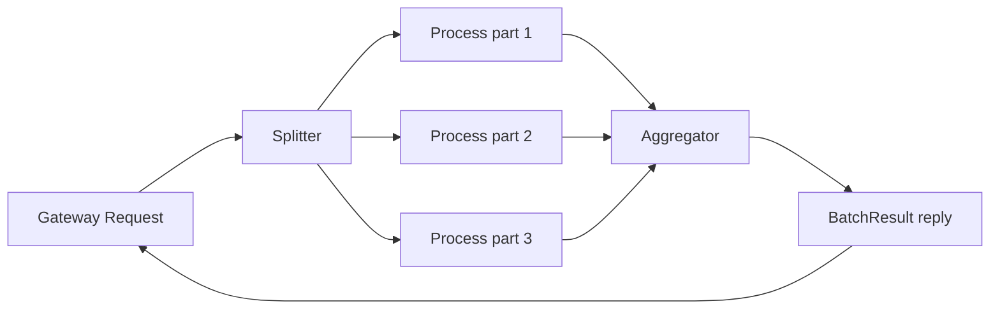

Gateway cần một final `BatchResult`. Do đó Aggregator phải có:

- Group key/correlation.
- Expected contributors hoặc release strategy.
- Timeout/partial/fail-fast policy.
- Duplicates/missing part handling.
- Reply context để gửi kết quả về caller.

Nếu một part bị Filter drop hoặc `void` handler không tạo output, Aggregator có thể chờ vô hạn.

### Event Notification fan-out

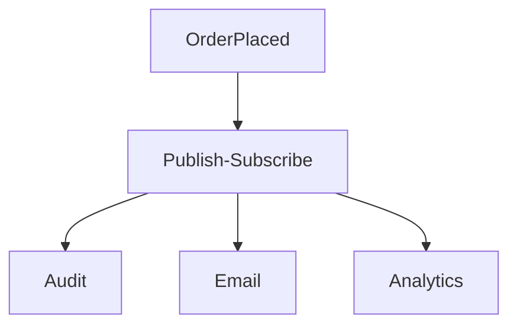

Không cần Aggregator nếu producer **không có nghĩa vụ chờ** Audit+Email+Analytics trả kết quả.

### Khi notification completion trở thành business requirement

Nếu cần biết “đã gửi email và audit thành công trước khi tiếp tục”, phải xây một workflow completion tracker hoặc Aggregator tiêu thụ **outcome events** với correlation và deadline riêng. Đó là một thiết kế mới, không phải tác dụng mặc định của publish-subscribe.

## 39. Gateway và lỗi sau async boundary

Một `@MessagingGateway` gửi request qua `ExecutorChannel` hoặc broker có thể đã rời thread ban đầu khi worker lỗi.

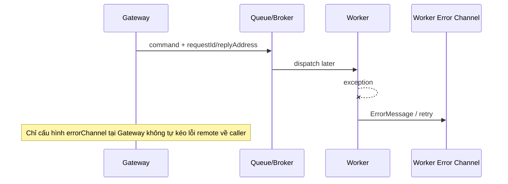

### Muốn Request-Reply qua broker cần gì?

- Request ID portable, unique đúng scope.
- Reply destination/topic/queue được whitelist.
- Correlation được giữ qua serializer/header mapper.
- Deadline/timeout và late reply policy.
- Error response envelope có result type rõ.
- Retry/idempotency/unknown outcome handling.
- Không serialize `MessageHeaders.REPLY_CHANNEL` Java object sang JSON.

### Notification không mang reply destination theo mặc định

Một `OrderPlaced` được publish lên topic để subscribers tiêu thụ. Không có lý do bắt buộc gửi replies tới producer; lỗi được xử lý ở consumer group/error stream riêng.

## 40. Khi nào dùng `202 Accepted + operationId`?

Nếu command mất nhiều phút, giữ Gateway synchronous chờ complete không bền vững:

```text
POST /jobs
  -> 202 Accepted
  -> operationId=OP-101

GET /jobs/OP-101
  -> PENDING / COMPLETED / FAILED
```

Ở đây có hai interaction:

1. **Request-Reply ngắn:** nhận job/command và trả acceptance.
2. **Bất đồng bộ:** background worker xử lý; có thể phát `JobCompleted` event notification.

### Mô hình

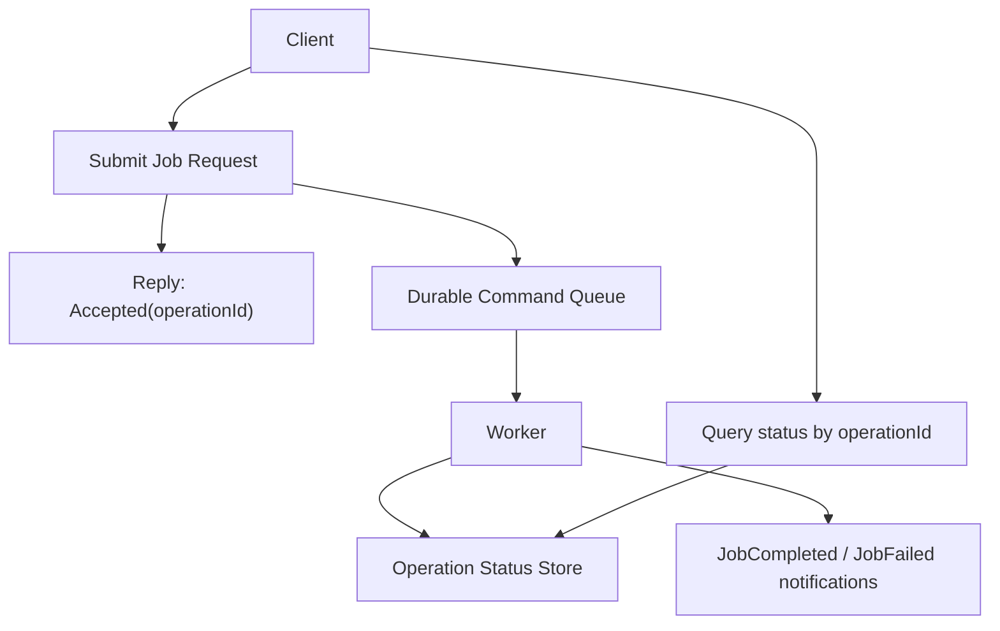

### Vì sao không gọi event là command?

`JobRequested` có thể chỉ là tên event-looking, nhưng nếu nó mang ý nghĩa “hãy chạy job này” thì về semantic là **command**. Một fact sau đó là `JobCompleted`/`JobFailed`.

Tên gọi nên giúp consumer hiểu **điều đã xảy ra** và **người nhận phải làm gì**, không đánh tráo một request dài thành notification để tránh thiết kế reply/status.

## 41. JUnit: nhiều Request-Reply calls đồng thời phải trả đúng caller

Một Gateway proxy có thể được nhiều threads sử dụng. Không được lưu `currentRequestId` trong một mutable static field, vì reply của request A có thể bị gán nhầm cho request B.

Thêm test vào `InteractionStyleTest`:

```java
@Test
void concurrentGatewayCallsKeepTheirOwnRequestIds()
        throws Exception {

    var requests = java.util.List.of(
        new PlaceOrder(
            "shop-01", "ORD-A", "REQ-A", 100L),
        new PlaceOrder(
            "shop-02", "ORD-B", "REQ-B", 200L),
        new PlaceOrder(
            "shop-03", "ORD-C", "REQ-C", 300L)
    );

    var pool = java.util.concurrent.Executors
        .newFixedThreadPool(requests.size());

    var ready = new java.util.concurrent.CountDownLatch(
        requests.size());

    var start = new java.util.concurrent.CountDownLatch(1);

    var futures = new java.util.ArrayList<
        java.util.concurrent.Future<OrderResult>>();

    try {
        for (PlaceOrder command : requests) {
            futures.add(pool.submit(() -> {
                ready.countDown();

                if (!start.await(
                        5,
                        java.util.concurrent.TimeUnit.SECONDS)) {
                    throw new IllegalStateException(
                        "Concurrent start timeout");
                }

                return gateway.place(command);
            }));
        }

        assertTrue(ready.await(
            5, java.util.concurrent.TimeUnit.SECONDS));

        start.countDown();

        var byRequest = new java.util.HashMap<
            String, OrderResult>();

        for (var future : futures) {
            OrderResult result = future.get(
                5,
                java.util.concurrent.TimeUnit.SECONDS);

            assertNotNull(result);

            // Mỗi logical request chỉ xuất hiện một lần.
            assertNull(byRequest.put(
                result.requestId(), result));
        }

        assertEquals(
            java.util.Set.of("REQ-A", "REQ-B", "REQ-C"),
            byRequest.keySet());

        for (OrderResult result : byRequest.values()) {
            assertEquals("ACCEPTED", result.status());
        }

        assertEquals(3, service.callCount());
        assertTrue(projection.snapshot().isEmpty());
        assertTrue(audit.snapshot().isEmpty());
    } finally {
        start.countDown();
        pool.shutdownNow();
    }
}
```

### Ý nghĩa

- Ba callers có thể nhận typed replies tương quan với từng `requestId`.
- Test không assert reply completion order giữa các requests.
- Event Notification subscribers **không** được kích hoạt chỉ do Gateway trả reply.
- Demo không có idempotency/durable store nên số lần gọi service chỉ chứng minh các invocations local.

### Giới hạn

Đây là test concurrency trong một JVM với DirectChannel. Nó không chứng minh broker reply routing xuyên process, DB transaction, retries hoặc multi-pod consistency. Nếu thay request channel thành async, cần test correlation và deadline với topology thật.

## 42. JUnit: notifications của nhiều tenants không bị trộn

Bổ sung một test cho fan-out. Test gửi events theo thứ tự rõ trong JVM, sau đó xác nhận mỗi subscriber quan sát đủ events với identity chính xác:

```java
@Test
void notificationsPreserveTenantAndEventIdentity() {
    var events = java.util.List.of(
        new OrderPlaced(
            "shop-01", "ORD-A", "EV-A", "REQ-A",
            Instant.parse("2026-11-21T08:30:00Z")),
        new OrderPlaced(
            "shop-02", "ORD-B", "EV-B", "REQ-B",
            Instant.parse("2026-11-21T08:30:01Z")),
        new OrderPlaced(
            "shop-01", "ORD-C", "EV-C", "REQ-C",
            Instant.parse("2026-11-21T08:30:02Z"))
    );

    for (OrderPlaced event : events) {
        assertTrue(notifications.send(
            MessageBuilder.withPayload(event).build()));
    }

    assertEquals(events, projection.snapshot());
    assertEquals(events, audit.snapshot());

    var ids = projection.snapshot().stream()
        .map(OrderPlaced::eventId)
        .collect(java.util.stream.Collectors.toSet());

    assertEquals(
        java.util.Set.of("EV-A", "EV-B", "EV-C"), ids);
    assertEquals(0, service.callCount());
}
```

### Không đồng nhất nhiều tenants với security isolation

Test chứng minh các event values không bị trộn bởi subscriber fixtures. Nó **không xác thực người gửi** hoặc bảo đảm tenant A không đọc được event của tenant B. Trong production, producer identity, topic ACL, authz, payload/header trust và data access controls phải được kiểm thử riêng.

### Khi dùng nhiều partitions

Nếu event flow chạy qua Kafka partitions hoặc executor, không assert `List.equals(events, ...)` theo global arrival order. Khi đó nhận đủ events có timeout, index theo `eventId` và xác minh từng tenant/order. Nếu business cần thứ tự theo `orderId`, thiết kế partitioning/sequence policy rõ.

## 43. JUnit: duplicate notification không tự được loại bỏ

Đây là một bài test cố tình mô phỏng rủi ro **at-least-once delivery**:

```java
@Test
void repeatedNotificationReachesSubscriberTwiceWithoutDedup() {
    OrderPlaced event = new OrderPlaced(
        "shop-01", "ORD-101", "EV-101", "REQ-101",
        Instant.parse("2026-11-21T08:30:00Z"));

    var message =
        MessageBuilder.withPayload(event).build();

    assertTrue(notifications.send(message));
    assertTrue(notifications.send(message));

    // Demo handlers không có Idempotent Receiver.
    assertEquals(2, projection.snapshot().size());
    assertEquals(2, audit.snapshot().size());

    assertEquals(
        java.util.List.of(event, event),
        projection.snapshot());
}
```

### Điều test phơi bày

- Subscriber void không đồng nghĩa idempotent.
- PublishSubscribeChannel không tự deduplicate theo `eventId`.
- Cùng một event có thể được deliver nhiều lần.
- Consumer cần business key/side effect guard.

### Một dedup key đúng

```text
consumer=OrderAudit
tenantId=shop-01
eventId=EV-101
operation=WRITE_AUDIT
```

Một consumer khác như Email có key khác vì nó thực hiện side effect khác. Giữ key trong store bền nếu ứng dụng có nhiều pods/restarts; một `HashSet` trong một JVM không đủ cho reliability toàn hệ thống.

### Khi duplicate có payload conflict

Nếu `EV-101` đã xử lý nhưng lần sau cùng ID lại chứa order ID/tenant khác, đây không đơn thuần là duplicate: có thể là event ID collision, corruption hoặc producer bug. Kiểm tra payload fingerprint/contract và quarantine nếu khác nghĩa.

## 44. Failure isolation: một event subscriber lỗi thì sao?

Giả sử Email subscriber ném exception:

```java
public void onPlaced(OrderPlaced event) {
    throw new IllegalStateException(
        "SMTP temporarily unavailable");
}
```

Với **in-process `PublishSubscribeChannel` đồng bộ**, lỗi có thể propagates đến thread gửi và ảnh hưởng dispatch tới subscriber khác. Vì vậy không nên hứa rằng một nhánh hỏng luôn hoàn toàn độc lập chỉ vì dùng publish-subscribe.

### Topology cần xét

| Topology | Đặc điểm | Điều cần test |
| --- | --- | --- |
| Sync PubSub trong JVM | Dispatch cùng thread theo cấu hình | Exception ảnh hưởng sender/nhánh khác thế nào |
| PubSub với Executor | Subscribers được dispatch async | Error channel, thread pool, backpressure |
| Broker nhiều consumer groups | Mỗi group có tiến độ và retry riêng | Ack/redelivery/DLQ per group |
| Cùng consumer group nhiều instances | Work sharing/partitioning | Partition assignment, ordering, duplicate |
| One common handler làm nhiều việc | Coupling trong cùng effect | Partial failure và transaction policy |

### Đừng tạo reply từ lỗi subscriber tùy tiện

Nếu Email handler thất bại, không nên gửi một `OrderResult(REJECTED)` vào temporary reply channel của Checkout request đã hoàn thành. Order có thể đã tạo; lỗi email là **outcome của subscriber**, không phải rollback của order transaction.

### Khi subscriber cần báo lại trạng thái?

Có thể phát `EmailDeliveryFailed`/`EmailSent` như events mới cho monitoring/workflow. Nếu Checkout workflow bắt buộc email thành công trước deadline, hãy định nghĩa một completion protocol riêng và nêu rõ ảnh hưởng tới business result.

## 45. Request reply trong một hệ thống xa: correlation protocol cụ thể

Nếu Gateway request/reply đi qua Kafka hoặc RabbitMQ, cần **portable fields**, không truyền `MessageChannel` object giữa JVMs.

Một exchange có thể dùng:

```json
{
  "type": "order.command",
  "requestId": "REQ-101",
  "replyTo": "orders.replies.v1",
  "tenantId": "shop-01",
  "payload": {
    "orderId": "ORD-101",
    "amountMinorUnits": 125000
  }
}
```

Worker trả:

```json
{
  "type": "order.reply",
  "requestId": "REQ-101",
  "status": "COMPLETED",
  "reasonCode": null
}
```

### Các kiểm soát bắt buộc

- `replyTo` phải thuộc allowlist hoặc routing policy, không tin bất kỳ topic/URL nào do client tự gửi.
- `requestId` unique đúng scope và không bị đổi giữa request/reply.
- Reply consumer kiểm tra tenant/principal/producer identity nếu liên quan.
- Deadline/expiry của pending requests được quản lý.
- Late replies được discard/quarantine hoặc lưu cho reconciliation.
- Nếu broker redeliver reply, không hoàn tất cùng request hai lần.
- Payload/reply schema version được quản lý.
- Error reply phải mang requestId và status có ý nghĩa.
- Không mặc định message được giao exactly once.

**Đây vẫn là Request-Reply**, dù transport bất đồng bộ. Ngược lại, `OrderPlaced` trên topic thông báo không cần `replyTo` để là event notification hợp lệ.

## 46. Bảng failure matrix: chọn đúng cách xử lý

| Sự cố | Request-Reply cần quan tâm | Event Notification cần quan tâm |
| --- | --- | --- |
| Caller timeout | Chưa biết outcome; idempotent retry/status | Thường không có caller business reply |
| Handler throw | Error result/exception/deadline | Consumer retry/error channel |
| Message publish fail | Request send failure, có thể chưa xử lý | Outbox retry, không mất event |
| Subscriber nhận duplicate | Nếu là worker reply, correlate/dedup | Consumer-specific idempotency |
| Reply đến muộn | Không trả nhầm caller khác, reconcile | Không có reply mặc định |
| Event đến muộn | Có thể ảnh hưởng workflow chờ event | Consumer lag/eventual consistency |
| Filter discard | Có thể gây no-reply timeout | Có thể là skip hợp lệ |
| Router không có route | Structured failure/fallback | Subscription policy/DLQ |
| DB commit rồi reply mất | Replay stored result | Event có thể vẫn phát sau commit |
| Outbox publish trùng | Consumer không nên tạo business reply hai lần | Consumer dedup event |
| Một consumer lỗi | Nếu thành phần của request decision, cần failure result | Không thay đổi fact đã publish |
| Schema không tương thích | Request validation/error result | Consumer quarantine/compatibility |
| Tenant mismatch | Không trả dữ liệu sai tenant | Không phát/tự tin event cho tenant sai |
| Network partition | Timeout/retry/circuit breaker | Backlog/retry/retention |
| Shutdown/restart | Pending requests có thể hết hạn | Durable broker replay và consumer offset |

### Không có công thức “retry tất cả”

Một `IllegalArgumentException` vì amount âm là deterministic validation failure, retry nguyên request sẽ lỗi mãi.

Một timeout sau external payment capture có thể là **unknown outcome**. Retry ngay bằng operation ID mới có thể thu tiền hai lần. Dùng provider idempotency key và reconciliation.

Một consumer email SMTP lỗi có thể retry độc lập mà không gọi lại Order Gateway.

## 47. Observability: đo mốc của hai tương tác khác nhau

### Request-Reply metrics

| Metric đề xuất | Ý nghĩa |
| --- | --- |
| `request.reply.requests` | Số Gateway invocations |
| `request.reply.completed` | Số calls nhận typed final result |
| `request.reply.rejected` | Số domain rejections |
| `request.reply.failures` | Số technical errors |
| `request.reply.latency` | Thời gian gửi–nhận result |
| `request.reply.send_timeout` | Request dispatch timeout |
| `request.reply.reply_timeout` | Không có reply đúng deadline |
| `request.reply.late_replies` | Replies đến sau deadline |
| `request.reply.correlation_errors` | Reply bị thiếu/sai request ID |
| `request.reply.idempotent_replays` | Lần trả stored result do retry |

### Event Notification metrics

| Metric đề xuất | Ý nghĩa |
| --- | --- |
| `event.publish.attempts` | Số lần cố publish |
| `event.publish.confirmed` | Broker/channel xác nhận theo protocol |
| `event.outbox.pending` | Outbox chưa publish xong |
| `event.consumer.delivered` | Số deliveries tới consumer |
| `event.consumer.processed` | Số events consumer xử lý thành công |
| `event.consumer.duplicate` | Duplicates được nhận diện |
| `event.consumer.failed` | Consumer failures |
| `event.consumer.retry` | Số lần retry thật |
| `event.consumer.dlq_backlog` | Poison events chờ xử lý |
| `event.consumer.lag` | Delay/backlog theo subscription |
| `event.consumer.processing_latency` | Thời gian xử lý event |

Đây là **application metrics đề xuất**, không phải toàn bộ metric Spring Integration tự phát với những tên trên.

### Structured logging minh họa

```text
stage=REQUEST_RECEIVED
requestId=REQ-101
operation=PLACE_ORDER
tenant=shop-01

stage=REPLY_RETURNED
requestId=REQ-101
status=COMPLETED
latencyMs=...

stage=EVENT_OUTBOX_COMMITTED
eventId=EV-201
businessCorrelationId=order:shop-01:ORD-101

stage=EVENT_PUBLISHED
eventId=EV-201
messageType=OrderPlaced

stage=EVENT_CONSUMED
eventId=EV-201
consumer=Audit
result=SUCCESS
```

Không log `eventId` và `requestId` làm high-cardinality metrics labels nếu không có policy rõ. Với logs, vẫn cần bảo mật tenant/PII/retention và nguồn tin cậy.

### Một dashboard nên tách ba trạng thái

```text
API result:
  Caller saw COMPLETED

Event transport:
  OrderPlaced published

Consumer side effects:
  Email sent? Audit committed? Analytics caught up?
```

Không gộp ba trạng thái thành một đèn “Success” duy nhất.

## 48. Tracing: một distributed trace không thay business identity

Một `traceparent` hoặc trace ID có thể nối các spans của Request-Reply và eventual Event Notification:

```text
Trace T1:
  HTTP PlaceOrder
  Gateway invocation
  DB transaction
  Outbox insertion
  Event publisher
  Audit consumer (linked span)
```

Nhưng:

- Trace ID không phải idempotency key.
- Một logical event replay có thể chạy trong trace mới.
- Một business operation có thể đi qua nhiều traces.
- Một response được correlate bằng request ID/protocol, không dựa vào trace ID tùy ý.
- Event handler cần phân biệt parent-child spans, span links và causation.
- Không tin unvalidated tracing baggage từ nguồn ngoài để cấp quyền tenant.

### Không sao chép mọi transport headers

Metadata trên Spring Message có thể chứa `replyChannel`/`errorChannel`, transient trace context, credentials hoặc framework IDs. Khi publish event tới broker, dùng allowlist và envelope/schema rõ; không serialize nguyên Java MessageHeaders.

## 49. Backpressure và scalability: hai loại áp lực khác nhau

### Request-Reply

Khi request queue đầy hoặc handler chậm:

- Caller latency tăng.
- Reply timeout/HTTP request timeout tăng.
- Pending reply contexts chiếm tài nguyên.
- Retry của clients làm tải tăng thêm.
- Cần rate limiting, bounded queues, bulkheads và error budgets.

### Event Notification

Khi subscribers chậm:

- Consumer lag tăng.
- Broker/queue backlog phình to.
- Message retention có thể hết hạn trước khi consumer bắt kịp.
- Một consumer lỗi cần retry/DLQ riêng.
- Cần phân vùng/scale consumers, max in-flight, bounded executor và backpressure.

### Sơ đồ quyết định

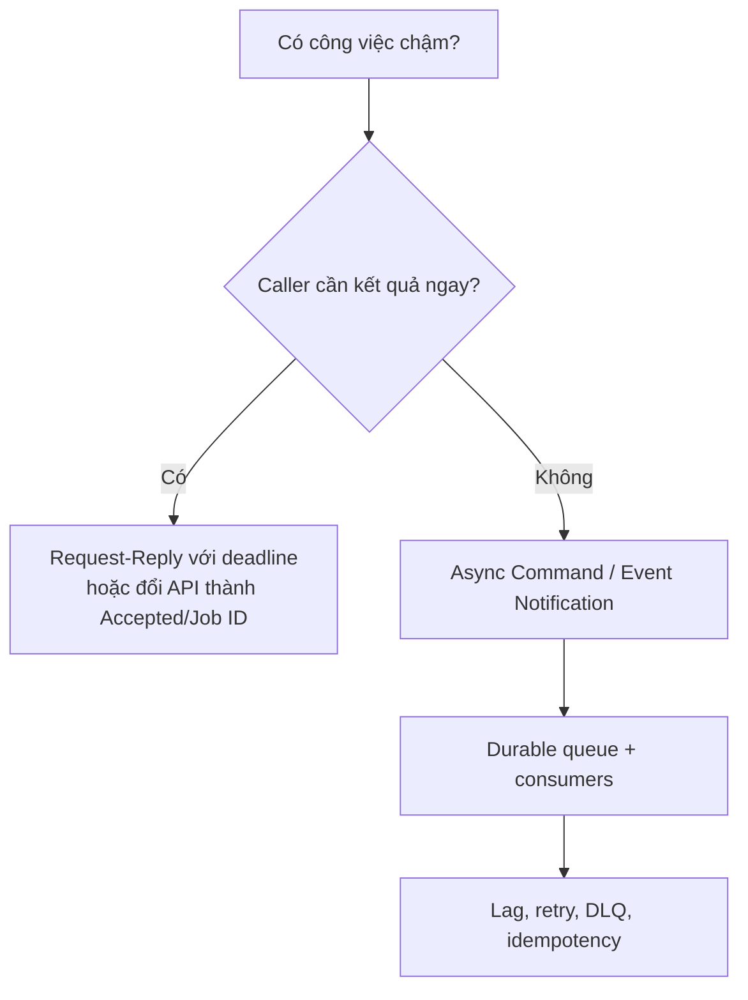

**Cẩn thận:** một asynchronous command là yêu cầu làm việc, không nhất thiết là notification về fact đã xảy ra. Đừng chỉ dựa vào “không cần kết quả ngay” để đổi mọi command thành domain event.

## 50. Các anti-patterns thường gặp

### 50.1. Gọi event notification là “request có reply”

Một `OrderPlaced` được publish không tạo `OrderResult` dành cho caller. Nếu cần result, tạo protocol riêng.

### 50.2. Coi synchronous/asynchronous là định nghĩa pattern

Request-Reply có thể async và Event Notification có thể sync trong JVM. Phân biệt theo contract.

### 50.3. Coi broker ACK là business completion

Broker nhận event không chứng minh DB của consumer hoặc email đã xử lý.

### 50.4. Trả COMPLETED ngay khi vừa enqueue command

Nếu job chưa hoàn tất, trả ACCEPTED/PENDING với operation ID.

### 50.5. Publish OrderPlaced trước khi DB commit

Fact có thể không thực sự xảy ra nếu transaction rollback. Dùng Outbox hoặc transaction protocol phù hợp.

### 50.6. Khi một subscriber lỗi thì retry nguyên PlaceOrder

Có thể tạo duplicate order. Retry theo consumer-specific effect.

### 50.7. Giữ Checkout chờ tất cả notification subscribers

Tăng coupling và latency; chỉ làm vậy nếu đó là business invariant có completion contract.

### 50.8. Dùng `MessageHeaders.id` làm logical event ID

Redelivery có thể tạo Message instance mới. Dùng stable event ID.

### 50.9. Dùng cùng `orderId` cho mọi request/reply correlation

Hai concurrent requests của cùng entity có thể nhận nhầm replies. Cần request ID riêng.

### 50.10. Dùng business correlation làm Aggregator group ID không kiểm chứng

Có thể gộp nhầm nhiều workflow runs. Dùng group/correlation strategy đúng scope.

### 50.11. Đặt `void` handler giữa Gateway và reply stage rồi chờ result

Method void không tạo normal reply. Nếu cần result, trả typed outcome hoặc thiết kế continuation khác.

### 50.12. Filter drop invalid command mà không trả rejection

Gateway có thể timeout thay vì nhận một business decision rõ ràng.

### 50.13. Tưởng PubSub luôn cô lập lỗi subscribers

In-process synchronous PubSub có thể chịu ảnh hưởng exceptions. Cần topology/error policy đúng.

### 50.14. Dùng queue in-memory thay cho durable broker mà khẳng định reliability

`QueueChannel`/`PublishSubscribeChannel` demo không tự bảo đảm persistence, cross-pod delivery hay crash recovery.

### 50.15. Retry non-idempotent side effect sau timeout

Có thể double charge hoặc tạo duplicate orders. Cần idempotency/reconciliation.

### 50.16. Gửi HTTP/Kafka `replyChannel` Java object qua network

Không portable; cần reply destination/correlation protocol.

### 50.17. Nhầm event notification với event sourcing

Publish event không tạo một event store authoritative hoặc cơ chế rebuild toàn state.

### 50.18. Không version hóa event schema

Subscriber cũ có thể không deserialize được; DLQ replay lỗi sau deployment.

### 50.19. Không xét late replies

Caller đã timeout nhưng reply muộn có thể cần discard/reconcile; không gán nhầm caller mới.

### 50.20. Log mọi headers/payloads để trace

Có nguy cơ PII/token leakage. Dùng structured metadata đã chọn và access control.

## 51. Decision tree: nên dùng Request-Reply hay Event Notification?

Bắt đầu từ **hợp đồng nghiệp vụ**, không bắt đầu từ việc team có Kafka hay HTTP.

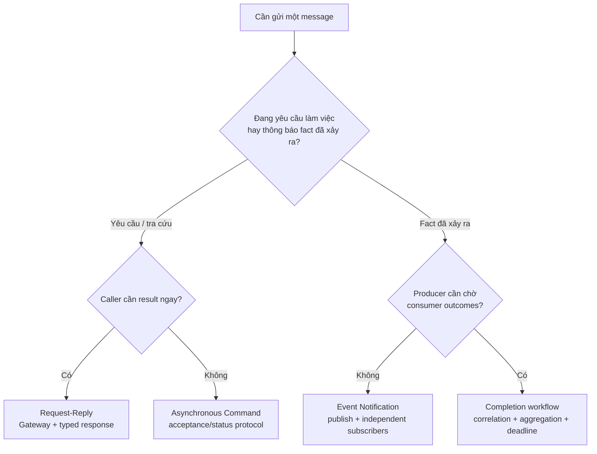

### Cách đọc sơ đồ

- Một **command** không trở thành event chỉ vì đặt lên queue.
- Một **notification** không tự có reply chỉ vì subscriber xử lý trong thread đồng bộ.
- Một **Gateway** không nhất thiết là blocking trên mọi topology; reply có thể bất đồng bộ.
- Một **event** vẫn có thể kích hoạt các operations quan trọng, nhưng không được gọi “tất cả đã hoàn thành” khi chưa có cơ chế xác nhận.
- Khi có nhiều components cần cùng quyết định, bạn có thể dùng Scatter-Gather/Aggregator nhưng phải xác định logical final response.

### Quy tắc sản phẩm

Nếu UI cần báo “Đã tạo đơn thành công”, phải có bằng chứng từ authoritative order workflow. Nếu UI chỉ có thể báo “Đã tiếp nhận yêu cầu”, hãy trả `ACCEPTED` và cho người dùng một cách tra trạng thái. Đừng để event publish hoặc HTTP timeout vô tình quyết định ngữ nghĩa nút “Đặt hàng thành công”.

## 52. Case study: đặt hàng với reply, sau đó phát notification

Xét một đơn hàng `ORD-101`, request `REQ-101`.

### Kịch bản A — Thành công

1. Checkout gửi `PlaceOrder(REQ-101)`.
2. Order Service validate.
3. Database transaction ghi order cùng outbox event `EV-201`.
4. Transaction commit thành công.
5. Gateway trả `OrderResult(COMPLETED)` nếu contract cam kết trạng thái cuối này.
6. Outbox publisher phát `OrderPlaced(EV-201)`.
7. Audit consumer ghi event theo idempotency key.
8. Email consumer gửi mail theo idempotency key riêng.
9. Analytics consumer cập nhật projection.

**Điều quan trọng:** event tới Email chậm 30 giây không đảo ngược trạng thái order đã commit. Nếu email bắt buộc phải hoàn thành để sản phẩm gọi “hoàn tất”, business contract phải diễn đạt điều đó, không dựa vào notification độc lập.

### Kịch bản B — Input bị từ chối

1. Checkout gửi amount âm.
2. Order Service trả `REJECTED(INVALID_AMOUNT)`.
3. Không tạo order.
4. Không phát `OrderPlaced`.
5. API/UI có thể hiển thị lỗi rõ cho caller.

**Không** tạo `OrderPlaced` chỉ vì request đã đến Gateway.

### Kịch bản C — DB commit rồi reply mất

1. Order row + outbox `EV-201` đã commit.
2. Reply `COMPLETED` bị mất, Gateway timeout.
3. Caller retry `REQ-101` với cùng stable operation key.
4. Business layer tìm stored result và trả lại `COMPLETED`, không ghi thêm order.
5. Outbox có thể publish `EV-201` nhiều lần nếu restart.
6. Audit/Email consumers dùng `eventId` để chống duplicate effect.

**Không** coi Gateway timeout là lý do hủy hoặc phát lại fact với event ID khác.

### Kịch bản D — Email consumer lỗi

1. Order đã commit.
2. Notification `EV-201` đã phát.
3. Audit xử lý thành công.
4. Email nhận event nhưng SMTP timeout.
5. Email retry có giới hạn; nếu hết budget, lưu DLQ và alert.
6. Checkout result vẫn phản ánh order status, không biến `COMPLETED` thành `REJECTED` vì email outage.

### Kịch bản E — Inventory reservation là điều kiện bắt buộc

Nếu business quy định “không được xác nhận đơn khi inventory chưa được giữ”, thì Inventory không chỉ là notification consumer phụ:

```text
PlaceOrder command
  -> validate
  -> reserve inventory (reply/error)
  -> commit order
  -> return OrderResult
  -> publish OrderPlaced
```

Hoặc dùng một orchestrated Saga/workflow với trạng thái `PENDING`, compensation và deadline. Đừng biến điều kiện bắt buộc thành một Notification không phản hồi mà vẫn báo order hoàn tất.

## 53. Bài thực hành A: triển khai hai patterns trong cùng module

**Mục tiêu:** từ cùng domain đơn hàng, chứng minh Request-Reply và Event Notification có hợp đồng riêng.

### A1. Domain và Gateway

1. Tạo `PlaceOrder`, `OrderResult` và `OrderPlaced`.
2. Định nghĩa `OrderCommandGateway.place(PlaceOrder)` trả `OrderResult`.
3. Cấu hình `placeOrderRequests` là `DirectChannel`.
4. Viết `DemoOrderService.place` trả `ACCEPTED` hoặc `REJECTED`.
5. Nối bằng `IntegrationFlow.from(...).handle(service, "place")`.
6. Gọi Gateway từ JUnit.
7. Assert reply đúng `requestId`, `status`, `reasonCode`.
8. Assert không có `OrderPlaced` được phát tự động từ demo handler.

### A2. Event notification

9. Tạo `orderNotifications` là `PublishSubscribeChannel`.
10. Tạo `OrderProjectionSubscriber` với `void onPlaced`.
11. Tạo `OrderAuditSubscriber` với `void onPlaced`.
12. Đăng ký hai IntegrationFlows subscribe cùng channel.
13. Publish một `OrderPlaced(EV-101)`.
14. Assert cả hai subscribers quan sát cùng event.
15. Assert `DemoOrderService.callCount()==0` nếu test chỉ publish event.
16. Giải thích tại sao `send(...)` không phải business reply.
17. Publish hai events với IDs khác nhau; phân biệt event ID và order ID.

### A3. Nối production pipeline đúng

18. Thay demo service bằng Order Service có transaction.
19. Ghi outbox event trong cùng DB transaction tạo order.
20. Outbox publisher phát notification sau commit.
21. Lưu `eventId` ổn định qua retry.
22. Consumers thêm idempotency theo từng business side effect.
23. Tạo status/reply protocol nếu caller cần theo dõi hoàn tất dài hạn.
24. Bảo đảm source tenant và event schema được xác thực.

### Kết quả mong đợi

| Hành động | Gateway reply | Event consumers |
| --- | --- | --- |
| Gọi `place` hợp lệ ở demo | `ACCEPTED` | Chưa được kích hoạt tự động |
| Gọi `place` amount âm | `REJECTED` | Chưa được kích hoạt |
| Publish `OrderPlaced` | Không có Gateway reply | Audit và Projection nhận event |
| Publish cùng event hai lần | Không tự sinh replies | Demo consumers quan sát hai deliveries |
| Một subscriber void hoàn tất | Không có return result | Subscriber khác nhận từ PubSub, không từ void reply |
| Backend commit + outbox publish | Result theo commit contract | Event có thể đến sau reply |

## 54. Bài thực hành B: Fault Injection và kiểm thử tin cậy

**Mục tiêu:** thấy rõ một lỗi có thể ảnh hưởng caller hoặc chỉ ảnh hưởng consumer side effect, và tránh suy luận sai từ `send`/timeout.

### B1. Request-Reply

1. Thêm handler ném exception mô phỏng DB outage trước commit.
2. Cấu hình Gateway error handling phù hợp.
3. Kiểm tra caller nhận exception hoặc typed error result đúng contract.
4. Thêm một handler `void` và thử dùng nó sau Gateway có return type `OrderResult`.
5. Kiểm tra no-reply behavior với timeout có giới hạn.
6. Thêm Filter discard command; phân biệt với exception.
7. Thêm `requiresReply` ở endpoint cần response và xác minh error path.
8. Gửi ba requests đồng thời, kiểm tra request IDs không tráo.
9. Giả lập reply đến muộn sau timeout.
10. Retry cùng idempotency key, kiểm tra stored result.
11. Giả lập DB commit rồi reply thất bại; xác nhận không nhân đôi effect.
12. Kiểm tra result type mismatches và missing reply channel.

### B2. Event Notification

13. Gửi một event tới hai subscribers.
14. Làm Email handler throw, kiểm tra sync PubSub dispatch behavior thật.
15. Chuyển sang broker hoặc async executor với error policy riêng.
16. Đo retry attempts, consumer lag và DLQ backlog.
17. Publish cùng event ID hai lần, chứng minh cần dedup.
18. Publish cùng event ID nhưng payload khác, kiểm tra conflict policy.
19. Cập nhật consumer projection từ events out of order.
20. Giữ source version và schema validation ở ingress.
21. Giả lập outbox publisher crash sau broker publish, trước mark-published.
22. Xác nhận event có thể được publish lại với cùng event ID.
23. Kiểm tra consumer không gửi hai email từ duplicate notification.
24. Ghi metrics consumer processed riêng với broker publish confirmed.

### B3. Cross-boundary

25. Truyền Request-Reply qua broker với request ID và reply topic.
26. Thử hai requests cùng order ID nhưng khác request IDs.
27. Kiểm tra late reply không gán nhầm request mới.
28. Không serialize Java `MessageChannel` object.
29. Gửi `OrderPlaced` bằng JSON envelope có event ID, version, correlation.
30. Kiểm tra subscriber đang chạy phiên bản schema cũ.
31. Xác minh authentication, tenant isolation và không leak credentials.
32. Thêm alert cho Gateway timeout và consumer lag riêng biệt.

### Chọn assertion phù hợp topology

Trong JVM sync demo, `snapshot().size()` có thể được kiểm tra ngay sau `send`. Với executor/broker, dùng latch, Awaitility hoặc polling có timeout; đừng dùng `Thread.sleep` tùy tiện và đừng assert global order giữa nhiều partitions.

## 55. Bộ test chấp nhận trước production

| Nhóm | Test case | Kết quả cần chứng minh |
| --- | --- | --- |
| Request-Reply | Gateway happy path | Typed result trả đúng caller |
| Request-Reply | Rejected command | Có explicit rejection, không publish business fact giả |
| Request-Reply | Handler throws | Error path đúng contract |
| Request-Reply | Void/null handler | Không tự tạo reply |
| Request-Reply | Reply timeout | Không đồng nhất timeout với rollback |
| Request-Reply | Two concurrent callers | Reply correlation không tráo |
| Request-Reply | Wrong reply type | Conversion/error được phát hiện |
| Request-Reply | Send timeout | Dispatch/backpressure policy đúng |
| Request-Reply | Retry after commit | Không lặp business effect |
| Event Notification | One event, two subscribers | Mỗi subscriber nhận một delivery trong sync demo |
| Event Notification | Duplicate eventId | Consumer idempotency ngăn effect lặp |
| Event Notification | Event schema V1/V2 | Compatibility được kiểm chứng |
| Event Notification | Subscriber throw | Retry/DLQ và isolation theo topology |
| Event Notification | Consumer lag | Backpressure/retention policy |
| Event Notification | Outbox crash window | Không mất event và xử lý duplicate |
| Event Notification | Out-of-order | Projection version/sequence policy |
| Event Notification | Tenant mismatch | Reject, không leak cross-tenant |
| Event Notification | Replay after restart | Consumer resume/dedup đúng |
| Boundary | Kafka/AMQP header mapping | ID/schema/correlation tồn tại qua serialization |
| Boundary | Error reply protocol | Remote failure trả đúng request nếu có contract |
| Workflow | Splitter/Aggregator | Final reply chỉ release khi đủ contribution theo policy |
| Workflow | Event-driven completion | Không nhầm mọi event notification đều cần Aggregator |
| Operations | Metrics | Request/reply, publish, consumer effect đo riêng |

Chỉ viết test trong Markdown **không chứng minh đã thực thi thành công**. Khi đưa vào project, phải chạy unit, integration, broker/DB fault-injection và kiểm tra API thực của phiên bản Spring Integration đã khóa.

## 56. Câu hỏi tự đánh giá

**Câu 1.** Khác biệt quan trọng nhất giữa Request-Reply và Event Notification là gì?

*Request-Reply có hợp đồng phản hồi cho một yêu cầu cụ thể; Event Notification công bố một fact đã xảy ra, thường không yêu cầu business reply từ subscribers.*

**Câu 2.** Request-Reply có bắt buộc synchronous không?

*Không. Có thể dùng reply topic, callback hoặc future bất đồng bộ nếu có request ID, reply correlation và deadline rõ.*

**Câu 3.** Event Notification có thể dispatch đồng bộ trên một JVM không?

*Có. PublishSubscribeChannel không có executor có thể gọi subscribers trong cùng thread; bản chất pattern vẫn là notification.*

**Câu 4.** `MessageChannel.send(...)` trả true có đồng nghĩa consumer đã commit DB không?

*Không. Nó phản ánh dispatch theo channel semantics; business commit và broker acknowledgement là các mốc khác.*

**Câu 5.** `PlaceOrder` và `OrderPlaced` khác nhau như thế nào?

*PlaceOrder là command yêu cầu thực hiện việc tạo đơn; OrderPlaced khẳng định fact đơn đã được tạo.*

**Câu 6.** Nếu Gateway trả `ACCEPTED`, có được phát ngay `OrderPlaced` không?

*Không mặc nhiên. Phải đợi fact thật sự xảy ra theo business contract/transaction.*

**Câu 7.** Vì sao hai concurrent requests của cùng order cần request IDs riêng?

*Để reply không bị gán nhầm cho caller khác; order ID là business entity ID, không thay thế request correlation.*

**Câu 8.** Nếu Email subscriber thất bại, có nên retry cả PlaceOrder không?

*Thường không. Retry nghiệp vụ gửi email theo event/consumer idempotency; không tạo lại đơn đã commit.*

**Câu 9.** Event Notification có cần event ID ổn định không?

*Có, nếu cần dedup, replay, reconciliation và trace đúng logical event.*

**Câu 10.** Transactional Outbox giải quyết điều gì?

*Giúp ghi ý định phát event trong cùng DB transaction với business state, giảm nguy cơ commit rồi quên publish. Nó không tự loại bỏ duplicate delivery.*

**Câu 11.** Nếu caller timeout, có chắc DB chưa commit không?

*Không. Có thể đã commit rồi reply mất; cần idempotency/stored result/reconciliation.*

**Câu 12.** Vì sao Filter discard message trước Gateway reply path nguy hiểm?

*Vì có thể không tạo reply lẫn exception, khiến caller chờ timeout. Nên có rejection result/failure contract.*

**Câu 13.** Khi nào dùng Aggregator trong Request-Reply?

*Khi cần gom nhiều contributions thành một final response có correlation, release strategy và deadline.*

**Câu 14.** Có cần Aggregator khi `OrderPlaced` phát tới ba subscribers không?

*Không nếu producer không yêu cầu completion của cả ba. Subscriber fan-out là các phản ứng độc lập.*

**Câu 15.** PublishSubscribeChannel có tự bảo đảm một subscriber lỗi không ảnh hưởng subscriber khác không?

*Không trong mọi cấu hình; sync dispatch có thể chịu ảnh hưởng exception. Cần test và thiết kế isolation.*

**Câu 16.** Event Notification và Event Sourcing có giống nhau không?

*Không. Notification thông báo facts; Event Sourcing dùng event history làm nguồn authoritative state với các ràng buộc riêng.*

**Câu 17.** Một command gửi vào queue không chờ reply có phải Event Notification không?

*Không nhất thiết. Nếu yêu cầu người nhận thực hiện hành động trong tương lai, nó vẫn là command one-way/asynchronous.*

**Câu 18.** Nếu UI cần biết job hoàn tất sau nhiều phút, nên làm gì?

*Trả acceptance/operation ID, lưu job status và cho polling/callback; có thể phát completion event sau khi thực sự hoàn tất.*

## 57. Checklist production

- **Semantic contract:** xác định command/query hay event fact, không dựa vào tên transport.
- **Reply obligation:** caller có cần kết quả dành riêng cho invocation không?
- **Synchronous vs async:** quyết định riêng với pattern.
- **Gateway:** đúng request channel, reply route, timeout và return type.
- **Status semantics:** `ACCEPTED` không bị nhầm với `COMPLETED`.
- **No reply:** void, null, Filter discard và unresolved Router có policy rõ.
- **Error handling:** technical exception, domain rejection, async failure và DLQ được tách.
- **Correlation:** request ID khác event ID, entity ID và Aggregator group ID.
- **Causation:** event ghi đúng nguồn gây ra nó khi cần.
- **Retry:** bounded và idempotent theo logical business operation.
- **Unknown outcome:** không retry mù sau timeout có thể đã commit.
- **Outbox:** business transaction và event publish intent được liên kết khi cần.
- **Producer:** chỉ phát fact đã xảy ra, không nhầm accepted job với completed event.
- **Schema:** event type/version, contract tests, replay compatibility.
- **Subscribers:** có idempotency, retry/error channel, DLQ và consumer ownership.
- **Failure isolation:** hiểu sync PubSub vs executor/broker consumer groups.
- **Ordering:** partition/group/sequence và out-of-order handling rõ ràng.
- **Concurrency:** không trộn replies và không dùng mutable currentRequestId.
- **Transport:** header/serializer/reply destination có protocol portable.
- **Security:** authenticated tenant/source, allowlist metadata, bảo vệ payload PII.
- **Backpressure:** Gateway latency và consumer lag được theo dõi riêng.
- **Observability:** request completion, broker publish và subscriber effect khác nhau.
- **Testing:** unit, IntegrationFlow, multi-caller, duplicate, fault injection và replay.
- **Operations:** có runbook cho timeout, lost reply, duplicate event, poison message và lag.
- **Ownership:** xác định team chịu trách nhiệm từng command API, event schema và subscription.
- **Documentation:** nêu rõ điều một reply/event/ACK cam kết, và điều nó không cam kết.

## 58. Kết luận

**Request-Reply** và **Event Notification** đều có thể triển khai bằng Spring Integration, nhưng phục vụ hai nhu cầu khác nhau. Request-Reply kết nối **một yêu cầu với kết quả tương ứng**, nên cần reply channel, correlation, deadline, typed response và failure handling theo caller. Event Notification công bố **một sự kiện đã xảy ra** cho các subscribers có vòng đời xử lý độc lập, nên cần event identity, schema, publish reliability, consumer retries, idempotency và eventual consistency.

Sự khác biệt **không nằm ở synchronous hay asynchronous**, cũng không đơn giản ở một consumer hay nhiều consumers. Một Gateway có thể giao tiếp qua broker bất đồng bộ nhưng vẫn là Request-Reply; một PublishSubscribeChannel chạy đồng bộ trên JVM vẫn là Event Notification. Hãy bắt đầu từ câu hỏi: *người gửi có đang yêu cầu hành động/kết quả, hay đang thông báo một fact?*

Trong module `SPRING_INTEGRATION_PATTERN`, một kiến trúc thường hiệu quả là **Gateway + Service Activator** trả business result ở đường command, kết hợp **Transactional Outbox + Event Notification subscribers** cho các phản ứng phụ sau khi fact đã được commit. Khi phối hợp Router, Filter, Transformer, Splitter, Aggregator, retry, error channel và correlation, hãy bảo đảm mỗi nhánh giữ đúng contract của nó. Điều này giúp hệ thống dễ kiểm thử, dễ theo dõi, giảm coupling và tránh tình trạng “caller không nhận reply nhưng side effect đã xảy ra” hoặc “event đã publish nhưng mọi subscriber chưa hoàn tất”.
