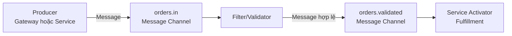
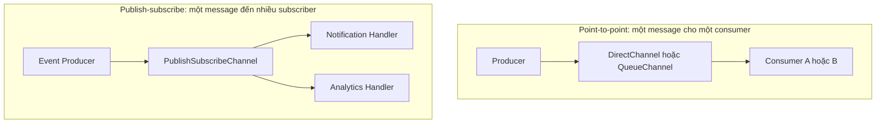
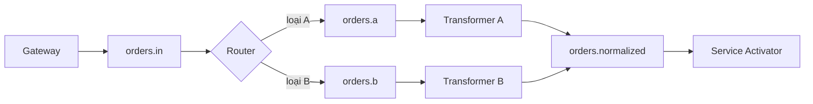

# Channel là Pipe trong Enterprise Integration Patterns

Trong Enterprise Integration Patterns (EIP), **Message Channel** là một đường kết nối logic để thành phần gửi thông điệp (**producer**) chuyển dữ liệu tới thành phần nhận (**consumer**) mà không cần gọi trực tiếp phương thức của nhau. Có thể hình dung channel như **đường ống (pipe)**: thành phần xử lý đẩy một message vào đầu ống; thành phần kế tiếp nhận message ở đầu còn lại.

Đó là một hình dung hữu ích, nhưng cần hiểu đúng: channel không nhất thiết là một hàng đợi, một luồng xử lý riêng, hay một broker bên ngoài. Channel mô tả **ranh giới trao đổi thông điệp và cách phân phối thông điệp**. Cơ chế thực thi thực tế phụ thuộc loại channel được cấu hình.

Trong module **SPRING_INTEGRATION_PATTERN**, việc hiểu channel là nền tảng để lắp ghép **Router, Filter, Transformer, Splitter, Aggregator, Gateway**, đồng thời thiết kế retry, error channel, correlation, kiểm thử và theo dõi đường đi của message. Bài này tập trung vào bản chất của Message Channel, những gì nó tách rời được, và cách ánh xạ khái niệm “pipe” vào Spring Integration.

## 1. Từ lời gọi trực tiếp đến message chạy qua pipe

Xét một quy trình xử lý đơn hàng có hai bước: kiểm tra yêu cầu và chuyển yêu cầu hợp lệ tới bộ phận thực hiện đơn.

### Cách gọi trực tiếp

```java
void submit(OrderCommand order) {
    validator.validate(order);
    fulfillmentService.fulfill(order);
}
```

Đoạn mã dễ hiểu: bộ điều phối biết trực tiếp cả `validator` và `fulfillmentService`, cũng như thứ tự gọi. Với quy trình ngắn, điều này có thể là lựa chọn tốt. Nhưng khi cần thay cách kiểm tra, thêm một tuyến xử lý hoặc đổi cơ chế thực thi, bộ điều phối có thể phải sửa theo.

### Cách ghép các bước bằng channel



Ở đây, **Filter/Validator** đọc từ `orders.in` và phát kết quả sang `orders.validated`; **Service Activator** nhận message từ `orders.validated` để thực hiện đơn. Các thành phần xử lý kết nối thông qua channel và hợp đồng message.

Cách tổ chức này phản ánh ý tưởng **Pipes and Filters**: *filter* là bước xử lý có chức năng riêng; *pipe* là kết nối đưa dữ liệu từ bước này sang bước kế tiếp. Cần phân biệt **Filter pattern** (quyết định message có được đi tiếp hay không) với **Message Channel pattern** (đường truyền và cách phân phối message). Một channel tự nó không kiểm tra nội dung đơn hàng.

### Ba thành phần cơ bản

| Thành phần | Trách nhiệm | Ví dụ trong Spring Integration |
| --- | --- | --- |
| **Message** | Gói dữ liệu được trao đổi, gồm payload và headers | `Message<OrderCommand>` |
| **Message Channel** | Làm trung gian gửi/nhận, quy định hành vi phân phối message | `DirectChannel`, `QueueChannel`, `PublishSubscribeChannel` |
| **Message Endpoint** | Nối logic xử lý với messaging: tiêu thụ, biến đổi, điều hướng hoặc phát message | `Service Activator`, `Filter`, `Transformer`, `Router` |

Một endpoint có thể vừa tiêu thụ một message từ channel đầu vào vừa phát message mới sang channel đầu ra. Channel là **kết nối giữa các endpoint**, không phải bản thân nghiệp vụ xử lý.

## 2. Message đi trong pipe chứa gì?

Trong Spring Integration, message sử dụng kiểu `org.springframework.messaging.Message<T>`, có hai phần:

- **Payload:** dữ liệu chính, chẳng hạn `OrderCommand`, JSON đã parse hoặc một đối tượng sự kiện.
- **Headers:** metadata phục vụ xử lý, ví dụ `id`, `timestamp`, correlation ID, reply channel hoặc error channel khi có cấu hình phù hợp.

```text
Message<OrderCommand>
+--------------------------------------------------+
| Headers                                           |
|   id: UUID                                        |
|   timestamp: thời điểm tạo                        |
|   correlationId: mã liên kết (nếu ứng dụng đặt)    |
+--------------------------------------------------+
| Payload                                          |
|   OrderCommand(orderId="O-101", amount=250000)    |
+--------------------------------------------------+
            |
            v
      Message Channel
            |
            v
        Consumer
```

**Channel chuyển message**, không tự biến đổi payload, thêm idempotency key hay xác nhận nghiệp vụ đã hoàn tất. Các bước Filter, Transformer, Router, Aggregator hoặc handler nhận trách nhiệm chuyên môn đó. Với các flow có chia và ghép message, correlation ID và sequence metadata phải được thiết kế để các phần thuộc cùng một nhóm được nhận diện chính xác.

Một producer và consumer được tách rời về **địa chỉ gọi trực tiếp**, nhưng vẫn cần thống nhất hợp đồng: kiểu payload, ý nghĩa trường dữ liệu, các header bắt buộc, và cách ứng xử khi message không hợp lệ. Message Channel giúp quản lý sự phụ thuộc này ở một ranh giới rõ ràng; nó không khiến hợp đồng biến mất.

## 3. Bốn câu hỏi mà một channel phải trả lời

Trước khi chọn channel, cần xác định:

1. **Ai sẽ nhận message?** Một consumer trong số nhiều consumer hay tất cả subscriber?
2. **Khi nào consumer xử lý?** Ngay trên luồng gửi, trong một luồng khác, hay sau khi consumer lấy message ra khỏi hàng đợi?
3. **Khi xử lý lỗi, điều gì xảy ra?** Exception có quay lại producer không? Ai retry và ghi nhận message lỗi?
4. **Nếu tải tăng, message được giữ ở đâu?** Có giới hạn bộ đệm, cơ chế chờ, mất dữ liệu khi restart hoặc backpressure không?

Không thể suy ra các câu trả lời này chỉ từ việc nhìn thấy `.channel("orders.in")` trong Java DSL.

## 4. Các loại Message Channel thường gặp trong Spring Integration

| Loại channel | Cách trao đổi | Phù hợp khi | Lưu ý |
| --- | --- | --- | --- |
| **DirectChannel** | Producer gửi và handler được gọi đồng bộ trên luồng gửi | Pipeline đơn giản, cần phản hồi/lỗi tức thời | Channel tách cấu trúc, nhưng chưa tách phụ thuộc thời gian |
| **ExecutorChannel** | Dispatch cho subscriber thông qua `TaskExecutor` | Muốn chuyển việc xử lý sang thread khác | Cần theo dõi năng lực executor, từ chối tác vụ và lỗi bất đồng bộ |
| **QueueChannel** | Message vào hàng đợi, consumer lấy ra bằng polling | Cần bộ đệm và tách tốc độ gửi/nhận trong một tiến trình | Cần poller; queue trong bộ nhớ không tự bảo đảm tồn tại qua restart |
| **PublishSubscribeChannel** | Phát message tới nhiều subscriber | Một sự kiện cần nhiều nhánh xử lý | Phát nhiều nhánh khác với chia message thành nhiều phần; mặc định có thể đồng bộ |
| **RendezvousChannel** | Bàn giao trực tiếp giữa bên gửi và bên nhận đang chờ | Cần đồng bộ hóa thời điểm bàn giao | Sender có thể phải chờ receiver, không dùng như queue tích lũy |
| **PriorityChannel** | Queue có thứ tự ưu tiên | Công việc có độ ưu tiên khác nhau | Cần xét nguy cơ công việc ưu tiên thấp phải đợi quá lâu |

### 4.1. Point-to-point khác publish-subscribe



Với channel kiểu **point-to-point**, mỗi message được chuyển đến **một** handler, ngay cả khi có nhiều subscriber đủ điều kiện. Chẳng hạn, `DirectChannel` sử dụng cơ chế dispatch một đích; `QueueChannel` cung cấp message cho một lần nhận từ hàng đợi. Không nên kỳ vọng hai handler cùng nhìn thấy mọi message từ một channel point-to-point.

Với **PublishSubscribeChannel**, một message được phát tới nhiều subscriber. Đây là lựa chọn thường gặp cho tình huống “đơn hàng được tạo” dẫn tới việc gửi thông báo và cập nhật phân tích. Tuy nhiên, các subscriber vẫn có thể chạy đồng bộ nếu không cấu hình executor; một subscriber lỗi có thể ảnh hưởng quá trình gửi tùy cơ chế dispatch/error handling.

### 4.2. Đồng bộ khác bất đồng bộ

Đừng đánh đồng “đi qua channel” với “chạy nền”. Trong `DirectChannel`, đường đi thường giống một lời gọi hàm có bước trung gian:

```text
Thread HTTP
  -> gateway.send(message)
  -> DirectChannel
  -> validator
  -> DirectChannel
  -> handler.fulfill(order)
  -> return
```

Với `ExecutorChannel`, việc xử lý có thể chuyển sang thread thuộc executor. Với `QueueChannel`, producer thường dừng sau khi gửi message vào queue, còn consumer sử dụng poller để nhận sau. Thay đổi này ảnh hưởng thời điểm một API được phép trả về, ngữ cảnh transaction và đường đi của lỗi.

### 4.3. Channel trong ứng dụng khác broker bên ngoài

`DirectChannel`, `ExecutorChannel` và `QueueChannel` thường kết nối các endpoint **bên trong một Spring application context**. Chúng không tự tạo một đường truyền bền vững giữa hai microservice ở hai tiến trình khác nhau.

Khi cần kết nối qua Kafka, RabbitMQ, JMS hoặc hệ thống bên ngoài, phải dùng **message-driven adapter, gateway, binder hoặc endpoint tích hợp thích hợp** và cấu hình các thuộc tính vận chuyển của hạ tầng đó. Dù vậy, kiến trúc nội bộ vẫn có thể biểu diễn dữ liệu qua các `MessageChannel` để các bước xử lý phía trong không phụ thuộc trực tiếp vào adapter.

## 5. Ví dụ thực hành: tạo pipe qua hai channel

Trong ví dụ sau, một gateway tiếp nhận yêu cầu xử lý đơn hàng. Flow thứ nhất kiểm tra dữ liệu và đẩy message hợp lệ sang channel tiếp theo. Flow thứ hai lấy message từ channel này để thực hiện nghiệp vụ.

### 5.1. Định nghĩa hợp đồng và gateway

```java
import java.math.BigDecimal;

import org.springframework.context.annotation.Bean;
import org.springframework.context.annotation.Configuration;
import org.springframework.integration.annotation.Gateway;
import org.springframework.integration.annotation.IntegrationComponentScan;
import org.springframework.integration.annotation.MessagingGateway;
import org.springframework.integration.channel.DirectChannel;
import org.springframework.integration.config.EnableIntegration;
import org.springframework.integration.dsl.IntegrationFlow;
import org.springframework.messaging.MessageChannel;

record OrderCommand(String orderId, BigDecimal amount) {}

interface FulfillmentService {
    void fulfill(OrderCommand order);
}

@MessagingGateway
interface OrderGateway {
    @Gateway(requestChannel = "orders.in")
    void submit(OrderCommand command);
}

@Configuration
@EnableIntegration
@IntegrationComponentScan
class OrderChannelConfiguration {

    @Bean("orders.in")
    MessageChannel ordersIn() {
        return new DirectChannel();
    }

    @Bean("orders.validated")
    MessageChannel validatedOrders() {
        return new DirectChannel();
    }

    @Bean
    IntegrationFlow validateOrders() {
        return IntegrationFlow.from("orders.in")
            .filter(OrderCommand.class,
                order -> order.orderId() != null
                    && !order.orderId().isBlank()
                    && order.amount() != null
                    && order.amount().signum() > 0,
                spec -> spec.throwExceptionOnRejection(true))
            .channel("orders.validated")
            .get();
    }

    @Bean
    IntegrationFlow fulfillOrders(FulfillmentService fulfillment) {
        return IntegrationFlow.from("orders.validated")
            .handle(OrderCommand.class, (order, headers) -> {
                fulfillment.fulfill(order);
                return null; // handler một chiều, không phát reply
            })
            .get();
    }
}
```

Đây là ví dụ cho Spring Integration Java DSL trong một ứng dụng đã có dependency Spring Integration. Gateway và cấu hình cần ở package được quét bởi `@IntegrationComponentScan` (hoặc được đăng ký tương đương). `FulfillmentService` phải có bean triển khai thực tế.

Ví dụ gọi từ service nghiệp vụ:

```java
class CheckoutService {
    private final OrderGateway orders;

    CheckoutService(OrderGateway orders) {
        this.orders = orders;
    }

    void checkout(String id, BigDecimal amount) {
        orders.submit(new OrderCommand(id, amount));
    }
}
```

Điểm quan trọng trong thiết kế:

- `CheckoutService` chỉ biết `OrderGateway`, không cần biết `FulfillmentService` xử lý ở đâu.
- Hai channel có tên rõ ràng: `orders.in` và `orders.validated`; Filter đóng vai trò endpoint ở giữa hai “pipe”.
- `throwExceptionOnRejection(true)` khiến message không đạt điều kiện bị từ chối bằng exception, thay vì âm thầm bị filter bỏ đi. Đó là lựa chọn cho ví dụ, không phải mặc định duy nhất cho mọi luồng.
- Cả hai channel là `DirectChannel`, nên lệnh `orders.submit(...)` vẫn diễn ra đồng bộ. Khi xử lý thành công, lời gọi trả về sau khi `fulfill(...)` hoàn tất; exception của handler có thể lan ngược về phía caller.
- `return null` tại handler biểu thị không tạo message trả lời; muốn request-reply phải định nghĩa hợp đồng và flow tương ứng.

### 5.2. Đổi pipe thành queue thay đổi điều gì?

Giả sử xử lý thực hiện đơn chậm và không nhất thiết phải hoàn tất trước khi API trả về. Ta có thể đổi **riêng channel thứ hai và cách consume**.

Thay bean channel `orders.validated` bằng:

```java
import org.springframework.integration.channel.QueueChannel;

@Bean("orders.validated")
MessageChannel validatedOrders() {
    return new QueueChannel(100); // tối đa 100 message đang chờ
}
```

Và dùng poller trong flow tiêu thụ:

```java
import org.springframework.integration.dsl.Pollers;

@Bean
IntegrationFlow fulfillOrders(FulfillmentService fulfillment) {
    return IntegrationFlow.from("orders.validated",
            endpoint -> endpoint.poller(Pollers.fixedDelay(250)))
        .handle(OrderCommand.class, (order, headers) -> {
            fulfillment.fulfill(order);
            return null;
        })
        .get();
}
```

**Hai đoạn mã trên thay thế các phần tương ứng của ví dụ đồng bộ**, không thêm một bean thứ hai cùng tên. Khi dùng queue, producer có thể gửi thành công mà handler vẫn chưa xử lý xong message. Poller lấy message từ queue theo lịch; thời điểm hoàn tất phụ thuộc cấu hình và tải thực tế. Với queue có giới hạn, producer phải được thiết kế cho trường hợp queue đầy, message không gửi được hoặc phải đợi.

Đây là một **QueueChannel trong bộ nhớ**: nếu process dừng, các message chưa xử lý có thể mất. Queue trong bộ nhớ cũng không tự động đảm bảo exactly-once, retry, dead-letter hay lưu bền sau restart. Nếu yêu cầu nghiệp vụ là “đã nhận thì phải xử lý dù hệ thống khởi động lại”, cần thiết kế lưu bền thích hợp, chẳng hạn message store bền vững hoặc broker, kết hợp cơ chế xử lý lỗi và idempotency.

## 6. Channel giảm coupling đến đâu?

Có hai kiểu phụ thuộc cần tách biệt:

**Phụ thuộc cấu trúc.** Khi producer gửi vào `orders.in`, nó không phải khởi tạo hay gọi trực tiếp handler xử lý đơn. Ta có thể đổi hoặc bổ sung các bước downstream, chẳng hạn Router chọn kho hoặc Transformer chuyển hợp đồng dữ liệu, mà vẫn giữ nguyên interface gửi nếu hợp đồng message ổn định.

**Phụ thuộc vận hành.** Khi channel là `DirectChannel`, producer vẫn phụ thuộc vào tốc độ và lỗi của consumer. Chỉ khi chọn cơ chế dispatch, buffer và hạ tầng phù hợp, hệ thống mới có thể tách một phần phụ thuộc về thời gian và độ sẵn sàng.

Sự tách rời này có giới hạn. Producer và consumer vẫn cần thống nhất:

| Hợp đồng chung | Nếu thay đổi tùy tiện |
| --- | --- |
| Tên channel hoặc cách tìm endpoint | Message có thể không đi tới consumer |
| Payload và phiên bản schema | Handler không đọc hoặc hiểu sai message |
| Headers phục vụ routing/correlation | Router hoặc Aggregator xử lý sai nhánh/nhóm |
| Chính sách lỗi và xác nhận | Producer tưởng thành công khi tác vụ thực tế đã thất bại |
| Ngữ nghĩa thứ tự, trùng lặp, retry | Dữ liệu có thể bị cập nhật nhiều lần hoặc sai thứ tự |

Vì vậy, lợi ích của “pipe” là **cho phép các bước trao đổi qua ranh giới được định nghĩa rõ**. Không nên mặc định channel sẽ xóa mọi dạng coupling.

## 7. Channel kết hợp với các pattern khác

Trong một hệ thống tích hợp thực tế, channel thường xuất hiện xen giữa nhiều EIP:



- **Gateway:** cung cấp cách gọi thuận tiện từ mã ứng dụng vào luồng message.
- **Router:** nhận message từ channel và chọn channel đầu ra dựa theo nội dung hoặc headers.
- **Filter:** quyết định message có được đi tiếp hay phải loại bỏ/từ chối.
- **Transformer:** chuyển payload hoặc cấu trúc message để consumer tiếp theo hiểu được.
- **Splitter:** tách một message thành nhiều message, thường đưa chúng qua channel kế tiếp.
- **Aggregator:** thu thập các message liên quan, ghép chúng theo điều kiện hoàn thành. Nó cần cơ chế correlation, group state và timeout rõ ràng.
- **Retry và error channel:** giúp xử lý lỗi tại những điểm thực thi phù hợp; chỉ thêm channel không tự cài đặt chính sách retry hay quan sát lỗi.

Một số thành phần như Aggregator có thể giữ trạng thái, trong khi channel thông thường chỉ làm nhiệm vụ phân phối hoặc đệm message. Phân biệt nơi giữ trạng thái giúp tránh nhầm nguyên nhân mất dữ liệu và điểm nghẽn.

## 8. Quan sát và kiểm thử một pipe

Khi thêm channel, đường đi của message có thể trải qua nhiều endpoint. Cần biết **message xuất phát từ đâu, đã được chuyển tới endpoint nào, và dừng ở đâu**.

### 8.1. Các kiểm tra nên có

| Ca kiểm tra | Kỳ vọng |
| --- | --- |
| Gửi `OrderCommand` hợp lệ qua gateway | `FulfillmentService.fulfill` được gọi đúng một lần trong ví dụ đồng bộ |
| Gửi amount bằng 0 hoặc âm | Filter từ chối và caller nhận exception khi dùng DirectChannel |
| Handler ném exception | Với DirectChannel, lỗi có thể quay về caller và cần được xử lý |
| Đổi `orders.validated` sang QueueChannel | Message được xếp vào queue, poller xử lý sau; không đồng nhất “gửi thành công” với “nghiệp vụ hoàn tất” |
| Queue đạt giới hạn | Hành vi chờ/từ chối gửi phù hợp timeout và chính sách của producer |
| Có nhiều subscriber trên DirectChannel | Một message không được mặc định phát đến mọi subscriber như PublishSubscribeChannel |

Với bài kiểm thử integration, có thể thay `FulfillmentService` bằng mock hoặc spy, gửi message vào `OrderGateway` và kiểm tra số lần gọi. Khi chuyển sang queue, nên chờ theo điều kiện với giới hạn thời gian thay vì giả định handler đã chạy ngay sau lệnh gửi.

### 8.2. Những dữ liệu cần ghi nhận khi vận hành

- **Message ID và correlation ID** để liên kết log giữa các bước; correlation ID nghiệp vụ cần được đưa vào message một cách có chủ đích.
- **Tên channel và endpoint** để thấy message vừa qua bước nào.
- **Số message gửi/nhận, độ trễ, lỗi và retry** nhằm phát hiện điểm nghẽn.
- **Độ dài queue, tốc độ tiêu thụ và số message đang chờ** nếu có queue.
- **Kết quả cuối cùng** của tác vụ nghiệp vụ, nhất là với luồng bất đồng bộ.

Spring Integration có các cơ chế interceptor, metrics và quan sát có thể cấu hình tại channel/endpoint. Việc bật, cấu hình và xuất telemetry phụ thuộc ứng dụng và hệ thống giám sát đang dùng. Không nên giả định mỗi message đều được tự động lưu dấu hoặc tracing đầy đủ nếu chưa thiết lập.

## 9. Những sai lầm thường gặp

**“Có channel thì mọi thứ đã bất đồng bộ.”** Sai với `DirectChannel`: producer và consumer vẫn xử lý trên cùng luồng gửi. Cần xem loại channel và executor/poller được cấu hình.

**“Channel là queue bền vững.”** Không đúng với channel nói chung. `DirectChannel` không phải queue; `QueueChannel` mặc định dùng bộ nhớ; độ bền phụ thuộc hạ tầng và message store.

**“Đặt hai consumer vào channel là cả hai sẽ nhận một bản sao.”** Chỉ đúng khi dùng cơ chế phát tới mọi subscriber như `PublishSubscribeChannel` theo cấu hình phù hợp. Point-to-point cung cấp một đích xử lý cho mỗi message.

**“Gửi vào queue thành công nghĩa là tác vụ đã hoàn thành.”** Sai với luồng tiêu thụ trễ. Kết quả gửi thành công cho biết message đã được channel chấp nhận theo ngữ nghĩa tương ứng, không bảo đảm business handler đã kết thúc.

**“Một pipe sẽ tự retry khi consumer lỗi.”** Retry, redelivery, dead-letter và error handling là các chính sách cần được cấu hình ở endpoint, adapter hoặc hạ tầng có hỗ trợ.

**“Thêm càng nhiều channel càng tốt.”** Mỗi channel mới cần tên, hợp đồng, chính sách xử lý và công cụ quan sát. Nên thêm channel khi nó làm rõ ranh giới giữa hai trách nhiệm, chính sách phân phối hoặc yêu cầu thực thi khác nhau.

## 10. Bài tập áp dụng

Một hệ thống thương mại điện tử nhận sự kiện `OrderPaid` và cần thực hiện ba việc: cấp quyền tải hàng số, gửi email và cập nhật chỉ số kinh doanh.

1. Nếu việc cấp quyền phải hoàn thành trước khi API trả về, hãy cân nhắc một flow đồng bộ và xác định rõ exception có quay về phía API hay không.
2. Nếu gửi email có thể chậm vài phút, hãy chọn cách tách thời gian xử lý; so sánh `ExecutorChannel`, `QueueChannel` và broker dựa trên yêu cầu chịu lỗi khi restart.
3. Nếu mọi sự kiện thanh toán đều cần đến cả bộ phận email và analytics, hãy cân nhắc `PublishSubscribeChannel` hoặc event infrastructure thay cho point-to-point channel.
4. Nếu analytics cần gom dữ liệu theo đợt, hãy phân biệt channel vận chuyển message với Aggregator phụ trách correlation và trạng thái nhóm.
5. Vẽ các channel và endpoint; chỉ ra với từng “pipe” producer phải biết điều gì, message có thể bị giữ tại đâu và ai chịu trách nhiệm retry.

Hãy giải thích vì sao cùng một ký hiệu **Message Channel** trên sơ đồ có thể tương ứng với các hành vi runtime rất khác nhau. Nếu trả lời được bằng loại channel, hình thức tiêu thụ, chính sách lỗi và bảo đảm lưu trữ, bạn đã hiểu phần quan trọng nhất của mô hình “channel là pipe”.

## Ghi nhớ

**Trong EIP, Message Channel là “pipe” kết nối các bước xử lý thông qua message.** Nó tách người gửi khỏi việc gọi trực tiếp người nhận và cung cấp điểm nối rõ ràng cho một integration flow. Trong Spring Integration, pipe có thể là `DirectChannel`, `ExecutorChannel`, `QueueChannel` hoặc `PublishSubscribeChannel` và mỗi loại có ngữ nghĩa thực thi khác nhau.

Khi thiết kế hệ thống ít phụ thuộc và dễ mở rộng, hãy chọn channel theo **đích nhận, thời điểm xử lý, cách lan truyền lỗi, khả năng đệm và yêu cầu lưu bền**. Sau đó mới kết hợp Filter, Router, Transformer, Splitter, Aggregator, Gateway, retry, error channel và correlation. Thiết kế tốt là thiết kế có thể giải thích chính xác mỗi message đi đâu, khi nào nó được coi là xử lý xong và cách phát hiện thất bại.

