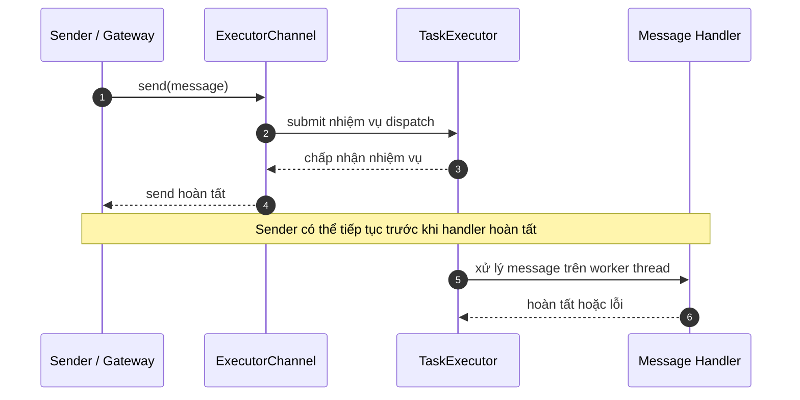
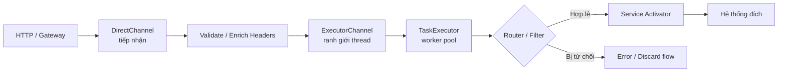
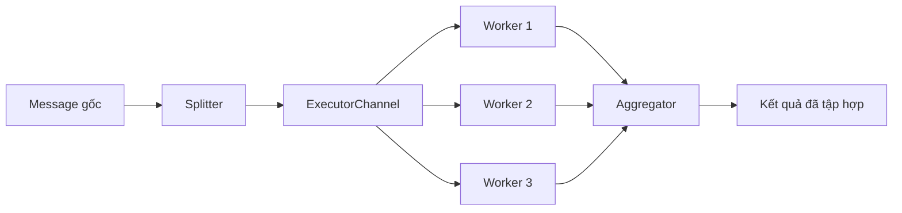
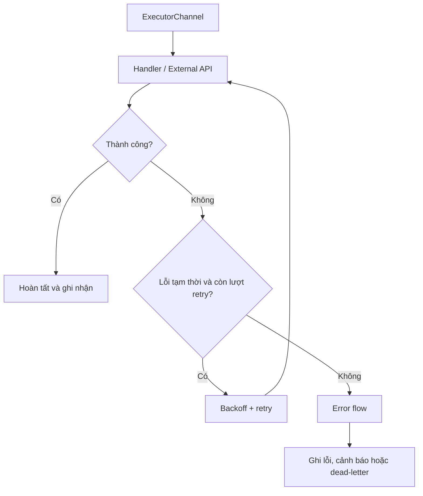

# ExecutorChannel và giao tiếp bất đồng bộ trong Spring Integration

> **Chương:** Message channel  
> **Bài học:** ExecutorChannel và giao tiếp bất đồng bộ  
> **Phạm vi:** Xây dựng luồng thông điệp với Spring Integration theo Enterprise Integration Patterns (EIP), kết hợp Router, Filter, Transformer, Splitter, Aggregator, Gateway, retry, error channel, correlation và quan sát luồng xử lý.

## 1. Bài toán: không để luồng gửi phải đợi toàn bộ xử lý

Một ứng dụng nhận thông điệp đặt hàng qua Gateway. Sau khi tiếp nhận, nó cần xác thực dữ liệu, gửi yêu cầu sang dịch vụ thanh toán và ghi lịch sử. Nếu tất cả handler chạy nối tiếp trên thread nhận yêu cầu, thời gian phản hồi của bên gửi phụ thuộc vào toàn bộ công việc phía sau.

```text
Thread HTTP / Gateway
    |
    v
Nhận đơn hàng --> Kiểm tra --> Thanh toán --> Lưu lịch sử --> Trả về
                  (20 ms)      (500 ms)       (100 ms)
```

Với nhiều yêu cầu đồng thời, những handler chậm có thể chiếm giữ thread đầu vào. Ta muốn bàn giao thông điệp cho một nhóm thread chuyên xử lý để thread gửi được giải phóng sớm sau khi việc bàn giao được chấp nhận.

**ExecutorChannel** là một `MessageChannel` trong Spring Integration thực hiện việc bàn giao đó. Nó sử dụng `TaskExecutor` để dispatch thông điệp đến subscriber. Bên gửi và handler có thể chạy trên hai thread khác nhau.



Sơ đồ mô tả trường hợp executor có worker thread sẵn sàng và chấp nhận nhiệm vụ. Nếu executor bị quá tải, từ chối tác vụ hoặc dùng chính sách chạy trên thread gọi, hành vi sẽ khác. Do đó, “gửi bất đồng bộ” không đồng nghĩa với “không bao giờ chặn” hoặc “đã xử lý thành công”.

### Sau bài học, bạn có thể

- Giải thích vai trò của `ExecutorChannel` trong các EIP và phân biệt nó với `DirectChannel`, `QueueChannel`.
- Cấu hình thread pool có giới hạn tài nguyên và chọn chính sách khi quá tải.
- Xác định ranh giới thread, transaction, thứ tự xử lý và ngữ cảnh metadata.
- Tổ chức error channel, retry và kiểm thử cho nhánh bất đồng bộ.
- Biết khi nào cần queue/broker bền vững thay vì chỉ dispatch trong bộ nhớ tiến trình.

## 2. ExecutorChannel nằm ở đâu trong mô hình Message Channel?

Spring Integration trao đổi dữ liệu bằng `Message<?>`. Mỗi message gồm **payload** (dữ liệu nghiệp vụ) và **headers** (metadata). Handler không cần trực tiếp biết địa chỉ hay công nghệ của handler khác: nó gửi message vào một channel.

`ExecutorChannel` là một **SubscribableChannel**: các handler đăng ký nhận thông điệp và framework chủ động chuyển message tới một subscriber. Nó có mục đích dispatch đến handler như `DirectChannel`, nhưng việc dispatch được thực hiện qua `TaskExecutor`.

| Channel | Kiểu nhận | Thread thực thi handler | Đặc điểm sử dụng |
| --- | --- | --- | --- |
| `DirectChannel` | Subscribe, điều phối một subscriber | Thường cùng thread gửi | Luồng gọi đồng bộ, dễ hiểu thứ tự và lỗi trả về |
| **`ExecutorChannel`** | Subscribe, điều phối một subscriber | Qua `TaskExecutor`, thường là worker thread | Tạo ranh giới bất đồng bộ trong ứng dụng |
| `QueueChannel` | Poll, người nhận tự lấy message | Thread của poller/người nhận | Có bộ đệm nội bộ, tiêu thụ theo nhịp poll |
| `PublishSubscribeChannel` | Subscribe, phát tới nhiều subscriber | Có thể đồng bộ hoặc dùng executor | Phù hợp broadcast/fan-out tới nhiều handler |

Một vài điểm thường bị nhầm:

- `ExecutorChannel` **không phải message broker**. Nó không tự ghi message ra Kafka, RabbitMQ hay cơ sở dữ liệu.
- `ExecutorChannel` **không phải hàng đợi bền vững**. `ThreadPoolTaskExecutor` có thể giữ tác vụ chờ trong bộ nhớ; tiến trình dừng đột ngột thì công việc chưa hoàn thành có thể mất.
- Với nhiều subscriber, `ExecutorChannel` sử dụng cơ chế điều phối một handler cho mỗi lần gửi (unicast), không tự nhân bản thông điệp cho tất cả subscriber. Muốn phát tới nhiều bên hãy xem `PublishSubscribeChannel`.
- `send(message)` hoàn tất chủ yếu thể hiện việc dispatch được chấp nhận trong trường hợp bình thường; nó không cam kết giao dịch nghiệp vụ phía sau đã kết thúc.

### Vì sao không chỉ dùng `@Async`?

`@Async` có thể giúp một lời gọi method chạy trên executor, nhưng `ExecutorChannel` biểu diễn rõ **ranh giới bất đồng bộ trong đồ thị luồng thông điệp**. Router, Filter, Transformer, Gateway và những component khác có thể nằm trước hoặc sau channel mà vẫn tuân theo giao diện `MessageChannel`, chia sẻ payload/headers và cơ chế error flow của Spring Integration.

Chọn `ExecutorChannel` khi việc chuyển thread thuộc về thiết kế tích hợp. Chọn `@Async` cho lời gọi method bất đồng bộ không nhất thiết thuộc một message flow. Hai cơ chế đều cần quản lý tài nguyên executor và lỗi.

## 3. Luồng đồng bộ và bất đồng bộ khác nhau thế nào?

Xét một luồng:



Các bước trước `ExecutorChannel` vẫn thường chạy trên thread đầu vào. Khi message đi qua channel này, framework giao việc dispatch cho executor. Router, Filter và các handler tiếp sau thường chạy trên worker thread của executor đó, cho đến khi có một ranh giới thread khác.

Hệ quả cần ghi nhớ:

1. **Độ trễ cảm nhận của sender** có thể giảm vì sender không phải chờ handler sau ranh giới.
2. **Thông lượng và độ trễ của toàn hệ thống** vẫn phụ thuộc tốc độ handler, kích thước pool và năng lực của hệ thống đích.
3. **Thứ tự hoàn tất** có thể thay đổi khi nhiều worker xử lý đồng thời.
4. **ThreadLocal và transaction của thread gửi** không tự động chuyển sang worker thread.
5. **Exception xảy ra phía worker** cần cơ chế báo lỗi riêng; sender có thể đã quay về.

## 4. Ví dụ hoàn chỉnh: xử lý đơn hàng qua ExecutorChannel

Ví dụ sử dụng Spring Integration Java DSL. Đầu vào là một message mang `OrderSubmitted`. Flow bổ sung header để theo dõi nguồn, chuyển qua `ExecutorChannel` và gọi một service xử lý đơn hàng. Service là handler một chiều nên trả về `void`.

```java
package example.integration;

import java.math.BigDecimal;
import java.util.concurrent.ThreadPoolExecutor;

import org.slf4j.Logger;
import org.slf4j.LoggerFactory;
import org.springframework.beans.factory.annotation.Qualifier;
import org.springframework.context.annotation.Bean;
import org.springframework.context.annotation.Configuration;
import org.springframework.core.task.TaskExecutor;
import org.springframework.integration.channel.DirectChannel;
import org.springframework.integration.channel.ExecutorChannel;
import org.springframework.integration.config.EnableIntegration;
import org.springframework.integration.dsl.IntegrationFlow;
import org.springframework.messaging.Message;
import org.springframework.messaging.MessageChannel;
import org.springframework.scheduling.concurrent.ThreadPoolTaskExecutor;

@Configuration
@EnableIntegration
public class AsyncOrderConfiguration {

    public record OrderSubmitted(String orderId, BigDecimal total) {}

    @Bean("ordersInput")
    public MessageChannel ordersInput() {
        return new DirectChannel();
    }

    @Bean("ordersExecutor")
    public ThreadPoolTaskExecutor ordersExecutor() {
        ThreadPoolTaskExecutor executor = new ThreadPoolTaskExecutor();
        executor.setCorePoolSize(2);
        executor.setMaxPoolSize(4);
        executor.setQueueCapacity(100);
        executor.setThreadNamePrefix("orders-worker-");
        executor.setRejectedExecutionHandler(
            new ThreadPoolExecutor.AbortPolicy());
        // Khi được đăng ký như Spring bean, executor được khởi tạo
        // và quản lý vòng đời bởi Spring.
        return executor;
    }

    @Bean("ordersAsync")
    public MessageChannel ordersAsync(
            @Qualifier("ordersExecutor") TaskExecutor executor) {
        return new ExecutorChannel(executor);
    }

    @Bean
    public OrderProcessor orderProcessor() {
        return new OrderProcessor();
    }

    @Bean
    public IntegrationFlow ordersFlow(OrderProcessor processor) {
        return IntegrationFlow.from("ordersInput")
            .enrichHeaders(headers ->
                headers.header("sourceSystem", "checkout-api"))
            .channel("ordersAsync")
            .handle(processor, "process")
            .get();
    }

    public static class OrderProcessor {

        private static final Logger log =
            LoggerFactory.getLogger(OrderProcessor.class);

        public void process(Message<OrderSubmitted> message) {
            OrderSubmitted order = message.getPayload();
            String source = message.getHeaders()
                .get("sourceSystem", String.class);

            log.info("orderId={}, source={}, thread={}",
                order.orderId(),
                source,
                Thread.currentThread().getName());

            // TODO: Gọi dịch vụ xử lý nghiệp vụ thực tế.
            // Cần timeout, idempotency và xử lý lỗi phù hợp.
        }
    }
}
```

Có thể gửi message vào channel như sau (ví dụ từ controller hoặc gateway của ứng dụng):

```java
OrderSubmitted order =
    new OrderSubmitted("ORD-2048", new BigDecimal("1250000"));

boolean accepted = ordersInput.send(
    MessageBuilder.withPayload(order)
        .setHeader("businessKey", order.orderId())
        .build()
);
```

Đoạn gửi giả định `ordersInput` đã được inject dưới dạng `MessageChannel`, và `MessageBuilder` được import từ `org.springframework.messaging.support.MessageBuilder`.

**Diễn giải từng chặng:**

- `ordersInput` là `DirectChannel`, đưa message vào flow trên thread gửi.
- `enrichHeaders` bổ sung metadata nguồn mà không thay đổi payload.
- `ordersAsync` bàn giao việc xử lý cho `ordersExecutor`.
- `OrderProcessor.process(...)` chạy trên thread do executor chọn và vẫn truy cập được payload lẫn header `businessKey` / `sourceSystem`.
- Method `process` trả về `void` để biểu thị xử lý một chiều; không tạo reply message.

Ví dụ dành cho luồng xử lý trong một tiến trình. Khi thay TODO bằng lời gọi thanh toán, ghi dữ liệu hoặc gửi broker, hãy bổ sung tính nhất quán và cơ chế phục hồi; riêng việc thêm `ExecutorChannel` không bảo đảm đơn hàng đã được lưu an toàn.

### Tại sao dùng `TaskExecutor` thay vì tự tạo Thread?

Spring quản lý lifecycle, số worker, tài nguyên và chính sách từ chối. `ThreadPoolTaskExecutor` còn cho phép giám sát kích thước pool và số task đang chạy. Nếu mỗi message tự tạo một thread, hệ thống khó kiểm soát tài nguyên khi tải tăng đột biến.

## 5. Hiểu đúng cấu hình ThreadPoolTaskExecutor

Các tham số quan trọng trong ví dụ:

| Cấu hình | Giá trị minh họa | Ý nghĩa |
| --- | ---: | --- |
| `corePoolSize` | 2 | Số worker lõi được duy trì theo cấu hình executor |
| `maxPoolSize` | 4 | Giới hạn trên của số worker trong pool |
| `queueCapacity` | 100 | Số tác vụ có thể đợi trong hàng đợi nội bộ |
| `threadNamePrefix` | `orders-worker-` | Giúp tìm luồng xử lý trong log và thread dump |
| Rejection policy | `AbortPolicy` | Báo lỗi khi không thể nhận thêm task |

Với cách vận hành thường gặp của `ThreadPoolExecutor`, khi các worker lõi bận, tác vụ được đưa vào queue; chỉ khi queue đầy, pool mới tăng số thread lên tới `maxPoolSize`. Vì vậy, đặt `maxPoolSize` rất lớn nhưng `queueCapacity` cũng rất lớn **không có nghĩa** số thread sẽ tăng ngay khi có tải.

Ví dụ mô hình:

```text
Message đến
    |
    v
Có worker lõi chưa bận?
    | Có                         | Không
    v                            v
Worker xử lý           Đưa task vào queue nếu còn chỗ
                                   |
                          Queue đã đầy?
                            | Không    | Có
                            v          v
                            Đợi   Tạo thêm worker
                                  (nếu chưa tới max)
                                          |
                                  Pool cũng đầy?
                                      | Có
                                      v
                                Từ chối task
```

Với `queueCapacity=0`, executor không giữ queue chờ thông thường và có xu hướng bàn giao trực tiếp cho worker, giúp pool tăng thread sớm hơn nhưng cũng khiến task dễ bị từ chối khi toàn bộ worker bận. Với queue lớn, áp lực được hấp thụ tạm thời nhưng thời gian nằm chờ tăng và tiêu thụ bộ nhớ nhiều hơn.

**Nguyên tắc:** giới hạn queue, giới hạn concurrency theo năng lực hệ thống đích, theo dõi độ trễ chờ và chủ động chọn hành vi khi quá tải.

### Khi task bị từ chối

Khi pool và queue đã hết khả năng tiếp nhận, executor có thể từ chối task. Với chính sách `AbortPolicy`, thao tác gửi có thể thất bại bằng exception được framework đóng gói hoặc phát ra từ cơ chế executor.

Một số chính sách khác như `CallerRunsPolicy` có thể cho chính thread gọi thực thi task. Điều này tạo backpressure nhưng cũng **làm mất giả định rằng handler luôn chạy trên worker thread**. Vì vậy, không thể mặc định mọi lệnh `send` qua `ExecutorChannel` đều trả về tức thì.

Hành vi khi quá tải cần được thể hiện trong hợp đồng API: trả lỗi, trả trạng thái yêu cầu đã tiếp nhận, yêu cầu bên gửi thử lại có kiểm soát hoặc chuyển sang cơ chế lưu trữ bền vững.

## 6. Bảo toàn thứ tự, correlation và tính đúng đắn khi song song

Giả sử đầu vào gửi tuần tự ba message cho cùng một đơn hàng:

```text
M1 = CREATE
M2 = APPROVE
M3 = SHIP
```

Khi nhiều worker xử lý đồng thời, thứ tự **bắt đầu** hoặc **hoàn tất** có thể khác thứ tự gửi. Ví dụ `M2` hoàn thành trước `M1` nếu xử lý `M1` lâu hơn. Điều này nguy hiểm nếu nghiệp vụ yêu cầu `CREATE` luôn xong trước `APPROVE`.

Các chiến lược thường dùng:

- Dùng một luồng xử lý tuần tự cho các thao tác bắt buộc có thứ tự; đừng tăng concurrency chỉ vì muốn giảm thời gian phản hồi.
- Dùng partition/keyed routing theo `orderId` nếu muốn các message của cùng một khóa đi theo cùng một nhánh có thứ tự, đồng thời cho phép các khóa khác nhau chạy song song. Việc triển khai partition và bảo toàn thứ tự là một thiết kế riêng.
- Dùng cơ chế kiểm soát trạng thái hoặc phiên bản dữ liệu tại nơi lưu trữ để ngăn áp dụng sự kiện cũ sau sự kiện mới.
- Thiết kế handler **idempotent**: cùng một message được xử lý lại không tạo thêm giao dịch nghiệp vụ ngoài ý muốn.

### Khi có Splitter và Aggregator

Splitter có thể tạo ra nhiều message con. Spring Integration sử dụng các header như `correlationId`, `sequenceNumber` và `sequenceSize` để hỗ trợ nhóm và tập hợp thông điệp. Nếu các message con qua `ExecutorChannel`, chúng có thể về Aggregator theo thứ tự khác nhau.



Aggregator cần chiến lược correlation/release phù hợp, kho lưu nhóm và chính sách timeout nếu message con có thể thất bại hoặc đến muộn. **Không sửa tùy tiện các header correlation/sequence do framework tạo ra**. Một khóa nghiệp vụ như `businessKey` có thể được giữ ở header riêng để quan sát và đối soát.

## 7. Ranh giới transaction và ThreadLocal

Đây là khác biệt quan trọng nhất giữa `DirectChannel` và `ExecutorChannel`.

### Transaction không tự đi theo message

Giả sử thread đầu vào đang ở một method có `@Transactional` và gửi message đến `ExecutorChannel`. Handler phía worker **không tự động tham gia cùng transaction gắn với thread gửi**. Nó có thể chạy trong transaction riêng nếu được cấu hình, hoặc không có transaction.

Nguy cơ:

```text
Thread A (transaction DB mở):
  lưu Order
  gửi message vào ExecutorChannel ----+
  commit transaction                  |
                                      v
Thread B:                         đọc Order từ DB
                                   (có thể diễn ra trước commit)
```

Khi cần đảm bảo hành động downstream chỉ xảy ra sau khi dữ liệu nguồn đã commit, cân nhắc phát sự kiện sau commit, **transactional outbox**, hoặc broker/queue có lưu trữ với cơ chế giao dịch phù hợp. Chỉ dùng channel bất đồng bộ trong RAM không giải quyết được bài toán giao dịch phân tán hay giao hàng bảo đảm.

### ThreadLocal không tự được sao chép

`SecurityContextHolder`, MDC của logger, transaction context và dữ liệu giữ trong `ThreadLocal` có thể không hiện diện trên worker thread. Nếu tái sử dụng worker, việc truyền context thiếu kiểm soát còn có thể khiến dữ liệu từ tác vụ trước ảnh hưởng tác vụ sau.

Giải pháp:

1. Đưa **metadata nghiệp vụ không nhạy cảm** và cần xuyên suốt flow vào `MessageHeaders` với schema rõ ràng.
2. Với tracing hoặc security context có yêu cầu riêng, dùng cơ chế propagation được framework hỗ trợ, ví dụ `TaskDecorator` thích hợp hoặc tích hợp observation/tracing.
3. Không tin metadata bảo mật chỉ vì nó nằm trong header; phải lấy quyền truy cập từ nguồn đã xác thực và áp dụng kiểm tra tại ranh giới bảo mật.
4. Mọi context được thiết lập thủ công trên worker thread phải được làm sạch trong `finally`.

Ví dụ, `traceId` và `businessKey` có thể giúp liên kết log từ thread HTTP sang worker. Token truy cập, mật khẩu hoặc nội dung cá nhân nhạy cảm không nên được sao chép bừa bãi vào headers hay log.

## 8. Error channel và retry trong xử lý bất đồng bộ

Với `DirectChannel`, một handler ném exception có thể làm lời gọi `send` phía sender thất bại ngay trên cùng thread. Sau ranh giới `ExecutorChannel`, lỗi phát sinh lúc handler thực thi xảy ra trên worker thread, khi sender có thể đã nhận kết quả gửi.

Cần phân biệt **hai thời điểm lỗi**:

| Thời điểm | Ví dụ | Cách xử lý |
| --- | --- | --- |
| **Trước hoặc tại bàn giao** | Không có subscriber phù hợp, executor từ chối task, cấu hình channel sai | Xử lý lỗi của thao tác gửi, phản hồi từ chối hoặc retry có giới hạn tại đầu vào |
| **Trong worker** | Timeout thanh toán, payload không hợp lệ, lỗi ghi DB | Xử lý tại endpoint, retry advice, error flow hoặc kênh lỗi phù hợp |

Spring Integration có khái niệm header `errorChannel` và kênh `errorChannel` mặc định cho cơ chế publish lỗi. Việc phát lỗi từ một worker đến kênh nào phụ thuộc vào thành phần dispatch, error handler và cấu hình flow thực tế. Khi thiết kế, hãy kiểm tra **đường lỗi của channel/endpoint trong phiên bản Spring Integration đang sử dụng**, thay vì coi việc gửi thành công là bằng chứng không có lỗi downstream.

### Các nguyên tắc khi thêm retry

- Chỉ retry lỗi có khả năng phục hồi, ví dụ timeout tạm thời hoặc lỗi mạng ngắn hạn; đừng retry vô hạn một payload sai schema.
- Đặt **giới hạn số lần thử, backoff và timeout**. Chú ý retry xảy ra bên trong worker có thể chiếm một slot của pool trong thời gian dài.
- Hệ thống thanh toán và tác vụ tạo bản ghi cần **idempotency key** để tránh tính tiền hoặc ghi trùng khi request được thử lại.
- Sau khi hết retry, phải có bước ghi nhận lỗi và cơ chế xử lý tiếp: error flow, hàng đợi lỗi bền vững, hoặc trạng thái thất bại theo nghiệp vụ.
- Khi xử lý theo nhóm, một phần tử lỗi cần được tính vào thiết kế timeout, release/expire của Aggregator.

Ví dụ luồng logic:



Nếu yêu cầu là **không mất message ngay cả khi ứng dụng bị tắt**, nên dùng message broker hoặc hàng đợi/persistent store phù hợp, kết hợp acknowledgement và retry/DLQ ở transport; `ExecutorChannel` một mình không đáp ứng mục tiêu này.

## 9. Gateway và lời gọi request-reply

`ExecutorChannel` rất hợp với tác vụ một chiều, ví dụ “tiếp nhận yêu cầu và xử lý sau”. Nhưng cần cẩn thận khi dùng Gateway có phương thức trả về kết quả.

Ví dụ về hai hợp đồng API:

```java
// Kiểu một chiều: mục đích là gửi yêu cầu để xử lý.
void submitOrder(OrderSubmitted order);

// Kiểu request-reply: bên gọi cần kết quả của xử lý.
OrderResult submitAndWait(OrderSubmitted order);
```

Một lời gọi `submitAndWait` vẫn phải chờ reply hoặc hết timeout nếu hợp đồng trả kết quả đồng bộ, dù giữa flow có `ExecutorChannel`. Chuyển thread **không tự động biến request-reply thành fire-and-forget**.

Nếu API cần trả ngay, có thể phản hồi một mã yêu cầu/đơn hàng sau khi nhận có kiểm soát rồi cung cấp endpoint tra cứu trạng thái. Nhưng “đã nhận” phải được định nghĩa chính xác: chỉ nhận vào thread pool trong bộ nhớ khác với đã lưu bền vững vào database/broker.

Khi cần request-reply bất đồng bộ thực sự, thiết kế theo các abstraction phù hợp và cấu hình reply timeout, correlation cũng như đường lỗi, thay vì chỉ thêm `ExecutorChannel` và giả định mọi phần đều bất đồng bộ.

## 10. Theo dõi, tối ưu và tránh nghẽn cổ chai

Trong hệ thống chạy thật, ngoài thời gian đáp ứng phía gửi cần đo cả thời gian hoàn tất downstream.

Các chỉ số hữu ích:

| Chỉ số | Phản ánh điều gì | Dấu hiệu cần xử lý |
| --- | --- | --- |
| Số thread đang hoạt động | Mức sử dụng worker | Chạm giới hạn trong thời gian dài |
| Số task đang chờ | Áp lực chưa xử lý | Queue tăng liên tục |
| Thời gian nằm chờ | Độ trễ trước khi worker bắt đầu | Sender nhanh nhưng nghiệp vụ hoàn tất rất chậm |
| Thời gian handler xử lý | Chi phí thực tế của nhánh downstream | API/DB chậm hoặc timeout |
| Số task bị từ chối | Quá tải tại ranh giới | Cần backpressure, giảm tốc đầu vào hoặc tăng năng lực |
| Retry/error rate | Chất lượng và độ ổn định của nhánh | Lỗi lặp, tắc nghẽn, message khó xử lý |

Có thể dùng Micrometer và các cơ chế observation của Spring để gắn metric/trace, tùy cấu hình và phiên bản đang chạy. Trong log, nên gắn `businessKey` hoặc correlation ID ở dạng an toàn để nối các sự kiện across thread và các nhánh Router, Filter, Gateway.

**Không chỉ tăng số thread.** Nếu handler gọi dịch vụ thanh toán cho phép tối đa 10 request đồng thời, một pool 100 thread có thể làm dịch vụ đó quá tải và gây timeout hàng loạt. Giới hạn concurrency nên dựa trên năng lực hệ thống đích và SLA của luồng.

### Mẫu lựa chọn thiết kế theo nhu cầu

| Nhu cầu | Hướng thiết kế phù hợp |
| --- | --- |
| Xử lý nhanh, phải đồng bộ và cùng transaction/thread | `DirectChannel` |
| Bàn giao handler sang pool khác trong cùng JVM | **`ExecutorChannel`** |
| Có buffer nội bộ để poller lấy việc theo nhịp | `QueueChannel` + poller |
| Phát một event đến nhiều subscriber | `PublishSubscribeChannel` |
| Cần giữ message sau khi ứng dụng crash, retry liên tiến trình | Broker hoặc store bền vững, dùng adapter tương ứng |

## 11. Kiểm thử xác nhận xử lý chạy trên worker thread

Không nên dùng `Thread.sleep()` rồi đoán rằng handler đã xử lý xong. `CountDownLatch` cho phép kiểm tra có giới hạn thời gian và xác nhận thread đã thực thi.

Ví dụ JUnit 5 dưới đây kiểm tra riêng hành vi `ExecutorChannel`, không phụ thuộc dịch vụ thanh toán hay cơ sở dữ liệu:

```java
import static org.junit.jupiter.api.Assertions.*;

import java.util.concurrent.CountDownLatch;
import java.util.concurrent.TimeUnit;
import java.util.concurrent.atomic.AtomicReference;

import org.junit.jupiter.api.Test;
import org.springframework.integration.channel.ExecutorChannel;
import org.springframework.messaging.support.GenericMessage;
import org.springframework.scheduling.concurrent.ThreadPoolTaskExecutor;

class ExecutorChannelTest {

    @Test
    void dispatchesMessageOnWorkerThread() throws InterruptedException {
        ThreadPoolTaskExecutor pool = new ThreadPoolTaskExecutor();
        pool.setCorePoolSize(1);
        pool.setMaxPoolSize(1);
        pool.setQueueCapacity(10);
        pool.setThreadNamePrefix("test-worker-");
        pool.initialize();

        try {
            ExecutorChannel channel = new ExecutorChannel(pool);
            CountDownLatch processed = new CountDownLatch(1);
            AtomicReference<String> handlerThread =
                new AtomicReference<>();

            channel.subscribe(message -> {
                handlerThread.set(Thread.currentThread().getName());
                processed.countDown();
            });

            String senderThread = Thread.currentThread().getName();
            assertTrue(channel.send(new GenericMessage<>("ORD-2048")));

            assertTrue(processed.await(5, TimeUnit.SECONDS),
                "Handler cần hoàn tất trong thời gian chờ");
            assertNotNull(handlerThread.get());
            assertNotEquals(senderThread, handlerThread.get());
            assertTrue(handlerThread.get().startsWith("test-worker-"));
        } finally {
            pool.shutdown();
        }
    }
}
```

Test này chứng minh tại cấu hình cụ thể rằng handler được gọi trên worker thread và message đã được chuyển thành công. Nó **không** chứng minh tính bền vững, exactly-once delivery hay thứ tự khi có nhiều worker.

### Những bài kiểm thử tích hợp nên bổ sung

1. **Nhiều message đồng thời:** kiểm tra handler không phụ thuộc thứ tự hoàn tất nếu thiết kế cho phép song song.
2. **Pool/queue đầy:** xác nhận hệ thống báo quá tải đúng hợp đồng, không âm thầm mất công việc.
3. **Handler ném lỗi:** xác minh lỗi đến error flow đã cấu hình và số lần retry có giới hạn.
4. **Payload và headers:** kiểm tra `businessKey`, `traceId`, `errorChannel` và metadata cần thiết được giữ qua ranh giới.
5. **Transaction:** kiểm tra handler không đọc dữ liệu chưa commit hoặc triển khai outbox khi cần.
6. **Shutdown/restart:** nếu yêu cầu không mất việc, kiểm thử cơ chế broker/store bền vững thay vì chỉ test ExecutorChannel.

## 12. Bài tập thực hành: xử lý thanh toán bất đồng bộ

Một cổng đặt hàng nhận `OrderSubmitted` chứa `orderId`, `amount`, `customerId`. Hệ thống cần cho phép xử lý nhiều đơn cùng lúc, nhưng không được thu tiền hai lần nếu thao tác bị retry.

**Yêu cầu thiết kế:**

1. Đặt một `DirectChannel` ở đầu vào, dùng Header Enricher để thêm `businessKey=orderId` và `receivedAt`.
2. Thêm `ExecutorChannel` cấu hình pool và queue có giới hạn.
3. Đặt Filter loại dữ liệu không hợp lệ và Router tách nhánh theo phương thức thanh toán.
4. Áp dụng timeout và retry có backoff cho lỗi tạm thời.
5. Tạo error flow để ghi nhận đơn không thể hoàn tất; phân biệt lỗi gửi bị từ chối với lỗi trong worker.
6. Đảm bảo xử lý thanh toán idempotent theo `orderId` hoặc khóa giao dịch được cấp đáng tin cậy.
7. Viết kiểm thử thread, quá tải, retry và lỗi; quan sát queue depth và thời gian hoàn tất đơn.
8. Giải thích giải pháp bảo toàn đơn hàng khi tiến trình ứng dụng khởi động lại giữa chừng.

**Một lời giải hợp lý** là dùng `ExecutorChannel` để tách phần xử lý trong JVM, phối hợp điều tiết tải và retry cho handler. Nếu mục tiêu bắt buộc không mất đơn hàng khi tiến trình chết, dùng transactional outbox hoặc broker bền vững để lưu yêu cầu trước khi nhận là đã tiếp nhận; sau đó tiêu thụ và xử lý với idempotency.

### Câu hỏi tự kiểm tra

**Câu 1:** Tại sao `ExecutorChannel` thường làm phản hồi sender nhanh hơn nhưng không làm handler chạy nhanh hơn?

*Vì việc dispatch được chuyển sang executor; sender có thể tiếp tục sau khi tác vụ được nhận, còn thời gian thực thi handler và hệ thống đích vẫn như cũ.*

**Câu 2:** Khi đặt `maxPoolSize=20` và `queueCapacity` rất lớn, pool có luôn tăng lên 20 thread khi tải cao?

*Không. Tùy hành vi của `ThreadPoolExecutor`, tác vụ có thể được xếp hàng sau khi các worker lõi bận; pool chỉ mở rộng khi queue không nhận thêm.*

**Câu 3:** Có nên sử dụng `ExecutorChannel` để bảo đảm một thanh toán không bao giờ bị mất?

*Không. ExecutorChannel chỉ cung cấp dispatch qua executor trong tiến trình. Cần một cơ chế lưu bền vững, xác nhận xử lý và idempotency phù hợp.*

**Câu 4:** Có thể dựa vào thứ tự message gửi để suy ra thứ tự xử lý hoàn tất không?

*Không khi nhiều worker xử lý đồng thời. Phải thiết kế thứ tự hoặc khóa phân vùng theo yêu cầu nghiệp vụ.*

## 13. Checklist khi đưa ExecutorChannel vào hệ thống thật

- **Đầu vào:** xác định hợp đồng `send`/Gateway và ý nghĩa trạng thái “đã tiếp nhận”.
- **Executor:** chọn `corePoolSize`, `maxPoolSize`, `queueCapacity`, rejection policy, shutdown phù hợp.
- **Dữ liệu:** giữ metadata cần thiết trong headers; tránh phụ thuộc vào ThreadLocal của sender.
- **Độ đúng:** thiết kế ordering, idempotency, correlation và transaction tại ranh giới thread.
- **Phục hồi:** xác định timeout, retry, error flow và cơ chế ghi nhận lỗi sau cùng.
- **Độ tin cậy:** bổ sung broker/store bền vững nếu không được phép mất message khi tiến trình chết.
- **Vận hành:** quan sát pool, queue, latency, rejection, error và trace giữa các nhánh.

`ExecutorChannel` là công cụ tạo ranh giới bất đồng bộ rõ ràng giữa những bước của một Spring Integration flow. Khi kết hợp đúng với Router, Filter, Transformer, Splitter, Aggregator và Gateway, nó giúp tách tài nguyên xử lý theo nhu cầu. Tính đúng đắn của hệ thống vẫn phải dựa trên hợp đồng message, chính sách quá tải, quản lý lỗi, transaction và chiến lược khôi phục đã được thiết kế và kiểm thử.
