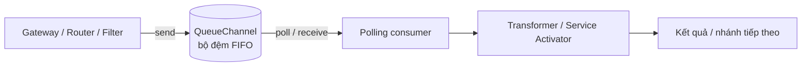
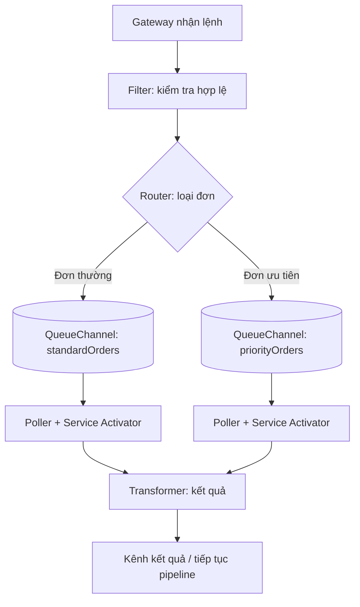

# QueueChannel và bộ đệm message trong Spring Integration

Trong hệ thống tích hợp, bên gửi thông điệp thường tạo dữ liệu theo nhịp khác với bên xử lý. Một API có thể nhận nhiều yêu cầu cùng lúc trong khi thao tác ghi cơ sở dữ liệu, gọi dịch vụ bên ngoài hoặc tổng hợp kết quả mất nhiều thời gian. **QueueChannel** là một loại *Message Channel* của Spring Integration cho phép **đưa Message vào hàng đợi và để phía nhận chủ động lấy ra xử lý**.

Đây là một lựa chọn quan trọng khi học **Enterprise Integration Patterns** với Spring Integration: kết hợp Gateway, Router, Filter, Transformer, Splitter, Aggregator, retry, error channel và correlation để xây dựng các luồng thông điệp ít phụ thuộc hơn, dễ mở rộng và có khả năng quan sát. Bài học tập trung vào cách QueueChannel làm bộ đệm, cách vận hành khi tải tăng, những giới hạn của hàng đợi trong bộ nhớ và cách kiểm thử một luồng có poller.

## 1. QueueChannel nằm ở đâu trong hệ thống Message?

Spring Integration sử dụng `Message<T>` để biểu diễn dữ liệu và `MessageChannel` để truyền thông điệp giữa các endpoint. Mỗi Message gồm:

- **Payload**: nội dung nghiệp vụ, chẳng hạn `OrderCommand`, `PaymentEvent` hoặc danh sách mã hàng.
- **Headers**: metadata như Message ID, timestamp, correlation ID và thông tin định tuyến.

`QueueChannel` triển khai giao diện **`PollableChannel`**. Bên gửi gọi `send(...)` để xếp Message vào kênh; bên nhận gọi `receive(...)` để lấy một Message ra. Message ở trong hàng đợi cho đến khi có bên nhận lấy, trong giới hạn bộ nhớ và dung lượng được cấu hình.



**Hai khái niệm cần tách biệt:**

1. **QueueChannel là nơi giữ Message chờ xử lý**, bản thân nó không tự khởi chạy một luồng xử lý nền.
2. **Poller hoặc mã gọi `receive()` mới là bên lấy Message**. Nếu không có consumer, dữ liệu vẫn nằm trong hàng đợi cho đến khi đầy hoặc ứng dụng dừng.

Điều này khác `DirectChannel`, nơi `send()` thường gọi trực tiếp handler được đăng ký trong luồng gọi hiện tại. `QueueChannel` ngăn cách thời điểm bên gửi đưa Message vào kênh với thời điểm bên nhận xử lý nó; đó là **tách biệt về thời gian**, nhưng không có nghĩa là ứng dụng đã sở hữu một message broker bền vững.

## 2. Cơ chế hàng đợi và các đặc tính nền tảng

Một `QueueChannel` mặc định dùng hàng đợi trong bộ nhớ theo nguyên tắc **FIFO** (*first in, first out*). Ở cấu hình thông thường, Message đến trước được lấy ra trước. Tuy nhiên, thứ tự **hoàn tất xử lý** có thể khác thứ tự lấy ra khi nhiều consumer thực thi song song.

| Thuộc tính | Hành vi điển hình | Hệ quả thiết kế |
| --- | --- | --- |
| Kiểu channel | `PollableChannel` | Consumer phải `receive()` trực tiếp hoặc được poller kích hoạt |
| Cách truyền | Producer `send`, consumer `receive` | Hai bên có thể chạy vào những thời điểm khác nhau |
| Bộ đệm | Hàng đợi trong bộ nhớ ở cấu hình thông thường | Giúp hấp thụ tải tăng ngắn hạn; có nguy cơ mất dữ liệu khi tiến trình dừng |
| Thứ tự | FIFO khi xếp/lấy Message khỏi hàng đợi | Không bảo đảm thứ tự hoàn tất nếu xử lý đồng thời |
| Phân phối | Mỗi thao tác lấy thành công đưa một Message ra khỏi queue | Không phải cơ chế phát một Message tới tất cả subscriber |
| Dung lượng | Có thể giới hạn bằng `capacity` | Đủ chỗ thì `send` nhận dữ liệu; đầy thì phải xử lý timeout / từ chối |
| Xử lý lỗi | Lỗi xảy ra **sau khi Message đã được lấy ra** | Cần thiết kế retry, error flow và phương án lưu thông điệp lỗi |

### PollableChannel và SubscribableChannel

Để chọn đúng loại channel, cần phân biệt:

| Channel | Cách tiêu thụ | Thích hợp khi |
| --- | --- | --- |
| `DirectChannel` | Đẩy trực tiếp đến subscriber; thường cùng luồng thực thi | Cần xử lý đồng bộ, đơn giản, phản hồi nhanh |
| `ExecutorChannel` | Chuyển việc gọi subscriber sang `TaskExecutor` | Muốn chuyển ranh giới thực thi sang thread khác |
| `QueueChannel` | Bên nhận **chủ động poll** | Cần bộ đệm, điều tiết tốc độ nhận và xử lý từng đợt |
| `PublishSubscribeChannel` | Phát tới nhiều subscriber | Nhiều nhánh cùng cần một sự kiện |
| `PriorityChannel` | Poll theo độ ưu tiên | Cần ưu tiên Message thay vì FIFO |

Không nên chọn QueueChannel chỉ vì muốn “bất đồng bộ”. Mọi luồng có queue vẫn phải xác định rõ **ai poll, poll nhanh đến đâu và xử lý lỗi thế nào**.

## 3. Tạo QueueChannel và thử send/receive

Ví dụ nhỏ dùng Java và Spring Integration:

```java
import org.springframework.integration.channel.QueueChannel;
import org.springframework.messaging.Message;
import org.springframework.messaging.support.MessageBuilder;

public class QueueChannelDemo {
    public static void main(String[] args) {
        QueueChannel queue = new QueueChannel(2); // chứa tối đa 2 Message

        Message<String> first = MessageBuilder
                .withPayload("ORDER-001")
                .setHeader("source", "web")
                .build();
        Message<String> second = MessageBuilder
                .withPayload("ORDER-002")
                .build();
        Message<String> third = MessageBuilder
                .withPayload("ORDER-003")
                .build();

        boolean accepted1 = queue.send(first, 0);
        boolean accepted2 = queue.send(second, 0);
        boolean accepted3 = queue.send(third, 100);

        System.out.println(accepted1); // true
        System.out.println(accepted2); // true
        System.out.println(accepted3); // false: queue đang đầy

        Message<?> received1 = queue.receive(0);
        Message<?> received2 = queue.receive(0);
        Message<?> received3 = queue.receive(0);

        System.out.println(received1.getPayload()); // ORDER-001
        System.out.println(received2.getPayload()); // ORDER-002
        System.out.println(received3 == null);      // true
    }
}
```

Constructor `new QueueChannel(2)` thiết lập **dung lượng tối đa hai Message trong queue**. Hai thao tác `send` đầu thành công; thao tác thứ ba phải chờ tối đa 100 ms rồi trả `false` nếu chưa có chỗ trống.

### Ý nghĩa của timeout

`QueueChannel` cung cấp API `MessageChannel.send(message, timeout)` và `PollableChannel.receive(timeout)`. Các giá trị thường dùng:

| Timeout | `send()` khi queue đầy | `receive()` khi queue rỗng |
| --- | --- | --- |
| `0` | Thử ngay; trả `false` nếu chưa thể xếp | Thử ngay; trả `null` nếu chưa có Message |
| Số dương, ví dụ `500` | Chờ tối đa 500 ms cho đến khi có chỗ | Chờ tối đa 500 ms cho đến khi có Message |
| `-1` | Có thể chờ vô thời hạn để xếp Message | Có thể chờ vô thời hạn để nhận Message |

Trong ứng dụng thực tế, nên dùng timeout hữu hạn ở điểm có yêu cầu thời gian phản hồi. Kết quả `false` cần được xử lý rõ ràng, chẳng hạn từ chối yêu cầu, phát tín hiệu quá tải hoặc chuyển sang cơ chế tiếp nhận đáng tin cậy khác. Không được coi `send()` trả `false` là thông điệp đã được chấp nhận.

Khi `receive(timeout)` trả `null`, đó là tình huống **không có Message trong khoảng chờ**; không nhất thiết là lỗi. Trước khi gọi `getPayload()`, hãy kiểm tra `null`.

## 4. Dung lượng bộ đệm và backpressure

Nếu producer tạo `λ` Message/giây còn consumer hoàn tất `μ` Message/giây, khi `λ > μ` trong thời gian dài thì số Message chờ sẽ tăng. Với queue có dung lượng `C`, thời gian gần đúng để đầy, khi queue ban đầu rỗng và tốc độ không đổi, là:

\[
t_{\text{fill}}\approx\frac{C}{\lambda-\mu}\quad(\lambda>\mu)
\]

Ví dụ: producer gửi 120 Message/giây; consumer xử lý 100 Message/giây; queue chứa tối đa 1.000 Message. Tồn đọng tăng khoảng 20 Message/giây và hàng đợi có thể đầy sau khoảng 50 giây nếu hai tốc độ giữ nguyên. Đây chỉ là mô hình gần đúng: sản xuất/xử lý thực thường biến động, có burst, retry và overhead.

### Bounded queue và unbounded queue

```java
QueueChannel bounded = new QueueChannel(500);
QueueChannel defaultQueue = new QueueChannel();
```

- **Bounded** (`new QueueChannel(500)`): giới hạn số Message chờ. Đây là lựa chọn nên cân nhắc cho luồng có khả năng quá tải để tránh bộ nhớ tăng vô hạn.
- **Mặc định** (`new QueueChannel()`): dùng bộ đệm trong bộ nhớ không có giới hạn dung lượng do ứng dụng đặt ra; thực tế vẫn bị giới hạn bởi tài nguyên tiến trình/JVM.

Dung lượng tính theo **số Message**, không phải số byte. Một queue chứa 1.000 payload nhỏ khác rất xa queue có 1.000 payload là các mảng dữ liệu lớn. Đừng chỉ nhìn số lượng Message mà bỏ qua kích thước và vòng đời của payload.

**Backpressure** ở đây không tự động xuyên suốt mọi tầng. Khi queue đầy, việc `send` chờ hoặc thất bại tạo tín hiệu áp lực lên producer đang gọi nó; Gateway, HTTP endpoint hoặc thành phần nhận upstream phải quyết định xử lý tín hiệu này như thế nào. Nếu producer cứ retry không giới hạn, tình trạng quá tải có thể nặng hơn.

### Quy tắc chọn capacity ban đầu

Có thể ước lượng dựa trên thời gian chờ backlog tối đa mà hệ thống chấp nhận:

\[
C \approx \text{tốc độ tiêu thụ ổn định} \times \text{thời gian chờ mục tiêu}
\]

Đây chỉ là điểm khởi đầu để thử tải. Cần đồng thời kiểm tra tốc độ burst, tài nguyên bộ nhớ, thời gian phản hồi `send`, số worker và ngưỡng cảnh báo. Capacity lớn không khắc phục tình trạng consumer luôn chậm hơn producer; nó chỉ làm chậm thời điểm chạm giới hạn.

## 5. Gắn QueueChannel với Poller và Service Activator

Trong ứng dụng Spring, ta thường khai báo `QueueChannel` như một bean và dùng **poller** để lấy Message theo lịch. Ví dụ sau sử dụng Spring Integration Java annotation configuration:

```java
import org.springframework.context.annotation.Bean;
import org.springframework.context.annotation.Configuration;
import org.springframework.integration.annotation.Poller;
import org.springframework.integration.annotation.ServiceActivator;
import org.springframework.integration.channel.QueueChannel;
import org.springframework.integration.config.EnableIntegration;
import org.springframework.messaging.Message;

@Configuration
@EnableIntegration
public class OrderQueueConfiguration {

    @Bean
    public QueueChannel orderQueue() {
        return new QueueChannel(100);
    }

    @ServiceActivator(
            inputChannel = "orderQueue",
            poller = @Poller(fixedDelay = "250", maxMessagesPerPoll = "10"))
    public void processOrder(Message<String> message) {
        String orderId = message.getPayload();
        System.out.println("Processing: " + orderId);
        // Thực hiện nghiệp vụ thực tế và xử lý ngoại lệ theo chính sách
    }
}
```

`orderQueue()` tạo một hàng đợi chứa tối đa 100 Message. `@ServiceActivator` khai báo endpoint nhận dữ liệu từ kênh tên `orderQueue`; `@Poller` cho phép endpoint ấy lấy tối đa 10 Message trong một lượt poll, với độ trễ cố định 250 ms giữa những lần poll theo lịch. **Cấu hình này không mặc nhiên tạo 10 thread song song**: `maxMessagesPerPoll` giới hạn số lần lấy Message trong mỗi lượt, còn concurrency phụ thuộc cấu hình scheduler, executor và handler.

Một producer có thể gửi Message như sau:

```java
import org.springframework.integration.channel.QueueChannel;
import org.springframework.messaging.support.MessageBuilder;

public class OrderProducer {
    private final QueueChannel orderQueue;

    public OrderProducer(QueueChannel orderQueue) {
        this.orderQueue = orderQueue;
    }

    public boolean submit(String orderId) {
        return orderQueue.send(
                MessageBuilder.withPayload(orderId)
                        .setHeader("businessOrderId", orderId)
                        .build(),
                300);
    }
}
```

Trong Spring Boot, `OrderProducer` cần được đăng ký là bean (chẳng hạn qua `@Component` hoặc `@Bean`) để Spring tự inject `orderQueue`. Giá trị trả về của `submit` cho biết Message **đã vào queue hay chưa**, chứ **không xác nhận rằng nghiệp vụ đã xử lý xong**.

### Poller giải quyết gì và chưa giải quyết gì?

Poller cung cấp nhịp tiêu thụ và gọi handler theo lịch. Nó không tự biến queue trong bộ nhớ thành hệ thống lưu trữ bền vững, không thay thế retry policy, cũng không bảo đảm rằng Message bị lỗi sẽ được đưa lại vào queue. Để kiểm soát throughput, có thể điều chỉnh chu kỳ poll, `maxMessagesPerPoll`, cấu hình executor và số replica, sau đó đo khả năng xử lý thực tế.

Nếu có nhiều consumer cùng lấy từ một queue, một Message thường chỉ được lấy bởi **một** consumer. Nhưng sau khi lấy ra, các consumer có thể xử lý song song nên thứ tự hoàn tất không còn là FIFO tuyệt đối.

## 6. Ghép QueueChannel vào Integration Flow

Một luồng mẫu xử lý đơn hàng:



Ở đây Router phân loại đơn hàng. QueueChannel đóng vai trò **bộ đệm giữa tầng nhận và tầng xử lý**; Poller điều tiết tốc độ từng nhánh. `Filter` có thể chặn thông điệp không hợp lệ trước khi xếp hàng, giúp tránh lãng phí dung lượng.

Các Enterprise Integration Patterns tương tác với QueueChannel như sau:

| Pattern | Cách phối hợp với QueueChannel | Điều cần kiểm soát |
| --- | --- | --- |
| Gateway | Gửi yêu cầu từ ứng dụng vào queue | Phân biệt “đã xếp hàng” với “đã xử lý”; timeout của lời gọi đồng bộ |
| Router | Điều hướng Message đến các queue khác nhau | Dung lượng, nhịp poll và độ ưu tiên của từng nhánh |
| Filter | Loại bỏ Message không đủ điều kiện trước/sau queue | Không để nhóm Aggregator chờ những phần tử đã bị loại bỏ |
| Transformer | Chuyển đổi payload trước khi xếp hoặc sau khi lấy | Bảo toàn metadata nghiệp vụ/correlation cần thiết |
| Splitter | Phát nhiều Message con, có thể đưa từng con vào queue | `correlationId`, `sequenceNumber`, `sequenceSize`, số lượng phần tử |
| Aggregator | Nhóm các phần tử được xử lý sau khi poll | Message đến muộn, timeout, release strategy và message store |
| Retry | Thử lại một thao tác thất bại của consumer | Số lần thử, backoff, idempotency, trường hợp vượt số lần |
| Error channel | Chuyển lỗi sang tuyến xử lý lỗi | Có log thông tin Message gốc và nơi lưu Message thất bại |

**Ví dụ correlation:** một đơn hàng có ba dòng; Splitter tạo ba Message con có cùng `correlationId` và các `sequenceNumber` lần lượt `1, 2, 3`. Đưa ba Message qua QueueChannel có thể làm chúng hoàn tất theo thứ tự khác nhau. Aggregator phải dựa vào correlation metadata và release strategy để gom đủ phần tử, không dựa vào thời điểm Message được xử lý xong.

Khi có Filter loại bỏ một phần tử sau Splitter, Aggregator vẫn có thể chờ đủ `sequenceSize` ban đầu. Phải xử lý tình huống này ở thiết kế luồng: lọc trước khi split, cập nhật điều kiện hoàn tất, hoặc xử lý nhóm hết hạn.

## 7. Điều gì xảy ra khi ứng dụng dừng hoặc consumer lỗi?

Đây là giới hạn quan trọng nhất của QueueChannel thông thường.

### 7.1. Queue trong bộ nhớ không phải hàng đợi bền vững

Nếu tiến trình JVM dừng hoặc bị kill, các Message chỉ tồn tại trong bộ nhớ sẽ mất. Khi triển khai nhiều instance, mỗi instance thường có **queue nội bộ riêng**, không tạo thành một hàng đợi chung của cả cụm.

Nếu cần giữ Message qua khởi động lại, trao đổi giữa nhiều dịch vụ hoặc xác nhận xử lý từ broker, hãy thiết kế bộ lưu trữ/chuyển phát phù hợp như JMS, AMQP, Kafka hoặc cơ chế message store của Spring Integration với cấu hình tương ứng. Việc dùng lưu trữ bền vững cần được kiểm tra cả giao dịch, phục hồi, serialization và chiến lược tiêu thụ; không thể chỉ đổi một cấu hình và mặc định có exactly-once.

### 7.2. Lấy Message ra không đồng nghĩa đã xử lý thành công

Với QueueChannel trong bộ nhớ, thao tác `receive()` đưa Message **ra khỏi hàng đợi**. Nếu handler gọi dịch vụ bên ngoài rồi lỗi, Message không tự xuất hiện lại trong queue chỉ vì handler ném exception.

```text
QueueChannel (có Message A)
         |
     receive(A)
         |        QueueChannel đã không còn A
      handler
         |
       lỗi!
         |
   retry / error flow / lưu lỗi do ứng dụng cấu hình
```

Đây là lý do mỗi consumer cần quy tắc xử lý lỗi rõ ràng: thử lại có giới hạn, đưa sự kiện lỗi đến error flow, lưu thông điệp để xử lý thủ công hoặc chuyển sang kênh dead-letter khi hạ tầng hỗ trợ.

### 7.3. Retry và idempotency

Retry có thể gây lặp thao tác nghiệp vụ. Ví dụ handler đã ghi đơn hàng vào database nhưng lỗi ở bước gọi dịch vụ kế tiếp; retry toàn bộ handler có thể ghi đơn hàng thêm lần nữa.

Giải pháp thường là:

1. Đặt **khóa idempotency** ổn định, chẳng hạn `eventId` hoặc `orderId + operationType`.
2. Kiểm tra và ghi nhận trạng thái xử lý bằng thao tác đủ tính nguyên tử.
3. Giới hạn số lần retry, có backoff phù hợp và lưu lý do lỗi cuối cùng.
4. Theo dõi Message lỗi hoặc nhóm Aggregator chưa hoàn tất để xử lý tiếp.

`MessageHeaders.ID` của một Message chỉ giúp quan sát Message đó; nếu cùng một sự kiện được tạo thành Message mới, ID có thể khác. Do đó, không nên dùng riêng Message ID làm khóa chống trùng xuyên lần gửi hay xuyên dịch vụ.

## 8. Theo dõi queue khi chạy thực tế

Một queue có thể hoạt động đúng nhưng vẫn làm hệ thống chậm khi backlog tích tụ. Hãy giám sát cả phía producer, queue và consumer:

| Chỉ số | Ý nghĩa | Dấu hiệu cần xem xét |
| --- | --- | --- |
| Queue depth | Số Message đang chờ | Tăng liên tục trong một khoảng dài |
| Capacity utilization | Tỷ lệ chiếm dụng so với dung lượng | Tiến sát giới hạn hoặc thường xuyên đầy |
| Enqueue rate | Số Message được chấp nhận mỗi giây | Tăng đột biến vượt công suất tiêu thụ |
| Dequeue / success rate | Số Message lấy ra và xử lý thành công | Thấp hơn tốc độ enqueue trong thời gian dài |
| Oldest message age | Thời gian Message cũ nhất chờ trong queue | Quá SLA chờ xử lý |
| Send timeout / rejection | Số lần producer không xếp Message được | Backpressure đã tác động lên upstream |
| Handler latency | Thời gian xử lý của handler | Dịch vụ phụ thuộc hoặc database bị chậm |
| Retry / error count | Số lần thử lại và số Message lỗi | Lỗi lặp hoặc cấu hình xử lý lỗi chưa phù hợp |

Có thể dùng Micrometer, Spring Boot Actuator và các công cụ giám sát thích hợp để thu thập chỉ số tại producer, poller và handler. Không nên giả định mọi chỉ số đều được xuất sẵn ở mọi phiên bản/cấu hình; một số cần tạo metric tùy chỉnh.

Đối với log, thông tin thường hữu ích gồm `messageId`, `correlationId`, khóa nghiệp vụ, tên channel, thời điểm enqueue/dequeue, số lần thử và kết quả. Không log toàn bộ payload nếu chứa thông tin nhạy cảm hoặc dung lượng lớn.

## 9. Kiểm thử QueueChannel và nhánh xử lý

### 9.1. Kiểm tra hoạt động cơ bản

Dùng queue nhỏ để xác minh chính xác hành vi:

```java
import static org.junit.jupiter.api.Assertions.*;

import org.junit.jupiter.api.Test;
import org.springframework.integration.channel.QueueChannel;
import org.springframework.messaging.Message;
import org.springframework.messaging.support.MessageBuilder;

class QueueChannelTest {

    @Test
    void shouldBufferInFifoOrderAndRejectWhenFull() {
        QueueChannel queue = new QueueChannel(2);

        assertTrue(queue.send(MessageBuilder.withPayload("A").build(), 0));
        assertTrue(queue.send(MessageBuilder.withPayload("B").build(), 0));
        assertFalse(queue.send(MessageBuilder.withPayload("C").build(), 0));

        Message<?> first = queue.receive(0);
        Message<?> second = queue.receive(0);

        assertNotNull(first);
        assertNotNull(second);
        assertEquals("A", first.getPayload());
        assertEquals("B", second.getPayload());
        assertNull(queue.receive(0));
    }
}
```

Đây là bài kiểm thử đơn vị chỉ cho `QueueChannel`, không cần khởi động toàn bộ Spring context. Nó chứng minh queue hữu hạn nhận hai Message, từ chối Message thứ ba khi đầy và phát lại theo thứ tự FIFO ở một consumer.

### 9.2. Kiểm thử pipeline có poller

Với cấu hình `OrderQueueConfiguration` ở mục 5, bài kiểm thử tích hợp nên xác nhận:

- Gửi Message qua channel thành công; handler được gọi qua poller trong khoảng thời gian chờ hữu hạn.
- Khi producer gửi nhiều Message, số lần handler nhận và kết quả nghiệp vụ khớp với số Message **đã được queue chấp nhận**.
- Khi queue đầy, producer nhận `false` hoặc chính sách từ chối được kích hoạt đúng.
- Khi handler lỗi, thông điệp đi theo retry/error flow đã cấu hình; không coi Message đã lấy ra là chắc chắn xử lý thành công.
- Với hai loại đơn được Router chia nhánh, Message vào đúng queue và consumer tương ứng.
- Với Splitter/Aggregator, kiểm tra correlation metadata và kết quả ghép sau khi các nhánh được xử lý.

Nên tránh `Thread.sleep()` cố định trong test bất đồng bộ. Hãy đợi một điều kiện rõ ràng với timeout và báo thất bại nếu không đạt được.

### 9.3. Thử tải và khôi phục lỗi

Thiết lập tốc độ producer cao hơn consumer một cách có kiểm soát, đo thời gian queue đầy và phản hồi của upstream. Sau đó thử tạm dừng consumer, khởi động lại ứng dụng và tạo lỗi ở handler để xác định đúng những gì còn trong queue, những gì đã xử lý và những gì cần gửi lại. Những thử nghiệm này đặc biệt quan trọng trước khi đưa QueueChannel vào luồng nghiệp vụ cần độ tin cậy cao.

## 10. Lỗi thiết kế thường gặp và cách phòng tránh

| Hiện tượng | Nguyên nhân có thể | Cách xử lý |
| --- | --- | --- |
| Message vào queue nhưng không được xử lý | Không cấu hình consumer/poller, poller dừng hoặc sai tên channel | Kiểm tra bean channel, poller, endpoint và log khởi động |
| API bị treo hoặc chậm | Producer chờ `send()` khi queue đầy hoặc Gateway chờ reply | Đặt timeout và thông báo quá tải phù hợp |
| Ứng dụng tăng RAM liên tục | Queue không giới hạn hoặc payload quá lớn | Giới hạn capacity, giảm payload, theo dõi backlog |
| Dữ liệu mất khi restart | Message chỉ nằm trong bộ nhớ | Dùng hạ tầng lưu trữ/chuyển phát bền vững nếu yêu cầu |
| Message biến mất sau lỗi handler | Message đã bị `receive()` lấy ra | Cấu hình retry, error flow và nơi lưu Message lỗi |
| Kết quả xử lý không theo thứ tự | Nhiều consumer cùng lấy Message hoặc các nhánh xử lý khác thời gian | Thiết kế thứ tự tại tầng nghiệp vụ hoặc phân vùng xử lý |
| Gộp thiếu hoặc lẫn nhóm | Sai `correlationId`, thiếu phần tử từ Splitter/Filter | Kiểm tra header và release/expiry strategy của Aggregator |
| Cùng nghiệp vụ bị thực thi nhiều lần | Retry hoặc upstream phát lại cùng event | Dùng idempotency key và lưu trạng thái xử lý |

## 11. Khi nào nên dùng QueueChannel?

**QueueChannel phù hợp** khi một ứng dụng Spring Integration cần bộ đệm **nội bộ** giữa hai giai đoạn, thời gian chờ xử lý ngắn, có consumer chủ động poll và chấp nhận được đặc tính lưu trong bộ nhớ hoặc có giải pháp message store riêng.

**Nên cân nhắc phương án khác** khi cần phát thông điệp cho nhiều subscriber, thứ tự ưu tiên, truyền bền vững giữa các tiến trình hoặc một broker dùng chung cho nhiều replica. Trong những tình huống đó, các channel khác hoặc adapter tới JMS, AMQP, Kafka có thể phản ánh yêu cầu hệ thống tốt hơn.

Khi thiết kế một Message Channel, bốn câu hỏi luôn cần được trả lời rõ: **Ai gửi? Ai lấy Message? Bộ đệm đầy thì sao? Consumer lỗi thì Message đi đâu?** Nếu có câu trả lời cụ thể cùng kiểm thử và giám sát phù hợp, QueueChannel sẽ giúp luồng Spring Integration hấp thụ tải ngắn hạn và tách nhịp gửi/nhận một cách có kiểm soát.
