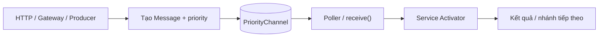
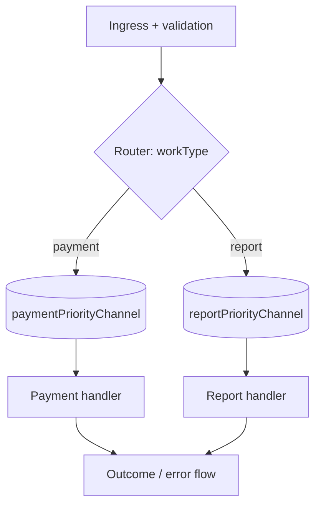

# PriorityChannel và thứ tự theo priority trong Spring Integration

## Mục tiêu học tập

Trong hệ thống trao đổi thông điệp, không phải yêu cầu nào cũng cần được xử lý theo đúng thứ tự đến. Một sự cố thanh toán có thể cần xử lý trước một tác vụ đồng bộ báo cáo, dù báo cáo được gửi vào hàng đợi sớm hơn. **PriorityChannel** của Spring Integration cho phép người tiêu thụ lấy những message đang chờ theo mức ưu tiên.

Bài học thuộc chương **Message channel**, trong phạm vi **SPRING_INTEGRATION_PATTERN**: triển khai Enterprise Integration Patterns (EIP) với Spring Integration để tạo luồng thông điệp ít phụ thuộc, dễ mở rộng; phối hợp Router, Filter, Transformer, Splitter, Aggregator, Gateway, retry, error channel và correlation; đồng thời kiểm thử và theo dõi từng nhánh.

Sau bài này, bạn có thể:

- Phân biệt thứ tự **được gửi vào** và thứ tự **được lấy ra** của `QueueChannel` và `PriorityChannel`.
- Sử dụng header `priority`, `PollableChannel` và poller đúng vai trò.
- Cấu hình `PriorityChannel` bằng Java DSL hoặc XML, có giới hạn dung lượng.
- Xây `Comparator<Message<?>>` để điều chỉnh cách xếp ưu tiên và xử lý trường hợp đồng hạng.
- Viết kiểm thử xác nhận quy tắc ưu tiên mà không phụ thuộc vào thời điểm chạy của thread.
- Nhận diện starvation, backpressure, rủi ro với nhiều consumer, retry, correlation và message store.

## 1. Vì sao cần PriorityChannel?

`QueueChannel` thông thường lấy message theo thứ tự vào trước, ra trước (FIFO). `PriorityChannel` vẫn là một hàng đợi cho message, nhưng chọn phần tử được lấy ra dựa trên **độ ưu tiên**, mặc định đọc từ header `priority`.

Ví dụ hệ thống nhận ba tác vụ:

| Thứ tự gửi vào | Tác vụ | Header `priority` |
| --- | --- | ---: |
| 1 | Tạo báo cáo ngày | 1 |
| 2 | Xác nhận đơn hàng | 5 |
| 3 | Xử lý gian lận khẩn cấp | 10 |

Giả sử **cả ba message đã nằm trong queue trước khi consumer gọi `receive()`**, thứ tự lấy ra theo cấu hình ưu tiên mặc định là:

```text
Gửi vào:   report (1)  --->  order (5)  --->  fraud (10)
                                              |
Queue đang chứa: [report (1), order (5), fraud (10)]
                                              |
Lấy ra:    fraud (10) --->  order (5)  --->  report (1)
```

**Giá trị priority lớn hơn có thứ tự ưu tiên cao hơn**. Đây là thứ tự chọn trong số các message **đang còn chờ trong channel**. Nó không có nghĩa message đến muộn sẽ giành lại một tác vụ đã được consumer lấy ra và đang xử lý.

### Ba khái niệm dễ nhầm

| Khái niệm | Ý nghĩa | Hệ quả |
| --- | --- | --- |
| **Arrival order** | Thứ tự producer gọi `send()` thành công | Không quyết định thứ tự lấy ra của `PriorityChannel`. |
| **Dequeue order** | Thứ tự các lời gọi `receive()` lấy message đang chờ | Do comparator của channel quyết định. |
| **Completion order** | Thứ tự handler hoàn tất tác vụ | Còn phụ thuộc thời gian xử lý, retry, thread pool và I/O; có thể khác dequeue order. |

`PriorityChannel` cung cấp quy tắc **dequeue**, không phải một bộ điều phối có khả năng ngắt tác vụ đang chạy (*preemption*), cũng không phải cơ chế bảo đảm hoàn tất công việc theo đúng thứ tự ưu tiên.

## 2. Cách PriorityChannel hoạt động

`PriorityChannel` thuộc gói `org.springframework.integration.channel`, là một triển khai dựa trên `QueueChannel` và thực hiện giao diện `PollableChannel`. Producer gửi một `Message<?>` vào channel; consumer chủ động nhận bằng `receive()`, hoặc Spring Integration dùng **polling endpoint** để gọi nhận theo lịch.



Bên trong message thường có:

```text
Message
  payload = WorkItem(id="W-42", type="FRAUD_CHECK")
  headers:
    priority      = 10
    correlationId = "batch-8"
    traceId       = "trace-91"
```

- `payload` mô tả nghiệp vụ cần làm.
- `priority` phục vụ **chọn thứ tự lấy message khỏi channel**.
- `traceId` hỗ trợ theo dõi xuyên suốt các endpoint.
- `correlationId` hỗ trợ liên kết một nhóm message, chẳng hạn trong Splitter/Aggregator. Nó **không tự động đồng nghĩa** với priority.

### Header priority cần đúng kiểu

Header mặc định mang tên `priority` và nên được đặt bằng số nguyên `Integer`, ví dụ qua `MessageBuilder.setHeader("priority", 10)`. Đừng dùng chuỗi `"10"` rồi trông chờ framework tự đổi kiểu. Nếu nhận priority từ HTTP, Kafka hay đầu vào người dùng, hãy chuẩn hóa, xác thực và giới hạn khoảng giá trị trước khi gửi vào channel.

Nếu một message **thiếu** header hoặc giá trị không hợp lệ, đừng xây hợp đồng nghiệp vụ dựa vào thứ tự suy đoán. Nên chủ động gán priority mặc định ở ingress và kiểm thử đúng phiên bản Spring Integration đang sử dụng.

## 3. Ví dụ Java nhỏ: quan sát thứ tự lấy ra

Ví dụ sau chủ động gửi đủ ba message **trước khi nhận**, vì vậy kết quả không bị ảnh hưởng bởi poller hoặc xử lý bất đồng bộ.

```java
import org.springframework.integration.channel.PriorityChannel;
import org.springframework.messaging.Message;
import org.springframework.messaging.support.MessageBuilder;

public class PriorityChannelDemo {

    private static Message<String> task(String name, int priority) {
        return MessageBuilder.withPayload(name)
            .setHeader("priority", priority)
            .build();
    }

    public static void main(String[] args) {
        PriorityChannel channel = new PriorityChannel(10);

        channel.send(task("report", 1));
        channel.send(task("order", 5));
        channel.send(task("fraud", 10));

        System.out.println(channel.receive(0).getPayload()); // fraud
        System.out.println(channel.receive(0).getPayload()); // order
        System.out.println(channel.receive(0).getPayload()); // report
    }
}
```

Ở đây:

1. `new PriorityChannel(10)` tạo channel có **capacity = 10**.
2. `send()` nhận message và đưa vào hàng đợi.
3. `receive(0)` thử lấy message **ngay lập tức**, không chờ nếu queue trống.
4. Comparator mặc định chọn priority cao trước.

Số `10` trong constructor là **sức chứa**, không phải mức priority mặc định hoặc số consumer. Khi channel không còn message, `receive(0)` trả về `null`; ví dụ trên không gặp trường hợp này vì đã gửi đủ ba message.

### So sánh nhanh với các loại channel

| Channel | Ai nhận message? | Quy tắc thứ tự nổi bật | Trường hợp sử dụng |
| --- | --- | --- | --- |
| `DirectChannel` | Handler được gọi qua cơ chế subscribe/dispatch | Gọi handler đồng bộ; không tạo hàng đợi ưu tiên | Chuyển tiếp trực tiếp, cần transaction cùng thread. |
| `QueueChannel` | Consumer/poller gọi `receive()` | FIFO cho các message đang chờ | Buffer công việc thông thường. |
| `PriorityChannel` | Consumer/poller gọi `receive()` | Theo priority/comparator cho các message đang chờ | Ưu tiên công việc khẩn cấp. |
| `PublishSubscribeChannel` | Các subscriber | Phát đến nhiều subscriber; không xếp hàng theo priority | Fan-out sự kiện. |

Lưu ý: `PriorityChannel` chỉ thay đổi chiến lược xếp hàng; không tự động thực hiện Router, Filter hoặc xử lý lỗi thay cho các endpoint.

## 4. Cấu hình một luồng thực tế bằng Spring Integration

Giả sử ứng dụng cần đưa tác vụ vào hàng đợi ưu tiên, sau đó một handler xử lý. Ta dùng:

- Một **IntegrationFlow** nhận đầu vào và chuyển nhãn nghiệp vụ thành header `priority`.
- Một bean **PriorityChannel** có dung lượng hữu hạn.
- Một **polling service activator** lấy message khỏi channel.

```java
import org.springframework.context.annotation.Bean;
import org.springframework.context.annotation.Configuration;
import org.springframework.integration.channel.PriorityChannel;
import org.springframework.integration.config.EnableIntegration;
import org.springframework.integration.annotation.Poller;
import org.springframework.integration.annotation.ServiceActivator;
import org.springframework.integration.dsl.IntegrationFlow;
import org.springframework.messaging.Message;

@Configuration
@EnableIntegration
public class PriorityWorkFlowConfig {

    @Bean("taskPriorityQueue")
    public PriorityChannel taskPriorityQueue() {
        return new PriorityChannel(100);
    }

    @Bean
    public IntegrationFlow taskIngressFlow() {
        return IntegrationFlow.from("taskIngress")
            .enrichHeaders(h -> h.headerFunction("priority", message -> {
                Object severity = message.getHeaders().get("severity");

                if ("CRITICAL".equals(severity)) {
                    return 100;
                }
                if ("HIGH".equals(severity)) {
                    return 50;
                }
                return 10;
            }))
            .channel("taskPriorityQueue")
            .get();
    }

    @ServiceActivator(
        inputChannel = "taskPriorityQueue",
        poller = @Poller(fixedDelay = "200", maxMessagesPerPoll = "1")
    )
    public void handleTask(Message<String> message) {
        String task = message.getPayload();
        int priority = (Integer) message.getHeaders().get("priority");

        // Gọi dịch vụ nghiệp vụ; có thể truy vết bằng traceId.
        System.out.printf("Handling %s (priority=%d)%n", task, priority);
    }
}
```

Mã trên thể hiện **ý tưởng wiring của các thành phần**. Một luồng khác có thể gửi message vào channel `taskIngress`, chẳng hạn:

```java
Message<String> incoming = MessageBuilder.withPayload("order-42")
    .setHeader("severity", "CRITICAL")
    .setHeader("traceId", "trace-42")
    .build();

taskIngress.send(incoming);
```

Trong đoạn gửi này, `taskIngress` là một `MessageChannel` được inject từ Spring context; ví dụ cần import `org.springframework.messaging.MessageChannel` và `org.springframework.messaging.support.MessageBuilder` cùng các kiểu message liên quan. Header enricher quy đổi `CRITICAL` → `100`, `HIGH` → `50`, còn lại → `10` trước khi đặt message vào queue.

**Vì sao phải có poller?** `PriorityChannel` thuộc nhóm `PollableChannel` nên nó không chủ động gọi subscriber theo cách của `DirectChannel`. Một handler dùng `@ServiceActivator` muốn nhận từ channel này cần cấu hình poller (hoặc một cơ chế nhận chủ động tương đương). `fixedDelay` quyết định nhịp poll và `maxMessagesPerPoll` giới hạn số message cho mỗi lần poll; chúng không thay thế chính sách priority.

### Cấu hình bằng XML

Nếu dự án dùng XML thay cho Java configuration, định nghĩa queue tương đương là:

```xml
<int:channel id="taskPriorityQueue">
    <int:priority-queue capacity="100"/>
</int:channel>
```

Đoạn XML giả định namespace Spring Integration `int` đã được khai báo. Tài liệu chính thức cũng hỗ trợ cấu hình comparator, kiểu payload được chấp nhận (`datatype`) và lựa chọn message store tương thích.

## 5. Đồng hạng priority: không mặc nhiên là FIFO

Hai tác vụ có cùng priority tạo ra một tình huống khác:

```text
A(priority=5) -> gửi trước
B(priority=5) -> gửi sau
```

Với comparator chỉ so sánh priority, kết quả so sánh của A và B bằng nhau. **Không nên giả định channel bảo đảm FIFO cho những message có priority bằng nhau.** Nếu nghiệp vụ yêu cầu “priority cao trước; cùng priority thì vào trước ra trước”, hãy định nghĩa quy tắc thứ cấp rõ ràng.

Một cách là gắn số thứ tự tại **điểm nhận vào** và dùng comparator:

```java
import java.util.Comparator;
import java.util.concurrent.atomic.AtomicLong;

import org.springframework.integration.channel.PriorityChannel;
import org.springframework.messaging.Message;
import org.springframework.messaging.support.MessageBuilder;

public class StablePriorityQueueFactory {

    private final AtomicLong sequence = new AtomicLong();

    public Message<String> newTask(String body, int priority) {
        return MessageBuilder.withPayload(body)
            .setHeader("priority", priority)
            .setHeader("enqueueSequence", sequence.incrementAndGet())
            .build();
    }

    public PriorityChannel createChannel() {
        Comparator<Message<?>> byPriorityThenSequence =
            Comparator.<Message<?>>comparingInt(m ->
                    ((Number) m.getHeaders().get("priority")).intValue())
                .reversed()
                .thenComparingLong(m ->
                    ((Number) m.getHeaders().get("enqueueSequence"))
                        .longValue());

        return new PriorityChannel(100, byPriorityThenSequence);
    }
}
```

Quy tắc ở đây:

1. Priority **giảm dần**: `100` trước `50` trước `10`.
2. Khi priority bằng nhau, `enqueueSequence` **tăng dần**: số nhỏ được lấy trước.
3. Mọi message phải có header `priority` và `enqueueSequence` đúng kiểu khi đi vào comparator.

`AtomicLong` chỉ cấp thứ tự đơn điệu **trong một instance ứng dụng**. Nếu nhiều producer chạy trên nhiều node, cần cơ chế cấp số thứ tự thống nhất hoặc chọn một yêu cầu ordering khác. Không dùng timestamp với độ phân giải thấp làm tiêu chí tie-breaker duy nhất nếu thật sự cần thứ tự chặt chẽ.

**Comparator phải nhất quán, có tính bắc cầu và dựa trên dữ liệu không thay đổi khi message đang nằm trong queue.** Tránh so sánh dựa trên “thời điểm hiện tại”, dữ liệu có thể bị thay đổi hoặc trạng thái bên ngoài; thứ tự của cấu trúc hàng đợi có thể trở nên khó dự đoán.

## 6. Capacity, backpressure và timeout

Một hàng đợi ưu tiên vẫn phải có **giới hạn tài nguyên**. Nếu producer gửi nhanh hơn consumer xử lý, queue có thể tăng liên tục và gây áp lực bộ nhớ. Cấu hình capacity hữu hạn giúp tạo tín hiệu **backpressure**.

```java
PriorityChannel queue = new PriorityChannel(2);

boolean first  = queue.send(task("A", 1), 0);
boolean second = queue.send(task("B", 5), 0);
boolean third  = queue.send(task("C", 9), 0);
```

Giả sử chưa có consumer và queue khởi đầu rỗng:

- `first` và `second` thành công.
- `third` thất bại vì đã đầy, khi dùng timeout bằng `0` để không chờ.
- Nếu dùng một timeout dương, producer có thể đợi đến khi có chỗ trống hoặc hết thời gian.
- Nếu dùng biến thể không chỉ định timeout, có nguy cơ bị chặn lâu khi queue luôn đầy; cần xem hợp đồng của API và cách endpoint gửi trong dự án.

Trong hệ thống thực tế, thất bại khi gửi phải được xử lý chủ động (trả lỗi upstream, retry với backoff, đẩy sang kênh lưu dự phòng hoặc báo quá tải); không bỏ qua giá trị trả về của `send()`.

**Không nên hiểu “priority cao” là có thể vượt qua giới hạn capacity.** Một queue đầy có thể khiến message khẩn cấp mới đến bị từ chối trước khi được xếp hạng. Nếu cần dành dung lượng riêng cho công việc khẩn, hãy cân nhắc nhiều queue hoặc quy tắc admission control riêng.

## 7. Ảnh hưởng đến các Enterprise Integration Patterns khác

Priority nằm ở **Message Channel**; các endpoint EIP quyết định **đưa message nào vào channel** và **làm gì sau khi nhận**. Vì vậy cần thiết kế priority cùng toàn bộ flow.

| Pattern / endpoint | Cách kết hợp | Rủi ro cần tránh |
| --- | --- | --- |
| **Router** | Chia tác vụ theo loại, khu vực hoặc SLA rồi đưa vào các channel ưu tiên riêng. | Một queue chung có thể khiến tất cả tenant bị chi phối bởi một loại tác vụ. |
| **Filter** | Loại message không hợp lệ trước khi vào queue. | Header priority từ nguồn ngoài chưa được xác thực có thể “đẩy lên” tác vụ không đáng tin. |
| **Transformer** | Chuyển đổi payload; giữ header `priority` nếu các bước sau vẫn cần. | Handler tự dựng `Message<?>` nhưng làm mất header. |
| **Splitter** | Các message con có thể dùng priority phù hợp với nhiệm vụ con. | Một request lớn tạo rất nhiều phần ưu tiên cao có thể chiếm queue. |
| **Aggregator** | Gom message theo `correlationId` và release strategy, không theo priority đơn thuần. | Message con ưu tiên thấp đến muộn có thể khiến cả nhóm bị giữ lại lâu. |
| **Gateway** | Caller có thể cung cấp dữ liệu để tính priority ở ingress. | Gateway đồng bộ vẫn có timeout; ưu tiên cao không đồng nghĩa trả lời ngay. |
| **Retry / error channel** | Retry thất bại có kiểm soát; lưu `traceId` và khóa correlation để phân tích. | Retry liên tục một message ưu tiên cao có thể chặn thông lượng của message khác. |

### Ví dụ với Router và các nhánh xử lý



Nếu thanh toán có SLA nghiêm ngặt còn báo cáo chạy theo lô, hai hàng đợi và hai nhóm consumer có thể dễ điều tiết hơn một hàng đợi priority duy nhất. Chỉ thêm `priority` không giải quyết mọi bài toán về cô lập nguồn lực hoặc fairness.

### Thứ tự trong Splitter/Aggregator

Khi một request được tách thành nhiều phần rồi gom lại, **thứ tự xử lý** có thể thay đổi vì priority và concurrency. Nếu kết quả yêu cầu thứ tự ban đầu, hãy sử dụng các thông tin nhóm như `correlationId`, `sequenceNumber` và quy tắc tổng hợp/sắp xếp có chủ đích. Không dùng thứ tự mà `Aggregator` nhận message làm đại diện cho thứ tự các phần tử trong payload gốc.

## 8. Các giới hạn quan trọng của ordering

### 8.1. Message đang xử lý không bị ngắt

Giả sử consumer đã lấy tác vụ priority `1` và đang chạy mất 5 giây. Sau đó message priority `100` được gửi vào queue. Message mới có thể được chọn **ở lần nhận tiếp theo**, nhưng `PriorityChannel` không ngắt handler đang chạy để xử lý nó trước.

Nếu yêu cầu độ trễ rất thấp cho tác vụ khẩn, hãy thiết kế **capacity xử lý** phù hợp, có thể tách queue và consumer thay vì chỉ tăng giá trị priority.

### 8.2. Nhiều consumer không bảo đảm completion order

Với nhiều poller/worker hoặc xử lý bất đồng bộ, message priority cao có thể được lấy trước nhưng hoàn tất sau message khác vì độ dài tác vụ khác nhau. Nếu cần thứ tự hoàn tất tuyệt đối hoặc thứ tự theo cùng `orderId`, phải dùng thêm cơ chế tuần tự theo khóa, giới hạn concurrency hoặc một bộ điều phối riêng.

### 8.3. Starvation

Nếu message priority cao liên tục đến, message priority thấp có thể phải chờ rất lâu, thậm chí không bao giờ được lấy ra khi lưu lượng cao kéo dài. Đây là **starvation**.

Các hướng giảm thiểu:

- Giới hạn lưu lượng/định mức mỗi nhóm priority hoặc mỗi tenant.
- Phân tách queue cho nhóm công việc có SLA khác nhau.
- Dùng lịch lấy cân bằng theo tỷ lệ (*weighted scheduling*) bên ngoài một PriorityChannel đơn lẻ.
- Thiết kế chính sách “aging” để nâng dần priority khi chờ lâu. Muốn áp dụng trong queue đã có phần tử, cần cơ chế xếp hàng lại/điều phối rõ ràng; **chỉ dùng comparator đọc thời gian hiện tại không bảo đảm queue tự sắp xếp lại**.
- Theo dõi độ trễ **theo từng mức priority**, không chỉ độ trễ trung bình.

### 8.4. Priority nội bộ khác priority giữa các dịch vụ

Một `PriorityChannel` trong tiến trình Java không tự truyền quy tắc sắp xếp sang Kafka, AMQP, JMS hoặc HTTP. Adapter có thể map header sang metadata của giao thức, nhưng broker hoặc consumer phía nhận vẫn có chính sách xếp hàng riêng. Cần kiểm thử tại ranh giới thật khi hệ thống sử dụng nhiều dịch vụ.

### 8.5. In-memory queue và lưu bền vững

Cấu hình queue mặc định phù hợp với xử lý trong tiến trình nhưng không tự bảo đảm message còn lại sau khi ứng dụng dừng đột ngột. Spring Integration có tùy chọn message store hỗ trợ priority qua `PriorityCapableChannelMessageStore` (tùy phiên bản, có các hiện thực như JDBC/Redis/MongoDB). Khi dùng message store, cách cấu hình `comparator` và `capacity` có ràng buộc khác queue in-memory; cần theo tài liệu phiên bản đang vận hành.

Một hàng đợi bền vững cũng không tự tạo bảo đảm **exactly-once processing**. Vẫn cần thiết kế idempotency, retry và kiểm soát trạng thái nghiệp vụ.

## 9. Kiểm thử: ưu tiên phải được chứng minh tại thời điểm dequeue

Để kiểm thử ưu tiên, hãy tạo queue độc lập, **gửi hết dữ liệu trước**, rồi nhận lần lượt. Tránh bật poller chạy nền ngay trong bài test ordering cơ bản vì consumer có thể lấy message thấp trước khi message cao được gửi.

```java
import static org.assertj.core.api.Assertions.assertThat;

import org.junit.jupiter.api.Test;
import org.springframework.integration.channel.PriorityChannel;
import org.springframework.messaging.Message;
import org.springframework.messaging.support.MessageBuilder;

class PriorityChannelTest {

    private Message<String> msg(String payload, int priority) {
        return MessageBuilder.withPayload(payload)
            .setHeader("priority", priority)
            .build();
    }

    @Test
    void dequeuesHighestPriorityFirst() {
        PriorityChannel queue = new PriorityChannel(8);

        assertThat(queue.send(msg("low", 1))).isTrue();
        assertThat(queue.send(msg("high", 10))).isTrue();
        assertThat(queue.send(msg("medium", 5))).isTrue();

        assertThat(queue.receive(0).getPayload()).isEqualTo("high");
        assertThat(queue.receive(0).getPayload()).isEqualTo("medium");
        assertThat(queue.receive(0).getPayload()).isEqualTo("low");
        assertThat(queue.receive(0)).isNull();
    }

    @Test
    void refusesNewMessageWhenBoundedQueueIsFull() {
        PriorityChannel queue = new PriorityChannel(1);

        assertThat(queue.send(msg("first", 1), 0)).isTrue();
        assertThat(queue.send(msg("second", 100), 0)).isFalse();

        assertThat(queue.receive(0).getPayload()).isEqualTo("first");
    }
}
```

Các assertion nêu đúng hai hợp đồng:

1. **Trong các message còn nằm trong queue**, priority cao được chọn trước.
2. **Queue đầy** không tự dành chỗ cho message mới có priority cao hơn.

Với comparator thứ cấp `enqueueSequence`, cần kiểm thử riêng khi hai message bằng priority và xác nhận message có sequence nhỏ được lấy trước. Với flow tích hợp đầy đủ, nên thêm test xác thực việc tính header priority, xử lý timeout, retry và bảo toàn `traceId` sau Transformer/Router.

## 10. Quan sát vận hành và chẩn đoán sự cố

Các chỉ số đáng theo dõi:

| Chỉ số | Ý nghĩa thực tiễn |
| --- | --- |
| Độ sâu queue / mức sử dụng capacity | Phát hiện áp lực bộ nhớ và nghẽn producer. |
| Thời gian chờ trong queue theo priority | Phát hiện message thấp bị starvation hoặc message cao không đạt SLA. |
| Tốc độ gửi, tốc độ nhận, thời gian xử lý | Phân biệt nghẽn ở producer, queue hay handler. |
| Số lần gửi thất bại/timeout | Nhận diện backpressure và nhu cầu điều chỉnh capacity. |
| Retry, lỗi, dead-letter theo priority | Nhận diện tác vụ lỗi lặp chiếm nguồn lực xử lý. |
| `traceId`, `correlationId`, mã tác vụ | Truy vết hành trình của message qua Router/Splitter/Aggregator. |

Ví dụ các câu hỏi khi điều tra:

**“Vì sao message priority 100 vẫn đến sau?”** Kiểm tra nó được gửi vào **trước hay sau** lúc consumer lấy message còn lại; liệu xử lý đang chạy hay có nhiều consumer; và message đã được tính đúng header `priority` trước khi vào queue chưa.

**“Vì sao hai message priority 10 đổi chỗ?”** Comparator mặc định không phải một hợp đồng FIFO cho trường hợp bằng priority. Nếu cần tính ổn định, thêm số thứ tự khi enqueue và comparator phụ.

**“Vì sao message khẩn không vào được queue?”** Kiểm tra capacity, timeout của `send()` và tốc độ tiêu thụ; priority không bỏ qua giới hạn sức chứa.

**“Vì sao nhóm Aggregator hoàn tất muộn?”** Kiểm tra correlation và release strategy; một phần tử priority thấp có thể chưa được consumer xử lý dù các phần còn lại đã đến.

Khi log, chỉ ghi những header cần thiết và được phép. Không đẩy nguyên token, thông tin bí mật hoặc toàn bộ message headers vào log chỉ để debug ordering.

## 11. Bài tập thực hành

1. **Xác nhận thứ tự:** Tạo `PriorityChannel(5)`, gửi năm message có priority lần lượt `2, 8, 1, 10, 5`, sau đó viết assertion kiểm tra `10, 8, 5, 2, 1`. Giải thích vì sao phải gửi hết trước khi gọi `receive()`.
2. **Quy tắc đồng hạng:** Tạo comparator phụ `enqueueSequence` và kiểm tra ba message cùng priority được lấy theo sequence tăng dần.
3. **Header enrichment:** Nhận một task có header `severity` và ánh xạ `CRITICAL/HIGH/NORMAL` thành `100/50/10`. Kiểm thử Filter từ chối severity không hợp lệ trước khi enqueue.
4. **Giới hạn tải:** Đặt capacity bằng `2`, kiểm tra `send(..., 0)` trả thất bại khi queue đầy và xây cách phản hồi upstream.
5. **Tình huống starvation:** Mô phỏng việc liên tục gửi priority cao, đo thời gian chờ của priority thấp và đề xuất một chính sách điều tiết có kiểm chứng.
6. **Phối hợp EIP:** Dùng Router đưa payment và report vào các priority queue riêng. Dùng `traceId` để theo dõi và `correlationId` nếu một request được Splitter/Aggregator xử lý.

## 12. Tổng kết kiến thức cần nhớ

- `PriorityChannel` là **PollableChannel**, chọn message đang chờ bằng priority header hoặc `Comparator<Message<?>>`.
- Priority **cao hơn** được lấy trước trong cơ chế so sánh mặc định; thứ tự hoàn tất xử lý không được bảo đảm.
- Cần poller hoặc consumer chủ động; queue không xử lý message chỉ vì đã gọi `send()`.
- **Equal priority không mặc nhiên FIFO.** Khi yêu cầu, hãy thêm tie-breaker ổn định.
- Capacity, backpressure, starvation, concurrency và độ bền của message là các phần không thể bỏ qua trong thiết kế thực tế.
- Priority là một chính sách **xếp hàng**; Router, Filter, Transformer, Splitter/Aggregator, Gateway, retry và error flow vẫn cần cấu hình và kiểm thử riêng.

### Tài liệu tham khảo

- [Spring Integration Reference — Message Channel Implementations](https://docs.spring.io/spring-integration/reference/channel/implementations.html)
- [Spring Integration Reference — Configuring Message Channels](https://docs.spring.io/spring-integration/reference/channel/configuration.html)
- [Spring Integration API — PriorityChannel](https://docs.spring.io/spring-integration/docs/6.4.2/api/org/springframework/integration/channel/PriorityChannel.html)
