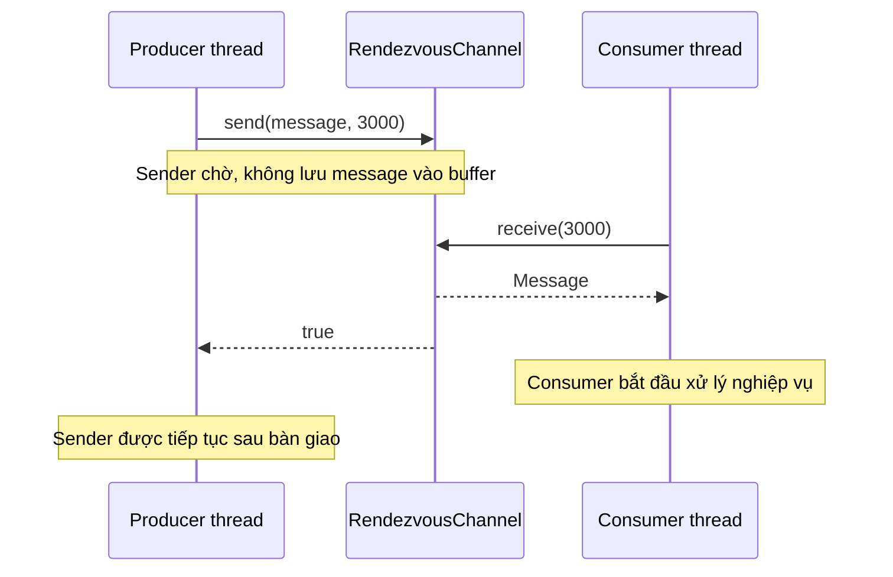
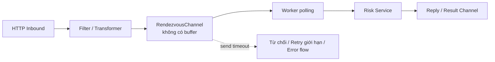

# RendezvousChannel và trao đổi đồng bộ

## 1. Vì sao cần một điểm hẹn giữa các luồng?

Trong một hệ thống tích hợp, không phải lúc nào producer cũng nên đưa message vào hàng đợi rồi tiếp tục ngay. Có những đoạn xử lý cần **chỉ giao message khi một consumer đã sẵn sàng nhận**. Ví dụ: một thread tiếp nhận lệnh tính toán muốn bàn giao lệnh cho một thread xử lý đang chờ; nếu chưa có thread nhận, thread gửi phải chờ trong một khoảng thời gian nhất định và báo hết hạn nếu không bàn giao được.

Trong **SPRING_INTEGRATION_PATTERN**, chúng ta triển khai Enterprise Integration Patterns bằng Spring Integration để liên kết các bước Router, Filter, Transformer, Splitter, Aggregator, Gateway, retry, error channel và correlation. Ở chương **Message channel**, `RendezvousChannel` là một lựa chọn có chủ đích khi **thời điểm bàn giao** message quan trọng hơn khả năng tích lũy message trong bộ đệm.

Kết quả mong đợi sau bài học:

- Giải thích được cơ chế *rendezvous* (điểm hẹn) giữa sender và receiver, và vì sao kênh không chứa sẵn message.
- Phân biệt `RendezvousChannel` với `DirectChannel`, `QueueChannel` và `ExecutorChannel`.
- Dùng `send(message, timeout)` và `receive(timeout)` để giới hạn thời gian chờ, tránh treo luồng.
- Cấu hình một consumer polling phù hợp, thiết kế cách xử lý timeout và kiểm thử việc bàn giao với hai thread riêng.
- Hiểu ranh giới giữa “consumer đã nhận message”, “xử lý đã hoàn thành” và “đã trả reply”.

## 2. RendezvousChannel hoạt động như thế nào?

`RendezvousChannel` là một `PollableChannel` của Spring Integration được xây dựng theo cơ chế **direct handoff** trên `java.util.concurrent.SynchronousQueue`. Hàng đợi bên dưới có **dung lượng lưu trữ bằng 0**: không có vị trí để giữ message trong lúc đợi một consumer ở tương lai.

Một lần `send` chỉ thành công khi một lời gọi `receive` tương ứng thực sự có thể nhận message đó. Nếu không có người nhận tại thời điểm gửi, sender chờ cho đến khi có người nhận hoặc hết timeout. Ngược lại, receiver gọi `receive` khi không có sender sẽ chờ producer xuất hiện.



Đặc điểm quan trọng:

1. **Hai lời gọi phải gặp nhau.** `send` và `receive` là hai phía của cùng một hành động chuyển giao; việc gửi không thể “để dành” một message trong channel.
2. **Sender và receiver thường nằm trên các thread khác nhau.** Nếu một thread gọi `send` chờ vô hạn rồi mới dự định gọi `receive`, nó sẽ không bao giờ tự đi đến dòng `receive`.
3. **Channel không tự tạo worker thread.** Các thread đến từ ứng dụng, thread pool hoặc endpoint polling được cấu hình; việc dùng `RendezvousChannel` không tự làm cho xử lý trở thành bất đồng bộ.
4. **Bàn giao thành công không đảm bảo xử lý nghiệp vụ thành công.** Sau khi consumer nhận message, nó vẫn có thể lỗi, retry hoặc tốn nhiều thời gian xử lý.
5. **Không phải hệ thống lưu trữ bền vững.** Nếu ứng dụng bị dừng hoặc không có consumer, không có backlog nằm trong kênh để khôi phục. Khi cần lưu bền vững, dùng một broker hoặc kênh với cơ chế lưu trữ phù hợp.

### “Đồng bộ” ở đây nghĩa là gì?

Rendezvous tạo **đồng bộ tại thời điểm trao message** giữa hai bên, còn `DirectChannel` thường thực thi subscriber trực tiếp **trên thread gửi**. Vì vậy có thể xảy ra tình huống hai thread xử lý độc lập nhưng phải đồng bộ trong một khoảnh khắc để bàn giao message. Không nên đồng nhất loại đồng bộ này với một giao dịch database, một HTTP request/reply hoàn chỉnh hoặc việc chờ kết quả nghiệp vụ.

Ví dụ, `receive()` có thể trả message để consumer xử lý trong 10 giây, trong khi `send()` đã trả `true` ngay khi bàn giao xong. Sender muốn chờ kết quả 10 giây đó cần cơ chế phản hồi riêng: `replyChannel`, Gateway với reply, `CompletableFuture`, hoặc message phản hồi tương ứng, cùng cơ chế correlation khi nhiều yêu cầu chạy song song.

## 3. So sánh các message channel thường gặp

| Kênh | Cách giao message | Thread chạy handler | Khi nào lệnh gửi hoàn tất? | Trường hợp phù hợp |
| --- | --- | --- | --- | --- |
| `DirectChannel` | Gọi subscriber trực tiếp, không cần poll | Thường chính thread của sender | Khi lời gọi handler đồng bộ trả về hoặc ném lỗi | Pipeline đơn giản, ít bước, cần truyền lỗi đồng bộ. |
| `QueueChannel` | Đặt message vào buffer để thread khác nhận sau | Thread polling/consumer | Khi việc đưa vào queue thành công; consumer có thể nhận sau | Tách tốc độ producer/consumer, hấp thụ lưu lượng theo dung lượng queue. |
| `RendezvousChannel` | Chỉ chuyển message khi sender và receiver gặp nhau; không có buffer | Thread đã gọi `receive` | Khi message được bàn giao cho receiver, trước khi đảm bảo công việc xong | Handoff trực tiếp, điều phối sẵn sàng, giới hạn việc gửi trước. |
| `ExecutorChannel` | Dispatch đến subscriber thông qua `TaskExecutor` | Worker của executor | Phụ thuộc việc executor nhận task; không cần chờ handler chạy xong | Tách thread sender với handler, chạy tác vụ đồng thời. |

**Hai điểm rất dễ nhầm:**

- `RendezvousChannel` là **pollable**: phía nhận phải chủ động gọi `receive` hoặc được một polling endpoint gọi hộ. `DirectChannel` là **subscribable**: đăng ký handler và channel tự dispatch khi nhận `send`.
- `QueueChannel` có thể có giới hạn capacity và từ chối hoặc chờ khi đầy; `RendezvousChannel` không có khái niệm “còn một ô trống”. Ngay cả message đầu tiên cũng cần consumer đang chờ. Không thể thay thế bằng cách giả định `QueueChannel` capacity bằng 0 có cùng hành vi.

Không nên coi tính “đồng bộ” là tiêu chí duy nhất để chọn channel. Cần trả lời: ai sở hữu thread nhận, thời gian chờ là bao lâu, có cần lưu trữ backlog, và khi quá tải producer sẽ bị chặn hay có nơi chứa tạm message?

## 4. API gửi, nhận và timeout

Hai interface liên quan:

- `MessageChannel`: `send(Message<?>)` hoặc `send(Message<?>, long timeout)`, trả về `boolean`.
- `PollableChannel`: bổ sung `receive()` hoặc `receive(long timeout)`, trả về `Message<?>` hoặc `null`.

`RendezvousChannel` có cả hành vi gửi và nhận vì là `PollableChannel`. Thời gian timeout trong các lời gọi này tính bằng **mili giây**.

| Lời gọi | Khi phía đối diện sẵn sàng | Khi phía đối diện chưa sẵn sàng |
| --- | --- | --- |
| `send(message, 3000)` | Giao message, trả `true` | Chờ tối đa khoảng 3 giây; hết hạn trả `false`. |
| `receive(3000)` | Trả `Message<?>` | Chờ tối đa khoảng 3 giây; hết hạn trả `null`. |
| `send(message, 0)` | Có thể giao ngay nếu đang có receiver đợi | Trả `false` ngay. |
| `receive(0)` | Có thể nhận ngay nếu đang có sender đợi | Trả `null` ngay. |
| `send(message)` / `receive()` | Bàn giao khi hai bên gặp nhau | Có thể chờ vô hạn nếu không có phía đối diện hoặc không bị ngắt. |

Hãy dùng timeout hữu hạn tại những ranh giới mà một thread bị chặn kéo dài sẽ gây hại, chẳng hạn một thread phục vụ HTTP request. Timeout **không đo thời gian xử lý nghiệp vụ sau nhận**; muốn giới hạn thời gian end-to-end phải đặt thêm deadline cho toàn bộ request/reply.

Một số phân biệt cần nhớ:

- `send(...) == true`: channel đã ghép được sender với receiver. **Không có nghĩa** consumer xử lý xong, đã commit transaction hay đã ghi dữ liệu thành công.
- `send(...) == false`: không bàn giao được trước hạn. Ứng dụng cần chọn từ chối, retry có giới hạn, hoặc chuyển sang cơ chế dự phòng. Không đánh dấu đơn hàng đã xử lý.
- `receive(...) == null`: không có message được nhận trong thời gian chờ; không có payload để đưa vào Transformer hoặc handler.
- Nếu thread bị interrupt hoặc hệ thống đang shutdown, vẫn phải xử lý theo hợp đồng lifecycle/exception thực tế; không coi mọi lỗi là timeout bình thường.
- Khi có nhiều sender và receiver đồng thời, hệ thống thực thi việc ghép cặp theo cơ chế đồng bộ của channel; không giả định thứ tự nghiệp vụ FIFO chỉ dựa vào thứ tự thread được tạo.

## 5. Ví dụ Java: hai thread trao một message

Đây là ví dụ độc lập ở mức API Spring Integration. Producer và consumer được chạy trên hai worker của `ExecutorService`, cùng dùng **một instance** `RendezvousChannel`. Chúng ta chủ động dùng timeout để mã có thể kết thúc nếu một phía không chạy.

```java
import java.util.concurrent.ExecutorService;
import java.util.concurrent.Executors;
import java.util.concurrent.Future;
import java.util.concurrent.TimeUnit;

import org.springframework.integration.channel.RendezvousChannel;
import org.springframework.messaging.Message;
import org.springframework.messaging.support.MessageBuilder;

public final class RendezvousHandoffDemo {

    public static void main(String[] args) throws Exception {
        RendezvousChannel handoff = new RendezvousChannel();
        ExecutorService workers = Executors.newFixedThreadPool(2);

        Message<String> order = MessageBuilder.withPayload("order-42")
                .setHeader("appCorrelationId", "corr-42")
                .build();

        try {
            Future<Boolean> producer = workers.submit(
                    () -> handoff.send(order, 3_000));

            Future<Message<?>> consumer = workers.submit(
                    () -> handoff.receive(3_000));

            boolean sent = producer.get(4, TimeUnit.SECONDS);
            Message<?> received = consumer.get(4, TimeUnit.SECONDS);

            if (!sent || received == null) {
                throw new IllegalStateException("Khong ban giao duoc message");
            }

            System.out.println(received.getPayload()); // order-42
            System.out.println(
                    received.getHeaders().get("appCorrelationId")); // corr-42
        } finally {
            workers.shutdownNow();
        }
    }
}
```

**Diễn giải thời gian chạy:**

1. Producer gọi `send`. Nếu consumer chưa nhận, producer tạm dừng trong lời gọi này.
2. Consumer gọi `receive` trên **cùng channel**. Hai thread ghép cặp và message được trao trực tiếp.
3. `receive` trả về message; `send` trả về `true`.
4. Đoạn in payload nằm ngoài channel, chỉ giúp quan sát. Khi triển khai thật, consumer sẽ gọi service xử lý ở thread nhận, cần xử lý lỗi, transaction và reply riêng.

Cùng một message giữ payload và các header ứng dụng đã gắn, chẳng hạn `appCorrelationId`. Tuy vậy, **message handoff không tự thực hiện correlation giữa các reply**; correlation nghiệp vụ vẫn do flow thiết kế.

### Phản ví dụ: gọi lần lượt trên một thread

```java
RendezvousChannel handoff = new RendezvousChannel();
Message<String> message = MessageBuilder.withPayload("task").build();

boolean sent = handoff.send(message, 1000);
Message<?> received = handoff.receive(1000);
```

Ở đoạn trên, `send` đang chờ consumer, nhưng `receive` chỉ được gọi **sau khi send kết thúc** trên chính thread đó. Không có thread nhận thứ hai, nên `send` sẽ hết hạn và trả `false`; sau đó `receive` cũng sẽ hết hạn và trả `null`. Nếu bỏ timeout, luồng có thể bị treo mãi tại `send`.

## 6. Kết hợp với Spring Integration Java DSL

Khi producer đến từ một endpoint và consumer là một flow khác, có thể khai báo channel như một bean và để một **polling consumer** nhận message. Việc khai báo `RendezvousChannel` đơn thuần không tự chạy consumer.

Ví dụ minh họa:

```java
import org.springframework.context.annotation.Bean;
import org.springframework.context.annotation.Configuration;
import org.springframework.integration.channel.RendezvousChannel;
import org.springframework.integration.dsl.IntegrationFlow;
import org.springframework.integration.dsl.Pollers;
import org.springframework.messaging.MessageHandler;

@Configuration
public class HandoffFlowConfiguration {

    @Bean
    public RendezvousChannel ordersRendezvous() {
        return new RendezvousChannel();
    }

    @Bean
    public IntegrationFlow consumeOrders(RendezvousChannel ordersRendezvous) {
        return IntegrationFlow
                .from(ordersRendezvous, endpoint -> endpoint.poller(
                        Pollers.fixedDelay(100)
                                .receiveTimeout(500)
                                .maxMessagesPerPoll(1)))
                .handle((MessageHandler) message -> {
                    // Ví dụ: thực tế gọi service và xử lý lỗi.
                    System.out.println("Received: " + message.getPayload());
                })
                .get();
    }
}
```

Ý nghĩa của ba tham số poller:

- `fixedDelay(100)`: khoảng trì hoãn giữa các lần poll (đơn vị mặc định là mili giây với overload sử dụng số).
- `receiveTimeout(500)`: mỗi lần poll có thể chờ message tối đa khoảng 500 ms; nếu không có producer, kết quả có thể là `null` và lần poll này kết thúc.
- `maxMessagesPerPoll(1)`: mỗi lượt poll cố gắng lấy tối đa một message, tránh một lượt poll kéo dài qua nhiều lần `receive` liên tiếp.

Việc xử lý trong handler chạy theo **thread của polling endpoint**. Nếu handler làm I/O chậm, thread poller bị chiếm và producer tiếp theo có thể phải chờ; cần đo tải trước khi tăng đồng thời hoặc thêm thread pool. Poller cố gắng nhận message theo lịch, nên thời điểm sender gặp receiver còn phụ thuộc vào scheduler và `receiveTimeout`.

Gửi vào kênh từ một service bên ngoài flow:

```java
import org.springframework.beans.factory.annotation.Qualifier;
import org.springframework.messaging.MessageChannel;
import org.springframework.messaging.support.MessageBuilder;
import org.springframework.stereotype.Service;

@Service
public class OrderHandoffService {

    private final MessageChannel handoff;

    public OrderHandoffService(
            @Qualifier("ordersRendezvous") MessageChannel handoff) {
        this.handoff = handoff;
    }

    public void submit(String orderId) {
        boolean delivered = handoff.send(
                MessageBuilder.withPayload(orderId).build(),
                2_000);

        if (!delivered) {
            throw new IllegalStateException(
                    "No consumer available within 2 seconds");
        }
    }
}
```

Đoạn này có nghĩa **đã giao đơn cho consumer** khi `submit()` trả về, chưa phải đã hoàn tất đơn hàng. Nếu API cần trả “đã xử lý xong”, phải thiết kế thêm bước nhận kết quả. Trong production, tránh xử lý `false` bằng cách tự động retry vô hạn trên thread web: việc đó có thể làm cạn thread và khuếch đại tải đúng lúc downstream gặp sự cố.

### Chọn consumer phù hợp

Với các luồng Spring Integration khác, `Service Activator` được gắn trực tiếp vào `DirectChannel` thường phản hồi đồng bộ trong lời gọi sender. Với `RendezvousChannel`, consumer cần polling, và Spring Integration có các endpoint polling để quản lý phần việc này. Cần cân đối:

- Số thread có thể chờ trên `receive`.
- Số lượng producer cùng lúc bị chặn tại `send`.
- Thời gian xử lý của handler sau khi đã nhận message.
- Giới hạn từ nguồn (ví dụ HTTP request timeout) và đích (ví dụ database connection pool).

Nếu không có nhu cầu ghép cặp trực tiếp mà muốn tạo hàng đợi công việc, một `QueueChannel` có capacity rõ ràng sẽ dễ vận hành hơn. Nếu cần queue bền vững và xử lý lại sau khi ứng dụng restart, chọn AMQP/JMS/Kafka hoặc thiết kế lưu trữ tương ứng.

## 7. Tình huống: chuẩn hóa lệnh rồi bàn giao cho worker

Giả sử hệ thống nhận yêu cầu kiểm tra rủi ro đơn hàng:

1. HTTP inbound gateway nhận request và gắn mã `appCorrelationId` từ nguồn đã được kiểm tra.
2. `Filter` loại yêu cầu không hợp lệ; `Transformer` chuyển payload thành lệnh kiểm tra thống nhất.
3. Flow gửi lệnh qua `RendezvousChannel` để **chỉ bàn giao khi một worker đang chờ**.
4. Worker nhận lệnh, kiểm tra rủi ro và phát hành kết quả sang channel khác.
5. Nếu cần trả kết quả về request HTTP ban đầu, Gateway chờ message phản hồi qua đường reply được thiết kế sẵn.



**Không nhầm ba cột mốc:**

| Cột mốc | Điều kiện | Có thể phản hồi gì? |
| --- | --- | --- |
| Producer gọi `send` | Có một lệnh muốn bàn giao | Chưa chắc có receiver; producer có thể đang chờ. |
| `send` trả `true` | Consumer đã nhận message | Có thể báo “đã nhận để xử lý” nếu hợp đồng API cho phép; chưa được báo “đã xử lý xong”. |
| Worker hoàn tất và phát reply | Kết quả hoặc lỗi nghiệp vụ đã có | Có thể trả kết quả theo correlation và deadline của request. |

Một Gateway trong Spring Integration có khái niệm `requestChannel`, `replyChannel`, `requestTimeout` và `replyTimeout`. **Request timeout** liên quan đến việc gửi request vào channel, còn **reply timeout** liên quan đến việc đợi phản hồi. Các giá trị này cần khớp với timeout của HTTP upstream và SLA của downstream. `RendezvousChannel` không tự tạo reply và không tự gắn kết quả của nhiều yêu cầu với nhau.

### Liên hệ với retry, error channel và correlation

- **Retry:** nếu `send` hết hạn và trả `false`, cần phân biệt lỗi bàn giao với lỗi nghiệp vụ sau bàn giao. Retry có giới hạn, dùng backoff và idempotency key; tránh tạo hai lệnh nghiệp vụ khi phía trước không chắc tình trạng cuối.
- **Error channel:** lỗi từ handler polling có thể được đưa vào error flow theo cấu hình endpoint; lỗi `send` thất bại phải được producer xử lý. Không giả định mọi lỗi đều đi về thread gửi ban đầu.
- **Correlation:** dùng header như `appCorrelationId` hoặc `businessMessageId` để theo dõi qua nhiều channel. Nếu dùng Splitter/Aggregator, các header `correlationId`, `sequenceNumber`, `sequenceSize` có ý nghĩa riêng trong nhóm message; đừng tự dùng UUID của channel message làm correlation nghiệp vụ.
- **Router:** có thể định tuyến các loại lệnh vào những channel khác nhau, nhưng phải bảo đảm **mỗi nhánh Rendezvous có consumer phù hợp**; một nhánh không có consumer sẽ làm producer trên nhánh đó hết hạn.

## 8. Backpressure, tài nguyên và rủi ro vận hành

Dù không có buffer, việc gửi bị chặn vẫn tiêu tốn tài nguyên ở **thread phía producer**. Khi có 500 HTTP request đồng thời chờ một consumer duy nhất, hệ thống có thể giữ 500 request thread hoặc task chưa hoàn thành. Đây là một hình thức backpressure, nhưng không thay thế cơ chế kiểm soát tải có giới hạn.

Ví dụ giả định: consumer xử lý được 20 lệnh/giây, producer gửi 200 lệnh/giây. Dù mỗi lần handoff rất nhanh, handler chỉ có thể nhận thêm khi poller sẵn sàng; số sender đang chờ có thể tăng nhanh. Thay vì chỉ kéo dài timeout, hãy:

- Giới hạn concurrency phía ingress; từ chối sớm khi hệ thống quá tải.
- Đặt thời gian chờ ngắn hơn deadline của caller; xử lý `false` có chủ đích.
- Dùng metric tách biệt: số sender đang chờ, thời gian chờ handoff, số timeout, thời gian xử lý của worker, số lỗi nghiệp vụ và số request hết deadline.
- Phân biệt tình huống không có consumer (cấu hình, lifecycle) với tình huống có consumer nhưng worker bận.
- Kiểm tra shutdown: dừng nhận request mới, ngắt các lời chờ còn tồn tại theo chính sách và thông báo rõ các lệnh chưa được bàn giao.

**Rendezvous không có hàng đợi nội bộ để “giải áp”.** Nó giúp kiểm soát bàn giao có điều kiện, nhưng cần giới hạn số sender đang chờ ở tầng ingress/thread pool. Nếu dự kiến tải burst cần được giữ lại, buffer và broker thường phù hợp hơn.

### Transaction và khả năng phát lại

`send() == true` không có tính chất của một commit giao dịch: nếu worker crash sau khi nhận nhưng trước khi ghi database, channel không tự redeliver message. Nếu cần xử lý đáng tin cậy qua lỗi tiến trình, phải bổ sung transaction/outbox, broker bền vững, retry có idempotency hoặc quy trình phục hồi.

Đối với các yêu cầu *at-least-once*, ứng dụng phải thiết kế việc xử lý trùng. Đối với *exactly-once* ở cấp nghiệp vụ, cần xác định rõ giới hạn transaction và idempotency, chứ không dựa vào đặc tính zero-buffer của channel.

## 9. Kiểm thử hành vi RendezvousChannel

Các ví dụ kiểm thử JUnit 5 + AssertJ sau kiểm tra hai điều cơ bản: **không có người nhận thì không gửi được**, và **hai thread có thể bàn giao cùng một message**.

```java
import static org.assertj.core.api.Assertions.assertThat;

import java.util.concurrent.ExecutorService;
import java.util.concurrent.Executors;
import java.util.concurrent.Future;
import java.util.concurrent.TimeUnit;

import org.junit.jupiter.api.Test;
import org.springframework.integration.channel.RendezvousChannel;
import org.springframework.messaging.Message;
import org.springframework.messaging.support.MessageBuilder;

class RendezvousChannelTest {

    @Test
    void cannotSendWhenThereIsNoReceiver() {
        RendezvousChannel channel = new RendezvousChannel();
        Message<String> message =
                MessageBuilder.withPayload("order-1").build();

        assertThat(channel.send(message, 50)).isFalse();
        assertThat(channel.receive(0)).isNull();
    }

    @Test
    void transfersMessageBetweenTwoThreads() throws Exception {
        RendezvousChannel channel = new RendezvousChannel();
        ExecutorService workers = Executors.newFixedThreadPool(2);
        Message<String> message = MessageBuilder
                .withPayload("order-2")
                .setHeader("appCorrelationId", "corr-2")
                .build();

        try {
            Future<Boolean> sending =
                    workers.submit(() -> channel.send(message, 2_000));
            Future<Message<?>> receiving =
                    workers.submit(() -> channel.receive(2_000));

            assertThat(sending.get(3, TimeUnit.SECONDS)).isTrue();
            Message<?> result = receiving.get(3, TimeUnit.SECONDS);

            assertThat(result).isNotNull();
            assertThat(result.getPayload()).isEqualTo("order-2");
            assertThat(result.getHeaders().get("appCorrelationId"))
                    .isEqualTo("corr-2");
        } finally {
            workers.shutdownNow();
        }
    }
}
```

Đây là kiểm thử API channel, chưa chạy service/HTTP/broker. Với một flow thật, cần mở rộng kiểm thử:

| Kịch bản | Kết quả cần quan sát |
| --- | --- |
| Producer gọi trước, consumer xuất hiện trong thời hạn | `send` trả `true`; receiver nhận đúng payload và header. |
| Không có consumer | `send` trả `false` trong thời gian hữu hạn; API trả lỗi hoặc đưa vào nhánh dự phòng đã quy định. |
| Consumer gọi trước, producer xuất hiện trong thời hạn | `receive` nhận được message; không có duplicate. |
| Receiver không có sender | `receive(timeout)` trả `null`; poller tiếp tục lịch chạy hợp lý. |
| Worker nhận được message nhưng xử lý thất bại | Bàn giao vẫn có thể thành công; lỗi nghiệp vụ được quan sát và xử lý riêng. |
| Nhiều producer, ít consumer | Không rò rỉ thread, số timeout được đo; không phụ thuộc vào thứ tự xử lý ngầm định. |
| Một flow có Gateway đợi kết quả | Xác nhận đồng thời request timeout, reply timeout, correlation và hành vi khi kết quả đến trễ. |

Để tránh test “có lúc pass, có lúc fail” vì race, dùng `CountDownLatch` hoặc các primitive đồng bộ khác khi cần xác nhận chính xác thread đã đi vào trạng thái chờ. Hạn chế dùng `Thread.sleep(...)` để mô phỏng sự sẵn sàng; sleep không chứng minh thread kia đã bắt đầu `receive`.

## 10. Các lỗi thường gặp và cách khoanh vùng

| Triệu chứng | Nguyên nhân có thể | Cách xử lý |
| --- | --- | --- |
| `send` luôn `false` | Không có poller/receiver, poller chưa chạy hoặc timeout quá ngắn | Kiểm tra bean channel, endpoint consumer, lifecycle và lịch poll. |
| Flow bị treo sau khi gửi | Lời gọi `send` chờ vô hạn, receiver không bao giờ xuất hiện | Dùng timeout hữu hạn; xem thread dump để tìm thread chờ send/receive. |
| Có một producer, một consumer nhưng không trao được message | Hai bên đang dùng **hai instance channel khác nhau** hoặc sai tên bean | Kiểm tra wiring, tên channel và context dependency injection. |
| Gửi thành công nhưng API vẫn timeout | Handoff thành công, nhưng xử lý/reply chậm hoặc không trả kết quả | Đo riêng thời gian handoff, xử lý, và reply; kiểm tra `replyChannel` và correlation. |
| Hệ thống quá tải dù channel không có buffer | Nhiều producer thread bị chặn, consumer nhận quá chậm | Giới hạn ingress, concurrency và timeout; xem xét queue/broker phù hợp. |
| Các kết quả không đúng thứ tự request | Scheduler ghép các thread theo thời điểm sẵn sàng, không có ordering contract nghiệp vụ | Dùng id/correlation rõ ràng; nếu cần ordering, thiết kế riêng theo key/sequence. |
| Lỗi downstream không xuất hiện ở caller | Handler chạy ở thread polling, sender đã trả về sau handoff | Dùng error flow, reply có trạng thái hoặc cơ chế theo dõi job, thay vì mong exception xuyên thread. |

Khi debug, bắt đầu bằng bốn điểm: producer đang gọi `send` ở thread nào, receiver đang gọi `receive` ở đâu, timeout áp dụng cho bước nào, và request có yêu cầu reply không. Log nên gắn `appCorrelationId` ở cả hai phía; không log dữ liệu nhạy cảm chỉ để kiểm tra việc bàn giao.

## 11. Bài tập áp dụng

**Bài 1 — Handoff có timeout.** Tạo một producer và một consumer chạy trên hai thread. Cấu hình `send(..., 500)`, `receive(..., 1000)`. Thử ba trường hợp: consumer chạy trước, producer chạy trước và không bao giờ có consumer. Ghi lại kết quả, nêu sự khác nhau giữa `false` và `null`.

**Bài 2 — So sánh channel.** Cùng một payload `order-42`, triển khai ba mô hình `DirectChannel`, `QueueChannel` và `RendezvousChannel`. Dùng log thread name và thời gian chờ để giải thích sender trả về lúc nào, handler chạy trên thread nào, và khi không có consumer thì xảy ra điều gì.

**Bài 3 — Request/reply có correlation.** Kết hợp Router, Transformer, RendezvousChannel, handler nghiệp vụ và reply flow. Gắn `appCorrelationId` ở ingress; chủ động tạo một xử lý lỗi và một reply đến trễ. Giải thích vì sao việc `send` thành công chưa đủ để trả HTTP 200 cho kết quả nghiệp vụ, và chọn timeout cho request/reply.

**Bài 4 — Giới hạn tải.** Mô phỏng 50 producer và hai consumer, mỗi consumer cần 100 ms xử lý một lệnh. Ghi nhận tỷ lệ handoff thành công, số timeout và số thread đang chờ. Đề xuất ngưỡng ingress phù hợp; nếu yêu cầu phải lưu mọi lệnh, đánh giá chuyển sang broker hoặc queue giới hạn capacity.

Một bài làm đạt yêu cầu cần có **sơ đồ thread**, cấu hình channel/consumer thực tế, chính sách timeout và test xác minh cả tình huống thành công lẫn không có receiver.

## 12. Tóm tắt ý chính

`RendezvousChannel` tổ chức trao đổi message theo kiểu **zero-capacity direct handoff**: sender và receiver phải gặp nhau mới chuyển được message. Nó tạo một điểm đồng bộ giữa các thread nhưng không tự tạo consumer, không chứa backlog và không xác nhận công việc nghiệp vụ hoàn tất. Trong Spring Integration, dùng kênh này khi cần kiểm soát thời điểm bàn giao; luôn thiết kế timeout, thread pool, cơ chế reply/error và correlation phù hợp. Với yêu cầu lưu lệnh bền vững hoặc hấp thụ burst, cân nhắc một queue/broker có chính sách rõ ràng.

## Tài liệu tham khảo

- [Spring Integration Reference — Message Channels](https://docs.spring.io/spring-integration/reference/channel.html)
- [Spring Integration Reference — Channel Implementations](https://docs.spring.io/spring-integration/reference/channel/implementations.html)
- [Spring Integration Reference — Polling Consumer](https://docs.spring.io/spring-integration/reference/endpoint/polling-consumer.html)
- [Spring Integration API — RendezvousChannel](https://docs.spring.io/spring-integration/api/org/springframework/integration/channel/RendezvousChannel.html)
- [Java SE — SynchronousQueue](https://docs.oracle.com/en/java/javase/17/docs/api/java.base/java/util/concurrent/SynchronousQueue.html)

Các ví dụ dùng các khái niệm và API phổ biến của Spring Integration. Khi tích hợp vào ứng dụng cụ thể, kiểm tra API và cấu hình polling theo phiên bản Spring Integration/Spring Framework đang sử dụng.
