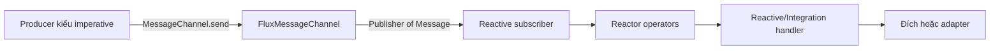
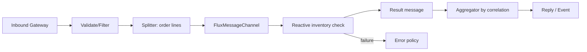

# FluxMessageChannel và reactive bridge

Trong **Spring Integration**, *Message Channel* là ranh giới truyền `Message<?>` giữa các endpoint của một luồng tích hợp. Các channel truyền thống như `DirectChannel`, `ExecutorChannel` hay `QueueChannel` phù hợp với nhiều bài toán xử lý lệnh và sự kiện. Khi một luồng cần liên kết với **Project Reactor** và **Reactive Streams** — chẳng hạn nhận dữ liệu liên tục, giới hạn tốc độ tiêu thụ hoặc kết nối với thành phần bất đồng bộ — ta có thể dùng **`FluxMessageChannel`**.

Chủ đề này thuộc chương **Message channel** của module `SPRING_INTEGRATION_PATTERN`: học cách triển khai Enterprise Integration Patterns bằng Spring Integration để luồng thông điệp ít phụ thuộc, dễ mở rộng, có thể định tuyến, lọc, chuyển đổi, tách/gom dữ liệu, xử lý lỗi và theo dõi các nhánh. Trọng tâm của bài là **ranh giới giữa cách gửi message theo lệnh (`send`) và cách nhận dòng message theo nhu cầu (`Publisher`/`Subscriber`)**, không phải chỉ thay tên một loại channel.

Sau bài học, bạn có thể:

- Giải thích `FluxMessageChannel` đứng ở đâu trong kiến trúc Spring Integration và Reactor.
- Kết nối một producer gửi `Message<?>` theo kiểu thông thường với consumer dùng `Flux<Message<?>>`.
- Phân biệt bất đồng bộ, *non-blocking*, backpressure và chuyện một message đã được xử lý xong hay chưa.
- Nhận biết cách phối hợp `FluxMessageChannel` với Filter, Router, Transformer, Splitter, Aggregator, Gateway và error flow.
- Chọn channel và thiết kế kiểm thử để không mất message, không làm nghẽn event-loop và không vô tình nhân đôi subscription.

## 1. Từ MessageChannel đến Reactive Streams

### Cách truyền thống: gửi một message

Một `MessageChannel` trong Spring Messaging hỗ trợ thao tác gửi message:

```java
import org.springframework.messaging.MessageChannel;
import org.springframework.messaging.support.MessageBuilder;

void publish(MessageChannel channel) {
    boolean accepted = channel.send(
            MessageBuilder.withPayload("order-created").build()
    );
}
```

Phương thức `send(...)` thể hiện **một lần gửi** vào channel. Kết quả `true` không nên được suy diễn chung thành “mọi xử lý nghiệp vụ phía sau đã hoàn tất”: ý nghĩa cụ thể còn phụ thuộc cách channel phân phối message, endpoint bên nhận và việc xử lý có chạy đồng bộ hay không.

### Cách reactive: đăng ký nhận một dòng message

**Reactive Streams** chuẩn hóa bốn khái niệm:

| Khái niệm | Vai trò |
| --- | --- |
| `Publisher<T>` | Nguồn phát các phần tử cho subscriber. |
| `Subscriber<T>` | Bên nhận phần tử, có thể thông báo số lượng muốn nhận. |
| `Subscription` | Liên kết giữa publisher và subscriber, cho phép `request(n)` hoặc `cancel()`. |
| Backpressure | Cơ chế để bên tiêu thụ biểu đạt mức nhu cầu (*demand*) thay vì bị đẩy dữ liệu không giới hạn. |

Project Reactor cung cấp `Flux<T>` để xử lý chuỗi **0 đến N phần tử** và `Mono<T>` cho **0 hoặc 1 phần tử**, cùng các toán tử `map`, `filter`, `flatMap`, `concatMap`, `onErrorResume`, `timeout`, v.v.

**`FluxMessageChannel`** là channel tích hợp hỗ trợ giao diện **`ReactiveStreamsSubscribableChannel`**: vừa tham gia hệ thống message của Spring Integration, vừa có thể được tiêu thụ như một `Publisher<Message<?>>`. Nhờ đó, nó đóng vai trò **reactive bridge** giữa phía gửi theo API channel và phía xử lý theo luồng Reactive Streams.



Ở sơ đồ này, **bridge** nghĩa là cầu nối hai **mô hình tiêu thụ message**, không phải mặc nhiên là cầu nối giữa hai message broker. Bản thân channel không làm cho mọi hàm downstream trở nên non-blocking; đoạn xử lý blocking vẫn là blocking cho đến khi được tách và điều phối thích hợp.

## 2. Đặc điểm của FluxMessageChannel

| Khía cạnh | Cần hiểu |
| --- | --- |
| Kiểu dữ liệu | Dòng phần tử là các `Message<?>`, bao gồm payload và headers như mọi Spring message. |
| Phía gửi | Producer có thể dùng API `MessageChannel.send(message)`. |
| Phía nhận | Thành phần reactive có thể subscribe vào publisher của channel. |
| Thời điểm xử lý | Subscriber phải được đăng ký và luồng phải được kích hoạt; chỉ khai báo `Flux` chưa phải là đã tiêu thụ. |
| Demand | Subscriber có thể phát tín hiệu yêu cầu phần tử theo Reactive Streams. |
| Kết thúc và lỗi | Cần phân biệt lỗi/hoàn thành của reactive stream với xử lý lỗi của một message nghiệp vụ. |
| Khả năng lưu trữ | Không nên coi channel là kho message bền vững, queue có xác nhận hay broker tự lưu khi consumer chậm. |

### Bốn điều không nên nhầm

1. **Reactive ≠ tự động chạy nền.** Reactive stream thường không chạy trước khi có subscription. Ngay cả sau subscribe, một số xử lý có thể diễn ra trên thread hiện tại nếu không có ranh giới lập lịch khác.
2. **Reactive ≠ toàn luồng non-blocking.** `Thread.sleep()`, JDBC blocking, gọi HTTP đồng bộ hay đọc file đồng bộ vẫn có thể chặn thread nếu chạy trong callback reactive.
3. **Backpressure ≠ bộ nhớ vô hạn hoặc không bao giờ rơi message.** Cần xác minh cách channel, adapter và các toán tử xử lý độ trễ, lượng dữ liệu chờ và overflow.
4. **Đã gửi ≠ đã xử lý/commit.** Thành công của `send()` không tự thay thế một cơ chế acknowledgement, transaction hoặc idempotency ở hệ thống đích.

## 3. Ví dụ tối thiểu: từ `send()` sang `Flux`

Ví dụ sau cho thấy một producer gửi message theo API Spring, trong khi consumer xử lý thông qua Project Reactor. Các phần import được liệt kê để làm rõ thư viện tham gia:

```java
import org.springframework.integration.channel.FluxMessageChannel;
import org.springframework.messaging.Message;
import org.springframework.messaging.support.MessageBuilder;

import reactor.core.Disposable;
import reactor.core.publisher.Flux;

public class ReactiveBridgeExample {

    public static void main(String[] args) {
        FluxMessageChannel channel = new FluxMessageChannel();

        // Phía nhận: đăng ký trước khi phát message.
        Flux<Message<?>> messages = Flux.from(channel);
        Disposable subscriber = messages
                .map(Message::getPayload)
                .doOnNext(payload -> System.out.println("Received: " + payload))
                .subscribe();

        // Phía gửi: không cần biết consumer triển khai bằng Reactor.
        boolean accepted = channel.send(
                MessageBuilder.withPayload("ORD-1001")
                        .setHeader("traceId", "trace-101")
                        .build()
        );

        System.out.println("send accepted = " + accepted);

        // Trong ví dụ ngắn, kết thúc subscription khi không dùng nữa.
        subscriber.dispose();
    }
}
```

Mục đích của ví dụ là chỉ ra **hai phía của bridge**: `send()` và `Flux.from(channel)`. Đây không phải mẫu triển khai production cho nguồn sự kiện chạy lâu dài. Trong ứng dụng Spring, nên để framework hoặc thành phần lifecycle quản lý việc subscribe/dispose, kiểm soát thời điểm khởi động, xử lý lỗi và dừng luồng. Đặc biệt, một luồng có xử lý bất đồng bộ có thể chưa hoàn tất trước khi đoạn mã ví dụ gọi `dispose()`; muốn kiểm thử chắc chắn, dùng cơ chế đồng bộ kiểm thử như `StepVerifier` thay vì suy ra từ thời gian chạy `main`.

### Giữ ý nghĩa payload và headers

Trong ví dụ, payload là mã đơn hàng, `traceId` là metadata truy vết. Nếu muốn đọc cả hai:

```java
Flux.from(channel)
        .doOnNext(message -> {
            Object orderId = message.getPayload();
            Object traceId = message.getHeaders().get("traceId");
            System.out.println(orderId + " / " + traceId);
        });
```

Đoạn `Flux` này **chỉ mô tả pipeline**, chưa thực thi vì chưa có subscription. Sự phân biệt rất quan trọng khi gỡ lỗi: thiếu subscriber không giống với việc Filter loại bỏ message, và cũng không đồng nghĩa message có payload null.

## 4. Đặt FluxMessageChannel trong một IntegrationFlow

Trong ứng dụng Spring, channel có thể là bean được tham chiếu bởi một luồng tích hợp. Ví dụ minh họa sau dùng Spring Integration Java DSL và các record Java 17+:

```java
import java.math.BigDecimal;

import org.springframework.context.annotation.Bean;
import org.springframework.context.annotation.Configuration;
import org.springframework.integration.channel.FluxMessageChannel;
import org.springframework.integration.dsl.IntegrationFlow;

record OrderSubmitted(String orderId, BigDecimal amount) {}
record OrderAccepted(String orderId) {}

@Configuration
class OrderIntegrationConfig {

    @Bean
    FluxMessageChannel ordersFluxChannel() {
        return new FluxMessageChannel();
    }

    @Bean
    IntegrationFlow orderFlow(FluxMessageChannel ordersFluxChannel) {
        return IntegrationFlow.from(ordersFluxChannel)
                .<OrderSubmitted>filter(order ->
                        order.amount() != null
                                && order.amount().signum() > 0)
                .<OrderSubmitted, OrderAccepted>transform(order ->
                        new OrderAccepted(order.orderId()))
                .handle(OrderAccepted.class, (accepted, headers) -> {
                    System.out.println("Accepted: " + accepted.orderId());
                    return null; // handler một chiều: không tạo reply
                })
                .get();
    }
}
```

Phía producer có thể gửi `Message<OrderSubmitted>` vào bean `ordersFluxChannel` từ Gateway, adapter hoặc service phù hợp. Bên trong flow, **Filter** từ chối dữ liệu không đạt yêu cầu; **Transformer** chuyển payload đã được chấp nhận thành kiểu mới; **Service Activator** thực hiện bước cuối và không phát reply. `return null` từ handler cuối thể hiện **không có message trả về**, không phải tạo message mới có payload null.

Mẫu minh họa tập trung vào cách đặt channel ở **đầu vào của flow**. Một flow cũng có thể dùng reactive channel giữa các bước. Tuy nhiên, mức độ thực thi reactive thực tế còn phụ thuộc loại endpoint, handler, adapter, cấu hình và phiên bản Spring Integration. **Không suy diễn rằng mọi endpoint trong flow đã trở thành một chuỗi Reactor không chặn chỉ vì đầu vào là `FluxMessageChannel`.**

## 5. Reactive bridge theo hai chiều

### Chiều A — Imperative producer → Reactive consumer

Đây là trường hợp tự nhiên của `FluxMessageChannel`:

```text
Service / Gateway / Inbound adapter
             │
       send(Message)
             │
             ▼
    FluxMessageChannel
             │
   Publisher<Message<?>>
             │
             ▼
   Subscriber + operators
             │
             ▼
    Reactive handler
```

Ví dụ, một adapter nhận message từ hệ thống cũ và gửi vào Spring Integration channel; phía sau cần `filter`, `concatMap` hoặc `flatMap` để gọi dịch vụ khác có API reactive. Cần đăng ký consumer trước, định nghĩa giới hạn xử lý đồng thời và quyết định cách báo lỗi khi downstream không sẵn sàng.

### Chiều B — Reactive producer → Imperative message flow

Nguồn reactive như `Flux<OrderSubmitted>` có thể chuyển từng phần tử thành `Message<OrderSubmitted>` để đưa vào một kênh truyền thống. Tuy nhiên, gọi `channel.send(...)` trực tiếp trong event-loop có thể trở thành **ranh giới blocking** nếu kênh hoặc downstream xử lý đồng bộ.

Mã dưới đây chỉ minh họa thao tác **đổi kiểu dữ liệu**, không tự đăng ký gửi message:

```java
import org.springframework.messaging.Message;
import org.springframework.messaging.support.MessageBuilder;
import reactor.core.publisher.Flux;

Flux<OrderSubmitted> orders = obtainOrders(); // nguồn reactive từ ứng dụng

Flux<Message<OrderSubmitted>> messages = orders.map(order ->
        MessageBuilder.withPayload(order)
                .setHeader("source", "reactive-order-feed")
                .build()
);
```

Ở đây `obtainOrders()` đại diện cho một nguồn nghiệp vụ do ứng dụng định nghĩa; không phải API sẵn có của Spring. Để chuyển tiếp `messages` vào hệ thống imperative thực tế, nên ưu tiên adapter hoặc endpoint Spring Integration hỗ trợ publisher/reactive input và quản lý lifecycle. Nếu buộc phải bọc lời gọi blocking, đặt nó trên scheduler phù hợp (ví dụ `Schedulers.boundedElastic()`), giới hạn concurrency, xem xét timeout, retry và chính sách lỗi; **không tạo `subscribe()` rải rác mà không có chủ thể quản lý subscription**.

### Cầu nối không thay thế hợp đồng giao nhận

Trong cả hai chiều, xác định rõ:

- Khi nào message được xem là **được nhận**?
- Khi nào xử lý nghiệp vụ được xem là **thành công**?
- Nếu consumer hủy subscription, lỗi hoặc chậm, ai có trách nhiệm lưu/chuyển lại message?
- ID nào được dùng để **khử trùng lặp** nếu producer phát lại?

Nếu yêu cầu lưu bền vững, giao nhận ít nhất một lần hay xác nhận giao dịch, cần dùng khả năng phù hợp của broker, persistent store, transaction và idempotent consumer; không mặc định `FluxMessageChannel` thay thế những khả năng đó.

## 6. Backpressure, tốc độ và tính đồng thời

### Demand đi từ consumer về publisher

Trong Reactive Streams, subscriber dùng `Subscription.request(n)` để yêu cầu tối đa `n` phần tử trước khi tiếp tục yêu cầu. Khi sử dụng `FluxMessageChannel`, hãy tách hai câu hỏi:

1. **Downstream muốn nhận bao nhiêu phần tử?** Đó là ngữ nghĩa demand của Reactive Streams.
2. **Upstream có thể làm gì khi dữ liệu đang được đẩy bằng `send()` nhanh hơn sức xử lý?** Điều này liên quan đến ranh giới imperative, hàng chờ/bộ đệm, hành vi overflow và cách ứng dụng xử lý khi downstream bị quá tải.

Một API `send()` đồng bộ không tự biến producer thành một `Publisher` biết tuân theo `request(n)`. Vì vậy, dù downstream dùng `Flux`, toàn bộ chuỗi **chưa chắc** có backpressure end-to-end.

### Điều chỉnh tốc độ ở phía xử lý

Ví dụ xử lý tác vụ bất đồng bộ với giới hạn số lượng chạy đồng thời:

```java
import org.springframework.messaging.Message;
import reactor.core.publisher.Flux;
import reactor.core.publisher.Mono;

Flux<Message<?>> inbound = Flux.from(channel);

Flux<OrderResult> processed = inbound
        .map(message -> (OrderSubmitted) message.getPayload())
        .flatMap(order -> processAsync(order), 8);

// processAsync(OrderSubmitted) là phương thức ứng dụng trả Mono<OrderResult>.
// Đăng ký và quản lý subscription ở đúng điểm cuối của ứng dụng.
```

`flatMap(..., 8)` giới hạn tối đa số tác vụ `processAsync` được đăng ký đồng thời trong **toán tử này**; nó không tự áp hạn mức trên toàn hệ thống hoặc làm producer ngừng gọi `send()`. Nếu cần giữ thứ tự, có thể cân nhắc `concatMap` (xử lý tuần tự) hoặc thiết kế thứ tự theo khóa nghiệp vụ; thứ tự thực tế còn phụ thuộc vào source, các scheduler và thao tác bất đồng bộ.

### Khi có chênh lệch tốc độ

| Tình huống | Hướng thiết kế |
| --- | --- |
| Producer phát nhanh, consumer chậm | Định nghĩa giới hạn tốc độ/bộ đệm rõ ràng; đo backlog và lựa chọn chính sách khi đầy. |
| Consumer gọi dịch vụ remote | Dùng API non-blocking nếu có; giới hạn concurrency, timeout và retry. |
| Consumer bắt buộc dùng API blocking | Cô lập công việc blocking sang scheduler/thread pool thích hợp, có giới hạn. |
| Không được phép mất message | Dùng broker/persistent queue và acknowledgement phù hợp, có idempotency. |
| Phải giữ thứ tự theo đơn hàng | Xác định khóa correlation/partition, chọn cách xử lý tuần tự cho từng khóa. |
| Dữ liệu cần phát cho nhiều consumer | Xác minh rõ hành vi đăng ký nhiều subscriber của channel/phiên bản; dùng PubSub hoặc cấu trúc fan-out được thiết kế tường minh khi cần. |

**Không đặt niềm tin tuyệt đối vào buffer mặc định.** Một thiết kế production cần đo các đại lượng thực tế như thông lượng, thời gian chờ, số tác vụ đang chạy, tỷ lệ lỗi, số lần retry và dung lượng bộ đệm. Khi tải cao, việc chỉ thêm `publishOn` hoặc `subscribeOn` có thể chuyển điểm nghẽn sang thread pool khác thay vì giải quyết nó.

## 7. Tương tác với các Enterprise Integration Patterns

`FluxMessageChannel` là một cơ chế **vận chuyển message giữa endpoint**, không thay thế các EIP. Có thể kết hợp như sau:

| Pattern | Ý nghĩa khi có reactive boundary | Điểm cần kiểm tra |
| --- | --- | --- |
| **Gateway** | Đưa request vào luồng hoặc nhận reply từ luồng. | Không mặc định request–reply phải có phản hồi tức thì; xác định timeout và correlation. |
| **Filter** | Loại bỏ message không đạt điều kiện. | “Không có message đầu ra” khác với message có payload rỗng hoặc null. |
| **Router** | Phân phối message sang nhánh xử lý phù hợp. | Mỗi nhánh có thể có tốc độ, lịch chạy và chính sách lỗi khác nhau. |
| **Transformer** | Biến đổi payload/headers khi đi qua ranh giới. | Giữ metadata correlation/trace cần thiết; kiểm thử biến đổi kiểu. |
| **Splitter** | Tách một message thành nhiều message con. | Tốc độ phát các phần tử, sequence/correlation và thứ tự khi chạy đồng thời. |
| **Aggregator** | Gom message liên quan thành kết quả. | Điều kiện hoàn thành nhóm, timeout, lưu trữ nhóm và rủi ro nhóm chờ mãi. |
| **Retry** | Thử lại thao tác lỗi tạm thời. | Phân biệt retry của Reactor với cơ chế retry của endpoint/inbound adapter; tránh lặp tác động phụ. |
| **Error channel** | Chuyển lỗi qua cơ chế nhắn tin của Spring Integration. | Không mặc định mọi Reactor `onError` sẽ tự được biến thành `ErrorMessage`. |

### Ví dụ nghiệp vụ: xử lý từng dòng đơn hàng



Giả sử một đơn hàng có 15 dòng. Splitter tạo các message con, mỗi message cần mang thông tin để Aggregator nhận diện cùng một nhóm. Phần kiểm tra tồn kho dùng dịch vụ không chặn, được giới hạn số lời gọi đồng thời để tránh làm quá tải hệ thống kho. Aggregator cần biết **đủ 15 kết quả, hoặc gặp timeout, hoặc chính sách lỗi yêu cầu kết thúc sớm**. `FluxMessageChannel` không tự định nghĩa các quy tắc nghiệp vụ đó.

Khi gọi lại dịch vụ tồn kho sau lỗi, sử dụng **idempotency key** thích hợp nếu thao tác có tác động phụ (ví dụ giữ chỗ hàng). `correlationId` để nhóm message con và `traceId` để quan sát không nhất thiết là khóa idempotency. Với lỗi không thể phục hồi, quyết định rõ sẽ trả `NotAvailable`, gửi error flow, bù trừ hay đánh dấu nhóm thất bại; đừng để lỗi bị mất trong một subscription không có người giám sát.

## 8. Xử lý lỗi và lifecycle của reactive stream

Một reactive subscriber có ba loại tín hiệu chính: `onNext` (phần tử), `onError` (lỗi kết thúc stream) và `onComplete` (stream kết thúc bình thường). Các tín hiệu này không tương đương trực tiếp với một message nghiệp vụ:

- **`onError`** là tín hiệu lỗi ở mức stream; thường kết thúc subscription hiện tại nếu không có toán tử xử lý phù hợp.
- **`ErrorMessage`/`errorChannel`** là cơ chế message/error handling của Spring Integration; việc ánh xạ giữa exception của endpoint và error channel còn phụ thuộc endpoint/cấu hình.
- **Message báo lỗi nghiệp vụ** (ví dụ `OutOfStock`) có thể là payload bình thường và không nên tự động biến thành `onError` nếu nghiệp vụ mong đợi xử lý nhánh này.

Để hạn chế một lỗi của từng phần tử làm sập toàn bộ subscriber, đôi khi cần xử lý lỗi **bên trong** phép biến đổi:

```java
Flux<OrderResult> outcomes = Flux.from(channel)
        .map(message -> (OrderSubmitted) message.getPayload())
        .flatMap(order -> processAsync(order)
                .onErrorResume(ex ->
                        Mono.just(OrderResult.failed(order.orderId(), ex.getMessage()))),
                8);
```

`OrderResult.failed(...)` là mẫu *result type* do ứng dụng thiết kế, không phải kiểu Spring có sẵn. Chiến lược này chỉ phù hợp khi lỗi riêng của từng đơn được **chuyển thành kết quả có thể xử lý**; không nên nuốt các lỗi nghiêm trọng hoặc lưu thông điệp lỗi chứa dữ liệu nhạy cảm một cách tùy tiện. Nếu cần gửi lỗi tới error channel, hãy tích hợp theo cơ chế lỗi của Spring Integration thay vì chỉ in log trong `.subscribe(...)`.

### Subscription là tài nguyên có vòng đời

Trong Reactor, `.subscribe()` thường trả `Disposable`. Với mã ứng dụng trực tiếp quản lý reactive stream, cần xác định nơi tạo và hủy subscription, bảo đảm không đăng ký trùng một pipeline, và biết hệ thống nên làm gì khi shutdown. Trong một ứng dụng Spring Integration, nên tận dụng lifecycle của endpoint/flow do Spring quản lý. **Đăng ký lặp vào cùng một nguồn** có thể dẫn tới phát lặp hoặc xử lý nhiều lần, tùy loại publisher và chính sách fan-out; cần kiểm thử rõ nếu bài toán yêu cầu xử lý mỗi message đúng một lần.

### Threading và tracing

Message headers có thể mang `correlationId`/`traceId`, nhưng thông tin dựa trên `ThreadLocal` như một số MDC logging context **không tự đảm bảo đi theo** khi Reactor chuyển thread. Khi cần distributed tracing, dùng cơ chế truyền context tương thích Reactor và Spring Observability, kèm header propagation qua các adapter. Đừng giả định `publishOn` hay `subscribeOn` tự bảo toàn mọi `ThreadLocal`.

## 9. So sánh FluxMessageChannel với những channel khác

| Loại channel | Mô hình chính | Trường hợp nên cân nhắc |
| --- | --- | --- |
| `DirectChannel` | Gửi tới handler trên call stack hiện tại trong tình huống thông thường. | Luồng đơn giản, ít overhead, muốn hành vi đồng bộ rõ ràng. |
| `ExecutorChannel` | Điều phối xử lý qua `TaskExecutor`. | Muốn tách thread xử lý của sender khỏi receiver; không tự có Reactive Streams demand. |
| `QueueChannel` | Hàng đợi trong bộ nhớ, thường được consumer poll. | Cần một điểm đệm/polling nội bộ có kiểm soát, không phải mặc nhiên lưu bền vững. |
| `PublishSubscribeChannel` | Phát tới các subscriber theo cấu hình channel. | Fan-out thông điệp đến nhiều handler kiểu Spring Integration. |
| **`FluxMessageChannel`** | Bridge `MessageChannel` ↔ Reactive Streams `Publisher<Message<?>>`. | Kết hợp source/handler theo mô hình Reactor và subscription-based consumption. |

Các lựa chọn trên không nên được xếp hạng đơn giản kiểu “reactive luôn nhanh hơn”. Hãy chọn theo **mô hình tiêu thụ**, **yêu cầu giao nhận**, **độ trễ**, **loại I/O** và **cách xử lý lỗi**, rồi xác minh bằng tải và kiểm thử phù hợp. Một luồng blocking thuần túy không trở nên tiết kiệm tài nguyên chỉ nhờ thay `DirectChannel` bằng `FluxMessageChannel`.

## 10. Kiểm thử reactive bridge bằng StepVerifier

Đối với reactive stream, việc `Thread.sleep()` rồi kiểm tra một biến thường gây test không ổn định. **`reactor-test`** cung cấp `StepVerifier` để đăng ký subscriber, kích hoạt các hành động và kiểm tra tín hiệu theo trình tự.

```java
import static org.junit.jupiter.api.Assertions.assertTrue;

import org.junit.jupiter.api.Test;
import org.springframework.integration.channel.FluxMessageChannel;
import org.springframework.messaging.support.MessageBuilder;

import reactor.core.publisher.Flux;
import reactor.test.StepVerifier;

class FluxMessageChannelTest {

    @Test
    void bridgesSentMessageToReactiveSubscriber() {
        FluxMessageChannel channel = new FluxMessageChannel();

        Flux<String> received = Flux.from(channel)
                .map(message -> (String) message.getPayload())
                .take(1);

        StepVerifier.create(received)
                .then(() -> assertTrue(channel.send(
                        MessageBuilder.withPayload("ORD-1001").build())))
                .expectNext("ORD-1001")
                .verifyComplete();
    }
}
```

Ở test này, StepVerifier subscribe **trước khi** callback `.then(...)` gửi message. Toán tử `.take(1)` giới hạn số phần tử cần kiểm tra và khiến luồng kiểm thử kết thúc sau phần tử đầu tiên. Ví dụ minh họa việc bắc cầu API; để kiểm tra khả năng chống quá tải và xử lý hủy subscription cần thêm test có kiểm soát demand, concurrency, timeout và lỗi.

### Bộ kiểm thử nên có trong ứng dụng thực tế

| Tình huống kiểm thử | Điều cần xác minh |
| --- | --- |
| Message được gửi sau khi consumer sẵn sàng | Có đúng payload và headers cần thiết, không bị biến đổi ngầm. |
| Chưa có subscriber hoặc subscriber hủy | Quan sát chính xác hành vi channel ở phiên bản đang dùng; không giả định message được lưu chờ. |
| Producer nhanh hơn consumer | Cơ chế giới hạn, backlog, overflow và khả năng phục hồi đúng theo thiết kế. |
| Handler trả lỗi | Luồng `onError`, error channel, retry và trạng thái nghiệp vụ không bị nhập nhằng. |
| Splitter/parallel processing | Correlation, sequence, tính đủ của Aggregator và thứ tự theo khóa đúng yêu cầu. |
| Shutdown/restart flow | Subscription được giải phóng; message chưa hoàn tất được xử lý theo chính sách giao nhận. |
| Qua adapter broker | Header mapping, serialization, acknowledgement và idempotency được giữ đúng hợp đồng. |

## 11. Lỗi triển khai thường gặp và cách phòng tránh

**Lỗi 1 — Tạo `Flux` nhưng quên subscribe.** Khai báo `Flux.from(channel).map(...)` một mình không có nghĩa pipeline đang chạy. Cần có subscriber được framework hoặc ứng dụng quản lý.

**Lỗi 2 — Gọi `.subscribe()` tùy tiện trong từng handler.** Dễ tạo nhiều subscription không kiểm soát, lỗi bị bỏ qua, shutdown không giải phóng tài nguyên và không phối hợp được chính sách retry. Hãy đặt điểm đăng ký ở ranh giới lifecycle rõ ràng.

**Lỗi 3 — Gọi API blocking trên event-loop.** Dùng API non-blocking khi có thể; nếu phải gọi blocking, cô lập và giới hạn tài nguyên phù hợp. Chỉ thay channel mà không sửa logic blocking không giải quyết được điểm nghẽn.

**Lỗi 4 — Coi backpressure là bảo đảm giao nhận.** `request(n)` kiểm soát nhu cầu của subscriber, không thay thế xác nhận của broker, transaction hay cơ chế lưu trữ khi hệ thống mất điện.

**Lỗi 5 — Dùng `flatMap` không giới hạn cho mọi message.** Có thể dồn quá nhiều request đồng thời vào dịch vụ downstream; cần điều chỉnh concurrency, timeout, retry và số lượng kết nối.

**Lỗi 6 — Đánh đồng stream error và business outcome.** `OutOfStock` là kết quả nghiệp vụ dự kiến; lỗi network hoặc lỗi parse thường cần chính sách khác. Chọn kiểu kết quả và error flow tường minh.

**Lỗi 7 — Nghĩ rằng mọi consumer phải nhận một bản sao message.** Đừng đoán hành vi fan-out/competing subscription; kiểm tra phiên bản, cấu hình và tạo topology PubSub/Router rõ ràng khi có nhiều nhánh độc lập.

**Lỗi 8 — Bỏ qua correlation khi xử lý song song.** Kết quả có thể về khác thứ tự; Aggregator và xử lý nghiệp vụ phải dựa vào ID ổn định và quy tắc hoàn thành, không chỉ dựa vào thứ tự đến.

## 12. Tình huống thực hành

Một hệ thống đặt hàng nhận tối đa hàng nghìn sự kiện mỗi giây. Mỗi sự kiện cần kiểm tra kho từ dịch vụ có WebClient reactive, có thể trả kết quả nhanh hoặc bị timeout. Nếu đơn có nhiều mặt hàng thì phải Splitter, kiểm tra từng dòng rồi Aggregator kết quả trước khi gửi phản hồi.

Hãy thiết kế luồng theo các bước:

1. Định nghĩa payload `OrderSubmitted` và headers `traceId`, `correlationId` cần thiết. Xác định ID bền vững cho idempotency nếu có phát lại.
2. Dùng Filter kiểm tra dữ liệu đầu vào; Router phân nhánh hợp lệ/không hợp lệ. Không dùng `null` để báo “đơn hàng không tồn tại”.
3. Chọn vị trí đặt `FluxMessageChannel` để bridge từ phần gửi thông thường sang xử lý Reactor, và bảo đảm endpoint có subscriber được quản lý.
4. Dùng `flatMap` với giới hạn concurrency cho I/O bất đồng bộ; nếu yêu cầu giữ thứ tự từng đơn, thiết kế thêm theo khóa.
5. Với Splitter/Aggregator, xác định correlation ID cho từng lượt xử lý, điều kiện hoàn thành, timeout và trường hợp một dòng hàng lỗi.
6. Phân biệt kết quả `OUT_OF_STOCK` với `TIMEOUT` hoặc `NETWORK_ERROR`; chọn retry có điều kiện và error flow tương ứng.
7. Kiểm thử message delivery, áp lực tải, cancellation, retry, số lượng kết quả Aggregator và quan sát bằng metrics/tracing. Nếu không chấp nhận mất message, thêm cơ chế giao nhận và lưu trữ bền vững ở ranh giới thích hợp.

**Câu hỏi kiểm tra:** Producer gọi `send()` thành công nhưng subscriber phát lỗi khi gọi API kho sau đó. Có thể báo với người dùng rằng đơn hàng đã được xử lý hoàn tất không? **Không.** Thành công của lần gửi vào channel chưa chứng minh transaction nghiệp vụ đã thành công. Kết quả cuối cùng phải dựa trên phản hồi nghiệp vụ hoặc trạng thái được xác nhận ở hệ thống đích.

## Tổng kết

- **`FluxMessageChannel`** là reactive bridge giữa **Spring Integration `MessageChannel`** và **Reactive Streams `Publisher<Message<?>>`**; nó giữ mô hình message với payload và headers.
- **Subscription** là điểm kích hoạt tiêu thụ; cấu hình pipeline `Flux` chưa đồng nghĩa pipeline đã chạy.
- **Backpressure** là điều phối nhu cầu ở phía Reactive Streams, không tự bảo đảm `send()` biết chờ, message được lưu bền vững hay downstream đã commit.
- **Reactive không đồng nghĩa non-blocking** nếu downstream vẫn gọi API blocking, và không đồng nghĩa tự động xử lý lỗi thay ứng dụng.
- Khi phối hợp các EIP **Filter, Router, Transformer, Splitter, Aggregator, Gateway, retry và error channel**, cần giữ rõ correlation, delivery semantics, chính sách lỗi, quan sát và lifecycle subscription.
- Chọn `FluxMessageChannel` khi thực sự cần tích hợp thế giới imperative với Reactor; nếu chỉ cần xử lý đồng bộ đơn giản, `DirectChannel` hoặc channel khác có thể rõ ràng hơn.
