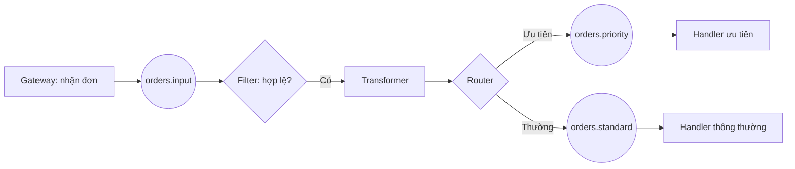
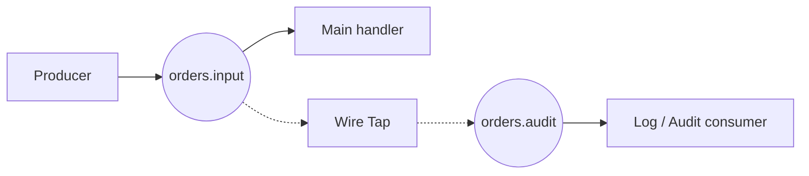
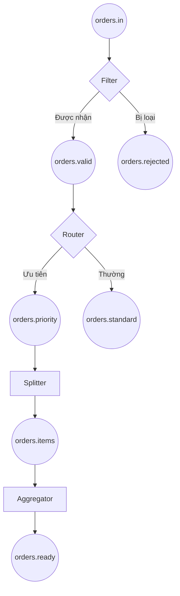
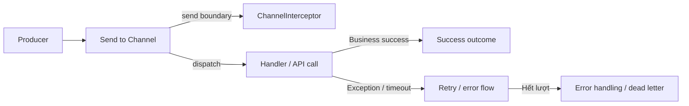

# Channel interceptor và quan sát message

> **Chương:** Message channel  
> **Module:** `SPRING_INTEGRATION_PATTERN` — học Enterprise Integration Patterns với Spring Integration để xây dựng luồng thông điệp ít phụ thuộc, dễ mở rộng; thực hành Gateway, Filter, Transformer, Router, Splitter, Aggregator, retry, error channel, correlation, kiểm thử và theo dõi từng nhánh. Bài này tập trung vào **điểm quan sát tại Message Channel** và cách dùng `ChannelInterceptor` mà không làm sai lệch hành vi nghiệp vụ.

## 1. Mục tiêu học tập

Sau bài này, bạn có thể:

1. Giải thích **Channel Interceptor** là gì, nằm ở đâu trong đường đi message và giải quyết bài toán quan sát nào.
2. Phân biệt các callback `preSend`, `postSend`, `afterSendCompletion`, `preReceive`, `postReceive` và `afterReceiveCompletion`.
3. Gắn interceptor vào một `DirectChannel`, ghi log metadata an toàn và nhận biết giới hạn của việc kết luận “gửi thành công”.
4. Phân biệt **interceptor**, **Wire Tap**, **logging/metrics/tracing** và **error channel**; lựa chọn đúng điểm đo cho Router, Filter, Gateway, Splitter và Aggregator.
5. Kiểm thử khả năng quan sát, đánh giá chi phí vận hành và tránh làm nghẽn hoặc làm lộ dữ liệu trong luồng tích hợp.

## 2. Vì sao cần quan sát message tại channel?

Một flow đặt hàng có thể chạy qua các bước sau:



Khi một đơn `ORD-501` không tới hệ thống xử lý, chỉ ghi log ở đầu Gateway và ở cuối handler chưa đủ để biết:

- Gateway đã gửi message vào channel đầu vào hay chưa?
- Message có thật sự được dispatch tới một endpoint hay không?
- Message đã đi qua nhánh ưu tiên hay nhánh thông thường?
- Khi một consumer bị lỗi, lỗi xảy ra lúc **gửi** hay **xử lý**? Có ranh giới bất đồng bộ nào không?
- Có bao nhiêu message đi qua từng channel, tỷ lệ lỗi và thời gian ở ranh giới send/receive là bao nhiêu?

**Channel Interceptor** cho phép thêm logic **xung quanh thao tác gửi/nhận qua một channel**. Đây là điểm giao cắt hữu ích cho logging, metrics, tagging, kiểm tra metadata, giám sát hoặc chuyển bản sao sang nhánh quan sát. Thay vì chèn mã log vào mọi handler nghiệp vụ, ta gắn một thành phần xử lý xuyên suốt vào channel.

> **Giới hạn quan trọng:** Interceptor quan sát **thao tác trên channel**, không tự động theo dõi toàn bộ vòng đời nghiệp vụ của message qua mọi service, broker, database và mọi nhánh. `send()` trả thành công không đồng nghĩa tác vụ ở đích đã hoàn thành.

## 3. ChannelInterceptor là gì?

Trong Spring Integration, message được trao đổi qua `MessageChannel`; các channel nội bộ phổ biến như `DirectChannel`, `ExecutorChannel`, `QueueChannel` có thể hỗ trợ các callback của Spring Messaging `ChannelInterceptor`.

`org.springframework.messaging.support.ChannelInterceptor` là một **interface** cung cấp các phương thức mặc định để can thiệp hoặc quan sát trước/sau thao tác gửi và nhận message trên các channel hỗ trợ interceptor.

```text
Producer
   |
   | send(message)
   v
[ ChannelInterceptor: preSend ]
   |
   v
[ Message Channel ] ----> Subscriber / Consumer
   |
   +-- [ ChannelInterceptor: postSend ]
   +-- [ ChannelInterceptor: afterSendCompletion ]
```

Hình trên minh họa ý tưởng **bọc quanh thao tác `send`**; thứ tự các callback và thời điểm handler hoàn thành phụ thuộc mô hình dispatch. Đặc biệt, một `ExecutorChannel` có thể chỉ **lên lịch** công việc cho executor trước khi consumer chạy xong. Không đọc hình như một lời hứa rằng mọi handler luôn xử lý xong trước `afterSendCompletion`.

### 3.1. Vị trí của interceptor trong thiết kế EIP

| Thành phần | Chịu trách nhiệm chính | Ví dụ |
| --- | --- | --- |
| **Filter** | Quyết định message nào được phép tiếp tục về mặt nghiệp vụ | Bỏ đơn có `amount <= 0` |
| **Transformer** | Biến đổi payload/header theo contract | Đổi `OrderRequest` thành `NormalizedOrder` |
| **Router** | Chọn channel hoặc nhánh đích | `orders.priority` hay `orders.standard` |
| **Service Activator** | Gọi logic nghiệp vụ khi nhận message | Giữ hàng hoặc tính phí |
| **ChannelInterceptor** | Quan sát/điều chỉnh thao tác qua channel | Log ID, đếm số message, đo thời gian dispatch |
| **Wire Tap** | Chuyển một bản sao của message sang channel quan sát | Gửi thông tin sang flow audit |
| **Error Channel** | Tiếp nhận `ErrorMessage` theo cơ chế lỗi phù hợp | Xử lý lỗi của một luồng bất đồng bộ |

Một interceptor **có khả năng** thay đổi hoặc chặn message, nhưng nên dùng Filter/Transformer/Router cho **luật nghiệp vụ** vì chúng thể hiện ý định rõ hơn, dễ kiểm thử và dễ nhìn thấy trong sơ đồ flow. Interceptor phù hợp với những yêu cầu xuyên suốt như metrics/tracing.

## 4. Vòng đời callback: gửi và nhận

`ChannelInterceptor` có các callback dành cho **send** và **receive**. Không phải channel nào cũng dùng cả hai nhánh: một `DirectChannel` thường có hoạt động dispatch sang subscriber khi gửi; `QueueChannel` có thao tác consumer chủ động `receive()`.

### 4.1. Nhóm callback khi gửi

| Callback | Khi nào xuất hiện? | Giá trị/ý nghĩa | Sử dụng phù hợp |
| --- | --- | --- | --- |
| `preSend(message, channel)` | Trước lúc channel thực hiện gửi | Trả về message để tiếp tục; có thể trả `null` để hủy gửi | Bắt đầu đo thời gian, đọc metadata, kiểm tra giao thức |
| `postSend(message, channel, sent)` | Sau khi thao tác gửi trả về bình thường | `sent` cho biết kết quả thao tác gửi của channel | Đếm số lần dispatch thành công/thất bại ở ranh giới channel |
| `afterSendCompletion(message, channel, sent, ex)` | Khi quá trình gửi kết thúc và chuỗi callback đủ điều kiện hoàn tất | Nhận trạng thái send và exception nếu có | Giải phóng ngữ cảnh tạm, ghi nhận exception khi gửi |

**Lưu ý về `preSend`:** Giá trị `null` nghĩa là **không tiếp tục gửi** message. Đây là công cụ mạnh và nguy hiểm nếu bị dùng để “âm thầm” thực thi luật nghiệp vụ. Không trả về `null` chỉ để che lỗi hoặc lọc đơn hàng mà không có đường xử lý từ chối rõ ràng.

**Lưu ý về `postSend`:** Nếu gửi phát sinh exception, `postSend` có thể không được gọi; đường hoàn tất/error phải được thiết kế và kiểm thử riêng. Mặt khác, `sent == true` biểu thị thao tác ở **channel hiện tại**, không phải xác nhận xử lý thành công ở hệ thống đích.

**Lưu ý về `afterSendCompletion`:** Việc một interceptor có được gọi callback hoàn tất phụ thuộc việc nó đã tham gia chuỗi xử lý đến mức nào. Không nên giả định interceptor đứng sau một interceptor khác đã từ chối trong `preSend` vẫn nhận đủ callback để dọn trạng thái.

### 4.2. Nhóm callback khi nhận

| Callback | Khi nào xuất hiện? | Ý nghĩa |
| --- | --- | --- |
| `preReceive(channel)` | Trước thao tác nhận từ `PollableChannel` | Có thể cho phép/hủy lần nhận (trả về boolean) |
| `postReceive(message, channel)` | Sau một thao tác nhận bình thường | Có thể quan sát/chuyển đổi message trả về cho consumer |
| `afterReceiveCompletion(message, channel, ex)` | Khi thao tác nhận kết thúc | Dọn ngữ cảnh, đo lỗi thao tác nhận |

**Receive callback không phải callback “subscriber xử lý xong”.** Nếu poller lấy được message từ queue và sau đó handler ném exception, giai đoạn `receive()` và giai đoạn nghiệp vụ của handler là **hai mốc khác nhau**.

### 4.3. Diễn giải đúng theo loại channel

| Channel | Nên hiểu các callback thế nào? |
| --- | --- |
| `DirectChannel` | `send()` thường dispatch đồng bộ tới subscriber; exception của handler có thể truyền ngược qua send. Thời gian send có thể bao gồm thời gian handler. |
| `ExecutorChannel` | Send có thể chỉ chuyển việc sang executor; callback hoàn tất send **không bảo đảm** handler đã hoàn tất. Cần đo ở consumer nếu muốn end-to-end latency. |
| `QueueChannel` | Send đưa message vào queue; consumer dùng receive/poller ở thời điểm khác. Nên đo cả enqueue, dequeue và thời gian chờ trong queue. |
| `PublishSubscribeChannel` | Một send có thể dẫn đến nhiều subscriber; kết quả và exception phụ thuộc mô hình dispatch và cấu hình (đồng bộ/executor/error handling). Không suy luận một callback thành kết quả độc lập của từng subscriber. |
| Adapter ra broker | Có thêm ranh giới giao thức, xác nhận publish và consumer xử lý ngoài ứng dụng. Channel interceptor ở nguồn không thay thế ack, broker metrics hay trace phía đích. |

## 5. Ví dụ: gắn interceptor cho một DirectChannel

Ví dụ dưới đây minh họa **gắn interceptor tại channel**, ghi log một số trường metadata an toàn, rồi đưa message tới handler. Giả định ứng dụng đã cấu hình Spring và có dependency Spring Integration; ví dụ phù hợp với kiểu cấu hình Java dùng `@EnableIntegration` và Java DSL.

```java
import org.slf4j.Logger;
import org.slf4j.LoggerFactory;
import org.springframework.context.annotation.Bean;
import org.springframework.context.annotation.Configuration;
import org.springframework.integration.channel.DirectChannel;
import org.springframework.integration.config.EnableIntegration;
import org.springframework.integration.dsl.IntegrationFlow;
import org.springframework.messaging.Message;
import org.springframework.messaging.MessageChannel;
import org.springframework.messaging.support.ChannelInterceptor;

@Configuration
@EnableIntegration
class OrderChannelConfiguration {

    private static final Logger log =
        LoggerFactory.getLogger(OrderChannelConfiguration.class);

    @Bean("orders.input")
    DirectChannel ordersInput(ChannelInterceptor orderChannelObserver) {
        DirectChannel channel = new DirectChannel();
        channel.addInterceptor(orderChannelObserver);
        return channel;
    }

    @Bean
    ChannelInterceptor orderChannelObserver() {
        return new ChannelInterceptor() {
            @Override
            public Message<?> preSend(Message<?> message, MessageChannel channel) {
                log.info("channel.preSend messageId={} orderId={} payloadType={}",
                    message.getHeaders().getId(),
                    message.getHeaders().get("orderId"),
                    message.getPayload().getClass().getSimpleName());
                return message; // Không sửa payload hay headers.
            }

            @Override
            public void postSend(Message<?> message, MessageChannel channel,
                                 boolean sent) {
                log.info("channel.postSend messageId={} sent={}",
                    message.getHeaders().getId(), sent);
            }

            @Override
            public void afterSendCompletion(Message<?> message,
                                            MessageChannel channel,
                                            boolean sent, Exception ex) {
                if (ex != null) {
                    log.warn("channel.send.failed messageId={} sent={}",
                        message.getHeaders().getId(), sent, ex);
                }
            }
        };
    }

    @Bean
    IntegrationFlow orderFlow() {
        return IntegrationFlow.from("orders.input")
            .handle(message -> log.info("handler.received orderId={}",
                message.getHeaders().get("orderId")))
            .get();
    }
}
```

Ở thành phần phát message:

```java
import org.springframework.messaging.Message;
import org.springframework.messaging.MessageChannel;
import org.springframework.messaging.support.MessageBuilder;

MessageChannel input = context.getBean("orders.input", MessageChannel.class);

Message<String> message = MessageBuilder.withPayload("Reserve stock for ORD-501")
    .setHeader("orderId", "ORD-501")
    .setHeader("sourceSystem", "web-store")
    .build();

boolean sent = input.send(message);
System.out.println("Channel send returned: " + sent);
```

Với `DirectChannel` và handler đơn giản như trên, log thường thể hiện các mốc `preSend` → `handler.received` → `postSend`. Nhưng **đây không phải thứ tự chung cho mọi loại channel**; ở channel dùng executor, handler có thể chạy trễ hoặc trên thread khác.

### 5.1. Những gì ví dụ này có và chưa có

- **Có:** interceptor ghi metadata cho channel `orders.input`; handler nhận message qua flow; log có thể liên kết bằng `messageId` và `orderId`.
- **Chưa có:** đo latency chuẩn, phát metrics, distributed tracing, bảo đảm lưu bền, kiểm soát dữ liệu nhạy cảm toàn diện, retry/error channel, hoặc hệ thống đích ngoài.
- **Không làm:** thay đổi payload, đặt điều kiện loại thông điệp hay tự suy ra “đã giữ hàng” từ `sent=true`.

Ghi log `channel` hoặc `channel.toString()` có thể không cho tên ổn định trong mọi cấu hình. Với hệ thống thật, nên **gắn nhãn channel ổn định** từ cấu hình hoặc registry thay vì lấy một chuỗi biểu diễn đối tượng ngẫu nhiên.

## 6. Global interceptor và phạm vi áp dụng

Nếu có nhiều channel, việc gọi `addInterceptor(...)` thủ công ở mọi bean có thể gây bỏ sót. Spring Integration hỗ trợ cơ chế **global channel interceptor** theo pattern để áp một interceptor cho nhiều channel phù hợp (ví dụ các channel có tên bắt đầu bằng `orders.`).

Hai cách triển khai thường gặp:

1. **Cục bộ:** tạo channel rồi `addInterceptor(...)` như ví dụ trên; nhìn rõ channel nào chịu tác động.
2. **Global:** khai báo interceptor với `@GlobalChannelInterceptor` hoặc cấu hình tương đương, kèm **patterns** để chọn channel phù hợp. Cách này có ích cho metrics/tracing thống nhất nhưng cần kiểm tra lại danh sách channel được chọn.

Khi dùng global interceptor, hãy chú ý những channel được framework tạo ngầm, channel phản hồi, channel lỗi và tên channel thay đổi theo cấu hình. Một pattern quá rộng có thể khiến số lần log/metrics tăng mạnh, bao gồm cả những message nội bộ hoặc message chứa dữ liệu nhạy cảm. **Global không có nghĩa là theo dõi cả message broker hoặc tất cả ứng dụng khác.**

## 7. Wire Tap: quan sát luồng phụ mà không chen vào handler chính

**Wire Tap** là một Enterprise Integration Pattern tạo nhánh nhận bản sao của message đi qua đường chính để phục vụ audit, metrics, log hoặc phân tích. Trong Spring Integration, Wire Tap có thể được triển khai như một **channel interceptor** chuyển message sang một channel quan sát.



Đường chính không nhất thiết phải biết consumer của kênh audit. Tuy nhiên, “nhánh phụ” **không bảo đảm hoàn toàn không ảnh hưởng nhánh chính**: nếu nhánh audit bị chậm, dùng channel đồng bộ hoặc ghi dữ liệu không giới hạn, nó có thể làm tăng latency hoặc gây backpressure. Tính tách biệt về thread và độ bền phụ thuộc cấu hình của channel đích và cơ chế xử lý lỗi.

### 7.1. Interceptor thông thường khác Wire Tap thế nào?

| Tiêu chí | Interceptor log trực tiếp | Wire Tap |
| --- | --- | --- |
| Cách quan sát | Thực hiện lệnh đo/log ngay trong callback | Gửi message sang một kênh quan sát khác |
| Độ phức tạp | Ít thành phần, phù hợp metadata rất nhẹ | Có flow phụ và consumer riêng |
| Rủi ro hiệu năng | Logging hoặc metrics nặng làm chậm channel | Nhánh audit có thể tạo tải/bộ đệm hoặc lỗi riêng |
| Mục tiêu điển hình | Counter, trạng thái send, metadata an toàn | Audit độc lập, phân tích, lưu bản ghi cần thiết |
| Vấn đề bảo mật | Không log nguyên payload nhạy cảm | Cần kiểm soát dữ liệu gửi sang nhánh phụ |

**Bản sao message không nhất thiết là deep copy của payload.** Nếu payload là object mutable, các nhánh có thể cùng tham chiếu nội dung và gây rủi ro cạnh tranh hoặc sai lệch dữ liệu. Ưu tiên payload bất biến hoặc copy có chủ đích khi một bên cần sửa dữ liệu.

### 7.2. Phòng tránh vòng lặp quan sát

Nếu global interceptor hoặc Wire Tap áp lên cả `orders.audit`, nó có thể tiếp tục quan sát chính message vừa được gửi để audit. Nếu flow phụ lại gửi trở lại channel nằm trong phạm vi tap, có nguy cơ **tạo vòng lặp hoặc bùng nổ message**.

Biện pháp là giới hạn pattern, loại trừ channel audit/error/metrics khỏi phạm vi cần tap, đồng thời kiểm thử topology có nhánh phụ. Không nên xem “mọi channel” là một lựa chọn mặc định an toàn.

## 8. Thiết kế logs, metrics và tracing đúng mục đích

Ba dạng quan sát thường bổ sung cho nhau, chứ không thay thế lẫn nhau:

| Tín hiệu | Trả lời câu hỏi | Ví dụ |
| --- | --- | --- |
| **Log** | Một message cụ thể đã trải qua bước gì? | `orderId=ORD-501`, `channel=orders.priority`, `sendResult=true` |
| **Metric** | Toàn hệ thống đang hoạt động ra sao? | Throughput, tỷ lệ lỗi, thời gian dispatch, queue depth |
| **Trace** | Một yêu cầu đi qua các service/nhánh nào và mất thời gian ở đâu? | Span qua Gateway → Router → Inventory API |

### 8.1. Chọn dữ liệu log có ý nghĩa

Nên lưu tối thiểu những trường được phép:

- `channelName` ổn định và `component`/`handler` nếu có.
- `messageId` để định danh một message trong phạm vi ứng dụng và `orderId`/business key để theo dõi nghiệp vụ.
- `correlationId` để liên kết các phần của một luồng, nhất là Splitter/Aggregator.
- `traceId`/`spanId` khi có cơ chế distributed tracing đã được thiết lập.
- `payloadType`, `schemaVersion`, `messageKind` để phát hiện sai contract mà không phải log toàn payload.
- `outcome`, `exceptionType`, thời gian và số lần thử lại khi phù hợp.

**Không mặc định log** toàn bộ payload, token xác thực, địa chỉ, thông tin thanh toán hay dữ liệu cá nhân. Hãy phân loại dữ liệu, mask/redact theo quy định, giới hạn độ dài, thời gian lưu và quyền truy cập vào log.

### 8.2. Metric và latency cần có ranh giới rõ

Một đồng hồ đo đặt ở `preSend` và dừng trong `afterSendCompletion` có thể đo **thời gian của send boundary**. Với `DirectChannel`, phép đo có thể bao gồm thời gian handler đồng bộ; với `ExecutorChannel`, nó có thể chỉ đo thời gian lên lịch. Nó **không phải một định nghĩa latency end-to-end nhất quán** cho mọi flow.

Để đo chính xác hơn, định nghĩa riêng:

1. **Channel send duration:** gửi vào channel mất bao lâu.
2. **Queue wait duration:** từ lúc enqueue đến khi dequeue mất bao lâu (cần timestamp được mang theo đáng tin cậy).
3. **Handler processing duration:** handler xử lý trong bao lâu.
4. **End-to-end business duration:** từ nhận yêu cầu đến khi có xác nhận kết quả nghiệp vụ, kể cả ranh giới service ngoài.

Các metric cần quản lý **cardinality**. Tên channel hoặc loại lỗi thường có số giá trị hữu hạn; `orderId`, `messageId`, `traceId` có thể gần như duy nhất cho từng message, vì vậy **không dùng chúng làm tag cho metric tổng hợp** nếu không có biện pháp kiểm soát.

### 8.3. Tracing không chỉ là log cùng một ID

Ở luồng đồng bộ, context có thể nằm trong thread hiện tại; khi chuyển sang executor, poller, broker hoặc remote API, context có thể bị gián đoạn nếu không được **propagate**. Tùy stack sử dụng, tracing có thể được hỗ trợ bởi cơ chế observation/instrumentation tương ứng, nhưng không nên giả định các header trace được truyền tự động qua mọi adapter.

Một thiết kế thường gồm: tạo/tiếp nhận trace context ở ingress, truyền context qua messaging boundary, tạo span riêng cho handler/outbound call, liên kết với `correlationId` nghiệp vụ, và **không thay thế** correlation nghiệp vụ bằng trace ID. Một yêu cầu nghiệp vụ có thể cần liên kết qua nhiều lần retry hoặc nhiều trace khác nhau.

## 9. Theo dõi Router, Filter, Splitter và Aggregator

Interceptor chỉ thấy **những channel có gắn interceptor**. Vì vậy để quan sát một flow nhiều nhánh cần bố trí các điểm đo có chủ đích:



| Nút cần quan sát | Điểm đo hữu ích | Tránh suy luận sai |
| --- | --- | --- |
| **Ingress** | Số message nhận, loại payload, nguồn phát | Đếm ingress không chứng minh downstream thành công |
| **Filter** | Số accepted và rejected; lý do reject | Không thấy message ở channel sau Filter **chưa đủ** kết luận nó bị Filter loại |
| **Router** | Số lượng theo channel đích, nhánh fallback/unknown | Một router có thể đưa message tới nhiều channel tùy kiểu và cấu hình |
| **Splitter** | Số message con, business key, sequence/correlation | `messageId` riêng của từng phần không phải group ID |
| **Aggregator** | Group size, phần còn thiếu, release/timeout, thời gian chờ | Send tới input Aggregator không đồng nghĩa group đã được release |
| **Gateway** | Ingress và reply/timeout, kết quả nghiệp vụ | `send=true` không đồng nghĩa đã nhận reply |

Ví dụ `ORD-501` có ba dòng hàng. Splitter tạo ba message. Muốn biết cả ba đã được gom, cần đo hoặc kiểm tra **đầu ra Aggregator**, khóa `correlationId`, điều kiện `releaseStrategy` và timeout. Đếm ba message đi vào channel đầu vào **không đủ** xác nhận nhóm hoàn thành. Nếu thông điệp bị retry, các bộ đếm channel có thể lớn hơn số thao tác nghiệp vụ duy nhất; cần phân biệt *attempt count* với *unique processed count*.

## 10. Interceptor, lỗi và retry: quan sát đúng tầng

Trong một flow đồng bộ dùng `DirectChannel`, nếu handler ném exception, lỗi có thể truyền về caller và khiến thao tác send thất bại. Với channel dùng executor hoặc poller, lỗi handler có thể được xử lý sau khi send/receive tại ranh giới channel đã kết thúc; trường hợp đó cần quan sát ở handler hoặc cơ chế `ErrorMessage` và `errorChannel` được cấu hình.



**Ba mức trạng thái cần tách biệt:**

- **Message accepted/sent ở channel:** giao nhận tại channel hiện tại đã đạt điều kiện của nó.
- **Handler processed:** handler đã xử lý message (có thể thất bại hoặc được thử lại).
- **Business outcome completed:** hệ thống đích đã thực sự tạo đơn, giữ hàng hoặc ghi dữ liệu theo hợp đồng.

### 10.1. Có nên retry trong `ChannelInterceptor`?

Thông thường **không nên** đưa chính sách retry nghiệp vụ vào interceptor. Retry thuộc vị trí có đủ thông tin về thao tác và khả năng phục hồi, ví dụ advice quanh handler/outbound gateway. Nếu interceptor tự gọi lại `channel.send(...)`, có thể tạo đệ quy, gửi lặp hoặc sai thứ tự callback. Interceptor phù hợp **ghi nhận số lần gửi**; handler/retry advice phù hợp quyết định **thử lại tác vụ nào**.

### 10.2. `errorChannel` không phải một kênh “nhận mọi lỗi” tự động

Với lỗi bất đồng bộ, Spring Integration có cơ chế chuyển lỗi thành `ErrorMessage` và gửi tới error channel theo cấu hình. Với lỗi đồng bộ, exception có thể được ném thẳng đến caller. **Đừng chỉ gắn interceptor cho `errorChannel` rồi khẳng định đã theo dõi được toàn bộ lỗi của module.** Cần kết hợp đo tại handler, gateway, outbound adapter và kiểm tra đường đi của từng loại lỗi.

### 10.3. An toàn khi interceptor thất bại

Một interceptor dùng logging hoặc metrics có thể gặp lỗi khi xuất bản log, gửi thông tin sang mạng hoặc truy cập hệ thống lưu trữ. Nếu throw exception ngay trong `preSend`, nó có thể ảnh hưởng trực tiếp tới flow nghiệp vụ. Vì vậy, hãy giữ instrumentation **nhẹ, có giới hạn, có fallback phù hợp**, và thống nhất chính sách xử lý khi telemetry gặp sự cố. Tránh tạo lời gọi mạng chặn ngay trên thread hot path của `DirectChannel`.

## 11. Kiểm thử ChannelInterceptor bằng JUnit

Phần kiểm thử sau không cần dựng cả ứng dụng: tạo `DirectChannel`, đăng ký một subscriber và interceptor đếm callback. Nó chứng minh interceptor thấy thao tác trên channel và **không thay đổi payload**.

```java
import static org.junit.jupiter.api.Assertions.assertEquals;
import static org.junit.jupiter.api.Assertions.assertTrue;

import java.util.concurrent.atomic.AtomicInteger;

import org.junit.jupiter.api.Test;
import org.springframework.integration.channel.DirectChannel;
import org.springframework.messaging.Message;
import org.springframework.messaging.MessageChannel;
import org.springframework.messaging.support.ChannelInterceptor;
import org.springframework.messaging.support.GenericMessage;

class ChannelInterceptorTest {

    @Test
    void shouldObserveSendWithoutChangingMessage() {
        DirectChannel channel = new DirectChannel();
        AtomicInteger before = new AtomicInteger();
        AtomicInteger after = new AtomicInteger();
        AtomicInteger delivered = new AtomicInteger();

        channel.addInterceptor(new ChannelInterceptor() {
            @Override
            public Message<?> preSend(Message<?> message, MessageChannel source) {
                before.incrementAndGet();
                return message;
            }

            @Override
            public void postSend(Message<?> message, MessageChannel source,
                                 boolean sent) {
                if (sent) {
                    after.incrementAndGet();
                }
            }
        });

        channel.subscribe(message -> {
            assertEquals("ORD-501", message.getPayload());
            delivered.incrementAndGet();
        });

        boolean sent = channel.send(new GenericMessage<>("ORD-501"));

        assertTrue(sent);
        assertEquals(1, before.get());
        assertEquals(1, after.get());
        assertEquals(1, delivered.get());
    }
}
```

Đây chỉ là **unit test cho `DirectChannel` đồng bộ**. Để kiểm thử sản phẩm, nên bổ sung những trường hợp sau:

| Kịch bản | Điều cần xác minh |
| --- | --- |
| Message đi qua channel có interceptor | Đúng metadata được ghi nhận; payload và header nghiệp vụ không bị sửa ngoài ý muốn |
| Message bị Filter loại | Có dữ liệu reject ở điểm thiết kế, không kết luận sai vì thiếu log downstream |
| Router phân nhánh | Các channel đích cần thiết được đo riêng; không đếm nhầm một event thành nhiều nghiệp vụ |
| `QueueChannel` có poller | Đo send và receive là hai thao tác khác nhau, có timeout và backlog |
| `ExecutorChannel` có handler chạy chậm | Log send có thể xuất hiện trước khi handler hoàn thành |
| Handler ném exception | Phân biệt lỗi đồng bộ với error message ở luồng bất đồng bộ |
| Telemetry bị lỗi | Không vô tình làm hỏng flow chính nếu chính sách cho phép tiếp tục |
| Global interceptor chứa channel audit | Không tạo vòng lặp tap/duplicate logs |
| Message chứa dữ liệu nhạy cảm | Log/trace không xuất nguyên payload, khóa bí mật hoặc dữ liệu cá nhân |

## 12. Checklist triển khai thực tế

- [ ] Xác định mục tiêu: audit, metrics, tracing hay theo dõi flow để debug.
- [ ] Gắn interceptor đúng channel và kiểm tra mọi global pattern có chủ ý.
- [ ] Chọn metadata cần lưu; không log payload nhạy cảm hay dùng `messageId` làm metric tag cardinality cao.
- [ ] Phân biệt send boundary, handler duration, queue wait và business completion.
- [ ] Xác định semantics của `DirectChannel`, `ExecutorChannel`, `QueueChannel` hoặc adapter broker.
- [ ] Có correlation ID và trace context đáng tin cậy khi qua Router, Splitter, Aggregator và hệ thống ngoài.
- [ ] Tách đường reject nghiệp vụ, exception và timeout; có error flow/retry phù hợp.
- [ ] Đảm bảo Wire Tap không tạo vòng lặp và nhánh quan sát có giới hạn tải, lưu trữ, truy cập.
- [ ] Kiểm thử message gốc không bị thay đổi ngoài ý muốn và telemetry không chặn hot path.
- [ ] Đánh giá overhead của instrumentation dưới tải thực, có sampling, retention và cảnh báo phù hợp.

## 13. Bài tập vận dụng

Một hệ thống xử lý đơn hàng nhận `OrderPlaced` qua `orders.input`, Filter các đơn không hợp lệ, Router sang `orders.priority` hoặc `orders.standard`; đơn có nhiều sản phẩm được Splitter để kiểm tra tồn kho rồi Aggregator gom kết quả. Khi inventory API bị timeout, flow retry hữu hạn; kết quả cuối được trả về qua Gateway hoặc công bố dưới dạng event.

**Yêu cầu:**

1. Chọn ít nhất **bốn channel** nên gắn interceptor; giải thích lý do và thông số cần đo tại mỗi channel.
2. Dùng `DirectChannel` cho phần đầu và `ExecutorChannel` trước Inventory API. Log `postSend(sent=true)` ở ranh giới executor có chứng minh API đã thành công không? Vì sao?
3. Thiết kế `Wire Tap` đưa thông tin audit sang nhánh phụ nhưng tránh ghi payload nhạy cảm và tránh vòng lặp.
4. Chọn `correlationId`, `orderId`, `messageId`, `traceId` cho bài toán Splitter/Aggregator; phân biệt chức năng của chúng.
5. Viết một test chứng minh `orders.priority` nhận message khi `priority=true`, còn `orders.standard` không nhận; thêm test khi API thất bại và khi một phần của nhóm không trả kết quả.

**Gợi ý thiết kế:** đặt counter ở ingress và các channel nhánh; đo handler inventory riêng với channel send; đặt correlation ở thông điệp con, theo dõi release/expiry của Aggregator; dùng retry advice tại outbound handler chứ không tự resend trong interceptor; đặt audit trên channel riêng có giới hạn và chính sách bảo mật; xác định rõ thời điểm Gateway được trả kết quả.

## 14. Tổng kết

**Channel Interceptor là một điểm mở rộng để quan sát và can thiệp vào thao tác gửi/nhận message qua các Message Channel có hỗ trợ interceptor.** Nó hữu ích để thu thập metadata, metrics và tín hiệu lỗi ở ranh giới channel, nhưng không phải nơi thích hợp để giấu Filter/Router/Transformer nghiệp vụ hoặc chứng minh thành công end-to-end. **Wire Tap** đưa một nhánh message sang flow quan sát, cũng cần giới hạn tài nguyên và kiểm soát dữ liệu.

Trong Spring Integration, hãy luôn phân biệt **khi nào channel chấp nhận message**, **khi nào handler thực sự xử lý** và **khi nào nghiệp vụ ở hệ thống đích hoàn tất**. Kết hợp interceptor với logs, metrics, tracing, correlation, kiểm thử nhánh Router/Filter, timeout, retry và error channel sẽ tạo nên luồng EIP vừa dễ mở rộng vừa có thể chẩn đoán sự cố một cách đáng tin cậy.

**Đọc thêm:** Tài liệu chính thức của Spring Integration về Message Channels, Channel Interceptors, Wire Tap, Global Channel Interceptors, Java DSL, Error Handling và Observability; tài liệu Spring Framework Messaging về `ChannelInterceptor`.
