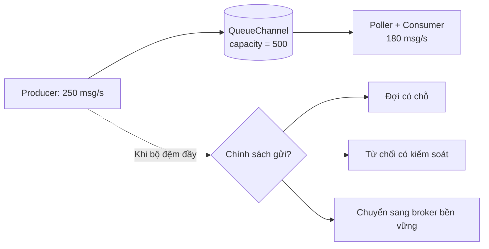
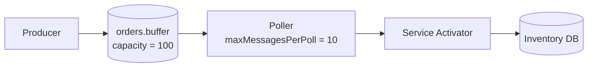
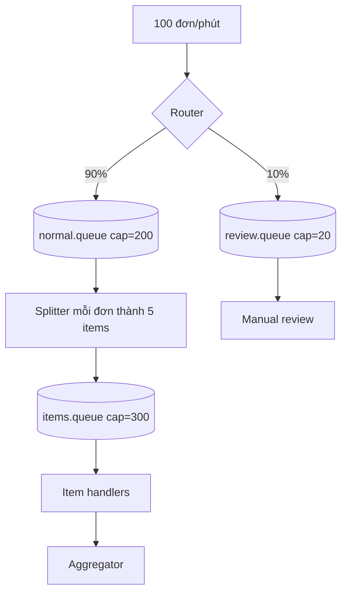

# Channel capacity và hành vi khi đầy

## 1. Vấn đề: producer nhanh hơn consumer

Trong một **integration flow**, producer có thể phát message nhanh hơn tốc độ endpoint phía sau xử lý. Ví dụ, API nhận 250 yêu cầu đặt hàng mỗi giây, còn thao tác xác nhận tồn kho chỉ xử lý được 180 đơn mỗi giây. Nếu tất cả message được xếp vào bộ đệm trong bộ nhớ mà không có giới hạn, hàng đợi tăng dần; nếu chặn producer vô thời hạn, thời gian phản hồi tăng mạnh; nếu loại message tùy tiện, hệ thống có thể mất nghiệp vụ quan trọng.

Trong module **SPRING_INTEGRATION_PATTERN**, ta sử dụng Spring Integration để triển khai Enterprise Integration Patterns (EIP) như **Router, Filter, Transformer, Splitter, Aggregator và Gateway**, kết hợp retry, error channel, correlation và kiểm thử các nhánh. Trước khi đi sâu vào các mẫu đó, cần hiểu **channel capacity**: khả năng giữ message chờ xử lý, cách gửi message khi hết chỗ và tác động của lựa chọn này lên toàn flow.



Ba câu hỏi cần trả lời trước khi chọn channel:

1. **Có bộ đệm không?** `DirectChannel` giao trực tiếp cho subscriber; `QueueChannel` lưu các message chờ consumer lấy; `RendezvousChannel` không có chỗ lưu trung gian theo nghĩa hàng đợi.
2. **Bộ đệm có giới hạn không?** Nếu có, producer gặp điều gì khi số message chờ bằng capacity?
3. **Khi quá tải, yêu cầu nghiệp vụ cho phép đợi, từ chối, thử lại hay chuyển sang nơi lưu bền vững?** Không có chiến lược chung đúng cho mọi loại message.

**Mục tiêu học tập:** phân biệt capacity với throughput, dự đoán hành vi `send` ở channel đầy, cấu hình `QueueChannel` có giới hạn, tổ chức poller/consumer, nhận diện saturation của `ExecutorChannel`, kiểm thử backpressure và quan sát các nhánh quá tải.

## 2. Capacity, throughput, backlog và backpressure

### 2.1. Các thuật ngữ quan trọng

| Thuật ngữ | Ý nghĩa | Ví dụ |
|---|---|---|
| **Capacity** | Số message tối đa mà bộ đệm của channel có thể giữ tại một thời điểm. | `QueueChannel(100)` giới hạn 100 message đang nằm trong queue. |
| **Queue depth / backlog** | Số message đang đợi được tiêu thụ. | Queue có 80/100 vị trí đã dùng. |
| **Throughput** | Số message được xử lý hoặc gửi thành công trong mỗi đơn vị thời gian. | Consumer hoàn tất 180 message/giây. |
| **Arrival rate** (`λ`) | Tốc độ message tới producer/channel. | 250 message/giây. |
| **Service rate** (`μ`) | Tốc độ downstream lấy và xử lý message. | 180 message/giây. |
| **Backpressure** | Tín hiệu hoặc cơ chế làm producer giảm/chặn tốc độ khi downstream không theo kịp. | `send` chờ, gửi không thành công, HTTP trả 429/503 theo chính sách. |
| **Overload / saturation** | Tình trạng tài nguyên như queue, thread pool hay connection pool cạn khả năng tiếp nhận. | Queue đầy hoặc executor từ chối task mới. |

Với mô hình một queue, nếu trung bình `λ > μ`, backlog **có xu hướng tăng**. Một phép ước lượng thô trong khoảng tải ổn định:

\[
\Delta Q \approx (\lambda - \mu)\,\Delta t
\]

Nếu `λ = 250` và `μ = 180` message/giây, backlog tăng khoảng **70 message/giây**. Một queue trống với capacity 700 có thể đầy sau khoảng **10 giây** nếu tốc độ không đổi. Đây chỉ là mô hình minh họa, **không phải dự báo SLA**: trong thực tế arrival có burst, độ trễ phân tán, consumer chạy song song, filter bỏ bớt message và chi phí xử lý khác nhau giữa các loại payload.

**Capacity không làm consumer xử lý nhanh hơn.** Tăng từ 100 lên 1.000 vị trí chỉ cho phép tích backlog lâu hơn; nếu throughput downstream thấp kéo dài, cuối cùng queue vẫn đầy. Capacity hữu ích để hấp thụ **burst tạm thời**, không thay thế việc tối ưu service, scale consumer hay kiểm soát tốc độ đầu vào.

### 2.2. Bộ đệm đầy khác với bộ đệm hỏng

Một queue đầy không nhất thiết có exception hoặc lỗi hạ tầng. Nó có thể đang hoạt động đúng theo giới hạn bảo vệ bộ nhớ. Khi đó producer nên nhận một kết quả rõ ràng: **đợi**, **không nhận thêm**, hoặc **chuyển sang tuyến tiếp nhận khác được thiết kế trước**. Ngược lại, tăng giới hạn đến mức không thực tế có thể biến tình huống quá tải dự đoán được thành lỗi hết bộ nhớ khó phục hồi.

Đặc biệt, **capacity thường tính theo số message, không tính theo byte**. Hai queue cùng 100 message có thể tiêu thụ RAM rất khác nhau nếu một queue chứa 100 ID ngắn, queue kia chứa 100 payload lớn. Khi đặt capacity, cần ước lượng kích thước payload và các object/headers đi kèm.

## 3. Mỗi loại channel có ý nghĩa capacity khác nhau

| Channel | Có queue nội bộ? | Điểm bão hòa cần xét | Hành vi trọng tâm |
|---|---|---|---|
| `DirectChannel` | Không có queue lưu message kiểu `QueueChannel`. | Thời gian xử lý của subscriber, thread gọi và sự sẵn có của handler. | Dispatch đồng bộ; bên gửi có thể bị giữ trong khi handler đang chạy. |
| `QueueChannel` | Có. | Số phần tử đang chờ đạt capacity. | Producer gửi vào queue, consumer chủ động `receive`/poll; gửi khi đầy phụ thuộc timeout. |
| `PriorityChannel` | Có hàng đợi ưu tiên. | Capacity và chính sách lấy phần tử theo độ ưu tiên. | Có thể xếp ưu tiên, nhưng không biến queue thành vô hạn hay bảo đảm fairness tuyệt đối. |
| `RendezvousChannel` | Không có bộ đệm chờ theo kiểu lưu nhiều message. | Chưa có receiver sẵn sàng nhận. | Handoff trực tiếp: producer có thể phải đợi consumer nhận. |
| `ExecutorChannel` | Không có `QueueChannel` riêng; có thể dùng queue của executor. | Số thread, queue và rejection policy của `TaskExecutor`. | Chuyển xử lý sang executor; bão hòa biểu hiện theo chính sách executor. |
| `PublishSubscribeChannel` | Không mặc nhiên có queue cho từng subscriber. | Thời gian/khả năng thực thi các subscriber hoặc executor nếu dùng. | Fan-out tới các subscriber, có thể đồng bộ hoặc qua executor tùy cấu hình. |

Không nên nói mọi channel đều có `capacity` như nhau. Chẳng hạn, `new QueueChannel(50)` giới hạn **message đang chờ**; `ThreadPoolTaskExecutor.setQueueCapacity(50)` giới hạn **task đang chờ trong executor**. Một task có thể xử lý một message, nhiều message hoặc phát sinh nhiều tác vụ khác; hai con số 50 không đồng nghĩa về tải hay tính bền vững.

## 4. QueueChannel: trường hợp điển hình của hàng đợi đầy

### 4.1. Tạo một QueueChannel có capacity rõ ràng

Spring Integration cung cấp `QueueChannel`, một implementation của `PollableChannel`, có thể giới hạn số message đang nằm trong queue:

```java
import org.springframework.integration.channel.QueueChannel;

QueueChannel queue = new QueueChannel(2);
```

Ở ví dụ này, hàng đợi lưu tối đa **2 message chưa được nhận ra**. Message đã được consumer `receive` thì không còn chiếm một vị trí trong queue, dù xử lý nghiệp vụ của consumer đó có thể chưa hoàn tất.

Nếu dùng constructor mặc định của `QueueChannel`, nên hiểu đây là queue **không có giới hạn nhỏ được thiết kế tường minh** (về triển khai thường là giới hạn cực lớn); không nên dựa vào mặc định như một chính sách chống quá tải. Trong production, đặt capacity dựa trên workload, memory budget và thời gian chờ chấp nhận được.

### 4.2. Hành vi khi gọi `send(message, timeout)`

`MessageChannel` hỗ trợ phương thức `send(Message<?> message, long timeout)`; với queue có giới hạn, timeout quyết định cách chờ vị trí trống:

| `timeout` | Khi còn chỗ | Khi queue đã đầy |
|---|---|---|
| `0` | Gửi thành công ngay. | Thử ngay và trả `false` nếu không thể enqueue; không chủ động chờ. |
| Số dương (mili giây) | Gửi thành công. | Đợi **tối đa** khoảng thời gian đó; nếu vẫn không có chỗ, trả `false`. |
| `-1` (timeout vô hạn) | Gửi thành công. | Có thể chờ cho tới khi consumer giải phóng chỗ hoặc thread bị gián đoạn; dễ làm caller bị treo nếu không có consumer. |

Các kết quả này mô tả **hành vi gửi cơ bản của một QueueChannel hoạt động bình thường**. Caller còn phải phân biệt `false` với exception do ngắt thread, interceptor hoặc handler xung quanh; template/gateway có thể biến việc gửi thất bại thành exception ở tầng cao hơn. Đừng coi `send(...)` trả `false` là message đã vào queue.

#### Minh họa bằng timeline

```text
T0  capacity=2, queue=[]
T1  send(A, 0)  -> true     queue=[A]
T2  send(B, 0)  -> true     queue=[A, B]       FULL
T3  send(C, 0)  -> false    queue=[A, B]       không chờ
T4  receive(0)  -> A        queue=[B]          giải phóng 1 chỗ
T5  send(C, 0)  -> true     queue=[B, C]       FULL
```

Ở T3, `C` **không được tự động thử lại** và không thể tìm thấy trong queue. Nếu ứng dụng coi `false` là thành công thì có nguy cơ mất yêu cầu. Với timeout dương, producer tại T3 có thể đợi cho đến T4, được giải phóng chỗ rồi tiếp tục; không có guarantee sẽ thành công nếu nhiều producer cùng tranh chỗ.

### 4.3. Đoạn Java chạy độc lập với QueueChannel

```java
import org.springframework.integration.channel.QueueChannel;
import org.springframework.messaging.Message;
import org.springframework.messaging.support.MessageBuilder;

QueueChannel queue = new QueueChannel(2);

Message<String> a = MessageBuilder.withPayload("A").build();
Message<String> b = MessageBuilder.withPayload("B").build();
Message<String> c = MessageBuilder.withPayload("C").build();

boolean okA = queue.send(a, 0);      // true
boolean okB = queue.send(b, 0);      // true
boolean okC = queue.send(c, 0);      // false vì queue đã đầy

Message<?> taken = queue.receive(0); // lấy A ra khỏi queue
boolean retryC = queue.send(c, 0);  // true: vừa có chỗ

System.out.println(okA && okB && !okC && retryC); // true
System.out.println(taken.getPayload());            // A
```

`receive(0)` không đợi nếu queue trống; nó trả `null` khi không lấy được message. Trong code production, luôn kiểm tra `null` trước khi truy cập payload. Đoạn ví dụ có thứ tự gửi/nhận cố định và chỉ một thread; trong ứng dụng nhiều producer/consumer, không suy luận kết quả chỉ bằng quan sát queue size tại một thời điểm vì có race condition.

### 4.4. Khi timeout âm hoặc vô hạn trở thành rủi ro

Nếu sender dùng cách gửi có thể **đợi vô thời hạn**, còn consumer bị dừng hoặc đã hỏng, request có thể mắc kẹt. Nếu đang giữ lock/connection/transaction trong lúc chờ, việc nghẽn queue có thể kéo theo deadlock hoặc exhaustion ở thành phần khác.

Nguyên tắc thiết kế:

1. Dùng timeout gửi **hữu hạn** khi có giới hạn về thời gian phản hồi.
2. Trả kết quả rõ ràng khi quá tải; chỉ retry khi có chính sách delay, giới hạn số lần và chống xử lý lặp.
3. Theo dõi backlog và consumer liveness; **không** chỉ tăng timeout để che nghẽn.
4. Không thực hiện thao tác chờ vô hạn trong cùng transaction/critical section nếu downstream cần tài nguyên đang bị giữ.

## 5. Kết hợp QueueChannel với Poller và Consumer

`QueueChannel` là `PollableChannel`: consumer phải chủ động lấy message. Trong Spring Integration, một **polling endpoint** có thể dùng `Poller` để kiểm tra queue định kỳ và chuyển message cho handler.



Ví dụ cấu hình bằng Java DSL, hướng tới Java 17+, Spring Boot 3.x và Spring Integration 6.x:

```java
import java.math.BigDecimal;

import org.springframework.context.annotation.Bean;
import org.springframework.context.annotation.Configuration;
import org.springframework.integration.channel.QueueChannel;
import org.springframework.integration.config.EnableIntegration;
import org.springframework.integration.dsl.IntegrationFlow;
import org.springframework.integration.dsl.Pollers;

record OrderCommand(String orderId, BigDecimal total) {}

interface OrderProcessingService {
    void process(OrderCommand order);
}

@Configuration
@EnableIntegration
class OrderQueueConfiguration {

    @Bean(name = "orders.buffer")
    QueueChannel ordersBuffer() {
        return new QueueChannel(100);
    }

    @Bean
    IntegrationFlow orderConsumerFlow(OrderProcessingService processingService) {
        return IntegrationFlow.from("orders.buffer",
                        endpoint -> endpoint.poller(
                                Pollers.fixedDelay(200)
                                        .maxMessagesPerPoll(10)))
                .handle(OrderCommand.class, (order, headers) -> {
                    processingService.process(order);
                    return null; // endpoint một chiều, không cần reply
                })
                .get();
    }
}
```

`OrderProcessingService` là interface nghiệp vụ của ứng dụng; cần cung cấp bean triển khai thực tế khi chạy trong Spring context. Ví dụ không giả định constructor hay implementation có sẵn trong framework.

Ở đây, `fixedDelay(200)` là khoảng cách giữa các lượt poll theo cấu hình trigger, **không phải** cam kết đúng 10 message mỗi 200 ms. `maxMessagesPerPoll(10)` đặt số message **tối đa** mà một lượt poll được lấy (tùy scheduler, số message có sẵn và thời gian handler); nó không tăng tự động số thread hoặc đảm bảo throughput. Nếu consumer xử lý mất 500 ms/message trên một thread, queue vẫn có thể đầy dù capacity đã là 100.

### 5.1. Producer có timeout và kết quả riêng khi đầy

Một producer có thể gửi trực tiếp vào bean `orders.buffer` để điều khiển thời gian đợi. Ví dụ sau **không dùng gateway request–reply**: thao tác nhận vào queue chỉ xác nhận tiếp nhận vào bộ đệm, **chưa phải xử lý nghiệp vụ thành công**.

```java
import org.springframework.integration.channel.QueueChannel;
import org.springframework.messaging.support.MessageBuilder;

final class OrderIntake {
    private final QueueChannel queue;

    OrderIntake(QueueChannel queue) {
        this.queue = queue;
    }

    boolean tryAccept(OrderCommand order) {
        return queue.send(MessageBuilder.withPayload(order)
                .setHeader("orderId", order.orderId())
                .build(), 100); // đợi tối đa 100 ms để enqueue
    }
}
```

Ở ứng dụng Spring thật, nên inject đúng bean `orders.buffer` (ví dụ bằng `@Qualifier`) nếu có nhiều `QueueChannel` cùng kiểu. Bước gọi `tryAccept()` cần chuyển `true/false` sang một **contract nghiệp vụ**: thành công nghĩa là "đã vào bộ đệm", thất bại nghĩa là "chưa được nhận". Nếu yêu cầu đảm bảo không mất dữ liệu qua restart, in-memory queue không phải điểm xác nhận đủ mạnh; nên xem xét broker/message store bền vững và cơ chế xác nhận tương ứng.

### 5.2. Buffer và consumer throughput là hai vấn đề độc lập

Khi queue đạt capacity, các lựa chọn tăng năng lực **đúng chỗ** là:

- Tối ưu endpoint phía sau nếu nó là bottleneck (database query, HTTP downstream, khóa đồng bộ).
- Tăng consumer concurrency có kiểm soát nếu nghiệp vụ cho phép xử lý song song; kiểm tra thread, transaction và thứ tự message.
- Điều chỉnh poll interval/batch size dựa trên đo lường, không mặc định "poll nhanh hơn" luôn tốt.
- Giảm tốc producer, gom/loại message không cần thiết bằng Filter theo hợp đồng đã định.
- Phân bổ queue riêng cho các luồng quan trọng để một nhánh chậm không chiếm toàn bộ capacity.

Chỉ tăng capacity là giải pháp hợp lý nếu mục tiêu chủ yếu là **chịu burst ngắn** và hệ thống downstream có thể giải phóng backlog sau đợt cao điểm.

## 6. Chọn chính sách khi đầy: đợi, từ chối, lưu bền vững hay giảm tải

| Chính sách | Cơ chế | Phù hợp khi | Rủi ro cần kiểm soát |
|---|---|---|---|
| **Block / wait** | `send` với timeout dương hoặc vô hạn. | Producer chịu được độ trễ và downstream sớm hồi phục. | Thread bị giữ; timeout dây chuyền, chặn transaction, nghẽn toàn hệ thống. |
| **Fail fast** | `send(message, 0)` và kiểm tra `false`. | API ưu tiên phản hồi nhanh, client có cơ chế retry phù hợp. | Cần biểu diễn lỗi rõ ràng và bảo đảm không công bố đã nhận khi chưa enqueue. |
| **Bounded wait** | Timeout ngắn hữu hạn. | Muốn hấp thụ jitter nhỏ nhưng giới hạn SLA. | Kết quả phụ thuộc race/concurrency; cần chỉ số timeout. |
| **Durable queue/broker** | Đẩy sang JMS/Kafka/RabbitMQ hoặc store bền vững có cấu hình phù hợp. | Cần phục hồi qua restart, consumer tạm ngưng, tách producer/consumer dài hạn. | Vẫn có quota, broker overload, retry/ack/DLQ, thứ tự và duplicate. |
| **Load shedding** | Từ chối một số yêu cầu ít ưu tiên khi quá tải. | Dữ liệu có thể bỏ theo chính sách rõ ràng (ví dụ một số telemetry). | Không áp dụng mù cho thanh toán/đơn hàng quan trọng. |
| **Scale downstream** | Tăng worker hoặc cải thiện throughput. | Có khả năng xử lý song song và đủ tài nguyên downstream. | Có thể làm nghẽn database/dịch vụ ngoài và đảo thứ tự message. |

Với HTTP request ở biên hệ thống, việc channel đầy có thể được ánh xạ thành phản hồi **429 Too Many Requests** hoặc **503 Service Unavailable** tùy nguyên nhân và contract API, kèm hướng dẫn thử lại khi phù hợp. Đây là quyết định của tầng API, **không phải** hành vi mặc định của `QueueChannel`. Đừng trả HTTP 200/202 "accepted" nếu message thực tế chưa vào nơi đảm bảo xử lý như đã hứa.

### 6.1. Backpressure không đồng nghĩa với retry tự động

Giả sử QueueChannel có capacity 2, producer gửi message thứ ba và nhận `false`. Cơ chế channel đã **báo quá tải**, nhưng nó không:

- Tự xếp message thứ ba vào queue khác.
- Tự thử gửi lại với backoff.
- Tự tạo `ErrorMessage` trên một error channel theo cùng logic với handler ném exception.
- Tự bảo đảm message không bị xử lý trùng nếu bên gửi retry.

Muốn retry, hãy định nghĩa **retryable errors**, số lần thử, backoff/jitter, tổng thời gian chờ và idempotency. Nếu chờ retry trong cùng thread xử lý message mà downstream cần chính thread đó giải phóng queue, có thể tạo deadlock hoặc khuếch đại nghẽn.

### 6.2. Error flow phải phân biệt lỗi tiếp nhận và lỗi xử lý

```text
Producer -- send false/timeout --> INTAKE_REJECTED (chưa được nhận)

Queue -- consumer nhận --> Handler -- exception --> PROCESSING_FAILED
                                                   | retry / recovery / DLQ
```

Lỗi **không enqueue được** khác lỗi **đã enqueue nhưng handler thất bại**. Với channel in-memory, một message đã được `receive` ra khỏi queue nhưng handler fail có thể không tự quay lại queue; phải thiết kế transaction/recovery cụ thể, không giả định có at-least-once delivery. Error channel, retry advice, transaction và broker acknowledgment giải quyết các phần trách nhiệm khác nhau.

## 7. ExecutorChannel: khi đầy là đầy hàng đợi task của executor

`ExecutorChannel` chuyển việc dispatch sang một `TaskExecutor`. Nó không có cùng tham số `capacity` như `QueueChannel`; giới hạn thường đến từ **thread pool** và **task queue** của executor. Ví dụ:

```java
import java.util.concurrent.ThreadPoolExecutor;

import org.springframework.context.annotation.Bean;
import org.springframework.integration.channel.ExecutorChannel;
import org.springframework.messaging.MessageChannel;
import org.springframework.scheduling.concurrent.ThreadPoolTaskExecutor;

@Bean
ThreadPoolTaskExecutor integrationExecutor() {
    ThreadPoolTaskExecutor executor = new ThreadPoolTaskExecutor();
    executor.setCorePoolSize(4);
    executor.setMaxPoolSize(8);
    executor.setQueueCapacity(50);
    executor.setThreadNamePrefix("integration-worker-");
    executor.setRejectedExecutionHandler(
            new ThreadPoolExecutor.AbortPolicy());
    executor.initialize();
    return executor;
}

@Bean(name = "orders.async")
MessageChannel asyncOrders(ThreadPoolTaskExecutor integrationExecutor) {
    return new ExecutorChannel(integrationExecutor);
}
```

Khi executor đã sử dụng hết các thread khả dụng **và** task queue không còn chỗ, việc nộp task mới có thể bị **từ chối** theo `RejectedExecutionHandler`. Với `AbortPolicy`, biểu hiện thường là exception loại rejected execution, được các tầng Spring có thể bọc/diễn giải khác nhau. Đây **không phải** trường hợp `QueueChannel.send(message, 0)` trả `false` theo cùng hợp đồng; luôn quan sát exception và cấu hình executor thực tế.

Chi tiết cần nắm với `ThreadPoolTaskExecutor`: khi dùng hàng đợi có capacity dương, executor thường ưu tiên dùng thread core và **xếp vào queue** trước khi tăng số thread tới `maxPoolSize`. Do đó đặt `corePoolSize=4`, `maxPoolSize=8`, `queueCapacity=50` **không** có nghĩa nó ngay lập tức dùng 8 thread rồi mới queue. Cần load test để đánh giá hành vi pool và chiến lược scale.

Một số rejection policies khác như `CallerRunsPolicy` có thể khiến **thread gửi chạy tác vụ** khi executor bão hòa (trừ trường hợp executor ngừng), tạo backpressure nhưng cũng làm thay đổi latency và ranh giới đồng bộ/bất đồng bộ. Không chọn policy chỉ vì tên nghe hợp lý; phải kiểm tra ảnh hưởng tới contract của gateway, transaction, logging/MDC và thứ tự xử lý.

### 7.1. Nhầm lẫn phổ biến: "ExecutorChannel luôn không chặn producer"

Trong điều kiện bình thường, executor tiếp nhận task nhanh và handler thực thi ở thread khác. Khi quá tải, một số policy từ chối hoặc buộc caller chạy task. Do đó **không có bảo đảm chung rằng producer luôn trở về ngay lập tức**. Mỗi `TaskExecutor` và rejection policy có semantics riêng.

Ngoài ra, `ExecutorChannel` tự thân không phải kho lưu trữ message bền vững. App restart có thể làm mất các task/message còn trong bộ nhớ, bất kể đang chạy hay đang chờ.

## 8. Capacity trong flow có Router, Splitter và Aggregator

Thực tế không chỉ có một queue. **Router** có thể chia tải vào nhiều nhánh, mỗi nhánh có backlog khác nhau. **Splitter** có thể nhân một message đơn hàng thành hàng chục message dòng hàng; **Aggregator** phải đợi nhiều phần trước khi phát kết quả. Vì vậy capacity phải được tính theo **đơn vị message ở từng đoạn**, không chỉ theo request đầu vào.



**Các điểm dễ nghẽn:**

1. `review.queue` có thể đầy dù tổng incoming rate thấp, vì bước xét duyệt chậm.
2. Sau Splitter, **một** đơn có thể tạo **nhiều** messages: 90 đơn/phút vào nhánh thường và 5 dòng hàng/đơn có thể phát 450 item messages/phút trước khi xử lý.
3. Aggregator giữ state các group đang chờ; backlog group không chỉ nằm trong `QueueChannel`. Cần giám sát số group chưa release, timeout và message store.
4. Một nhánh dùng queue đầy có thể khiến thread của nhánh khác bị chặn nếu chúng cùng chia sẻ executor hoặc giữ tài nguyên giao dịch.

Không ép tất cả nhánh dùng capacity bằng nhau. Đặt budget theo độ quan trọng, kích thước payload, tốc độ downstream, burst, retry và độ trễ chấp nhận được. Nếu nhóm cần duyệt có SLA dài, có thể cần durable queue/worker riêng thay vì dồn vào bộ đệm in-memory của request–reply gateway.

### 8.1. Correlation và quá tải phải đi cùng quan sát

Khi message bị Splitter chia thành các phần, cần gắn correlation key ổn định và nhận biết sequence. Nếu một message con không được enqueue vì full, Aggregator có thể **không bao giờ nhận đủ phần** theo release strategy. Khi đó:

- Ghi lại `correlationId`, `sequenceNumber`, `sequenceSize` nếu có, cùng `traceId` và business ID.
- Định nghĩa timeout/expiry của group và xử lý kết quả thiếu theo yêu cầu nghiệp vụ.
- Kiểm tra retry có thể phát sinh duplicate item và cách Aggregator xử lý duplicate.
- Theo dõi từng queue theo nhánh; không chỉ nhìn tổng số request ở inbound gateway.

Một nhánh bị quá tải không tự động xuất hiện như một lỗi rõ ràng ở nhánh khác. Quan sát cần giúp trả lời **đã nhận**, **đã xử lý**, **đã gửi tiếp** hay **bị từ chối ở điểm nào**.

## 9. Kiểm thử hành vi đầy queue và timeout

### 9.1. Unit test không cần Spring context

JUnit 5 có thể kiểm tra chính xác capacity và `send(..., 0)` mà không cần đợi thời gian thực:

```java
import org.junit.jupiter.api.Test;
import org.springframework.integration.channel.QueueChannel;
import org.springframework.messaging.Message;
import org.springframework.messaging.support.MessageBuilder;

import static org.junit.jupiter.api.Assertions.assertEquals;
import static org.junit.jupiter.api.Assertions.assertFalse;
import static org.junit.jupiter.api.Assertions.assertNotNull;
import static org.junit.jupiter.api.Assertions.assertTrue;

class QueueChannelCapacityTest {

    @Test
    void rejectsImmediatelyWhenQueueIsFullAndAcceptsAfterReceive() {
        QueueChannel queue = new QueueChannel(2);
        Message<String> a = MessageBuilder.withPayload("A").build();
        Message<String> b = MessageBuilder.withPayload("B").build();
        Message<String> c = MessageBuilder.withPayload("C").build();

        assertTrue(queue.send(a, 0));
        assertTrue(queue.send(b, 0));
        assertEquals(2, queue.getQueueSize());

        assertFalse(queue.send(c, 0));
        assertEquals(2, queue.getQueueSize());

        Message<?> consumed = queue.receive(0);
        assertNotNull(consumed);
        assertEquals("A", consumed.getPayload());
        assertTrue(queue.send(c, 0));
        assertEquals(2, queue.getQueueSize());
    }
}
```

`getQueueSize()` phù hợp để **chẩn đoán/test tại thời điểm biết rõ không có luồng khác**, nhưng không phải phép kiểm tra atomic để quyết định "đã có chỗ nên chắc chắn send thành công" trong hệ thống nhiều thread. **Nguồn chuẩn về kết quả gửi là chính `send(...)` hoặc exception của API gửi**, không phải phép đọc `queueSize` trước đó.

### 9.2. Integration test cho producer đang chờ

Để kiểm tra `send(message, timeout)` khi queue đầy:

1. Tạo queue capacity 1, gửi message `A` thành công.
2. Từ một thread khác gọi `send(B, 500)` và bảo đảm thread đã thực sự bắt đầu phép gửi (dùng synchronization barrier/latch, không chỉ `Thread.sleep`).
3. Lấy `A` khỏi queue trước khi hết timeout; kiểm tra kết quả gửi `B` thành công và consumer lấy được `B`.
4. Lặp lại, **không** lấy `A`; kiểm tra sender gửi `B` trả `false` sau khoảng giới hạn, với biên sai số phù hợp môi trường CI.
5. Bảo đảm shutdown executor/test threads trong `finally`; timeout toàn bài test phải hữu hạn để không treo CI.

Test về thời gian có thể flaky nếu máy CI quá tải; tránh assert số mili giây tuyệt đối. Test quan trọng là **trạng thái kết quả** và việc **không mất hoặc nhân đôi message**, không phải chứng minh scheduler thức dậy chính xác từng millisecond.

### 9.3. Ma trận kiểm thử toàn flow

| Tình huống | Dấu hiệu mong đợi | Khẳng định cần có |
|---|---|---|
| Queue dưới capacity | `send` trả `true`. | Consumer nhận đủ message theo contract. |
| Queue vừa đầy | `send(..., 0)` trả `false`. | Không ghi nhận message đó là đã accepted. |
| Queue đầy, receiver giải phóng chỗ | `send` có timeout dương có thể thành công. | Một bản message được enqueue; không tự nhân đôi. |
| Queue đầy liên tục | `send` chờ tới giới hạn rồi thất bại. | Có metrics/log cho kết quả quá tải và phản hồi producer. |
| Consumer chậm/hỏng | Queue depth tăng và đạt ngưỡng cảnh báo. | Không cần restart app mới nhìn thấy sự cố. |
| Executor saturation | Policy tạo exception/chạy caller theo cấu hình. | Không đồng nhất với `QueueChannel` full; lỗi có trace/correlation. |
| Splitter fan-out vượt năng lực nhánh | Một hoặc nhiều queue tăng backlog. | Group expiry/recovery được kiểm thử, không chờ vô hạn. |
| Restart ứng dụng với queue in-memory | Message đang chờ không có cam kết lưu lại. | Không công bố delivery guarantee mà thiết kế không hỗ trợ. |

## 10. Giám sát capacity và xác định ngưỡng cảnh báo

Một hệ thống chạy thực tế cần giám sát đồng thời **độ sâu hàng đợi**, **tốc độ vào/ra**, **latency**, **tỷ lệ không enqueue được** và **tình trạng downstream**.

| Metric / tín hiệu | Vai trò | Cách diễn giải |
|---|---|---|
| Queue depth | Message đang chờ. | Liên tục tăng nghĩa là downstream không theo kịp hoặc bị lỗi. |
| Remaining capacity | Số vị trí còn. | Tiến về 0 là dấu hiệu gần full; giá trị là snapshot. |
| Enqueue accepted/rejected | Kết quả nhận message ở producer. | Rejected tăng nghĩa là cần thay chính sách tải hoặc kiểm tra consumer. |
| Oldest-message age | Message lâu nhất chưa xử lý. | Có thể cảnh báo sớm cả khi queue depth chưa quá cao. |
| Consumer throughput | Số message xử lý thành công mỗi giây. | Phân biệt queue đầy do burst hay do downstream xuống tốc. |
| Processing failures/retry | Lỗi, số lần thử lại. | Retry quá mức có thể làm tăng tải nhập queue. |
| Executor active threads / task queue | Độ bão hòa executor. | Liên quan `ExecutorChannel`, không thay thế việc đo `QueueChannel`. |
| Aggregator incomplete groups | Các group đang đợi. | Có thể nghẽn dù QueueChannel đã trống. |

Ví dụ cách quan sát một queue trong application code:

```java
import org.springframework.integration.channel.QueueChannel;

void reportQueueSnapshot(QueueChannel queue) {
    int queued = queue.getQueueSize();
    int free = queue.getRemainingCapacity();
    System.out.printf("queued=%d remaining=%d%n", queued, free);
}
```

Đây là **ảnh chụp tức thời**, không phải một phép reservation chỗ trống. Để làm dashboard dài hạn, tích hợp metrics/observation thông qua hạ tầng giám sát Spring Integration/Micrometer theo phiên bản đang dùng và đặt ngưỡng phù hợp với **capacity thực tế** của từng queue; đừng hardcode một giá trị cảnh báo chung cho mọi flow.

### 10.1. Ví dụ đánh giá ba ngưỡng cảnh báo

Với queue capacity 100, có thể **khởi đầu để hiệu chỉnh** bằng các mức minh họa:

- **70/100:** kiểm tra xu hướng tăng trong vài phút, đồng thời nhìn consumer throughput.
- **90/100:** cảnh báo nguy cơ đầy nếu tốc độ vào còn cao.
- **100/100:** đo tỷ lệ `send` thất bại và phản hồi producer theo chính sách quá tải.

Đây **không phải quy tắc vận hành mặc định**. Queue sâu 95 nhưng đang giảm đều có thể ít nguy hiểm hơn queue sâu 50 đang tăng rất nhanh, trong khi oldest-message age có thể đã vi phạm SLA trước khi capacity đầy. Dùng nhiều metric kết hợp và diễn tập tình huống burst/consumer outage.

## 11. Các lỗi thiết kế thường gặp

| Hiểu nhầm | Hậu quả | Cách xử lý đúng |
|---|---|---|
| "Capacity lớn hơn sẽ tăng throughput." | Chỉ che backlog; độ trễ vẫn tăng. | Đo và giải quyết bottleneck downstream, scale hợp lý. |
| "Mọi `MessageChannel` đều có queue capacity." | Đặt sai kỳ vọng với `DirectChannel` hoặc `ExecutorChannel`. | Chọn loại channel theo semantics; xét cả executor và transport. |
| "QueueChannel mặc định đủ an toàn để chống quá tải." | RAM tăng không kiểm soát khi backlog kéo dài. | Đặt capacity hữu hạn theo memory budget và đo payload size. |
| "`send(..., 0)` trả `false` nghĩa là message đã được retry." | Producer làm rơi message hoặc gửi nhầm trạng thái accepted. | Kiểm tra kết quả và áp dụng chính sách retry/rejection riêng. |
| "Blocking vô hạn là không mất message." | Thread/transaction bị giữ, gây timeout dây chuyền. | Đặt timeout hữu hạn và error contract rõ. |
| "Queue in-memory giống broker durable." | Restart có thể làm mất messages đang chờ. | Dùng broker/store bền vững và thiết kế ack/recovery khi cần. |
| "Có QueueChannel thì consumer tự xử lý." | Message nằm yên trong queue. | Cần poller/consumer hoặc `receive()` thực tế. |
| "Tăng maxPoolSize thì ExecutorChannel sẽ luôn dùng hết thread ngay." | Pool vẫn xếp task vào queue trước khi scale qua core theo cấu hình. | Hiểu `ThreadPoolTaskExecutor`, queueCapacity và rejection policy. |
| "Nếu send thành công, nghiệp vụ chắc chắn thành công." | Nhầm accepted-to-buffer với processed/committed. | Tách trạng thái ACCEPTED, PROCESSING, COMPLETED, FAILED. |
| "Aggregator đang chờ tức là queue chưa xử lý xong." | Bỏ sót state của group và message thành phần thiếu. | Theo dõi correlation, release/expiry và message store riêng. |

## 12. Bài tập thực hành

1. **Capacity cơ bản:** tạo `QueueChannel(3)`, gửi bốn message với timeout `0`, đọc lại từng message. Giải thích vì sao message thứ tư không ở trong queue và khi nào có thể gửi lại.
2. **Timeout:** so sánh `send(B, 0)`, `send(B, 200)` và `send(B, -1)` khi queue capacity 1 đã chứa `A`. Thiết kế kiểm thử dùng một consumer ở thread khác và bảo đảm không có test bị treo.
3. **Poller:** dùng `IntegrationFlow.from("orders.buffer", endpoint -> endpoint.poller(...))` để xử lý đơn. Thử cho `processingService.process` chậm hơn producer; quan sát queue depth và tỷ lệ `send` không thành công.
4. **Executor:** tạo `ExecutorChannel` với thread pool nhỏ, queueCapacity hữu hạn và `AbortPolicy`. Tạo workload nhiều hơn năng lực pool; đối chiếu exception của executor với `false` của `QueueChannel`.
5. **Routing:** chia đơn thông thường/đơn cần duyệt vào hai queue capacity khác nhau. Cho nhánh duyệt chậm và kiểm tra nó có ảnh hưởng nhánh thường hay không (cần xem có chia sẻ thread pool/tài nguyên không).
6. **Splitter/Aggregator:** chia một đơn thành năm phần nhưng cố tình làm một nhánh từ chối enqueue vì queue đầy. Định nghĩa rõ cách phát hiện group thiếu phần, timeout, recovery và idempotency.
7. **Observability:** bổ sung `traceId`, `orderId`, `correlationId` (nơi phù hợp) và log có cấu trúc cho `ENQUEUE_ACCEPTED`, `ENQUEUE_REJECTED`, `PROCESSING_STARTED`, `PROCESSING_COMPLETED` hoặc `PROCESSING_FAILED`. Đo xem sự cố xảy ra ở bước nào.

### Câu hỏi tự kiểm tra

**Câu 1:** Một queue có capacity 100, đang chứa 100 message. `send(message, 0)` với producer bình thường trả kết quả gì? **Đáp án:** trả `false` nếu không có chỗ ngay lúc thử enqueue; message mới chưa được nhận vào queue.

**Câu 2:** Tăng capacity từ 100 lên 10.000 có khắc phục consumer chỉ xử lý được 50 message/giây trong khi producer gửi 100 message/giây không? **Đáp án:** không; chỉ trì hoãn thời điểm backlog đầy và có thể làm tăng memory/latency.

**Câu 3:** `ExecutorChannel` dùng `TaskExecutor` có task queue đầy có giống `QueueChannel.send(..., 0)` trả `false` không? **Đáp án:** không mặc nhiên; nó tuân theo rejection policy của executor, có thể ném exception hoặc chạy tác vụ ở thread caller.

**Câu 4:** `QueueChannel.send(...)` thành công đã đủ để trả lời "đơn hàng được xử lý xong" chưa? **Đáp án:** chưa; nó mới xác nhận message được enqueue, chưa xác nhận handler và các side effect downstream hoàn tất.

**Kết luận:** **Capacity là giới hạn của một nơi tích backlog, không phải thước đo công suất xử lý.** Khi thiết kế Spring Integration flow, hãy chọn đúng semantics của channel, đặt giới hạn hữu hạn khi cần, xác định rõ hành vi `send` khi đầy, thiết kế consumer/poller và overload policy, rồi kiểm thử cả đường thành công lẫn đường từ chối. Kết hợp Router/Filter/Transformer, Splitter/Aggregator, retry, error flow và correlation với metrics theo từng nhánh để vừa giữ hệ thống ít phụ thuộc, vừa tránh mất message hoặc nghẽn dây chuyền khi tải tăng.
