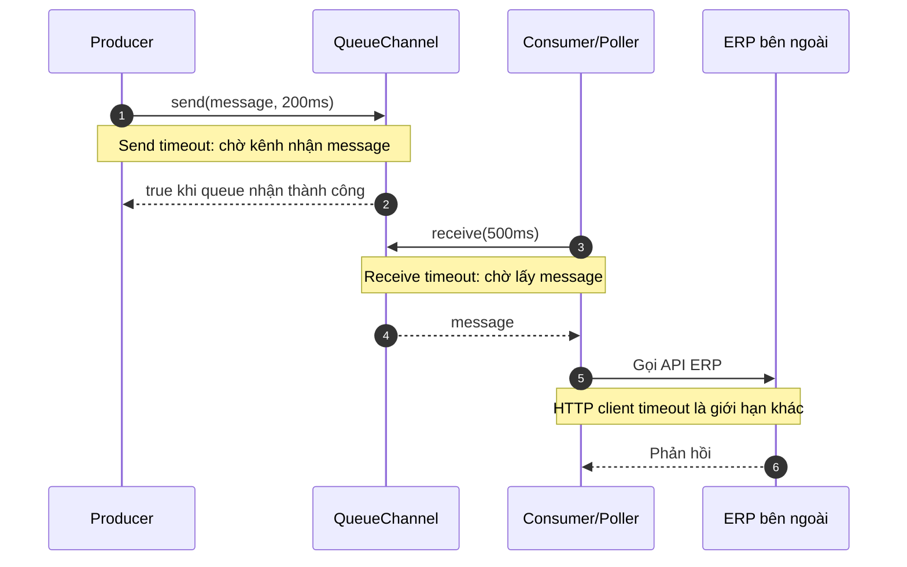
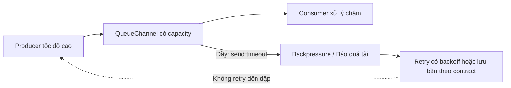
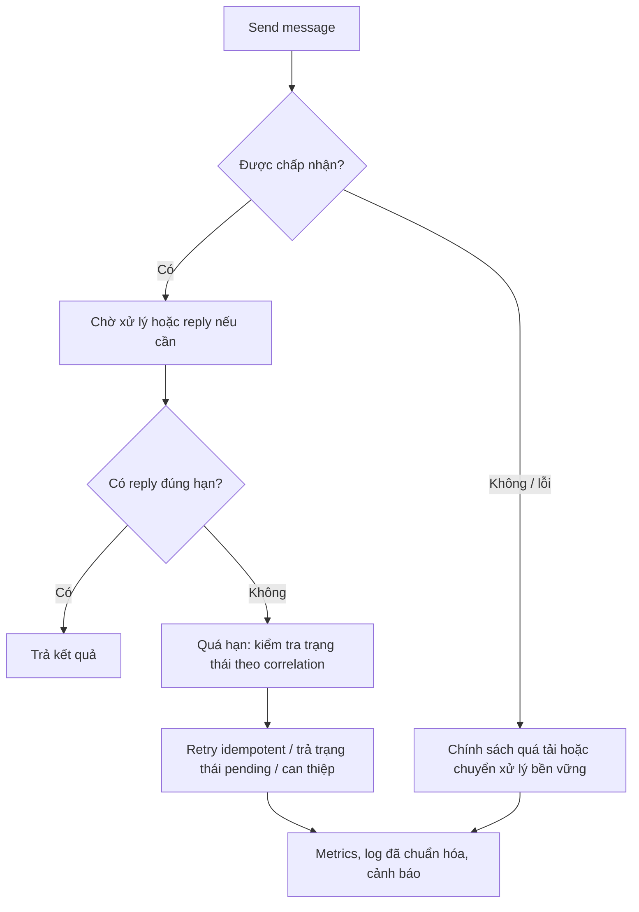

# Send timeout và receive timeout

Trong một hệ thống tích hợp, **gửi được thông điệp** và **nhận được thông điệp** là hai sự kiện khác nhau. Một producer có thể bị chặn vì kênh đầy, trong khi một consumer có thể phải chờ vì chưa có dữ liệu. Nếu ứng dụng sử dụng **Spring Integration** nhưng không đặt giới hạn chờ hợp lý, một lỗi nhỏ ở phía sau có thể làm treo request, chiếm thread hoặc khiến hàng đợi phình to.

Chủ đề **Send timeout và receive timeout** thuộc chương **Message channel** của module `SPRING_INTEGRATION_PATTERN`. Đây là nền tảng để triển khai các **Enterprise Integration Patterns (EIP)** — Router, Filter, Transformer, Splitter, Aggregator, Gateway — trong luồng thông điệp ít phụ thuộc, dễ mở rộng, đồng thời xử lý retry, error channel, correlation, kiểm thử và giám sát những nhánh gặp sự cố.

> **Điểm cần nhớ:** `send timeout` giới hạn thời gian **chờ để gửi/chuyển giao thông điệp** ở một thao tác hỗ trợ chờ; `receive timeout` giới hạn thời gian **chờ thông điệp xuất hiện** ở một thao tác nhận hỗ trợ chờ. **Cả hai không phải là “thời gian tối đa để toàn bộ nghiệp vụ hoàn thành”**.

## 1. Hiểu đúng hai loại thời gian chờ

### 1.1. Send timeout: chờ đến khi kênh có thể nhận message

Một producer gọi `MessageChannel.send(message, timeout)` để giao thông điệp cho channel. Với channel có cơ chế **giữ/chờ chỗ trống** (chẳng hạn `QueueChannel` có giới hạn dung lượng), thao tác có thể cần đợi cho đến khi có chỗ.

- Nếu kênh còn chỗ, `send` thường hoàn tất sớm, **không cần dùng hết thời gian timeout**.
- Nếu kênh đầy, `send` có thể chờ tối đa khoảng thời gian đã cho, tùy implementation.
- Nếu không thể gửi trong khoảng đó, lời gọi có thể trả `false`; tùy channel/endpoint và điều kiện lỗi, cũng có thể xảy ra exception.
- Timeout không tự khẳng định consumer đã xử lý thông điệp. Nó chỉ phản ánh kết quả **bàn giao ở ranh giới send**.

Với Java API của Spring Messaging:

```java
import org.springframework.messaging.Message;
import org.springframework.messaging.MessageChannel;

// 200 là ngân sách chờ gửi (mili giây), không phải thời gian xử lý nghiệp vụ.
MessageChannel channel = /* channel được cấu hình */ null;
Message<?> message = /* message cần gửi */ null;

// Ví dụ cách gọi khi có channel/message thực; không chạy riêng đoạn khai báo null này.
// boolean accepted = channel.send(message, 200);
```

**Lưu ý:** Không phải channel nào cũng phải chờ. `DirectChannel` chuyển lời gọi đến subscriber theo kiểu đồng bộ trong caller thread; `ExecutorChannel` phụ thuộc executor; `QueueChannel`/`RendezvousChannel` mới là những ví dụ dễ thấy về chờ tài nguyên hoặc phối hợp producer–consumer. Ý nghĩa thực tế của tham số `timeout` **phụ thuộc loại channel**.

### 1.2. Receive timeout: chờ đến khi có message để nhận

Một consumer có thể gọi `PollableChannel.receive(timeout)` để lấy thông điệp. Với `QueueChannel`, nếu queue đang rỗng thì người nhận có thể chờ tới khi có dữ liệu hoặc hết thời hạn:

```java
import org.springframework.integration.channel.QueueChannel;
import org.springframework.messaging.Message;

QueueChannel queue = new QueueChannel(10);

Message<?> availableNow = queue.receive(0);   // Kiểm tra ngay, không chờ.
Message<?> within250ms = queue.receive(250);   // Chờ tối đa khoảng 250 ms.

if (within250ms == null) {
    // Không nhận được message trước khi hết thời gian chờ.
    // Chưa đủ cơ sở kết luận hệ thống đã lỗi.
}
```

`receive(...)` trả `Message<?>` khi có dữ liệu, và có thể trả `null` khi không có thông điệp trước timeout. **Một lần nhận `null` không có nghĩa producer bị lỗi hoặc thông điệp đã mất**; producer có thể đơn giản chưa gửi.

`receive(timeout)` là API của **`PollableChannel`**, không phải mọi `MessageChannel`. Các kênh dạng `SubscribableChannel` như `DirectChannel` vận hành theo mô hình dispatch tới subscriber, **không phải gọi `receive(...)` để lấy dữ liệu**.

### 1.3. Phân biệt gửi thành công với xử lý thành công

Giả sử một hàng đợi nội bộ có chỗ. Producer gọi `send(...)` và nhận `true`. Điều này thường chỉ nói rằng message được channel chấp nhận; **không bảo đảm** Service Activator đã xử lý, ERP đã phản hồi, giao dịch đã commit hoặc dữ liệu sẽ tồn tại sau khi ứng dụng dừng.

Ngược lại, với một kênh đồng bộ như `DirectChannel`, việc `send(...)` đi qua handler có thể kéo theo xử lý ngay trong cùng thread. Do vậy, kết luận chính xác phải xét **channel, endpoint và ranh giới xử lý** chứ không chỉ xét giá trị `true`.

## 2. Bốn thời điểm dễ bị nhầm trong một luồng



Trong sơ đồ có ít nhất **ba loại chờ**: chờ gửi vào channel, chờ lấy message ra channel và chờ ERP qua mạng. Nếu caller cần kết quả từ toàn bộ luồng, còn có **reply timeout** của request–reply gateway. Chỉ tăng `send timeout` không thể sửa tình trạng ERP phản hồi chậm; chỉ tăng `receive timeout` cũng không đảm bảo đã xử lý xong business operation.

| Mốc | Ai chờ? | Khi hết thời hạn | Bằng chứng thu được |
| --- | --- | --- | --- |
| **Send timeout** | Producer muốn giao message cho channel. | Channel có thể từ chối send hoặc báo lỗi tùy loại. | Message có được channel nhận đúng hạn hay không. |
| **Receive timeout** | Consumer muốn lấy message từ `PollableChannel`. | Có thể nhận `null`. | Có message sẵn sàng để lấy trong khoảng chờ hay không. |
| **Reply timeout** | Gateway/caller đang chờ response của request–reply flow. | Có thể timeout/không có reply tùy gateway và hợp đồng xử lý. | Có nhận phản hồi đúng thời hạn hay không. |
| **Network/client timeout** | HTTP/broker/database client đang chờ kết nối hoặc phản hồi. | Client hoặc adapter phát sinh timeout/lỗi riêng. | Hoạt động giao tiếp với tài nguyên ngoài có đạt deadline hay không. |
| **Processing deadline** | Nghiệp vụ hoặc workflow có thời hạn hoàn thành. | Cần chính sách hủy, bù trừ, đánh dấu quá hạn hoặc xử lý sau. | Toàn bộ use case có đáp ứng SLA hay không. |

## 3. Timeout phụ thuộc loại `MessageChannel`

Spring Integration có nhiều loại channel với ngữ nghĩa khác nhau. Không nên gán cùng một giải thích timeout cho tất cả.

| Channel | Mô hình thực thi | Send timeout | Receive timeout |
| --- | --- | --- | --- |
| **`DirectChannel`** | Dispatch đồng bộ đến subscriber (thường trên thread gửi). | Không phải bộ ngắt thời gian xử lý handler; thời gian `send` có thể bao gồm thời gian thực thi handler. | Không có API poll trực tiếp; dùng subscriber. |
| **`QueueChannel`** | Giữ message trong queue để consumer/poller lấy sau. | Có ý nghĩa rõ khi **queue giới hạn dung lượng và đang đầy**. | Có ý nghĩa khi **queue đang rỗng**. |
| **`RendezvousChannel`** | Bàn giao trực tiếp giữa bên gửi và nhận, không có bộ đệm lưu chờ thông thường. | Bên gửi có thể chờ phía nhận sẵn sàng. | Bên nhận có thể chờ phía gửi sẵn sàng. |
| **`ExecutorChannel`** | Chuyển việc xử lý sang `TaskExecutor`. | Chủ yếu chịu tác động của chính sách executor/khả năng nhận tác vụ; không phải giới hạn runtime của handler. | Không dùng `receive` như một `PollableChannel`. |
| **`PublishSubscribeChannel`** | Phân phối cho nhiều subscriber; có thể đồng bộ hoặc theo executor. | Phụ thuộc cách dispatch; không tự tạo giới hạn tổng thời gian xử lý của tất cả subscriber. | Không dùng `receive` để poll theo mô hình channel này. |

### 3.1. Vì sao `DirectChannel` dễ gây ngộ nhận?

Xét handler gọi API ERP mất 8 giây. Producer gửi qua `DirectChannel` với timeout 100 ms:

```text
Producer ──send(message, 100ms)──> DirectChannel ──> Handler gọi ERP (8 giây)
```

Không nên suy ra sau 100 ms handler sẽ tự bị hủy. Đối với dispatch đồng bộ, `send timeout` không phải cơ chế đặt deadline cho method, SQL query hoặc HTTP client. Nếu cần kiểm soát thời gian của ERP, hãy cấu hình **connect/read/response timeout** tại client thích hợp, và xác định chính sách retry/circuit breaker hoặc giới hạn toàn bộ yêu cầu ở lớp ứng dụng.

Nếu chuyển sang `ExecutorChannel` để tách thread, việc sender có thể hoàn tất sớm **vẫn không chứng minh** handler chạy xong hay chịu được restart. Executor có thể bị bão hòa; chính sách từ chối tác vụ và hàng đợi executor cũng cần được thiết kế/quan sát.

### 3.2. `QueueChannel` có dung lượng khác nhau thì timeout khác nhau

Với `QueueChannel` có dung lượng hữu hạn, ví dụ `new QueueChannel(1)`, sau khi một thông điệp chiếm chỗ thì lần send thứ hai có thể phải chờ. Ngược lại, một queue không được ràng buộc dung lượng ở mức mong muốn có thể tiếp nhận liên tục, khiến send timeout ít khi xuất hiện nhưng **bộ nhớ lại chịu áp lực**.

Lựa chọn không phải “chờ dài là tốt” mà là phối hợp **capacity + send timeout + consumer throughput + backpressure**. Một hàng đợi quá rộng chỉ che giấu việc consumer không theo kịp producer.

## 4. Cơ chế timeout trên `QueueChannel` bằng ví dụ có thể kiểm thử

Hai ví dụ sau dùng API Spring Integration và Spring Messaging trực tiếp. Không cần khởi động ERP, Kafka hoặc HTTP server để hiểu semantics cơ bản.

### 4.1. Send timeout khi queue đầy

```java
import static org.junit.jupiter.api.Assertions.assertFalse;
import static org.junit.jupiter.api.Assertions.assertTrue;

import org.junit.jupiter.api.Test;
import org.springframework.integration.channel.QueueChannel;
import org.springframework.messaging.support.MessageBuilder;

class QueueSendTimeoutTest {

    @Test
    void secondMessageCannotEnterFullBoundedQueue() {
        QueueChannel queue = new QueueChannel(1);

        // Hàng đợi trống: nhận message thứ nhất ngay.
        assertTrue(queue.send(
            MessageBuilder.withPayload("first").build(), 0));

        // Chưa có consumer lấy message thứ nhất, queue vẫn đầy.
        // Gửi lần hai chờ nhiều nhất 50 ms rồi trả false.
        assertFalse(queue.send(
            MessageBuilder.withPayload("second").build(), 50));
    }
}
```

Test kiểm tra **kết quả giao thông điệp khi queue đầy**. Nó không kiểm tra chính xác thời gian tính theo đồng hồ; trên máy CI tải cao, không nên đặt assertion quá sát vài mili giây. Nếu cần kiểm tra timeout dài/ngắn, dùng sai số phù hợp và chạy với môi trường ổn định.

**Tình huống production:** Nếu producer nhận `false`, không nên lặng lẽ trả “đã tạo đơn thành công”. Hệ thống cần hợp đồng rõ: trả trạng thái quá tải cho caller, chuyển sang cơ chế lưu bền khác, thông báo retry, hay xử lý đồng bộ theo phương án dự phòng. Cách lựa chọn phụ thuộc yêu cầu giao hàng và nghiệp vụ.

### 4.2. Receive timeout khi queue rỗng

```java
import static org.junit.jupiter.api.Assertions.assertEquals;
import static org.junit.jupiter.api.Assertions.assertNull;
import static org.junit.jupiter.api.Assertions.assertTrue;

import org.junit.jupiter.api.Test;
import org.springframework.integration.channel.QueueChannel;
import org.springframework.messaging.Message;
import org.springframework.messaging.support.MessageBuilder;

class QueueReceiveTimeoutTest {

    @Test
    void receiveReturnsNullWhenNothingArrives() {
        QueueChannel queue = new QueueChannel(2);

        // Queue rỗng, chờ tối đa 40 ms nhưng không có producer.
        assertNull(queue.receive(40));

        assertTrue(queue.send(
            MessageBuilder.withPayload("order-101").build(), 0));

        // Có sẵn dữ liệu: nhận ngay; không cần đợi hết timeout.
        Message<?> received = queue.receive(0);
        assertEquals("order-101", received.getPayload());

        // Message đã bị lấy ra, queue lại rỗng.
        assertNull(queue.receive(0));
    }
}
```

Để test ổn định, ta không dựa vào thread cạnh tranh: queue rỗng → nhận `null`; queue có một message → lấy ra → lại rỗng. Đây là **unit test semantics**, chưa phải test throughput hay thread scheduling thực tế.

### 4.3. `0`, số dương và giá trị âm nghĩa là gì?

Với các triển khai pollable/queue thông dụng của Spring Integration, các cách dùng thường được hiểu như sau:

| Giá trị timeout | Ý nghĩa thực hành thường gặp | Khuyến nghị |
| --- | --- | --- |
| `0` | Thử ngay, **không chờ** nếu chưa sẵn sàng. | Dùng để kiểm tra nhanh và tránh block caller. |
| Số dương, ví dụ `200` | Chờ tối đa khoảng **200 mili giây**. | Dùng ngân sách chờ hữu hạn đã cân đối với SLA. |
| Giá trị âm hỗ trợ “chờ vô hạn” (thường `-1`) | Có thể chờ cho đến khi kênh sẵn sàng hoặc thread bị ngắt. | Tránh cho request online nếu không có cơ chế giám sát, hủy và xử lý lỗi. |

**Không áp dụng bảng một cách máy móc cho mọi channel hay adapter.** Kiểm tra API và phiên bản Spring Integration thực tế; default của gateway, template, adapter hoặc poller có thể khác nhau và một số thành phần không hỗ trợ cùng semantics.

## 5. Phân biệt `receive(timeout)` với polling scheduler

Một consumer có thể chủ động gọi `queue.receive(200)`. Nhưng nhiều flow Spring Integration dùng **poller** để kiểm tra nguồn có dữ liệu theo lịch:

```text
Poller chạy mỗi khoảng cấu hình
         |
         v
      QueueChannel
         |
   có message chưa?
      /       \
    có         không
     |           |
  xử lý      kết thúc lượt poll
```

Các tham số như **`fixedDelay`/`fixedRate`**, **`maxMessagesPerPoll`** và **receive timeout** không đồng nghĩa:

- `fixedDelay`: ảnh hưởng thời điểm **bắt đầu lượt poll tiếp theo** sau lượt trước theo cấu hình scheduler.
- `maxMessagesPerPoll`: giới hạn số message một lượt poller có thể lấy/xử lý theo cấu hình.
- `receive timeout`: giới hạn **lần chờ lấy message** từ nguồn pollable thích hợp.

Ví dụ, poller chạy thường xuyên nhưng handler xử lý quá chậm có thể vẫn khiến queue đầy; tăng receive timeout không làm handler chạy nhanh hơn. Ngược lại, nếu poller ngủ quá lâu, message có thể nằm chờ dù consumer đủ năng lực.

Trong tích hợp thực tế, nên đo **thời gian message chờ trong queue**, **độ sâu queue** và **tốc độ consumer xử lý**, thay vì chỉ xem số lần `receive` trả `null`.

## 6. Gateway request/reply có hai kiểu timeout khác nhau

Một **Messaging Gateway** chuyển lời gọi Java quen thuộc sang message flow. Khi method cần trả kết quả, có hai loại chờ thường được cấu hình:

1. **Request timeout:** thời gian chờ **gửi request message** đến request channel, nếu thao tác send có thể block.
2. **Reply timeout:** thời gian chờ **nhận reply message** cho request đó ở flow request–reply.

Ví dụ cấu hình bằng annotation (dành cho phiên bản Spring Integration hỗ trợ thuộc tính tương ứng):

```java
import org.springframework.integration.annotation.MessagingGateway;

@MessagingGateway(
    defaultRequestChannel = "pricingRequests",
    defaultRequestTimeout = "200",
    defaultReplyTimeout = "1500"
)
public interface PricingGateway {
    PriceQuote requestQuote(PriceRequest request);
}

// PriceRequest và PriceQuote là kiểu nghiệp vụ do ứng dụng tự định nghĩa.
```

Ở đây, `200` và `1500` là **mili giây** theo hợp đồng timeout của gateway. Một flow thực tế vẫn phải có `pricingRequests` và endpoint xử lý request–reply, chẳng hạn Service Activator tạo `PriceQuote` hoặc adapter outbound gateway gọi dịch vụ ngoài.

### 6.1. Reply timeout không phải cơ chế tự hủy công việc

Nếu gateway chờ reply 1500 ms nhưng downstream mất 5 giây, caller có thể hết hạn chờ theo cấu hình/đường thực thi; tuy nhiên **không có nghĩa công việc nền đã bị dừng**, transaction đã rollback hoặc API phía ngoài không còn xử lý nữa. Trong một số đường đi **đồng bộ trực tiếp**, thời gian chạy handler có thể chi phối khi nào lời gọi trả về; reply timeout không nên được xem là “đồng hồ tổng” bảo đảm ngắt một method đang chạy.

Vì vậy cần xác định rõ:

- Caller sẽ nhận gì khi không có reply đúng hạn: `null`, exception, một trạng thái quá hạn hay kết quả bất đồng bộ? Điều này tùy chữ ký method, cơ chế gateway và cách ứng dụng xử lý lỗi.
- Reply đến muộn có bị bỏ qua, báo lỗi phát delivery, lưu lại hay đối chiếu với trạng thái đã quá hạn?
- Người gọi retry có làm lại **tác vụ đã hoàn tất** và gây trùng dữ liệu hay không?
- Correlation key và reply channel có được duy trì xuyên các ranh giới bất đồng bộ/adapter hay không?

### 6.2. Khi nào dùng request–reply và khi nào dùng fire-and-forget?

| Nhu cầu | Thiết kế phù hợp hơn |
| --- | --- |
| API cần giá báo ngay trong một khoảng chờ ngắn. | Request–reply Gateway với deadline rõ ràng và client timeout tương ứng. |
| Gửi email/báo cáo có thể hoàn thành sau vài phút. | Chấp nhận công việc, trả mã công việc rồi xử lý async; không giữ HTTP request chờ. |
| Tác vụ liên hệ nhiều đối tác, kết quả có thể thiếu. | Theo dõi trạng thái theo correlation ID, Aggregator timeout và quy tắc kết thúc nhóm. |
| Nguồn dữ liệu có nhịp không đều. | Poller/consumer có receive timeout hữu hạn, không busy-spin khi queue rỗng. |

## 7. Timeout dưới tải cao: backpressure trước khi retry

Giả sử producer tạo 500 message/giây nhưng consumer chỉ xử lý 100 message/giây. Nếu không giới hạn hàng đợi, số message chờ có thể tăng liên tục. Nếu đặt capacity = 1000, queue sẽ đầy sau một thời gian và producer có thể bắt đầu gặp send timeout.



**Backpressure** là tín hiệu bảo hệ thống phía trước **giảm tốc hoặc không gửi thêm vào một tài nguyên đã đầy**. Một send timeout là dấu hiệu đáng quan sát: nếu caller cứ retry ngay không giới hạn, nó có thể làm quá tải nghiêm trọng hơn.

### 7.1. Chọn chính sách sau khi gửi thất bại

| Hợp đồng nghiệp vụ | Hướng xử lý cân nhắc |
| --- | --- |
| Request online, client có thể retry. | Trả lỗi quá tải hoặc trạng thái tạm thời phù hợp, kèm chỉ dẫn retry và idempotency key ổn định. |
| Event không được phép mất. | Dùng cơ chế tiếp nhận/lưu bền theo đúng cam kết, có xác nhận và cơ chế replay phù hợp. |
| Dữ liệu ít quan trọng, cho phép bỏ mẫu đo. | Có thể drop có kiểm soát và ghi metric, không giả báo xử lý thành công. |
| Batch có thể chậm. | Giảm tốc producer, batch hợp lý, tăng consumer có giới hạn, đo queue age. |

**Không đánh đồng `QueueChannel` trong bộ nhớ với durable broker.** Một send trả `true` trước khi ứng dụng crash không có nghĩa message sẽ được khôi phục; để có durability cần lựa chọn lưu trữ, transaction và cơ chế ack/recovery tương ứng.

### 7.2. Timeout quá ngắn và quá dài đều có giá

- **Quá ngắn:** dễ tạo lỗi giả khi hệ thống gặp đột biến tải hợp lệ hoặc khi consumer cần một khoảng xử lý bình thường.
- **Quá dài:** chiếm thread, tăng latency, giảm khả năng phục vụ request mới, che khuất bão hòa hệ thống.
- **Không giới hạn:** có thể làm caller chờ vô thời hạn nếu không có consumer/handler hoặc tài nguyên ngoài bị kẹt.

Điểm bắt đầu hợp lý không phải một con số chung cho tất cả, mà là **SLO/SLA, tốc độ producer/consumer, queue capacity, thời gian xử lý phân vị cao và ngân sách chờ end-to-end**.

## 8. Thiết kế ngân sách thời gian end-to-end

Giả sử một API có mục tiêu trả kết quả trong **2 giây**. Ngân sách minh họa có thể chia như sau:

| Công đoạn | Ngân sách ví dụ |
| --- | ---: |
| Xác thực/chuẩn hóa request | 150 ms |
| Chờ gửi vào bounded channel | 150 ms |
| Chờ downstream/reply, gồm xử lý và mạng | 1400 ms |
| Khoảng dự phòng cho serialization/network/caller | 300 ms |
| **Tổng** | **2000 ms** |

Các con số chỉ để minh họa cách phân bổ, **không phải giá trị mặc định nên áp dụng nguyên xi**. Một deadline end-to-end cần được quản lý qua các ranh giới, thay vì mỗi tầng tự dùng một timeout 2 giây. Nếu mỗi adapter được phép chờ 2 giây và có ba adapter nối tiếp, toàn bộ API có thể trễ xa mục tiêu ban đầu.

Một hệ thống nên:

1. **Bắt đầu đo deadline từ biên đầu vào** (HTTP/Gateway), không bắt đầu lại đồng hồ mỗi khi đi sang một nhánh.
2. **Phân bổ ngân sách cho từng điểm chờ**: queue, gateway reply, client connect/read, lock, aggregator.
3. **Trừ thời gian đã dùng** trước khi gửi tiếp; nếu không còn ngân sách thì thất bại có kiểm soát hoặc chuyển sang quy trình async.
4. **Đảm bảo việc timeout không bị hiểu sai là chưa xử lý**: cần trạng thái nghiệp vụ và idempotency.
5. **Quan sát phân vị latency và số lần quá hạn**, không chỉ đo giá trị trung bình.

Nếu một yêu cầu đã được chấp nhận để xử lý bất đồng bộ và có thể tiếp tục sau deadline của caller, hợp đồng phải nói rõ *accepted* khác *completed*. Trả HTTP thành công không nên khiến client hiểu rằng mọi side effect đã hoàn tất nếu hệ thống chỉ mới enqueue.

## 9. Retry, lỗi, correlation và kết quả đến muộn

### 9.1. Retry sau send timeout có thể gây trùng không?

Với một **bounded `QueueChannel` đơn giản**, `send(..., timeout)` trả `false` khi chưa đưa được message vào queue. Nhưng khi **đi qua gateway/adapter/transport ngoài**, caller có thể không biết chắc message hay tác vụ đã được hệ thống đích xử lý hay chưa. Timeout ở một điểm không tự chứng minh “chưa có side effect”.

Khi retry, cần:

- Giới hạn số lần thử, backoff, jitter khi phù hợp và có ngân sách deadline.
- Phân loại lỗi tạm thời (queue đầy, mạng tạm thời) với lỗi cố định (schema sai, thiếu quyền).
- Dùng **idempotency key ổn định** và kiểm soát trạng thái tại ranh giới nghiệp vụ có tác dụng phụ.
- Không retry mù sau khi gateway reply timeout nếu tác vụ có thể đã hoàn tất.

### 9.2. Error channel có giúp xử lý mọi timeout không?

Không có bảo đảm chung như vậy. Với code gọi `queue.receive(100)`, kết quả `null` là **trạng thái không có dữ liệu đúng hạn**, không mặc định trở thành `ErrorMessage`. `send(...)` có thể trả `false` hoặc ném exception tùy channel/hạ tầng; gateway reply timeout cũng có ngữ nghĩa riêng. Trong luồng đồng bộ, exception có thể trả trực tiếp về caller; trong luồng bất đồng bộ, các endpoint/adapter có thể gửi `ErrorMessage` đến kênh lỗi khi cấu hình cho phép.

Vì vậy phải thiết kế **chính sách lỗi theo từng nhánh**:



**Đây là sơ đồ chính sách**, không phải hành vi mặc định mà Spring Integration tự sinh khi bạn khai báo một channel tên `errorChannel`.

### 9.3. Correlation của request–reply và Aggregator

Trong luồng có Splitter/Aggregator, một đơn có thể tách thành năm message con. Nếu reply của ba nhánh đến trước timeout, còn hai nhánh trả sau, nhóm phát triển phải quy định rõ **release strategy**, **group timeout/expiry** và cách xử lý kết quả muộn/trùng. **Aggregator group timeout khác `PollableChannel.receive(timeout)`**: một cái liên quan tới **vòng đời nhóm message**, một cái giới hạn **lần chờ lấy message** từ channel.

Các khóa cần phân biệt:

| Khóa | Mục tiêu |
| --- | --- |
| `messageId` | Định danh kỹ thuật của một message, có thể thay đổi khi xây dựng lại. |
| `correlationId` | Liên kết các message cùng yêu cầu hoặc nhóm xử lý. |
| `eventId` hoặc idempotency key | Nhận biết sự kiện/tác vụ đã xử lý để kiểm soát replay. |
| `traceId` | Kết nối log/span quan sát xuyên service; không thay thế khóa nghiệp vụ. |

Tránh dùng dữ liệu nhạy cảm như token hoặc email làm correlation ID. Khi reply đến sau khi caller đã timeout, luồng cần chính sách lưu trạng thái, loại bỏ có chủ đích hoặc chuyển sang xử lý async theo hợp đồng, không coi mọi reply muộn là “thất lạc ngẫu nhiên”.

## 10. Kiểm thử timeout: chỉ kiểm tra điều bạn thật sự kiểm soát

Các bài kiểm thử nên chia thành nhiều tầng, vì unit test cho `QueueChannel` chưa thể chứng minh thời gian chờ của ERP ngoài mạng.

| Lớp kiểm thử | Kịch bản | Điều cần khẳng định |
| --- | --- | --- |
| **Unit: bounded queue** | Dung lượng 1, gửi hai message không có consumer. | Lần đầu `true`, lần sau hết hạn/trả `false`. |
| **Unit: empty queue** | Không có producer, gọi `receive(40)`. | Nhận `null` và không xử lý tiếp như thể có message. |
| **Flow test** | Router đưa một nhóm message vào queue, downstream bị chặn. | Có tín hiệu quá tải phù hợp; không âm thầm mất thông điệp. |
| **Gateway test** | Downstream reply trễ hơn ngân sách. | Caller quan sát timeout/không reply theo contract; không khẳng định downstream đã hủy. |
| **Adapter integration test** | HTTP client hoặc broker phản hồi chậm/không sẵn sàng. | Client timeout, retry/error flow và thông tin trạng thái hoạt động đúng. |
| **Idempotency test** | Gửi lại cùng event sau request timeout. | Không tạo side effect trùng vượt quá hợp đồng. |
| **Recovery test** | Restart khi có message trong queue. | Chứng minh rõ loại channel/store nào có hoặc không có persistence. |
| **Load test** | Producer nhanh hơn consumer trong thời gian dài. | Queue age, capacity, thread use và tỷ lệ send timeout đáp ứng giới hạn. |

### 10.1. Tránh flaky test do đồng hồ và scheduler

`Thread.sleep(50)` rồi mong message xuất hiện chính xác tại 50 ms thường gây test không ổn định. Với test bất đồng bộ, dùng **latch/đồng bộ hóa và chờ theo điều kiện có timeout**. Đặt ngân sách test đủ rộng so với biến động scheduler, nhưng vẫn giới hạn để phát hiện treo.

Hai ví dụ JUnit bên trên cố ý kiểm tra **trạng thái queue có tính quyết định** (đầy/rỗng) thay vì đo độ trễ tới từng mili giây. Đây là bước đầu cho kiểm thử hiệu quả; test flow thực tế cần bổ sung các trường hợp concurrent producer–consumer, interruption, retry và cấu hình adapter.

### 10.2. Cần kiểm tra cả điều kiện hủy/interruption

Một thread đang chờ vô hạn có thể không kết thúc theo kỳ vọng nếu không có dữ liệu và không có cơ chế dừng. Khi shutdown ứng dụng, cần hiểu endpoint/poller/executor có đáp ứng interruption, dừng nhận message mới, xả queue hoặc bàn giao cho store bền vững không. **Timeout hữu hạn giảm nguy cơ giữ tài nguyên không giới hạn**, nhưng không thay thế chiến lược graceful shutdown và recovery.

## 11. Observability: phân biệt kênh đầy, kênh rỗng và xử lý chậm

Các tín hiệu vận hành hữu ích:

- **Send timeout rate:** tỷ lệ gửi thất bại do không nhận được chỗ hoặc không dispatch thành công; ghi rõ channel và nguyên nhân.
- **Receive empty/timeout rate:** tần suất nhận không có message; giá trị cao có thể chỉ là **ít việc**, không nhất thiết là lỗi.
- **Queue depth/capacity:** độ sâu, phần trăm đầy và tốc độ tăng/giảm backlog.
- **Queue age:** thời gian message nằm chờ trước khi consumer lấy.
- **Handler latency:** độ trễ thực thi endpoint, đặc biệt khi gọi dịch vụ ngoài.
- **Gateway reply latency:** thời gian chờ từ khi yêu cầu gửi đi đến khi có reply.
- **Error/retry counts:** số lần timeout theo loại, retry, kết quả cuối cùng và tỷ lệ xử lý trùng.

Một bản ghi log có cấu trúc tối thiểu có thể như:

```text
event=channel_send_timeout
channel=orders.queue
timeout_ms=200
queue_capacity=100
queue_depth=100
correlation_id=7ac87f45-2e10-4a89-91f6-96dbe3bc35fa
outcome=retry_scheduled
```

Đây là **ví dụ format log**, không có ý khẳng định Spring Integration tự phát sinh các trường này. Cần cấu hình đo và xuất metrics/traces tương ứng; tránh ghi payload, API key, token, thông tin khách hàng hoặc đưa `correlationId` riêng từng request vào **metric labels** gây cardinality cao. Có thể dùng correlation ID mờ trong log/traces có phân quyền, còn metrics tổng hợp theo tên channel/loại lỗi.

### 11.1. Chẩn đoán nhanh từ dấu hiệu

| Dấu hiệu | Khả năng nên kiểm tra trước |
| --- | --- |
| Send timeout tăng, queue luôn đầy. | Consumer quá chậm, poller thưa, downstream lỗi hoặc producer quá nhanh. |
| Receive timeout nhiều, queue gần như luôn rỗng. | Workload thấp hoặc producer không gửi; cần đối chiếu lưu lượng vào. |
| `send` nhanh nhưng API tổng thể rất chậm. | Handler, network client, gateway reply hoặc Aggregator, không chỉ send timeout. |
| Reply timeout nhưng đối tác ghi thành công. | Phản hồi bị trễ/mất, timeout đặt thiếu ngân sách, cần idempotency và tra cứu trạng thái. |
| `ExecutorChannel` bão hòa không nhận tác vụ. | Executor pool/queue/rejection policy, backpressure và capacity. |
| Shutdown bị treo. | Chờ vô hạn, thread đang block, lifecycle poller/executor hoặc tác vụ ngoài chưa kết thúc. |

## 12. Những sai lầm phổ biến và cách sửa

### Sai lầm 1: “Đặt `sendTimeout=200` nên Handler không thể chạy quá 200 ms”

**Sai:** Send timeout không phải deadline thực thi logic nghiệp vụ. Với `DirectChannel`, handler đồng bộ có thể kéo dài; với channel bất đồng bộ, tác vụ cũng có thể chạy sau khi sender đã trả về. **Cách sửa:** đặt timeout cho client/handler phù hợp và quản lý deadline end-to-end.

### Sai lầm 2: “`receive(100)` trả `null` tức hệ thống có lỗi”

**Sai:** `null` có thể chỉ là queue chưa có message. **Cách sửa:** kiểm tra lưu lượng vào, trạng thái producer và mục tiêu polling; không spam error log cho mỗi lần poll rỗng.

### Sai lầm 3: “Tăng queue capacity vô hạn để tránh send timeout”

**Sai:** Điều đó có thể chuyển vấn đề thành tăng bộ nhớ và độ trễ hàng đợi. **Cách sửa:** capacity hữu hạn theo năng lực consumer, giám sát backlog và backpressure.

### Sai lầm 4: “Gateway reply timeout nghĩa là đối tác chưa làm gì”

**Sai:** Đối tác có thể đã commit nhưng phản hồi bị mất. **Cách sửa:** trạng thái nghiệp vụ, idempotency và quy trình đối soát/retry an toàn.

### Sai lầm 5: “Timeout nào cũng đi vào error channel”

**Sai:** `receive` trả `null` không tự sinh lỗi; `send` có thể trả `false`; gateway/adapter có cơ chế ngoại lệ riêng. **Cách sửa:** xử lý đúng từng kết quả và kiểm thử tuyến lỗi đồng bộ/bất đồng bộ đã cấu hình.

### Sai lầm 6: “Thay `DirectChannel` bằng `ExecutorChannel` là có độ bền”

**Sai:** Bất đồng bộ không đồng nghĩa lưu bền, và executor có thể bão hòa. **Cách sửa:** chọn persistence/broker theo yêu cầu giao nhận, cùng chính sách acknowledgment, retry và recovery phù hợp.

## 13. Tự kiểm tra mức hiểu

**Tình huống A.** `QueueChannel(1)` chứa một message. Không có consumer. Producer gọi `send(second, 100)`. Điều gì có thể xảy ra?

*Đáp án:* Vì queue đã đầy, thao tác có thể chờ khoảng 100 ms rồi trả `false`. Đây là dấu hiệu **chưa giao được message vào queue**, không phải bằng chứng downstream đã chạy hoặc thất bại.

**Tình huống B.** Consumer gọi `receive(300)` trên queue rỗng và nhận `null`. Có nên đưa ngay vào DLQ?

*Đáp án:* Không. Không có message để đưa vào DLQ; đây thường là **lần poll không có dữ liệu**. Hãy xử lý như trạng thái trống, trừ khi hợp đồng ứng dụng định nghĩa một điều kiện timeout nghiệp vụ riêng.

**Tình huống C.** API gửi qua `DirectChannel`, handler gọi HTTP trong 10 giây, `send timeout` đặt 50 ms. Có chắc API trả sau 50 ms không?

*Đáp án:* Không. `DirectChannel` chạy handler đồng bộ; send timeout không tự ngắt HTTP call. Cần timeout ở client và giới hạn end-to-end thích hợp.

**Tình huống D.** Gateway đã reply timeout nhưng khách hàng báo đơn vừa được tạo ở ERP. Gọi lại request tạo đơn ngay có an toàn không?

*Đáp án:* Chưa chắc. Cần đối chiếu trạng thái hoặc retry với **idempotency key ổn định**, để tránh tạo đơn trùng.

**Tình huống E.** Splitter gửi năm phần đến nhiều hệ thống; Aggregator chỉ nhận bốn phần trong 3 giây. Có phải tăng `QueueChannel.receiveTimeout` để Aggregator chắc chắn đủ dữ liệu?

*Đáp án:* Không. Đây là bài toán **group correlation, release strategy và group timeout/expiry** của Aggregator, khác lần nhận message từ `PollableChannel`. Cần định nghĩa xử lý phần đến muộn và kết quả thiếu.

## 14. Checklist khi thiết kế timeout cho một flow

| Câu hỏi | Điều cần xác định |
| --- | --- |
| Producer gửi vào channel nào? | Kiểu channel, capacity và khả năng block khi send. |
| Consumer lấy message kiểu gì? | Subscriber hay poller; receive timeout có áp dụng không? |
| Caller có đợi reply không? | Request timeout, reply timeout và loại kết quả khi quá hạn. |
| Có gọi mạng/cơ sở dữ liệu không? | Connect/read/response timeout, transaction và circuit breaker nếu dùng. |
| Deadline nghiệp vụ là bao lâu? | Chia ngân sách cho từng bước, có dự phòng và kiểm soát reply muộn. |
| Queue đầy sẽ làm gì? | Backpressure, bounded retry, fail fast hoặc lưu bền đúng hợp đồng. |
| Message có thể được xử lý lại không? | Idempotency key, deduplication và đối chiếu trạng thái. |
| Có dùng Splitter/Aggregator? | Correlation, group release/expiry và cách xử lý nhánh thiếu. |
| Có đo lường được trạng thái không? | Send/receive timeout, queue depth/age, handler latency, lỗi và retry. |
| Có kiểm thử lỗi thật không? | Queue đầy, queue rỗng, consumer chậm, request–reply muộn, shutdown/restart. |

## Kết luận

**Send timeout** và **receive timeout** là hai giới hạn chờ tại ranh giới truyền/nhận message; chúng giúp Spring Integration không bị phụ thuộc vào sự sẵn sàng tức thời của producer và consumer. Trên `QueueChannel`, send timeout đặc biệt quan trọng khi queue đầy; receive timeout phát huy tác dụng khi queue rỗng. Trên những channel khác, nhất là `DirectChannel` và `ExecutorChannel`, cần hiểu **mô hình dispatch thực tế** trước khi suy luận về timeout.

Khi xây dựng **Enterprise Integration Patterns**, hãy thiết kế timeout cùng **capacity, backpressure, Gateway request/reply, client timeout, retry, error flow, correlation, idempotency và observability**. Một timeout có giá trị không phải vì nó đơn thuần dừng chờ, mà vì hệ thống biết **điều gì đã xảy ra, điều gì chưa chắc đã xảy ra và bước tiếp theo an toàn là gì**.
