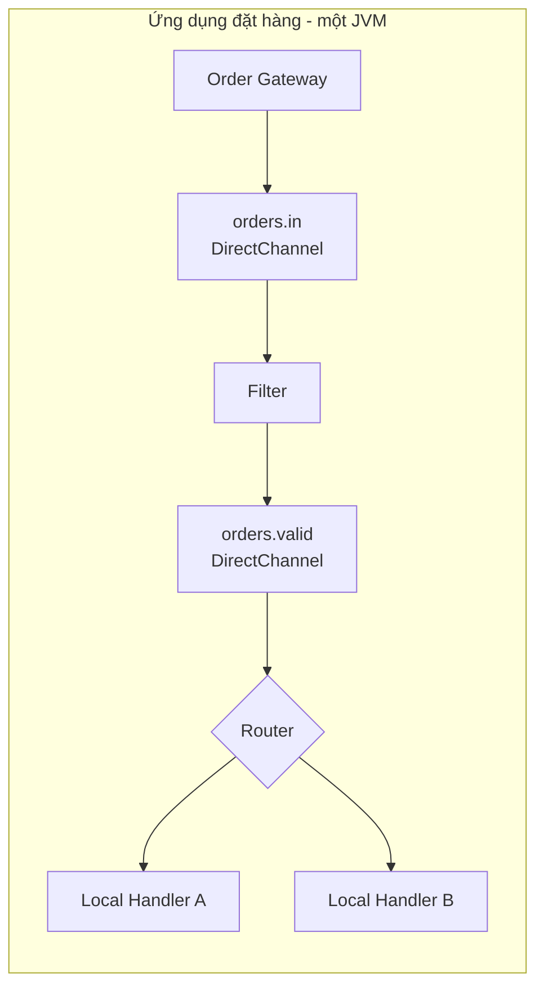
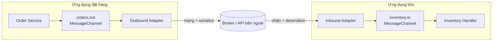
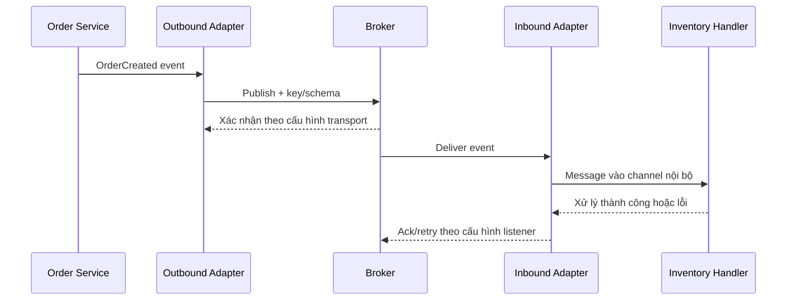
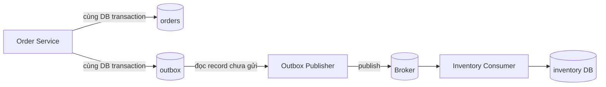

# Kênh nội bộ và kênh qua hệ thống ngoài

Trong Enterprise Integration Patterns (EIP), **Message Channel** biểu diễn đường đi logic của một message từ thành phần gửi tới thành phần nhận. Khi triển khai bằng **Spring Integration**, cùng một sơ đồ có thể kết nối các bước xử lý trong **một ứng dụng Java** hoặc đi qua **mạng, broker và ứng dụng khác**. Hai cách tổ chức này có cùng ý tưởng trao đổi message, nhưng khác nhau đáng kể về thời gian xử lý, hợp đồng dữ liệu, cơ chế lỗi, lưu bền và vận hành.

Ví dụ: hệ thống đặt hàng cần kiểm tra đơn, định tuyến theo khu vực, giữ hàng trong kho rồi gửi thông báo. Bước **kiểm tra → định tuyến** có thể nằm trong cùng ứng dụng và trao đổi qua `DirectChannel`. Ngược lại, nếu kho là một dịch vụ triển khai độc lập, yêu cầu giữ hàng có thể đi qua Kafka, RabbitMQ, JMS hoặc HTTP. Khi đó hệ thống phải xử lý thêm việc truyền dữ liệu qua mạng, retry, sự cố kết nối và khả năng nhận lại cùng một message.

Bài học thuộc chương **Message channel** của module **SPRING_INTEGRATION_PATTERN**. Mục tiêu là giúp bạn thiết kế luồng thông điệp ít phụ thuộc, dễ mở rộng bằng Router, Filter, Transformer, Splitter, Aggregator và Gateway, đồng thời biết khi nào cần retry, error channel, correlation, kiểm thử và quan sát ở ranh giới với hệ thống ngoài.

Sau bài này, bạn sẽ phân biệt được **channel nội bộ** và **kênh trao đổi liên hệ thống**, lựa chọn cách nối hai bên bằng adapter/gateway và mô tả chính xác điều gì được bảo đảm khi gửi một message.

## 1. Hai phạm vi kết nối dưới cùng một mô hình

### 1.1. Kênh nội bộ: các endpoint trong một ứng dụng

Kênh nội bộ kết nối những endpoint thuộc cùng một Spring application context. Producer gửi một đối tượng `Message<?>` hoặc payload vào `MessageChannel`; channel phân phối message cho endpoint đã đăng ký.



Những endpoint có thể là Filter, Transformer, Router, Service Activator hoặc các thành phần khác trong Spring Integration. Với `DirectChannel`, lời gọi thường được thực thi đồng bộ trên thread gửi. Với `ExecutorChannel` hoặc `QueueChannel`, có thể tách thời điểm xử lý, nhưng nếu mọi thứ vẫn nằm trong cùng một tiến trình thì khi tiến trình dừng, các tài nguyên trong bộ nhớ cũng biến mất.

Kênh nội bộ giảm phụ thuộc giữa mã nguồn của producer và implementation của consumer. Dù vậy, các bên vẫn phụ thuộc vào **hợp đồng message** và ngữ nghĩa thực thi của channel.

### 1.2. Kênh qua hệ thống ngoài: phải vượt qua một ranh giới vận chuyển

Khi message cần đi sang hệ thống khác, luồng phải đi qua **adapter hoặc gateway** có khả năng giao tiếp với transport thực tế. Transport có thể là HTTP, AMQP/RabbitMQ, Kafka, JMS, TCP hoặc một hệ thống SaaS có API riêng.



**Chú ý về thuật ngữ:** Trong Spring Integration, `MessageChannel` thường là abstraction **bên trong ứng dụng**. Kafka topic, RabbitMQ queue hay endpoint HTTP là **đích vận chuyển bên ngoài**; chúng không tự động trở thành bean `MessageChannel` chỉ vì ta gọi chung là “kênh”. Outbound adapter nối channel nội bộ với transport; inbound adapter nhận dữ liệu từ transport và phát vào channel nội bộ.

Nhờ ranh giới này, handler nghiệp vụ phía trong có thể xử lý một message theo hợp đồng ổn định mà không cần biết nó đến từ HTTP hay Kafka. Tuy nhiên, lớp adapter phải quản lý chuyển đổi dữ liệu, kết nối, timeout, xác nhận gửi/nhận và lỗi.

## 2. Điểm giống và khác nhau quan trọng

| Tiêu chí | MessageChannel nội bộ | Trao đổi qua hệ thống ngoài |
| --- | --- | --- |
| Ranh giới | Giữa các endpoint trong một ứng dụng/context | Giữa các tiến trình, máy chủ hoặc dịch vụ |
| Dữ liệu | Thường là Java object trong bộ nhớ, có message headers | Cần biểu diễn qua giao thức, serialization và schema tương thích |
| Độ trễ | Thường thấp, không cần network hop | Có network latency, serialization và độ trễ của hệ thống bên ngoài |
| Lỗi | Có thể là exception của handler trong cùng process | Có thể có timeout, mất kết nối, phản hồi không rõ, redelivery |
| Giao dịch | Có thể cùng thread và cùng transaction khi cấu hình phù hợp | Thường có ranh giới transaction riêng, cần thiết kế nhất quán dữ liệu |
| Khả năng lưu bền | Phụ thuộc loại channel/message store; `DirectChannel` không lưu message | Phụ thuộc broker, cơ chế persistence, publisher confirm, ack và cấu hình |
| Scale | Thường trong phạm vi một process; executor tăng concurrency nội bộ | Có thể triển khai, scale producer và consumer độc lập khi transport hỗ trợ |
| Quan sát | Channel/endpoint metrics và log trong ứng dụng | Cần tracing xuyên process, message key, broker metrics, retry/DLQ |
| Bảo mật | Ranh giới tin cậy nội bộ tiến trình | Cần authentication, authorization, mã hóa đường truyền và kiểm soát dữ liệu |
| Độ phức tạp | Ít thành phần vận hành hơn | Phải vận hành adapter, broker/API, hợp đồng schema và quy trình lỗi |

Không thể kết luận “kênh ngoài đáng tin cậy hơn” hoặc “kênh nội bộ luôn đồng bộ”. Một `QueueChannel` trong bộ nhớ là bất đồng bộ nhưng có thể mất dữ liệu khi restart; một HTTP outbound gateway vượt qua mạng nhưng vẫn có thể chặn thread để đợi response. **Loại transport và cấu hình thực thi** mới quyết định hành vi.

### Một hiểu lầm thường gặp: channel khác queue

- **Channel** là khái niệm phân phối message giữa các bên.
- **Queue** là một cách lưu và cung cấp message cho consumer.
- **Topic/pub-sub** là cơ chế đưa cùng sự kiện tới các subscriber theo quy tắc riêng.
- **Adapter/gateway** chuyển message qua ranh giới, ví dụ từ `MessageChannel` sang HTTP hoặc broker.

Bởi vậy, việc gọi tất cả những thứ trên là “queue” che mất những quyết định kiến trúc quan trọng.

## 3. Các loại channel nội bộ và tính chất thực thi

Spring Integration cung cấp nhiều implementation của `MessageChannel`. Các lựa chọn phổ biến:

| Channel | Hành vi cơ bản | Trường hợp sử dụng | Điều cần kiểm tra |
| --- | --- | --- | --- |
| `DirectChannel` | Dispatch tới subscriber trên thread gửi | Các bước đồng bộ, nối Filter/Transformer/Router trong process | Lỗi handler và độ trễ có thể ảnh hưởng caller |
| `ExecutorChannel` | Dispatch qua `TaskExecutor` | Xử lý đồng thời hoặc chuyển công việc khỏi thread gửi | Executor quá tải, task bị từ chối, xử lý lỗi bất đồng bộ |
| `QueueChannel` | Message nằm trong queue cho consumer/poller nhận | Bộ đệm giữa producer và consumer nội bộ | Sức chứa, poller, timeout gửi, lưu bền message |
| `PublishSubscribeChannel` | Phân phối message tới nhiều subscriber | Fan-out sự kiện trong ứng dụng | Có/không có executor, lỗi một subscriber, số nhánh được gọi |
| `PriorityChannel` | Cung cấp message theo mức ưu tiên | Điều phối công việc có mức khẩn cấp khác nhau | Starvation và cách xác định priority |
| `RendezvousChannel` | Bên gửi và bên nhận bàn giao trực tiếp | Cần đồng bộ hóa hai bên tại thời điểm trao đổi | Có thể chờ hoặc timeout khi chưa có bên nhận |

Một `DirectChannel` có thể vận hành rất tốt ở giữa hai bước xử lý trong cùng thread. Đưa toàn bộ các bước đó ra Kafka chỉ vì muốn “decoupling” sẽ thêm chi phí serialization, kết nối và vận hành mà chưa chắc cải thiện yêu cầu thực tế.

Ngược lại, một tác vụ gửi email cần được xử lý sau, có thể do dịch vụ khác phụ trách và phải sống sót qua việc restart ứng dụng sẽ phù hợp hơn với cơ chế lưu bền, nhận lại message và xử lý lỗi của transport bên ngoài được cấu hình thích hợp.

## 4. Ví dụ Java DSL: pipeline hoàn toàn nội bộ

Giả sử ứng dụng nhận `OrderCommand`, kiểm tra dữ liệu và chuyển cho `InventoryService`. Đây là luồng nội bộ, chưa qua broker.

```java
import java.math.BigDecimal;

import org.springframework.context.annotation.Bean;
import org.springframework.context.annotation.Configuration;
import org.springframework.integration.annotation.Gateway;
import org.springframework.integration.annotation.IntegrationComponentScan;
import org.springframework.integration.annotation.MessagingGateway;
import org.springframework.integration.channel.DirectChannel;
import org.springframework.integration.config.EnableIntegration;
import org.springframework.integration.dsl.IntegrationFlow;
import org.springframework.messaging.MessageChannel;

record OrderCommand(String orderId, BigDecimal amount) {}

interface InventoryService {
    void reserve(OrderCommand order);
}

@MessagingGateway
interface OrderGateway {
    @Gateway(requestChannel = "orders.in")
    void submit(OrderCommand order);
}

@Configuration
@EnableIntegration
@IntegrationComponentScan
class InternalOrderFlow {

    @Bean("orders.in")
    MessageChannel ordersIn() {
        return new DirectChannel();
    }

    @Bean("orders.valid")
    MessageChannel ordersValid() {
        return new DirectChannel();
    }

    @Bean
    IntegrationFlow validateOrders() {
        return IntegrationFlow.from("orders.in")
            .filter(OrderCommand.class,
                order -> order.orderId() != null
                    && !order.orderId().isBlank()
                    && order.amount() != null
                    && order.amount().signum() > 0,
                spec -> spec.throwExceptionOnRejection(true))
            .channel("orders.valid")
            .get();
    }

    @Bean
    IntegrationFlow reserveStock(InventoryService inventory) {
        return IntegrationFlow.from("orders.valid")
            .handle(OrderCommand.class, (order, headers) -> {
                inventory.reserve(order);
                return null; // handler một chiều
            })
            .get();
    }
}
```

Một service ứng dụng chỉ cần gọi `orderGateway.submit(command)`. Các dependency Spring Integration tương ứng và bean triển khai `InventoryService` phải được đăng ký trong ứng dụng.

### Điều gì được bảo đảm trong ví dụ này?

1. `orders.in` và `orders.valid` là hai `DirectChannel`, nối các endpoint trong cùng Spring context.
2. Filter từ chối đơn không hợp lệ bằng exception do đã cấu hình `throwExceptionOnRejection(true)`. Đây là quyết định của filter, không phải chức năng mặc định của channel.
3. Vì handler chạy đồng bộ trên đường đi này, caller thường chỉ quay về sau khi `inventory.reserve(order)` xử lý xong. Exception từ handler có thể lan tới caller.
4. Chưa có broker, serialization qua mạng, hàng đợi lưu bền hay phân tán tải giữa nhiều tiến trình.
5. Nếu thay `orders.valid` bằng `QueueChannel`, phải bố trí poller để đọc message; hợp đồng thời điểm hoàn thành và đường đi lỗi sẽ khác.

**Bài học:** Channel nội bộ hữu ích ngay cả khi xử lý vẫn đồng bộ: nó cung cấp điểm nối rõ ràng để thêm Filter, Router, Transformer hoặc interceptor tại ranh giới giữa các bước.

## 5. Nối ra ngoài: outbound adapter và inbound adapter

Luồng đi từ Spring Integration đến hệ thống khác thường gồm hai nửa:

- **Outbound adapter/gateway:** nhận message từ channel nội bộ, chuyển nó sang giao thức của hệ thống ngoài.
- **Inbound adapter/gateway:** nhận dữ liệu từ hệ thống ngoài, chuyển thành Spring message và phát vào channel nội bộ.

Sự khác nhau giữa **adapter** và **gateway** còn liên quan đến cách tương tác: một outbound adapter thường thực hiện gửi một chiều; outbound gateway thường tham gia tương tác request-reply. Không nên coi tên gọi này là bảo đảm hệ thống ngoài đã hoàn tất nghiệp vụ.

### 5.1. Mô hình một chiều qua broker



Trong sơ đồ, **xác nhận publish của broker** và **kết quả xử lý nghiệp vụ tại Inventory Handler** là hai mốc khác nhau. Producer nhận thông báo publish thành công không có nghĩa là kho đã giữ hàng.

Tùy công nghệ, việc broker xác nhận có thể chỉ chứng tỏ message đã được chấp nhận theo chính sách ack/persistence hiện tại. Không được suy diễn rằng message đã an toàn qua mọi sự cố nếu chưa đọc và cấu hình cụ thể của broker.

### 5.2. Ví dụ bridge vào Spring Integration từ Kafka

Ví dụ sau mô tả **phía ứng dụng kho**, nơi Spring Kafka consumer nhận một sự kiện từ topic rồi phát nó vào một `MessageChannel` nội bộ. Đây là cách viết cầu nối thủ công dễ nhìn; khi triển khai thực tế có thể dùng **Kafka inbound channel adapter** của Spring Integration để tránh phải tự viết bridge.

```java
import org.springframework.beans.factory.annotation.Qualifier;
import org.springframework.context.annotation.Bean;
import org.springframework.context.annotation.Configuration;
import org.springframework.integration.channel.DirectChannel;
import org.springframework.integration.config.EnableIntegration;
import org.springframework.integration.dsl.IntegrationFlow;
import org.springframework.kafka.annotation.EnableKafka;
import org.springframework.kafka.annotation.KafkaListener;
import org.springframework.messaging.MessageChannel;
import org.springframework.messaging.support.MessageBuilder;
import org.springframework.stereotype.Component;

record OrderCreated(String orderId, String region) {}

interface InventoryReservationService {
    void reserveFor(OrderCreated event);
}

@Configuration
@EnableIntegration
@EnableKafka
class InventoryInboundFlow {

    @Bean("inventory.events.in")
    MessageChannel inventoryEventsIn() {
        return new DirectChannel();
    }

    @Bean
    IntegrationFlow handleEvents(InventoryReservationService service) {
        return IntegrationFlow.from("inventory.events.in")
            .handle(OrderCreated.class, (event, headers) -> {
                service.reserveFor(event);
                return null;
            })
            .get();
    }
}

@Component
class KafkaToIntegrationBridge {
    private final MessageChannel inbound;

    KafkaToIntegrationBridge(
        @Qualifier("inventory.events.in") MessageChannel inbound) {
        this.inbound = inbound;
    }

    @KafkaListener(
        topics = "orders.events",
        groupId = "inventory-reservation")
    public void onOrderCreated(OrderCreated event) {
        boolean accepted = inbound.send(
            MessageBuilder.withPayload(event).build());

        if (!accepted) {
            throw new IllegalStateException("Internal channel rejected event");
        }
    }
}
```

Để chạy được ví dụ, ứng dụng còn cần dependency Spring Kafka, cấu hình bootstrap servers, consumer factory, deserializer/JSON conversion và listener container. Topic `orders.events` phải có ở broker; `InventoryReservationService` phải có implementation; phía producer cũng phải publish đúng hợp đồng `OrderCreated`.

**Đường xử lý:** Kafka listener lấy record từ bên ngoài → chuyển thành Java object → `MessageChannel` nội bộ → Service Activator. Vì nội bộ dùng `DirectChannel`, lỗi từ `reserveFor` có thể truyền ngược đến listener. **Listener container** mới quyết định xử lý exception, offset commit, retry hoặc dead-letter theo cấu hình cụ thể. Mã trên không tự tạo độ bền, idempotency hay chính sách retry.

Với Spring Integration Kafka, có thể dùng **message-driven inbound channel adapter** để làm trực tiếp việc nhận record và phát Spring message vào channel. Ngược lại, phía producer dùng **outbound channel adapter** để chuyển message từ channel nội bộ thành bản ghi Kafka. Việc chọn adapter chính thức hay bridge thủ công phụ thuộc yêu cầu tích hợp, nhưng nguyên tắc ranh giới không đổi.

### 5.3. Đi qua HTTP khác gì đi qua broker?

Khi dùng outbound HTTP gateway, producer thường gửi một request và đợi response hoặc timeout. Việc gọi một API bên ngoài vẫn có **coupling về thời gian**: hệ thống nhận chậm hoặc không có sẵn sẽ ảnh hưởng lời gọi.

Với broker, producer có thể phát message và tiếp tục công việc sau khi nhận xác nhận publish theo quy tắc được cấu hình. Consumer xử lý sau, nhưng hệ thống phải chấp nhận **eventual consistency**, trạng thái trung gian và khả năng xử lý trùng nếu có retry/redelivery.

Không có quy tắc “HTTP luôn kém hơn Kafka”. HTTP thường phù hợp khi cần câu trả lời tức thì và hợp đồng request-reply rõ ràng; broker phù hợp khi cần tách thời gian xử lý, fan-out hoặc lưu trữ/phân phối message theo yêu cầu được hỗ trợ.

## 6. Đưa message qua ranh giới ngoài làm thay đổi điều gì?

### 6.1. Payload phải có hợp đồng liên hệ thống

Trong cùng JVM, một `Message<OrderCommand>` có thể mang đối tượng Java. Bước qua Kafka, RabbitMQ, JMS hay HTTP thường phải serialize dữ liệu thành JSON, Avro, Protobuf hoặc định dạng được hai bên đồng thuận.

Ví dụ hợp đồng sự kiện:

```json
{
  "eventId": "evt-10025",
  "eventType": "OrderCreated",
  "schemaVersion": 1,
  "occurredAt": "2026-11-21T03:00:00Z",
  "orderId": "ORD-902",
  "region": "VN-S"
}
```

Mỗi trường phải có nghĩa rõ ràng. `eventId` hỗ trợ theo dõi và deduplication; `schemaVersion` thể hiện phiên bản dữ liệu; `orderId` là business key, có thể được dùng để làm Kafka message key khi cần nhóm thứ tự theo đơn. Đây là ví dụ thiết kế hợp đồng, không phải những trường Spring Integration tự tạo.

Nên thống nhất cách mở rộng schema tương thích ngược: consumer cũ có xử lý trường mới không, field bắt buộc thay đổi thế nào, sự kiện bị lỗi parse sẽ đi đâu. Tránh mặc định gửi object Java native serialization qua ranh giới không tin cậy.

### 6.2. Header của Spring message không tự động giữ nguyên

`MessageHeaders` nội bộ có các giá trị như message id/timestamp; các adapter khác nhau có chính sách ánh xạ header sang Kafka record headers, HTTP headers hoặc JMS properties riêng. Không phải mọi Java object trong header đều có thể serialize, và không phải mọi tên header đều được transport hỗ trợ.

Nếu muốn correlation xuyên dịch vụ, hãy thiết kế các trường/headers như `traceId`, `correlationId` hoặc business key; cấu hình header mapper và xác minh bên nhận nhìn thấy đúng giá trị. Đừng phụ thuộc vào việc toàn bộ header nội bộ sẽ được gửi nguyên vẹn.

### 6.3. “Đã gửi” khác “đã xử lý”

Các trạng thái dễ bị nhầm lẫn:

| Mốc | Ý nghĩa thường gặp | Chưa bảo đảm điều gì? |
| --- | --- | --- |
| Gửi vào `DirectChannel` thành công | Channel đã dispatch trên đường xử lý đồng bộ | Không tạo durability nếu tiến trình chết |
| Gửi vào `QueueChannel` thành công | Queue đã chấp nhận message theo điều kiện capacity | Consumer chưa chắc đã xử lý |
| Broker chấp nhận publish | Message được broker xác nhận theo chính sách transport | Consumer chưa chắc đã nhận hoặc xử lý thành công |
| Consumer ack/commit | Theo cấu hình consumer, message/offset đã được xác nhận | Không mặc nhiên bảo đảm mọi side effect nghiệp vụ atomic |
| Handler cập nhật dữ liệu thành công | Bước nghiệp vụ tại consumer hoàn tất | Producer có thể chưa biết kết quả nếu không có kênh phản hồi |

Nếu API trả về `202 Accepted` sau khi gửi sự kiện, nên hiểu là yêu cầu đã được tiếp nhận để xử lý sau. Đừng hiển thị trạng thái “đã hoàn tất” nếu consumer còn chưa xử lý.

### 6.4. Giao dịch xuyên hai hệ thống không tự xuất hiện

Xét bước tạo đơn và publish `OrderCreated`:

1. Cập nhật bảng `orders` thành công.
2. Tiến trình chết trước khi publish sự kiện.

Khi đó đơn hàng đã tồn tại nhưng hệ thống kho có thể không bao giờ nhận thông báo. Đảo thứ tự cũng có rủi ro: đã publish rồi, nhưng giao dịch lưu đơn lại rollback.

Một cách thường dùng là **Transactional Outbox**: ghi thay đổi nghiệp vụ và bản ghi outbox **trong cùng transaction database**; một tác vụ riêng đọc outbox và publish sang broker, sau đó đánh dấu trạng thái gửi. Cơ chế này giải quyết rủi ro dual-write theo điều kiện triển khai, nhưng có thể dẫn đến publish trùng khi retry, nên consumer vẫn phải idempotent.



Sơ đồ chỉ minh họa dòng dữ liệu; transaction thật sự là thao tác cập nhật `orders` và `outbox` trong cùng cơ sở dữ liệu trước khi publisher chạy.

## 7. Retry, error channel và xử lý message trùng

### 7.1. Ở kênh nội bộ

Trong `DirectChannel`, exception của handler thường có thể lan đến caller. Nếu cần thử lại, có thể cấu hình retry advice cho endpoint phù hợp. Với `ExecutorChannel` hoặc poller xử lý queue, lỗi xảy ra ở luồng khác, nên phải dùng cơ chế lỗi của các endpoint/handler và error channel tương ứng.

**Error channel** giúp chuyển message lỗi vào một luồng xử lý riêng khi hạ tầng phát sinh `ErrorMessage` theo ngữ cảnh thực thi. Nó không tự đảm bảo tái gửi, không phải broker dead-letter queue và không thay thế mọi chính sách lỗi của adapter ngoài.

### 7.2. Ở ranh giới ngoài

Sự cố phổ biến là consumer xử lý xong nhưng bị mất kết nối trước lúc broker ghi nhận ack. Broker có thể chuyển lại cùng message; nếu handler cập nhật trạng thái hoặc trừ kho lần nữa, dữ liệu có thể sai.

Cần xác định ba chính sách độc lập:

- **Retry:** loại lỗi nào có thể thử lại (timeout, lỗi tạm thời) và số lần, khoảng chờ, giới hạn tải.
- **Dead-letter/parking:** message không thể xử lý sau số lần thử phù hợp cần được lưu để điều tra hoặc xử lý lại có kiểm soát.
- **Idempotency:** cùng `eventId`/business key bị giao nhiều lần vẫn chỉ tạo một hiệu ứng nghiệp vụ mong muốn.

Ví dụ: consumer xử lý sự kiện `ReserveInventory(orderId, sku, quantity)` có thể dùng một bảng ghi `processed_event_id` hoặc ràng buộc duy nhất trên khóa nghiệp vụ, cùng transaction với cập nhật tồn kho. Chỉ kiểm tra trong bộ nhớ là không đủ nếu nhiều instance chạy song song hoặc tiến trình restart.

Đặc biệt, khái niệm **exactly-once** phải được nêu theo phạm vi: một số broker hỗ trợ transaction/processing guarantee trong hệ sinh thái riêng, nhưng không mặc nhiên tạo đúng một lần cho mọi lệnh gọi database, HTTP hoặc side effect bên ngoài. Thiết kế idempotent vẫn rất quan trọng.

### 7.3. Message đến sai thứ tự hoặc bị trễ

Với Kafka, thứ tự được bảo đảm trong phạm vi **một partition** theo các điều kiện vận hành của nó, không phải giữa toàn bộ partition. Với queue và nhiều consumer, xử lý song song cũng có thể hoàn tất khác thứ tự phát.

Đối với nghiệp vụ cần thứ tự theo đơn hàng, hãy chọn partition key hoặc cơ chế điều phối phù hợp, dùng version/sequence number, và định nghĩa cách giải quyết sự kiện đến muộn. Với **Splitter/Aggregator**, cần correlation key, điều kiện hoàn thành nhóm, timeout và xử lý phần còn thiếu; channel không tự cung cấp các quy tắc này.

## 8. Khi nào chọn kênh nội bộ, khi nào đi ra ngoài?

Bắt đầu từ **yêu cầu nghiệp vụ và ranh giới triển khai**, không bắt đầu từ tên công nghệ.

| Nhu cầu | Điểm xuất phát hợp lý | Cần cân nhắc |
| --- | --- | --- |
| Kiểm tra/biến đổi dữ liệu giữa vài bước trong cùng service | `DirectChannel` với Filter/Transformer | Độ dễ đọc, exception, transaction |
| Bước xử lý ngắn cần trả kết quả ngay | Luồng đồng bộ nội bộ hoặc HTTP gateway nếu bên nhận ở ngoài | Timeout, hợp đồng reply, fallback |
| Xử lý nền trong cùng ứng dụng, chấp nhận mất tác vụ khi crash theo yêu cầu | `ExecutorChannel` hoặc queue nội bộ | Concurrency, queue đầy, shutdown |
| Tác vụ nền bắt buộc khôi phục sau restart | Transport hoặc message store có lưu bền phù hợp | Persistence, ack, outbox, retry, idempotency |
| Hai microservice cần triển khai, scale độc lập | Adapter/gateway và transport liên hệ thống | Schema, mạng, bảo mật, observability |
| Một sự kiện cần nhiều hệ thống nhận độc lập | Event/pub-sub infrastructure phù hợp | Semantics của topic, consumer group, fan-out |
| Dữ liệu nhạy cảm cần response chính xác ngay | Request-reply có xác thực, timeout và xác nhận nghiệp vụ | Trạng thái không rõ khi timeout, kiểm soát duplicate |
| Gom nhiều kết quả của nhiều consumer | Splitter/Aggregator có correlation | Timeout, partial result, state storage |

**Ví dụ đối chiếu:**

- **Ứng dụng monolith:** kiểm tra đơn → tính giá → chuyển đổi model → gọi handler đều trong một process. Kênh nội bộ thường đủ; thêm broker có thể khiến thiết kế vận hành phức tạp mà chưa đem lại lợi ích cần thiết.
- **Hệ thống đa dịch vụ:** đơn hàng, thanh toán, kho và thông báo triển khai độc lập. Adapter qua broker hoặc gateway HTTP giúp nối ranh giới triển khai; đổi lại phải thiết kế hợp đồng dữ liệu, xử lý trạng thái phân tán, lỗi kết nối và tracing.
- **Hệ thống kết hợp:** trong mỗi dịch vụ dùng channel nội bộ để nối Filter/Router/Transformer; chỉ đi qua transport bên ngoài tại ranh giới cần độc lập hoặc xử lý từ xa. Đây là cấu trúc rất thường gặp.

## 9. Quan sát luồng message xuyên ranh giới

Với pipeline nội bộ, log có thể dùng message ID, tên channel và endpoint để xác định bước đang xử lý. Qua mạng, cùng một message nghiệp vụ có thể được tái tạo thành nhiều Spring message khác nhau ở các tiến trình, nên **ID nội bộ của object message không nhất thiết tồn tại nguyên vẹn ở phía nhận**.

Cần thiết kế ít nhất:

| Thông tin | Tác dụng |
| --- | --- |
| `eventId`/request ID | Tra cứu một sự kiện cụ thể và loại trùng |
| `correlationId`/trace context | Nối các bước thuộc cùng yêu cầu nghiệp vụ xuyên dịch vụ |
| Message key, topic/queue và partition/offset nếu có | Xác định nơi phát và nơi tiêu thụ |
| Thời điểm publish, receive, process, ack | Đo độ trễ end-to-end và tìm điểm nghẽn |
| Retry count, error type và dead-letter destination | Điều tra message lỗi |
| Tên handler, route đã chọn và kết quả nghiệp vụ | Biết message đi theo nhánh nào và đã hoàn thành chưa |

Không nên đưa mật khẩu, token truy cập hay payload nhạy cảm vào log chỉ vì tiện quan sát. Nếu một message bị trễ, hãy phân biệt thời gian **nằm trong queue/broker** và thời gian **handler xử lý**; tăng số luồng consumer chỉ giúp khi bottleneck thực sự nằm ở năng lực xử lý.

Một sơ đồ vận hành hữu ích:

```text
Producer
  ├─ publishAttempt
  ├─ publishAcknowledged / publishFailed
  v
Broker / External API
  ├─ enqueue / deliver
  ├─ lag / depth
  v
Consumer Adapter
  ├─ deserialize / validate
  ├─ route to local channel
  v
Business Handler
  ├─ processed / retry / dead-letter
  └─ business outcome
```

Mỗi mốc cần một cách quan sát tương ứng. Metrics của channel nội bộ không thay thế metrics broker, và ngược lại.

## 10. Cách kiểm thử hai loại kênh

### 10.1. Test nội bộ

Với `DirectChannel`, có thể kiểm tra định tuyến bằng một message hợp lệ và một message sai:

1. Gửi command hợp lệ vào gateway hoặc input channel.
2. Dùng mock/spy `InventoryService`, xác nhận handler nhận đúng payload và được gọi số lần kỳ vọng.
3. Gửi command không hợp lệ, kiểm tra filter từ chối theo chính sách đã cấu hình.
4. Với Router, xác minh điều kiện chọn output channel; với Transformer, kiểm tra payload và headers cần giữ.

Vì flow chạy đồng bộ, bài test có thể kiểm tra kết quả ngay sau lệnh gọi. Khi đổi sang `ExecutorChannel` hoặc queue/poller, cần kiểm tra bất đồng bộ bằng cách đợi điều kiện có giới hạn thời gian; không dùng sleep cố định để giả lập thành công.

### 10.2. Test qua hệ thống ngoài

Test bằng broker/API thật trong môi trường cô lập, ví dụ container tích hợp, để kiểm tra behavior không thể chứng minh bằng mock channel:

- Producer publish message với schema và key mong đợi; consumer đọc được, deserialize đúng.
- Broker không sẵn sàng hoặc phản hồi chậm: ứng dụng trả trạng thái đúng và có chính sách timeout/retry.
- Consumer lỗi một lần rồi thành công: xác minh retry, ack/offset và không tạo side effect trùng.
- Message sai schema: ghi nhận nguyên nhân, đưa về vị trí xử lý lỗi phù hợp, tránh vòng retry vô hạn.
- Consumer restart trong khi message còn chờ: kiểm tra liệu message được phát lại hay không theo cấu hình persistence.
- Hai instance cùng nhận: xác minh semantics consumer group/queue và việc giữ đúng thứ tự khi nghiệp vụ yêu cầu.

Test hợp đồng **schema compatibility** cũng quan trọng: thay đổi DTO trong một dịch vụ không nên âm thầm làm consumer độc lập không đọc được message.

## 11. Những lỗi thiết kế dễ mắc

**1. Nghĩ rằng `DirectChannel` có khả năng gửi sang process khác.** Nó dispatch cho handler trong application context. Muốn giao tiếp liên hệ thống phải có adapter/gateway phù hợp.

**2. Coi HTTP request như sự kiện đã được xử lý hoàn toàn.** HTTP `200` hay `202` chỉ có ý nghĩa theo hợp đồng API. Với API bất đồng bộ, response có thể chỉ xác nhận đã tiếp nhận yêu cầu.

**3. Coi “broker đã ack” là “business transaction đã commit”.** Hai mốc này thuộc các hệ thống khác nhau; cần đo và xử lý riêng.

**4. Bỏ qua serialization và versioning.** Một Java record mới thêm field có thể chạy tốt trong cùng process nhưng khiến consumer cũ không parse đúng khi qua transport.

**5. Retry vô hạn mà không idempotency.** Message có thể gây duplicate reservation, gửi hai email hoặc trừ tiền nhiều lần. Hãy giới hạn retry và làm handler an toàn trước redelivery.

**6. Dùng hàng đợi nội bộ như một broker bền vững.** Queue trong bộ nhớ không đủ cho yêu cầu tồn tại sau restart. Cần xác định rõ message store hoặc hạ tầng bền vững.

**7. Đặt correlation ID trong log nhưng không truyền qua ranh giới.** Khi adapter tạo message mới, trace có thể bị đứt. Hãy kiểm tra header mapping và hợp đồng metadata.

**8. Biến mọi tương tác thành messaging bất đồng bộ.** Khi nghiệp vụ cần biết ngay có giữ hàng thành công hay không, contract request-reply hoặc thiết kế trạng thái rõ ràng thường phù hợp hơn một sự kiện “fire-and-forget”.

## 12. Bài tập thiết kế

Bạn phụ trách hệ thống đặt vé. Dịch vụ đặt vé có ba trách nhiệm:

- Kiểm tra tính hợp lệ và tính giá trong cùng tiến trình.
- Gửi yêu cầu thanh toán tới dịch vụ thanh toán triển khai độc lập; ứng dụng phải biết kết quả để quyết định cấp vé.
- Sau khi vé được cấp, gửi email và cập nhật analytics. Các tác vụ này có thể chạy trễ nhưng không được mất sau restart.

Hãy thiết kế sơ đồ sử dụng channel nội bộ và ranh giới ngoài.

**Một phương án tham khảo:**

1. Dùng `DirectChannel` trong dịch vụ đặt vé cho bước Filter/Transformer và các bước ngắn có kết quả tức thời.
2. Dùng outbound gateway qua một giao thức request-reply được hỗ trợ hoặc thiết kế yêu cầu/phản hồi bất đồng bộ có correlation, timeout và trạng thái nghiệp vụ rõ ràng cho thanh toán.
3. Chỉ sau khi quyết định cấp vé được ghi nhất quán, phát `TicketIssued` qua outbox và broker bền vững theo yêu cầu.
4. Sử dụng các consumer/nhóm nhận thích hợp để email và analytics đều được thông báo theo semantics transport, sau đó đưa vào channel nội bộ trong từng dịch vụ.
5. Cấu hình retry, xử lý message không hợp lệ, dead-letter, idempotency và metrics; xác định rõ mốc nào báo “đã gửi” và mốc nào báo “đã hoàn thành”.

Thảo luận thêm: nếu timeout khi gọi dịch vụ thanh toán, ta có chắc chưa trừ tiền không? Nếu broker phát lại `TicketIssued`, email có gửi hai lần không? Nếu analytics ngừng 30 phút, việc cấp vé có cần chờ không? Câu trả lời phụ thuộc hợp đồng, trạng thái và chính sách phân phối, chứ không chỉ phụ thuộc việc chọn channel.

## Ghi nhớ

**Message Channel nội bộ** nối các endpoint trong Spring Integration và quyết định cách message được dispatch trong ứng dụng. **Trao đổi qua hệ thống ngoài** đưa message vượt qua ranh giới process thông qua adapter/gateway và một transport có ngữ nghĩa riêng. Kafka topic, RabbitMQ queue hay HTTP endpoint không tự động là bean `MessageChannel`.

Hãy thiết kế theo ba lớp: **luồng EIP bên trong** (Gateway, Filter, Router, Transformer, Splitter, Aggregator), **ranh giới kết nối** (adapter, gateway, schema, headers), và **bảo đảm vận hành** (ack, retry, error channel, correlation, idempotency, quan sát). Khi phân biệt rõ ba lớp này, bạn sẽ xây được các luồng ít phụ thuộc, có khả năng mở rộng và dễ kiểm chứng khi hệ thống phát triển.

