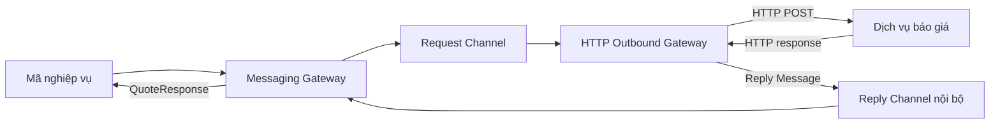
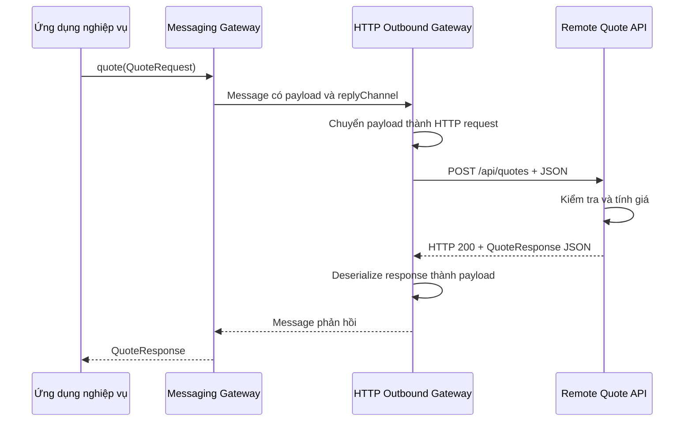
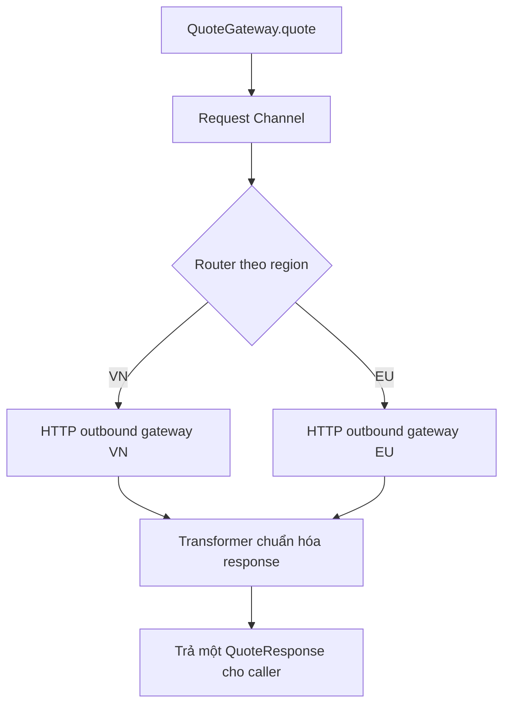

# Remote Procedure Invocation trong integration flow với Spring Integration

## 1. Đặt vấn đề: gọi chức năng ở một hệ thống khác

Giả sử ứng dụng bán hàng cần tính báo giá. Logic tính giá đang nằm ở một dịch vụ riêng, nên ứng dụng không thể gọi trực tiếp một đối tượng Java cùng tiến trình. Thay vào đó, phía gọi gửi dữ liệu qua mạng, dịch vụ từ xa thực hiện thao tác và gửi kết quả về.

Đó là bài toán của **Remote Procedure Invocation (RPI)**: trình bày việc thực thi một thao tác ở hệ thống khác dưới dạng một lời gọi có yêu cầu và kết quả. Trong **Enterprise Integration Patterns**, cách này giúp ứng dụng gọi một dịch vụ từ xa thông qua một giao diện gần với việc gọi phương thức thông thường.

Với **Spring Integration**, ta có thể ghép:

- **Messaging Gateway**: cung cấp API kiểu phương thức Java cho mã nghiệp vụ.
- **Request channel**: chuyển yêu cầu vào integration flow.
- **Outbound gateway**: gửi request qua giao thức như HTTP và nhận response.
- **Message handler / Transformer / Router**: chuyển đổi, định tuyến và xử lý kết quả nếu cần.
- **Reply channel**: đưa kết quả của flow trở lại Gateway đã gọi.

Bài học nằm trong chương **Remote procedure invocation** của module **SPRING_INTEGRATION_PATTERN**. Module hướng tới việc ứng dụng Router, Filter, Transformer, Splitter, Aggregator, Gateway, retry, error channel và correlation để xây dựng luồng thông điệp ít phụ thuộc, có khả năng mở rộng, theo dõi và kiểm thử.

Sau bài này, bạn sẽ hiểu cách RPI xuất hiện trong một integration flow, xây dựng ví dụ Spring Integration gọi dịch vụ HTTP, biết nơi cấu hình timeout và xử lý lỗi, đồng thời nhận diện giới hạn của lời gọi đồng bộ qua mạng.

## 2. Remote Procedure Invocation thực sự là gì?

Trong lời gọi phương thức cục bộ, ví dụ:

```java
QuoteResponse result = quoteService.calculate(request);
```

phía gọi và đối tượng xử lý thường sống trong cùng JVM. Một lỗi có thể lan qua stack trace, tham số có thể là đối tượng Java trong bộ nhớ, và thời gian gọi thường ngắn hơn đáng kể so với giao tiếp mạng.

Trong remote invocation, dòng mã phía gọi có thể trông tương tự:

```java
QuoteResponse result = quoteGateway.quote(request);
```

nhưng bên dưới có nhiều bước bổ sung:

1. Chuyển request thành message và serialize thành dữ liệu có thể truyền.
2. Gửi dữ liệu qua transport, chẳng hạn HTTP.
3. Chờ hệ thống khác nhận và thực hiện thao tác.
4. Nhận phản hồi hoặc lỗi từ mạng/dịch vụ.
5. Deserialize kết quả và trả về lời gọi Java.

Do đó, RPI **giấu sự phức tạp của giao tiếp khỏi mã nghiệp vụ**, nhưng không xóa được độ trễ mạng, lỗi kết nối, thay đổi hợp đồng dữ liệu hay khả năng kết quả không rõ ràng sau timeout.

### Đặc điểm nổi bật

| Khía cạnh | Gọi phương thức cục bộ | Remote Procedure Invocation |
|---|---|---|
| Nơi thực thi | Cùng tiến trình/JVM | Dịch vụ hoặc tiến trình khác |
| Truyền tham số | Đối tượng/giá trị trong bộ nhớ | Payload đã serialize |
| Kết quả | Giá trị hoặc exception trực tiếp | Response qua transport rồi được chuyển đổi |
| Độ trễ | Thường thấp | Phụ thuộc mạng, hệ thống đích, hàng đợi, I/O |
| Lỗi | Lỗi chương trình, tài nguyên cục bộ | Thêm timeout, DNS, kết nối, HTTP status, dữ liệu không tương thích |
| Tính nguyên tử | Có thể nằm cùng giao dịch | Không mặc nhiên có giao dịch phân tán |
| Retry | Thường ít phức tạp | Có thể làm lặp tác dụng phụ của thao tác từ xa |

RPI thường có ngữ nghĩa **request–reply**, nhưng không phải mọi request–reply đều là remote invocation: một Gateway gọi Service Activator trong cùng ứng dụng cũng có thể là request–reply mà không vượt qua ranh giới mạng.

## 3. RPI nằm ở đâu trong Spring Integration?

Spring Integration dùng các thành phần EIP để tổ chức việc gửi, xử lý, chuyển đổi và trả về message. RPI thường hình thành khi một flow nội bộ gặp **outbound gateway** gửi yêu cầu đến hệ thống ngoài rồi chờ phản hồi.



Các thành phần không hoàn toàn tương đương:

- **Messaging Gateway** là mặt tiền ở phía ứng dụng gọi, ánh xạ method Java sang message flow.
- **HTTP outbound gateway** là endpoint tích hợp thực hiện trao đổi HTTP và tạo message phản hồi từ response.
- **REST endpoint** nằm trong dịch vụ từ xa, nhận HTTP request, thực thi xử lý và phát HTTP response.
- **Temporary reply channel** (khi Gateway dùng cơ chế này) nằm ở phía Spring Integration của ứng dụng gọi. Nó là một đối tượng kênh nội bộ, **không được gửi nguyên vẹn qua HTTP**.

Điểm cuối rất quan trọng: dịch vụ từ xa không cần biết đối tượng `MessageChannel` của JVM phía client. Outbound gateway kết nối hai ngữ cảnh: HTTP response từ mạng được biến thành reply trong flow nội bộ; sau đó Gateway trả kết quả về caller.

### Sơ đồ thứ tự



Nếu remote endpoint lỗi hoặc không phản hồi, các bước sau phần HTTP request không diễn ra như nhánh thành công. Caller nhận exception, timeout hoặc đường xử lý lỗi được thiết kế, tùy cấu hình.

## 4. Ví dụ thực hành: gọi dịch vụ báo giá qua HTTP

Ta xây dựng hai ứng dụng độc lập:

- **Quote Server** chạy tại `http://localhost:8081`, cung cấp `POST /api/quotes`.
- **Quote Client** dùng Spring Integration Gateway và HTTP outbound gateway để gọi Quote Server.

Các đoạn mã minh họa phù hợp với mô hình Spring Boot 3.x / Spring Integration 6.x, Java 17 trở lên; khi sử dụng phiên bản khác, kiểm tra tương thích API và dependency tương ứng.

### 4.1. Hợp đồng dữ liệu chung

Hai phía cần thống nhất cấu trúc JSON của request/response. Trong dự án thực tế, có thể chia sẻ các DTO trong một thư viện contract có version, hoặc sinh mã từ OpenAPI.

```java
// QuoteRequest.java
package com.example.contract;

public record QuoteRequest(String productCode, int quantity) {
}
```

```java
// QuoteResponse.java
package com.example.contract;

import java.math.BigDecimal;

public record QuoteResponse(
        String productCode,
        int quantity,
        BigDecimal total
) {
}
```

JSON request mong đợi:

```json
{
  "productCode": "BOOK-01",
  "quantity": 3
}
```

JSON response thành công:

```json
{
  "productCode": "BOOK-01",
  "quantity": 3,
  "total": 75.00
}
```

Khi dùng record Java ở cả hai phía và Jackson tương thích, dữ liệu JSON có thể được ánh xạ vào record theo tên field. Trong môi trường nhiều ngôn ngữ hoặc version, hợp đồng HTTP/JSON là nguồn thống nhất quan trọng hơn việc dùng chung class Java.

### 4.2. Remote server: REST endpoint thực hiện nghiệp vụ

Ở ứng dụng Quote Server, cần dependency cho Spring Web/Jackson, ví dụ `spring-boot-starter-web`.

```java
// QuoteController.java - chạy trong ứng dụng Quote Server
package com.example.quoteserver;

import com.example.contract.QuoteRequest;
import com.example.contract.QuoteResponse;

import java.math.BigDecimal;

import org.springframework.http.HttpStatus;
import org.springframework.web.bind.annotation.PostMapping;
import org.springframework.web.bind.annotation.RequestBody;
import org.springframework.web.bind.annotation.RestController;
import org.springframework.web.server.ResponseStatusException;

@RestController
public class QuoteController {

    private static final BigDecimal UNIT_PRICE =
            new BigDecimal("25.00");

    @PostMapping("/api/quotes")
    public QuoteResponse calculate(@RequestBody QuoteRequest request) {
        if (request == null
                || request.productCode() == null
                || request.productCode().isBlank()
                || request.quantity() <= 0) {
            throw new ResponseStatusException(
                    HttpStatus.BAD_REQUEST,
                    "Invalid quote request");
        }

        BigDecimal total = UNIT_PRICE.multiply(
                BigDecimal.valueOf(request.quantity()));

        return new QuoteResponse(
                request.productCode(),
                request.quantity(),
                total);
    }
}
```

Ứng dụng Server cần chạy ở cổng 8081:

```properties
# application.properties của Quote Server
server.port=8081
```

Khi nhận request hợp lệ, server tính giá và trả HTTP 200 với JSON. Khi request không hợp lệ, server trả HTTP 400; đây là **lỗi hợp đồng/validation ở biên HTTP**, không phải một reply nghiệp vụ có kiểu `QuoteResponse`.

### 4.3. Client: định nghĩa Messaging Gateway

Ứng dụng Client khai báo interface để mã nghiệp vụ không phải trực tiếp thao tác với `HttpURLConnection` hay xây dựng HTTP request.

```java
// QuoteGateway.java - chạy trong ứng dụng Quote Client
package com.example.quoteclient;

import com.example.contract.QuoteRequest;
import com.example.contract.QuoteResponse;
import org.springframework.integration.annotation.MessagingGateway;

@MessagingGateway(
        defaultRequestChannel = "remoteQuoteRequests",
        defaultReplyTimeout = "3000"
)
public interface QuoteGateway {

    QuoteResponse quote(QuoteRequest request);
}
```

Khi gọi `quote()`, Spring Integration xây dựng message từ request và gửi tới `remoteQuoteRequests`. Với method cần một giá trị trả về, Gateway chờ reply theo hợp đồng và cấu hình của nó.

`defaultReplyTimeout = "3000"` là cấu hình về **việc chờ reply** tính bằng mili giây. Nó không tự thay thế timeout kết nối hoặc timeout đọc phản hồi HTTP; phần này sẽ được phân tích ở mục 6.

### 4.4. Client: khai báo IntegrationFlow gọi remote service

Ứng dụng Client cần dependency Spring Integration, gồm `spring-boot-starter-integration` và `spring-integration-http`. Đảm bảo Jackson hỗ trợ chuyển đổi JSON.

```java
// RemoteQuoteFlow.java - chạy trong ứng dụng Quote Client
package com.example.quoteclient;

import com.example.contract.QuoteResponse;

import org.springframework.context.annotation.Bean;
import org.springframework.context.annotation.Configuration;
import org.springframework.http.HttpMethod;
import org.springframework.integration.channel.DirectChannel;
import org.springframework.integration.dsl.IntegrationFlow;
import org.springframework.integration.http.dsl.Http;
import org.springframework.messaging.MessageChannel;

@Configuration
public class RemoteQuoteFlow {

    @Bean
    public MessageChannel remoteQuoteRequests() {
        return new DirectChannel();
    }

    @Bean
    public IntegrationFlow invokeQuoteService() {
        return IntegrationFlow.from("remoteQuoteRequests")
                .handle(
                    Http.outboundGateway(
                            "http://localhost:8081/api/quotes")
                        .httpMethod(HttpMethod.POST)
                        .expectedResponseType(QuoteResponse.class)
                )
                .get();
    }
}
```

Ý nghĩa từng bước:

1. `remoteQuoteRequests` là request channel nội bộ.
2. `IntegrationFlow.from(...)` tạo đầu vào của flow từ channel đó.
3. `Http.outboundGateway(...)` chuyển request thành một HTTP call.
4. `httpMethod(HttpMethod.POST)` chọn phương thức HTTP.
5. `expectedResponseType(QuoteResponse.class)` yêu cầu chuyển nội dung response thành kiểu kết quả thích hợp.
6. Giá trị trả về của outbound gateway trở thành reply trong flow và được định tuyến về nơi Gateway đang chờ khi không có endpoint output khác ghi đè.

Sự hiện diện của thư viện chuyển đổi JSON là cần thiết để serialize `QuoteRequest` và deserialize `QuoteResponse`. Nếu server trả JSON không phù hợp contract hoặc cấu hình message converter thiếu, lời gọi có thể thất bại ở bước chuyển đổi.

**Phân biệt tên:** `QuoteGateway` là Messaging Gateway đại diện lời gọi Java; `Http.outboundGateway(...)` là outbound gateway truy cập dịch vụ qua mạng. Hai Gateway có trách nhiệm khác nhau dù cùng nằm trong luồng request–reply.

### 4.5. Khởi động phía Client

```java
// QuoteClientApplication.java
package com.example.quoteclient;

import org.springframework.boot.SpringApplication;
import org.springframework.boot.autoconfigure.SpringBootApplication;
import org.springframework.integration.annotation.IntegrationComponentScan;
import org.springframework.integration.config.EnableIntegration;

@SpringBootApplication
@EnableIntegration
@IntegrationComponentScan
public class QuoteClientApplication {

    public static void main(String[] args) {
        SpringApplication.run(QuoteClientApplication.class, args);
    }
}
```

Lớp `QuoteGateway` và cấu hình flow cần nằm trong phạm vi component scan. Server và Client là hai ứng dụng khởi động độc lập; không đưa cả hai lớp `@SpringBootApplication` vào cùng một ứng dụng đang chạy.

### 4.6. Sử dụng từ mã nghiệp vụ

```java
// Ví dụ trong một @Service thuộc ứng dụng Client.
QuoteResponse response = quoteGateway.quote(
        new QuoteRequest("BOOK-01", 3)
);

System.out.println(response.total()); // 75.00
```

Để chạy theo luồng minh họa: khởi động Quote Server trên cổng 8081, sau đó khởi động Quote Client và gọi method Gateway. Caller nhận `QuoteResponse` như một lời gọi Java, còn HTTP giao tiếp ở bên trong integration flow.

Một phép kiểm tra độc lập phía server có thể gửi request sau:

```bash
curl -i -X POST "http://localhost:8081/api/quotes" \
  -H "Content-Type: application/json" \
  -d '{"productCode":"BOOK-01","quantity":3}'
```

Khi server chạy đúng, phản hồi có mã HTTP 200 và dữ liệu báo giá tương ứng. Trên Windows PowerShell, có thể dùng `curl.exe` thay cho alias `curl` nếu cần chạy lệnh ví dụ.

## 5. Điều gì xảy ra ở đường phản hồi?

Trong ví dụ trên tồn tại **hai chiều phản hồi khác nhau**:

| Phạm vi | Request | Reply |
|---|---|---|
| Java → Spring Integration | Gọi `quote(request)` | `QuoteResponse` trả cho caller |
| Integration flow nội bộ | Message gửi vào `remoteQuoteRequests` | Message tạo từ response của outbound gateway |
| HTTP client ↔ remote server | HTTP POST + JSON | HTTP status + JSON |
 
HTTP response **không chứa một đối tượng temporary reply channel của Spring Integration**. Outbound gateway nhận HTTP response, tạo message trả lời rồi framework sử dụng cơ chế routing nội bộ để hoàn tất Gateway call.

Nếu có Transformer phía sau HTTP outbound gateway, Transformer có thể đổi payload `QuoteResponse` thành một DTO khác trước khi trả về caller. Nếu có Router, cần bảo đảm mỗi nhánh trả về một kết quả đúng hợp đồng hoặc xử lý lỗi rõ ràng.

### Khi nào dùng reply channel cố định?

Đa số Gateway kiểu gọi phương thức cần một reply tương ứng từng lời gọi có thể dựa vào cơ chế reply channel tạm thời. Kênh reply cố định phù hợp với những topology cần luồng phản hồi riêng, nhưng phải hiểu cách giữ tương quan nếu có nhiều caller đồng thời.

Dù sử dụng cơ chế nào, **không gửi tham chiếu Java MessageChannel qua mạng**; nếu cần ghép kết quả qua hệ thống phân tán, dùng một giá trị correlation ID có thể serialize và truyền theo giao thức chung.

## 6. Timeout của RPI: phân biệt các lớp thời gian chờ

Remote invocation có nhiều điểm có thể bị chặn:

1. Chờ để request được gửi vào channel.
2. Kết nối TCP/TLS tới dịch vụ từ xa.
3. Gửi HTTP request và đợi server xử lý.
4. Đọc HTTP response qua mạng.
5. Đợi reply được đưa về Gateway nội bộ, nếu phần xử lý được thực hiện bất đồng bộ.

| Timeout / deadline | Dùng để kiểm soát |
|---|---|
| **Connect timeout** | Thời gian tối đa dành cho thiết lập kết nối theo HTTP client |
| **Read/response timeout** | Thời gian chờ dữ liệu phản hồi theo cơ chế HTTP client |
| **Gateway request timeout** | Chờ thao tác gửi message vào channel nếu send có thể chặn |
| **Gateway reply timeout** | Chờ message phản hồi sau khi gửi request theo ngữ nghĩa của Gateway |
| **Deadline nghiệp vụ** | Tổng thời gian ứng dụng chấp nhận cho một thao tác từ đầu đến cuối |

Vì `DirectChannel` thực thi handler đồng bộ, call qua HTTP outbound gateway có thể **chiếm luồng caller ngay trong pha gửi request**. Do đó, chỉ đặt `defaultReplyTimeout = "3000"` không đảm bảo rằng một HTTP request bị treo sẽ tự dừng sau ba giây.

### Ví dụ cấu hình timeout cho HTTP client

Có thể tạo HTTP request factory với timeout rồi gắn vào HTTP outbound gateway:

```java
import java.time.Duration;

import org.springframework.http.HttpMethod;
import org.springframework.http.client.SimpleClientHttpRequestFactory;
import org.springframework.integration.dsl.IntegrationFlow;
import org.springframework.integration.http.dsl.Http;

// Bên trong lớp @Configuration:
@Bean
public IntegrationFlow invokeQuoteService() {
    SimpleClientHttpRequestFactory requestFactory =
            new SimpleClientHttpRequestFactory();

    requestFactory.setConnectTimeout(Duration.ofSeconds(1));
    requestFactory.setReadTimeout(Duration.ofSeconds(2));

    return IntegrationFlow.from("remoteQuoteRequests")
            .handle(
                Http.outboundGateway(
                        "http://localhost:8081/api/quotes")
                    .httpMethod(HttpMethod.POST)
                    .expectedResponseType(QuoteResponse.class)
                    .requestFactory(requestFactory)
            )
            .get();
}
```

Đây là **biến thể thay thế** bean `invokeQuoteService()` ở mục 4.4, không đăng ký cả hai flow cùng tiêu thụ một request channel. Các overload timeout phụ thuộc phiên bản Spring Framework; nếu phiên bản đang dùng chỉ nhận mili giây dạng `int`, dùng overload tương thích. Trong dự án thật, đưa các thông số này vào cấu hình môi trường, không hardcode rải rác.

Ngay cả khi đã có connect/read timeout, hãy kiểm tra **deadline tổng thể**, bởi các lần retry có thể làm thời gian cuối cùng dài hơn dự kiến. Nếu xử lý phía server đã thực hiện xong nhưng response mất trên mạng, phía client không thể kết luận chắc chắn thao tác chưa xảy ra.

## 7. Xử lý lỗi HTTP và exception trong integration flow

Remote Procedure Invocation phải coi lỗi mạng là một trạng thái bình thường cần thiết kế, không phải sự kiện hiếm có thể bỏ qua.

### Những tình huống phổ biến

| Tình huống | Ví dụ | Hướng xử lý |
|---|---|---|
| Request sai | HTTP 400 | Sửa dữ liệu, trả lỗi validation; thường không retry nguyên trạng |
| Không có quyền | HTTP 401/403 | Kiểm tra cơ chế xác thực, phân quyền |
| Không tìm thấy tài nguyên | HTTP 404 | Ánh xạ theo hợp đồng nghiệp vụ |
| Server lỗi tạm thời | HTTP 502/503 | Retry có giới hạn nếu thao tác an toàn |
| Rate limit | HTTP 429 | Tuân thủ hướng dẫn backoff/Retry-After nếu có |
| Không kết nối được | DNS/TCP/TLS lỗi | Quan sát mạng, circuit breaker và timeout |
| Server xử lý chậm | Read timeout | Không biết chắc request đã tạo tác dụng phụ hay chưa |
| Sai schema phản hồi | JSON không ánh xạ được DTO | Sửa tương thích contract; tăng timeout không giúp |

HTTP outbound gateway thường báo lỗi HTTP không thành công qua exception theo cấu hình HTTP client/handler, có thể được Spring Integration bọc lại khi đi qua endpoint. Không nên mặc định mọi lỗi sẽ trở thành một `QuoteResponse` với `total = 0`.

### Lỗi trên luồng đồng bộ và bất đồng bộ

Trong ví dụ dùng `DirectChannel`, exception từ HTTP request có thể lan về phía gọi `quote()`. Khi đưa flow qua `ExecutorChannel`, `QueueChannel` hoặc một ranh giới bất đồng bộ khác, lỗi có thể được chuyển sang error channel và caller chờ reply riêng.

Một `errorChannel` không tự động tương đương với `replyChannel`. Nếu muốn caller nhận một response lỗi nghiệp vụ, cần thiết kế cách chuyển lỗi thành response theo contract hoặc trả exception ra đúng đường đi.

### Chiến lược lỗi nên rõ ràng

Hợp đồng kết quả có thể phân nhóm:

- **Thành công:** server trả dữ liệu hợp lệ, Gateway trả `QuoteResponse`.
- **Từ chối nghiệp vụ:** server trả mã và body thể hiện validation/business error; client ánh xạ sang lỗi có cấu trúc.
- **Lỗi hạ tầng:** transport timeout, kết nối lỗi, dịch vụ quá tải hoặc response hỏng; đưa vào chính sách retry/fallback.
- **Trạng thái không chắc chắn:** request có thể đã xử lý phía server nhưng reply bị mất; không tự động xem như “chưa thực thi”.

Tùy yêu cầu, có thể đặt logic ánh xạ exception trong một handler, advice hoặc lớp ứng dụng bao quanh Gateway. Điều quan trọng là người gọi có thể phân biệt kết quả nghiệp vụ với thất bại của giao tiếp.

## 8. Retry, idempotency và nguy cơ gọi trùng

Giả sử RPI gọi endpoint **tạo đơn hàng thanh toán**:

1. Client gửi `POST /payments`.
2. Server đã ghi giao dịch thành công.
3. Response bị mất do mạng.
4. Client thấy timeout và retry.
5. Server có thể ghi thêm giao dịch thứ hai nếu không có cơ chế chống trùng.

Việc retry không thể dựa duy nhất vào lỗi timeout. Cần xem xét **idempotency**: nhiều yêu cầu tương đương có cùng tác dụng nghiệp vụ như một lần thực thi.

### Idempotency key

Một giao thức phù hợp có thể quy định:

- Mỗi thao tác nghiệp vụ được cấp một `Idempotency-Key` cố định, ví dụ UUID tạo một lần trước khi gọi.
- Client giữ nguyên key qua các lần retry của cùng thao tác.
- Server lưu key cùng kết quả, từ chối hoặc trả lại kết quả cũ nếu key đã xử lý.
- Các key khác nhau biểu diễn yêu cầu nghiệp vụ độc lập.

```text
Lần đầu:  POST /payments, Idempotency-Key: pay-42
           → server xử lý và lưu kết quả; response bị mất

Retry:    POST /payments, Idempotency-Key: pay-42
           → server tra key, trả kết quả cũ; không tạo payment mới
```

Thông thường HTTP outbound gateway có thể được cấu hình để ánh xạ các header cần thiết sang HTTP. Không nên mặc định mọi Spring Integration header đều tự xuất hiện dưới dạng HTTP header; hãy kiểm tra và khai báo header mapping rõ ràng cho `Idempotency-Key`, `X-Request-Id` hoặc `traceparent` theo chuẩn giao tiếp của hệ thống.

### Khi nào có thể retry?

| Phân loại | Gợi ý |
|---|---|
| Truy vấn chỉ đọc | Có thể retry với giới hạn, backoff, jitter và deadline |
| POST tạo tác dụng phụ | Chỉ retry tự động khi server hỗ trợ idempotency hoặc có cơ chế xác định kết quả |
| HTTP 400 do dữ liệu sai | Không retry nguyên trạng |
| HTTP 401/403 | Không retry mù; cần sửa xác thực/quyền |
| HTTP 429/503 | Cân nhắc backoff theo hợp đồng server |
| Lỗi parse response do schema | Điều tra tương thích API thay vì retry liên tục |

Spring Integration có cơ chế retry advice cho endpoint và handler, nhưng việc áp dụng phải được cân nhắc theo **tính an toàn của nghiệp vụ từ xa**, không chỉ theo khả năng kỹ thuật.

## 9. Correlation và quan sát luồng phân tán

Trong hệ thống nội bộ, Gateway có thể dùng temporary reply channel để khớp một reply với một caller. Khi request đi qua HTTP, bạn cần **định danh truyền được qua mạng** để hỗ trợ tracing và ghép sự kiện.

Ví dụ một bộ metadata:

| Metadata | Mục đích |
|---|---|
| `X-Request-Id` | Theo dấu một request qua client, gateway và server |
| `traceparent` | Mang thông tin distributed trace theo chuẩn W3C khi có tracing |
| `Idempotency-Key` | Nhận diện cùng một thao tác nghiệp vụ qua nhiều retry |
| `correlationId` | Ghép các message trung gian trong flow, đặc biệt khi Splitter/Aggregator |
| Deadline/cutoff | Cho bên nhận biết thời gian còn hợp lệ của tác vụ nếu contract hỗ trợ |

Không nên đồng nhất tất cả thành một ID. `traceId` phục vụ quan sát, `Idempotency-Key` phục vụ chống thực thi trùng, còn correlation ID của một nhóm message phục vụ ghép các nhánh của integration flow.

Cần log tối thiểu:

1. ID yêu cầu và thời điểm bắt đầu.
2. Đích remote và tên thao tác, tránh log credential/token.
3. Thời lượng gọi HTTP, status nhận được hoặc loại exception.
4. Số lần retry và delay nếu có.
5. Kết quả ánh xạ về caller và tổng thời gian hoàn tất.

Khi dữ liệu có thông tin nhạy cảm, log mã định danh/metadata có kiểm soát thay vì toàn bộ body request/response.

### Metrics quan trọng

- Số request/giây tới mỗi remote operation.
- Tỷ lệ 2xx, 4xx, 5xx và lỗi transport.
- Độ trễ p50/p95/p99 theo endpoint.
- Số timeout, retry và circuit breaker open.
- Số response không khớp schema.
- Thời gian chờ và kích thước hàng đợi nếu flow có bước async.

Những số liệu này giúp phân biệt remote service chậm, mạng không ổn định, request channel tắc nghẽn và lỗi contract.

## 10. Kết hợp với các Enterprise Integration Patterns

Remote invocation hiếm khi đứng một mình. Một integration flow thực tế có thể cần thêm các pattern đã học.

| Pattern | Cách tham gia vào remote invocation |
|---|---|
| **Gateway** | Cung cấp API Java cho caller và triển khai transport request–reply |
| **Transformer** | Đổi DTO nghiệp vụ thành request của API đối tác, hoặc đổi response thành model nội bộ |
| **Router** | Chọn endpoint theo khu vực, loại sản phẩm, tenant hoặc version API |
| **Filter** | Chặn request không phù hợp trước khi gọi remote, với nhánh reject có kết quả rõ |
| **Splitter** | Tách lô thành nhiều lời gọi remote độc lập |
| **Aggregator** | Ghép các response thành một kết quả cuối, theo correlation và chính sách timeout |
| **Retry** | Thử lại lỗi tạm thời với giới hạn và idempotency |
| **Error channel** | Tiếp nhận lỗi trong các nhánh async, phục vụ cảnh báo hoặc xử lý thất bại |
| **Correlation** | Ghép đúng request/reply và các kết quả nhánh |

### Ví dụ Router + remote gateways

Một hệ thống có thể có hai nhà cung cấp báo giá:



Dù đi nhánh nào, hợp đồng phương thức Java vẫn là `QuoteResponse quote(QuoteRequest)`. Đó là giá trị của integration layer: mã nghiệp vụ gọi một API thống nhất, còn topology tích hợp xử lý routing, mapping và lỗi.

### Ví dụ Splitter + Aggregator

Một request chứa năm sản phẩm có thể được tách thành năm remote calls. Nếu cần trả **một** tổng báo giá, Aggregator phải đợi các kết quả cần thiết, xử lý lỗi từng phần theo chính sách và chỉ sau đó phát một message kết quả cuối về Gateway. Nếu không có điều kiện release/timeout phù hợp, lời gọi tổng có thể bị treo hoặc nhận kết quả thiếu.

Ở đây `correlationId` và thông tin sequence phục vụ ghép nhóm message. Không nên cho năm lời gọi con tự gửi năm reply trực tiếp tới một Gateway đang chờ một kết quả.

## 11. Khi nào nên dùng RPC, khi nào nên dùng bất đồng bộ?

RPI thuận tiện nhưng tăng **temporal coupling**: thời điểm caller gọi phải có khả năng liên lạc và nhận phản hồi từ remote service.

| Tiêu chí | Remote Procedure Invocation đồng bộ | Messaging bất đồng bộ |
|---|---|---|
| Caller cần kết quả ngay | Phù hợp | Cần thêm cơ chế trả kết quả sau |
| Kết quả có thể chờ hàng giờ | Không phù hợp cho request đang chặn | Thường phù hợp hơn |
| Xử lý dài và có nhiều bước | Dễ làm caller timeout | Có thể xử lý với queue/workflow |
| Tình trạng hệ thống đích | Ảnh hưởng trực tiếp độ trễ caller | Queue có thể đệm khi hệ thống đích chậm |
| Quản lý kết quả | Qua response trực tiếp | Qua event, callback, correlation ID hoặc truy vấn trạng thái |
| Đơn giản ở mức API | Dễ gọi như method | Cần quản lý trạng thái tác vụ |

Ví dụ:

- **Nên cân nhắc RPI:** tra cứu tỷ giá, tính thuế, xác thực nhanh, lấy thông tin khách hàng.
- **Nên cân nhắc bất đồng bộ:** xử lý video, import hàng triệu bản ghi, thanh toán qua nhiều bước, workflow chờ phê duyệt.

Một API đồng bộ có thể trả ngay `202 Accepted` cùng ID tác vụ, sau đó client theo dõi kết quả qua event hoặc polling. Đó là một hợp đồng khác với phương thức Gateway chờ tới khi xử lý xong toàn bộ.

## 12. Các nguyên tắc thiết kế an toàn và dễ mở rộng

### 12.1. Contract rõ ràng, có version

Xác định schema request/response, status code, error body, version, giới hạn kích thước payload và quy tắc tương thích ngược. Nếu đổi tên JSON field mà không thống nhất, client có thể parse lỗi dù HTTP 200.

### 12.2. Giới hạn tài nguyên

Một Gateway đồng bộ chiếm thread trong lúc chờ HTTP. Nếu rất nhiều caller đồng thời, hệ thống có nguy cơ cạn thread hoặc connection pool. Cần giới hạn concurrency, dùng connection pooling, backpressure/rate limit và đặt deadline rõ ràng.

### 12.3. Tách lớp nghiệp vụ khỏi transport

Mã nghiệp vụ chỉ nên biết `QuoteGateway.quote(request)` hoặc một abstraction tương tự. URL, HTTP method, mapping và retry đặt ở integration layer. Đây là cách giảm phụ thuộc trực tiếp vào nhà cung cấp API hoặc cơ chế giao tiếp cụ thể.

### 12.4. Bảo vệ dữ liệu và endpoint

Dùng HTTPS/TLS, xác thực phù hợp, kiểm tra input và giới hạn dữ liệu gửi đi. Đừng đưa bearer token, cookie hay dữ liệu nhạy cảm vào log hoặc truy dấu. Không cho phép URL remote được tạo tùy ý từ dữ liệu không tin cậy nếu không có kiểm soát đích được gọi.

### 12.5. Không biến mọi lỗi thành retry

Retry liên tục có thể gây quá tải dây chuyền. Nên giới hạn số lần, thêm exponential backoff/jitter, có circuit breaker và thực hiện fallback chỉ khi fallback giữ đúng ngữ nghĩa nghiệp vụ.

## 13. Kiểm thử Remote Procedure Invocation

Một flow tích hợp không nên chỉ được kiểm tra bằng unit test của lớp Gateway; cần xác nhận giao tiếp HTTP và ánh xạ lỗi.

### Các lớp kiểm thử

1. **Unit test remote handler:** gọi trực tiếp logic tính giá, kiểm tra các nhánh hợp lệ và validation.
2. **Contract test:** đối chiếu HTTP request/response JSON với schema hai phía đã công bố.
3. **Integration test client flow:** chạy một HTTP stub/server kiểm soát được, gọi `QuoteGateway.quote()` và xác nhận method, path, JSON body, kết quả deserialize.
4. **Failure test:** server trả 400, 500, timeout, JSON sai hoặc ngắt kết nối.
5. **Concurrency/retry test:** gửi nhiều request song song, xác nhận phản hồi đúng caller và không tạo tác dụng phụ trùng khi retry.

### Ví dụ unit test cho remote controller

```java
// QuoteControllerTest.java - trong dự án Quote Server
package com.example.quoteserver;

import static org.junit.jupiter.api.Assertions.assertEquals;

import com.example.contract.QuoteRequest;
import com.example.contract.QuoteResponse;
import java.math.BigDecimal;
import org.junit.jupiter.api.Test;

class QuoteControllerTest {

    private final QuoteController controller = new QuoteController();

    @Test
    void returnsExpectedQuote() {
        QuoteResponse actual = controller.calculate(
                new QuoteRequest("BOOK-01", 3));

        assertEquals("BOOK-01", actual.productCode());
        assertEquals(3, actual.quantity());
        assertEquals(new BigDecimal("75.00"), actual.total());
    }
}
```

Test này chỉ kiểm tra **logic controller**, chưa kiểm tra HTTP serialization hoặc flow của Client. Ở integration test đầy đủ, HTTP stub cần xác nhận rằng request thật tới `POST /api/quotes` mang đúng JSON và reply được ánh xạ thành `QuoteResponse`.

### Ma trận kiểm thử gợi ý

| Tình huống | Kỳ vọng |
|---|---|
| HTTP 200 + JSON hợp lệ | Gateway trả đúng `QuoteResponse` |
| HTTP 400 | Caller nhận xử lý validation/error có chủ đích |
| HTTP 503 tạm thời | Retry theo chính sách nếu thao tác cho phép |
| Connect timeout | Có lỗi hạ tầng, đo được thời gian chờ |
| Read timeout | Không mặc nhiên cho rằng server chưa thực thi |
| Response có JSON sai schema | Lỗi mapping được phát hiện |
| Nhiều caller song song | Không ghép nhầm reply |
| Retry với cùng idempotency key | Không tạo tác dụng phụ trùng |
| Router chọn nhiều remote endpoint | Mọi nhánh giữ đúng response contract |
| Splitter/Aggregator | Có tương quan và chỉ một reply cuối cùng |

## 14. Những lỗi thường gặp

**Lỗi 1: chỉ cấu hình reply timeout ở Messaging Gateway.** Điều đó không nhất thiết giới hạn một HTTP call đồng bộ đang chờ mạng. Hãy cấu hình HTTP client timeout và deadline tổng.

**Lỗi 2: cho rằng HTTP 200 đồng nghĩa nghiệp vụ thành công.** Một API có thể trả response hợp lệ nhưng nội dung chứa mã trạng thái nghiệp vụ thất bại. Contract phải định nghĩa rõ ý nghĩa từng trường và status.

**Lỗi 3: gửi tất cả message header qua HTTP.** Header nội bộ có thể chứa dữ liệu nhạy cảm hoặc đối tượng không serialize được, chẳng hạn tham chiếu reply channel. Chỉ ánh xạ metadata đã thống nhất.

**Lỗi 4: retry POST bất kể tác dụng phụ.** Khi response mất nhưng server đã xử lý, retry có thể tạo trùng. Dùng idempotency hoặc tra cứu trạng thái trước.

**Lỗi 5: nhầm HTTP outbound adapter và outbound gateway.** Outbound adapter thường phục vụ gửi một chiều; outbound gateway phục vụ trao đổi request–reply. Nếu caller cần dữ liệu phản hồi, chọn thành phần có ngữ nghĩa reply.

**Lỗi 6: quên một nhánh xử lý lỗi.** Router, Filter hoặc error flow có thể kết thúc mà không sinh reply, khiến caller chờ hoặc nhận kết quả thiếu. Mọi đường đi phải có kết cục rõ ràng.

**Lỗi 7: gửi nhiều reply về Gateway đang chờ một kết quả.** Khi có fan-out, dùng Aggregator hoặc một contract hỗ trợ nhiều kết quả thay vì mặc định request–reply trả được danh sách phản hồi tự phát.

## 15. Câu hỏi ôn tập

1. Remote Procedure Invocation khác gọi method cục bộ ở những điểm nào ngoài cú pháp Java?
2. Messaging Gateway và HTTP outbound gateway đóng vai trò gì trong cùng một integration flow?
3. Vì sao một temporary reply channel của Spring Integration không được truyền nguyên vẹn qua HTTP?
4. Khi gọi outbound HTTP trên `DirectChannel`, vì sao `defaultReplyTimeout` không bảo đảm giới hạn tổng thời gian của lời gọi?
5. Khi HTTP request timeout, có thể khẳng định remote server chưa thực thi thao tác không? Vì sao?
6. Khi nào cần idempotency key và nó phải được giữ như thế nào khi retry?
7. Vì sao nên phân biệt `X-Request-Id`, `traceparent` và `Idempotency-Key`?
8. Nếu Router chọn hai nhà cung cấp khác nhau, cần bảo đảm điều gì về response contract?
9. Nếu Splitter phát nhiều request remote, Aggregator cần correlation và release strategy như thế nào?
10. Những tình huống nào nên chuyển từ request–reply đồng bộ sang messaging bất đồng bộ?

## 16. Checklist áp dụng trong dự án

- [ ] Gateway có hợp đồng request, response và lỗi rõ ràng.
- [ ] Integration flow dùng đúng outbound gateway khi cần phản hồi.
- [ ] Schema JSON, HTTP method, endpoint và API version được thống nhất.
- [ ] HTTP client có connect/read timeout; hệ thống có deadline tổng phù hợp.
- [ ] HTTP status, validation error, mapping error và transport error được xử lý riêng.
- [ ] Retry có giới hạn, backoff và xét idempotency trước khi áp dụng.
- [ ] Header qua mạng được ánh xạ có chủ đích; không rò rỉ đối tượng/channel nội bộ.
- [ ] Có request ID/tracing, log và metric đủ để theo dõi từng thao tác.
- [ ] Thread, kết nối và concurrency được giới hạn phù hợp tải thực tế.
- [ ] Có kiểm thử tích hợp với HTTP server giả lập hoặc môi trường thử nghiệm.
- [ ] Các nhánh Router/Filter/Splitter/Aggregator đều giữ đúng hợp đồng reply.
- [ ] Những tác vụ dài được đánh giá để chuyển sang flow bất đồng bộ.

**Ghi nhớ:** Remote Procedure Invocation trong Spring Integration cho phép mã nghiệp vụ gọi một API Java quen thuộc, còn integration flow đảm nhiệm việc chuyển message thành một yêu cầu qua mạng và chuyển response trở lại. Sự tiện dụng của Gateway phải đi cùng thiết kế rõ ràng về contract, timeout, lỗi, retry, idempotency và correlation. Một lời gọi từ xa luôn có đặc điểm của hệ thống phân tán, dù bề ngoài trông giống một phương thức Java bình thường.
