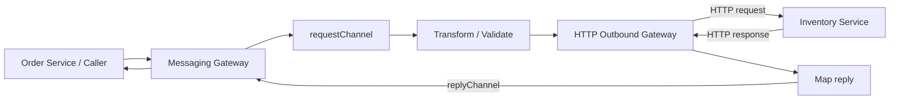
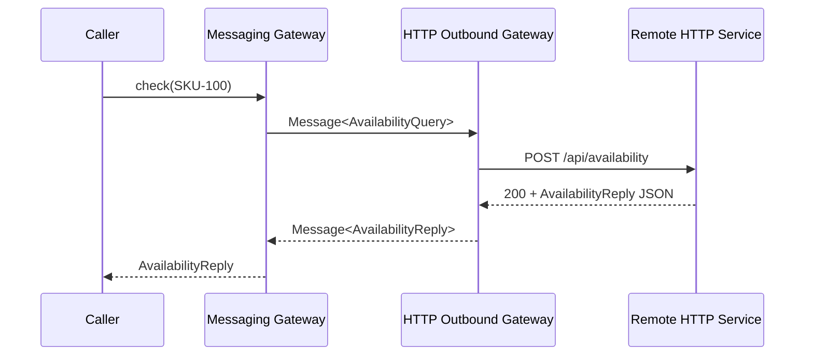
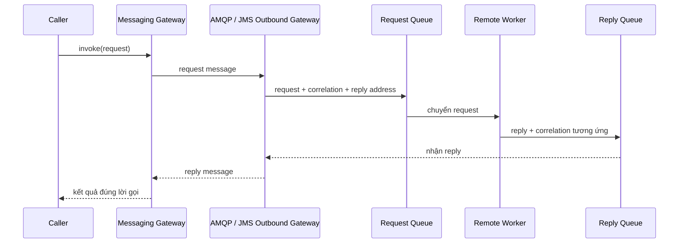

# Gateway và remote adapter

Trong chương **Remote procedure invocation** của module **SPRING_INTEGRATION_PATTERN**, chúng ta xây dựng lời gọi tới một hệ thống ở xa dưới dạng thao tác nghiệp vụ quen thuộc, nhưng bên trong vẫn sử dụng thông điệp của Spring Integration. Đây là cách áp dụng Enterprise Integration Patterns để tạo luồng ít phụ thuộc, dễ mở rộng: phía gọi làm việc qua **Gateway**, còn phần kết nối HTTP, TCP hoặc message broker được đảm nhiệm bởi **remote adapter** phù hợp.

Khi hệ thống cần gọi dịch vụ tồn kho, thanh toán hoặc tra cứu khách hàng, hai nhiệm vụ rất khác nhau thường bị trộn lẫn: **biểu diễn yêu cầu nghiệp vụ** và **giao tiếp qua mạng**. Spring Integration cho phép đặt một ranh giới rõ ràng giữa hai nhiệm vụ đó. Gateway nhận lời gọi và chuyển nó thành message; remote adapter đưa message qua giao thức cụ thể, nhận dữ liệu từ bên ngoài (nếu là request-reply) và chuyển kết quả về luồng nội bộ.

Sau bài học, bạn có thể:

- Phân biệt Messaging Gateway, outbound gateway, inbound gateway và channel adapter một chiều.
- Xây dựng luồng Java DSL gọi một REST API từ giao diện Gateway kiểu Java.
- Giải thích cách request/reply đi qua channel, adapter và mạng; khi nào cần correlation.
- Xác định hợp đồng payload, timeout, lỗi từ xa, retry, idempotency và quan sát luồng.
- Chọn loại remote adapter theo yêu cầu đồng bộ, bất đồng bộ và đặc điểm giao thức.

## 1. Hai lớp trừu tượng: Gateway và remote adapter

Giả sử hệ thống đặt hàng cần kiểm tra kho. Ở tầng nghiệp vụ, cách gọi mong muốn là:

```java
AvailabilityReply reply = availabilityGateway.check(
    new AvailabilityQuery("SKU-100")
);
```

Caller không cần tự tạo HTTP request, mở kết nối TCP hay biết tên queue của dịch vụ tồn kho. Cách tổ chức này gồm các trách nhiệm:

| Thành phần | Vai trò | Điều không nên gán nhầm |
| --- | --- | --- |
| **Messaging Gateway** (ví dụ `@MessagingGateway`) | Tạo một giao diện Java cho việc gửi message và, nếu method có kết quả, chờ reply thích hợp. | Không nhất thiết tự gọi HTTP, TCP hay broker. |
| **Message channel** | Nối các thành phần Spring Integration và điều phối message trong ứng dụng. | Không mặc nhiên là kết nối mạng. |
| **Transformer / Router / Filter** | Chuẩn hóa dữ liệu, chọn tuyến xử lý, áp dụng luật nghiệp vụ trước/sau khi gửi. | Không thay thế hợp đồng giao thức bên ngoài. |
| **Outbound gateway** | Tương tác hai chiều với hệ thống ngoài: gửi request và nhận response/reply. | Khác outbound *channel adapter* chỉ dùng cho gửi một chiều. |
| **Inbound gateway** | Nhận request từ bên ngoài, đưa vào flow và trả reply ra phía hệ thống gọi. | Không giống inbound *channel adapter* chỉ đưa dữ liệu một chiều vào flow. |
| **Channel adapter** | Chuyển message qua ranh giới hệ thống theo hướng gửi hoặc nhận, thường không gắn một reply trực tiếp cho từng request. | Không nên coi mọi channel adapter đều là RPC. |

Một kiến trúc phổ biến:



Đường đi gồm hai tầng cần quan sát riêng:

1. **Trong tiến trình:** lời gọi method → message → channel → handler → reply channel.
2. **Qua biên mạng:** adapter mã hóa/gửi request → dịch vụ ngoài xử lý → adapter nhận/giải mã response.

Gateway giúp caller phụ thuộc vào một *hợp đồng nghiệp vụ*. Adapter giúp phần còn lại của flow ít bị gắn chặt vào một giao thức vận chuyển cụ thể. Tuy vậy, việc thay từ HTTP sang AMQP vẫn có thể yêu cầu điều chỉnh timeout, cách correlation và bảo đảm giao nhận; không phải phép thay thế hoàn toàn trong suốt.

## 2. Remote procedure invocation khác gửi message một chiều thế nào?

**Remote Procedure Invocation (RPI)** diễn đạt một thao tác ở hệ thống xa như một lần gọi hàm. Khác biệt cốt lõi nằm ở kỳ vọng có kết quả cho một request.

| Đặc điểm | Request-reply qua remote gateway | Gửi qua outbound channel adapter |
| --- | --- | --- |
| Mục tiêu | Gửi yêu cầu và nhận kết quả liên quan | Chuyển sự kiện/lệnh ra ngoài |
| Caller | Thường đợi reply hoặc một future/luồng phản hồi được thiết kế rõ | Không cần reply nghiệp vụ trực tiếp |
| Xử lý lỗi | Có thể nhận remote error, timeout, lỗi chuyển đổi | Thường biết kết quả gửi/ghi, không mặc nhiên biết nghiệp vụ đã hoàn tất |
| Ví dụ | Kiểm tra tồn kho, tra cứu định mức, lấy báo giá | Phát sự kiện “đơn hàng đã tạo”, gửi telemetry |
| Lựa chọn phù hợp | Khi bước tiếp theo cần phản hồi của dịch vụ ngoài | Khi tác vụ có thể xử lý độc lập, không cần chặn bên gửi |

Chỉ vì bên gửi nhận được ACK từ broker không có nghĩa nghiệp vụ ở phía nhận đã hoàn tất. Muốn biết kết quả cuối cùng cần thiết kế riêng một reply và cách ghép cặp, hoặc chuyển sang luồng bất đồng bộ có trạng thái.

## 3. Ví dụ: Java Gateway gọi HTTP remote service

Ví dụ sử dụng **Spring Integration Java DSL**, Spring Integration HTTP, Java 17+, và một dịch vụ tồn kho giả định:

- Endpoint từ xa: `POST http://localhost:8081/api/availability`.
- Request JSON: `{"sku":"SKU-100"}`.
- Response JSON: `{"sku":"SKU-100","available":true,"quantity":12}`.
- Caller chỉ nhìn thấy method Java trả `AvailabilityReply`.

### 3.1. Định nghĩa DTO và giao diện Gateway

```java
package example.inventory;

record AvailabilityQuery(String sku) {}

record AvailabilityReply(
    String sku,
    boolean available,
    int quantity
) {}
```

```java
package example.inventory;

import org.springframework.integration.annotation.MessagingGateway;

@MessagingGateway(
    defaultRequestChannel = "inventory.check.requests",
    defaultReplyTimeout = "5000"
)
interface AvailabilityGateway {
    AvailabilityReply check(AvailabilityQuery query);
}
```

Chữ ký method là **hợp đồng của phía gọi**. Dù flow bên trong dùng HTTP, TCP hay một adapter khác, code nghiệp vụ vẫn nhận `AvailabilityReply` nếu mọi nhánh thành công đáp ứng đúng hợp đồng đó.

### 3.2. Kết nối Gateway với HTTP outbound gateway

```java
package example.inventory;

import org.springframework.context.annotation.Bean;
import org.springframework.context.annotation.Configuration;
import org.springframework.http.HttpMethod;
import org.springframework.http.MediaType;
import org.springframework.integration.annotation.IntegrationComponentScan;
import org.springframework.integration.config.EnableIntegration;
import org.springframework.integration.dsl.IntegrationFlow;
import org.springframework.integration.http.dsl.Http;
import org.springframework.messaging.MessageHeaders;

@Configuration
@EnableIntegration
@IntegrationComponentScan
class InventoryClientIntegrationConfig {

    @Bean
    IntegrationFlow inventoryRemoteCallFlow() {
        return IntegrationFlow.from("inventory.check.requests")
            .enrichHeaders(h -> h.header(
                MessageHeaders.CONTENT_TYPE,
                MediaType.APPLICATION_JSON_VALUE
            ))
            .handle(
                Http.outboundGateway(
                        "http://localhost:8081/api/availability"
                    )
                    .httpMethod(HttpMethod.POST)
                    .expectedResponseType(AvailabilityReply.class)
            )
            .get();
    }
}
```

Flow này hoạt động theo ý tưởng:

1. `AvailabilityGateway.check(query)` tạo message với payload là `AvailabilityQuery`, gửi vào `inventory.check.requests`.
2. Header `contentType` biểu thị request JSON. HTTP outbound gateway sử dụng cơ chế chuyển đổi HTTP message được cấu hình để serialize request.
3. Adapter gửi HTTP POST tới dịch vụ kho, nhận HTTP response rồi chuyển response body thành `AvailabilityReply` thông qua converter thích hợp.
4. Reply đi theo cơ chế request-reply nội bộ, để lời gọi `check(...)` trả kết quả cho caller.

Ví dụ giả định đã có **dependency Spring Integration HTTP** và HTTP message converter hỗ trợ JSON (thường là Jackson trong ứng dụng Spring Boot). Nếu thiếu converter hoặc response body không khớp schema, không thể chỉ đặt `expectedResponseType` mà coi việc giải mã đã được bảo đảm. Endpoint và URL trong mã là ví dụ localhost; ứng dụng thực tế nên lấy địa chỉ dịch vụ và cấu hình kết nối từ cấu hình triển khai.

### 3.3. Giao diện bên dịch vụ nhận: HTTP inbound gateway

Nếu phía tồn kho cũng dùng Spring Integration, có thể nhận HTTP request vào một flow rồi trả phản hồi qua inbound gateway:

```java
package example.inventory;

import org.springframework.context.annotation.Bean;
import org.springframework.context.annotation.Configuration;
import org.springframework.http.HttpMethod;
import org.springframework.integration.config.EnableIntegration;
import org.springframework.integration.dsl.IntegrationFlow;
import org.springframework.integration.http.dsl.Http;

@Configuration
@EnableIntegration
class InventoryServerIntegrationConfig {

    @Bean
    IntegrationFlow availabilityEndpointFlow() {
        return IntegrationFlow.from(
                Http.inboundGateway("/api/availability")
                    .requestMapping(m -> m.methods(HttpMethod.POST))
                    .requestPayloadType(AvailabilityQuery.class)
            )
            .handle(AvailabilityQuery.class, (query, headers) -> {
                int quantity = "SKU-100".equals(query.sku()) ? 12 : 0;
                return new AvailabilityReply(
                    query.sku(),
                    quantity > 0,
                    quantity
                );
            })
            .get();
    }
}
```

Đây là phần **server** minh họa riêng, chạy ở dịch vụ nhận HTTP; nó không bắt buộc phải dùng chung ứng dụng với phần outbound. Ở một dịch vụ thật, logic kho sẽ gọi thành phần dữ liệu phù hợp và xác thực request. Response được serialize ra HTTP bằng các converter của phía server.

### 3.4. Khi nào gateway nhận đúng reply?

Với HTTP request-reply thông thường, response thuộc về chính request trên kết nối HTTP đó, nên bản thân giao thức đã gắn kết hai phía. Còn trong Spring Integration, Gateway tạo/giữ ngữ cảnh reply cho lần gọi nội bộ. Flow cần giữ được đường trả kết quả qua các handler, Transformer và Router.



Nếu handler cuối cùng trả `String`, `Map` hoặc một kiểu lỗi trong khi Gateway khai báo `AvailabilityReply`, cần chuyển đổi/chuẩn hóa payload. Giao nhận request-reply đúng đường **không tự bảo đảm kiểu dữ liệu đúng**.

## 4. Những remote adapter khác có thể sử dụng

Spring Integration cung cấp các thành phần kết nối với giao thức ngoài; tên API và khả năng cụ thể phụ thuộc phiên bản/module được khai báo. Hãy chọn theo loại tương tác mong muốn, không chọn theo tên “adapter” đơn thuần.

| Giao thức | Loại endpoint thường dùng | Đặc điểm cần cân nhắc |
| --- | --- | --- |
| **HTTP/REST** | HTTP outbound gateway / inbound gateway | Request-reply rõ ràng qua HTTP response; cần quy định HTTP status, JSON schema, connect/read timeout. |
| **JMS** | JMS outbound gateway / inbound gateway | Dùng message broker; cần reply destination, correlation, thời gian chờ và chính sách nhận lại message. |
| **AMQP/RabbitMQ** | AMQP outbound gateway / inbound gateway | Có mô hình RPC qua request/reply queues; cần cấu hình reply, routing, correlation và timeout. |
| **TCP** | TCP outbound gateway / inbound gateway | Phải quy định cách đóng khung message, serialize payload và quản lý kết nối. |
| **Kafka** | Các endpoint Kafka hỗ trợ request-reply theo cấu hình cụ thể | Cần kiểm tra khả năng gateway ở phiên bản đang sử dụng; request/reply không phải hành vi mặc định của mọi producer/consumer. |
| **Giao thức tùy biến** | Service Activator hoặc adapter do ứng dụng triển khai | Cần tự quản lý hợp đồng, chuyển đổi, timeout, retry và có thể cả correlation. |

Một giao thức có cả *channel adapter* lẫn *gateway* thì nên ưu tiên **outbound gateway** khi cần reply trực tiếp. Nếu bản chất luồng chỉ phát một sự kiện và phía gọi không đợi kết quả, **outbound channel adapter** thường phù hợp hơn.

Một lựa chọn khác là dùng Service Activator gọi HTTP client/SDK của bên thứ ba. Điều này có thể thuận tiện khi SDK mang nghiệp vụ riêng. Tuy nhiên, outbound gateway chuyên dụng giúp thể hiện rõ ranh giới message-to-protocol trong cấu hình integration flow và dễ áp dụng cùng các cơ chế channel, advice và header của Spring Integration.

## 5. Payload, headers và hợp đồng giữa hai hệ thống

Trong ứng dụng có nhiều endpoint, hợp đồng remote invocation cần rõ hơn tên method `check`:

| Khía cạnh | Câu hỏi phải trả lời |
| --- | --- |
| Request schema | Trường nào bắt buộc, kiểu gì, có version không? |
| Reply schema | Payload hợp lệ khi thành công là gì? Có chấp nhận null/danh sách rỗng không? |
| Remote status | HTTP 2xx/4xx/5xx hoặc mã lỗi của broker được ánh xạ thế nào? |
| Headers | Cần `contentType`, `accept`, `requestId`, trace headers, authorization? |
| Timeout | Ngưỡng chờ ở Gateway, adapter, kết nối và bên xử lý là bao nhiêu? |
| Retry | Có được lặp lại lệnh không? Khóa idempotency nào được áp dụng? |
| Correlation | Bên nào ghép reply với request, dựa trên trường nào? |
| Bảo mật | Cách xác thực, phân quyền, mã hóa và kiểm soát dữ liệu nhạy cảm? |

### Headers nội bộ không tự đi qua mạng

Trong Spring Integration, `replyChannel` và `errorChannel` có thể chứa tham chiếu tới kênh nội bộ trong JVM. Không thể giả định những đối tượng Java này sẽ được gửi qua JSON hoặc broker như một địa chỉ reply dùng được ở hệ thống khác. Ở ranh giới từ xa, adapter cần chuyển đổi các header mà giao thức hỗ trợ. Địa chỉ reply của JMS/AMQP hoặc header HTTP phải được ánh xạ đúng theo transport.

Tương tự, `MessageHeaders.ID` của một message Java không nên được dùng như mã yêu cầu nghiệp vụ lâu dài. Khi cần quan sát và ghép cặp xuyên dịch vụ, hãy định nghĩa `requestId` ổn định và truyền nó qua các giao thức/hệ thống theo hợp đồng.

## 6. Correlation: khác nhau giữa HTTP và broker

**HTTP request-response:** Adapter thực hiện một lời gọi và nhận response tương ứng của lời gọi đó; thường không cần tự tạo bảng chờ correlation theo kiểu queue RPC. Nếu chạy nhiều request đồng thời, HTTP client vẫn phân biệt từng response. Một `requestId` trong header vẫn hữu ích cho log, tracing và idempotency.

**JMS/AMQP request-reply:** Request và reply là hai message có thể chạy qua những queue khác nhau; reply có thể đến muộn hoặc không đúng thứ tự. Một remote gateway/adapter phù hợp cần có cơ chế ghép reply và quản lý timeout. Tùy giao thức, cơ chế có thể sử dụng `JMSCorrelationID`, `replyTo` hay các header/correlation metadata của adapter. Không giả định rằng cùng một header nội bộ sẽ có cùng tên trên mọi broker.



Cần phân biệt **tương quan của RPC** với **correlation trong Aggregator**. Một nhóm message sau Splitter thường dùng `correlationId` và `sequenceNumber` để gom các phần; còn lời gọi từ xa dùng correlation để xác định reply thuộc request nào. Khi một RPC được chia thành nhiều tác vụ, hệ thống có thể cần cả hai loại định danh với ngữ nghĩa riêng.

## 7. Timeout: có nhiều đồng hồ cùng chạy

Thiết lập `defaultReplyTimeout = "5000"` ở `@MessagingGateway` chỉ nói về việc **chờ reply theo cơ chế Gateway**. Không nên giả định thông số đó tự động áp đặt timeout lên thao tác HTTP socket đang chạy đồng bộ. Với HTTP outbound gateway, cần cấu hình timeout của HTTP request factory/client phù hợp; với broker, cần timeout đợi reply và xử lý reply muộn.

| Mức timeout | Điều gì bị giới hạn? | Hệ quả khi hết thời gian |
| --- | --- | --- |
| **Connect timeout** | Thời gian thiết lập kết nối tới server | Không kết nối được; thường phát sinh lỗi transport. |
| **Read/response timeout** | Thời gian đợi dữ liệu từ phía remote | Lời gọi remote có thể ném lỗi timeout. |
| **Reply timeout** | Thời gian Gateway/adapter đợi reply trên cơ chế messaging | Caller không còn chờ; tác vụ ở xa có thể vẫn tiếp tục. |
| **Deadline nghiệp vụ** | Thời gian tối đa chấp nhận cho một yêu cầu trên toàn chuỗi | Cần được thiết kế/truyền qua các bước nếu muốn các hệ thống cùng tuân thủ. |

Ví dụ: Gateway có `defaultReplyTimeout=5000`, nhưng một HTTP call trực tiếp bị kẹt 30 giây do cấu hình remote client. Việc đặt timeout ở Gateway **không đủ** để chứng minh caller sẽ luôn quay về sau 5 giây. Cần kiểm tra đường thực thi thực tế: DirectChannel, hàng đợi bất đồng bộ, và cấu hình HTTP client.

Khi remote hết hạn chờ, hãy định nghĩa rõ ứng dụng sẽ **trả lỗi**, **trả fallback**, hay **đưa yêu cầu sang luồng xử lý sau**. Không tự động hiểu timeout là remote đã hủy giao dịch.

## 8. Retry, idempotency và lỗi từ xa

Remote invocation có thể thất bại ở nhiều vị trí:

1. **Trước khi gửi:** DNS, TLS, connect timeout; phía remote có thể chưa nhận request.
2. **Trong khi xử lý:** remote trả lỗi 4xx/5xx, payload không đúng schema hoặc tác vụ bị lỗi.
3. **Sau khi remote đã xử lý:** response mất trên đường về; phía caller báo timeout dù thay đổi nghiệp vụ có thể đã xảy ra.

Trường hợp thứ ba làm retry trở nên nguy hiểm. Nếu remote là thao tác thanh toán hoặc tạo đơn, gửi lại một request có thể gây giao dịch lặp.

- Với thao tác **đọc** không gây tác dụng phụ (ví dụ kiểm tra số lượng tồn), retry có giới hạn có thể phù hợp với lỗi mạng tạm thời.
- Với thao tác **ghi**, cần idempotency key, cơ chế chống lặp phía server hoặc thiết kế truy vấn trạng thái trước khi thử lại.
- Khi có retry, đặt backoff, số lần thử, giới hạn tổng thời gian và phân loại lỗi retryable/non-retryable.
- Lỗi xác thực, validate schema hoặc điều kiện nghiệp vụ thường không biến mất chỉ vì gửi lại cùng payload.
- Với queue RPC, nếu reply đến sau timeout, cần xác định cách dọn trạng thái và ghi nhận reply trễ.

Ví dụ một request có thể mang mã nghiệp vụ ổn định:

```json
{
  "requestId": "c18b18b5-0049-40d5-b7e2-073d88c40f1b",
  "operation": "reserve-stock",
  "sku": "SKU-100",
  "quantity": 2
}
```

`requestId` được giữ qua các lần gửi lại **cùng thao tác nghiệp vụ** nếu hai bên đã thống nhất nó là khóa chống lặp. Các attempt có thể mang `attemptId` khác để hỗ trợ log. Chỉ thêm header vào request chưa tạo ra tính idempotent: remote service phải thực thi quy tắc phát hiện và xử lý trùng.

Trong Spring Integration có thể áp dụng retry advice quanh endpoint thích hợp và điều hướng lỗi qua `errorChannel` hoặc exception tới caller. Khi flow chạy đồng bộ, exception thường quay về nơi gọi; khi có channel bất đồng bộ, cần đảm bảo error path có người nhận và có cách liên hệ với yêu cầu ban đầu. Không gửi một `ErrorMessage` tùy ý như DTO thành công của Gateway.

## 9. Quan sát và bảo mật ranh giới remote

Một lời gọi “hàm” ở xa luôn có đặc tính mạng: độ trễ biến thiên, khả năng mất kết nối và kết quả không chắc chắn khi timeout. Để điều tra sự cố, hãy thu thập dữ liệu tại cả phía Gateway lẫn remote adapter:

| Trường | Vì sao cần? |
| --- | --- |
| `requestId` / correlation ID | Liên hệ request, reply và retry |
| `traceId` / span ID (nếu có) | Theo dõi đường đi qua các dịch vụ |
| Tên flow/channel/endpoint | Biết request đang ở bước nào |
| Tên remote service, operation | Khoanh vùng phụ thuộc bên ngoài |
| Kiểu payload và phiên bản schema | Chẩn đoán sai chuyển đổi hoặc tương thích |
| Thời gian gọi và timeout | Phân biệt xử lý chậm, mất kết nối, lỗi nội bộ |
| Mã kết quả remote và số lần retry | Quan sát lỗi và áp lực lên hệ thống ngoài |

Không cần đưa toàn bộ payload, credential hoặc token vào log. Khi có nhiều dịch vụ, cần quy định propagation của trace context và correlation fields qua adapter; các header nội bộ không tự trở thành HTTP headers nếu không có cấu hình ánh xạ tương ứng.

Về bảo mật, URL từ xa nên dùng TLS trong môi trường cần bảo vệ thông tin, cơ chế xác thực phù hợp, phân quyền tại dịch vụ nhận, kiểm tra đầu vào và giới hạn kích thước request/response. Chỉ cho phép gọi đến những endpoint đã được cấu hình tin cậy; tránh dùng URL tùy ý lấy trực tiếp từ payload để hạn chế rủi ro truy cập đến địa chỉ không mong muốn.

## 10. Kiểm thử Gateway và remote adapter

Nên kiểm thử ở hai lớp: **hợp đồng nội bộ của Gateway** và **giao tiếp của adapter với remote**. Một bài kiểm thử chỉ gọi handler Java nội bộ chưa chứng minh JSON/HTTP mapping đã đúng.

| Trường hợp | Cách mô phỏng | Kết quả cần xác minh |
| --- | --- | --- |
| Thành công | Stub HTTP trả `200` cùng JSON hợp lệ | Gateway trả `AvailabilityReply` đúng giá trị. |
| Sai schema | Stub trả JSON thiếu trường hoặc sai kiểu | Lỗi conversion/validation rõ ràng; không có kết quả giả. |
| Remote 4xx | Stub trả lỗi truy cập hoặc dữ liệu không hợp lệ | Lỗi được xử lý theo hợp đồng; không retry vô hạn. |
| Remote 5xx tạm thời | Stub lỗi vài lần rồi thành công | Retry có giới hạn và backoff nếu chính sách cho phép. |
| Chậm phản hồi | Stub cố ý trì hoãn quá timeout remote client | Caller thấy lỗi/timeout đúng chính sách; không treo vô hạn. |
| Trả reply trễ qua queue | Gửi nhiều request, đảo thứ tự các reply | Mỗi caller nhận đúng phản hồi hoặc kết thúc chờ theo deadline. |
| Reply trùng | Cùng khóa correlation xuất hiện hai lần | Không hoàn tất/tạo tác động nghiệp vụ hai lần. |
| Sai kiểu reply | Remote trả `String` khi cần DTO | Phát hiện tại boundary; có thông tin chẩn đoán. |
| Không có reply | Remote không trả hoặc reply destination sai | Có timeout, dọn trạng thái chờ và theo dõi lỗi. |

### Ví dụ kịch bản test mức hợp đồng

```text
Given: caller gọi gateway.check(AvailabilityQuery("SKU-100"))
And: HTTP stub mong đợi POST /api/availability
And: request body có sku = "SKU-100"
And: stub trả application/json:
     {"sku":"SKU-100","available":true,"quantity":12}
When: gateway.check(...) hoàn tất
Then: kết quả là AvailabilityReply
And: sku = "SKU-100", available = true, quantity = 12
And: remote endpoint chỉ được gọi đúng số lần theo retry policy
```

Với HTTP, có thể dùng mock server như MockWebServer/WireMock để giả lập mạng và response; với AMQP/JMS, nên có integration test kiểm tra reply queue, correlation và timeout tương ứng. Khi thay adapter, giữ lại các test về hợp đồng Gateway và bổ sung test cho cơ chế transport mới.

## 11. Các lỗi thiết kế thường gặp

**Nhầm Gateway với HTTP client.** `@MessagingGateway` cung cấp giao diện cho caller giao tiếp với luồng message; để gọi HTTP cần một HTTP outbound gateway hoặc thành phần giao thức cụ thể trong flow.

**Dùng channel adapter một chiều rồi chờ response như RPC.** Outbound channel adapter thích hợp cho thao tác gửi một chiều; nếu cần request-reply trực tiếp, hãy thiết kế outbound gateway hoặc một luồng reply bất đồng bộ có correlation.

**Giả định reply đúng kênh nghĩa là đúng kiểu.** Reply có thể là chuỗi JSON, `byte[]`, DTO phiên bản cũ hoặc đối tượng lỗi. Phải chuẩn hóa và kiểm tra kiểu trả về của Gateway.

**Chỉ đặt timeout ở Gateway.** Các thao tác socket, broker và thread xử lý có ngưỡng đợi riêng. Xem xét toàn bộ đường gọi trước khi đưa ra cam kết độ trễ.

**Retry mọi lỗi.** Lặp lại thao tác gây tác dụng phụ khi không có idempotency có thể tạo dữ liệu trùng; retry mãi một request sai schema không giúp phục hồi.

**Tin rằng correlation header luôn tự truyền qua hệ thống khác.** Header Java và header transport không phải lúc nào cũng ánh xạ một-một. Cần hợp đồng và cấu hình message converter/header mapper.

**Giấu lỗi remote thành kết quả thành công.** Trả một DTO “thành công rỗng” sau lỗi mạng có thể khiến caller ra quyết định sai. Hãy phân biệt rõ không có dữ liệu hợp lệ, lỗi nghiệp vụ và lỗi kết nối.

## 12. Checklist triển khai

1. Xác định method nghiệp vụ mà caller cần và **kiểu kết quả thành công**.
2. Quyết định thao tác là request-reply hay gửi một chiều.
3. Khai báo `@MessagingGateway` và một `requestChannel` rõ ràng.
4. Chọn remote adapter/gateway theo giao thức, cấu hình URL/destination từ môi trường.
5. Chuẩn hóa request/response schema bằng Transformer hoặc converter phù hợp.
6. Thiết lập timeout ở **cả Gateway lẫn remote transport**, hiểu tác động của channel đồng bộ/bất đồng bộ.
7. Định nghĩa lỗi, retry, idempotency và correlation khi reply đi qua broker.
8. Ghi log/tracing theo request ID, kênh và điểm remote, tránh thông tin nhạy cảm.
9. Kiểm thử happy path, sai schema, timeout, lỗi remote và reply đảo thứ tự nếu có queue.

## Kết luận

**Gateway** làm cho một lời gọi tích hợp từ xa có giao diện nghiệp vụ rõ ràng đối với caller; **remote adapter** thực hiện công việc giao tiếp với hệ thống bên ngoài. Với Spring Integration, kết hợp `@MessagingGateway`, channels, Transformer và outbound/inbound gateway giúp tách trách nhiệm và dễ thử nghiệm từng lớp. Để Remote Procedure Invocation đáng tin cậy, cần đi xa hơn việc “gọi thành công”: phải xác định hợp đồng reply, cấu hình timeout ở đúng tầng, xử lý lỗi từ xa, dùng correlation phù hợp và kiểm soát retry đối với những thao tác có tác dụng phụ.
