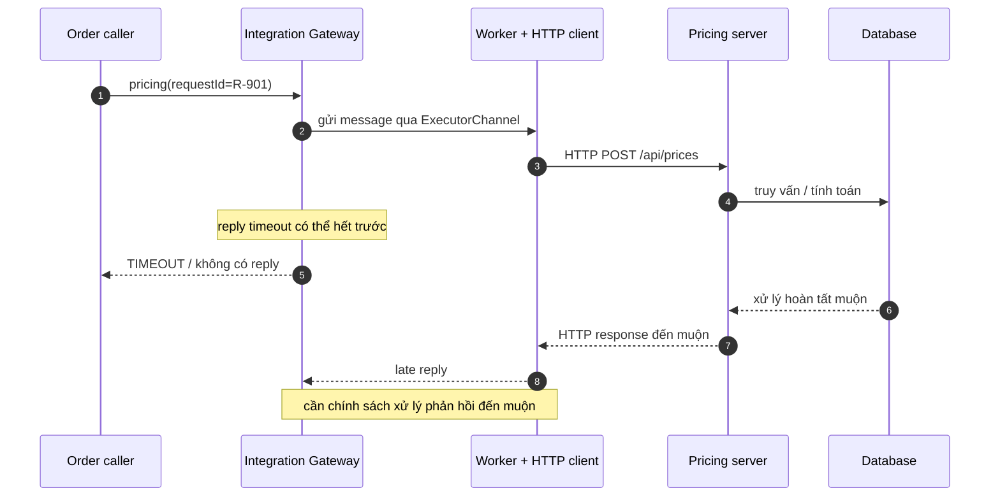
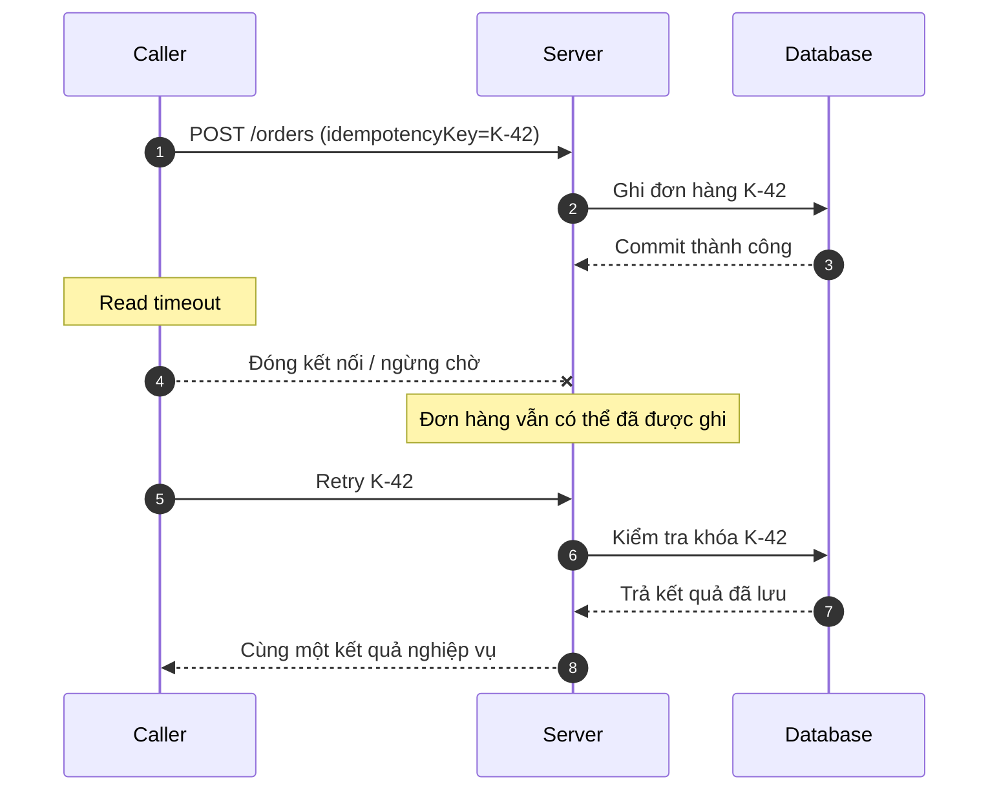

# Timeout mạng và timeout xử lý khi gọi thủ tục từ xa

## Mục tiêu bài học

Sau bài này, bạn có thể:

- Phân biệt **timeout kết nối mạng**, **timeout đọc phản hồi**, **timeout chờ reply của Messaging Gateway** và **timeout thực thi nghiệp vụ phía server**.
- Giải thích vì sao một RPC đã timeout ở client vẫn có thể tiếp tục xử lý hoặc tạo tác dụng phụ ở server.
- Thiết kế ngân sách thời gian (*timeout budget*), deadline cho toàn bộ chuỗi gọi, cùng cơ chế truyền deadline qua nhiều dịch vụ.
- Cấu hình timeout ở HTTP client và Spring Integration Gateway, nhận biết ranh giới mà mỗi timeout thực sự kiểm soát.
- Xử lý retry, idempotency, circuit breaker, error channel, tương quan request–reply và phản hồi đến muộn.
- Thiết kế các ca kiểm thử cho kết nối chậm, xử lý chậm, nhiều lời gọi đồng thời và lỗi mạng không xác định kết quả.

Trong mô-đun **SPRING_INTEGRATION_PATTERN**, chúng ta học triển khai *Enterprise Integration Patterns* bằng Spring Integration để xây dựng luồng thông điệp ít phụ thuộc và dễ mở rộng. Bài này thuộc chương **Remote procedure invocation**, tập trung vào một vấn đề đặc biệt quan trọng khi kết nối các luồng Gateway, Router, Transformer, retry, error channel và correlation: **một lời gọi từ xa chậm hoặc mất phản hồi phải kết thúc thế nào để hệ thống không treo, không xử lý nhầm và không gây tác dụng phụ lặp lại**.

## 1. RPC có thể chậm ở nhiều nơi

Giả sử dịch vụ đặt hàng gọi dịch vụ giá để lấy tổng tiền:

```text
Order Service                             Pricing Service
     |                                           |
     | -- POST /api/prices, requestId=R-901 --> |
     |         (network / HTTP client)           |  <-- chờ worker / DB / tính giá
     |                                           |
     | <-- HTTP response: total = 240000 ------ |
     |                                           |
```

Không phải mọi lời gọi chậm đều có cùng nguyên nhân. Một request có thể mất thời gian trong DNS, thiết lập TCP/TLS, chờ kết nối từ pool, gửi dữ liệu, chờ server nhận worker, chờ truy vấn database, rồi mới bắt đầu nhận HTTP response. Nếu chỉ cấu hình một timeout, bạn có thể giới hạn **một đoạn** của hành trình nhưng những đoạn còn lại vẫn bị chặn.

Vì thế, trước tiên phải trả lời ba câu hỏi:

1. **Ai đang chờ?** Thread gọi Gateway, thread HTTP client hay thread xử lý request ở server?
2. **Điều gì được giới hạn?** Thời gian gửi, kết nối, chờ byte phản hồi, thực thi một tác vụ hay toàn bộ hành trình?
3. **Khi hết giờ thì xảy ra gì?** Hủy I/O, trả lỗi, ngừng chờ reply, yêu cầu bên kia hủy, hay chỉ đánh dấu tác vụ quá hạn?

Một thông báo `timeout` chỉ cho biết một **giới hạn chờ** bị vượt. Nó không chứng minh server chưa xử lý request.

## 2. Phân biệt các loại timeout

| Loại timeout | Đo ở đâu? | Giới hạn thường áp dụng | Điều **không** được bảo đảm |
| --- | --- | --- | --- |
| **Connect timeout** | HTTP/TCP client | Thời gian cố gắng thiết lập kết nối tới endpoint | Không giới hạn DNS, pool acquisition, toàn bộ TLS hay thời gian chạy nghiệp vụ trong mọi implementation |
| **Connection-pool acquisition timeout** | HTTP client có connection pool | Thời gian đợi lấy một connection sẵn dùng | Không giải quyết tình trạng server xử lý chậm sau khi đã lấy connection |
| **Read/socket timeout** | HTTP client | Khoảng chờ hoạt động đọc dữ liệu từ socket | Thường không phải deadline tuyệt đối cho toàn bộ HTTP call; nhiều lần đọc có thể kéo dài tổng thời gian |
| **HTTP/request deadline** | Client, proxy hoặc RPC transport | Thời gian tổng từ lúc bắt đầu đến hạn cuối theo cơ chế cụ thể | Không mặc nhiên hủy computation phía server |
| **Spring Integration request timeout** | Messaging Gateway / thao tác gửi vào channel | Thời gian chờ gửi message khi phép gửi có thể block | Không phải thời gian xử lý request từ xa |
| **Spring Integration reply timeout** | Messaging Gateway khi nhận reply | Thời gian chờ reply sau pha gửi | Không tự ngắt handler đồng bộ đang chạy; không cam kết remote operation đã dừng |
| **Server processing timeout** | Server, worker, database client | Thời gian được phép xử lý một yêu cầu hoặc một bước nghiệp vụ | Không tự thay thế các timeout tại kết nối, message broker, database và downstream |
| **Queue / message-expiry timeout** | Queue, broker hoặc consumer | Thời gian thông điệp được giữ chờ xử lý, tùy broker | Không đảm bảo đã có reply; TTL hết hạn không nhất thiết rollback giao dịch đang chạy |

**Điểm cần nhớ:** `connectTimeout`, `readTimeout`, `requestTimeout` và `replyTimeout` có tên gần nhau nhưng phạm vi khác nhau. Phải đặt timeout ở đúng tầng đang có khả năng treo.

### 2.1. Timeout mạng

Timeout mạng mô tả tình huống **giao tiếp** không tiến triển đủ nhanh: không mở được kết nối trong khoảng cho phép, không đọc được dữ liệu đúng hạn, hoặc một chặng mạng bị ngắt. Timeout có thể xuất hiện ngay cả khi server vẫn khỏe, chẳng hạn kết nối bị chặn, proxy bận hoặc gói tin thất lạc.

Ví dụ: HTTP client đặt `connectTimeout = 400 ms` và `readTimeout = 1.500 ms`. Nếu TCP không thiết lập được kịp, kết nối thất bại ở giai đoạn connect. Nếu đã kết nối nhưng server không gửi dữ liệu trong thời gian chờ đọc tương ứng, giai đoạn read có thể hết hạn. Các giá trị này **không có nghĩa** toàn lời gọi chắc chắn hoàn tất trong 1.900 ms, vì còn DNS, thread scheduling, chờ pool và cách thư viện thực thi socket I/O.

### 2.2. Timeout xử lý

Timeout xử lý là giới hạn cho **công việc nghiệp vụ**: tra cứu dữ liệu, tính giá, gọi thêm dịch vụ, xử lý quy tắc hoặc thực hiện giao dịch. Nó có thể được áp dụng qua server request deadline, timeout của database, transaction timeout, hay bộ điều phối tác vụ.

Nếu server nhận request và bắt đầu ghi đơn hàng, client hết hạn chờ response **không có nghĩa** database sẽ rollback. Server có thể hoàn tất việc ghi, nhưng response bị mất trên đường về. Đây là lý do mọi RPC có tác dụng phụ phải tính đến **kết quả không xác định** sau timeout.

### 2.3. Timeout chờ reply trong Spring Integration

`@MessagingGateway` biến một phương thức Java thành lời gọi tới message flow. Với phương thức trả về đối tượng, Gateway thường gửi message lên request channel rồi chờ reply theo cấu hình.

- Nếu flow chạy qua `DirectChannel`, handler thực thi **đồng bộ** trong lần gửi. HTTP call chậm ngay trong handler khiến thread gọi bị giữ trước khi cơ chế chờ reply phát huy tác dụng; `replyTimeout` không thay thế timeout HTTP.
- Nếu request được gửi qua `ExecutorChannel`, handler chạy trên worker thread. Gateway có thể chờ reply với giới hạn riêng, và caller có thể hết thời gian chờ trước khi handler hoàn tất.
- Nếu ứng dụng dùng broker hoặc gateway nhiều hop, còn phải phân biệt thời gian ghi message lên broker, thời gian queue, thời gian handler và thời gian reply quay về.

Khi Gateway hết hạn, một phương thức trả object có thể nhận `null` trong cấu hình đồng bộ thường gặp khi không có reply; các kiểu trả về và cấu hình xử lý lỗi khác có thể có hành vi khác. **Hãy kiểm tra và chuẩn hóa hợp đồng timeout ở lớp gọi Gateway**; đừng giả định mọi timeout đều tự biến thành một exception duy nhất.

## 3. Sơ đồ thời gian và deadline từ đầu đến cuối



Từ sơ đồ, ta thấy **đồng hồ của caller và đồng hồ xử lý bên dưới không phải một**. Đến thời điểm Gateway hết hạn, worker và server vẫn có thể đang làm việc; nếu hệ thống cho phép thử lại ngay, cùng một giao dịch có thể được thực hiện lần nữa.

### 3.1. Timeout tương đối và deadline tuyệt đối

Giả sử API công bố thời gian phản hồi mục tiêu là **3 giây**. Một thiết kế tham khảo:

| Thành phần | Mức ngân sách minh họa |
| --- | ---: |
| Chờ điều phối local + kết nối + trao đổi qua mạng | 500 ms |
| Xử lý server, bao gồm truy vấn phụ thuộc | 1.700 ms |
| Reply, chuyển đổi kết quả và dự phòng jitter | 500 ms |
| Biên an toàn | 300 ms |
| **Tổng ngân sách caller** | **3.000 ms** |

Các số này là **ngân sách thiết kế**, không phải khẳng định rằng cộng các cấu hình socket timeout sẽ tạo ra deadline tổng. Để giữ đúng thời hạn, cần theo dõi thời gian đã tiêu thụ, dành ngân sách cho các chặng còn lại, và đặt deadline tổng mà các tầng thực sự thực thi.

**Timeout tương đối** nói “được phép đợi thêm 2 giây kể từ bây giờ”. Nếu mỗi dịch vụ lặp lại 2 giây ở từng hop, tổng latency có thể tăng theo số hop. **Deadline** nói “toàn bộ công việc phải kết thúc trước một thời điểm/budget thống nhất”; ở mỗi hop, chuyển tiếp phần ngân sách còn lại.

```text
Caller có ngân sách 3.000 ms
  Sau khi điều phối + kết nối mất 450 ms
    -> còn 2.550 ms
      Server sử dụng 1.600 ms
        -> còn 950 ms cho response và các bước tiếp theo
```

Khi gửi deadline dưới dạng thời điểm tuyệt đối, phải xem xét sai lệch đồng hồ giữa các máy. Với hệ thống cần tính toán cẩn thận, deadline tuyệt đối phục vụ truyền thông xuyên process; bên nhận chuyển thành ngân sách tương đối và dùng đồng hồ monotonic cho phép đo cục bộ. Không dùng việc đồng bộ đồng hồ làm lý do bỏ qua timeout thực tế của I/O.

## 4. Ví dụ Spring Integration: HTTP RPC với giới hạn ở hai tầng

Ta xây một luồng gọi dịch vụ giá:

```text
Java caller
   |
   v
PricingGateway
   |  reply timeout: 2.500 ms
   v
ExecutorChannel (pricingRequests)
   |
   v
Service Activator (HTTP client)
   |  connect timeout: 400 ms
   |  read timeout: 1.800 ms
   v
Pricing HTTP service
   |  server-side processing + DB timeout riêng
   v
HTTP response -> Service Activator -> Gateway -> caller
```

Ví dụ phù hợp **Java 17+**, **Spring Integration 6.x**, Spring Boot với starter Integration và Web, sử dụng `RestTemplate` cho phần HTTP. Các kiểu `public` đặt ở các file Java riêng, trong cùng package tại mỗi ứng dụng. Dịch vụ giá chạy độc lập, chẳng hạn trên cổng 8081; URL chỉ minh họa môi trường phát triển.

### 4.1. Hợp đồng request, response và kết quả RPC

```java
// PricingRequest.java
public record PricingRequest(
        String requestId,
        String sku,
        int quantity
) {}

// PricingResponse.java
import java.math.BigDecimal;

public record PricingResponse(
        String requestId,
        String sku,
        BigDecimal total
) {}

// PricingResult.java
public record PricingResult(
        String requestId,
        PricingResponse response,
        String errorCode
) {
    public boolean successful() {
        return response != null && errorCode == null;
    }

    public static PricingResult ok(PricingResponse response) {
        return new PricingResult(response.requestId(), response, null);
    }

    public static PricingResult error(String requestId, String code) {
        return new PricingResult(requestId, null, code);
    }
}
```

`requestId` là khóa tương quan **nghiệp vụ**, phục vụ logging và đối soát. Nó không thay thế `MessageHeaders.CORRELATION_ID` khi một flow có Splitter/Aggregator; cũng không phải message ID của Spring Messaging. Khi request đi qua mạng, khóa nghiệp vụ cần được truyền như một trường của hợp đồng hoặc header có quy ước thống nhất.

### 4.2. Cấu hình HTTP connect/read timeout và channel xử lý

```java
import org.springframework.context.annotation.Bean;
import org.springframework.context.annotation.Configuration;
import org.springframework.integration.annotation.IntegrationComponentScan;
import org.springframework.integration.channel.ExecutorChannel;
import org.springframework.integration.config.EnableIntegration;
import org.springframework.messaging.MessageChannel;
import org.springframework.scheduling.concurrent.ThreadPoolTaskExecutor;
import org.springframework.http.client.SimpleClientHttpRequestFactory;
import org.springframework.web.client.RestTemplate;

@Configuration
@EnableIntegration
@IntegrationComponentScan
public class PricingIntegrationConfig {

    @Bean
    public ThreadPoolTaskExecutor pricingExecutor() {
        ThreadPoolTaskExecutor executor = new ThreadPoolTaskExecutor();
        executor.setCorePoolSize(4);
        executor.setMaxPoolSize(8);
        executor.setQueueCapacity(50);
        executor.setThreadNamePrefix("pricing-rpc-");
        return executor;
    }

    @Bean
    public MessageChannel pricingRequests(
            ThreadPoolTaskExecutor pricingExecutor) {
        return new ExecutorChannel(pricingExecutor);
    }

    @Bean
    public RestTemplate pricingRestTemplate() {
        SimpleClientHttpRequestFactory requestFactory =
                new SimpleClientHttpRequestFactory();
        requestFactory.setConnectTimeout(400);
        requestFactory.setReadTimeout(1800);
        return new RestTemplate(requestFactory);
    }
}
```

Với `SimpleClientHttpRequestFactory`, đơn vị của `setConnectTimeout(int)` và `setReadTimeout(int)` là **mili-giây**. Đây là hai giới hạn ở HTTP transport; chúng không đại diện cho thời gian thực thi cuối cùng của server và không bao phủ mọi giai đoạn mạng.

Ta dùng `ExecutorChannel` để thao tác gọi HTTP chạy trên worker thread. Pool có giới hạn số thread và hàng đợi; khi quá tải, cần chính sách xử lý việc executor từ chối công việc. Không tăng kích thước pool vô hạn để che giấu latency của downstream.

### 4.3. Gateway: giới hạn thời gian nhận reply

```java
import org.springframework.integration.annotation.MessagingGateway;

@MessagingGateway(
    defaultRequestChannel = "pricingRequests",
    defaultReplyTimeout = "2500"
)
public interface PricingGateway {
    PricingResult quote(PricingRequest request);
}
```

Khi request đã đi vào kênh bất đồng bộ, Gateway chờ phản hồi theo giới hạn cấu hình. `2.500 ms` ở đây là thời gian chờ reply ở Gateway, không cam kết worker HTTP dừng tại mốc đó. Một cấu hình khác có thể cần `requestTimeout` khi thao tác gửi message có thể bị chặn; nó giải quyết **pha gửi**, không thay thế `replyTimeout`.

### 4.4. Service Activator: gọi HTTP và chuẩn hóa lỗi

```java
import org.springframework.integration.annotation.ServiceActivator;
import org.springframework.stereotype.Component;
import org.springframework.web.client.HttpStatusCodeException;
import org.springframework.web.client.ResourceAccessException;
import org.springframework.web.client.RestTemplate;

@Component
public class PricingRpcHandler {
    private final RestTemplate pricingRestTemplate;

    public PricingRpcHandler(RestTemplate pricingRestTemplate) {
        this.pricingRestTemplate = pricingRestTemplate;
    }

    @ServiceActivator(inputChannel = "pricingRequests")
    public PricingResult invoke(PricingRequest request) {
        try {
            PricingResponse response = pricingRestTemplate.postForObject(
                "http://localhost:8081/api/prices",
                request,
                PricingResponse.class
            );
            if (response == null) {
                return PricingResult.error(
                    request.requestId(), "EMPTY_RESPONSE");
            }
            if (!request.requestId().equals(response.requestId())) {
                return PricingResult.error(
                    request.requestId(), "CORRELATION_MISMATCH");
            }
            return PricingResult.ok(response);
        } catch (ResourceAccessException ex) {
            // Có thể là connect/read timeout hoặc lỗi I/O khác.
            return PricingResult.error(
                request.requestId(), "REMOTE_IO_FAILURE");
        } catch (HttpStatusCodeException ex) {
            // HTTP 4xx/5xx không đồng nghĩa timeout.
            return PricingResult.error(
                request.requestId(),
                "REMOTE_HTTP_" + ex.getStatusCode().value());
        }
    }
}
```

`ResourceAccessException` bao gồm nhiều lỗi I/O, nên không nên phân loại mọi trường hợp trong catch này thành `TIMEOUT`. Nếu cần phân loại chính xác `CONNECT_TIMEOUT` hoặc `READ_TIMEOUT` để phục vụ retry/metric, hãy kiểm tra cause chain theo client HTTP đang sử dụng và chuẩn hóa tại adapter.

Trong ví dụ, lỗi HTTP được chuyển thành **reply có cấu trúc** để Gateway nhận được một kết quả ngay cả khi I/O thất bại. Những lỗi lập trình không được bắt tại đây vẫn có thể đi theo cơ chế lỗi của Spring Integration: với flow bất đồng bộ, cấu hình `errorChannel` và endpoint quyết định nơi nhận `ErrorMessage`. Nếu không có đường phản hồi lỗi rõ ràng, caller có thể chỉ thấy reply timeout dù worker đã ném exception.

### 4.5. Caller xử lý timeout của Gateway

```java
import org.springframework.stereotype.Service;

@Service
public class PricingApplicationService {
    private final PricingGateway gateway;

    public PricingApplicationService(PricingGateway gateway) {
        this.gateway = gateway;
    }

    public PricingResponse priceForOrder() {
        String requestId = "R-901";
        PricingResult result = gateway.quote(
            new PricingRequest(requestId, "BOOK-01", 2));

        if (result == null) {
            // Không nhận được reply trong ngân sách Gateway.
            throw new IllegalStateException(
                "RPC_REPLY_TIMEOUT requestId=" + requestId);
        }
        if (!requestId.equals(result.requestId())) {
            throw new IllegalStateException(
                "RPC_CORRELATION_ERROR");
        }
        if (!result.successful()) {
            throw new IllegalStateException(
                "RPC_FAILED code=" + result.errorCode());
        }
        return result.response();
    }
}
```

Đây là ví dụ minh họa hợp đồng gọi. Ứng dụng thực tế nên dùng exception/result type của riêng domain thay cho `IllegalStateException` và không ghi dữ liệu nhạy cảm trong thông báo lỗi. Điều cần giữ là tách được **không có reply**, **lỗi HTTP/I/O từ downstream**, và **reply không khớp request ID**.

### 4.6. Dịch vụ phía server cũng phải có timeout

Giả sử server giá thực hiện:

```text
POST /api/prices
  1. validate requestId, sku, quantity
  2. kiểm tra deadline còn hiệu lực
  3. truy vấn bảng giá (query timeout riêng)
  4. tính tổng tiền
  5. tạo response có cùng requestId
```

Server cần xác định thời gian tối đa cho request và cho từng downstream call. Nếu client đã hết hạn chờ, không nên tiếp tục một tác vụ đắt đỏ chỉ vì không có cơ chế kiểm tra deadline. Tuy nhiên, **kiểm tra deadline trước khi chạy** không có nghĩa tự động dừng được một truy vấn đã bắt đầu. Phải dùng cơ chế ngắt/hủy/thời hạn của chính executor, database hoặc thư viện I/O.

Một cách truyền budget có chủ đích là gửi thêm header như `X-Request-Deadline-Epoch-Millis` hoặc trường `remainingTimeoutMs` trong envelope. Đây là **giao ước do ứng dụng tự định nghĩa**, không phải một header Spring Integration tự chuẩn hóa cho mọi HTTP RPC.

Ví dụ tính thời gian còn lại trước khi khởi chạy công việc:

```java
import java.time.Clock;
import java.time.Duration;
import java.time.Instant;

public final class DeadlineBudget {
    private final Clock clock;
    private final Instant deadline;

    public DeadlineBudget(Clock clock, Instant deadline) {
        this.clock = clock;
        this.deadline = deadline;
    }

    public long remainingMillis() {
        return Math.max(0L,
            Duration.between(clock.instant(), deadline).toMillis());
    }

    public void requireTimeLeft() {
        if (remainingMillis() <= 0L) {
            throw new IllegalStateException("DEADLINE_EXCEEDED");
        }
    }
}
```

Ví dụ trên chỉ **đo và kiểm tra** deadline. Nó không tự áp timeout cho HTTP/database hay ngắt một worker đang chạy. Khi bắt đầu một phép I/O mới, phải truyền phần budget còn lại vào client/driver phù hợp; không sửa timeout của một HTTP client dùng chung theo từng request một cách không an toàn giữa nhiều thread.

## 5. Vì sao timeout client không thể thay timeout xử lý?

Một chuỗi sự kiện cần đặc biệt cảnh giác:



Khi client bị timeout, có ít nhất ba khả năng:

| Trạng thái thật | Client có biết chắc không? | Hệ quả |
| --- | --- | --- |
| Request chưa tới server | Thường không | Có thể retry nếu quy tắc cho phép |
| Server đang xử lý | Không | Retry có thể tạo xử lý trùng |
| Server đã commit nhưng reply thất lạc | Không | Retry không kiểm soát có thể tạo tác dụng phụ hai lần |

Với một RPC **chỉ đọc** và không gây tác dụng phụ, retry có thể đơn giản hơn. Với tạo đơn, thanh toán, gửi email hay xuất kho, phải dùng **idempotency key**, lưu trạng thái kết quả đã xử lý, và định nghĩa hành vi khi cùng key được gửi lại. Không áp dụng retry vô điều kiện cho mọi lỗi timeout.

**Lưu ý về hủy tác vụ:** client ngắt kết nối, `Future.cancel(true)` hoặc `CompletableFuture.orTimeout(...)` không bảo đảm một HTTP call hay transaction trên server dừng ngay. Ngắt chỉ hiệu lực khi thư viện và tác vụ thực sự hỗ trợ. Một giải pháp hoàn chỉnh phải kiểm soát deadline ở từng nơi có thao tác blocking và kiểm tra khả năng rollback/cancel thực tế.

## 6. Chọn timeout và retry theo ngân sách còn lại

Giả sử caller có deadline **3.000 ms**, nhưng request đầu tiên mất **2.400 ms** rồi bị read timeout. Thời gian còn lại chỉ khoảng **600 ms**, chưa tính overhead. Nếu retry với timeout mới 3.000 ms, bạn đã phá vỡ ngân sách của caller và gây thêm tải khi downstream đang chậm.

Một chiến lược hợp lý:

1. Gắn `requestId` hoặc `idempotencyKey` cho mọi thao tác cần đối soát.
2. Tại điểm bắt đầu RPC, xác định **deadline tổng**.
3. Trước mỗi attempt, tính **remaining budget**; nếu không đủ cho một lần gọi có ý nghĩa thì dừng.
4. Đặt connect/read timeout và deadline thực tế của attempt không vượt chính sách tổng; dùng backoff ngẫu nhiên có giới hạn cho retry phù hợp.
5. Chỉ retry những lỗi có cơ sở phục hồi tạm thời và phương thức có thể lặp lại an toàn.
6. Khi hết hạn, trả trạng thái rõ ràng; tiếp tục theo dõi task đã gửi nếu nghiệp vụ yêu cầu đối soát.

### 6.1. Ví dụ tính ngân sách một attempt

```java
import java.time.Duration;
import java.time.Instant;

public long computeAttemptBudgetMillis(
        Instant deadline,
        Instant now,
        long maxAttemptMillis,
        long reserveForReplyMillis) {
    long left = Duration.between(now, deadline).toMillis();
    return Math.max(0L,
        Math.min(maxAttemptMillis, left - reserveForReplyMillis));
}
```

Nếu hàm trả `0`, không bắt đầu attempt mới. Đây là ví dụ tính ngân sách; việc **thực thi** giới hạn này phải được nối vào timeout của HTTP/RPC client tương ứng. Với `RestTemplate` và request factory chia sẻ giữa các thread, không thay đổi các setter timeout của factory trước mỗi cuộc gọi; cần thiết kế HTTP client/adapter cho timeout theo request hoặc nhóm client có policy cố định.

### 6.2. Những lỗi không nên retry giống nhau

| Tín hiệu | Retry? | Điều kiện |
| --- | --- | --- |
| Kết nối bị từ chối trước khi truyền request | Có thể | Downstream hồi phục được; tránh retry storm |
| Socket read timeout sau khi gửi request | Cân nhắc kỹ | Kết quả phía server không xác định; bảo vệ idempotency |
| HTTP 429 / 503 | Có thể | Tôn trọng `Retry-After` nếu có và remaining budget |
| HTTP 400 do dữ liệu sai | Thường không | Phải sửa request |
| Lỗi nghiệp vụ cố định | Không | Retry không thay đổi nguyên nhân |
| Gateway reply timeout do thread pool nghẽn | Không tự động | Tìm nguyên nhân nghẽn và giới hạn concurrency |

**Circuit breaker** giúp tạm ngăn nhiều lời gọi mới tới downstream có tỷ lệ lỗi/timeout cao; **bulkhead** giới hạn số tác vụ song song; **retry** tạo thêm attempts. Chúng bổ sung nhau nhưng không thay thế deadline và cơ chế chống trùng. Retry mạnh khi downstream quá tải có thể làm sự cố nghiêm trọng hơn.

## 7. Error channel, Router và correlation khi reply đến muộn

Spring Integration có thể tạo nhiều nhánh: request vào Gateway, qua Router, Transformer, HTTP outbound endpoint rồi trở về. Khi áp dụng timeout, cần giữ các quy ước sau:

- **Reply channel:** đường mà reply quay về Gateway. Một reply được gửi sau khi caller đã hết hạn chờ không tự động trở thành kết quả của request khác.
- **Correlation ID:** nếu tách request thành nhiều message qua Splitter hoặc broker, bảo toàn khóa tương quan để Aggregator hoặc bảng pending request ghép đúng reply. Không đồng nhất message ID với business request ID.
- **Error channel:** ở flow bất đồng bộ, lỗi của worker có thể được gửi qua `errorChannel` dưới dạng `ErrorMessage` tùy endpoint/configuration. Cần quyết định lỗi đó trở thành response lỗi cho caller, được lưu lại để đối soát, hay chỉ log/alert. Không coi mọi lỗi chắc chắn tự quay về caller.
- **Router/Filter:** một nhánh không tạo reply có thể làm Gateway hết hạn chờ. Nếu Filter từ chối request, cần thông báo lỗi hoặc hoàn tất theo hợp đồng; tránh “lọc âm thầm” trong RPC phải có phản hồi.
- **Aggregator:** group timeout và reply timeout là hai giới hạn độc lập. Group bị giữ lâu có thể gây tăng bộ nhớ/message store ngay cả khi Gateway đã trả timeout.

Một chính sách xử lý late reply nên định nghĩa rõ:

| Trường hợp | Chính sách minh họa |
| --- | --- |
| Reply đến đúng hạn, đúng `requestId` | Chuyển cho caller, ghi nhận success |
| Reply đến sau deadline | Ghi metric và trace; bỏ qua hoặc lưu kết quả đối soát theo nghiệp vụ |
| Reply đến cho request ID không tồn tại | Không gán sang lời gọi khác; log/đưa vào dead-letter/audit phù hợp |
| Reply trùng | Dedupe bằng request ID + attempt/operation key |
| ErrorMessage phát sinh sau khi caller timeout | Ghi nhận độc lập, tránh để mất nguyên nhân gốc |

Nếu hệ thống chạy nhiều instance, nơi lưu pending request/correlation và cách route reply tới đúng consumer phải được thiết kế rõ. Cấu trúc in-memory chỉ phù hợp khi vòng đời response nằm trong một process và không yêu cầu khôi phục sau restart.

## 8. Quan sát timeout đúng tầng

Không nên chỉ log `"RPC timed out"` rồi kết luận server chậm. Cần ghi đủ dữ kiện để phân biệt tầng xảy ra sự cố:

| Metric / trường log | Ý nghĩa |
| --- | --- |
| `requestId`, `traceId`, downstream name | Ghép sự kiện giữa các hop |
| `attemptNumber`, `deadlineRemainingMs` | Biết request đã retry bao nhiêu lần, còn bao nhiêu budget |
| `dns/connect/poolWait` khi client hỗ trợ | Xác định độ trễ thiết lập kết nối |
| `remoteLatencyMs`, `responseStatus` | Quan sát thời gian và kết quả HTTP call |
| `gatewayReplyWaitMs` | Thời gian caller chờ reply của message flow |
| `serverQueueMs`, `serverProcessingMs` | Phân biệt server chờ worker với thật sự xử lý chậm |
| `dbQueryMs`, `dbTimeoutCount` | Phát hiện downstream nội bộ làm trễ |
| `lateReplyCount`, `timeoutCount` | Đối soát kết quả đến sau và lỗi chưa hoàn tất |

Theo dõi p50/p95/p99 latency, tỷ lệ timeout, tỷ lệ retry và số tác vụ còn chạy sau timeout. Cần gắn nhãn số liệu với nguyên nhân **connect/read/reply/server processing** khi có đủ bằng chứng; nếu không, dùng nhãn lỗi I/O chưa phân loại. Tránh log token, thông tin thanh toán hoặc payload nhạy cảm.

## 9. Kiểm thử các ranh giới timeout

Một phép kiểm thử timeout có giá trị khi mô phỏng được *đúng tầng chậm*. Ví dụ không nên dùng mock trả lỗi socket rồi tuyên bố đã kiểm thử thời gian xử lý server.

| Kịch bản | Cách mô phỏng | Kỳ vọng |
| --- | --- | --- |
| Không kết nối được | Endpoint không nhận kết nối hoặc network test harness kiểm soát TCP | Connect error/timeout được phân loại, không treo vô hạn |
| Server nhận nhưng trả dữ liệu chậm | Local test HTTP server cố ý giữ response sau khi đã nhận request | Read timeout hoặc deadline tổng theo client dùng trong test |
| Handler chạy chậm hơn reply timeout | Executor worker ngủ lâu hơn thời gian Gateway chờ | Caller hết hạn; handler có thể vẫn chạy; late reply không gán sai |
| Server commit rồi reply thất lạc | Test server ghi trạng thái trước khi cắt kết nối | Retry cùng idempotency key không tạo thêm bản ghi |
| Nhiều request đồng thời | Phát request ID khác nhau, đảo thứ tự hoàn tất | Không trộn reply; không rò rỉ pending request |
| Hết hạn ở bước DB | Truy vấn DB chậm hơn query timeout | Server kết thúc có kiểm soát, trả lỗi phù hợp |
| Downstream trả HTTP 400/503 | Trả status và body cụ thể | 400 không retry; 503 áp chính sách retry có giới hạn |

Ví dụ kiểm thử mapper lỗi HTTP **không phụ thuộc kết nối mạng** bằng `MockRestServiceServer` (Spring Test). Nó xác nhận adapter trả lỗi có cấu trúc khi downstream báo 503, nhưng **không kiểm thử socket timeout thực**:

```java
import static org.assertj.core.api.Assertions.assertThat;
import static org.springframework.test.web.client.match.MockRestRequestMatchers.method;
import static org.springframework.test.web.client.match.MockRestRequestMatchers.requestTo;
import static org.springframework.test.web.client.response.MockRestResponseCreators.withStatus;

import org.junit.jupiter.api.Test;
import org.springframework.http.HttpMethod;
import org.springframework.http.HttpStatus;
import org.springframework.test.web.client.MockRestServiceServer;
import org.springframework.web.client.RestTemplate;

class PricingRpcHandlerTest {
    @Test
    void mapsHttp503ToStructuredReply() {
        RestTemplate restTemplate = new RestTemplate();
        MockRestServiceServer server =
            MockRestServiceServer.createServer(restTemplate);
        server.expect(requestTo("http://localhost:8081/api/prices"))
            .andExpect(method(HttpMethod.POST))
            .andRespond(withStatus(HttpStatus.SERVICE_UNAVAILABLE));

        PricingRpcHandler handler = new PricingRpcHandler(restTemplate);
        PricingResult reply = handler.invoke(
            new PricingRequest("R-901", "BOOK-01", 2));

        assertThat(reply.successful()).isFalse();
        assertThat(reply.requestId()).isEqualTo("R-901");
        assertThat(reply.errorCode()).isEqualTo("REMOTE_HTTP_503");
        server.verify();
    }
}
```

Để xác minh thời gian chờ thật, dùng HTTP test server được điều khiển độ trễ hoặc proxy mô phỏng lỗi mạng, đo thời gian thực tế bằng đồng hồ monotonic và quan sát cả task phía server. Đừng kiểm thử deadline bằng một lệnh `Thread.sleep` và cho rằng nó chứng minh một transaction từ xa đã bị ngắt.

## 10. Tình huống thực hành: đơn hàng bị timeout sau 2,5 giây

Giả sử `PricingGateway` có reply timeout `2.500 ms`, HTTP client có read timeout `1.800 ms` và dịch vụ giá thỉnh thoảng chậm vì truy vấn DB. Khi hệ thống nhận 200 request đồng thời:

1. Một số message phải chờ trong hàng đợi của executor trước khi bắt đầu gọi HTTP.
2. Những worker đã chạy sẽ chịu giới hạn connect/read tương ứng; nhiều lời gọi có thể thất bại do I/O chậm.
3. Gateway có thể hết hạn trước khi task đến lượt chạy hoặc trước khi nhận kết quả, vì reply timeout tính theo lượt gọi Gateway, không dựa vào lúc HTTP request thực sự bắt đầu.
4. Nếu caller retry tất cả request sau timeout mà không giới hạn, queue có thể đầy hơn và làm trễ tăng.
5. Nếu một lời gọi là thao tác ghi, kết quả timeout vẫn cần đối soát bằng request ID/idempotency key.

Hướng xử lý thực tế là đo **executor queue wait** và **remote latency** riêng, giới hạn số request đồng thời, đặt timeout I/O và server theo ngân sách, dùng retry có điều kiện, rồi xác định chính sách late reply. Khi một request cần đi qua nhiều backend, Router có thể lựa chọn nhánh dựa trên tình trạng downstream; correlation phải được giữ để reply quay về đúng lời gọi, và mỗi nhánh phải tuân thủ cùng deadline tổng.

## 11. Checklist trước khi vận hành RPC

1. Có tách rõ **connect, pool wait, read, Gateway reply** và **server processing** trong thiết kế và metric chưa?
2. Caller có deadline tổng? Các hop có sử dụng **remaining budget** thay vì tự bắt đầu timeout mới không?
3. Việc Gateway hết hạn có thể để lại handler, message group, transaction hoặc remote task đang chạy không? Có chính sách dọn dẹp chưa?
4. Khi kết quả không xác định, retry có thể tạo tác dụng phụ lặp lại không? Có `idempotencyKey` và lưu kết quả cho key đã xử lý chưa?
5. Có phân biệt HTTP 4xx/5xx, connect/read timeout, lỗi nghiệp vụ và reply timeout không?
6. Lỗi ở executor có đi qua error channel hoặc được đổi thành reply lỗi có cấu trúc không?
7. Có kiểm thử reply trễ, server commit nhưng mất response, nhiều request đồng thời và áp lực lên thread pool chưa?

## Kết luận

**Timeout mạng** giới hạn từng hoạt động giao tiếp; **timeout xử lý** giới hạn công việc ở server; **reply timeout** trong Spring Integration giới hạn thời gian Gateway đợi phản hồi từ message flow. Ba nhóm giới hạn có mục đích khác nhau và cần phối hợp trong một **deadline tổng**. Khi RPC quá hạn, việc client ngừng chờ không chứng minh server ngừng xử lý. Vì thế, ngoài cấu hình timeout còn phải thiết kế correlation, idempotency, retry theo ngân sách, xử lý late reply và giám sát rõ từng giai đoạn của lời gọi.
