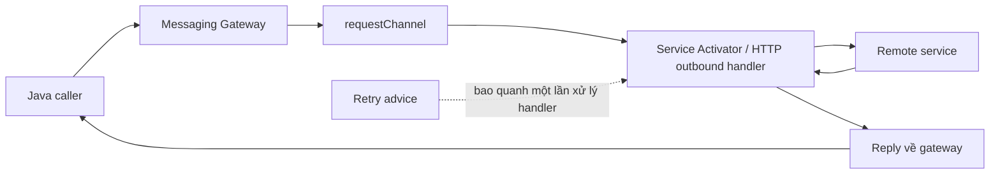
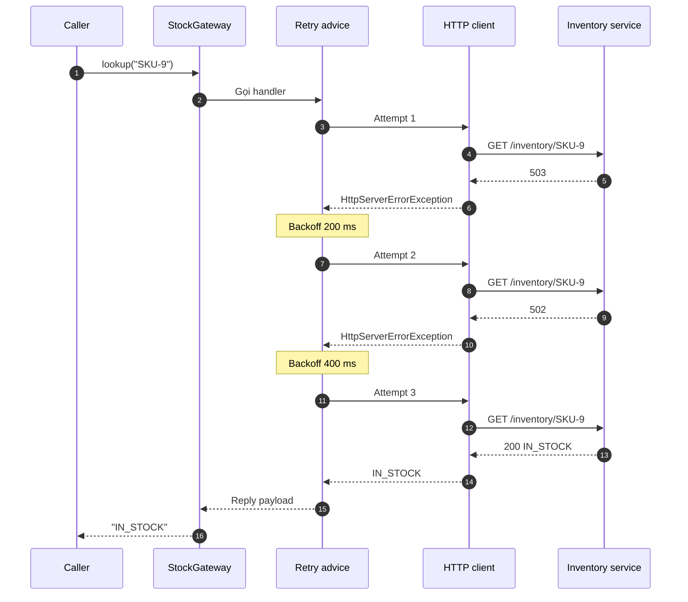
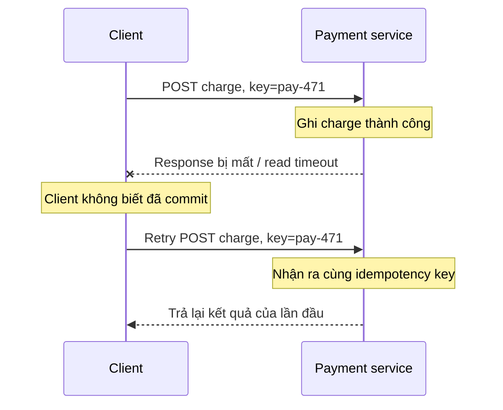

# Remote procedure invocation — Retry lời gọi từ xa với Spring Integration

## Mục tiêu học tập

Sau bài này, bạn có thể:

- Giải thích tại sao **Remote Procedure Invocation (RPI)** có thể thất bại tạm thời và khi nào retry giúp khôi phục.
- Phân biệt lỗi có thể thử lại với lỗi nghiệp vụ, lỗi dữ liệu và trạng thái thực thi **không chắc chắn** khi phản hồi mạng bị mất.
- Cấu hình `RequestHandlerRetryAdvice`, `RetryTemplate`, giới hạn số lần thử và **exponential backoff** cho handler gọi HTTP từ Spring Integration.
- Phân tích mối quan hệ giữa retry, timeout của HTTP client, `@MessagingGateway`, `replyChannel`, retry ở nhiều tầng và error channel.
- Kiểm thử số lần gọi lại, kết quả thành công, trường hợp không retry và retry hết lượt; áp dụng **idempotency**, correlation và quan sát để tránh side effect trùng.

Bài thuộc chương **Remote procedure invocation** của module **SPRING_INTEGRATION_PATTERN**. Mục tiêu của module là học Enterprise Integration Patterns trong Spring Integration để xây dựng luồng message ít phụ thuộc, dễ mở rộng, có Router, Filter, Transformer, Splitter, Aggregator, Gateway, retry, error channel, correlation và khả năng kiểm thử, theo dõi từng nhánh. Ở đây, phần cần hiểu sâu là chính sách **thử gọi lại một thao tác ở hệ thống từ xa** và tác động của nó đối với đường request–reply.

## 1. Vì sao lời gọi từ xa cần retry?

Một lời gọi Java nội bộ có thể lỗi khi logic thực thi không hợp lệ. Với lời gọi từ xa, còn có nhiều lỗi xuất hiện giữa caller và remote service:

- TCP không kết nối được do service đang khởi động lại hoặc kết nối bị từ chối.
- Connection pool hoặc gateway mạng gặp lỗi ngắn hạn.
- Máy chủ trả `502 Bad Gateway`, `503 Service Unavailable` hoặc `504 Gateway Timeout` trong thời gian quá tải.
- Request đã đến server, nhưng client không đọc được response trước khi hết thời gian chờ.
- Server áp dụng rate limit và trả `429 Too Many Requests` kèm chỉ dẫn `Retry-After`.
- Một lỗi dữ liệu hoặc nghiệp vụ khiến server trả `400`, `401`, `403`, `404` hoặc `409`; gửi y nguyên request thường không giải quyết nguyên nhân.

Retry là **gửi lại một lần thực thi có điều kiện** khi lỗi có khả năng tạm thời và thao tác được phép chạy lại. Đây là một cơ chế tăng tính sẵn sàng, nhưng không phải cách sửa mọi lỗi. Chọn sai loại lỗi hoặc retry không giới hạn có thể làm service đang quá tải tiếp tục nhận thêm lưu lượng.

Ví dụ hệ thống kiểm tồn kho:

```text
Đơn hàng ──request──> stockRequests ──> HTTP inventory service
             │                              │
             │                              ├─ Lần 1: 503
             │                              ├─ Chờ 200 ms
             │                              └─ Lần 2: 200 "IN_STOCK"
             │
             └─reply<──── "IN_STOCK" <───────┘
```

Với tra cứu tồn kho **không có tác dụng phụ**, hai lần thử có thể chấp nhận được. Trái lại, nếu RPC là “tạo thanh toán”, một lần thử trước đã thành công nhưng response thất lạc thì retry có thể tính tiền hai lần. Đó là khác biệt quan trọng giữa **có thể thử lại về mặt kỹ thuật** và **an toàn khi thử lại về mặt nghiệp vụ**.

## 2. Vị trí của retry trong luồng Spring Integration

Trong một flow, lời gọi từ xa thường là một handler hoặc outbound gateway:



`RequestHandlerRetryAdvice` là advice tích hợp với handler của Spring Integration. Nó sử dụng **Spring Retry** để gọi lại handler khi xử lý ném exception mà chính sách cho phép retry.

Điểm cần xác định đúng phạm vi:

1. Retry gắn ở **handler gọi remote** sẽ thực thi lại chính handler đó. Những bước ở trước handler không tự động chạy lại.
2. Retry ở **caller bên ngoài gateway** có thể chạy lại **toàn bộ request flow**, kể cả những bước trước cuộc gọi từ xa.
3. Retry ở HTTP client, message broker, load balancer hoặc SDK của dịch vụ ngoài có thể cộng dồn với retry tại Spring Integration.
4. Nếu handler gồm cả ghi DB và gọi HTTP, retry toàn handler có thể ghi DB lần nữa. Nên tách thao tác hoặc bảo đảm chúng an toàn khi lặp.

Chọn **một tầng chịu trách nhiệm chính** cho retry của mỗi loại lỗi; khi nhiều tầng bắt buộc cùng retry, hãy tính ngân sách tổng số lần gọi và thời gian chờ.

## 3. Phân loại lỗi trước khi retry

Không nên retry trên mọi `Exception`. Chính sách khởi đầu cho HTTP/RPC có thể là:

| Dấu hiệu | Có retry? | Điều kiện và lưu ý |
| --- | --- | --- |
| Không kết nối được, lỗi I/O tạm thời | Thường có | Xác minh thao tác an toàn khi lặp; một số timeout xảy ra sau khi server đã nhận request |
| `502`, `503`, `504` | Thường cân nhắc | Chờ có backoff; kiểm soát quá tải; chỉ retry lệnh có idempotency |
| `500` | Tùy nguyên nhân | Có thể do lỗi lập trình kéo dài; lặp vô ích nếu không phải lỗi tạm thời |
| `429` | Có điều kiện | Tuân thủ `Retry-After` và hạn mức; không retry dồn dập |
| `400`, `401`, `403`, `404` | Thường không | Sửa request/quyền hoặc xác minh quy tắc nghiệp vụ trước |
| `409 Conflict` | Tùy giao kèo | Có thể là trùng lệnh được server xử lý; tra trạng thái trước khi thử |
| Validation/domain exception | Không | Cùng dữ liệu sai thì kết quả thường không đổi |
| Deadline tổng đã hết | Không tiếp tục | Không phát sinh lượt gọi mới ngoài ngân sách thời gian |
| Lỗi do caller chủ động hủy | Không | Tôn trọng cancellation/interrupt theo khả năng hỗ trợ |

Có hai dạng timeout cần phân biệt:

- **Connect timeout**: client không thiết lập kết nối kịp thời. Điều này thường gợi ý lỗi kết nối, nhưng proxy và hạ tầng có thể khiến kết quả khó suy luận.
- **Read timeout**: client đã gửi request hoặc đã có kết nối nhưng không nhận dữ liệu kịp thời. **Không thể kết luận remote chưa thực hiện thao tác.** Với lệnh có side effect, phải tra trạng thái hoặc dùng idempotency key.

Kể cả khi nhận `503` hoặc `500`, request có thể đã đi qua một phần nghiệp vụ trước khi lỗi được phát ra. Đừng suy luận “mã HTTP lỗi nghĩa là chưa commit”.

### Retry policy gồm những thành phần nào?

| Thành phần | Tác dụng | Ví dụ |
| --- | --- | --- |
| `maxAttempts` | Tổng lần thực thi, **bao gồm lượt đầu** | 3 = lần đầu + tối đa 2 lần retry |
| Retryable exception classifier | Chỉ định lỗi được thử lại | `ResourceAccessException`, `HttpServerErrorException` |
| Backoff | Tạo khoảng dừng trước mỗi lần thử tiếp | 200 ms → 400 ms → ... |
| Jitter | Làm ngẫu nhiên khoảng chờ để tránh nhiều client đồng loạt gọi lại | 200 ms ± một khoảng phù hợp |
| Deadline/budget | Chặn tổng thời gian vượt khả năng chờ của caller | Không khởi tạo lượt mới khi gần hết SLA |
| Recovery/fallback | Hành vi khi đã thử hết | Ném lỗi, ghi kết quả lỗi, chuyển sang luồng bù |

**Chú ý:** exponential backoff chỉ quyết định **thời gian giữa các lượt**. Nó không tự tạo giới hạn tổng thời gian và không đồng nghĩa một cơ chế circuit breaker.

## 4. Ví dụ hoàn chỉnh: retry khi dịch vụ tồn kho trả 5xx

Ta xây dựng một chương trình Spring Integration gọi HTTP GET tới inventory service. Handler nhận một `sku` và lấy phản hồi chuỗi. Ví dụ giả định remote API:

```http
GET http://localhost:8099/inventory/SKU-9

HTTP/1.1 200 OK
Content-Type: text/plain

IN_STOCK
```

Khi remote tạm trả 5xx hoặc client gặp lỗi truy cập mạng, handler sẽ được retry có giới hạn. Khi remote trả 4xx, không retry theo policy này.

Các thành phần cần có trong dự án: `spring-integration-core`, `spring-retry`, Spring Web (cho `RestTemplate`) và Spring Context. Đoạn code dùng Java 17 và Spring Integration Java DSL theo các API phổ biến của Spring Integration 6.x. Phần kiểm thử phía sau dùng thêm Spring Test và JUnit 5.

### 4.1. Gateway cho bên gọi

`StockGateway.java`:

```java
import org.springframework.integration.annotation.MessagingGateway;

@MessagingGateway(defaultRequestChannel = "stockRequests")
public interface StockGateway {
    String lookup(String sku);
}
```

Caller chỉ thấy phương thức `lookup`. Spring Integration chuyển payload `sku` thành message và gửi vào channel `stockRequests`. Handler sẽ trả reply theo đường request–reply do gateway quản lý. Cách viết này tách mã gọi nghiệp vụ khỏi chi tiết kênh, giống cách các Gateway pattern hoạt động trong module.

### 4.2. Cấu hình HTTP client, RetryTemplate và IntegrationFlow

`StockIntegrationConfig.java`:

```java
import java.util.Map;

import org.springframework.context.annotation.Bean;
import org.springframework.context.annotation.Configuration;
import org.springframework.http.client.SimpleClientHttpRequestFactory;
import org.springframework.integration.annotation.EnableIntegration;
import org.springframework.integration.annotation.IntegrationComponentScan;
import org.springframework.integration.dsl.IntegrationFlow;
import org.springframework.integration.handler.advice.RequestHandlerRetryAdvice;
import org.springframework.retry.backoff.ExponentialBackOffPolicy;
import org.springframework.retry.policy.SimpleRetryPolicy;
import org.springframework.retry.support.RetryTemplate;
import org.springframework.web.client.HttpServerErrorException;
import org.springframework.web.client.ResourceAccessException;
import org.springframework.web.client.RestTemplate;

@Configuration
@EnableIntegration
@IntegrationComponentScan(basePackageClasses = StockGateway.class)
public class StockIntegrationConfig {

    @Bean
    public RestTemplate stockRestTemplate() {
        SimpleClientHttpRequestFactory factory =
            new SimpleClientHttpRequestFactory();

        factory.setConnectTimeout(500);
        factory.setReadTimeout(1_000);
        return new RestTemplate(factory);
    }

    @Bean
    public RetryTemplate stockRetryTemplate() {
        // maxAttempts = 3 bao gồm lần đầu + tối đa 2 lần thử lại.
        // true: tìm nguyên nhân sâu hơn nếu exception bị handler bọc lại.
        SimpleRetryPolicy policy = new SimpleRetryPolicy(
            3,
            Map.of(
                ResourceAccessException.class, true,
                HttpServerErrorException.class, true
            ),
            true
        );

        ExponentialBackOffPolicy backoff =
            new ExponentialBackOffPolicy();
        backoff.setInitialInterval(200);
        backoff.setMultiplier(2.0);
        backoff.setMaxInterval(1_000);

        RetryTemplate template = new RetryTemplate();
        template.setRetryPolicy(policy);
        template.setBackOffPolicy(backoff);
        return template;
    }

    @Bean
    public RequestHandlerRetryAdvice stockRetryAdvice(
            RetryTemplate stockRetryTemplate) {
        RequestHandlerRetryAdvice advice =
            new RequestHandlerRetryAdvice();
        advice.setRetryTemplate(stockRetryTemplate);
        return advice;
    }

    @Bean
    public IntegrationFlow stockFlow(
            RestTemplate stockRestTemplate,
            RequestHandlerRetryAdvice stockRetryAdvice) {
        return IntegrationFlow.from("stockRequests")
            .handle(
                String.class,
                (sku, headers) -> stockRestTemplate.getForObject(
                    "http://localhost:8099/inventory/{sku}",
                    String.class,
                    sku
                ),
                endpoint -> endpoint.advice(stockRetryAdvice)
            )
            .get();
    }
}
```

**Giải thích đường đi:**

1. `StockGateway.lookup("SKU-9")` gửi message vào `stockRequests`.
2. Endpoint `.handle(...)` gọi `RestTemplate.getForObject(...)` tới service bên ngoài.
3. Advice bọc handler và dựa vào `RetryTemplate` để quyết định retry.
4. Nếu remote trả 5xx, `RestTemplate` mặc định ném `HttpServerErrorException` (hoặc lớp con); policy cho phép retry.
5. Nếu kết nối/lần đọc gặp lỗi truy cập, `ResourceAccessException` có thể được retry theo policy.
6. Nếu lần sau thành công, handler trả payload và Spring Integration định tuyến reply về gateway.
7. Nếu đã hết lượt hoặc lỗi không nằm trong danh sách, exception được phát ra cho cơ chế xử lý lỗi của flow/caller.

**Vì sao `traverseCauses = true`?** Spring Integration có thể bọc exception từ handler trong `MessageHandlingException` hoặc một lớp khác. Khi truy tìm cause chain, policy vẫn nhận ra lỗi HTTP bên dưới. Điều này tránh phải retry mọi exception của framework; retry vẫn được giới hạn vào các loại lỗi chủ đích.

`Map.of(...)` trong ví dụ xác định các exception retryable; các exception không được cấu hình sẽ không được retry. Các timeout của `SimpleClientHttpRequestFactory` là timeout kết nối/đọc **cho từng HTTP attempt**, không phải tổng timeout của toàn bộ request–reply. Với Java và Spring Framework version khác, API cấu hình timeout có thể khác; cần xác nhận dependency thực tế khi đưa vào dự án.

### 4.3. Diễn biến của ba lượt thử

Với response giả định 503 → 502 → 200:



Trong trường hợp thứ ba vẫn lỗi 503, policy dừng và phát sinh lỗi cuối cùng; **không có attempt thứ tư**. Việc chọn 200 ms và 400 ms chỉ minh họa, không nên mặc định chúng phù hợp với mọi tải.

### 4.4. Xử lý 429 và Retry-After

Ví dụ trên chỉ retry 5xx và `ResourceAccessException`; lỗi 429 thường thuộc nhóm `HttpClientErrorException` nên **không** được retry bởi policy trên. Đây là lựa chọn có chủ ý để tránh vô tình retry mọi 4xx.

Nếu hệ thống phải hỗ trợ 429:

- Chỉ cho phép thử lại khi giao kèo remote nói rõ có thể retry.
- Đọc `Retry-After` khi có, dưới dạng số giây hoặc thời điểm HTTP-date; tôn trọng thời hạn và ngân sách tổng.
- Cân nhắc xử lý 429 bằng retry policy/backoff tùy biến hoặc một tầng HTTP client chuyên trách; `ExponentialBackOffPolicy` cố định không tự đọc header này.
- Giới hạn số lượt đồng thời để việc retry không biến thành đợt dồn tải.

## 5. Kiểm thử số lần gọi từ xa bằng MockRestServiceServer

Mục tiêu của test là xác minh **số attempt thực sự** và hành vi reply. Không cần chạy một service HTTP thật; `MockRestServiceServer` từ `spring-test` có thể giả lập các phản hồi cho `RestTemplate`.

`StockRetryIntegrationTest.java`:

```java
import static org.junit.jupiter.api.Assertions.assertEquals;
import static org.junit.jupiter.api.Assertions.assertThrows;
import static org.springframework.test.web.client.match.MockRestRequestMatchers.requestTo;
import static org.springframework.test.web.client.response.MockRestResponseCreators.withBadRequest;
import static org.springframework.test.web.client.response.MockRestResponseCreators.withServerError;
import static org.springframework.test.web.client.response.MockRestResponseCreators.withSuccess;

import org.junit.jupiter.api.Test;
import org.springframework.beans.factory.annotation.Autowired;
import org.springframework.http.MediaType;
import org.springframework.test.context.junit.jupiter.SpringJUnitConfig;
import org.springframework.test.web.client.MockRestServiceServer;
import org.springframework.web.client.RestTemplate;

@SpringJUnitConfig(StockIntegrationConfig.class)
class StockRetryIntegrationTest {

    @Autowired
    StockGateway gateway;

    @Autowired
    RestTemplate stockRestTemplate;

    @Test
    void retriesServerErrorThenReceivesReply() {
        MockRestServiceServer server =
            MockRestServiceServer.createServer(stockRestTemplate);

        String url = "http://localhost:8099/inventory/SKU-9";
        server.expect(requestTo(url))
            .andRespond(withServerError());
        server.expect(requestTo(url))
            .andRespond(withSuccess(
                "IN_STOCK", MediaType.TEXT_PLAIN
            ));

        assertEquals("IN_STOCK", gateway.lookup("SKU-9"));
        server.verify(); // Đã gọi hai lần theo đúng kỳ vọng.
    }

    @Test
    void doesNotRetryBadRequest() {
        MockRestServiceServer server =
            MockRestServiceServer.createServer(stockRestTemplate);

        String url = "http://localhost:8099/inventory/BAD-SKU";
        server.expect(requestTo(url))
            .andRespond(withBadRequest());

        assertThrows(
            RuntimeException.class,
            () -> gateway.lookup("BAD-SKU")
        );

        server.verify(); // Chính sách không retry lỗi 400.
    }
}
```

Khi thử hết lượt, có thể bổ sung test với ba phản hồi 503 liên tiếp, rồi khẳng định gateway ném exception và server ghi nhận **đúng ba** HTTP call. Đừng kiểm tra rằng lần gọi thành công sau lỗi 400: điều này sẽ đi ngược chính sách được thiết lập.

**Lưu ý về kiểm thử:** `MockRestServiceServer` thay request factory của `RestTemplate` trong phiên test, vì vậy nó thích hợp kiểm tra phân loại exception, số lượt thử và reply routing. Nó không chứng minh timeout socket thật, tác động của network partition hoặc độ ổn định dưới tải; các trường hợp đó cần integration test riêng trên môi trường phù hợp. Đối với retry có backoff, thời gian chạy test có thể có độ trễ chờ thực; đừng viết assertion thời gian chính xác đến từng mili giây.

## 6. Retry phải gắn với idempotency

Retry làm tăng xác suất cùng một **ý định nghiệp vụ** được thực thi nhiều lần. Kết nối bị đứt sau khi server đã ghi kết quả là tình huống nguy hiểm:



Nếu server không hỗ trợ idempotency, retry POST có thể tạo giao dịch thứ hai. Không phải tất cả REST API có POST đều không thể retry, nhưng **an toàn phải được bảo đảm bởi giao kèo và triển khai** chứ không chỉ bởi HTTP method.

Một giao kèo mẫu:

```http
POST /payments
Idempotency-Key: pay-471
Content-Type: application/json

{"orderId":"ORD-471","amount":125000,"currency":"VND"}
```

Bên nhận cần đảm bảo:

1. Cùng một `idempotencyKey` trong một phạm vi rõ ràng chỉ tạo **một** tác dụng phụ.
2. Ghi nhận khóa và kết quả bằng thao tác nguyên tử cùng transaction hoặc quy trình nhất quán.
3. Khi retry cùng khóa và cùng nội dung, trả lại kết quả đã biết hoặc trạng thái đang xử lý.
4. Khi cùng khóa nhưng payload khác, từ chối hoặc báo conflict theo hợp đồng.
5. Duy trì khóa trong thời gian đủ lâu so với cửa sổ retry và khả năng request muộn quay lại.

**Đừng tạo key mới cho mỗi attempt.** Key đại diện cho **một lệnh nghiệp vụ**, trong khi `attempt` chỉ là một lần vận chuyển lệnh đó. `requestId` hoặc `correlationId` hữu ích cho log và ghép request–reply; chúng không tự cung cấp tính idempotent nếu backend không kiểm tra và lưu trạng thái.

### Những thao tác nào dễ retry hơn?

- Tra cứu tồn kho, đọc cấu hình: thường retry được nếu remote bảo đảm đọc không thay đổi trạng thái.
- Ghi trạng thái bằng PUT có điều kiện: có thể retry nếu API tuân thủ idempotency và kiểm tra version.
- Tạo đơn, trừ tiền, phát event: cần cơ chế khử trùng hoặc kiểm tra trạng thái trước khi retry.
- Gửi email/SMS: cần định danh lệnh và chiến lược dedup; gửi lại có thể tạo thông báo trùng.

Cần tính cả trường hợp **lời gọi đã thất bại ở tầng HTTP nhưng thành công ở tầng nghiệp vụ**.

## 7. Timeouts, gateway và ngân sách thời gian

Một policy có ba lần thử có thể kéo dài hơn caller kỳ vọng. Ta cần phân biệt:

| Đồng hồ | Phạm vi |
| --- | --- |
| HTTP connect timeout | Thời hạn kết nối đến remote **trong mỗi attempt** |
| HTTP read timeout | Thời hạn chờ dữ liệu response theo cơ chế HTTP client |
| Retry backoff | Khoảng nghỉ **giữa** các attempt |
| `requestTimeout` của Messaging Gateway | Thời gian chờ gửi request vào message channel khi thao tác gửi hỗ trợ timeout |
| `replyTimeout` của Messaging Gateway | Thời gian chờ reply ở giai đoạn gateway đợi kết quả |
| Deadline nghiệp vụ | Thời hạn tổng mà tác vụ còn có ý nghĩa với caller |

Ước lượng để lập ngân sách:

\[
T_{\text{remote}} \approx \sum_{i=1}^{N} T_{\text{attempt},i}
+ \sum_{i=1}^{N-1} T_{\text{backoff},i}
\]

Với ba attempt, hai khoảng backoff 200 ms và 400 ms, chỉ riêng phần chờ retry đã là **600 ms**. Nếu mỗi lượt HTTP mất thêm thời gian kết nối, xử lý và đọc, tổng thời gian sẽ lớn hơn. Công thức là mô hình ngân sách, **không phải bảo đảm giới hạn cứng**: DNS, TLS, scheduler, connection pool hoặc thiết lập client có thể ảnh hưởng đến thời gian thực tế.

**Điểm dễ nhầm với DirectChannel:** một handler đồng bộ trên `DirectChannel` có thể giữ luồng của gateway ngay trong bước `send()`, bao gồm toàn bộ retry và backoff. Vì vậy chỉ đặt `replyTimeout` không bảo đảm lời gọi Java kết thúc trước deadline nếu send/handler còn đang chặn. Nếu cần giới hạn tổng thời gian, phải kiểm soát ở tầng remote client, deadline của ứng dụng và các ranh giới bất đồng bộ phù hợp.

Khi dùng `ExecutorChannel` hoặc adapter bất đồng bộ, gateway có thể ngừng chờ trong khi handler vẫn retry phía sau. Lúc đó có thể phát sinh **late reply**: retry thành công nhưng caller đã timeout. Cần có chính sách lưu kết quả hoặc xử lý kết quả đến muộn, thay vì cho rằng retry thành công luôn đồng nghĩa caller nhận được reply.

### Sự nguy hiểm của retry chồng tầng

Giả sử mỗi tầng retry ba lần:

```text
Caller:                tối đa 3 lần gọi Gateway
Spring Integration:    tối đa 3 lần gọi handler / gateway call
HTTP SDK:              tối đa 3 lần gửi / handler call
                      ───────────────────────────
Tổng có thể lên đến 3 × 3 × 3 = 27 HTTP request
```

Đây là **giới hạn lý thuyết** khi cả ba tầng đều retry tối đa; thực tế tùy lỗi và điểm thất bại. Nhưng chỉ riêng mô hình này cho thấy vì sao phải thống nhất ownership của retry và theo dõi số lần gọi cuối cùng.

## 8. Retry, error channel và recovery

Điều quan trọng sau khi retry hết lượt là **đưa hệ thống về trạng thái rõ ràng**, thay vì nuốt lỗi.

- **Flow đồng bộ:** sau khi hết lượt, lỗi của handler thường được bọc/chuyển tiếp lên caller của Messaging Gateway. Caller có thể bắt exception, trả lỗi API thích hợp hoặc áp dụng fallback có kiểm soát.
- **Flow bất đồng bộ:** lỗi có thể đi qua cơ chế `ErrorMessage` và `errorChannel` của endpoint/adapter theo cấu hình. Nơi nhận lỗi cần phân biệt lỗi gọi remote thực sự với lỗi phát reply và lỗi của chính cơ chế retry.
- **Recovery callback:** Spring Retry và `RequestHandlerRetryAdvice` cho phép cấu hình hành vi sau khi hết retry. Ví dụ có thể phát sự kiện thất bại vào kênh theo dõi, nhưng phải xác định rõ caller sẽ nhận reply lỗi nghiệp vụ, exception hay timeout.
- **Dead-letter/parking lot:** áp dụng khi message phải được lưu lại để điều tra hoặc replay có kiểm soát; lưu cả correlation, nguyên nhân lỗi và số attempt. Replay thủ công vẫn phải tôn trọng idempotency.

Đối với request–reply, **nuốt exception và không sinh reply** thường khiến gateway tiếp tục chờ đến timeout, làm mất tín hiệu lỗi thực tế. Nếu cần trả lỗi nghiệp vụ, nên thiết kế kiểu kết quả rõ ràng:

```java
public record StockLookupResult(
    String sku,
    boolean success,
    String availability,
    String errorCode
) {}
```

Phân biệt kết quả `success=false, errorCode="REMOTE_UNAVAILABLE"` với timeout không có message. Recovery phù hợp sẽ giúp caller quyết định retry ở tầng nào và khi nào.

### Circuit breaker và bulkhead khác retry thế nào?

| Cơ chế | Giải quyết gì? |
| --- | --- |
| Retry + backoff | Khôi phục từ lỗi ngắn hạn bằng vài lần thử có giới hạn |
| Circuit breaker | Tạm thời từ chối lời gọi khi remote lỗi liên tục để tránh tiếp tục gây tải |
| Bulkhead / concurrency limit | Giới hạn số request đang chiếm tài nguyên của hệ thống |
| Rate limiter | Khống chế tốc độ gửi sang remote |
| Timeout/deadline | Giới hạn thời gian còn ý nghĩa để chờ/tiếp tục |
| Idempotency | Giữ side effect đúng một lần về mặt nghiệp vụ dù request được gửi lại |

Một service có thể cần đồng thời nhiều cơ chế. Tuy nhiên, thứ tự áp dụng ảnh hưởng đến hành vi: retry phải không vượt giới hạn tốc độ hoặc deadline do hệ thống quyết định.

## 9. Correlation và theo dõi từng attempt

Nên phân biệt ID nghiệp vụ và ID của mỗi lượt thử:

| Trường | Ví dụ | Cách sử dụng |
| --- | --- | --- |
| `operationId` | `op-471` | Định danh lệnh nghiệp vụ, ổn định qua các attempt |
| `idempotencyKey` | `pay-471` | Chống side effect trùng ở remote service |
| `correlationId` | `trace-471` | Ghép request–reply, log và trace xuyên nhiều bước |
| `attempt` | `1`, `2`, `3` | Giải thích vì sao có nhiều network call |
| `deadline` | Mốc thời gian UTC | Quyết định còn tiếp tục retry được không |
| `lastErrorType` | `REMOTE_503` | Phân loại lỗi, đo tỷ lệ retryable |

Một log minh họa:

```json
{"event":"rpc_attempt","operationId":"op-471","attempt":1,"target":"inventory"}
{"event":"rpc_retry","operationId":"op-471","attempt":1,"reason":"HTTP_503","backoffMs":200}
{"event":"rpc_attempt","operationId":"op-471","attempt":2,"target":"inventory"}
{"event":"rpc_success","operationId":"op-471","attempt":2,"status":"IN_STOCK"}
```

Chỉ ghi metadata cần thiết, không log token hoặc payload nhạy cảm. Trong Spring Retry, có thể dùng `RetryListener` / thông tin từ `RetryContext` để đo số lần thử và lỗi cuối, nhưng cần cẩn thận ngữ nghĩa: `retryCount` thông thường đếm số lần thất bại đã ghi nhận, còn `maxAttempts` tính cả lượt thử đầu.

Các metric hữu ích gồm: tổng lượt RPC, tỷ lệ thành công lần đầu, tỷ lệ thành công sau retry, số attempt trung bình, lỗi 4xx/5xx/timeout, số request retry hết lượt, p95/p99 latency và số reply đến muộn. Nên tách theo loại endpoint và dependency để tìm đúng nút thắt.

## 10. Các lỗi triển khai phổ biến

| Triệu chứng | Nguyên nhân có thể | Hướng xử lý |
| --- | --- | --- |
| 5xx chỉ gọi một lần | Advice chưa gắn vào đúng handler hoặc classifier không nhận lỗi bị bọc | Kiểm tra `endpoint.advice(...)` và cause chain |
| Lỗi 400 cũng bị retry | Chính sách quá rộng như retry mọi `Exception` | Chỉ định exception retryable theo loại lỗi |
| Caller chờ rất lâu | Retry + backoff chồng với HTTP timeout trong flow đồng bộ | Tính ngân sách tổng, tối ưu request deadline |
| Request POST bị xử lý trùng | Retry sau read timeout trong khi server đã commit | Idempotency key và tra trạng thái |
| Remote càng quá tải càng bị gọi nhiều | Không có backoff, jitter hoặc giới hạn đồng thời | Backoff, retry budget, rate limit và circuit breaker |
| Gateway timeout dù handler sau đó thành công | Retry diễn ra sau ranh giới bất đồng bộ, reply đến muộn | Correlation và cơ chế xử lý late reply |
| Lỗi biến thành timeout khó hiểu | Recovery nuốt exception và không tạo kết quả | Reply lỗi nghiệp vụ rõ ràng hoặc phát exception đúng tầng |
| Không biết đã retry mấy lần | Không ghi attempt, correlation hoặc metric | Bổ sung RetryListener/trace có cấu trúc |
| Header correlation mất khi qua adapter | Header bị lọc hoặc không chuyển đổi qua transport | Quy định rõ các header được ánh xạ/serialize |
| Test chỉ xác minh payload trả về | Không chứng minh đã retry đúng số lần | Kiểm đếm HTTP request và cả nhánh không retry |

## 11. Bài tập thực hành

**Bài 1 — Retry thành công.** Dùng `MockRestServiceServer` tạo hai phản hồi 503, rồi một phản hồi 200. Xác nhận gateway trả đúng payload, tổng số HTTP request là ba và không có lần thứ tư.

**Bài 2 — Chặn retry không phù hợp.** Thử 400 và 404. Kiểm chứng handler chỉ gọi remote một lần cho từng request; phân tích vì sao lỗi đầu vào khác lỗi mạng tạm thời.

**Bài 3 — Retry hết lượt.** Giả lập ba phản hồi 503. Ghi lại exception cuối, tổng số attempt và thời gian backoff. Đề xuất cách báo lỗi từ gateway cho REST controller đang chờ kết quả.

**Bài 4 — Tác dụng phụ.** Thay GET tồn kho bằng POST tạo đơn. Giả lập server đã lưu đơn nhưng response bị mất ở attempt đầu. Thiết kế `idempotencyKey` và kiểm thử rằng cả hai attempt chỉ sinh một đơn.

**Bài 5 — Retry chồng tầng.** Cho SDK HTTP và Spring Integration mỗi tầng tối đa ba attempt. Tính số lần gọi tối đa, đề xuất tầng chịu trách nhiệm retry và deadline tổng để tránh khuếch đại tải.

**Bài 6 — Request–reply bất đồng bộ.** Đặt một `ExecutorChannel` trước handler, cấu hình gateway chờ ngắn hơn tổng thời gian retry. Theo dõi requestId, thời điểm gateway timeout và kết quả handler đến muộn; quyết định có lưu late result hay không.

**Tiêu chí hoàn thành:** mô tả được lỗi nào được thử lại, lý do nghiệp vụ cho phép retry, số attempt thực, backoff, đường lỗi khi đã hết lượt và cách tránh tạo side effect trùng khi phản hồi remote bị mất.

## 12. Ghi nhớ

- Retry lời gọi từ xa chỉ có ích khi lỗi mang tính tạm thời và thao tác **an toàn khi thực thi lại**.
- `RequestHandlerRetryAdvice` kết hợp `RetryTemplate` cho phép gắn retry có giới hạn vào handler Spring Integration. `maxAttempts = 3` nghĩa là **ba attempt tổng cộng**, không phải ba lần retry sau lượt đầu.
- Phân loại exception cụ thể, dùng backoff và deadline; tránh retry mọi 4xx hoặc retry liên tục khi remote đang quá tải.
- `replyTimeout` của gateway và timeout HTTP là các đồng hồ khác nhau; retry trong handler đồng bộ có thể giữ caller lâu hơn thời gian chờ reply cấu hình.
- Khi có side effect, **idempotency key và trạng thái nghiệp vụ tại remote** mới quyết định retry có an toàn hay không.
- Quan sát đầy đủ operationId/correlationId, số attempt, kết quả sau retry, error channel và late reply giúp vận hành các luồng tích hợp có độ tin cậy cao.
