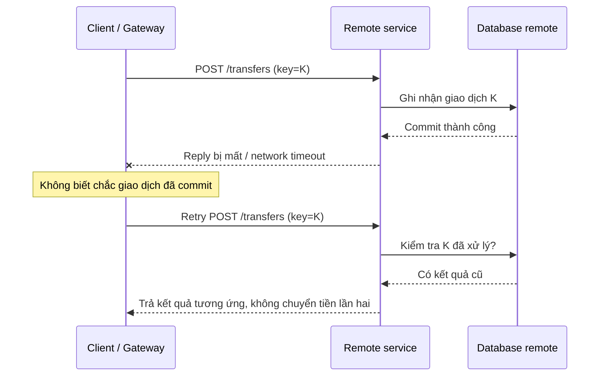
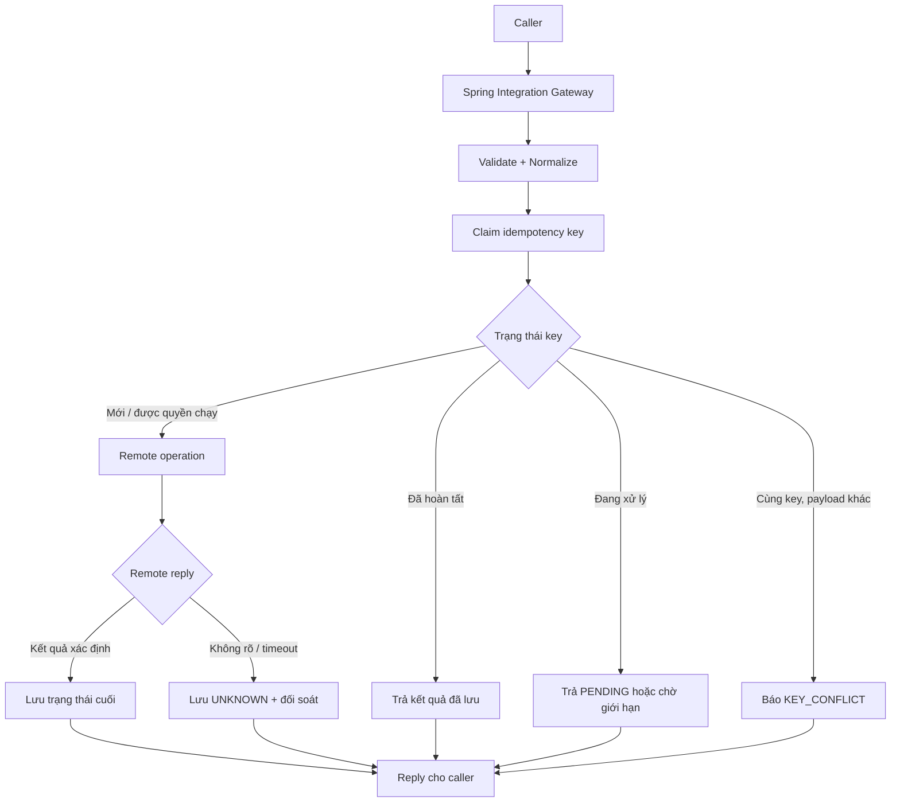
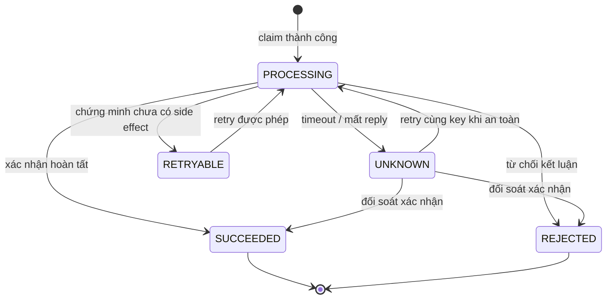

# Idempotency của remote operation trong Spring Integration

## 1. Vì sao lời gọi từ xa cần idempotency?

Trong chương **Remote procedure invocation** của mô-đun **SPRING_INTEGRATION_PATTERN**, ứng dụng sử dụng Spring Integration để xây dựng luồng thông điệp dựa trên các **Enterprise Integration Patterns** (EIP). Một thành phần có thể gọi API HTTP, hệ thống thanh toán, dịch vụ kho hoặc RPC endpoint thông qua Gateway và các endpoint tích hợp; Router, Filter, Transformer, retry, error channel và correlation giúp điều phối các nhánh.

Vấn đề lớn nhất khi gọi thao tác từ xa không chỉ là gửi request thành công, mà là **biết điều gì xảy ra khi không nhận được reply**.

Ví dụ:

1. Ứng dụng gửi lệnh `transfer(500_000 VND)` tới dịch vụ chuyển tiền.
2. Dịch vụ nhận yêu cầu, ghi giao dịch và thực hiện chuyển tiền.
3. Kết nối đứt ngay trước khi phản hồi được gửi về.
4. Ứng dụng thấy timeout nên gửi lại yêu cầu.
5. Nếu dịch vụ không chống xử lý trùng, cùng một ý định chuyển tiền có thể tạo **hai giao dịch thực**.

Idempotency giải quyết bài toán này bằng một nguyên tắc: **lặp lại cùng một thao tác có cùng danh tính nghiệp vụ sẽ không làm phát sinh thêm tác động ngoài ý muốn**.

Khái niệm idempotency có thể biểu diễn bằng:

```text
f(f(x)) = f(x)       (xét theo trạng thái/hiệu ứng nghiệp vụ quan sát được)
```

Ví dụ, đặt trạng thái một đơn hàng thành `CANCELLED` nhiều lần có thể là idempotent nếu mọi lần đều đưa đơn về cùng một trạng thái và không phát sinh thêm tác động. Ngược lại, `debit(account, 500_000)` thực hiện hai lần sẽ trừ tiền hai lần, nên cần khóa idempotency hoặc cơ chế chống trùng ở nơi thực hiện debit.

> **Phạm vi bảo đảm:** Idempotency là thuộc tính của **hiệu ứng nghiệp vụ**, không đồng nghĩa mọi lần gọi đều phải trả cùng HTTP status, thời điểm hoặc toàn bộ byte phản hồi. Một số API cung cấp cơ chế cache response theo idempotency key, nhưng đó là một lựa chọn contract cụ thể.

Sau bài này, bạn sẽ biết cách:

- Xác định một **logical operation** và chọn idempotency key ổn định qua retry.
- Phân biệt idempotency, retry, deduplication, correlation và exactly-once effect.
- Thiết kế một luồng RPC/request–reply có ghi nhận trạng thái, chống tranh chấp đồng thời và đối soát kết quả.
- Áp dụng Gateway, Service Activator, retry và error channel của Spring Integration mà vẫn bảo toàn tính đúng đắn.
- Kiểm thử timeout, lost reply, duplicate, crash và key conflict.

## 2. Remote call, retry và điểm mù của kết quả

Một lần gọi từ xa có thể kết thúc theo nhiều cách. Caller chỉ nhìn thấy phần quan sát được từ phía mình; điều đó không luôn đủ để suy ra trạng thái bên remote.



Để hình dung khác biệt, xét các kết quả có thể xảy ra:

| Caller quan sát | Điều chắc chắn biết | Điều **chưa** chắc chắn |
| --- | --- | --- |
| Reply thành công được xác thực | Remote đã xác nhận thao tác theo contract | Các tác động phụ ngoài contract |
| Reply từ chối nghiệp vụ rõ ràng | Remote đã từ chối theo contract | Không nên suy đoán nếu contract mơ hồ |
| Connection refused trước khi kết nối được tạo | Kết nối tại địa chỉ đó thất bại | Có hệ thống trung gian nào đã nhận lệnh hay chưa |
| Read timeout sau khi gửi request | Không có reply đúng hạn | Remote có thể đang chạy hoặc đã commit |
| HTTP 5xx | Remote/gateway báo lỗi | Có side effect nào đã xảy ra trước lỗi |
| Caller bị crash sau khi gửi | Tiến trình caller đã dừng | Remote đã nhận, xử lý hay trả lời hay chưa |

**Không có reply không đồng nghĩa chưa thực hiện lệnh.** Đặc biệt, RPC thực hiện thao tác ghi dữ liệu qua HTTP/gRPC/queue cần một chiến lược đối soát khi outcome chưa xác định.

### Idempotency không phải retry

- **Retry**: cơ chế thử gửi/làm lại thao tác sau lỗi.
- **Idempotency**: đặc tính bảo đảm việc lặp lại cùng ý định không tạo thêm tác động.
- **Deduplication**: phát hiện những lần gửi trùng (thường bằng khóa được lưu).
- **Correlation**: ghép request, reply, log và sự kiện theo một mã liên quan.
- **Exactly-once business effect**: mục tiêu nghiệp vụ chỉ tạo tác động một lần. Hệ thống phân tán thường hiện thực bằng cơ chế xử lý có thể lặp lại kết hợp lưu trạng thái, unique constraint và idempotency ở nơi sinh side effect, thay vì chỉ dựa vào giao thức gửi tin.

Retry có thể làm tăng số lần gọi; idempotency giúp nhiều lần gọi vẫn đại diện cho một ý định nghiệp vụ. Nếu không có idempotency, retry có thể làm tình trạng xấu đi.

## 3. Nhận diện đúng một thao tác nghiệp vụ

### 3.1. Chọn idempotency key

Một khóa tốt phải thỏa các yêu cầu:

1. **Duy nhất cho một ý định nghiệp vụ** trong phạm vi quy định.
2. **Giữ nguyên** khi retry cùng ý định, kể cả khi caller restart.
3. **Đổi khóa** khi người dùng thực sự khởi tạo một ý định mới.
4. **Không phụ thuộc** vào connection, thread, message ID được tạo lại hoặc số thứ tự retry.
5. **Được lưu đủ lâu** để bắt được mọi lần gửi trùng còn có thể xuất hiện.

Ví dụ client tạo một key như `trf-01JABC...` khi người dùng xác nhận chuyển khoản. Nếu mạng lỗi, lần retry tiếp tục dùng cùng key. Nếu người dùng chủ động tạo chuyển khoản thứ hai với cùng số tiền thì phải dùng key khác.

Đừng lấy số tiền + tài khoản làm key duy nhất: người dùng có thể hợp pháp chuyển hai lần cùng một số tiền. Tương tự, tự động tạo UUID **mới** trong mỗi lần retry sẽ vô hiệu hóa chống trùng.

### 3.2. Scope khóa và fingerprint payload

Cùng một chuỗi key có thể được nhiều tenant hoặc client sử dụng. Vì vậy, nơi lưu nên áp dụng unique constraint cho cặp **`(tenant_id, idempotency_key)`** hoặc một phạm vi tương đương theo contract.

Ngoài key, lưu **fingerprint của payload đã chuẩn hóa**. Nếu cùng key được dùng lại với dữ liệu khác, phải báo lỗi xung đột thay vì xử lý một yêu cầu mới hoặc trả kết quả cũ không liên quan.

Ví dụ:

| Tenant | Key | Payload chuẩn hóa | Quyết định |
| --- | --- | --- | --- |
| `team-A` | `K-101` | Chuyển 500.000 VND từ A sang B | Lần đầu: chấp nhận |
| `team-A` | `K-101` | Cùng payload như trên | Duplicate: trả trạng thái/kết quả cũ |
| `team-A` | `K-101` | Chuyển 700.000 VND từ A sang B | **Conflict**: cùng key, khác ý định |
| `team-B` | `K-101` | Yêu cầu riêng của tenant B | Độc lập nếu scope có tenant |

Fingerprint có thể là SHA-256 trên biểu diễn canonical của những trường nghiệp vụ có ý nghĩa. Phải thống nhất cách chuẩn hóa số thập phân, thứ tự trường, đơn vị tiền tệ, timezone và định dạng; nếu không, hai payload mang cùng ý nghĩa có thể cho hai fingerprint khác nhau. Không dùng token, trace ID hay timestamp request như một phần fingerprint nếu chúng thay đổi theo mỗi lần retry.

### 3.3. Phân biệt ba mã hay gặp

| Trường | Mục đích | Có thay đổi khi retry? |
| --- | --- | --- |
| `idempotencyKey` | Định danh ý định nghiệp vụ cần chống trùng | **Không** |
| `correlationId` | Liên kết luồng request/reply và các bước xử lý | Tùy contract; nên giữ khóa nghiệp vụ liên kết |
| `traceId` / `spanId` | Quan sát một đường thực thi và các nhánh | Có thể khác theo từng lần gọi |

Trong Spring Integration, header `replyChannel` có thể là channel nội bộ tạm thời, đặc biệt tại messaging gateway; đừng dùng đối tượng channel ấy làm danh tính nghiệp vụ khi gọi qua mạng. Nên truyền khóa nghiệp vụ qua header/field có thể serialize và phù hợp với protocol remote.

## 4. Luồng RPC có idempotency

Một thiết kế phổ biến có lớp điều phối ở phía caller và **idempotency ledger** ở phía remote hoặc hệ thống sở hữu side effect.



**Vị trí quan trọng nhất là nơi sinh side effect.** Một bộ nhớ chống trùng ở phía caller giúp tránh hai thread cùng gọi remote từ cùng một ứng dụng, nhưng không thể tự bảo đảm an toàn khi có nhiều instance, restart, mất response hoặc client khác gọi thẳng tới remote. Muốn bảo đảm hiệu ứng từ xa chỉ xảy ra một lần, remote service cần có hợp đồng idempotency, hoặc một cơ chế khác để truy xuất/khôi phục kết quả và ngăn trùng **tại hệ thống ghi dữ liệu**.

Có thể áp dụng nhiều lớp:

- **Caller**: giữ nguyên key, lưu intent, kiểm soát retry và deadline, không tạo lệnh mới khi outcome chưa chắc chắn.
- **Integration flow**: truyền key qua Router/Transformer/Handler, ghi log có correlation, áp dụng timeout/error channel và điều phối trạng thái.
- **Remote service**: áp dụng atomic dedup trước khi ghi side effect, lưu kết quả cuối, trả response hợp lệ cho duplicate.
- **Storage/outbox**: lưu tiến trình bền vững để khôi phục sau crash; dùng transactional outbox nếu cần phát sự kiện sau khi commit dữ liệu.

Không được coi một message header hay một in-memory cache là thay thế cho cơ chế idempotency bền vững khi yêu cầu chịu restart và nhiều instance.

## 5. Máy trạng thái cho operation

Một bản ghi ledger hữu ích có thể sử dụng các trạng thái sau:

| State | Ý nghĩa | Hành động khi nhận lại cùng key |
| --- | --- | --- |
| `PROCESSING` | Một worker đã claim, kết quả chưa hoàn tất | Không tự khởi chạy song song; trả `PENDING` hoặc chờ giới hạn |
| `SUCCEEDED` | Side effect đã hoàn tất và kết quả được lưu | Trả kết quả đã lưu |
| `REJECTED` | Remote từ chối có tính kết luận theo contract | Trả cùng quyết định từ chối |
| `UNKNOWN` | Request có thể đã tới remote nhưng kết quả chưa xác định | Tra cứu/đối soát; tránh replay thiếu bảo đảm |
| `RETRYABLE` | Có bằng chứng an toàn để thử lại | Thực hiện retry có hạn và cùng key |

`PROCESSING` không được tự đổi thành `FAILED` chỉ vì quá thời gian xử lý. `UNKNOWN` phản ánh **mức độ biết của caller** chứ không nhất thiết là trạng thái nghiệp vụ bên remote.

Một mô hình chuyển trạng thái minh họa:



Nếu cần retry từ `UNKNOWN`, ưu tiên remote endpoint hỗ trợ **idempotency key** hoặc truy vấn trạng thái theo mã yêu cầu; một lệnh POST mới với key mới có thể gây trùng. Bảng trạng thái nên lưu cả nguồn xác nhận, timestamp, remote reference và số lần thử.

## 6. Ví dụ với Spring Integration Gateway và Service Activator

Xây dựng lời gọi chuyển tiền qua Spring Integration. Ví dụ dùng Java 17+, Spring Framework 6.1+ (để dùng `RestClient`) và Spring Integration. Ý tưởng gồm: Gateway nhận yêu cầu, Service Activator phối hợp ledger, rồi gọi một remote API có hỗ trợ header `Idempotency-Key`.

Các đoạn code cho thấy ranh giới trách nhiệm. `OperationLedger` là **hợp đồng truy cập kho lưu trạng thái** cần được triển khai bằng transaction/unique constraint; không dùng một `HashMap` để làm ledger production.

### 6.1. Định nghĩa request/reply

```java
import java.math.BigDecimal;

public record TransferCommand(
    String tenantId,
    String requestId,
    String sourceAccount,
    String targetAccount,
    BigDecimal amount,
    String currency
) {}

public record TransferReply(
    String requestId,
    String state,
    String remoteOperationId,
    String code
) {}

public record RemoteTransferResponse(
    String operationId,
    String state
) {}
```

Trong ví dụ, `requestId` được dùng làm idempotency key cho **một lần chuyển tiền có chủ đích**. `tenantId` cung cấp phạm vi key. `state` ở reply có thể là `SUCCEEDED`, `REJECTED`, `PENDING` hoặc `UNKNOWN`.

### 6.2. Gateway và request channel

```java
import org.springframework.context.annotation.Bean;
import org.springframework.context.annotation.Configuration;
import org.springframework.integration.annotation.IntegrationComponentScan;
import org.springframework.integration.channel.DirectChannel;
import org.springframework.integration.config.EnableIntegration;
import org.springframework.messaging.MessageChannel;

@Configuration
@EnableIntegration
@IntegrationComponentScan
public class TransferIntegrationConfiguration {

    @Bean("transferRequests")
    public MessageChannel transferRequests() {
        return new DirectChannel();
    }
}
```

```java
import org.springframework.integration.annotation.MessagingGateway;

@MessagingGateway(defaultRequestChannel = "transferRequests")
public interface TransferGateway {
    TransferReply transfer(TransferCommand command);
}
```

Đây là API Java cho caller, không phải một RPC network protocol. Việc gọi remote API sẽ diễn ra trong một handler của luồng. `DirectChannel` đơn giản hóa minh họa, nhưng handler gọi HTTP đồng bộ có thể chặn thread của caller. Cần cấu hình **connect timeout, read/response timeout, deadline nghiệp vụ** tại HTTP client/downstream; chỉ đặt `replyTimeout` cho messaging gateway không bảo đảm cắt được một lời gọi đồng bộ đang chạy trong `DirectChannel`.

### 6.3. Hợp đồng ledger với atomic claim

```java
public enum ClaimKind {
    ACQUIRED,       // Worker này giành quyền xử lý key mới.
    COMPLETED,      // Đã có kết quả cuối được lưu.
    IN_PROGRESS,    // Worker khác đang xử lý.
    UNKNOWN,        // Chưa xác định được kết quả remote.
    KEY_CONFLICT    // Cùng key nhưng fingerprint khác.
}

public record Claim(
    ClaimKind kind,
    TransferReply previousReply
) {}

public interface OperationLedger {
    Claim claim(
        String tenantId,
        String idempotencyKey,
        String payloadFingerprint
    );

    void complete(
        String tenantId,
        String idempotencyKey,
        TransferReply reply
    );

    void markUnknown(
        String tenantId,
        String idempotencyKey,
        String reasonCode
    );
}
```

Hợp đồng `claim` cần có tính **nguyên tử**: hai thread hay hai instance không thể cùng nhận `ACQUIRED` cho một key đang chạy. Khi có `COMPLETED`, `previousReply` chứa phản hồi đã lưu. `IN_PROGRESS` và `UNKNOWN` không trao quyền chạy remote mới.

Bên trong ledger, cần dùng transaction, khóa/unique constraint và một chính sách lease/recovery phù hợp. Chỉ so sánh key sau khi đã xác thực tenant; tránh đọc hoặc trả kết quả của người dùng khác.

### 6.4. Remote client truyền cùng idempotency key

```java
import org.springframework.stereotype.Component;
import org.springframework.web.client.RestClient;

@Component
public class TransferRemoteClient {
    private final RestClient restClient;

    public TransferRemoteClient(RestClient.Builder builder) {
        this.restClient = builder
            .baseUrl("https://payments.example.invalid")
            .build();
    }

    public RemoteTransferResponse send(
            TransferCommand command,
            String idempotencyKey) {

        return restClient.post()
            .uri("/transfers")
            .header("Idempotency-Key", idempotencyKey)
            // Header auth và tenant được cấu hình theo contract thực tế.
            .body(command)
            .retrieve()
            .body(RemoteTransferResponse.class);
    }
}
```

`https://payments.example.invalid` chỉ là địa chỉ minh họa, **không phải API thật**. Remote API phải có contract công khai về `Idempotency-Key`, cách xử lý cùng key khác payload, thời hạn giữ key và cách truy vấn trạng thái.

Mẫu code cố ý không giả định mọi HTTP 2xx chắc chắn biểu thị giao dịch `SUCCEEDED`: remote có thể trả `ACCEPTED`/`PENDING` và xử lý sau. Handler cần diễn giải `response.state()` theo contract; xác nhận thành công chỉ khi có bằng chứng rõ ràng.

### 6.5. Service Activator điều phối claim, gửi lệnh và ghi kết quả

```java
import org.springframework.integration.annotation.ServiceActivator;
import org.springframework.stereotype.Component;
import org.springframework.web.client.ResourceAccessException;
import org.springframework.web.client.HttpServerErrorException;

@Component
public class TransferHandler {
    private final OperationLedger ledger;
    private final TransferRemoteClient remoteClient;
    private final PayloadFingerprint fingerprint;

    public TransferHandler(
            OperationLedger ledger,
            TransferRemoteClient remoteClient,
            PayloadFingerprint fingerprint) {
        this.ledger = ledger;
        this.remoteClient = remoteClient;
        this.fingerprint = fingerprint;
    }

    @ServiceActivator(inputChannel = "transferRequests")
    public TransferReply handle(TransferCommand command) {
        validate(command);

        String key = command.requestId();
        String hash = fingerprint.of(command);
        Claim claim = ledger.claim(command.tenantId(), key, hash);

        switch (claim.kind()) {
            case KEY_CONFLICT:
                return new TransferReply(
                    key, "REJECTED", null, "IDEMPOTENCY_KEY_CONFLICT");
            case COMPLETED:
                return claim.previousReply();
            case IN_PROGRESS:
                return new TransferReply(
                    key, "PENDING", null, "ALREADY_PROCESSING");
            case UNKNOWN:
                return new TransferReply(
                    key, "UNKNOWN", null, "RECONCILIATION_REQUIRED");
            case ACQUIRED:
                break; // Chỉ nhánh đã claim được phép gọi remote.
        }

        try {
            RemoteTransferResponse remote = remoteClient.send(command, key);
            if (remote == null) {
                ledger.markUnknown(command.tenantId(), key, "EMPTY_RESPONSE");
                return new TransferReply(
                    key, "UNKNOWN", null, "EMPTY_REMOTE_RESPONSE");
            }

            // Contract minh họa: chỉ SUCCEEDED/REJECTED là kết luận.
            if ("SUCCEEDED".equals(remote.state())
                    || "REJECTED".equals(remote.state())) {
                TransferReply finalReply = new TransferReply(
                    key, remote.state(), remote.operationId(), "REMOTE_FINAL");
                ledger.complete(command.tenantId(), key, finalReply);
                return finalReply;
            }

            ledger.markUnknown(command.tenantId(), key, "NOT_FINAL_YET");
            return new TransferReply(
                key, "PENDING", remote.operationId(), "REMOTE_PENDING");

        } catch (ResourceAccessException
                 | HttpServerErrorException uncertain) {
            // Lỗi mạng/read timeout/5xx: remote có thể đã xử lý.
            ledger.markUnknown(command.tenantId(), key, "REMOTE_UNCERTAIN");
            return new TransferReply(
                key, "UNKNOWN", null, "RECONCILIATION_REQUIRED");
        }
    }

    private static void validate(TransferCommand command) {
        if (command.requestId() == null || command.requestId().isBlank()
                || command.tenantId() == null || command.tenantId().isBlank()
                || command.amount() == null
                || command.amount().signum() <= 0) {
            throw new IllegalArgumentException("Invalid transfer command");
        }
    }
}
```

`PayloadFingerprint` là dependency thực hiện canonicalization và hashing; để minh họa ranh giới chức năng, có thể khai báo interface:

```java
public interface PayloadFingerprint {
    String of(TransferCommand command);
}
```

**Lưu ý khi áp dụng:**

- Mẫu này là **sườn tích hợp**, chưa phải chương trình chạy độc lập: cần triển khai `OperationLedger`, `PayloadFingerprint`, remote API, xác thực tenant, HTTP client timeout và chính sách error handling theo hệ thống thực.
- Các exception `ResourceAccessException`/`HttpServerErrorException` được xem là kết quả chưa xác định. HTTP 4xx không tự động đồng nghĩa từ chối nghiệp vụ; chỉ ánh xạ thành `REJECTED` nếu remote contract bảo đảm yêu cầu đã bị từ chối và side effect không diễn ra.
- Có thể xảy ra crash sau khi remote trả `SUCCEEDED` nhưng **trước** khi ledger lưu `complete`. Lần tiếp theo sẽ gặp trạng thái chưa chắc chắn; cần tra cứu remote bằng cùng key hoặc remoteOperationId. Không được tự đánh dấu thành công chỉ vì lời gọi trước “có lẽ” đã chạy.
- Nếu remote thực sự hỗ trợ idempotency key, retry cùng key có thể an toàn theo phạm vi và thời hạn bảo đảm của provider. Nếu không hỗ trợ, phải đối soát trước khi gọi lại.
- Không đặt lời gọi HTTP kéo dài **bên trong transaction giữ khóa của ledger**; nên claim và commit trạng thái trước khi gọi mạng, sau đó cập nhật kết quả trong một transaction ngắn khác.
- Nếu response của remote là bất đồng bộ, hãy trả `PENDING` và xây cơ chế callback/event/status query được đối chiếu bằng cùng khóa; đừng cho gateway chờ mãi.

## 7. Triển khai ledger trong cơ sở dữ liệu

Một ví dụ schema PostgreSQL lưu record cho từng tenant và key:

```sql
CREATE TABLE remote_operations (
    id BIGSERIAL PRIMARY KEY,
    tenant_id VARCHAR(80) NOT NULL,
    idempotency_key VARCHAR(160) NOT NULL,
    payload_fingerprint CHAR(64) NOT NULL,
    state VARCHAR(20) NOT NULL
        CHECK (state IN (
            'PROCESSING', 'SUCCEEDED', 'REJECTED',
            'UNKNOWN', 'RETRYABLE'
        )),
    remote_operation_id VARCHAR(160),
    response_json JSONB,
    lease_until TIMESTAMPTZ,
    created_at TIMESTAMPTZ NOT NULL DEFAULT now(),
    updated_at TIMESTAMPTZ NOT NULL DEFAULT now(),
    CONSTRAINT uq_remote_operation_tenant_key
        UNIQUE (tenant_id, idempotency_key)
);
```

**Atomic claim** là hàng rào đầu tiên trước khi gọi remote:

```sql
INSERT INTO remote_operations (
    tenant_id,
    idempotency_key,
    payload_fingerprint,
    state,
    lease_until
)
VALUES (
    :tenant_id,
    :key,
    :fingerprint,
    'PROCESSING',
    now() + interval '30 seconds'
)
ON CONFLICT (tenant_id, idempotency_key)
DO NOTHING
RETURNING id;
```

Nếu `INSERT ... RETURNING` tạo một dòng, caller đã claim key mới. Nếu không có dòng trả về, ứng dụng phải **đọc record hiện có**, kiểm tra fingerprint và trạng thái:

- **Fingerprint khác**: trả `KEY_CONFLICT`, không gọi remote.
- **`SUCCEEDED`/`REJECTED`**: trả kết quả cuối đã lưu.
- **`PROCESSING`**: trả `PENDING` hoặc chờ ngắn theo chính sách; không chạy thêm remote.
- **`UNKNOWN`**: đưa sang luồng đối soát.

Mỗi thay đổi trạng thái phải được bảo vệ bằng transaction, điều kiện cập nhật phù hợp và kiểm tra owner/lease khi cần, để hai worker không ghi đè kết quả của nhau. Ví dụ, câu cập nhật sau có thể là một phần của triển khai thực, với tiền đề đã chứng minh worker sở hữu claim:

```sql
UPDATE remote_operations
SET state = 'SUCCEEDED',
    remote_operation_id = :remote_operation_id,
    response_json = CAST(:response_json AS jsonb),
    updated_at = now()
WHERE tenant_id = :tenant_id
  AND idempotency_key = :key
  AND state IN ('PROCESSING', 'UNKNOWN');
```

Phải kiểm tra **số hàng đã cập nhật**. Query chỉ minh họa chuyển trạng thái; trong thiết kế nhiều worker còn cần lưu claim owner/fencing token hoặc ràng buộc phiên bản để ngăn worker cũ cập nhật sau khi lease đã được chuyển.

### 7.1. Tại sao không giữ DB lock trong khi gọi HTTP?

Nếu mở transaction, `SELECT ... FOR UPDATE` rồi giữ khóa suốt vài giây chờ remote, những request khác cùng key sẽ bị chặn; cơ sở dữ liệu chịu thêm áp lực, còn transaction có thể timeout hoặc deadlock.

Thực tế thường chia thành các đoạn ngắn:

1. Transaction A: chuẩn hóa + atomic claim + commit.
2. Ngoài transaction: gọi remote với idempotency key đã claim.
3. Transaction B: lưu kết quả kết luận hoặc tình trạng chưa rõ.
4. Luồng reconciliation: cập nhật kết quả muộn sau khi lấy bằng chứng từ remote.

Ở bước 2, crash có thể khiến record tồn tại trong `PROCESSING` mà không có kết quả. Đây là lý do phải có lease, deadline và cơ chế recovery.

### 7.2. Lease hết hạn có được phép gọi lại ngay?

**Không mặc định.** Lease hết hạn chỉ nói rằng worker sở hữu trước đó không còn được tin là đang xử lý; nó không chứng minh remote chưa thực thi.

Khi lease hết:

- Kiểm tra trạng thái remote bằng `idempotencyKey`/`remoteOperationId` nếu API có endpoint tra cứu.
- Nếu provider bảo đảm xử lý trùng theo cùng key và còn trong thời hạn lưu key, có thể retry có kiểm soát bằng **chính key đó**.
- Nếu provider không có idempotency hay API tra cứu, đánh dấu `UNKNOWN`, chuyển sang đối soát thủ công hoặc cơ chế nghiệp vụ riêng.
- Nếu worker cũ có thể “sống lại”, dùng fencing token, version hoặc compare-and-set để nó không ghi đè record đã chuyển quyền.

Một lease 30 giây không phải “ngưỡng hết hiệu lực nghiệp vụ 30 giây”; đừng xóa key sau 30 giây nếu caller vẫn có thể retry trong nhiều giờ.

### 7.3. TTL và vòng đời key

TTL phải lớn hơn khoảng thời gian có thể xuất hiện duplicate: timeout, retry backoff, hàng đợi, thiết bị offline, job recovery và thời hạn broker redelivery. Provider remote cũng có thể chỉ lưu key trong một cửa sổ ngắn. Khi thời hạn của provider hết, việc gọi lại cùng key **không còn được bảo đảm an toàn**; phải có quy trình tra cứu hoặc chuyển sang điều tra.

Nếu kết quả lưu vĩnh viễn là quá tốn kém, có thể tách dữ liệu audit và khóa idempotency, lưu trạng thái cuối có thời hạn phù hợp yêu cầu nghiệp vụ. Không xóa key khi còn request có thể được redeliver.

## 8. Tình huống crash: Vì sao “exactly once” khó?

Xét bốn điểm sự cố:

| Thời điểm crash | Trạng thái local có thể thấy | Giải pháp khôi phục |
| --- | --- | --- |
| Trước khi claim | Chưa có record | Có thể claim rồi thực thi |
| Sau khi claim, trước khi gửi remote | `PROCESSING` treo | Kiểm tra trạng thái và lease; retry nếu chứng minh an toàn |
| Sau khi remote commit, trước khi local ghi kết quả | `PROCESSING`/`UNKNOWN` | Tra cứu bằng key, hoặc retry cùng key nếu provider bảo đảm idempotency |
| Sau khi local ghi `SUCCEEDED`, trước khi gửi reply | Kết quả cuối đã lưu | Caller retry cùng key và nhận kết quả cũ |

Mục tiêu là **không tạo hiệu ứng nghiệp vụ trùng trong các lần khôi phục**. Chỉ khóa phía caller chưa đủ để bảo đảm điều đó khi remote và local DB commit độc lập.

### 8.1. Transactional outbox có giúp được không?

Outbox giúp đảm bảo sự kiện/lệnh được ghi cùng transaction với dữ liệu local, rồi một publisher gửi chúng ra bên ngoài. Nó giải quyết khoảng mất message giữa commit local và publish, nhưng publisher vẫn có thể gửi lặp nếu ack bị mất.

Vì vậy, **outbox + idempotent consumer/inbox** thường là cặp hữu ích: bên nhận ghi nhận message/operation ID bằng unique constraint trước hoặc cùng transaction với side effect. Nếu remote là một HTTP API bên thứ ba không hỗ trợ idempotency key hay truy vấn kết quả, outbox riêng không thể bảo đảm exactly-once side effect.

### 8.2. Có thể dùng “phép toán vốn đã idempotent” không?

Có. Một số operation được thiết kế tự nhiên idempotent:

```text
PUT /accounts/123/preferences
{"emailNotifications": true}
```

Gửi lại cùng giá trị không làm thay đổi trạng thái mong muốn sau lần đầu. Tuy nhiên, side effect phụ như gửi email mỗi lần update vẫn phải được kiểm soát. HTTP method mang ngữ nghĩa idempotent theo giao thức không tự chứng minh implementation có mọi side effect idempotent.

Ngược lại, một lệnh kiểu `POST /transfers` hoặc `incrementBalance(500000)` cần hợp đồng idempotency rõ ràng nếu muốn retry an toàn.

## 9. Retry, timeout, error channel và correlation trong Spring Integration

### 9.1. Retry phải tôn trọng idempotency

Với `RequestHandlerRetryAdvice` hoặc retry ở HTTP client, một lần gọi handler có thể được thực thi lại. Trước khi bật:

- Xác định loại lỗi **được phép retry**.
- Giữ nguyên idempotency key và payload ở mỗi lần thử.
- Giới hạn `maxAttempts`, backoff, jitter và tổng thời gian.
- Có cách phát hiện kết quả không chắc chắn; tránh retry “tất cả exception”.
- Kiểm tra bên remote có áp dụng key trên **cùng endpoint và cùng loại operation** không.

Một policy minh họa:

| Kết quả | Retry ngay? | Lý do |
| --- | --- | --- |
| Validation error chắc chắn | Không | Payload cần sửa |
| `KEY_CONFLICT` | Không | Cùng key đã được dùng cho ý định khác |
| Lỗi connect trước khi gửi được request, có bằng chứng rõ | Có thể | Không có side effect nếu thật sự chưa gửi |
| Read timeout sau khi gửi | **Chỉ nếu remote chống trùng theo key** hoặc đã đối soát | Trạng thái không xác định |
| HTTP 5xx | Không retry mù | Có thể đã commit trước khi trả lỗi |
| `IN_PROGRESS` | Chờ/tra cứu theo policy | Một worker khác đã claim |
| `SUCCEEDED` trong ledger | Không gọi remote | Trả kết quả đã lưu |

### 9.2. Hai loại timeout

`requestTimeout` và `replyTimeout` của Spring Integration Gateway phục vụ lần lượt thời gian gửi request vào channel và thời gian chờ reply theo ngữ cảnh gateway. Timeout của HTTP client, transaction, database, RPC deadline và deadline nghiệp vụ cần cấu hình riêng.

Nếu handler trong `DirectChannel` gọi HTTP và bị chặn 10 giây, `replyTimeout` không nhất thiết cắt cuộc gọi sau một giây. Với `ExecutorChannel`, gateway có thể hết thời gian chờ trong lúc worker vẫn đang xử lý. Trong cả hai trường hợp, **caller timeout không tự hủy tác động ở remote**.

### 9.3. Error channel phân loại lỗi, không tạo idempotency

Spring Integration có thể gửi `ErrorMessage` đến error channel khi lỗi phát sinh ở những boundary hỗ trợ. Error flow hữu ích để ghi log, phân nhóm lỗi, cảnh báo hoặc tạo reply thay thế.

Nhưng:

- Error channel không tự chứng minh rằng side effect chưa xảy ra.
- Lỗi ở worker thread không nhất thiết tự quay về caller.
- Reply lỗi cần truyền `requestId` và loại trạng thái `UNKNOWN` khi không thể kết luận.
- Một exception được retry nhiều lần không tạo bảo đảm xử lý một lần.

Nếu error flow chuyển mọi network exception thành `FAILED` rồi caller tạo request mới, khả năng tạo duplicate vẫn tồn tại. Hãy thiết kế error mapping dựa trên bằng chứng về trạng thái operation.

### 9.4. Router, Filter, Transformer, Aggregator và mã tương quan

Trong flow EIP dài, key có thể đi qua nhiều bước:

```text
Gateway
  -> Filter (validate key, payload)
  -> Transformer (canonicalize command + fingerprint)
  -> Router (chọn remote provider)
  -> Service Activator / HTTP outbound call
  -> Reply Transformer
  -> Gateway reply
```

Khuyến nghị:

- **Filter**: yêu cầu khóa hợp lệ; một request bị filter bỏ mà không sinh reply có thể khiến gateway chờ đến timeout. Thiết kế rejection reply rõ ràng khi cần.
- **Transformer**: giữ key khi chuyển đổi payload/header. Nếu cần canonicalization, áp dụng cùng một quy tắc ở mọi lần retry.
- **Router**: key có thể cần scope thêm `providerId`/operation type; một key gửi sang hai provider khác nhau không chắc ngăn được hai hiệu ứng.
- **Splitter/Aggregator**: mỗi nhánh có thể cần khóa con ổn định như `operationKey + stepName`; aggregator dùng correlation để ghép kết quả, nhưng correlation của group không thay thế idempotency tại remote side effect.
- **Gateway**: giữ contract reply `SUCCEEDED`/`REJECTED`/`PENDING`/`UNKNOWN`; không diễn giải `null` hoặc timeout là `FAILED`.

Có thể truyền key trong metadata message và payload. Khi đi qua broker hoặc RPC boundary, chọn biểu diễn có thể serialize theo giao thức (ví dụ HTTP header, JSON field, gRPC metadata), không chuyển trực tiếp đối tượng channel Java.

## 10. Observability và bảo mật

Một hệ thống idempotent tốt cần giải thích được vì sao nhiều lần gọi chỉ tạo một tác động. Nên log/metric theo:

- `tenantId`, `idempotencyKey`, `requestId`, `correlationId`, endpoint, operation type.
- `attemptNumber` và nguyên nhân retry.
- Kết quả atomic claim: `ACQUIRED`, `COMPLETED`, `IN_PROGRESS`, `KEY_CONFLICT`.
- Trạng thái ledger trước/sau, thời điểm claim, deadline, lease và thời gian nằm ở `UNKNOWN`.
- Remote operation ID, mã phản hồi, thời gian gọi và kết quả reconciliation.
- Số duplicate bị chặn, số request chưa rõ kết quả, số timeout, độ trễ p95/p99 và số key conflict.

Ví dụ timeline:

```text
10:00:00.000 key=K-77 tenant=A attempt=1 CLAIMED
10:00:00.120 key=K-77 tenant=A attempt=1 REMOTE_SENT
10:00:01.120 key=K-77 tenant=A attempt=1 READ_TIMEOUT
10:00:01.130 key=K-77 tenant=A state=UNKNOWN
10:00:02.000 key=K-77 tenant=A attempt=2 DUPLICATE_UNKNOWN
10:00:03.200 key=K-77 tenant=A REMOTE_STATUS=SUCCEEDED
10:00:03.220 key=K-77 tenant=A state=SUCCEEDED remoteId=R-901
```

Đây là timeline minh họa. Request thứ hai **không gửi lệnh chuyển tiền mới** khi chưa có cơ sở an toàn; nó tra cứu/đợi đối soát. Không ghi mật khẩu, token, số tài khoản nhạy cảm hay toàn bộ payload chưa lọc vào log. Kiểm tra quyền truy cập khi trả kết quả theo key; không được để tenant khác đoán key rồi đọc được dữ liệu giao dịch.

## 11. Kiểm thử các tình huống khó

Bài toán idempotency cần nhiều hơn test “gọi lần hai trả cùng giá trị”. Hãy kiểm tra **số side effect thực tế**.

| Tình huống | Chuẩn bị | Kỳ vọng |
| --- | --- | --- |
| Lần đầu với key mới | Ledger chưa có key | Một claim `ACQUIRED`, một remote call |
| Duplicate sau thành công | Ledger lưu `SUCCEEDED` | Trả reply cũ, **0 remote call bổ sung** |
| Hai request đồng thời cùng key | Hai thread/instance claim | Chỉ một request được `ACQUIRED` |
| Cùng key, payload khác | Fingerprint khác | `KEY_CONFLICT`, không gọi remote |
| Read timeout nhưng remote đã commit | Giả lập mất reply | Trạng thái `UNKNOWN` rồi đối soát; không tạo side effect mới |
| Crash sau remote commit, trước khi lưu local | Khởi động lại worker | Tra cứu/retry cùng key khi an toàn; chỉ một effect |
| Crash sau khi lưu kết quả, trước reply | Caller retry | Trả kết quả đã lưu |
| Lease hết hạn khi worker cũ chưa chết | Worker mới bắt đầu recovery | Không có hai worker gây side effect trùng |
| TTL của provider đã hết | Retry rất muộn | Không dựa vào key cũ để khẳng định an toàn |
| Remote từ chối nghiệp vụ rõ | Reply `REJECTED` theo contract | Lưu trạng thái cuối, không retry vô nghĩa |
| Error channel xử lý lỗi | Handler/adapter ném exception | Phản hồi không biến lỗi chưa rõ thành `FAILED` |
| Splitter tạo nhiều nhánh | Nhánh A thành công, B timeout | Có key ổn định theo từng nhánh, không lặp A khi retry B |

### Test minh họa cho duplicate sau khi đã hoàn tất

Với JUnit 5 và Mockito, có thể kiểm tra hành vi của `TransferHandler` đã khai báo ở trên. Test cần stub ledger và fingerprint, sau đó chứng minh duplicate không chạm remote.

```java
import static org.junit.jupiter.api.Assertions.assertEquals;
import static org.mockito.Mockito.*;

import java.math.BigDecimal;
import org.junit.jupiter.api.Test;

class TransferHandlerTest {

    @Test
    void completedKeyReturnsCachedResultWithoutRemoteCall() {
        OperationLedger ledger = mock(OperationLedger.class);
        TransferRemoteClient client = mock(TransferRemoteClient.class);
        PayloadFingerprint fingerprint = mock(PayloadFingerprint.class);

        TransferCommand command = new TransferCommand(
            "tenant-A", "K-123",
            "A", "B", new BigDecimal("500000"), "VND"
        );
        TransferReply cached = new TransferReply(
            "K-123", "SUCCEEDED", "R-900", "REMOTE_FINAL"
        );

        when(fingerprint.of(command)).thenReturn("stable-fingerprint");
        when(ledger.claim("tenant-A", "K-123", "stable-fingerprint"))
            .thenReturn(new Claim(ClaimKind.COMPLETED, cached));

        TransferHandler handler =
            new TransferHandler(ledger, client, fingerprint);

        TransferReply actual = handler.handle(command);

        assertEquals(cached, actual);
        verifyNoInteractions(client);
    }
}
```

Test này kiểm tra điều phối khi ledger đã có kết quả. Để khẳng định **idempotency giữa nhiều instance**, còn cần integration test trên database thật (unique constraint, giao dịch cạnh tranh) và thử crash/restart kết hợp remote API có idempotency hoặc reconciliation. Mockito không chứng minh được tính nguyên tử của storage.

### Kịch bản thực hành mở rộng

1. Tạo bảng `remote_operations`, viết `claim` với câu `INSERT ... ON CONFLICT DO NOTHING`.
2. Chạy 20 luồng cùng gửi key `K-123`, đếm số lần remote được gọi; kết quả mong muốn là một lần đối với operation đang xử lý.
3. Thay payload của một request dùng cùng key; kiểm tra hệ thống trả `KEY_CONFLICT`.
4. Mô phỏng remote xử lý thành công nhưng client mất reply; đưa ledger sang `UNKNOWN` và bổ sung API tra cứu.
5. Gây crash giữa remote commit và local `complete`. Sau restart, chứng minh không tạo chuyển tiền trùng.
6. Thử retry khi key của provider đã hết TTL; thiết kế quy trình từ chối retry tự động hoặc đối soát ngoài băng.

## 12. Các sai lầm thường gặp

**Mỗi lần retry tạo UUID mới.** Hệ thống không thể nhận diện cùng ý định nghiệp vụ. Key phải tồn tại qua retry và restart.

**Chống trùng bằng `ConcurrentHashMap` trong mỗi instance.** Bộ nhớ cục bộ không bảo đảm giữa nhiều instance, mất khi restart và không giải quyết được crash sau remote commit.

**Chỉ kiểm tra key mà không so fingerprint.** Hai request khác nội dung dùng chung key có thể bị chấp nhận nhầm hoặc trả kết quả không thuộc về request hiện tại.

**Xóa key sau một timeout ngắn.** Một request cũ vẫn có thể đến lại sau khi key bị xóa, tạo side effect thứ hai.

**Tin rằng remote HTTP 5xx luôn có nghĩa không có side effect.** Server có thể commit trước khi trả lỗi. Phải tôn trọng contract hoặc tra cứu kết quả.

**Retry khi lease hết hạn mà không đối soát.** Worker cũ có thể đã gửi lệnh; lease hết chỉ là tín hiệu recovery, không phải bằng chứng remote chưa chạy.

**Cho rằng Spring Integration retry/errorChannel tạo exactly-once.** Chúng giúp vận chuyển và xử lý lỗi, còn idempotency cần thực thi tại ranh giới side effect và nơi lưu trạng thái bền vững.

**Không kiểm soát tenant scope.** Dùng key toàn hệ thống thiếu scope có thể gây xung đột giữa khách hàng hoặc lộ kết quả của tenant khác.

**Trả `FAILED` khi kết quả thực chưa xác định.** Điều này khuyến khích caller thực hiện lệnh mới và tạo duplicate. Hãy giữ trạng thái `UNKNOWN`/`PENDING` có thể đối soát.

## 13. Câu hỏi tự đánh giá

1. Vì sao retry một yêu cầu chuyển tiền sau read timeout nguy hiểm hơn retry một truy vấn chỉ đọc?
2. Nếu cùng key nhưng payload khác, vì sao trả kết quả cũ cũng có thể là lỗi?
3. Nếu database local đã ghi `PROCESSING` rồi ứng dụng chết trước khi gọi remote, recovery nên quyết định thế nào?
4. Nếu remote đã commit nhưng local ledger chưa ghi `SUCCEEDED`, cơ chế nào cho phép khôi phục mà không thực hiện giao dịch hai lần?
5. Khi dùng Splitter/Aggregator, bạn chọn idempotency key cho toàn bộ request và từng nhánh như thế nào?
6. `replyTimeout`, HTTP timeout, lease expiration và TTL của provider khác nhau ra sao?
7. Vì sao một unique constraint trên bảng local **không đủ** nếu remote không hỗ trợ idempotency và không thể truy vấn trạng thái?
8. Khi nào có thể trả `REJECTED`, khi nào phải trả `UNKNOWN`, và bằng chứng nào cho phép chuyển trạng thái?

## Ghi nhớ

- Idempotency bảo vệ **tác động nghiệp vụ** khi cùng một remote operation được gửi nhiều lần; retry chỉ là cơ chế thử lại.
- Key phải gắn với một ý định, có scope rõ ràng, giữ nguyên qua retry và được so với fingerprint của payload.
- Chống trùng bền vững cần atomic claim, trạng thái có thể khôi phục và kiểm soát concurrency.
- Remote side effect chỉ được bảo đảm không lặp nếu hệ thống thực hiện side effect có cơ chế idempotency/reconciliation phù hợp; ledger phía caller không thể tự tạo bảo đảm xuyên hai hệ thống độc lập.
- Timeout, 5xx, reply bị mất và crash có thể tạo `UNKNOWN`; hãy đối soát bằng key trước khi retry không an toàn.
- Spring Integration Gateway, Transformer, Router, retry, error channel và correlation cung cấp cơ chế điều phối; tính đúng đắn của idempotency nằm ở **contract nghiệp vụ và ranh giới lưu trạng thái**.
