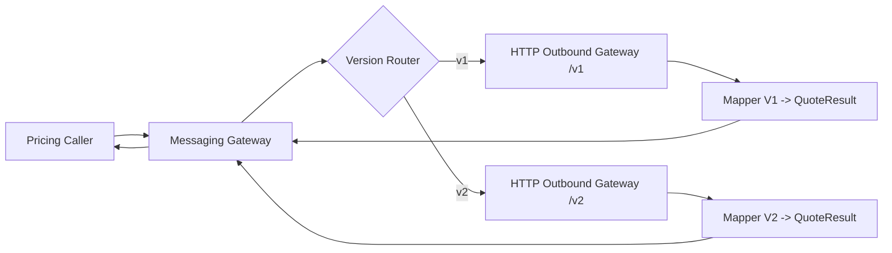
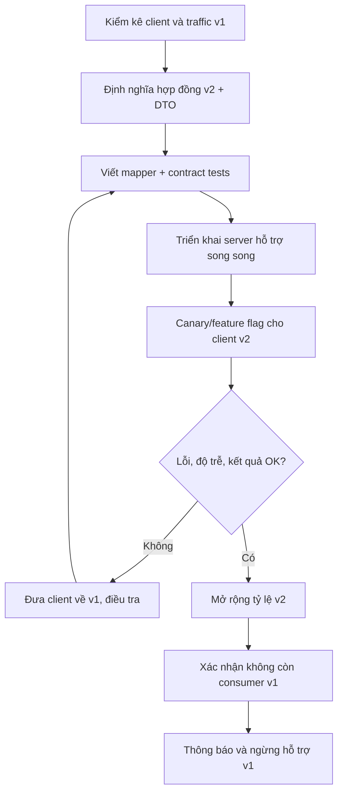

# Versioning endpoint từ xa

Trong chương **Remote procedure invocation** của module **SPRING_INTEGRATION_PATTERN**, ứng dụng thường gọi một dịch vụ khác qua HTTP, TCP, JMS, AMQP hoặc giao thức tích hợp tương tự. Spring Integration giúp tách phần gọi nghiệp vụ khỏi hệ thống từ xa bằng **Messaging Gateway**, **Message Channel**, **Transformer**, **Router** và các **remote gateway/adapter**. Tuy nhiên, ranh giới này vẫn phải xử lý một thực tế: **hợp đồng của endpoint từ xa thay đổi theo thời gian**.

**Versioning endpoint từ xa** là cách định nghĩa, công bố, lựa chọn và duy trì các phiên bản hợp đồng giao tiếp để client và server có thể nâng cấp theo những thời điểm khác nhau. Mục tiêu là tiếp tục chuyển đúng request, nhận đúng reply và xử lý lỗi có kiểm soát khi v1 và v2 cùng tồn tại hoặc khi một phiên bản chuẩn bị ngừng hỗ trợ.

Sau bài này, bạn có thể:

- Phân biệt phiên bản endpoint/API, phiên bản schema message và phiên bản thư viện ứng dụng.
- Nhận diện thay đổi tương thích và thay đổi phá vỡ hợp đồng trong request-reply.
- Sử dụng Gateway, Router, Transformer và remote adapter để tích hợp nhiều phiên bản.
- Lập kế hoạch chuyển từ v1 sang v2 có kiểm thử, quan sát, rollback và thời hạn ngừng phiên bản cũ.
- Thiết kế timeout, retry, correlation, xử lý lỗi và idempotency phù hợp khi nhiều phiên bản cùng chạy.

## 1. Vì sao phiên bản endpoint quan trọng với Remote Procedure Invocation?

Giả sử dịch vụ báo giá ban đầu cung cấp:

```http
POST /v1/quotes
Content-Type: application/json

{"sku":"SKU-10","quantity":2}
```

Reply v1:

```json
{
  "sku": "SKU-10",
  "total": "250000"
}
```

Sau đó, đội sở hữu dịch vụ bổ sung nhiều loại tiền, mã báo giá và chuyển `total` sang dạng số thập phân:

```http
POST /v2/quotes
Content-Type: application/json

{"sku":"SKU-10","quantity":2}
```

Reply v2:

```json
{
  "quoteId": "Q-2026-001",
  "sku": "SKU-10",
  "totalAmount": 250000.00,
  "currency": "VND"
}
```

Nếu flow nội bộ hiện đang deserialize v1 vào `QuoteV1Response(String sku, String total)`, việc đổi thẳng URL sang `/v2/quotes` có thể gây mất dữ liệu, lỗi chuyển đổi hoặc tính toán sai. Endpoint vẫn trả HTTP 200, nhưng **nghĩa và cấu trúc của reply đã thay đổi**.

Versioning cho phép hai hệ thống nâng cấp độc lập trong một khoảng thời gian: ứng dụng cũ tiếp tục dùng v1, ứng dụng đã chuẩn bị có thể chuyển sang v2, và đội phát triển xác định rõ khi nào được loại bỏ v1.

## 2. Ba loại phiên bản không nên nhầm lẫn

| Loại phiên bản | Ví dụ | Phạm vi tác động |
| --- | --- | --- |
| **Phiên bản API/endpoint** | `/v1/quotes`, `/v2/quotes` | Hợp đồng công khai giữa client và remote service: đường gọi, payload, mã lỗi và ngữ nghĩa |
| **Phiên bản schema/envelope** | Header `schemaVersion=2`, event `QuoteCreatedV2` | Biểu diễn dữ liệu được gửi qua HTTP/broker; có thể khác phiên bản đường dẫn |
| **Phiên bản thư viện/framework** | Phiên bản Spring Integration, Jackson, HTTP client | API Java và cơ chế chuyển đổi bên trong ứng dụng; không quyết định tự động phiên bản API từ xa |

Một client sử dụng Spring Integration phiên bản mới vẫn có thể gọi `/v1/quotes`. Ngược lại, client chạy trên stack cũ vẫn có thể gọi API v2 nếu adapter và hợp đồng dữ liệu tương thích.

Không nên gắn `schemaVersion` một cách tùy tiện cho mọi message nội bộ. Chỉ cần version tường minh ở các ranh giới mà hai bên có thể nâng cấp độc lập hoặc phải đọc lại dữ liệu đã lưu.

## 3. Những thay đổi nào phá vỡ hợp đồng?

Không có quy tắc chung rằng “thêm field luôn an toàn”: mức tương thích phụ thuộc cách client parse, validate, serialize và sử dụng trường đó.

| Thay đổi | Khả năng tương thích | Điều cần kiểm tra |
| --- | --- | --- |
| Thêm field tùy chọn trong reply | Thường tương thích nếu client bỏ qua field lạ | Deserializer có từ chối unknown property không? |
| Thêm field **bắt buộc** vào request | Thường phá vỡ client cũ | Server có giá trị mặc định hoặc thời kỳ chuyển tiếp không? |
| Đổi tên `total` thành `totalAmount` | Thường phá vỡ client v1 | Có alias hoặc mapper chuyển đổi ở boundary không? |
| Đổi kiểu `String` sang `number` | Có nguy cơ phá vỡ | Khả năng parse, độ chính xác số, format, null |
| Đổi đơn vị từ VND sang USD | Phá vỡ về **ngữ nghĩa** dù JSON giống nhau | Đơn vị, làm tròn, tỷ giá, điều kiện nghiệp vụ |
| Xóa field hoặc enum value | Có thể phá vỡ | Các nhánh xử lý đã bao phủ mọi giá trị chưa? |
| Đổi mã lỗi, retry behavior | Có thể phá vỡ cách caller ra quyết định | Client phân loại lỗi và retry theo trường nào? |
| Đổi quyền truy cập hoặc cách xác thực | Có thể phá vỡ toàn bộ kết nối | Header, credentials, policy, chứng chỉ |
| Thêm endpoint v2 song song | Có thể tương thích với v1 nếu v1 giữ nguyên | Vận hành đồng thời, giới hạn tải, thời hạn hỗ trợ |

Một thay đổi “tương thích” chỉ được xác nhận từ **tập client và dữ liệu thực tế**, không chỉ từ việc JSON hợp lệ.

## 4. Những cách biểu diễn phiên bản thường gặp

### 4.1. Version trong đường dẫn URL

```text
POST https://pricing.example.test/v1/quotes
POST https://pricing.example.test/v2/quotes
```

Dễ nhìn, dễ cấu hình cho HTTP outbound gateway và dễ vận hành nhiều phiên bản đồng thời. Nhược điểm: URL thay đổi khi nâng cấp; phải giữ tài liệu, route và hạn hỗ trợ tương ứng.

### 4.2. Version qua media type hoặc header

```http
POST /quotes
Accept: application/vnd.example.quote.v2+json
Content-Type: application/json
```

Đường dẫn ổn định, client yêu cầu biểu diễn v2 bằng HTTP content negotiation. Server phải thật sự hiểu media type đó; HTTP adapter cần cấu hình header mapper/message converter phù hợp. Header tùy biến như `X-API-Version: 2` cũng có thể được dùng nếu hai bên thống nhất.

**Lưu ý:** `Accept` biểu thị dạng phản hồi client chấp nhận; `Content-Type` biểu thị dạng request đã gửi. Không dùng hai header này thay thế nhau. Header nhận diện version do nhà cung cấp quy định không phải tính năng mặc định chung của mọi REST API.

### 4.3. Version trong envelope của message broker

```json
{
  "messageType": "QuoteRequest",
  "schemaVersion": 2,
  "requestId": "c31b623e-0177-4650-a8a1-05ece9acbdce",
  "payload": {
    "sku": "SKU-10",
    "quantity": 2
  }
}
```

JMS/AMQP/Kafka có thể mang metadata version trong header hoặc envelope được serialize. Consumer đọc version, chọn deserializer và mapper tương ứng. Việc chọn topic/queue theo version cũng là một lựa chọn nếu cần cô lập traffic, retention hoặc quyền truy cập.

Không giả định tên `schemaVersion` tự động được Spring Integration hiểu. Đây là **hợp đồng do hệ thống định nghĩa**; cần mã hóa, ánh xạ và kiểm thử với transport thực tế.

## 5. Tách hợp đồng nghiệp vụ của Gateway khỏi DTO bên ngoài

Khi client gọi API v1 hoặc v2, không nhất thiết phải cho phần còn lại của ứng dụng phụ thuộc vào hai DTO từ xa.



Định nghĩa **DTO nghiệp vụ ổn định**:

```java
package example.pricing;

import java.math.BigDecimal;

record QuoteQuery(String sku, int quantity) {}

record QuoteResult(
    String sku,
    BigDecimal amount,
    String currency,
    String quoteReference
) {}
```

Định nghĩa DTO dành riêng cho từng hợp đồng remote:

```java
package example.pricing;

import java.math.BigDecimal;

record QuoteV1Response(String sku, String total) {}

record QuoteV2Response(
    String quoteId,
    String sku,
    BigDecimal totalAmount,
    String currency
) {}
```

Hai DTO remote khác nhau nhưng đều có thể được chuyển thành `QuoteResult`. Ví dụ:

```java
package example.pricing;

import java.math.BigDecimal;

final class QuoteMapping {

    private QuoteMapping() {}

    static QuoteResult fromV1(QuoteV1Response response) {
        if (response == null || response.sku() == null ||
            response.total() == null) {
            throw new IllegalArgumentException("Reply v1 thiếu dữ liệu");
        }
        return new QuoteResult(
            response.sku(),
            new BigDecimal(response.total()),
            "VND",     // Chỉ hợp lệ nếu hợp đồng v1 quy định VND.
            null       // V1 không có mã báo giá.
        );
    }

    static QuoteResult fromV2(QuoteV2Response response) {
        if (response == null || response.sku() == null ||
            response.totalAmount() == null || response.currency() == null) {
            throw new IllegalArgumentException("Reply v2 thiếu dữ liệu");
        }
        return new QuoteResult(
            response.sku(),
            response.totalAmount(),
            response.currency(),
            response.quoteId()
        );
    }
}
```

Việc dùng `null` cho `quoteReference` chỉ là **lựa chọn minh họa khi field v2 chưa có trong v1**. Hợp đồng thật có thể dùng `Optional`, một trường trạng thái, hoặc bắt buộc chuyển mọi client sang v2 nếu mã báo giá là bắt buộc. Không tự gán giá trị mặc định cho tiền tệ, đơn vị hoặc trạng thái nếu dịch vụ nguồn chưa định nghĩa rõ.

Ưu điểm của lớp mapping: code nghiệp vụ sử dụng **một kiểu nhất quán**; nơi biết sự khác nhau giữa v1/v2 được giới hạn ở adapter boundary.

## 6. Triển khai bằng Messaging Gateway và HTTP outbound gateway

Ví dụ sau minh họa hai phương thức Java cho hai phiên bản remote đang tồn tại. Ở giai đoạn chuyển đổi, ta có thể gọi v1 hoặc v2 có chủ đích rồi trả cùng `QuoteResult` về phía caller.

### 6.1. Gateway khai báo rõ request channel

```java
package example.pricing;

import org.springframework.integration.annotation.Gateway;
import org.springframework.integration.annotation.MessagingGateway;

@MessagingGateway(defaultReplyTimeout = "5000")
interface QuoteGateway {

    @Gateway(requestChannel = "quote.v1.requests")
    QuoteResult quoteViaV1(QuoteQuery query);

    @Gateway(requestChannel = "quote.v2.requests")
    QuoteResult quoteViaV2(QuoteQuery query);
}
```

Trong bản triển khai cuối cùng, ứng dụng có thể giữ một method `quote(...)` và sử dụng Router hoặc cấu hình triển khai để chọn một version. Hai method ở đây có mục đích làm rõ phiên bản được gọi và giúp thử nghiệm so sánh.

### 6.2. Hai flow gọi hai HTTP endpoint

```java
package example.pricing;

import org.springframework.beans.factory.annotation.Value;
import org.springframework.context.annotation.Bean;
import org.springframework.context.annotation.Configuration;
import org.springframework.http.HttpMethod;
import org.springframework.http.MediaType;
import org.springframework.integration.annotation.IntegrationComponentScan;
import org.springframework.integration.config.EnableIntegration;
import org.springframework.integration.dsl.IntegrationFlow;
import org.springframework.integration.http.dsl.Http;
import org.springframework.messaging.MessageHeaders;

@Configuration
@EnableIntegration
@IntegrationComponentScan
class QuoteRemoteFlows {

    @Bean
    IntegrationFlow quoteV1Flow(
        @Value("${pricing.remote.base-url}") String baseUrl
    ) {
        return IntegrationFlow.from("quote.v1.requests")
            .enrichHeaders(headers -> headers.header(
                MessageHeaders.CONTENT_TYPE,
                MediaType.APPLICATION_JSON_VALUE
            ))
            .handle(Http.outboundGateway(baseUrl + "/v1/quotes")
                .httpMethod(HttpMethod.POST)
                .expectedResponseType(QuoteV1Response.class))
            .transform(QuoteV1Response.class, QuoteMapping::fromV1)
            .get();
    }

    @Bean
    IntegrationFlow quoteV2Flow(
        @Value("${pricing.remote.base-url}") String baseUrl
    ) {
        return IntegrationFlow.from("quote.v2.requests")
            .enrichHeaders(headers -> headers.header(
                MessageHeaders.CONTENT_TYPE,
                MediaType.APPLICATION_JSON_VALUE
            ))
            .handle(Http.outboundGateway(baseUrl + "/v2/quotes")
                .httpMethod(HttpMethod.POST)
                .expectedResponseType(QuoteV2Response.class))
            .transform(QuoteV2Response.class, QuoteMapping::fromV2)
            .get();
    }
}
```

Điều kiện để chạy ví dụ: ứng dụng có các dependency Spring Integration HTTP, HTTP JSON message converter (chẳng hạn Jackson), Spring context và các `record` phía trên; cấu hình `pricing.remote.base-url` phải trỏ tới dịch vụ phù hợp. Cú pháp/khả năng converter thực tế cần được đối chiếu với phiên bản Spring Integration và HTTP client đang dùng.

Đường đi cho từng method:

1. Gateway tạo request message và gửi vào channel v1 hoặc v2.
2. HTTP outbound gateway gửi request qua URL tương ứng.
3. Response JSON được deserialize thành `QuoteV1Response` hoặc `QuoteV2Response`.
4. Transformer chuẩn hóa thành `QuoteResult`.
5. Gateway nhận reply tương ứng với lời gọi và trả về cùng kiểu `QuoteResult`.

Nếu server v2 không hỗ trợ `POST /v2/quotes`, điều đó là lỗi hợp đồng/triển khai; không nên tự động thử URL khác mà chưa có chính sách fallback rõ ràng.

### 6.3. Chọn version bằng Router khi phù hợp

Khi cần **một method Gateway** duy nhất, ứng dụng có thể gắn header `targetApiVersion` bằng cấu hình triển khai hoặc một thành phần điều phối, rồi dùng Router tách vào `quote.v1.requests` và `quote.v2.requests`. Ví dụ sơ đồ:

```text
quote.requests
    |
    v
route by targetApiVersion
    | "1"                 | "2"
    v                     v
quote.v1.requests      quote.v2.requests
    |                     |
 HTTP /v1               HTTP /v2
    |                     |
QuoteV1Response        QuoteV2Response
    |                     |
Mapper V1              Mapper V2
    +------> QuoteResult <-+
                  |
                  v
             Reply Gateway
```

Nguyên tắc: version để chọn endpoint nên xuất phát từ **chính sách client/triển khai đáng tin cậy**, ví dụ feature flag, tenant mapping hoặc cấu hình rollout. Không cho một header từ client không đáng tin cậy tùy ý trỏ sang URL bất kỳ. Route phải có nhánh xử lý version không được hỗ trợ; tránh ngầm gửi về v1 khi version không hợp lệ.

Nếu v1/v2 khác nhau cả request schema, cần thêm một Transformer **trước** mỗi outbound gateway để tạo đúng request DTO phiên bản đó. Đừng chỉ chuẩn hóa reply rồi bỏ qua sự khác nhau của request.

## 7. Khả năng tương thích theo hai hướng

Khi hai phiên bản cùng tồn tại, ít nhất cần xét hai chiều:

- **Client cũ → Server mới:** server mới vẫn xử lý được request cũ và trả reply mà client cũ hiểu?
- **Client mới → Server cũ:** nếu phải rollback hoặc gặp một instance chưa nâng cấp, request của client mới có tương thích với server cũ?

Ví dụ:

| | Server chỉ v1 | Server hỗ trợ v1 và v2 | Server chỉ v2 |
| --- | --- | --- | --- |
| Client chỉ v1 | Hợp lệ | Hợp lệ nếu v1 giữ nguyên | Thất bại nếu không có lớp tương thích |
| Client hỗ trợ v1 và v2 | Chọn v1 | Có thể thử v2 theo chính sách rollout | Chọn v2 |
| Client chỉ v2 | Thất bại nếu không có lớp tương thích | Hợp lệ | Hợp lệ |

Chính sách versioning cần được mô tả bằng **ma trận hỗ trợ cụ thể**, gồm endpoint, request schema, response schema, mã lỗi, cơ chế xác thực và thời gian kết thúc hỗ trợ. Việc “server có route v2” chưa đủ để kết luận client v2 hoạt động: có thể còn thiếu converter, quyền truy cập hoặc thông tin nghiệp vụ.

### Thay đổi schema không đồng nghĩa thay đổi ngữ nghĩa

Một mapper có thể đổi tên `total` thành `totalAmount`, nhưng nếu v2 còn đổi cách tính chiết khấu, thuế hoặc đơn vị tiền thì phép đổi tên chưa đủ. Định nghĩa một bài test với kỳ vọng nghiệp vụ cụ thể để bảo đảm `QuoteResult` từ v1/v2 mang cùng ý nghĩa ở những trường mà ứng dụng sử dụng.

## 8. Chuyển đổi và ngừng hỗ trợ một phiên bản

Nâng cấp endpoint nên là một chuỗi bước kiểm chứng được:



1. **Kiểm kê:** xác định client, consumer, request volume, mã lỗi và endpoint đang gọi v1.
2. **Định nghĩa contract v2:** chỉ rõ field thay đổi, validation, status code, content type, deadline và chính sách deprecation.
3. **Tạo mapping và kiểm thử hợp đồng:** chuẩn hóa cả request/reply, xác minh tính đúng của dữ liệu.
4. **Triển khai server trước:** vận hành v1/v2 song song nếu có thể, tránh bắt client nâng cấp cùng thời điểm.
5. **Canary client:** chuyển một nhóm traffic nhỏ theo tenant, instance hoặc feature flag; đo error rate, latency và sai lệch kết quả nghiệp vụ.
6. **Mở rộng có điều kiện:** tăng tỉ lệ traffic v2 khi kết quả đạt ngưỡng đã thống nhất; duy trì lựa chọn rollback trong giai đoạn chuyển tiếp.
7. **Ngừng v1:** chỉ xóa flow/endpoint v1 sau khi xác nhận không còn client cần v1 và đã qua thời hạn thông báo.

Trong canary, **so sánh shadow response** có thể hữu ích với thao tác đọc. Với thao tác ghi như tạo đơn/thu tiền, không được gọi v1 và v2 song song một cách mù quáng vì có thể tạo **hai tác động nghiệp vụ**. Nếu cần shadow traffic cho command, phải có môi trường mô phỏng, dry-run hoặc idempotency được thiết kế và kiểm chứng.

Rollback chỉ an toàn nếu v1 vẫn đáp ứng các dữ liệu mới phát sinh. Khi v2 bổ sung trạng thái/ngữ nghĩa không biểu diễn được trong v1, cần có kế hoạch rollback dữ liệu hoặc giới hạn chức năng trong giai đoạn chuyển đổi.

## 9. Timeout, retry, correlation khi chạy nhiều version

Versioning thường xuất hiện cùng retry, nhưng hai nhiệm vụ này cần tách riêng:

**Retry:** gửi lại *cùng yêu cầu* do lỗi tạm thời (timeout, một số lỗi 5xx) theo giới hạn và backoff.

**Version fallback:** chuyển sang *hợp đồng khác* do chính sách tương thích đã định nghĩa. Đây là thay đổi hành vi của integration flow, có thể ảnh hưởng schema và ngữ nghĩa. Không nên coi mọi 404, 406 hoặc lỗi chuyển đổi đều là tín hiệu có thể tự chuyển từ v2 về v1.

| Tình huống | Ứng xử được khuyến nghị |
| --- | --- |
| V2 trả 200 đúng schema | Chuyển sang `QuoteResult`, hoàn tất lời gọi |
| V2 trả 404 do endpoint chưa triển khai | Xem lại rollout/cấu hình; chỉ fallback v1 nếu chính sách có khai báo |
| V2 trả 406 / 415 | Kiểm tra `Accept`/`Content-Type`, media type và converter |
| V2 trả 400 do thiếu field bắt buộc | Sửa mapping request; retry y nguyên thường không giải quyết |
| V2 trả 429 / 503 | Có thể retry có giới hạn khi server và nghiệp vụ cho phép, tôn trọng `Retry-After` nếu được cung cấp |
| Timeout sau khi gửi command | Không biết chắc remote đã xử lý chưa; cần idempotency hoặc truy vấn trạng thái |
| Reply từ v1/v2 khác kiểu | Cần map về DTO chung hoặc báo lỗi version/schema rõ ràng |
| Reply tới sai người gọi | Kiểm tra correlation/reply channel; version không thay thế khóa tương quan |

Đối với HTTP request-response, lời gọi HTTP gắn response với request trên client. Với JMS/AMQP request-reply, reply có thể đến qua queue khác và cần khóa tương quan theo hợp đồng transport. Trong cả hai trường hợp, một `requestId` ổn định giúp log và đối chiếu attempt. Nếu hệ thống đang nâng cấp từ v1 lên v2 giữa các attempt, không được tái gửi command sang phiên bản khác khi chưa chắc cùng một `requestId` và cùng ngữ nghĩa idempotency được cả hai phiên bản chấp nhận.

Một lời gọi Gateway có `defaultReplyTimeout` không tự đặt timeout cho mọi kết nối HTTP/broker phía dưới. Cấu hình connect/response timeout, retry deadline và thời gian chờ reply theo từng tầng; đo tail latency của cả v1 và v2 để không làm trầm trọng thêm tình trạng quá tải khi rollout.

## 10. Quản lý lỗi và khả năng quan sát theo phiên bản

Để chẩn đoán vấn đề trong giai đoạn có nhiều version, nên log/đo ít nhất:

| Dữ liệu | Mục đích |
| --- | --- |
| `targetApiVersion` / version endpoint | Phân biệt request v1 và v2 |
| Tên remote operation | Tìm đúng chức năng bị ảnh hưởng |
| `requestId` và `traceId` (nếu có) | Nối các bước trong flow và hệ thống khác |
| Kiểu request/reply, schema version | Phát hiện converter/DTO không tương thích |
| HTTP status / transport error | Phân loại lỗi endpoint, xác thực, timeout |
| Latency, timeout, retry count | Kiểm tra khả năng đáp ứng và hiệu ứng retry |
| Tỉ lệ fallback, số client v1 còn hoạt động | Đo tiến độ migration và thời điểm có thể deprecate |

Ví dụ một log sự kiện đã lược dữ liệu nhạy cảm:

```text
requestId=REQ-789
operation=quote
targetApiVersion=2
endpoint=POST /v2/quotes
replyType=QuoteV2Response
result=MAPPING_FAILED
durationMs=186
```

Không ghi access token, dữ liệu khách hàng, số thẻ hoặc toàn bộ body chỉ để xác định version. Nếu dùng tracing, phải cấu hình propagation qua HTTP/broker; các header của Spring Message không mặc nhiên được phép chuyển nguyên vẹn sang mạng.

Khi dùng `errorChannel`, cần bảo đảm lỗi converter, lỗi gọi remote và lỗi Router không bị biến thành reply nghiệp vụ hợp lệ. Với flow đồng bộ, exception có thể quay về caller; với flow bất đồng bộ cần một đường lỗi có người nhận, có correlation và cơ chế dọn trạng thái chờ.

## 11. Kiểm thử contract và triển khai nhiều phiên bản

Để xác minh một thay đổi version, cần kiểm thử **đúng biên remote**, không chỉ chạy unit test cho mapper.

| Kiểm thử | Dữ liệu thử | Kỳ vọng |
| --- | --- | --- |
| Gateway v1 | Remote mock trả JSON v1 | `QuoteResult` có số tiền đúng, currency đúng hợp đồng v1 |
| Gateway v2 | Remote mock trả JSON v2 | `QuoteResult` lấy đủ amount, currency, quoteReference |
| Unknown field | V2 thêm một field tùy chọn | Converter xử lý theo policy đã công bố |
| Required field missing | Thiếu `currency` hoặc `totalAmount` | Phát hiện lỗi, không trả thành công giả |
| Invalid number | V1 trả `total: "abc"` | Converter/mapper báo lỗi có kiểm soát |
| Endpoint not found | `/v2/quotes` trả 404 | Chính sách lỗi/fallback đúng, không retry vô hạn |
| Status/error change | V2 trả 400/429/503 | Phân loại retry và mapping lỗi đúng |
| Timeout + retry | Response chậm, thử lại có giới hạn | Không treo; deadline và idempotency được tuân thủ |
| Mixed traffic | Gọi v1 và v2 đồng thời | Cùng hợp đồng caller; không nhầm reply |
| Rollback | V2 lỗi, route trở lại v1 | Hoạt động trong giới hạn dữ liệu v1 còn hỗ trợ |

Ví dụ pseudocode kiểm thử contract cấp ứng dụng:

```text
Given:
  stub POST /v1/quotes -> 200 {"sku":"SKU-10","total":"250000"}
  stub POST /v2/quotes -> 200
    {"quoteId":"Q-2026-001","sku":"SKU-10",
     "totalAmount":250000.00,"currency":"VND"}
When:
  QuoteResult oldReply = gateway.quoteViaV1(query)
  QuoteResult newReply = gateway.quoteViaV2(query)
Then:
  oldReply.amount == newReply.amount == 250000
  oldReply.currency == newReply.currency == "VND"
  oldReply.quoteReference == null
  newReply.quoteReference == "Q-2026-001"
  each HTTP endpoint receives exactly its expected request
```

Test trên giả định nghiệp vụ v1 có currency VND và mã báo giá chỉ được thêm ở v2. Trong hệ thống thực, trường nào cần bằng nhau phải dựa trên quy tắc nghiệp vụ đã xác nhận. Có thể dùng stub HTTP (WireMock/MockWebServer) hoặc test container/broker tùy giao thức để kiểm tra request thật, header và converter.

Ở phía server, nên có **consumer-driven contract tests** hoặc bộ schema fixtures được chia sẻ qua quy trình phát hành. Đối với JSON Schema/Avro/Protobuf, có thể kiểm tra mức tương thích bằng registry hoặc công cụ tương ứng nếu tổ chức đang sử dụng; không nên mặc định một serializer tự bảo vệ mọi thay đổi ngữ nghĩa.

## 12. Các lỗi triển khai thường gặp

- **Đổi URL sang v2 rồi giữ nguyên DTO v1:** response có thể parse lỗi hoặc, nguy hiểm hơn, parse thành giá trị thiếu mà không báo.
- **Thêm version vào URL nhưng không version hợp đồng:** các field, mã lỗi hoặc định nghĩa nghiệp vụ vẫn thay đổi ngoài ý muốn.
- **Cho caller biết mọi DTO v1/v2:** mỗi nơi phải xử lý schema khác nhau, làm tăng coupling và rủi ro trong migration.
- **Dùng fallback không giới hạn:** có thể che lỗi triển khai v2, gây traffic bất thường tới v1 hoặc thực hiện lại command.
- **Đổi version giữa các lần retry của command:** có thể tạo hai tác động nếu idempotency không được chia sẻ giữa phiên bản.
- **Không kiểm thử client cũ:** v2 đã chạy nhưng client còn dùng v1 bị ngắt khi route/serializer cũ bị xóa.
- **Xóa v1 theo lịch mà không đo consumer:** các job nền/đối tác ít hoạt động có thể chỉ phát sinh request sau nhiều ngày.
- **Đồng nhất HTTP status với lỗi nghiệp vụ:** trạng thái HTTP và JSON body có thể thay đổi độc lập; cần tài liệu ánh xạ lỗi.
- **Không kiểm tra ngữ nghĩa tiền tệ và đơn vị:** JSON parse được nhưng giá trị có thể sai về mặt nghiệp vụ.

## 13. Checklist trước khi chuyển traffic sang endpoint mới

1. Ghi rõ `v1 -> v2` thay đổi **URL, method, headers, request schema, response schema, mã lỗi và ngữ nghĩa** nào.
2. Xác định bên quản lý version, thời gian song song, mốc thông báo ngừng hỗ trợ và danh sách consumer.
3. Tách DTO bên ngoài khỏi kiểu trả về nghiệp vụ của Messaging Gateway.
4. Cấu hình outbound gateway cho từng version và mapping request/reply có validation.
5. Xác định chính sách chọn version và hành vi khi version không được hỗ trợ.
6. Thiết kế timeout, retry, correlation và idempotency cho mỗi loại thao tác.
7. Kiểm thử hợp đồng cho cả v1/v2, bao gồm schema lỗi, concurrency và rollback.
8. Triển khai server và client theo thứ tự an toàn; canary trước khi mở rộng.
9. Quan sát lượng traffic v1/v2, tỉ lệ lỗi, thời gian phản hồi và các lần fallback.
10. Chỉ retire v1 sau khi xác minh consumer đã chuyển đổi và mọi dữ liệu cần rollback vẫn được xử lý.

## Kết luận

Versioning endpoint từ xa là một phần của **thiết kế hợp đồng tích hợp**, không đơn thuần là thêm `/v2` vào URL. Trong Spring Integration, **Messaging Gateway** giúp giữ giao diện nghiệp vụ ổn định; **remote gateway/adapter** thực hiện kết nối và **Router/Transformer** xử lý lựa chọn phiên bản cùng khác biệt dữ liệu. Khi nâng cấp, cần bảo đảm tương thích của request/reply, kiểm thử các kịch bản lỗi, quan sát traffic thực tế, kiểm soát timeout và retry, đồng thời có kế hoạch rollout, rollback và ngừng hỗ trợ phiên bản cũ rõ ràng.
