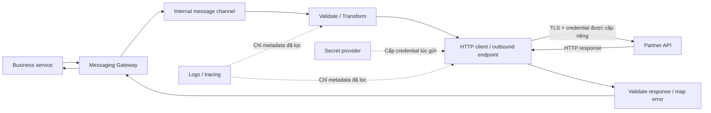
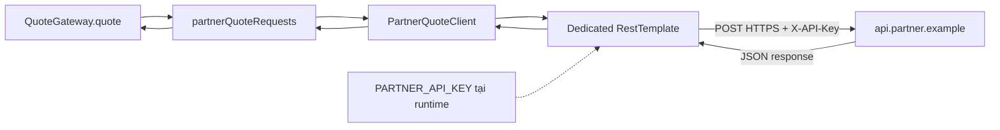
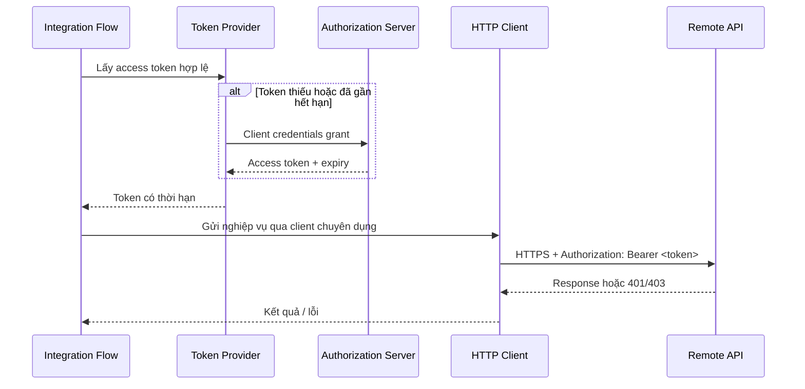
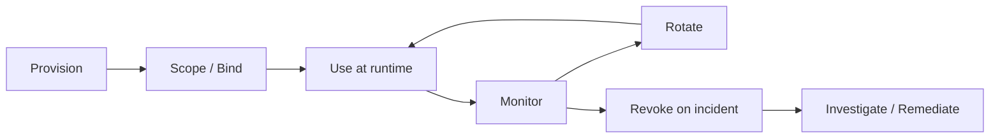

# Bảo vệ dữ liệu và credential khi Remote Procedure Invocation qua Spring Integration

## 1. Bối cảnh: vì sao Remote Procedure Invocation cần kiểm soát bảo mật?

Một integration flow thường nhận yêu cầu từ ứng dụng nghiệp vụ, chuyển đổi payload rồi gọi API của một dịch vụ khác. Lời gọi ấy có thể trông như gọi phương thức Java, nhưng thực chất đã đi qua mạng và nhiều ranh giới tin cậy.

Ví dụ: hệ thống bán hàng gọi dịch vụ báo giá của đối tác. Request chứa mã sản phẩm, số lượng và có thể chứa mã khách hàng; kết nối dùng API key, access token hoặc chứng thư client để xác thực. Nếu log toàn bộ message, chuyển tiếp header sai hoặc gửi request tới địa chỉ không được kiểm soát, cả dữ liệu lẫn credential có thể bị lộ.

Trong chương **Remote procedure invocation**, chủ đề **Bảo vệ dữ liệu và credential** tập trung vào việc giữ an toàn cho:

- **Dữ liệu nghiệp vụ:** thông tin khách hàng, đơn hàng, số tiền, mã định danh và các trường nhạy cảm.
- **Credential:** API key, OAuth2 access token, mật khẩu, private key và certificate dùng xác thực.
- **Metadata:** header, correlation ID, trace context và thông tin lỗi có thể tiết lộ hệ thống nội bộ.
- **Kết quả RPC:** response phải được nhận từ đích đáng tin cậy, đúng schema và gửi về đúng caller.

Bài học thuộc module **SPRING_INTEGRATION_PATTERN**, sử dụng các Enterprise Integration Patterns trong Spring Integration để thiết kế luồng thông điệp ít phụ thuộc, dễ mở rộng. Những cơ chế Gateway, Router, Filter, Transformer, Splitter, Aggregator, retry, error channel và correlation sẽ được nhìn từ góc độ bảo mật.

Sau bài này, bạn sẽ có thể thiết kế một luồng gọi API có xác thực, giảm lượng dữ liệu bị lộ qua message và log, quản lý credential trong runtime, xác định biên truyền header và viết kiểm thử bảo mật cho integration flow.

## 2. Xác định ranh giới tin cậy trước khi viết flow

Một ứng dụng có thể tin các bean nội bộ, nhưng không nên mặc nhiên coi mọi thông điệp, endpoint hoặc response từ mạng là đáng tin cậy.



Trong sơ đồ:

1. Mã nghiệp vụ gọi **Messaging Gateway** để tránh phụ thuộc vào giao thức của đối tác.
2. Flow thực hiện validation và mapping trước khi gửi ra ngoài.
3. HTTP client bổ sung credential **ở ranh giới outbound**.
4. Dịch vụ đối tác chỉ nhận trường dữ liệu và header được cho phép.
5. Response được kiểm tra, chuyển thành giá trị hoặc lỗi thích hợp.
6. Log và tracing được lọc ở mọi điểm có thể ghi thông điệp.

**Nguyên tắc:** credential thuộc về kênh giao tiếp và danh tính của ứng dụng gọi. Trừ khi hợp đồng tích hợp quy định rõ, không đặt credential vào payload nghiệp vụ hoặc phổ biến credential như một Spring Integration message header dùng chung.

### Phân loại tài sản và các mối đe dọa

| Tài sản | Rủi ro | Biện pháp trọng tâm |
|---|---|---|
| Payload chứa dữ liệu khách hàng | Rò rỉ trên đường truyền, log hoặc hệ thống trung gian | TLS, tối thiểu hóa dữ liệu, redaction, kiểm soát lưu trữ |
| API key / access token | Bị đánh cắp, dùng sai dịch vụ, giữ quá lâu | Secret store, scope tối thiểu, vòng đời ngắn, rotation |
| Private key / certificate | Bị sao chép hoặc cấu hình sai | Kho khóa được bảo vệ, phân quyền file, mTLS, rotation |
| URL đích RPC | SSRF, gọi nhầm host, chuyển credential tới host lạ | Endpoint allowlist, kiểm soát redirect, egress policy |
| Header nội bộ | Rò rỉ reply channel, thông tin topology, trace | Chỉ ánh xạ header được phép |
| Response từ hệ thống ngoài | Dữ liệu độc hại, sai schema, kích thước bất thường | Parse có kiểm soát, validation, giới hạn kích thước |
| Log / error channel | Lưu token, dữ liệu nhạy cảm hoặc stack trace | Redaction, truy cập theo vai trò, retention ngắn |
| Retry | Gửi lặp thao tác có tác dụng phụ | Idempotency key, retry có điều kiện và deadline |

## 3. Bảo vệ dữ liệu đang truyền qua mạng

### 3.1. Chỉ gọi qua HTTPS/TLS đã xác minh

Với RPC qua HTTP, ưu tiên **HTTPS**. HTTP client phải xác minh chuỗi chứng thư của server và hostname; không vô hiệu hóa TLS verification để xử lý lỗi certificate.

Một kết nối an toàn cần:

- Dùng tên host đã được phê duyệt, ví dụ `api.partner.example`.
- Tin cậy CA phù hợp và kiểm tra hostname.
- Cấu hình TLS phiên bản, cipher và trust store theo chính sách nền tảng.
- Hạn chế redirect, đặc biệt redirect sang một host khác khi request mang credential.
- Có quy trình cập nhật trust store và certificate trước khi hết hạn.

**Sai lầm nghiêm trọng:** tạo `TrustManager` chấp nhận mọi certificate hoặc tắt hostname verification trong production. Cách này làm mất ý nghĩa của TLS và mở đường cho tấn công giả mạo endpoint.

### 3.2. Kiểm soát URL đích và nguy cơ SSRF

Đừng lấy URL gọi outbound trực tiếp từ payload do người dùng đưa vào rồi ghép với access token của hệ thống. Nếu attacker khiến flow gọi `http://127.0.0.1/...` hoặc metadata endpoint nội bộ, ứng dụng có thể bị lợi dụng để truy cập tài nguyên vốn không mở ra Internet.

Cần:

1. Cấu hình URL đích bằng cấu hình đáng tin cậy, hoặc sử dụng tập host đã được phép.
2. Kiểm tra scheme phải là `https`, hostname và port hợp lệ.
3. Có egress policy tại mạng/container để chỉ được kết nối các đích cần thiết.
4. Kiểm soát DNS và redirect vì kiểm tra chuỗi hostname đơn thuần chưa giải quyết mọi dạng SSRF.
5. Chỉ thêm credential khi destination đã qua kiểm tra.

Một Router có thể chọn giữa nhiều đối tác, nhưng mỗi nhánh nên dùng **client và credential riêng**. Không dùng chung một RestTemplate luôn gắn token của đối tác A rồi gửi đến đối tác B.

### 3.3. Chỉ truyền dữ liệu cần thiết

Nếu endpoint báo giá chỉ cần `sku` và `quantity`, đừng gửi thêm địa chỉ giao hàng, email hoặc thông tin thanh toán chỉ vì DTO của ứng dụng nội bộ chứa các trường đó.

Tốt hơn là dùng DTO riêng cho boundary:

```java
// DTO được gửi ra remote API.
public record PartnerQuoteRequest(
        String sku,
        int quantity
) {
}
```

```java
// DTO từ remote API.
import java.math.BigDecimal;

public record PartnerQuoteResponse(
        String sku,
        BigDecimal total
) {
}
```

Transformer trong flow có thể chuyển đối tượng nghiệp vụ đầy đủ thành `PartnerQuoteRequest` tối giản. Điều này giảm dữ liệu ra khỏi hệ thống, hạn chế phạm vi của credential được cấp và giúp contract thay đổi độc lập với domain model.

### 3.4. Bảo vệ dữ liệu lưu trữ và dữ liệu trong bộ nhớ

TLS chỉ bảo vệ dữ liệu khi truyền. Dữ liệu có thể còn xuất hiện trong:

- Log của ứng dụng hoặc reverse proxy.
- Message store, queue, dead-letter queue, audit event.
- Cache và response persistence.
- Bộ nhớ process, heap dump, crash dump.
- Artifact của CI/CD hoặc công cụ debug.

Hãy áp dụng quyền truy cập tối thiểu, mã hóa lưu trữ khi cần, retention phù hợp và hạn chế truy cập log/heap dump. Đối với dữ liệu đặc biệt nhạy cảm, xem xét tokenization, masking hoặc mã hóa ở tầng ứng dụng theo hợp đồng tích hợp.

## 4. Chọn cơ chế xác thực cho RPC

| Cơ chế | Mô tả | Khi phù hợp | Điểm cần chú ý |
|---|---|---|---|
| **API key** | Chuỗi bí mật định danh client hoặc ứng dụng | API đối tác đơn giản, hỗ trợ key theo tenant/app | Giữ trong secret store, rotation, chỉ gửi tới host đích |
| **OAuth2 client credentials** | Client lấy access token bằng danh tính ứng dụng | Service-to-service có authorization server | Scope, audience, thời hạn token, refresh/reacquire |
| **mTLS** | Hai phía xác thực bằng chứng thư trong TLS | Kết nối giữa dịch vụ yêu cầu xác thực mạnh | Bảo vệ private key, quản lý CA và vòng đời chứng thư |
| **HTTP Basic** | Gửi username/password được mã hóa Base64 trong header | Hệ thống cũ yêu cầu rõ ràng | Chỉ dùng qua TLS; Base64 không phải mã hóa an toàn |
| **Signed request / HMAC** | Ký nội dung theo thuật toán/hợp đồng API | API yêu cầu integrity và xác thực theo từng request | Timestamp, canonicalization, replay protection, key rotation |

Các cơ chế có thể phối hợp, ví dụ mTLS kết hợp OAuth2. Không thêm nhiều credential vào request khi không cần thiết; mỗi credential làm tăng bề mặt tấn công và nghĩa vụ quản lý.

### Quy tắc cấp quyền tối thiểu

Một flow **chỉ đọc báo giá** không nên dùng service account có quyền xóa đơn hàng hoặc quản trị tài khoản. Nếu gọi nhiều hệ thống, ưu tiên danh tính khác nhau cho từng hệ thống và môi trường.

Credential nên bị giới hạn theo:

- **Đối tượng sử dụng:** ứng dụng, workload hoặc tenant được phép.
- **Phạm vi thao tác:** scope/role/API permission tối thiểu.
- **Đích được phép:** audience và host hợp đồng.
- **Thời gian:** TTL hợp lý, rotation theo chính sách.
- **Môi trường:** development, staging và production dùng credential riêng.

## 5. Quản lý credential trong Spring Integration

### 5.1. Không ghi secret vào source code

Tránh cấu hình dạng:

```java
// KHÔNG sử dụng trong dự án thật.
String apiKey = "a-real-secret-value";
```

Không commit secret vào `application.yml`, file test thực, tài liệu nội bộ hay script CI. Nếu đã lộ credential trong Git hoặc log, việc xóa dòng mã **không đủ**: cần revoke/rotate secret và xử lý lịch sử hoặc bản sao theo quy trình bảo mật.

Đối với secret runtime, một số nguồn phù hợp gồm secret manager, Kubernetes Secret được bảo vệ bởi cơ chế quản lý khóa, workload identity hoặc biến môi trường được đưa vào một cách có kiểm soát. Biến môi trường dễ sử dụng nhưng vẫn có thể lộ qua dump/diagnostic hoặc quyền truy cập process; không xem chúng là kho bí mật tuyệt đối.

### 5.2. Đọc credential khi khởi động hoặc khi gửi request?

Có hai chiến lược:

- **Credential tĩnh được inject khi khởi động:** đơn giản cho API key; rotation thường cần nạp lại bean/ứng dụng.
- **Credential lấy động từ token provider:** phù hợp access token ngắn hạn, rotation không gián đoạn và hệ thống có authentication server.

Không lưu một access token ngắn hạn vào biến toàn cục rồi dùng mãi. Token provider cần biết hạn sử dụng, sai lệch đồng hồ, khả năng cấp lại và lỗi authentication server.

### 5.3. Đừng đặt credential vào message header nội bộ nếu không cần

Spring Integration có header `replyChannel`, `errorChannel`, `correlationId` cùng metadata ứng dụng. Nếu thêm `Authorization` hoặc `X-API-Key` vào mọi message, các thành phần như Wire Tap, logging handler, Splitter hoặc message store có thể tiếp cận credential.

Ưu tiên cách sau:

1. Flow tạo message chỉ chứa dữ liệu nghiệp vụ và metadata cần thiết.
2. HTTP client hoặc security component được cấu hình riêng cho remote endpoint.
3. Client gắn credential ngay trước khi request rời process.
4. Mapping outbound chỉ gửi header được allowlist.

Việc credential được gắn ở lớp HTTP client không loại bỏ hoàn toàn rủi ro bộ nhớ hay log HTTP, nhưng giảm số thành phần nội bộ phải tiếp xúc với nó.

## 6. Ví dụ thực hành: một flow gọi Partner API có API key

Ví dụ minh họa **Spring Boot 3.x, Spring Integration 6.x, Java 17+** và Spring Web. Vì chủ đề là bảo vệ dữ liệu và credential, ta dùng một `RestTemplate` **riêng cho đối tác**, thêm API key tại HTTP boundary, rồi gọi client này thông qua một Service Activator trong integration flow.

Cách tiếp cận này vẫn là **Remote Procedure Invocation qua Spring Integration**: Messaging Gateway biến lời gọi Java thành message, flow thực hiện remote HTTP request, kết quả được trả về qua cơ chế Request–Reply. Một HTTP outbound gateway của Spring Integration là lựa chọn khác; nguyên tắc bảo mật cho HTTP client và header mapping vẫn tương tự.

### 6.1. Sơ đồ lớp và thành phần



Credential không xuất hiện trong payload `PartnerQuoteRequest`, không đi qua `partnerQuoteRequests` và không trở thành header mặc định của mọi message.

### 6.2. Cấu hình không chứa secret

Ví dụ `application.properties` của ứng dụng client:

```properties
partner.api.url=https://api.partner.example/v1/quotes
```

Credential được cấp khi chạy ứng dụng qua environment variable `PARTNER_API_KEY` tương ứng với property `partner.api.key`. Không ghi giá trị của `PARTNER_API_KEY` vào file cấu hình này.

Địa chỉ `api.partner.example` là **tên minh họa**, không phải một API đang hoạt động. Khi triển khai thực tế, thay bằng hostname đã được phê duyệt và điều chỉnh allowlist tương ứng.

### 6.3. DTO chỉ có dữ liệu đối tác cần

```java
// PartnerQuoteRequest.java
package com.example.integration;

public record PartnerQuoteRequest(String sku, int quantity) {
}
```

```java
// PartnerQuoteResponse.java
package com.example.integration;

import java.math.BigDecimal;

public record PartnerQuoteResponse(String sku, BigDecimal total) {
}
```

### 6.4. Tạo RestTemplate riêng và gắn API key ở outbound boundary

```java
// PartnerHttpConfiguration.java
package com.example.integration;

import java.net.URI;
import java.time.Duration;

import org.springframework.beans.factory.annotation.Value;
import org.springframework.boot.web.client.RestTemplateBuilder;
import org.springframework.context.annotation.Bean;
import org.springframework.context.annotation.Configuration;
import org.springframework.web.client.RestTemplate;

@Configuration
public class PartnerHttpConfiguration {

    @Bean("partnerRestTemplate")
    public RestTemplate partnerRestTemplate(
            RestTemplateBuilder builder,
            @Value("${partner.api.key}") String apiKey) {

        if (apiKey == null || apiKey.isBlank()) {
            throw new IllegalStateException("Partner credential is missing");
        }

        return builder
                .setConnectTimeout(Duration.ofSeconds(2))
                .setReadTimeout(Duration.ofSeconds(3))
                .additionalInterceptors((request, body, execution) -> {
                    URI uri = request.getURI();

                    if (!"https".equalsIgnoreCase(uri.getScheme())
                            || !"api.partner.example".equalsIgnoreCase(
                                    uri.getHost())
                            || (uri.getPort() != -1 && uri.getPort() != 443)) {
                        throw new IllegalStateException(
                                "Outbound target is not allowed");
                    }

                    request.getHeaders().set("X-API-Key", apiKey);
                    return execution.execute(request, body);
                })
                .build();
    }
}
```

Giải thích:

- `@Value("${partner.api.key}")` lấy credential từ cấu hình runtime. Nếu không có, ứng dụng không thể tạo bean, tránh chạy trong trạng thái thiếu bảo vệ.
- `RestTemplate` này chỉ dành cho đối tác báo giá. Không tái sử dụng nó để gọi các dịch vụ khác.
- HTTP interceptor kiểm tra HTTPS, hostname và port **trước khi** thêm header `X-API-Key`.
- Connect/read timeout được đặt tại HTTP client. Gateway reply timeout là cấu hình khác.
- Không log `apiKey`, không đưa nó vào exception và không sao chép nó sang `MessageHeaders` của Spring Integration.

**Giới hạn của ví dụ:** allowlist trong interceptor là một lớp kiểm soát cơ bản; nếu HTTP client có thể tự động theo redirect, redirect phải được vô hiệu hóa hoặc kiểm soát riêng. Egress policy, DNS và proxy vẫn cần được cấu hình an toàn. Giá trị API key trong interceptor giữ đến khi bean/client được thay thế, nên rotation động cần cơ chế cung cấp credential khác.

### 6.5. Viết HTTP client nhận request và trả response

```java
// PartnerQuoteClient.java
package com.example.integration;

import java.net.URI;

import org.springframework.beans.factory.annotation.Qualifier;
import org.springframework.beans.factory.annotation.Value;
import org.springframework.http.HttpEntity;
import org.springframework.http.HttpMethod;
import org.springframework.http.ResponseEntity;
import org.springframework.stereotype.Component;
import org.springframework.web.client.RestTemplate;

@Component
public class PartnerQuoteClient {

    private final RestTemplate http;
    private final URI endpoint;

    public PartnerQuoteClient(
            @Qualifier("partnerRestTemplate") RestTemplate http,
            @Value("${partner.api.url}") String endpointUrl) {
        this.http = http;
        this.endpoint = URI.create(endpointUrl);
    }

    public PartnerQuoteResponse quote(PartnerQuoteRequest request) {
        if (request == null
                || request.sku() == null
                || request.sku().isBlank()
                || request.quantity() <= 0) {
            throw new IllegalArgumentException(
                    "Invalid partner quote request");
        }

        ResponseEntity<PartnerQuoteResponse> response = http.exchange(
                endpoint,
                HttpMethod.POST,
                new HttpEntity<>(request),
                PartnerQuoteResponse.class);

        if (response.getBody() == null) {
            throw new IllegalStateException(
                    "Partner returned an empty response");
        }

        return response.getBody();
    }
}
```

Nhận xét về lớp này:

- `PartnerQuoteRequest` có hai trường; client không gửi toàn bộ domain object.
- URL lấy từ cấu hình triển khai và không phụ thuộc input của caller.
- Phản hồi được deserialize về kiểu cụ thể; payload trả về vẫn cần validation nghiệp vụ nếu contract yêu cầu.
- Exception không chứa URL có query nhạy cảm, API key hay toàn bộ response body.
- Lỗi HTTP 4xx/5xx thông thường sẽ được HTTP client biểu diễn thành exception; nên ánh xạ chúng theo contract tại tầng thích hợp.

### 6.6. Bọc lời gọi từ xa trong IntegrationFlow

```java
// PartnerQuoteFlow.java
package com.example.integration;

import org.springframework.context.annotation.Bean;
import org.springframework.context.annotation.Configuration;
import org.springframework.integration.channel.DirectChannel;
import org.springframework.integration.config.EnableIntegration;
import org.springframework.integration.dsl.IntegrationFlow;
import org.springframework.messaging.MessageChannel;

@Configuration
@EnableIntegration
public class PartnerQuoteFlow {

    @Bean
    public MessageChannel partnerQuoteRequests() {
        return new DirectChannel();
    }

    @Bean
    public IntegrationFlow partnerQuoteIntegration(
            PartnerQuoteClient partnerClient) {
        return IntegrationFlow.from("partnerQuoteRequests")
                .handle(
                    PartnerQuoteRequest.class,
                    (request, headers) -> partnerClient.quote(request)
                )
                .get();
    }
}
```

Đây là một handler có ngữ nghĩa request–reply. Nó trả `PartnerQuoteResponse` để framework chuyển kết quả về nơi Messaging Gateway đang chờ. Vì request channel là `DirectChannel`, thao tác HTTP chạy đồng bộ trên đường thực thi của caller; điều này ảnh hưởng cách tính timeout tổng.

### 6.7. Khai báo Gateway cho ứng dụng nghiệp vụ

```java
// QuoteGateway.java
package com.example.integration;

import org.springframework.integration.annotation.MessagingGateway;

@MessagingGateway(
        defaultRequestChannel = "partnerQuoteRequests",
        defaultReplyTimeout = "5000"
)
public interface QuoteGateway {

    PartnerQuoteResponse quote(PartnerQuoteRequest request);
}
```

Để phát hiện interface Gateway khi khởi động, bật quét Integration Component:

```java
// DemoApplication.java
package com.example.integration;

import org.springframework.boot.SpringApplication;
import org.springframework.boot.autoconfigure.SpringBootApplication;
import org.springframework.integration.annotation.IntegrationComponentScan;

@SpringBootApplication
@IntegrationComponentScan
public class DemoApplication {

    public static void main(String[] args) {
        SpringApplication.run(DemoApplication.class, args);
    }
}
```

Ứng dụng cần các dependency tương thích gồm Spring Boot Starter Integration, Spring Boot Starter Web, Spring Integration core và công cụ kiểm thử khi chạy test. Cơ chế `@EnableIntegration` trong cấu hình flow kích hoạt hạ tầng Integration; Spring Boot cũng có auto-configuration cho Spring Integration khi dependency phù hợp.

### 6.8. Gọi Gateway

```java
PartnerQuoteResponse reply = quoteGateway.quote(
        new PartnerQuoteRequest("SKU-101", 2)
);

System.out.println(reply.total());
```

Từ góc nhìn caller, đây là phương thức Java. Ở phía dưới, flow chuyển request thành lời gọi HTTP có xác thực, nhận JSON response, đổi thành DTO và trả kết quả.

**Đừng dùng `System.out.println` để in toàn bộ request, token hoặc dữ liệu nhạy cảm** trong ứng dụng thật. Ví dụ chỉ in trường `total` để minh họa cách truy cập response.

## 7. Nếu dùng HTTP outbound gateway của Spring Integration thì sao?

Một cách khác là dùng component outbound gateway đã có trong Spring Integration:

```java
import org.springframework.context.annotation.Bean;
import org.springframework.http.HttpMethod;
import org.springframework.integration.dsl.IntegrationFlow;
import org.springframework.integration.http.dsl.Http;

@Bean
IntegrationFlow partnerHttpGatewayFlow() {
    return IntegrationFlow.from("partnerQuoteRequests")
            .handle(
                Http.outboundGateway(
                        "https://api.partner.example/v1/quotes")
                    .httpMethod(HttpMethod.POST)
                    .expectedResponseType(PartnerQuoteResponse.class)
            )
            .get();
}
```

Đây là **phương án thay thế** flow ở mục 6.6, không đăng ký đồng thời hai consumer khác nhau trên cùng `DirectChannel` trong ví dụ.

Trong triển khai thật, outbound gateway cần được cấu hình với HTTP client/RestTemplate có cơ chế authentication, timeout và TLS thích hợp. Cấu hình cụ thể phụ thuộc phiên bản Spring Integration và HTTP client mà dự án dùng.

**Cảnh báo về header:** nếu chọn cách chèn `Authorization` trực tiếp vào Spring Integration message trước outbound gateway, cần kiểm soát wire tap, log, message store và mapped request headers vì thông tin đó đã có mặt trong luồng nội bộ. Tốt hơn là bổ sung credential trong HTTP client tại ranh giới gửi request.

Đối với REST client, `Http.outboundGateway` phù hợp khi cần reply; HTTP outbound adapter thiên về gửi một chiều. Nếu phương thức Java cần trả response, phải thiết kế flow để tạo một reply kết thúc.

## 8. Dùng OAuth2 client credentials và token ngắn hạn

API key là ví dụ dễ hiểu, nhưng nhiều hệ thống service-to-service dùng **OAuth2 client credentials**. Một client được cấp danh tính ứng dụng, xác thực với authorization server rồi nhận access token có scope và lifetime giới hạn.



Để triển khai bằng Spring Security OAuth2 Client, có thể dùng `OAuth2AuthorizedClientManager` cho client registration chuyên biệt.

Ví dụ phần **lấy token**, giả định manager và client registration đã được cấu hình đúng theo Spring Security:

```java
import org.springframework.security.oauth2.client.OAuth2AuthorizeRequest;
import org.springframework.security.oauth2.client.OAuth2AuthorizedClient;
import org.springframework.security.oauth2.client.OAuth2AuthorizedClientManager;

public final class PartnerTokenProvider {

    private final OAuth2AuthorizedClientManager manager;

    public PartnerTokenProvider(OAuth2AuthorizedClientManager manager) {
        this.manager = manager;
    }

    public String accessToken() {
        OAuth2AuthorizeRequest request = OAuth2AuthorizeRequest
                .withClientRegistrationId("partner")
                .principal("integration-service")
                .build();

        OAuth2AuthorizedClient client = manager.authorize(request);

        if (client == null || client.getAccessToken() == null) {
            throw new IllegalStateException(
                    "Cannot obtain partner access token");
        }

        return client.getAccessToken().getTokenValue();
    }
}
```

Đây là **đoạn minh họa**, không phải một lớp cấu hình OAuth2 hoàn chỉnh. Cần định nghĩa client registration, token endpoint, phương thức xác thực client, scope và authorized-client provider thích hợp. Cơ chế cache/cấp lại token còn phụ thuộc manager và storage được cấu hình.

Sau đó HTTP interceptor của client chuyên dụng có thể sử dụng token provider:

```java
.additionalInterceptors((request, body, execution) -> {
    // Chỉ thực hiện sau khi xác minh scheme/host/port hợp lệ.
    request.getHeaders().setBearerAuth(tokenProvider.accessToken());
    return execution.execute(request, body);
})
```

Đừng ghi token vào log, đặt trong URI query string hoặc chuyển nó vào response. Nếu một request nhận HTTP 401, không retry vô hạn: kiểm tra nguyên nhân, cấu hình token/scope/audience và chính sách refresh. Với 403, thường cần sửa quyền hoặc scope, không phải cứ xin lại token.

### Token delegation và danh tính người dùng

Client credentials mang **danh tính của ứng dụng**, khác với token đại diện một người dùng. Không tự động truyền nguyên bearer token của người dùng từ request inbound sang mọi remote API.

Nếu nghiệp vụ cần ủy quyền thay mặt người dùng, cần một flow đã được thiết kế cho token exchange/on-behalf-of hoặc cơ chế delegation phù hợp. Token mang audience của dịch vụ A không nên được chuyển thẳng đến dịch vụ B nếu B không phải đối tượng được cấp quyền nhận token đó.

## 9. Header mapping: giữ metadata cần thiết, loại dữ liệu nhạy cảm

Spring Integration message headers có thể chứa những giá trị nội bộ như:

- `replyChannel`: đích nhận phản hồi nội bộ.
- `errorChannel`: kênh xử lý lỗi nội bộ.
- `correlationId` và thông tin sequence: phục vụ ghép message.
- Metadata ứng dụng như tenant, trace ID và custom attributes.

Không phải mọi header đều phù hợp với HTTP. Có những đối tượng không serialize được; có trường chứa dữ liệu nhạy cảm; có trường chỉ có nghĩa trong JVM hiện tại.

Một whitelist outbound có thể gồm:

| HTTP header được phép | Điều kiện |
|---|---|
| `Content-Type: application/json` | Dùng khi payload là JSON |
| `Accept: application/json` | Nếu hợp đồng response sử dụng JSON |
| `X-Request-Id` | Chỉ chứa ID không nhạy cảm, được xác thực/chuẩn hóa |
| `traceparent` | Khi hệ thống có chuẩn distributed tracing |
| `Idempotency-Key` | Khi server hỗ trợ chống thực thi trùng |
| `Authorization` hoặc `X-API-Key` | Được thêm tại HTTP boundary bởi security component được phép |

**Không chuyển nguyên** `replyChannel`, `errorChannel`, exception stack trace, session cookie, internal auth header hoặc tên máy/chương trình không cần thiết. Với tracing, cân nhắc rằng baggage hoặc correlation metadata cũng có thể chứa dữ liệu định danh.

### Inbound header cũng cần xử lý

Response header từ remote server không mặc nhiên đáng tin. Đừng lấy nguyên tất cả response header rồi chuyển vào message để những handler sau sử dụng làm quyết định bảo mật. Chỉ nhận các header đã được định nghĩa trong hợp đồng, ví dụ request ID do đối tác tạo hoặc mã giới hạn tốc độ.

## 10. Logging, Wire Tap và tracing không làm lộ secret

Một integration flow thường cần quan sát nhiều bước để tìm lỗi Router, Filter, Transformer hoặc HTTP gateway. Tuy nhiên, ghi toàn bộ `Message<?>` có thể đồng thời ghi payload và header credential.

### Ví dụ log nên tránh

```java
// Không dùng nếu message có thể mang dữ liệu nhạy cảm.
log.info("Outbound message: {}", message);
```

Các vị trí dễ vô tình ghi secret:

1. `LoggingHandler` hoặc Wire Tap in toàn bộ message.
2. HTTP client debug log in request/response headers.
3. Exception handler ghi body lỗi chứa thông tin nhạy cảm.
4. APM/tracing tự động thu thập HTTP headers hoặc query string.
5. Queue/DLQ lưu lại message không được redaction.
6. Unit test snapshot lưu credential test hoặc dữ liệu người dùng thật.

### Ví dụ log metadata có kiểm soát

```java
log.info(
    "Partner quote requestId={} operation={} durationMs={} outcome={}",
    requestId,
    "quote",
    durationMs,
    outcomeCode
);
```

Chỉ đưa vào log các giá trị được kiểm soát. Đừng mặc định rằng `requestId` hoặc mã khách hàng đều không nhạy cảm; xem xét cách tạo, nguồn đầu vào và quy tắc retention.

**Nên có danh sách redaction rõ ràng**, tối thiểu cho `Authorization`, `Proxy-Authorization`, `Cookie`, `Set-Cookie`, `X-API-Key`, `client_secret`, password và token trong payload. Cần kiểm tra cả giá trị trong URL query string và exception message.

### Tracing hữu ích mà không phơi lộ credential

Distributed tracing có thể theo dõi các span: Gateway → Transformer → HTTP client → remote API. Dùng ID để ghép các span, metric theo route/operation và latency, thay vì lưu toàn bộ payload. Không thêm thông tin khách hàng hoặc token vào `traceparent` và chỉ sử dụng baggage theo chính sách được phê duyệt.

## 11. Retry, error channel và ảnh hưởng tới bảo mật

Retry có thể vô tình biến một lỗi ngắn hạn thành nhiều request chứa cùng credential và dữ liệu nhạy cảm. Một flow tốt cần quy định loại lỗi nào cho phép retry và credential còn hợp lệ khi retry hay không.

| Trạng thái | Hướng xử lý |
|---|---|
| HTTP 400 | Sửa request; không retry cùng payload vô hạn |
| HTTP 401 | Kiểm tra credential hết hạn hoặc sai; cấp lại có kiểm soát nếu phù hợp |
| HTTP 403 | Kiểm tra scope/role/audience; không retry mù |
| HTTP 429 | Giảm tốc, tuân thủ retry policy/backoff |
| HTTP 502/503 | Có thể retry giới hạn nếu thao tác an toàn |
| Connect timeout | Xác định chính sách retry và endpoint |
| Read timeout | Không chắc remote server đã xử lý hay chưa |
| Schema response không hợp lệ | Ghi nhận contract error; không coi retry là giải pháp mặc định |

### Tác dụng phụ và idempotency

Nếu RPC tạo đơn hàng, thanh toán hoặc thay đổi dữ liệu, request có thể đã được server xử lý trước khi client mất kết nối. Retry bằng credential hợp lệ có thể tạo tác dụng phụ trùng.

Khi đối tác hỗ trợ, gửi một `Idempotency-Key` duy nhất cho **một thao tác nghiệp vụ**, giữ nguyên qua các lần thử của thao tác đó. Server cần thực thi chính sách chống trùng phù hợp. Token xác thực và idempotency key giải quyết **hai vấn đề khác nhau**: ai được phép gọi và request nào là cùng một thao tác.

### Error channel cũng phải bảo mật

Trong một flow bất đồng bộ, `ErrorMessage` có thể mang exception và failed message. Nếu gửi nguyên error message sang log/DLQ, thông tin nhạy cảm trong payload hoặc header có thể bị lưu lâu hơn dự kiến.

Cần kiểm soát:

- Ai được đọc error channel và DLQ.
- Payload nào được lưu và trong bao lâu.
- Header/exception nào bị redaction trước khi persist.
- Cách trả lỗi cho caller mà không lộ stack trace nội bộ.
- Khi nào cần cách ly sự kiện lỗi để điều tra, với quyền truy cập riêng.

## 12. Bảo vệ credential theo vòng đời

Một secret an toàn ở thời điểm cấp phát vẫn có thể bị lộ hoặc hết hạn sau đó. Cần một quy trình quản lý đầy đủ.



### 12.1. Provision

Cấp credential riêng cho workload và môi trường; không tái sử dụng API key production trong môi trường development hoặc test.

### 12.2. Lưu trữ và phân quyền

Dùng secret manager hoặc cơ chế phân phối bí mật phù hợp. Quyền truy cập phải chỉ cấp cho runtime/service account cần sử dụng. Tránh lưu giá trị trong artifact build, Git, email hoặc ticket.

### 12.3. Sử dụng

Chỉ lấy secret khi cần. Tránh xuất token vào log và response. Thiết lập bảo vệ dump nếu ứng dụng có khả năng ghi lại heap hoặc request diagnostics.

### 12.4. Rotation

Với API key, nếu nhà cung cấp hỗ trợ, dùng giai đoạn chồng lấn giữa key cũ và key mới để cập nhật an toàn. Với OAuth2, cấp lại token dựa trên expiry và cấu hình client. Với mTLS, thay certificate/private key trước khi hết hạn, đồng thời xác nhận trust chain mới.

### 12.5. Revoke và ứng phó sự cố

Nếu phát hiện token hoặc key lộ, cần revoke/rotate tại hệ thống cấp quyền, đánh giá phạm vi sử dụng bất thường và rà soát nơi secret đã được ghi. Chỉ sửa source code hoặc xóa log hiển thị là chưa đủ nếu token còn hiệu lực.

## 13. Test bảo mật cho integration flow

Ngoài kiểm thử nghiệp vụ, cần xác nhận credential chỉ xuất hiện ở đúng HTTP boundary và flow không làm rò rỉ dữ liệu.

### 13.1. Kiểm tra HTTP request bằng mock server

Với ví dụ ở mục 6, có thể kiểm thử mà không gọi mạng thật. Dùng `MockRestServiceServer` từ Spring Test, cung cấp giá trị credential **giả dùng riêng trong test**.

```java
// PartnerQuoteSecurityTest.java
package com.example.integration;

import static org.junit.jupiter.api.Assertions.assertEquals;
import static org.springframework.test.web.client.match.MockRestRequestMatchers.*;
import static org.springframework.test.web.client.response.MockRestResponseCreators.*;

import java.math.BigDecimal;

import org.junit.jupiter.api.Test;
import org.springframework.beans.factory.annotation.Autowired;
import org.springframework.beans.factory.annotation.Qualifier;
import org.springframework.boot.test.context.SpringBootTest;
import org.springframework.http.HttpMethod;
import org.springframework.http.MediaType;
import org.springframework.test.web.client.MockRestServiceServer;
import org.springframework.web.client.RestTemplate;

@SpringBootTest(properties = {
        "partner.api.key=TEST_ONLY_KEY",
        "partner.api.url=https://api.partner.example/v1/quotes"
})
class PartnerQuoteSecurityTest {

    @Autowired
    private QuoteGateway gateway;

    @Autowired
    @Qualifier("partnerRestTemplate")
    private RestTemplate restTemplate;

    @Test
    void attachesApiKeyOnlyAtApprovedOutboundRequest() {
        MockRestServiceServer server =
                MockRestServiceServer.bindTo(restTemplate).build();

        server.expect(
                    requestTo("https://api.partner.example/v1/quotes"))
                .andExpect(method(HttpMethod.POST))
                .andExpect(header("X-API-Key", "TEST_ONLY_KEY"))
                .andExpect(content().json(
                        "{\"sku\":\"SKU-101\",\"quantity\":2}"))
                .andRespond(withSuccess(
                        "{\"sku\":\"SKU-101\",\"total\":50.00}",
                        MediaType.APPLICATION_JSON));

        PartnerQuoteResponse reply = gateway.quote(
                new PartnerQuoteRequest("SKU-101", 2));

        assertEquals("SKU-101", reply.sku());
        assertEquals(new BigDecimal("50.00"), reply.total());

        server.verify();
    }
}
```

Bài kiểm thử xác nhận:

- Endpoint được gọi đúng URL và HTTP method.
- Payload chỉ chứa các trường của `PartnerQuoteRequest`.
- API key test xuất hiện trong HTTP request tới host được phép.
- JSON response được chuyển đổi và trả về Gateway.

Test này **chưa chứng minh đầy đủ** việc redaction trong log, redirect handling hoặc egress policy. Những phần đó cần các test và cấu hình riêng.

### 13.2. Các tình huống nên kiểm thử bổ sung

| Kiểm thử | Kỳ vọng |
|---|---|
| Không cấp API key | Ứng dụng fail fast hoặc từ chối gọi outbound theo thiết kế |
| URL dùng HTTP | Client từ chối gửi credential |
| URL trỏ tới hostname khác | Không phát HTTP request mang key |
| Server redirect sang host khác | Không làm lộ header xác thực |
| HTTP 401/403 | Error flow có kết quả đúng, không in token |
| Token hết hạn | Provider cấp lại đúng chính sách; không retry vô hạn |
| Service trả payload rất lớn | Bị chặn theo giới hạn được cấu hình |
| Response sai schema | Lỗi mapping được xử lý mà không log body nhạy cảm |
| Bật wire tap/log debug | Header/password/token được redaction |
| Retry POST sau read timeout | Không tạo tác dụng phụ trùng nhờ idempotency |
| Multi-tenant | Không dùng nhầm credential giữa tenant |
| Credential rotation | Client chuyển sang credential mới theo quy trình, không gián đoạn ngoài dự kiến |

### 13.3. Kiểm thử tránh đưa secret vào assertion failure

Một assertion in toàn bộ request khi thất bại có thể làm lộ header. Ưu tiên HTTP mock tool và test fixture chỉ chứa credential giả; không lấy secret thực từ production để chạy CI.

Cấu hình CI cũng cần hạn chế lưu request dump, screenshot, artifact và test report chứa Authorization header hoặc dữ liệu thật.

## 14. Những lỗi bảo mật thường gặp trong dự án Spring Integration

**Lỗi 1: thêm API key vào mọi message ngay sau Messaging Gateway.** Một Wire Tap hoặc error flow có thể quan sát header đó. Thêm credential ở client chuyên dụng tại outbound boundary.

**Lỗi 2: dùng một RestTemplate gắn token cho nhiều domain.** Token có thể bị gửi sang sai đối tác. Tách client theo đích, kiểm tra host và dùng egress policy.

**Lỗi 3: tắt TLS validation khi certificate lỗi.** Điều này mở đường cho giả mạo endpoint. Sửa trust chain, hostname hoặc certificate đúng quy trình.

**Lỗi 4: log nguyên payload và `MessageHeaders` để debug.** Các header hoặc body có thể chứa credential/PII. Redact trước khi ghi và giới hạn quyền truy cập log.

**Lỗi 5: đưa token vào URL query parameter.** URL thường xuất hiện trong access log, proxy log, browser history và monitoring. Sử dụng header/auth mechanism theo hợp đồng.

**Lỗi 6: dùng access token của người dùng để gọi mọi service.** Audience, scope và bối cảnh ủy quyền có thể không khớp. Chỉ thực hiện delegation theo cơ chế được thiết kế.

**Lỗi 7: giả định timeout nghĩa là remote chưa làm gì.** Request có thể đã được thực thi và response bị mất. Kết hợp retry với idempotency.

**Lỗi 8: tin response chỉ vì server trả HTTP 200.** Response có thể sai schema, thiếu trường, chứa dữ liệu quá lớn hoặc vi phạm quy tắc nghiệp vụ. Luôn validate.

**Lỗi 9: giữ credential cũ sau rotation.** API key trong bean tĩnh có thể không tự nạp lại. Thiết kế reload/recreate bean hoặc token provider động tùy yêu cầu vận hành.

**Lỗi 10: lưu error message không giới hạn.** DLQ chứa request/exception có thể trở thành kho dữ liệu nhạy cảm. Quy định encryption, retention và quyền truy cập.

## 15. Câu hỏi ôn tập

1. Những ranh giới tin cậy nào xuất hiện khi Messaging Gateway gọi một API từ xa?
2. Vì sao không nên đặt `Authorization` làm header mặc định của mọi message trong flow?
3. TLS bảo vệ dữ liệu ở pha nào, và vì sao vẫn cần bảo vệ log và message store?
4. API key, OAuth2 client credentials và mTLS khác nhau ở đâu?
5. Scope, audience và token expiration giúp giảm nguy cơ thế nào?
6. Vì sao token của người dùng không nên được tự động chuyển tiếp sang mọi remote API?
7. SSRF có thể xuất hiện khi URL remote được lấy từ payload như thế nào?
8. Tại sao host allowlist ở interceptor cần kết hợp với redirect control và egress policy?
9. Trong ví dụ Java, credential được gắn vào request ở lớp nào?
10. Vì sao read timeout có thể dẫn tới tác dụng phụ trùng nếu retry?
11. Correlation ID, trace ID và idempotency key phục vụ những mục đích khác nhau thế nào?
12. Khi error channel chứa failed message, cần có biện pháp bảo vệ gì?
13. Một test có thể xác nhận credential không bị đưa vào payload và chỉ được gửi tới host hợp lệ bằng cách nào?
14. Khi credential bị lộ trong Git, những bước nào cần thiết ngoài việc xóa dòng mã?

## 16. Checklist cho một Remote Procedure Invocation an toàn

- [ ] Phân loại dữ liệu nào được phép ra khỏi hệ thống và loại bỏ trường dư thừa.
- [ ] Endpoint là HTTPS với certificate/hostname được xác minh.
- [ ] URL đích thuộc allowlist; redirect, DNS và egress được kiểm soát.
- [ ] Mỗi đối tác/môi trường sử dụng danh tính và credential phù hợp.
- [ ] Credential được cấp từ nguồn runtime an toàn, không hardcode hoặc commit.
- [ ] API key/token được thêm tại outbound boundary; header mapping được allowlist.
- [ ] OAuth2 token có scope/audience/TTL phù hợp và được quản lý vòng đời.
- [ ] Service account có quyền tối thiểu; xác định rõ việc ủy quyền thay mặt người dùng.
- [ ] Request/response được validation và giới hạn kích thước hợp lý.
- [ ] Log, tracing, exception và error channel có redaction, access control và retention.
- [ ] Connect/read timeout, Gateway timeout và deadline tổng được đặt phù hợp.
- [ ] Retry có giới hạn, có idempotency nếu thao tác có tác dụng phụ.
- [ ] Credential rotation và revoke đã có quy trình vận hành.
- [ ] Có test cho URL trái phép, thiếu credential, lỗi auth, log redaction và concurrency.
- [ ] Các nhánh Router, Filter, Transformer, Splitter, Aggregator không làm rò rỉ secret hoặc tạo reply sai hợp đồng.

**Ghi nhớ:** Bảo vệ dữ liệu và credential trong Remote Procedure Invocation là trách nhiệm xuyên suốt integration flow. Hãy tối thiểu hóa payload, xác minh đích qua TLS, cấp quyền ít nhất có thể, thêm credential tại HTTP boundary, kiểm soát header/log và thiết kế timeout–retry–error handling phù hợp. Spring Integration cung cấp cơ chế tổ chức luồng thông điệp; chính hợp đồng dữ liệu, cấu hình bảo mật và kiểm thử của ứng dụng mới quyết định lời gọi từ xa an toàn đến mức nào.
