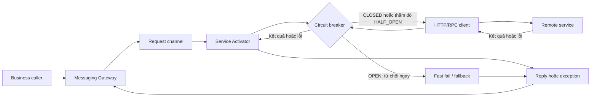
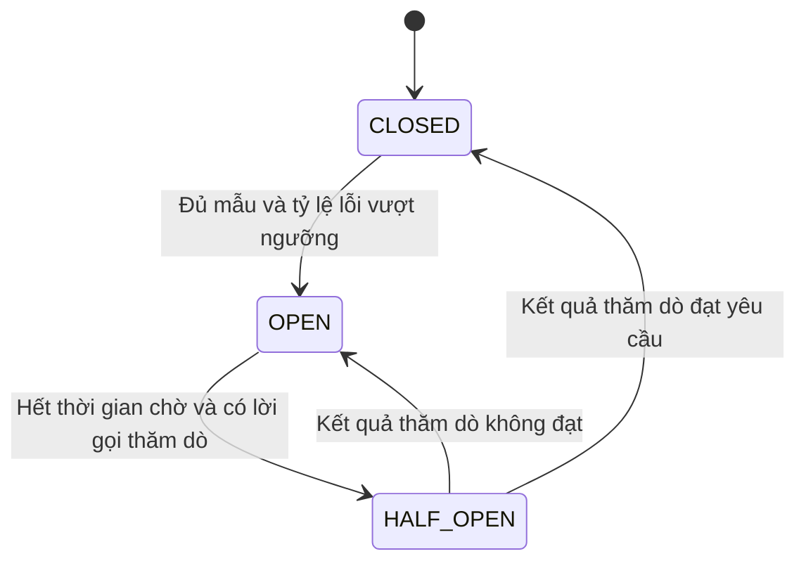

# Circuit breaker ở ranh giới gọi từ xa

## 1. Bối cảnh và mục tiêu

Trong **Remote Procedure Invocation (RPI/RPC)**, một thành phần gửi yêu cầu đến dịch vụ ở tiến trình hoặc máy khác và chờ kết quả như khi gọi một hàm. Với **Spring Integration**, lời gọi này thường được đặt sau một `Messaging Gateway` và được xử lý bởi `Service Activator` hoặc một outbound gateway. Cách tổ chức theo thông điệp giúp tách nghiệp vụ khỏi giao thức vận chuyển; tuy nhiên, bản thân một lời gọi từ xa vẫn có thể gặp timeout, lỗi kết nối, HTTP 5xx hoặc quá tải.

**Circuit breaker** là cơ chế bảo vệ tại ranh giới phụ thuộc từ xa. Nó quan sát kết quả những lời gọi vừa qua và **tạm từ chối lời gọi mới** khi tỷ lệ lỗi vượt ngưỡng. Sau một khoảng chờ, circuit breaker cho phép một số yêu cầu thăm dò để quyết định có mở lại luồng xử lý bình thường hay không.

Bài học này thuộc module `SPRING_INTEGRATION_PATTERN`: triển khai Enterprise Integration Patterns bằng Spring Integration với các luồng thông điệp ít phụ thuộc, dễ mở rộng và có khả năng kiểm thử, theo dõi. Sau bài học, bạn có thể:

- Xác định vị trí đặt circuit breaker quanh một dependency ở nhánh request–reply.
- Hiểu các trạng thái `CLOSED`, `OPEN`, `HALF_OPEN`, cách phân loại lỗi và các ngưỡng quan trọng.
- Kết hợp circuit breaker với timeout, retry, fallback, error channel và correlation mà không che giấu lỗi nghiệp vụ.
- Xây dựng ví dụ Spring Integration + Resilience4j, sau đó kiểm thử trạng thái và khả năng phục hồi.

## 2. Vì sao cần circuit breaker trong lời gọi đồng bộ?

Giả sử hệ thống nhận yêu cầu tra cứu khách hàng. `CustomerGateway` gửi thông điệp qua channel tới handler; handler gọi `customer-service` qua HTTP và trả dữ liệu về caller. Khi dịch vụ đích gặp sự cố, mỗi yêu cầu có thể tiếp tục chiếm luồng xử lý trong lúc chờ timeout. Số yêu cầu đang chờ tăng, tài nguyên bị giữ lâu và lỗi lan sang các thành phần vốn đang khỏe mạnh.



Circuit breaker tạo ra **fast fail** khi dependency đang bị đánh giá là không sẵn sàng. Nó không tự làm cho dịch vụ đích phục hồi, không giới hạn số lời gọi đồng thời và không thay thế timeout. Công dụng chính là tránh tiếp tục dồn tải vô ích vào một dependency đang lỗi.

Ví dụ: trong 10 lời gọi đủ điều kiện gần nhất, có 6 lời gọi thất bại do timeout hoặc HTTP 5xx. Nếu ngưỡng lỗi được đặt là 50% và số mẫu tối thiểu là 10, breaker có thể chuyển sang `OPEN`; các lời gọi mới bị từ chối mà không gửi HTTP. Thời điểm và cách tính chính xác phụ thuộc cấu hình cửa sổ thống kê.

## 3. Ba trạng thái và vòng đời

| Trạng thái | Có gửi lời gọi từ xa? | Hành vi |
| --- | --- | --- |
| `CLOSED` | Có | Cho phép yêu cầu; ghi nhận thành công/thất bại, kiểm tra ngưỡng khi đủ mẫu. |
| `OPEN` | Không | Từ chối ngay bằng lỗi kiểu `CallNotPermittedException` trong Resilience4j. |
| `HALF_OPEN` | Có, nhưng giới hạn | Cấp một số quyền thử nghiệm; kết quả quyết định trở lại `CLOSED` hoặc `OPEN`. |



Trong Resilience4j, `OPEN` thường chỉ chuyển sang `HALF_OPEN` khi có lời gọi mới đến sau thời gian chờ; có thể cấu hình chuyển trạng thái tự động nếu cần. Một số trạng thái đặc biệt như `DISABLED`, `FORCED_OPEN` và `METRICS_ONLY` phục vụ vận hành hoặc quan sát; luồng bảo vệ thông thường tập trung vào ba trạng thái trên.

Các tham số nên hiểu cùng nhau:

| Tham số | Ý nghĩa | Giá trị minh họa |
| --- | --- | --- |
| `slidingWindowSize` | Kích thước cửa sổ theo số lời gọi, nếu dùng `COUNT_BASED`. | `20` |
| `minimumNumberOfCalls` | Số lời gọi tối thiểu trước khi tính ngưỡng mở. | `10` |
| `failureRateThreshold` | Tỷ lệ lỗi (%) khiến breaker mở khi đủ mẫu. | `50` |
| `waitDurationInOpenState` | Khoảng chờ trước khi thử tiếp. | `30s` |
| `permittedNumberOfCallsInHalfOpenState` | Số lời gọi thử được cấp trong `HALF_OPEN`. | `3` |
| `slowCallDurationThreshold`, `slowCallRateThreshold` | Tùy chọn đánh giá tỷ lệ lời gọi quá chậm ngay cả khi chưa thất bại. | Tùy SLO |

Các con số là **ví dụ để học**, không phải cấu hình phù hợp cho mọi hệ thống. Hãy lấy timeout, lưu lượng, ngân sách lỗi và SLO của dependency làm cơ sở điều chỉnh. Với dịch vụ ít lưu lượng, cửa sổ thống kê quá lớn có thể khiến breaker phản ứng chậm.

## 4. Đặt breaker đúng ranh giới

Trong một flow Spring Integration, nên đặt breaker **ngay quanh thao tác thực sự đi ra ngoài tiến trình**: HTTP client, RPC stub hoặc adapter gọi dịch vụ khác. Khi đó, breaker đo được trạng thái của dependency thay vì đo cả bước mapping, validation hoặc xử lý nghiệp vụ nội bộ.

Ví dụ các ranh giới khác nhau:

| Vị trí | Hệ quả | Khuyến nghị |
| --- | --- | --- |
| Bao quanh HTTP/RPC call trong `Service Activator` | Ghi nhận đúng kết quả của dependency; dễ cấu hình theo dịch vụ. | Phù hợp cho ví dụ dưới đây. |
| Bao quanh toàn bộ flow gồm validation, transform và RPC | Lỗi mapping/validation có thể làm breaker mở dù dependency khỏe. | Chỉ dùng nếu đó là chính sách được chủ ý thiết kế. |
| Một breaker dùng chung cho nhiều dịch vụ khác nhau | Lỗi dịch vụ A có thể vô tình chặn lời gọi tới B. | Tách breaker theo dependency hoặc nhóm thao tác có cùng đặc tính lỗi/SLO. |

Không tạo một `CircuitBreaker` mới cho mỗi message: bộ đếm và trạng thái phải được dùng chung giữa các lời gọi. Trong Spring, thường khai báo nó là **singleton bean**. Nếu các endpoint của cùng một dịch vụ có độ sẵn sàng rất khác nhau, cân nhắc breaker riêng theo thao tác.

## 5. Ví dụ Spring Integration + Resilience4j

Ví dụ dùng **Spring Boot 3.x, Spring Integration 6.x, Java 17+** và HTTP đồng bộ qua `RestClient`. Cần các thư viện Spring Integration, Spring Web và `io.github.resilience4j:resilience4j-circuitbreaker` với phiên bản tương thích được quản lý trong cấu hình build của dự án. Đây là một lựa chọn triển khai; Spring Integration không buộc bạn dùng duy nhất Resilience4j hay HTTP.

Luồng yêu cầu:

```text
CustomerGateway.getById(id)
    -> channel "customer.rpc.requests" (DirectChannel)
    -> CustomerRpcHandler.load(id)
    -> CircuitBreaker.executeSupplier(...)
    -> RestClient GET /customers/{id}
    -> CustomerSnapshot hoặc exception trả về caller
```

### 5.1. Cấu hình channel, HTTP timeout và circuit breaker

```java
import java.time.Duration;

import io.github.resilience4j.circuitbreaker.CircuitBreaker;
import io.github.resilience4j.circuitbreaker.CircuitBreakerConfig;
import org.springframework.context.annotation.Bean;
import org.springframework.context.annotation.Configuration;
import org.springframework.http.client.SimpleClientHttpRequestFactory;
import org.springframework.integration.annotation.IntegrationComponentScan;
import org.springframework.integration.config.EnableIntegration;
import org.springframework.integration.channel.DirectChannel;
import org.springframework.messaging.MessageChannel;
import org.springframework.web.client.HttpClientErrorException;
import org.springframework.web.client.RestClient;

@Configuration
@EnableIntegration
@IntegrationComponentScan
public class CustomerRpcConfiguration {

    @Bean("customer.rpc.requests")
    MessageChannel customerRpcRequests() {
        return new DirectChannel();
    }

    @Bean
    RestClient customerRestClient(RestClient.Builder builder) {
        SimpleClientHttpRequestFactory factory =
                new SimpleClientHttpRequestFactory();
        factory.setConnectTimeout(300);  // milliseconds
        factory.setReadTimeout(1500);    // milliseconds

        return builder
                .baseUrl("https://customer-service.internal")
                .requestFactory(factory)
                .build();
    }

    @Bean
    CircuitBreaker customerCircuitBreaker() {
        CircuitBreakerConfig config = CircuitBreakerConfig.custom()
                .slidingWindowType(
                        CircuitBreakerConfig.SlidingWindowType.COUNT_BASED)
                .slidingWindowSize(20)
                .minimumNumberOfCalls(10)
                .failureRateThreshold(50.0f)
                .waitDurationInOpenState(Duration.ofSeconds(30))
                .permittedNumberOfCallsInHalfOpenState(3)
                .ignoreExceptions(HttpClientErrorException.class)
                .build();

        return CircuitBreaker.of("customer-service", config);
    }
}
```

`ignoreExceptions(HttpClientErrorException.class)` minh họa chính sách **không đưa lỗi HTTP 4xx vào thống kê thành công/thất bại của breaker**: chẳng hạn `404 Not Found` thường là kết quả nghiệp vụ hợp lệ, không phải dấu hiệu dependency mất khả dụng. Ngoại lệ 4xx vẫn được ném về caller để xử lý đúng ngữ nghĩa. Với API có quy ước khác (ví dụ `429 Too Many Requests` phản ánh quá tải), cần phân loại riêng. Nếu không chỉ định quy tắc thích hợp, ngoại lệ runtime không thuộc nhóm bị bỏ qua cũng có thể bị ghi nhận là lỗi kỹ thuật.

Ở ví dụ này, `SimpleClientHttpRequestFactory` cung cấp timeout cho **kết nối và đọc HTTP**. Việc chỉnh thời gian chờ của `Messaging Gateway` ở bước sau không thay thế hai timeout đó.

### 5.2. Gateway biểu diễn lời gọi request–reply

```java
import org.springframework.integration.annotation.Gateway;
import org.springframework.integration.annotation.MessagingGateway;

@MessagingGateway(defaultRequestChannel = "customer.rpc.requests")
public interface CustomerGateway {

    @Gateway(requestTimeout = "1000", replyTimeout = "2500")
    CustomerSnapshot getById(String customerId);
}
```

`@MessagingGateway` che giấu chi tiết message/channel khỏi mã nghiệp vụ. Gateway nhận kết quả do handler trả về hoặc chuyển lỗi về bên gọi theo ngữ nghĩa đồng bộ đã cấu hình.

**Lưu ý quan trọng về timeout:** `DirectChannel` gọi subscriber trên cùng luồng của sender. Vì vậy `replyTimeout` của gateway **không bảo đảm cắt ngang** một HTTP call đang chặn trong handler. Timeout mạng phải được đặt trên client (và cân nhắc `TimeLimiter` cho lời gọi bất đồng bộ) để có giới hạn thời gian thực tế. `requestTimeout` cũng không biến `DirectChannel` thành hàng đợi có deadline.

### 5.3. Service Activator gọi từ xa bên trong breaker

```java
import java.util.Objects;

import io.github.resilience4j.circuitbreaker.CircuitBreaker;
import io.github.resilience4j.circuitbreaker.CallNotPermittedException;
import org.springframework.integration.annotation.ServiceActivator;
import org.springframework.stereotype.Component;
import org.springframework.web.client.RestClient;

@Component
public class CustomerRpcHandler {
    private final RestClient client;
    private final CircuitBreaker breaker;

    public CustomerRpcHandler(RestClient customerRestClient,
                              CircuitBreaker customerCircuitBreaker) {
        this.client = customerRestClient;
        this.breaker = customerCircuitBreaker;
    }

    @ServiceActivator(inputChannel = "customer.rpc.requests")
    public CustomerSnapshot load(String customerId) {
        try {
            return breaker.executeSupplier(() ->
                    Objects.requireNonNull(
                            client.get()
                                    .uri("/customers/{id}", customerId)
                                    .retrieve()
                                    .body(CustomerSnapshot.class),
                            "customer-service returned an empty body"));
        } catch (CallNotPermittedException rejected) {
            throw new RemoteDependencyUnavailableException(
                    "customer-service is temporarily unavailable", rejected);
        }
    }
}

record CustomerSnapshot(String id, String displayName) {}

class RemoteDependencyUnavailableException extends RuntimeException {
    RemoteDependencyUnavailableException(String message, Throwable cause) {
        super(message, cause);
    }
}
```

Các lớp được đặt chung để làm rõ mối liên hệ; khi đưa vào dự án, hãy tách thành các file Java phù hợp và điều chỉnh package/bean qualification nếu có nhiều `RestClient` hoặc `CircuitBreaker`. Địa chỉ `customer-service.internal` chỉ là địa chỉ minh họa, phải thay bằng endpoint thực tế trong cấu hình môi trường.

Đường xử lý có hai tình huống khác nhau:

1. **Breaker cho phép gọi:** `executeSupplier` chạy HTTP call. Kết quả thành công được trả thành payload reply; exception từ HTTP được truyền ngược theo luồng request–reply, đồng thời được breaker ghi nhận hoặc bỏ qua tùy chính sách.
2. **Breaker đang `OPEN`:** lời gọi bị từ chối trước HTTP. `CallNotPermittedException` được chuyển thành lỗi ứng dụng `RemoteDependencyUnavailableException` để caller chọn phản hồi `503`, fallback hoặc đường xử lý tương đương. Việc đổi loại exception ở đây diễn ra **bên ngoài thao tác được breaker đo**.

Trong một ứng dụng thực tế, hãy giữ nguyên nguyên nhân (`cause`), thời gian và định danh dependency trong log/tracing; tránh ghi dữ liệu nhạy cảm từ payload.

## 6. Thiết kế fallback và phản hồi khi lỗi

Fallback là **quyết định nghiệp vụ**, không phải đặc tính bắt buộc của circuit breaker. Khi `OPEN`, hệ thống cần trả lời rõ ràng hoặc cung cấp dữ liệu thay thế có giới hạn:

| Trường hợp | Phản hồi hợp lý | Điều cần kiểm soát |
| --- | --- | --- |
| Đọc thông tin ít thay đổi | Trả cache kèm dấu hiệu dữ liệu cũ (`stale`). | TTL, thời điểm cập nhật, quyền truy cập. |
| Tra cứu có thể bỏ qua tạm thời | Trả trạng thái `temporarily unavailable`. | Caller biết đây không phải `not found`. |
| Thao tác ghi hoặc thanh toán | Fast fail hoặc chuyển hàng đợi có idempotency khi kiến trúc cho phép. | Không tự giả lập “thành công”; tránh ghi trùng. |
| Bước phụ trợ không quan trọng | Bỏ qua bước với dấu hiệu degraded rõ ràng. | Không làm sai kết quả nghiệp vụ chính. |

Không biến mọi exception thành một payload thành công: điều đó khiến caller hiểu sai kết quả, đồng thời che khuất tỷ lệ lỗi. Nếu fallback cũng gọi một dependency khác, nó cần chính sách bảo vệ và timeout riêng. Một fallback gọi trở lại đúng dịch vụ đang `OPEN` sẽ vô hiệu hóa mục tiêu fast fail.

Với Spring Integration, cần quyết định rõ đường truyền lỗi:

- Ở **flow đồng bộ với `DirectChannel`**, exception từ handler thường lan ngược về gateway/caller. Caller có thể phân biệt lỗi kết nối, lỗi HTTP nghiệp vụ và lời gọi bị breaker từ chối.
- Khi dùng `errorChannel`, `ErrorMessage` hay flow bất đồng bộ, phải cấu hình nhánh xử lý lỗi và phản hồi tương ứng; **không giả định mọi exception đều tự đến `errorChannel` toàn cục**.
- Giữ `correlationId`, request ID hoặc trace context qua các nhánh reply/error khi có split/aggregate hoặc đi qua môi trường bất đồng bộ. Điều này giúp ghép lỗi và phản hồi về đúng yêu cầu, đồng thời hỗ trợ truy vết.

## 7. Circuit breaker kết hợp timeout, retry và bulkhead

Các cơ chế giải quyết những vấn đề khác nhau:

| Cơ chế | Trả lời câu hỏi nào? | Điểm cần lưu ý |
| --- | --- | --- |
| **Timeout** | Chờ một lời gọi tối đa bao lâu? | Phải thực thi ở I/O client hoặc lớp async phù hợp. |
| **Retry** | Có nên thử lại một lỗi tạm thời? | Chỉ retry lỗi phù hợp, giới hạn lần thử, backoff và jitter. |
| **Circuit breaker** | Có nên cho phép gọi dependency lúc này? | Đo lỗi trong cửa sổ thống kê; từ chối khi `OPEN`. |
| **Bulkhead** | Cho phép bao nhiêu lời gọi đồng thời? | Cách ly tài nguyên; breaker **không** thay thế giới hạn concurrency. |
| **Fallback** | Caller nhận gì khi dependency không sẵn sàng? | Phải phù hợp tính đúng đắn của nghiệp vụ. |

Thứ tự bọc các cơ chế ảnh hưởng đến số mẫu breaker quan sát:

```text
Gateway -> CircuitBreaker -> Retry (tối đa 2 lần) -> HTTP client
```

Ở thứ tự này, breaker nhìn **một lời gọi logic** sau tối đa hai lần thử; nếu cả hai thất bại, breaker ghi nhận một lần thất bại. Ngược lại:

```text
Gateway -> Retry -> CircuitBreaker -> HTTP client
```

Mỗi lần retry đi qua breaker có thể tạo thêm một phép đo hoặc bị từ chối khi breaker `OPEN`. Điều đó có thể làm breaker mở nhanh hơn và khiến số lần thử trong `HALF_OPEN` bị tiêu thụ. Hãy chọn thứ tự một cách chủ ý, đặc biệt với hoạt động ghi không bảo đảm idempotency.

**Không retry vô hạn** sau timeout. Mỗi retry tiêu tốn tài nguyên và có thể làm dịch vụ đang quá tải suy yếu thêm. Với thao tác có side effect, dùng idempotency key và quy tắc xác định kết quả khi client timeout nhưng server có thể đã xử lý thành công.

## 8. Kiểm thử hành vi bằng tình huống có kiểm soát

Thay remote endpoint bằng mock HTTP server hoặc fake client có thể phát sinh kết quả xác định. Với unit test của breaker, dùng cấu hình cửa sổ nhỏ và không lệ thuộc vào thời gian chờ dài của môi trường sản xuất. Khi cần kiểm thử deadline, dùng cơ chế điều khiển thời gian phù hợp hoặc thời lượng ngắn có giới hạn rõ ràng.

| Tình huống | Cách thử | Kỳ vọng |
| --- | --- | --- |
| Dependency khỏe | Trả HTTP 200 liên tiếp. | Caller nhận `CustomerSnapshot`; breaker ở `CLOSED`. |
| Lỗi 5xx/timeout đạt ngưỡng | Gửi đủ số mẫu với tỷ lệ lỗi vượt ngưỡng. | Chuyển `OPEN`; các yêu cầu sau không tạo thêm HTTP request. |
| `OPEN` fast fail | Tiếp tục gọi khi chưa hết thời gian chờ. | Nhận lỗi unavailable nhanh; số lượt chạm remote không đổi. |
| Phục hồi qua `HALF_OPEN` | Hết thời gian chờ, mock trả kết quả thành công cho các phép thử. | Cho phép số phép thử đã cấu hình và trở lại `CLOSED` khi đạt điều kiện. |
| Thăm dò thất bại | Mock tiếp tục trả lỗi trong `HALF_OPEN`. | Breaker trở lại `OPEN` theo chính sách ngưỡng. |
| HTTP 404 hợp lệ | Mock trả 404. | Caller vẫn thấy lỗi nghiệp vụ; 404 không làm tăng thống kê failure của breaker ở cấu hình ví dụ. |
| Tải đồng thời | Nhiều request cùng lúc khi dependency chậm. | Thấy giới hạn thực tế từ timeout/bulkhead; breaker không được kỳ vọng tự giới hạn concurrency. |
| Lỗi ở nhánh message | Kích hoạt nhánh error/reply tương ứng. | Không mất request correlation; caller nhận kết quả hoặc exception đúng loại. |

Ví dụ unit test tối giản dùng JUnit 5 để kiểm tra thao tác chuyển `OPEN` của chính Resilience4j:

```java
import io.github.resilience4j.circuitbreaker.CallNotPermittedException;
import io.github.resilience4j.circuitbreaker.CircuitBreaker;
import io.github.resilience4j.circuitbreaker.CircuitBreakerConfig;
import org.junit.jupiter.api.Test;

import static org.junit.jupiter.api.Assertions.assertEquals;
import static org.junit.jupiter.api.Assertions.assertThrows;

class CustomerCircuitBreakerTest {
    @Test
    void opensAfterFailures() {
        CircuitBreakerConfig testConfig = CircuitBreakerConfig.custom()
                .slidingWindowSize(2)
                .minimumNumberOfCalls(2)
                .failureRateThreshold(50.0f)
                .build();
        CircuitBreaker testBreaker = CircuitBreaker.of("remote-test", testConfig);

        for (int i = 0; i < 2; i++) {
            try {
                testBreaker.executeRunnable(() -> {
                    throw new IllegalStateException("remote down");
                });
            } catch (IllegalStateException expected) {
                // Cả hai lời gọi đều thất bại để tạo đủ mẫu.
            }
        }

        assertEquals(CircuitBreaker.State.OPEN, testBreaker.getState());
        assertThrows(CallNotPermittedException.class,
                () -> testBreaker.executeRunnable(() -> {}));
    }
}
```

Đoạn kiểm thử trên chỉ xác nhận **state machine của breaker**. Để kiểm chứng tính tích hợp, vẫn cần bài test gửi yêu cầu qua `CustomerGateway`, giả lập HTTP và xác nhận rằng khi `OPEN` không phát sinh request tới remote endpoint.

## 9. Quan sát vận hành và những lỗi triển khai thường gặp

Nên theo dõi các chỉ số theo tên breaker/dependency: trạng thái hiện tại và lần chuyển trạng thái, số lời gọi thành công/thất bại/chậm, số lời gọi bị từ chối, latency và tỷ lệ fallback. Có thể dùng event publisher của Resilience4j, Micrometer và hệ thống log/tracing hiện có; khả năng xuất metrics cụ thể tùy dependency và cấu hình quan sát của ứng dụng.

Khi đọc dashboard, phân biệt **lỗi thật từ remote** với **lời gọi bị từ chối do breaker `OPEN`**. Số lượng bị từ chối tăng không đồng nghĩa dịch vụ đích tiếp tục nhận thêm lưu lượng. Ngoài ra, tổng hợp metrics phải giữ số nhãn thấp (ví dụ tên dependency, loại thao tác); không dùng customer ID hay request ID làm nhãn metric vì gây cardinality cao. ID chi tiết thuộc log hoặc trace.

Những lỗi triển khai cần tránh:

1. **Chỉ cấu hình `replyTimeout` ở gateway** và tưởng rằng HTTP call đã có deadline.
2. **Dùng chung breaker cho mọi endpoint** có đặc điểm lỗi khác nhau; một dependency lỗi làm tắc toàn bộ tích hợp.
3. **Đếm lỗi validation/404 như lỗi hạ tầng** khiến breaker mở do lưu lượng nghiệp vụ bình thường.
4. **Retry trước mọi lỗi**, đặc biệt là 4xx hoặc lời gọi ghi thiếu idempotency.
5. **Trả fallback như thành công thật** mà không nêu độ tươi dữ liệu hoặc trạng thái degraded.
6. **Không có bulkhead**, để hàng nghìn cuộc gọi chậm chiếm hết luồng ngay cả trước khi breaker đủ mẫu để mở.
7. **Không test `HALF_OPEN` và recovery**, khiến hệ thống tiếp tục từ chối dù dependency đã hồi phục.

## 10. Tiêu chí hoàn thành một ranh giới RPC có circuit breaker

Một giải pháp có thể được xem là sẵn sàng đưa vào giai đoạn kiểm thử tích hợp khi trả lời rõ những câu hỏi sau:

- Dependency nào được bảo vệ, và circuit breaker được đặt sát lời gọi outbound nào?
- Những exception/status nào được tính là lỗi hạ tầng, lỗi nghiệp vụ hoặc bị bỏ qua?
- Timeout kết nối/đọc, số lần retry và giới hạn concurrency đã được xác định từ SLO chưa?
- Khi `OPEN`, caller thấy loại lỗi hoặc fallback nào, có làm sai dữ liệu hay tạo side effect không?
- Kết quả request–reply/error có bảo toàn correlation và có thể truy vết không?
- Có test chứng minh `OPEN` chặn HTTP, `HALF_OPEN` cho phép thăm dò và `CLOSED` phục hồi không?
- Có metrics và cảnh báo đủ để phân biệt dependency lỗi với breaker từ chối lưu lượng không?

Circuit breaker phát huy hiệu quả khi được xem là **một phần của chính sách gọi từ xa** cùng timeout, retry có giới hạn, xử lý lỗi rõ ràng và quan sát vận hành. Trong Spring Integration, việc đặt chính sách này ở Service Activator hoặc outbound boundary giúp giữ cho flow thông điệp và nghiệp vụ phía trên dễ hiểu, ít phụ thuộc vào cách xử lý sự cố của từng dịch vụ đích.
