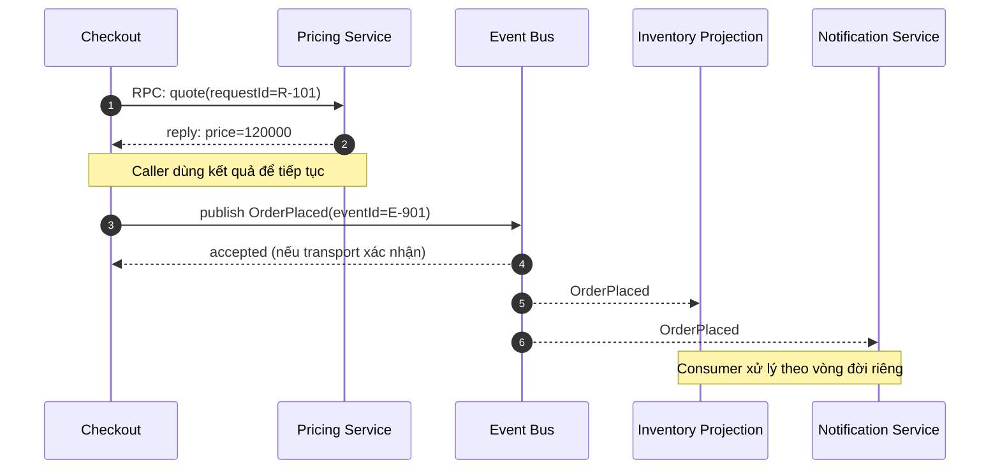
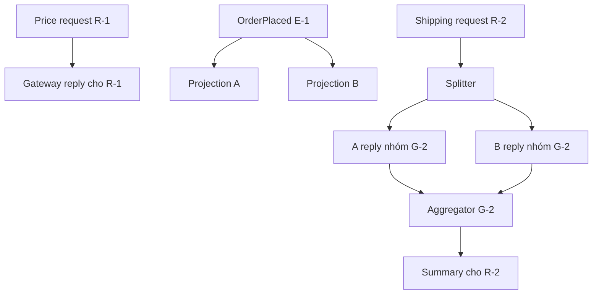

# Phân biệt RPC với message-driven interaction trong Spring Integration

## Mục tiêu bài học

Sau bài này, bạn có thể:

- Giải thích **Remote Procedure Invocation (RPC)** và **message-driven interaction** theo hợp đồng trao đổi giữa các thành phần.
- Phân biệt **request–reply**, **command**, **event** và **fire-and-forget**, không đánh đồng message với xử lý bất đồng bộ.
- Nhận diện các phụ thuộc về thời gian, khả năng sẵn sàng, schema, timeout, lỗi và độ tin cậy của mỗi cách thiết kế.
- Triển khai một RPC kiểu request–reply thông qua `@MessagingGateway` và một luồng xử lý sự kiện qua `PublishSubscribeChannel` trong Spring Integration.
- Lựa chọn kết hợp Gateway, Service Activator, Router, Filter, Transformer, retry, error channel và correlation cho đúng mục tiêu nghiệp vụ.
- Xác định các ca kiểm thử và chỉ số theo dõi để chứng minh hệ thống trả đúng kết quả, không làm mất hoặc xử lý trùng thông điệp.

Bài học thuộc chương **Remote procedure invocation** trong mô-đun **SPRING_INTEGRATION_PATTERN**. Mô-đun hướng tới triển khai *Enterprise Integration Patterns* bằng Spring Integration để xây dựng luồng thông điệp ít phụ thuộc và dễ mở rộng. Vì cả RPC lẫn các luồng hướng thông điệp đều có thể được xây bằng message channel, điều quan trọng là hiểu **hợp đồng tương tác** trước khi chọn API hoặc transport.

## 1. Hai kiểu tương tác giải quyết hai nhu cầu khác nhau

**RPC** là cách một thành phần yêu cầu thành phần khác thực hiện một thao tác và nhận kết quả tương ứng. Bên gọi thường nhìn thao tác từ xa như một lời gọi hàm: gửi tham số, chờ kết quả hoặc lỗi, rồi quyết định bước tiếp theo.

Ví dụ: khi xác nhận thanh toán, dịch vụ bán hàng cần biết `authorizePayment(orderId, amount)` đã được chấp thuận hay từ chối trước khi hiển thị kết quả.

**Message-driven interaction** tổ chức công việc quanh việc gửi và nhận message. Một consumer được kích hoạt khi có message đến; producer không nhất thiết cần nhận ngay kết quả nghiệp vụ của consumer. Message có thể biểu diễn:

- **Command:** yêu cầu một thành phần thực hiện hành động, ví dụ `ReserveInventory`.
- **Event:** thông báo sự kiện đã xảy ra, ví dụ `OrderPlaced`.
- **Request:** đề nghị cung cấp thông tin, ví dụ `GetShippingQuotes`.
- **Reply:** thông điệp phản hồi có thể chứa kết quả hoặc trạng thái lỗi.

Điểm khác biệt nằm ở **cam kết giữa producer và consumer**: caller có cần kết quả ngay để tiếp tục hay không, và ai sở hữu vòng đời hoàn tất công việc.

### Sơ đồ đối chiếu



Trong sơ đồ, **accepted** là trạng thái nhận/gửi message theo hợp đồng transport, không phải chứng nhận rằng tồn kho và thông báo đã xử lý thành công. Một broker có cơ chế xác nhận và lưu bền có thể tăng độ tin cậy, nhưng một channel trong bộ nhớ không tự cung cấp các tính chất đó.

## 2. So sánh theo hợp đồng thay vì theo công nghệ

| Khía cạnh | RPC / request–reply | Message-driven, đặc biệt command/event không chờ reply |
| --- | --- | --- |
| Mục đích | Hỏi kết quả một thao tác cụ thể | Kích hoạt công việc hoặc công bố sự kiện |
| Bên gửi cần gì? | Kết quả hoặc lỗi liên quan đến lời gọi | Thường chỉ cần xác nhận đã gửi/nhận; kết quả xử lý đến qua cơ chế khác nếu cần |
| Phụ thuộc thời gian | Caller thường đợi trong một giới hạn | Producer có thể hoàn tất trước consumer nếu có hàng đợi bất đồng bộ |
| Quan hệ bên nhận | Thường xác định bên xử lý hoặc một hợp đồng RPC | Có thể một consumer, nhiều subscriber, hoặc Router chọn consumer |
| Đường phản hồi | Reply channel, HTTP response hoặc callback có correlation | Không nhất thiết có reply; có thể phát event tiếp theo |
| Lỗi | Caller cần hiểu timeout, lỗi remote hoặc trạng thái không xác định | Lỗi có thể được xử lý độc lập bằng retry, dead-letter hoặc error flow |
| Số người tiêu thụ | Thường một logical service; có thể fan-out rồi gom reply | Một message có thể được phát tới nhiều subscriber theo cấu hình |
| Mở rộng | Bị giới hạn bởi latency/deadline của đường gọi trực tiếp | Có thể xử lý tách rời bằng broker, partition và worker, nhưng phải tính backpressure |
| Dữ liệu nhất quán | Thường caller cần quyết định ngay từ reply | Projection và tác dụng phụ có thể nhất quán sau một khoảng trễ |
| Độ tin cậy | Timeout không xác nhận server đã dừng hoặc chưa commit | Giao nhận có thể mất/trùng theo transport; cần ack, lưu bền, idempotency |

**Không nên suy luận:**

1. “RPC luôn dùng HTTP.” RPC có thể dùng gRPC, HTTP hoặc **request–reply qua message broker**.
2. “Message-driven luôn bất đồng bộ.” `DirectChannel` và `PublishSubscribeChannel` không gắn executor có thể gọi subscriber ngay trên thread gửi.
3. “Gửi event nghĩa là không có phản hồi.” Producer vẫn có thể nhận transport acknowledgment, còn kết quả nghiệp vụ có thể phát thành event riêng.
4. “Bất đồng bộ nghĩa là có queue bền vững.” `ExecutorChannel` chỉ bàn giao xử lý cho executor trong tiến trình; nó không tự bảo đảm message tồn tại sau restart.
5. “Không có RPC nghĩa là không phụ thuộc.” Consumer và producer vẫn phụ thuộc vào schema sự kiện, cách versioning và quy tắc nghiệp vụ.

## 3. Bốn mẫu trao đổi thường gặp

### 3.1. Request–reply: câu hỏi và câu trả lời

```text
Checkout -- QuoteRequest(requestId=R-101) --> Pricing
Checkout <-- QuoteReply(requestId=R-101) --- Pricing
```

Caller phải ghép **đúng** reply với request đang chờ; có timeout và hành vi lỗi đã thống nhất. Nếu request B hoàn tất trước A, reply B không được đưa cho caller A. Trong Spring Integration, `@MessagingGateway` có thể quản lý đường trả lời cho từng lời gọi; khi truyền qua broker, cần phối hợp reply destination với correlation ID/request ID.

### 3.2. One-way command: giao một yêu cầu thực hiện

```text
Checkout -- ReserveInventory(commandId=C-101) --> Inventory Worker
Checkout <-- accepted by queue ------------------ Broker/Adapter
... Inventory Worker xử lý về sau ...
```

Command có **đích hoặc trách nhiệm xử lý rõ**. Xác nhận đã xếp vào hàng đợi và xác nhận nghiệp vụ “đã giữ hàng” là **hai mốc khác nhau**. Nếu Checkout cần chờ kết quả cuối, phải có reply, callback, polling hoặc event báo trạng thái tương ứng.

### 3.3. Event notification: thông báo điều đã xảy ra

```text
Order Service -- OrderPlaced(eventId=E-901) --> Event Bus
                                                   |---> Analytics
                                                   |---> Email Service
                                                   |---> Search Projection
```

Event nên đặt tên ở **thì quá khứ** và diễn đạt một fact nghiệp vụ, chẳng hạn `OrderPlaced`. Producer không yêu cầu mọi subscriber trả về response trong chính lần publish. Subscriber có thể độc lập triển khai, song các hệ thống cần quản lý version/schema và chính sách xử lý sự kiện trùng hoặc muộn.

### 3.4. Scatter–gather: gửi nhiều request và chờ một summary

```text
Shipping Request
     |
  Splitter / Router
     |---- Provider A -> reply A --|
     |---- Provider B -> reply B --|--> Aggregator -> SummaryReply
     |---- Provider C -> reply C --|
```

Đây vẫn là **request–reply ở ranh giới caller** dù bên trong có nhiều message-driven handler. Aggregator dùng correlation ID, điều kiện hoàn tất và deadline để gom các kết quả. Cùng một ứng dụng có thể trộn nhiều pattern; không cần “chọn phe” RPC hay messaging cho toàn bộ hệ thống.

## 4. Spring Integration: cơ sở chung của cả hai cách

Spring Integration cung cấp `Message<?>` gồm payload và headers, `MessageChannel` để truyền message, cùng các endpoint như Service Activator, Router, Filter, Transformer và Aggregator.

**Các công cụ có thể phục vụ cả hai kiểu tương tác:**

| Thành phần | Khi làm RPC | Khi làm message-driven |
| --- | --- | --- |
| `@MessagingGateway` | Biến phương thức Java thành request và chờ reply | Có thể dùng phương thức `void` để gửi one-way message; hợp đồng không phải RPC nếu caller không chờ kết quả |
| `@ServiceActivator` | Thực thi và trả reply | Xử lý command/event, có thể không trả output |
| `DirectChannel` | Đồng bộ trong call stack của sender | Gửi message tới handler ngay trong thread sender |
| `ExecutorChannel` | Xử lý request ở worker; caller có thể chờ reply | Bàn giao tác vụ cho executor, tránh giữ thread gửi trong handler |
| `PublishSubscribeChannel` | Có thể phát tới nhiều nhánh xử lý | Phát event tới nhiều subscriber |
| `Router` / `Filter` | Định tuyến nhánh RPC; nhánh bị loại phải có hợp đồng lỗi/timeout rõ | Chọn consumer hoặc loại event không liên quan |
| `Transformer` | Chuyển DTO, header, response | Chuyển định dạng message cho consumer |
| `Aggregator` | Gom nhiều reply trước khi trả lời một request | Gom sự kiện liên quan thành một kết quả/command mới |
| `errorChannel` | Có thể chuyển lỗi bất đồng bộ thành response lỗi theo cấu hình | Xử lý lỗi consumer, retry và đường dead-letter theo thiết kế |

Mỗi trường hợp yêu cầu một **hợp đồng về reply, lỗi, timeout và durability**; tên của channel không tự quyết định hành vi.

## 5. Ví dụ A — RPC qua Messaging Gateway và HTTP

Giả sử Checkout cần lấy giá ngay trước khi cho người dùng xác nhận. Phương thức `PricingGateway.quote(...)` nhận lại `PricingResult`. Phía sau, Spring Integration sử dụng worker để gọi HTTP Pricing Service.

Ví dụ dùng **Java 17+, Spring Boot 3.x, Spring Integration 6.x** và Spring Web. Các class/record `public` bên dưới được đặt ở file Java tương ứng trong cùng package. Ứng dụng Pricing chạy ở địa chỉ minh họa `http://localhost:8081`.

### 5.1. DTO và kết quả có cấu trúc

```java
// PricingRequest.java
public record PricingRequest(
        String requestId,
        String sku,
        int quantity
) {}

// PricingQuote.java
import java.math.BigDecimal;

public record PricingQuote(
        String requestId,
        BigDecimal amount
) {}

// PricingResult.java
public record PricingResult(
        String requestId,
        PricingQuote quote,
        String errorCode
) {
    public boolean successful() {
        return quote != null && errorCode == null;
    }
}
```

`requestId` là mã nghiệp vụ được gửi qua mạng để truy vết và xác minh phản hồi. ID của `Message<?>` trong Spring Messaging không mặc nhiên thay thế mã này. Khi có nhiều request chạy song song, một giá trả về đúng số tiền nhưng **sai requestId** cũng là lỗi nghiêm trọng.

### 5.2. Cấu hình request channel và HTTP client

```java
// PricingIntegrationConfig.java
import org.springframework.beans.factory.annotation.Qualifier;
import org.springframework.context.annotation.Bean;
import org.springframework.context.annotation.Configuration;
import org.springframework.http.client.SimpleClientHttpRequestFactory;
import org.springframework.integration.annotation.IntegrationComponentScan;
import org.springframework.integration.channel.ExecutorChannel;
import org.springframework.integration.config.EnableIntegration;
import org.springframework.messaging.MessageChannel;
import org.springframework.scheduling.concurrent.ThreadPoolTaskExecutor;
import org.springframework.web.client.RestTemplate;

@Configuration
@EnableIntegration
@IntegrationComponentScan
public class PricingIntegrationConfig {
    @Bean("pricingExecutor")
    public ThreadPoolTaskExecutor pricingExecutor() {
        ThreadPoolTaskExecutor executor = new ThreadPoolTaskExecutor();
        executor.setCorePoolSize(4);
        executor.setMaxPoolSize(8);
        executor.setQueueCapacity(50);
        executor.setThreadNamePrefix("pricing-");
        return executor;
    }

    @Bean("priceRequests")
    public MessageChannel priceRequests(
            @Qualifier("pricingExecutor") ThreadPoolTaskExecutor executor) {
        return new ExecutorChannel(executor);
    }

    @Bean("pricingHttpClient")
    public RestTemplate pricingHttpClient() {
        SimpleClientHttpRequestFactory factory =
                new SimpleClientHttpRequestFactory();
        factory.setConnectTimeout(350);
        factory.setReadTimeout(1600);
        return new RestTemplate(factory);
    }
}
```

`ExecutorChannel` chạy handler trên thread của executor. Điều đó cho phép Gateway có thể hết thời gian chờ reply trong khi worker vẫn đang xử lý. Hai timeout HTTP là giới hạn riêng của connect/read I/O; chúng **không** tự bảo đảm toàn bộ server-side processing kết thúc trước deadline Gateway.

### 5.3. Gateway chuyển lời gọi Java thành request–reply

```java
// PricingGateway.java
import org.springframework.integration.annotation.MessagingGateway;

@MessagingGateway(
    defaultRequestChannel = "priceRequests",
    defaultReplyTimeout = "2200"
)
public interface PricingGateway {
    PricingResult quote(PricingRequest request);
}
```

Đây là **hợp đồng RPC**: caller muốn có kết quả giá hoặc một trạng thái lỗi trước khi tiếp tục. Gateway gắn đường nhận reply cho lời gọi; Service Activator không cần biết caller nào đang chờ. Nếu reply timeout, một lời gọi đồng bộ trả về reference type có thể nhận `null` khi không có reply; cần xử lý trường hợp này ở biên ứng dụng. Ngoại lệ của flow có thể đi theo cơ chế lỗi khác tùy endpoint và cấu hình.

### 5.4. Service Activator thực hiện cuộc gọi từ xa

```java
// PricingRpcAdapter.java
import org.springframework.beans.factory.annotation.Qualifier;
import org.springframework.integration.annotation.ServiceActivator;
import org.springframework.stereotype.Component;
import org.springframework.web.client.RestClientException;
import org.springframework.web.client.RestTemplate;

@Component
public class PricingRpcAdapter {
    private final RestTemplate http;

    public PricingRpcAdapter(
            @Qualifier("pricingHttpClient") RestTemplate http) {
        this.http = http;
    }

    @ServiceActivator(inputChannel = "priceRequests")
    public PricingResult invoke(PricingRequest request) {
        if (request.quantity() <= 0) {
            return new PricingResult(
                    request.requestId(), null, "INVALID_QUANTITY");
        }

        try {
            PricingQuote quote = http.postForObject(
                    "http://localhost:8081/api/prices",
                    request,
                    PricingQuote.class);

            if (quote == null ||
                    !request.requestId().equals(quote.requestId())) {
                return new PricingResult(
                        request.requestId(), null, "INVALID_REPLY");
            }
            return new PricingResult(request.requestId(), quote, null);
        } catch (RestClientException ex) {
            // Bao gồm lỗi HTTP và lỗi I/O: cần phân loại thêm
            // theo loại exception nếu quyết định chính sách retry.
            return new PricingResult(
                    request.requestId(), null, "REMOTE_FAILURE");
        }
    }
}
```

Adapter chuyển lỗi HTTP đã biết thành reply có cấu trúc, để caller không phải chờ timeout chỉ vì downstream trả status lỗi. Điều này không thay thế `errorChannel` cho các lỗi bất ngờ ngoài phạm vi catch. Khi đi qua một ranh giới bất đồng bộ, exception chưa được xử lý cần error flow tương ứng; nếu không, bên gọi có thể chỉ thấy timeout.

### 5.5. Caller dựa trên kết quả để quyết định

```java
// CheckoutPricingService.java
import org.springframework.stereotype.Service;

@Service
public class CheckoutPricingService {
    private final PricingGateway gateway;

    public CheckoutPricingService(PricingGateway gateway) {
        this.gateway = gateway;
    }

    public PricingQuote getPrice(PricingRequest request) {
        PricingResult result = gateway.quote(request);

        if (result == null) {
            throw new IllegalStateException("PRICING_REPLY_TIMEOUT");
        }
        if (!request.requestId().equals(result.requestId())) {
            throw new IllegalStateException("PRICING_CORRELATION_ERROR");
        }
        if (!result.successful()) {
            throw new IllegalStateException(result.errorCode());
        }
        return result.quote();
    }
}
```

Trong luồng này, Checkout **phụ thuộc vào khả năng phản hồi đúng hạn** của Pricing. Nếu không nhận được reply, Checkout cần quyết định trả lỗi, tạm hoãn hoặc dùng chính sách fallback đã được nghiệp vụ phê duyệt. Đừng suy luận rằng timeout nghĩa là remote service chắc chắn không xử lý request.

## 6. Ví dụ B — Event-driven qua Publish–Subscribe Channel

Sau khi đặt hàng thành công, Checkout phát `OrderPlaced` để nhiều thành phần cập nhật thông tin. Không thành phần nào cần trả “đã gửi email xong” vào cùng lời gọi đặt hàng.

Ví dụ dùng **channel trong bộ nhớ có executor** để làm rõ hợp đồng event. Cấu hình này **không có durability, replay hoặc broker acknowledgment**; khi cần giao nhận bền qua restart, phải dùng adapter và broker phù hợp hoặc transactional outbox.

### 6.1. Sự kiện bất biến

```java
// OrderPlaced.java
import java.time.Instant;

public record OrderPlaced(
        String eventId,
        String orderId,
        Instant occurredAt
) {}
```

`eventId` định danh một lần phát sự kiện để hỗ trợ chống trùng. `orderId` là khóa nghiệp vụ có thể xuất hiện trong nhiều loại event khác nhau. Sự kiện diễn đạt **đơn hàng đã được tạo**, không ra lệnh cụ thể “hãy gửi email”.

### 6.2. Kênh phát cho nhiều subscriber

```java
// OrderEventsConfig.java
import org.springframework.beans.factory.annotation.Qualifier;
import org.springframework.context.annotation.Bean;
import org.springframework.context.annotation.Configuration;
import org.springframework.integration.channel.PublishSubscribeChannel;
import org.springframework.scheduling.concurrent.ThreadPoolTaskExecutor;

@Configuration
public class OrderEventsConfig {
    @Bean("orderEventExecutor")
    public ThreadPoolTaskExecutor orderEventExecutor() {
        ThreadPoolTaskExecutor executor = new ThreadPoolTaskExecutor();
        executor.setCorePoolSize(2);
        executor.setMaxPoolSize(6);
        executor.setQueueCapacity(100);
        executor.setThreadNamePrefix("order-events-");
        return executor;
    }

    @Bean("orderEvents")
    public PublishSubscribeChannel orderEvents(
            @Qualifier("orderEventExecutor")
            ThreadPoolTaskExecutor executor) {
        return new PublishSubscribeChannel(executor);
    }
}
```

Ở đây `PublishSubscribeChannel` dùng executor, nên việc xử lý subscriber diễn ra trên worker. Nếu bỏ executor, cùng loại channel có thể thực thi subscriber ngay trong thread gửi. Do đó **Publish–Subscribe** mô tả cách phân phối, còn **bất đồng bộ** phụ thuộc cấu hình channel.

### 6.3. Producer phát event và kết thúc trách nhiệm gửi

```java
// OrderEventPublisher.java
import org.springframework.beans.factory.annotation.Qualifier;
import org.springframework.messaging.MessageChannel;
import org.springframework.messaging.support.MessageBuilder;
import org.springframework.stereotype.Component;

@Component
public class OrderEventPublisher {
    private final MessageChannel channel;

    public OrderEventPublisher(
            @Qualifier("orderEvents") MessageChannel channel) {
        this.channel = channel;
    }

    public void publish(OrderPlaced event) {
        boolean accepted = channel.send(
                MessageBuilder.withPayload(event).build());
        if (!accepted) {
            throw new IllegalStateException("ORDER_EVENT_SEND_FAILED");
        }
    }
}
```

`send()` trả `true` khi channel chấp nhận thao tác gửi theo hợp đồng của nó. Với executor bất đồng bộ, điều đó **không xác nhận** mọi subscriber đã xử lý xong và **không phải** cam kết message tồn tại sau khi process chết. Nếu publish phải bảo đảm atomically cùng transaction ghi đơn hàng, cân nhắc **transactional outbox** hoặc giải pháp transaction phù hợp cho transport.

### 6.4. Hai consumer độc lập

```java
// OrderAuditProjection.java
import java.util.Map;
import java.util.concurrent.ConcurrentHashMap;
import org.springframework.integration.annotation.ServiceActivator;
import org.springframework.stereotype.Component;

@Component
public class OrderAuditProjection {
    // Chỉ minh họa lưu trong bộ nhớ, không phải event store bền vững.
    private final Map<String, OrderPlaced> seen =
            new ConcurrentHashMap<>();

    @ServiceActivator(inputChannel = "orderEvents")
    public void record(OrderPlaced event) {
        seen.putIfAbsent(event.eventId(), event);
    }

    public boolean hasSeen(String eventId) {
        return seen.containsKey(eventId);
    }
}

// OrderMetricsProjection.java
import java.util.Map;
import java.util.concurrent.ConcurrentHashMap;
import org.springframework.integration.annotation.ServiceActivator;
import org.springframework.stereotype.Component;

@Component
public class OrderMetricsProjection {
    private final Map<String, String> latestEventPerOrder =
            new ConcurrentHashMap<>();

    @ServiceActivator(inputChannel = "orderEvents")
    public void update(OrderPlaced event) {
        latestEventPerOrder.put(event.orderId(), event.eventId());
    }
}
```

Hai consumer nhận **cùng sự kiện** và cập nhật các projection riêng. Ví dụ cố ý không sử dụng database, vì mục tiêu là giải thích cách tương tác. Để chạy production, thay bằng lưu trữ bền, idempotency dựa trên event ID, version hoặc ordering thích hợp, và theo dõi lỗi subscriber. `ConcurrentHashMap` không giải quyết durability qua restart.

Một điểm cần tránh: `latestEventPerOrder` chỉ ghi nhận event gần nhất **theo thứ tự được xử lý**, không chứng minh đó là event mới nhất theo thời gian nghiệp vụ. Nếu ordering là yêu cầu, phải có sequence/version từ nguồn và cơ chế so sánh trước khi cập nhật.

## 7. Mặt khác biệt lớn nhất: mức độ phụ thuộc theo thời gian

Khi một luồng RPC trực tiếp cần Pricing trả lời trong hai giây, thời gian xử lý Pricing và trạng thái mạng ảnh hưởng ngay đến trải nghiệm Checkout.

```text
RPC:
Checkout -- call Pricing --> Pricing
         <-- reply/error ---          (Checkout đang chờ)

Async message with durable broker:
Order -- publish --> Broker --> Consumer A (xử lý sau)
                          |--> Consumer B (xử lý sau)
Order được phép tiếp tục sau điểm ack mà hợp đồng định nghĩa.
```

Broker có thể làm giảm **temporal coupling** nếu nó lưu message bền và consumer nhận lại khi sẵn sàng. Tuy nhiên producer vẫn có thể phụ thuộc vào khả năng nhận message của broker; nếu broker không nhận được message, việc publish có thể thất bại. Hệ thống cũng phải đối phó với consumer lag, backlog, redelivery và schema version.

Một sự kiện được publish trước khi transaction ghi đơn hàng commit có thể khiến consumer nhìn thấy trạng thái chưa tồn tại; publish sau khi commit nhưng trước khi phát event có thể khiến event thất lạc nếu process chết. **Transactional outbox** thường được dùng để ghi dữ liệu nghiệp vụ và bản ghi sự kiện trong cùng transaction cục bộ, sau đó một relay phát sự kiện và đánh dấu trạng thái đã chuyển. Relay có thể phát lại, nên consumer vẫn cần idempotency.

## 8. Timeout, lỗi và retry: cùng từ nhưng khác ý nghĩa

| Tình huống | Với RPC | Với message-driven không chờ kết quả ngay |
| --- | --- | --- |
| Consumer chậm | Caller có thể timeout | Backlog/consumer lag tăng; producer có thể đã nhận ack |
| Downstream trả lỗi | Trả lỗi về caller hoặc error reply | Retry/backoff, dead-letter hoặc event thất bại theo flow |
| Reply thất lạc | Kết quả thật của RPC có thể không xác định | Không áp dụng nếu không có reply; có thể mất ack hoặc event tiếp theo |
| Retry sau timeout | Có nguy cơ thao tác chạy hai lần | Redelivery cũng có thể khiến consumer xử lý trùng |
| Hủy yêu cầu | Caller ngừng chờ không chứng minh server đã hủy | Cần command hủy hoặc saga/compensation nếu nghiệp vụ cho phép |
| Chuyển hướng xử lý | Router/Failover cần bảo đảm reply quay về đúng lời gọi | Router có thể chọn hàng đợi/consumer; phải giữ correlation và thứ tự khi cần |

### 8.1. Timeout của Gateway khác timeout của HTTP

Ví dụ RPC ở phần 5 dùng `defaultReplyTimeout = "2200"` cho Messaging Gateway và `setReadTimeout(1600)` cho HTTP client. Đây là **hai giới hạn khác tầng**:

- HTTP read timeout điều khiển thời gian chờ đọc trên transport theo request factory đang sử dụng.
- Gateway reply timeout điều khiển thời gian caller chờ message phản hồi từ flow sau khi gửi.
- Với `DirectChannel` và handler chạy đồng bộ, Gateway có thể bị chặn ngay trong pha gửi; reply timeout không tự ngắt I/O bên trong handler.
- Với `ExecutorChannel`, caller có thể hết hạn trước khi worker bắt đầu hoặc hoàn tất HTTP call; worker cần kiểm soát resource, deadline và late reply riêng.

Timeout không thay thế xử lý lỗi và **không chứng minh remote operation đã rollback**.

### 8.2. Idempotency cần cho cả hai mô hình

Trong RPC, nếu caller timeout sau khi server đã tạo đơn và retry, server có thể nhận hai lần lệnh tạo đơn. Trong message-driven, broker có thể redeliver event sau khi consumer ghi dữ liệu nhưng chưa kịp ack.

Thiết kế an toàn sử dụng một khóa ổn định như `idempotencyKey` hoặc `eventId`, kết hợp kiểm tra và lưu trạng thái xử lý **một cách nhất quán với side effect**. Chỉ dùng `containsKey` trên bộ nhớ hoặc kiểm tra rồi ghi ở hai bước không có transaction chưa đủ cho hệ thống phân tán.

### 8.3. Error channel không phải reply channel

`errorChannel` xử lý các `ErrorMessage` phát sinh trong những luồng hỗ trợ cơ chế định tuyến lỗi. `replyChannel` chỉ định nơi phản hồi nghiệp vụ cần trở về. Với một handler đồng bộ, exception có thể ném trực tiếp về caller; với executor, việc gửi lỗi tùy cấu hình endpoint/channel.

Nếu RPC hứa phải trả kết quả, các nhánh Router/Filter phải bảo đảm trả reply hoặc một tín hiệu lỗi đã thỏa thuận. Nếu message được Filter bỏ mà không có reply, caller có thể chờ tới timeout. Trong event-driven, một event bị lọc vì không liên quan là hợp lý, miễn hợp đồng consumer cho phép và việc theo dõi không xem đó là mất sự kiện.

## 9. Correlation trong RPC và message-driven

Khi quan sát nhiều tương tác song song, phân biệt các ID:

| ID | Thuộc về | Khi nào dùng |
| --- | --- | --- |
| Spring Message ID | Một message cụ thể | Phân biệt từng message trong flow |
| `requestId` | Một thao tác nghiệp vụ/câu hỏi | Ghép request–reply, truy vết qua HTTP hoặc message broker |
| `MessageHeaders.CORRELATION_ID` | Một nhóm message cần ghép | Aggregator, Splitter và một số flow yêu cầu tương quan |
| `eventId` | Một sự kiện đã phát | Phát hiện xử lý lại sự kiện, theo dõi consumer |
| `traceId` / `spanId` | Một trace quan sát phân tán | Ghép log/latency giữa các dịch vụ; không mặc nhiên là khóa idempotency |



Khi cần gom nhiều reply, Aggregator cần cùng khóa correlation và release strategy để biết nhóm đã đủ. Khi phát event cho nhiều consumer, cùng `eventId` có thể được mỗi consumer xử lý độc lập; không nhất thiết có Aggregator. Khi truyền qua broker, các header nội bộ phải được ánh xạ sang định dạng transport thực tế; không giả định mọi object `replyChannel` trong bộ nhớ có thể đi qua tiến trình khác.

## 10. Chọn mô hình theo câu hỏi nghiệp vụ

| Nhu cầu | Hướng phù hợp | Lý do |
| --- | --- | --- |
| Hiển thị báo giá ngay trước khi xác nhận | RPC / request–reply | Checkout cần kết quả cho bước hiện tại |
| Cập nhật dashboard khi có đơn hàng mới | Event message | Người bán không phải chờ dashboard xử lý |
| Gửi email sau khi đơn đã lưu | Event, hàng đợi bền | Email có thể xử lý sau, có retry |
| Giữ kho và cần kết quả trước khi cam kết đơn | RPC hoặc async command kèm trạng thái chờ | Phải thống nhất khi nào “đã giữ kho” được xác nhận |
| Lấy ba báo giá vận chuyển và trả giá thấp nhất | Fan-out + Aggregator + một RPC reply | Nhiều nhánh nội bộ, caller cần summary |
| Xử lý video nhiều phút | Async command + job ID + progress event/polling | Giữ kết nối RPC lâu không cần thiết |
| Đồng bộ search index từ thay đổi dữ liệu | Event stream, consumer idempotent | Projection có thể cập nhật dần |
| Thanh toán có tác dụng phụ | Hợp đồng command/RPC có idempotency, đối soát | Timeout có thể để lại kết quả không xác định; cần trạng thái chắc chắn |

Không có giải pháp tối ưu cho mọi trường hợp. Một kiến trúc thường dùng **RPC ở đường cần phản hồi tức thì** và **events/commands ở công việc có thể tách thời gian**, đồng thời chuẩn hóa schema, correlation, tracing và xử lý lỗi giữa hai phần.

## 11. Kiểm thử sự khác biệt thay vì chỉ kiểm thử payload

Với RPC, các phép kiểm thử quan trọng gồm:

1. **Trả đúng request:** gửi nhiều `requestId` đồng thời, cố ý đảo thứ tự hoàn tất; mọi reply phải thuộc đúng caller.
2. **Timeout:** remote response đến chậm hơn hạn Gateway; caller nhận trạng thái timeout rõ ràng, không bị gán reply của request trước.
3. **Lỗi downstream:** HTTP 400, 503, mất kết nối và exception bất ngờ được phân biệt theo hợp đồng.
4. **Retry có tác dụng phụ:** server commit rồi reply mất; retry cùng idempotency key không tạo bản ghi thứ hai.

Với luồng message-driven, các phép kiểm thử cần chú ý:

1. **Fan-out:** nhiều subscriber nhận event theo cấu hình; một event không buộc tất cả subscriber trả reply.
2. **Redelivery:** publish lại cùng `eventId`, xác minh side effect xử lý có chống trùng.
3. **Consumer chậm hoặc lỗi:** producer không xem nhận message là đã hoàn thành nghiệp vụ; kiểm tra retry/error flow/dead-letter phù hợp transport.
4. **Restart / broker outage:** nếu yêu cầu durability, thông điệp đã xác nhận vẫn có thể được khôi phục; một channel bộ nhớ không đáp ứng ca này.
5. **Ordering:** xử lý hai event có `version` khác nhau theo thứ tự đảo, projection vẫn giữ đúng trạng thái mới nhất.

Ví dụ kiểm thử cho **RPC adapter** bằng Spring Test, nhằm xác minh một response có `requestId` không khớp bị từ chối (đây là test hợp đồng, chưa kiểm thử network timeout):

```java
import static org.assertj.core.api.Assertions.assertThat;
import static org.springframework.test.web.client.match.MockRestRequestMatchers.requestTo;
import static org.springframework.test.web.client.response.MockRestResponseCreators.withSuccess;

import org.junit.jupiter.api.Test;
import org.springframework.http.MediaType;
import org.springframework.test.web.client.MockRestServiceServer;
import org.springframework.web.client.RestTemplate;

class PricingRpcAdapterTest {
    @Test
    void rejectsReplyBelongingToAnotherRequest() {
        RestTemplate restTemplate = new RestTemplate();
        MockRestServiceServer mockServer =
                MockRestServiceServer.createServer(restTemplate);
        mockServer.expect(requestTo("http://localhost:8081/api/prices"))
                .andRespond(withSuccess(
                    "{\"requestId\":\"R-OTHER\",\"amount\":120000}",
                    MediaType.APPLICATION_JSON));

        PricingRpcAdapter adapter = new PricingRpcAdapter(restTemplate);
        PricingResult result = adapter.invoke(
                new PricingRequest("R-101", "BOOK-01", 1));

        assertThat(result.successful()).isFalse();
        assertThat(result.errorCode()).isEqualTo("INVALID_REPLY");
        assertThat(result.requestId()).isEqualTo("R-101");
        mockServer.verify();
    }
}
```

Trong môi trường thật, dùng thêm integration tests với broker/test server, kiểm tra trường hợp reply đến muộn, executor bị quá tải, error channel và việc lưu bền thông điệp. Các test bằng mock không thể chứng minh độ tin cậy của hệ thống sau khi mất điện hoặc mất kết nối.

## 12. Theo dõi vận hành và kiểm soát phụ thuộc

**Đối với RPC:** theo dõi request rate, p50/p95/p99 latency, lỗi 4xx/5xx, connect/read timeout, Gateway reply timeout, retry count, pool saturation và circuit breaker state. Log `requestId` cùng trace ID để đối soát request và reply. Giữ timeout budget trong suốt các hop; nếu caller đã hết deadline, đừng khởi động retry vô hạn.

**Đối với message-driven:** theo dõi publish acceptance, consumer lag, queue depth, thời gian từ publish đến xử lý, retry/redelivery, dead-letter count, duplicate suppression và version/schema errors. Một event bus có thể nhận sự kiện thành công nhưng consumer ngừng hoạt động nhiều giờ; tỷ lệ lỗi publish bằng 0 không đồng nghĩa nghiệp vụ đã cập nhật đầy đủ.

Khi cần phân tích sâu, hãy gắn **cùng trace context** cho lời gọi và sự kiện liên quan, nhưng đừng dùng trace ID làm khóa chống trùng. Tránh ghi payload nhạy cảm vào log hoặc dùng message ID của framework làm định danh nghiệp vụ xuyên các hệ thống.

## 13. Câu hỏi tự kiểm tra

1. Một `@MessagingGateway` có thể gửi message qua broker và chờ reply không? Nếu có, điều gì làm hợp đồng đó vẫn là RPC?
2. Một `PublishSubscribeChannel` không có executor có chắc chắn bất đồng bộ không?
3. Vì sao `send() == true` không đủ để kết luận subscriber đã cập nhật database?
4. Khi một thao tác thanh toán timeout nhưng server có thể đã commit, giải pháp nào hạn chế xử lý trùng?
5. Vì sao một event có thể cần `eventId`, trong khi request–reply cần `requestId` và một Aggregator có thể cần correlation ID riêng?
6. Nếu hệ thống có Filter bỏ request RPC, caller sẽ nhận gì khi không có nhánh trả lời?
7. Trong kiến trúc Checkout, công việc nào phải có kết quả ngay, công việc nào có thể hoàn tất về sau và dùng hợp đồng giao tiếp nào?

## Kết luận

**RPC** là hợp đồng yêu cầu thực hiện thao tác và nhận một kết quả tương ứng; **message-driven interaction** là cách tổ chức việc trao đổi bằng message, trong đó producer có thể giao command hoặc phát event mà không chờ xử lý xong. Hai khái niệm **không đối lập tuyệt đối**: RPC có thể đi qua broker, event có thể chạy đồng bộ, và Spring Integration dùng chung Gateway, Channel, Service Activator, Router, Transformer, Aggregator cùng cơ chế tương quan cho cả hai. Lựa chọn đúng phụ thuộc vào **khi nào caller cần kết quả**, **hợp đồng lỗi/timeout**, **độ tin cậy khi retry hoặc restart**, và **mức phụ thuộc thời gian mà nghiệp vụ chấp nhận**.
