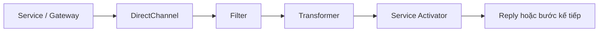
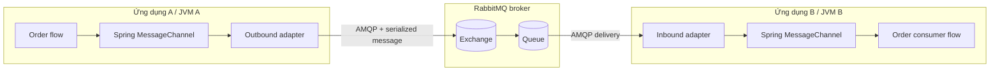
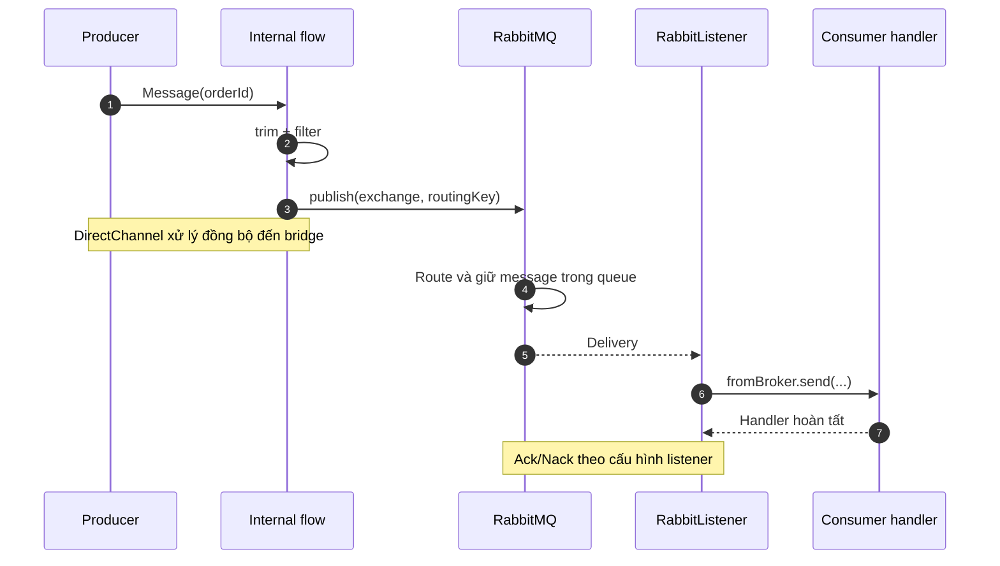
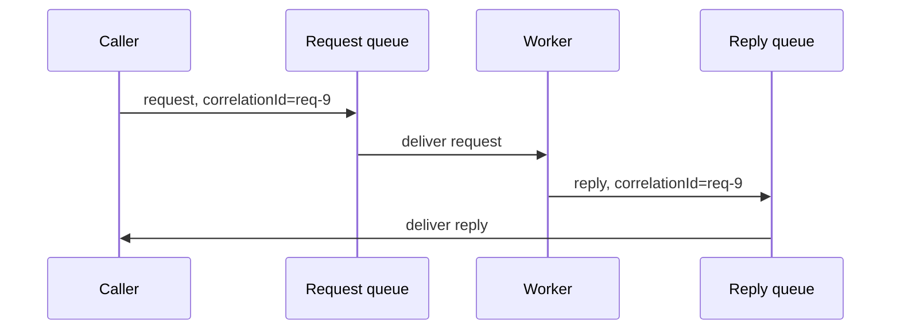
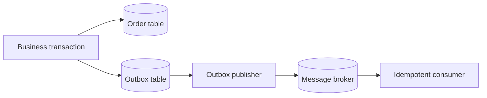

# Message broker — Message Channel nội bộ và broker channel

## Mục tiêu học tập

Hoàn thành bài học, bạn có thể:

- Giải thích `MessageChannel` của Spring Integration hoạt động trong một ứng dụng như thế nào và phân biệt nó với **queue/topic trên message broker**.
- Chọn `DirectChannel`, `QueueChannel`, `ExecutorChannel` hoặc `PublishSubscribeChannel` theo yêu cầu đồng bộ, bất đồng bộ và phân phối thông điệp.
- Mô tả ranh giới truyền thông điệp từ **Spring Integration flow → outbound adapter/bridge → broker → inbound adapter/bridge → flow nhận**.
- Thực hiện ví dụ gửi và nhận sự kiện qua RabbitMQ, nhận diện vai trò của exchange, routing key, queue, consumer và message converter.
- Phân tích delivery acknowledgement, retry, duplicate, idempotency, correlation, error channel và quan sát đường đi của message khi vượt qua ranh giới tiến trình.

Bài thuộc chương **Message broker** của module **SPRING_INTEGRATION_PATTERN**. Mục tiêu module là triển khai Enterprise Integration Patterns với Spring Integration để xây dựng luồng thông điệp ít phụ thuộc, dễ mở rộng; thực hành Router, Filter, Transformer, Splitter, Aggregator, Gateway, retry, error channel, correlation cùng kiểm thử và theo dõi nhánh xử lý. Hiểu đúng **Message Channel nội bộ và broker channel** là nền tảng để quyết định bước nào nên xử lý tại chỗ, bước nào phải giao sang hệ thống khác.

## 1. Hai khái niệm thường bị gọi chung là “channel”

### 1.1. Message Channel nội bộ

Trong Spring Integration, `org.springframework.messaging.MessageChannel` là một hợp đồng gửi message trong **ngữ cảnh ứng dụng đang chạy**. Ví dụ:

```java
public interface MessageChannel {
    boolean send(Message<?> message);
    boolean send(Message<?> message, long timeout);
}
```

Một message có **payload** và **headers**. Các endpoint như Service Activator, Filter, Router, Transformer và Aggregator có thể kết nối với nhau qua các channel. Sơ đồ một ứng dụng:



Điều đó **không tự có nghĩa** message được gửi qua TCP, được broker lưu bền vững hay một service ở JVM khác có thể subscribe vào bean channel cùng tên. Theo cấu hình mặc định, các channel này trao đổi thông tin trong một process. Một số channel có thể dùng `MessageStore` bên ngoài để lưu queue bền vững, nhưng đó vẫn là một cách cấu hình cụ thể, không phải đặc tính mặc định của mọi `MessageChannel`.

Ví dụ, hai microservice cùng khai báo bean tên `orders` sẽ có **hai đối tượng channel khác nhau**, trừ khi chúng được nối với nhau bằng một cơ chế truyền thông có chủ đích.

### 1.2. Broker channel / đích message trên broker

**Message broker** là hạ tầng trung gian nhận message từ producer và chuyển cho consumer: RabbitMQ, Apache Kafka hoặc JMS broker là các ví dụ quen thuộc. Tên “broker channel” thường được dùng theo nghĩa **đường truyền hoặc đích logic trên broker**, chẳng hạn:

- RabbitMQ: exchange, routing key và queue.
- JMS: queue hoặc topic.
- Kafka: topic và partition.

Những đối tượng này **không đồng nhất** với Java `MessageChannel`. Phần nối là một **message-driven adapter**, **outbound adapter/gateway** hoặc một bridge do ứng dụng xây dựng. Adapter chuyển payload/headers thành định dạng transport, gửi qua mạng và chuyển dữ liệu nhận được trở lại message của Spring Integration.



Ranh giới cần nhớ là **adapter/bridge**, nơi các đặc tính đồng bộ, serialization, lỗi, acknowledgement và vòng đời message có thể thay đổi.

## 2. So sánh các loại channel nội bộ

| Loại channel | Cách phân phối | Thread và thời điểm xử lý | Trường hợp sử dụng |
| --- | --- | --- | --- |
| `DirectChannel` | Gửi cho một subscriber phù hợp | Subscriber xử lý trực tiếp trong thread gửi theo mặc định | Flow ngắn, xử lý đồng bộ, cần exception quay lại caller |
| `QueueChannel` | Giữ message cho phía nhận `poll` | Sender enqueue; consumer gọi `receive()` hoặc một poller lấy ra | Tách thời điểm gửi/nhận, hàng đợi nhỏ trong ứng dụng |
| `ExecutorChannel` | Giao cho subscriber qua executor | Xử lý ở thread khác, sender thường trả về trước khi handler hoàn tất | Tách thread, công việc nặng hoặc cần concurrency |
| `PublishSubscribeChannel` | Phát cho các subscriber đăng ký | Đồng bộ theo mặc định; có thể cấu hình executor | Phát sự kiện nội bộ tới nhiều handler |
| Broker queue / topic | Qua transport ngoài process | Producer và consumer chạy độc lập, theo hợp đồng broker | Kết nối nhiều service, buffer khi consumer tạm dừng, mở rộng độc lập |

Một vài chi tiết dễ nhầm:

- `DirectChannel` không có API `receive()` như một `PollableChannel`; nó giao message cho subscriber. Khi subscriber ném exception trong flow đồng bộ, exception thường truyền trở lại bên gửi.
- `QueueChannel` có thể dùng `receive(timeout)` và mặc định là hàng đợi trong bộ nhớ. Nó **không tự động** là RabbitMQ/JMS queue và không bảo đảm tồn tại sau khi process chết.
- `ExecutorChannel` tạo bất đồng bộ trong cùng ứng dụng; không tự lưu bền vững qua restart. Sự cố tại handler xảy ra sau khi sender đã nhận kết quả gửi thành công.
- `PublishSubscribeChannel` gửi tới nhiều subscriber **trong cùng ứng dụng**. Điều này khác với việc broker fan-out tới nhiều service hoặc nhiều queue độc lập.
- `MessageChannel.send(message) == true` nói rằng bước gửi đã được channel chấp nhận theo hợp đồng của nó; đó **không phải** xác nhận cuối cùng rằng toàn bộ nghiệp vụ phía sau hoàn thành hoặc dữ liệu đã commit ở service khác.

Không chọn channel chỉ theo tên có vẻ “async”. Hãy xác định liệu cần giữ message qua restart, cần tách process, cần fan-out tới nhiều nhóm consumer hay chỉ cần tách thread trong một flow.

## 3. Khi nào cần broker?

Một Message Channel nội bộ thường là đủ nếu:

- Các endpoint thuộc cùng một ứng dụng và có thể chạy trong cùng JVM.
- Việc gửi/nhận không cần sống độc lập khi ứng dụng ngừng.
- Mục tiêu chỉ là tách các bước Router → Transformer → Service Activator và quản lý concurrency nội bộ.
- Không có yêu cầu nhiều microservice ở các tiến trình khác nhau subscribe vào cùng luồng.

Broker phù hợp khi:

- Producer và consumer **độc lập về triển khai, lifecycle hoặc quy mô**.
- Consumer có thể ngừng tạm thời, nhưng hệ thống vẫn cần giữ message theo cấu hình lưu trữ và acknowledgement.
- Một sự kiện phải được gửi tới nhiều nhóm consumer; ví dụ đơn hàng mới kích hoạt vận chuyển, gửi thông báo và cập nhật báo cáo.
- Cần chính sách retry, dead-letter, giới hạn lưu lượng, giám sát backlog hoặc lưu giữ log sự kiện vượt quá một process.

Broker cũng có chi phí: network latency, vận hành hạ tầng, định dạng dữ liệu, schema/version, bảo mật, message trùng, thứ tự, redelivery và độ phức tạp khi debug. Không cần thêm broker nếu quy mô và tính chất nghiệp vụ chỉ cần các kênh nội bộ.

### Các cách phân phối không giống nhau

| Mô hình | Ví dụ | Hành vi cần chú ý |
| --- | --- | --- |
| Point-to-point | Một RabbitMQ queue, nhiều consumer cùng queue | Các consumer cạnh tranh nhận công việc; **không phải mỗi consumer đều nhận một bản** |
| Publish-subscribe | RabbitMQ exchange nối nhiều queue riêng | Mỗi queue phù hợp có thể nhận bản của sự kiện; consumer trong cùng queue vẫn cạnh tranh |
| Partitioned log | Kafka topic chia partition | Consumer group phân bổ partition; thứ tự chủ yếu được xác định trong từng partition |
| Pub-sub nội bộ | `PublishSubscribeChannel` có nhiều subscriber | Phân phối trong ứng dụng; không tự cung cấp bền vững qua process |

Chẳng hạn, nếu ba service đều cần sự kiện `OrderPlaced`, trong RabbitMQ thường tạo **ba queue riêng** cùng binding tới exchange. Tạo ba instance consumer của một queue chỉ tăng số worker xử lý cạnh tranh cho **một nhóm công việc**, không phải ba nhóm nhận mọi sự kiện.

## 4. Ví dụ Spring Integration kết nối RabbitMQ

Bài toán: một ứng dụng phát lệnh xử lý mã đơn hàng qua channel nội bộ `orderCommands`, Filter loại mã rỗng, Transformer chuẩn hóa khoảng trắng, rồi bridge chuyển đơn hàng sang RabbitMQ. Một consumer nhận từ broker và chuyển lại vào channel nội bộ `fromBroker` để xử lý.

Để dễ nhìn ranh giới, ví dụ dùng **Spring Integration** cho các bước trong JVM và **Spring AMQP** (`RabbitTemplate`, `@RabbitListener`) làm bridge. Trong dự án thực, có thể dùng **Spring Integration AMQP outbound/inbound channel adapters** để cùng trách nhiệm này được khai báo hoàn toàn theo IntegrationFlow. Hai cách đều dựa vào ý tưởng chung: bridge/adapter kết nối một channel nội bộ với transport ngoài tiến trình.

Giả sử dự án Spring Boot có các dependency:

```groovy
dependencies {
    implementation 'org.springframework.boot:spring-boot-starter-integration'
    implementation 'org.springframework.boot:spring-boot-starter-amqp'
    testImplementation 'org.springframework.boot:spring-boot-starter-test'
}
```

Để dùng các AMQP adapters chuyên dụng của Spring Integration, bổ sung dependency `org.springframework.integration:spring-integration-amqp` phù hợp với phiên bản Spring Integration đang chạy. Ví dụ bên dưới chỉ sử dụng `RabbitTemplate` và `@RabbitListener` nên không cần adapter đó.

### 4.1. Khai báo channel nội bộ và topology RabbitMQ

`OrderMessagingConfiguration.java`:

```java
import org.springframework.amqp.core.Binding;
import org.springframework.amqp.core.BindingBuilder;
import org.springframework.amqp.core.Queue;
import org.springframework.amqp.core.QueueBuilder;
import org.springframework.amqp.core.TopicExchange;
import org.springframework.amqp.rabbit.annotation.EnableRabbit;
import org.springframework.context.annotation.Bean;
import org.springframework.context.annotation.Configuration;
import org.springframework.integration.annotation.EnableIntegration;
import org.springframework.integration.channel.DirectChannel;
import org.springframework.integration.dsl.IntegrationFlow;
import org.springframework.messaging.MessageChannel;

@Configuration
@EnableIntegration
@EnableRabbit
public class OrderMessagingConfiguration {

    @Bean("orderCommands")
    public MessageChannel orderCommands() {
        return new DirectChannel();
    }

    @Bean("toBroker")
    public MessageChannel toBroker() {
        return new DirectChannel();
    }

    @Bean("fromBroker")
    public MessageChannel fromBroker() {
        return new DirectChannel();
    }

    @Bean
    public IntegrationFlow prepareOrderFlow() {
        return IntegrationFlow.from("orderCommands")
            .transform(String.class, String::trim)
            .filter(String.class, orderId -> !orderId.isBlank())
            .channel("toBroker")
            .get();
    }

    @Bean
    public TopicExchange orderExchange() {
        return new TopicExchange("orders.events", true, false);
    }

    @Bean
    public Queue orderCreatedQueue() {
        return QueueBuilder.durable("orders.created.q").build();
    }

    @Bean
    public Binding orderCreatedBinding(
            Queue orderCreatedQueue, TopicExchange orderExchange) {
        return BindingBuilder.bind(orderCreatedQueue)
            .to(orderExchange)
            .with("order.placed");
    }
}
```

Các bean `orderCommands`, `toBroker` và `fromBroker` là **Spring MessageChannel**. Ngược lại, `orders.events` là **RabbitMQ topic exchange** và `orders.created.q` là **RabbitMQ queue**. Binding cho phép message có routing key `order.placed` được chuyển từ exchange vào queue.

Với Spring Boot có RabbitMQ auto-configuration và `RabbitAdmin` phù hợp, các bean exchange/queue/binding được khai báo lên broker. Nếu cấu hình Spring thuần, cần đăng ký `RabbitAdmin` hoặc chủ động tạo topology bằng công cụ vận hành. Cần RabbitMQ đang chạy và thông số kết nối như `spring.rabbitmq.host`, `port`, `username` và `password` phù hợp môi trường.

**Giới hạn của ví dụ:** Filter đang loại bỏ chuỗi rỗng mà không phát reply lỗi. Đối với luồng command cần xác nhận, hãy trả lỗi validation hoặc dùng discard channel rõ ràng; nếu bên gọi đồng bộ chờ reply, việc lọc âm thầm có thể dẫn tới timeout.

### 4.2. Bridge publish từ Spring Integration sang broker

`OrderBrokerBridge.java`:

```java
import org.springframework.amqp.rabbit.annotation.RabbitListener;
import org.springframework.amqp.rabbit.core.RabbitTemplate;
import org.springframework.beans.factory.annotation.Qualifier;
import org.springframework.integration.annotation.ServiceActivator;
import org.springframework.messaging.MessageChannel;
import org.springframework.messaging.support.MessageBuilder;
import org.springframework.stereotype.Component;

@Component
public class OrderBrokerBridge {

    private final RabbitTemplate rabbitTemplate;
    private final MessageChannel fromBroker;

    public OrderBrokerBridge(
            RabbitTemplate rabbitTemplate,
            @Qualifier("fromBroker") MessageChannel fromBroker) {
        this.rabbitTemplate = rabbitTemplate;
        this.fromBroker = fromBroker;
    }

    @ServiceActivator(inputChannel = "toBroker")
    public void publish(String orderId) {
        rabbitTemplate.convertAndSend(
            "orders.events",
            "order.placed",
            orderId
        );
    }

    @RabbitListener(queues = "orders.created.q")
    public void receive(String orderId) {
        // Từ RabbitMQ quay lại một MessageChannel nội bộ.
        boolean accepted = fromBroker.send(
            MessageBuilder.withPayload(orderId)
                .setHeader("transport", "rabbitmq")
                .build()
        );
        if (!accepted) {
            throw new IllegalStateException("Local channel rejected event");
        }
    }

    @ServiceActivator(inputChannel = "fromBroker")
    public void process(String orderId) {
        // Minh họa handler nội bộ; thay bằng nghiệp vụ thực tế.
        System.out.println("Processing order event: " + orderId);
    }
}
```

Diễn biến:

1. Một producer phát `Message<String>` chứa `" ORD-42 "` vào `orderCommands`.
2. Transformer biến payload thành `"ORD-42"`; Filter giữ message hợp lệ rồi chuyển đến `toBroker`.
3. `@ServiceActivator` nhận message và gọi `RabbitTemplate.convertAndSend(...)`. RabbitMQ định tuyến message qua exchange, routing key và binding vào queue.
4. `@RabbitListener` của consumer lấy message từ queue, chuyển payload đã giải mã về Java, dựng một Spring `Message` rồi gửi đến `fromBroker`.
5. `@ServiceActivator` trên `fromBroker` xử lý payload trong ứng dụng nhận.

Cách gửi request nội bộ:

```java
import org.springframework.context.ApplicationContext;
import org.springframework.messaging.MessageChannel;
import org.springframework.messaging.support.MessageBuilder;

MessageChannel commands =
    context.getBean("orderCommands", MessageChannel.class);
commands.send(
    MessageBuilder.withPayload(" ORD-42 ").build()
);
```

`context` trong đoạn trên là `ApplicationContext` đã được ứng dụng cung cấp. Ví dụ dùng chung process cho hai đầu bridge để thuận tiện học tập; khi tách thành hai service, service A chỉ giữ phần publisher, service B giữ phần consumer và các bean channel riêng của nó. Chúng gặp nhau qua **broker**, không chia sẻ đối tượng `MessageChannel`.

### 4.3. Sơ đồ đường đi và sự thay đổi ngữ nghĩa



Bên gửi không nên coi việc gọi `commands.send(...)` thành công là bằng chứng rằng consumer ở service khác đã xử lý xong. Với `RabbitTemplate.convertAndSend(...)` thông thường, return bình thường chỉ cho biết thao tác publish phía client không ném lỗi tại thời điểm đó; muốn xác minh broker đã nhận và định tuyến đúng phải cấu hình cơ chế **publisher confirms** và, khi phù hợp, **publisher returns/mandatory**. Để xác minh nghiệp vụ phía consumer hoàn tất, cần một **acknowledgement nghiệp vụ** hoặc trạng thái độc lập.

Trong ứng dụng gửi message, nếu `toBroker` là `DirectChannel`, exception từ bridge publish có thể truyền ngược lên lời gọi gửi. Nếu chuyển sang `ExecutorChannel`, exception có thể xảy ra ở thread khác và phải được theo dõi bằng error handling phù hợp.

## 5. Độ bền và xác nhận không giống nhau

Khi dùng broker, cần phân biệt ít nhất **ba mốc xác nhận**:

| Mốc | Ai xác nhận? | Nó chứng minh điều gì? |
| --- | --- | --- |
| Gửi vào channel nội bộ | `MessageChannel` | Message được channel chấp nhận/giao cho endpoint theo hợp đồng của channel |
| Broker nhận publish | Publisher confirm, nếu được cấu hình | Broker xác nhận xử lý publish theo cơ chế của nó; chưa đồng nghĩa consumer hoàn tất |
| Consumer hoàn thành xử lý | Consumer acknowledgement và/hoặc kết quả nghiệp vụ | Broker có thể xóa/đánh dấu delivery theo ack; kết quả nghiệp vụ cần kiểm tra riêng khi có side effect |

**Durable queue** nghĩa là queue được khai báo để tồn tại qua restart broker theo cơ chế hỗ trợ, nhưng để lưu message bền vững còn liên quan **persistent delivery mode**, publisher confirms, độ bền hạ tầng và các cấu hình broker tương ứng. Không suy luận chỉ vì có queue durable mà mọi message chắc chắn không thể mất.

### Ack, requeue và message trùng

Trong Spring AMQP, listener container thường dùng chế độ acknowledgement tự động ở **mức container**: khi listener trả về thành công, container xác nhận delivery; khi listener ném exception, container áp dụng chính sách lỗi, có thể từ chối/requeue theo cấu hình. “AUTO” ở đây **không có nghĩa ack ngay khi nhận**, và không bảo đảm transaction nghiệp vụ luôn nguyên tử với ack.

Xét tình huống:

1. Consumer nhận `OrderPlaced(eventId=evt-17)`.
2. Consumer ghi đơn hàng vào DB thành công.
3. Process chết trước khi RabbitMQ ghi nhận acknowledgement.
4. Broker có thể giao lại **cùng message** sau khi consumer khởi động lại.

Nếu handler không kiểm tra `eventId` hoặc key nghiệp vụ, nó có thể tạo dữ liệu trùng. Vì thế ở các mô hình giao ít nhất một lần (*at-least-once*), consumer cần **idempotency/deduplication**.

Cẩn thận khi thay `fromBroker` bằng `ExecutorChannel`: lúc này `fromBroker.send(...)` có thể trả về **trước khi handler thực sự hoàn tất**. Listener có thể trả về thành công rồi broker nhận ack dù công việc ở thread khác còn đang chạy. Nếu yêu cầu ack chỉ sau commit, cần thiết kế rõ thời điểm ack, transaction hoặc cơ chế lưu công việc bền vững trước khi bàn giao bất đồng bộ.

### Retry và dead-letter

Nếu consumer lỗi liên tục và broker luôn requeue, một message “độc” (*poison message*) có thể tạo vòng lặp thất bại. Chính sách production thường gồm:

- Phân loại lỗi tạm thời (ví dụ downstream 503) và lỗi vĩnh viễn (schema sai, dữ liệu không hợp lệ).
- Retry có **max attempts**, backoff và giới hạn tải; tránh retry vô hạn ngay trong consumer.
- Khi hết lượt, đưa message tới **dead-letter queue (DLQ)** hoặc nơi lưu cách ly theo cấu hình, kèm nguyên nhân, ID và số lượt thử.
- Giám sát số lượng message pending, unacked, redelivered và dead-letter; quy định quy trình replay an toàn.

Một `errorChannel` trong Spring Integration giúp thu `ErrorMessage` của những đoạn flow có cơ chế đẩy lỗi tới kênh; **nó không tự động thay thế** nack/requeue/DLQ của RabbitMQ. Error channel là xử lý trong ứng dụng, còn xác nhận delivery là giao thức giữa consumer với broker. Khi nối hai bên, phải chỉ định lỗi ở đâu sẽ làm listener ném exception và lỗi ở đâu đã được xử lý có chủ đích.

## 6. Serialization, headers và correlation qua broker

Trong JVM, payload có thể là đối tượng Java và header `replyChannel` thậm chí chứa một đối tượng `MessageChannel`. Khi qua broker, message phải chuyển sang **định dạng vận chuyển**. Một broker consumer ở JVM khác không thể dùng trực tiếp tham chiếu đối tượng channel của producer.

Các yếu tố nên chuẩn hóa:

| Thành phần | Ví dụ | Quy ước |
| --- | --- | --- |
| `eventId` | `evt-17` | Khóa dedup cho sự kiện cụ thể |
| `aggregateId` / `orderId` | `ORD-42` | Khóa nhóm theo đối tượng nghiệp vụ |
| `correlationId` | `trace-82` | Ghép log/trace giữa bước xử lý, reply và sự kiện |
| `causationId` | `cmd-12` | Cho biết message được tạo do lệnh/sự kiện nào |
| `schemaVersion` | `1` | Hỗ trợ thay đổi cấu trúc payload |
| `occurredAt` | UTC ISO-8601 | Phân biệt thời điểm phát sinh với thời điểm broker delivery |
| Content type | `application/json` | Khai báo cách decode payload |
| Routing key/topic | `order.placed` | Quy tắc phân phối trên broker, không phải tên bean trong JVM |

Ví dụ một event payload **đề xuất cho production** thay cho `String` tối giản của bài:

```json
{
  "eventId": "evt-17",
  "eventType": "OrderPlaced",
  "schemaVersion": 1,
  "orderId": "ORD-42",
  "occurredAt": "2026-11-21T05:00:00Z"
}
```

Để gửi/nhận JSON thực tế, cần cấu hình message converter tương thích ở publisher/consumer, schema và cách ánh xạ trường. Snippet Spring AMQP ở mục 4 dùng `String` để tránh phụ thuộc serializer; **không thể thay thành Java record rồi mặc định mong tự ra JSON** nếu chưa cấu hình converter.

Khi message đi qua nhiều transport, phải kiểm tra header nào được mapping. Header `replyChannel` là thông tin định tuyến nội bộ, không phải một địa chỉ reply có thể serialize vô điều kiện. Với request–reply qua broker, hãy xác định **reply destination**, correlation ID, timeout và cách xử lý reply đến muộn ở mức giao thức/adapter tương ứng. Đừng giả định `@MessagingGateway` đồng bộ nội bộ sẽ tự tạo RPC xuyên service chỉ nhờ một queue.

## 7. Request–reply với broker khác event một chiều

Ví dụ đơn hàng ở trên là **publish/consume một chiều**: producer phát sự kiện, consumer xử lý. Còn trong Remote Procedure Invocation hoặc Request–Reply qua broker, caller còn cần một phản hồi tương ứng:



Mô hình này đòi hỏi thêm:

1. Định nghĩa **reply queue/destination** mà worker có thể truy cập.
2. Giữ **correlation ID** nguyên vẹn qua request và reply, nhất là khi nhiều lời gọi chạy đồng thời.
3. Đặt timeout ở caller; khi worker trả reply sau timeout, có **late reply** phải xử lý rõ.
4. Retry an toàn; không tạo nghiệp vụ trùng nếu message bị redeliver.
5. Cleanup trạng thái pending và quyết định ai nhận reply nếu caller đã restart.

Broker không tự biến giao tiếp bất đồng bộ thành lời gọi synchronous có “exactly once”. Nếu nghiệp vụ dài, thường phù hợp hơn khi gửi lệnh với `requestId` và để caller truy vấn trạng thái hoặc nhận sự kiện kết thúc.

## 8. Tính nhất quán DB và việc phát sự kiện

Đặt trong cùng Service Activator:

```text
1. INSERT orders vào database
2. Publish OrderPlaced qua RabbitMQ
```

Hai bước này không tự thuộc cùng một transaction phân tán. Nếu DB commit thành công nhưng publish thất bại, downstream không nhận sự kiện. Nếu publish thành công nhưng transaction DB rollback, downstream có thể nhận sự kiện về đơn hàng không tồn tại.

**Transactional outbox** là một hướng xử lý phổ biến:



Ứng dụng ghi thay đổi nghiệp vụ và bản ghi outbox **trong cùng transaction DB**. Một publisher độc lập đọc outbox, gửi lên broker, rồi đánh dấu đã publish sau khi có xác nhận phù hợp. Nếu publisher chết giữa chừng, nó có thể gửi lại, nên consumer vẫn cần deduplication theo `eventId`.

Ở phía nhận, có thể dùng **inbox/dedup table** để ghi nhận `eventId` đã xử lý và thực hiện side effect trong cùng transaction. Đây là phương án giảm rủi ro lặp khi redelivery; nó không làm toàn bộ hệ thống trở thành một transaction nguyên tử duy nhất.

## 9. Quan sát và kiểm thử ranh giới

### 9.1. Kiểm thử hành vi channel nội bộ

Một kiểm thử JUnit 5 nhỏ chứng minh `DirectChannel` đẩy message tới subscriber nội bộ và `QueueChannel` có thể dùng để bắt kết quả:

```java
import static org.junit.jupiter.api.Assertions.assertEquals;
import static org.junit.jupiter.api.Assertions.assertNotNull;
import static org.junit.jupiter.api.Assertions.assertTrue;

import org.junit.jupiter.api.Test;
import org.springframework.integration.channel.DirectChannel;
import org.springframework.integration.channel.QueueChannel;
import org.springframework.messaging.Message;
import org.springframework.messaging.support.MessageBuilder;

class InternalChannelTest {

    @Test
    void sendsToSubscribedHandlerWithinSameApplication() {
        DirectChannel input = new DirectChannel();
        QueueChannel captured = new QueueChannel(1);

        input.subscribe(message -> {
            captured.send(message);
        });

        assertTrue(input.send(
            MessageBuilder.withPayload("ORD-42").build()
        ));

        Message<?> received = captured.receive(1_000);
        assertNotNull(received);
        assertEquals("ORD-42", received.getPayload());
    }
}
```

Kiểm thử này chứng minh khả năng dispatch trong bộ nhớ. Nó **không kiểm tra** RabbitMQ, sự cố mạng, tính bền vững hoặc acknowledgement từ consumer khác process.

### 9.2. Kiểm thử tích hợp broker

Với RabbitMQ chạy thử hoặc Testcontainers RabbitMQ, nên xác minh độc lập:

1. Producer gửi `" ORD-42 "` qua `orderCommands`; message đến queue với payload đã chuẩn hóa `"ORD-42"`.
2. Consumer đăng ký trên `orders.created.q` nhận và chuyển payload vào `fromBroker`.
3. Hai nhóm consumer với **hai queue** khác nhau đều nhận event đã publish; hai consumer của **cùng queue** phân chia công việc.
4. Tắt consumer trước khi publish, sau đó khởi động lại: xác minh message được lưu/giao theo cấu hình durability, TTL, ack và retention thực tế.
5. Gây lỗi ở consumer trước khi ack: kiểm chứng redelivery hoặc dead-letter theo cấu hình; dedup ngăn side effect lần hai.
6. Gửi routing key không có binding phù hợp: kiểm tra publisher returns/mandatory hoặc cơ chế phát hiện unroutable message đã thiết lập.

Dùng event ID riêng cho mỗi test và dọn queue giữa các bài để kết quả không lẫn dữ liệu từ lần chạy khác. Kiểm tra từng mốc: producer gửi, broker xác nhận, consumer nhận, nghiệp vụ commit và ack. Không dùng một assertion “send thành công” để đại diện cho toàn bộ chuỗi.

### 9.3. Những metric và log nên có

| Vị trí | Quan sát cần thiết |
| --- | --- |
| Internal channel | Số message gửi, thời gian xử lý handler, lỗi/timeout, queue depth nếu có |
| Outbound bridge | Publish attempt, exception, publisher confirms, unroutable returns |
| Broker | Ready/unacked, backlog, redelivered, DLQ, độ trễ queue |
| Inbound bridge | Message received, consumer concurrency, thời gian xử lý, nack/requeue |
| Nghiệp vụ | `eventId`/`correlationId`, kết quả xử lý, dedup hit, trạng thái transaction |

Trên mỗi log, giữ cùng `eventId` hoặc `correlationId` từ producer đến consumer. Tránh ghi token, password và toàn bộ payload nhạy cảm. Nếu dùng Micrometer hoặc distributed tracing, đặt span/baggage theo khả năng hỗ trợ của adapter và cấu hình propagator; không suy đoán tracing tự lan qua mọi broker.

## 10. Những lỗi thiết kế thường gặp

| Sai lầm | Hậu quả | Cách khắc phục |
| --- | --- | --- |
| Tưởng `QueueChannel` mặc định là broker | Mất message khi ứng dụng restart; process khác không subscribe được | Dùng broker/adapter khi thực sự cần qua process, hoặc thiết kế persistent store phù hợp |
| Dùng chung tên bean channel ở hai service | Hai channel vẫn hoàn toàn tách rời | Định nghĩa endpoint broker, routing và transport cụ thể |
| Tưởng `send()` thành công nghĩa là nghiệp vụ remote đã xong | Đánh dấu hoàn thành quá sớm | Theo dõi confirm, delivery và trạng thái nghiệp vụ ở từng tầng |
| Một queue với nhiều consumer nhưng kỳ vọng mọi consumer nhận mọi event | Chỉ một consumer trong nhóm cạnh tranh nhận từng delivery | Tạo các queue/binding riêng cho từng nhóm cần bản sao |
| Ack trước khi công việc bất đồng bộ hoàn thành | Có thể mất tác vụ nếu worker chết | Ack sau xử lý/commit hoặc lưu công việc bền vững trước khi ack |
| Requeue vô hạn khi payload sai | Vòng lặp poison message | Bounded retry, phân loại lỗi, DLQ và cảnh báo |
| Không dedup sau redelivery | Ghi DB, gửi email hoặc tính phí trùng | Idempotency theo `eventId`/key nghiệp vụ |
| Chỉ tạo durable queue | Nhầm rằng mọi publish đã bền vững | Xác định message persistence, confirms, HA và recovery |
| Serialize đối tượng `MessageChannel` trong header | Consumer JVM khác không thể dùng tham chiếu nội bộ | Dùng transport reply destination và correlation |
| Thay đổi event schema không có version | Consumer cũ đọc lỗi hoặc hiểu sai payload | Version schema, kiểm thử compatibility, áp dụng converter rõ ràng |

## 11. Bài tập thực hành

**Bài 1 — Chỉ dùng channel nội bộ.** Xây dựng flow `ordersInput → Filter → Transformer → Service Activator`. Thay `DirectChannel` bằng `ExecutorChannel`, quan sát thread xử lý và cách báo lỗi thay đổi.

**Bài 2 — Đổi điểm cuối sang broker.** Dùng `OrderMessagingConfiguration` và `OrderBrokerBridge` ở mục 4. Chạy RabbitMQ, gửi `" ORD-42 "`, xác nhận nội dung trên queue là `"ORD-42"` và consumer đã xử lý.

**Bài 3 — Một queue hay nhiều queue?** Tạo thêm queue `orders.analytics.q` và bind cùng routing key `order.placed`. Đưa hai consumer vào `orders.created.q` và một consumer vào `orders.analytics.q`. Quan sát work sharing và pub-sub khác nhau thế nào.

**Bài 4 — Crash và redelivery.** Giả lập consumer đã ghi DB rồi gặp exception trước ack. Thiết kế lưu `eventId` để sau khi redelivery, consumer không ghi lặp.

**Bài 5 — Không có route.** Publish vào exchange với routing key không khớp binding. Bật publisher confirms và mandatory returns theo cấu hình phù hợp; so sánh “broker nhận publish” và “message được route vào queue”.

**Bài 6 — Request–reply qua broker.** Đề xuất reply destination, correlation ID và timeout cho một worker xử lý lâu. Viết chính sách khi reply đến sau khi caller đã timeout.

**Tiêu chí hoàn thành:** với một message cụ thể, vẽ được toàn bộ đường đi từ producer tới consumer, chỉ ra ranh giới JVM/broker, đơn vị nào chịu trách nhiệm lưu và ack, cách phát hiện retry/duplicate và cách kiểm chứng nghiệp vụ hoàn tất.

## 12. Ghi nhớ

- `MessageChannel` của Spring Integration là hợp đồng kết nối các endpoint **trong một ứng dụng**; `DirectChannel`, `QueueChannel`, `ExecutorChannel` và `PublishSubscribeChannel` có ngữ nghĩa khác nhau nhưng không tự kết nối nhiều service.
- **Broker channel** là đường message qua hạ tầng ngoài process (queue, topic, exchange/partition tùy broker). Cần adapter/bridge để chuyển giữa hai thế giới.
- `send()`, broker publisher confirm, consumer ack và nghiệp vụ commit là **những mốc xác nhận khác nhau**.
- Khi qua broker, phải thiết kế serialization, schema, correlation, retry, dead-letter, idempotency và quan sát.
- Chọn internal channel cho các bước xử lý cục bộ; dùng broker khi cần tách tiến trình, lưu message trong lúc consumer ngừng hoặc phân phối tới nhiều nhóm consumer theo hợp đồng vận hành rõ ràng.
