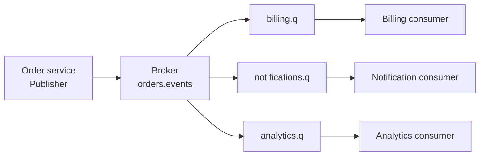
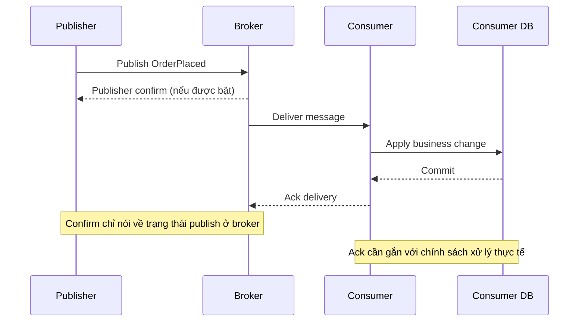
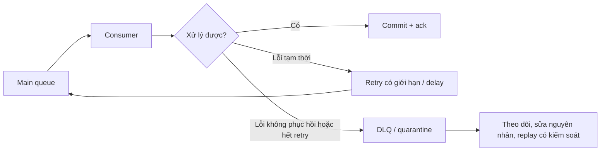
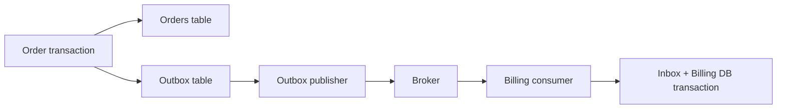

# Publish và consume qua broker với Spring Integration

## 1. Bài toán: tách nơi phát sự kiện khỏi nơi xử lý

Trong chương **Message broker** của mô-đun **SPRING_INTEGRATION_PATTERN**, chúng ta áp dụng các **Enterprise Integration Patterns** bằng Spring Integration để tổ chức luồng thông điệp ít phụ thuộc, có thể mở rộng và theo dõi được. Bài này tập trung vào hai hành động cốt lõi:

- **Publish**: đưa một message lên broker để các hệ thống quan tâm có thể nhận và xử lý.
- **Consume**: lấy message từ queue/topic/subscription, chuyển vào luồng xử lý của ứng dụng và xác nhận kết quả theo chính sách giao nhận.

Giả sử dịch vụ **Order** hoàn tất việc ghi đơn hàng và phát sự kiện `OrderPlaced`. Dịch vụ **Billing** cần tạo bản ghi thanh toán; **Notification** cần gửi thông báo; **Analytics** cần cập nhật thống kê. Nếu Order gọi trực tiếp cả ba hệ thống, một hệ thống chậm có thể kéo dài thời gian xử lý của Order, và việc thêm consumer mới buộc Order phải biết thêm đích gọi.

Thay vì vậy, Order publish một event lên broker. Mỗi dịch vụ subscribe qua queue hoặc consumer group tương ứng.



Sơ đồ minh họa **một event được fan-out tới nhiều nhóm chức năng**. Trong mỗi queue của một nhóm, có thể chạy nhiều consumer cùng chia nhau xử lý các message của queue đó. Đây là hai quan hệ khác nhau: **broadcast giữa các nhóm** và **competing consumers trong một nhóm**.

Kết thúc bài học, bạn sẽ có thể:

1. Giải thích exchange, routing key, queue, binding, topic, subscription, acknowledgment và offset.
2. Tạo một luồng publish/consume trong Spring Integration, minh họa bằng RabbitMQ qua Spring AMQP.
3. Phân biệt xác nhận đã gửi, đã nhận, đã xử lý và đã commit nghiệp vụ.
4. Thiết kế retry, dead-letter, idempotency và correlation khi message bị gửi hoặc xử lý trùng.
5. Chẩn đoán backlog, lỗi định tuyến, poison message và lỗi khi consumer restart.
6. So sánh điểm khác nhau của RabbitMQ, Kafka và JMS để chọn cơ chế phù hợp.

## 2. Publish/subscribe không có nghĩa mọi consumer nhận mọi message

### 2.1. Các thành phần nền tảng

| Thành phần | Vai trò | Lưu ý |
| --- | --- | --- |
| **Publisher / Producer** | Gửi thông điệp tới broker | Cần xử lý lỗi mạng, retry và xác nhận publish |
| **Broker** | Trung gian nhận, lưu/chuyển và phân phối message | Độ bền phụ thuộc sản phẩm và cấu hình |
| **Exchange / Topic** | Điểm nhận hoặc phân loại message | RabbitMQ dùng exchange; Kafka dùng topic |
| **Routing key / Partition key** | Chọn đích hoặc nhóm dữ liệu liên quan | Ngữ nghĩa phụ thuộc broker |
| **Queue / Subscription / Consumer group** | Nơi consumer lấy message | Có thể đại diện cho một nhóm công việc |
| **Consumer** | Đọc và xử lý message | Phải quản lý lỗi, acknowledgment và idempotency |
| **Ack / Offset commit** | Đánh dấu tiến độ nhận/xử lý với broker | **Không tự đồng nghĩa** transaction nghiệp vụ đã commit |
| **Dead-letter destination** | Nơi chứa message không xử lý được theo chính sách | Phục vụ phân tích, sửa và reprocess có kiểm soát |

Trong RabbitMQ, publisher thường gửi vào **exchange**, sau đó exchange chuyển đến queue theo binding/routing key. Trong Kafka, producer gửi vào **topic partition**, consumer trong cùng group chia nhau các partition. Không nên bê nguyên mô hình exchange/queue của RabbitMQ sang Kafka vì cơ chế phân phối, lưu trữ và acknowledgment khác nhau.

### 2.2. Hai kiểu phân phối thường gặp

**Fan-out giữa các dịch vụ**

```text
           +--> billing.queue       --> Billing
Order ---> +--> notification.queue  --> Notification
           +--> analytics.queue     --> Analytics
```

Mỗi nhóm xử lý có queue/subscription riêng. Cùng một sự kiện có thể được các nhóm xử lý độc lập.

**Competing consumers trong cùng một nhóm**

```text
billing.queue --> Billing worker A
              --> Billing worker B
              --> Billing worker C
```

Các worker cùng đọc một queue để phân chia công việc. Một message bình thường được giao cho một consumer tại một thời điểm trong cùng queue, nhưng **có thể được giao lại** nếu chưa được xác nhận đúng cách hoặc kết nối bị gián đoạn.

### 2.3. Event và command khác nhau thế nào?

- **Event** nêu điều đã xảy ra: `OrderPlaced`, `PaymentCaptured`. Nhiều subscriber có thể quan tâm.
- **Command** yêu cầu làm việc cụ thể: `ReserveStock`, `GenerateInvoice`. Thường nhắm một chủ thể sở hữu trách nhiệm.
- **Request–reply qua broker** cần reply destination, correlation ID và timeout; đó là một kiểu giao tiếp khác với event fire-and-forget.

Ví dụ một event nên dùng thì quá khứ, mang dữ liệu đủ để consumer hiểu sự kiện đã xảy ra. Broker chỉ chịu trách nhiệm vận chuyển; business event vẫn cần định nghĩa contract, version và owner.

## 3. Đường đi của message và bốn mức “thành công”

Một trong những lỗi thiết kế phổ biến nhất là log “publish success” rồi coi các service khác đã cập nhật dữ liệu.



Có ít nhất bốn mốc:

1. **Caller gửi message tới adapter**: hàm publish phía ứng dụng đã được gọi.
2. **Broker xác nhận publish**: broker đã nhận/xử lý publish ở mức được contract của nó bảo đảm.
3. **Broker giao message tới consumer**: consumer bắt đầu có cơ hội xử lý.
4. **Consumer commit tác động nghiệp vụ rồi xác nhận**: xử lý được coi là hoàn tất theo policy của hệ thống.

Các mốc không hoán đổi cho nhau. Publisher confirm **không** có nghĩa consumer đã tạo invoice. Consumer ack cũng không chứng minh đã commit nếu code ack trước khi giao dịch dữ liệu kết thúc.

### 3.1. Các cam kết giao nhận

| Mức bảo đảm | Cách hiểu | Đổi lại |
| --- | --- | --- |
| **At-most-once** | Message có thể mất; không cố giao lại khi thất bại | Ít duplicate, nhưng mất dữ liệu có thể xảy ra |
| **At-least-once** | Có thể giao lại khi chưa được xác nhận | Consumer phải xử lý trùng an toàn |
| **Exactly-once processing/effect** | Hiệu ứng được kiểm soát không bị nhân đôi trong phạm vi bảo đảm xác định | Cần phối hợp transaction, deduplication và contract rõ ràng |

Trong thiết kế event-driven phổ biến, hãy **mặc định chuẩn bị cho duplicate** và làm consumer idempotent. Một số broker hỗ trợ transaction hoặc exactly-once ở phạm vi nội bộ sản phẩm, nhưng không tự bảo đảm thao tác bên ngoài như HTTP, gửi email hay cập nhật database khác đúng một lần.

## 4. Thiết kế message contract trước khi viết code

Ví dụ event khi đơn hàng được chấp nhận:

```json
{
  "eventId": "evt-9de71",
  "eventType": "OrderPlaced",
  "schemaVersion": 1,
  "orderId": "ord-2408",
  "amountCents": 259900,
  "currency": "VND",
  "occurredAt": "2026-11-21T03:10:30Z"
}
```

Các trường có vai trò:

| Trường | Tại sao cần? |
| --- | --- |
| `eventId` | Định danh duy nhất sự kiện để dedup ở từng consumer |
| `eventType` | Cho biết nghiệp vụ đã diễn ra |
| `schemaVersion` | Hỗ trợ thay đổi contract theo thời gian |
| `orderId` | Khóa nghiệp vụ và có thể là key để giữ thứ tự theo đơn |
| `amountCents`, `currency` | Giữ đơn vị rõ ràng, tránh sai số dấu phẩy động |
| `occurredAt` | Mốc phát sinh sự kiện, độc lập thời gian broker giao message |

Một event có thể có metadata như `traceId`, `correlationId`, `tenantId` hoặc producer version ở header. **Event ID** dành cho phát hiện duplicate; **correlation ID** dành cho truy vết liên quan giữa các message; hai khái niệm có thể liên hệ nhưng không nên mặc định là một.

**Quy tắc contract:** consumer phải kiểm tra event type, schema version, trường bắt buộc và phạm vi tenant trước khi thực hiện side effect. Nếu schema chưa hỗ trợ, cần policy rõ ràng để đưa lỗi sang dead-letter/quarantine, thay vì đọc sai rồi ack như thành công.

## 5. Ví dụ Spring Integration với RabbitMQ

Ví dụ triển khai một producer `Order` và một consumer `Billing` dùng **Spring Integration + Spring AMQP**. Ta dùng RabbitMQ làm broker minh họa; nguyên tắc publish/consume có thể chuyển sang broker khác nhưng API và bảo đảm giao nhận phải được thiết kế lại tương ứng.

### 5.1. Thành phần và dependency

Với ứng dụng Spring Boot dùng Gradle, cần các dependency phù hợp với BOM của phiên bản Boot đang sử dụng:

```groovy
dependencies {
    implementation 'org.springframework.boot:spring-boot-starter-integration'
    implementation 'org.springframework.boot:spring-boot-starter-amqp'
    implementation 'org.springframework.integration:spring-integration-amqp'

    // Tích hợp database khi làm inbox/outbox:
    implementation 'org.springframework.boot:spring-boot-starter-jdbc'
    runtimeOnly 'org.postgresql:postgresql'
}
```

Cần một RabbitMQ đang chạy và thông tin kết nối đúng với môi trường. Ở môi trường development, ví dụ cấu hình:

```yaml
spring:
  rabbitmq:
    host: localhost
    port: 5672
    username: guest
    password: guest
```

Đây là **ví dụ cấu hình local**, không phải thông tin dùng cho production. Trong production, lấy credential từ secret manager, dùng TLS, phân quyền tối thiểu theo vhost/exchange/queue và quản lý topology bằng cấu hình có kiểm soát.

### 5.2. Exchange, queue và binding

Ta dùng topic exchange `orders.events`. Billing có queue riêng `billing.order-events.q` và chỉ nhận routing key `order.placed`.

```java
import org.springframework.amqp.core.Binding;
import org.springframework.amqp.core.BindingBuilder;
import org.springframework.amqp.core.Queue;
import org.springframework.amqp.core.QueueBuilder;
import org.springframework.amqp.core.TopicExchange;
import org.springframework.amqp.core.ExchangeBuilder;
import org.springframework.context.annotation.Bean;
import org.springframework.context.annotation.Configuration;

@Configuration
public class BrokerTopology {

    public static final String EXCHANGE = "orders.events";
    public static final String BILLING_QUEUE = "billing.order-events.q";
    public static final String ORDER_PLACED_KEY = "order.placed";

    @Bean
    public TopicExchange ordersExchange() {
        return ExchangeBuilder.topicExchange(EXCHANGE)
            .durable(true)
            .build();
    }

    @Bean
    public Queue billingOrderEventsQueue() {
        return QueueBuilder.durable(BILLING_QUEUE).build();
    }

    @Bean
    public Binding billingOrderBinding(
            Queue billingOrderEventsQueue,
            TopicExchange ordersExchange) {
        return BindingBuilder.bind(billingOrderEventsQueue)
            .to(ordersExchange)
            .with(ORDER_PLACED_KEY);
    }
}
```

**Durable exchange/queue** giúp khai báo topology tồn tại qua restart theo cơ chế RabbitMQ, nhưng không tự bảo đảm mọi message đã được ghi bền. Còn cần cân nhắc delivery mode của message, publisher confirms, loại queue, replication và policy của broker.

Với nhiều dịch vụ nhận `OrderPlaced`, tạo queue riêng cho từng dịch vụ và binding thích hợp vào exchange. Không để Billing và Notification dùng chung một queue nếu yêu cầu **cả hai** đều xử lý mọi event.

### 5.3. Khai báo Gateway cho publisher

Một lệnh publish fire-and-forget có thể được biểu diễn bằng gateway trả về `void`. Gateway chuyển payload sang channel do Spring Integration quản lý.

```java
import org.springframework.integration.annotation.MessagingGateway;

@MessagingGateway(defaultRequestChannel = "outboundOrderEvents")
public interface OrderEventGateway {
    void publish(String eventJson);
}
```

Cần bật các cơ chế Spring Integration thích hợp để đăng ký gateway. Ví dụ sau dùng `@EnableIntegration` và `@IntegrationComponentScan`.

### 5.4. Outbound AMQP adapter để publish

```java
import org.springframework.amqp.rabbit.core.RabbitTemplate;
import org.springframework.context.annotation.Bean;
import org.springframework.context.annotation.Configuration;
import org.springframework.integration.amqp.dsl.Amqp;
import org.springframework.integration.annotation.IntegrationComponentScan;
import org.springframework.integration.config.EnableIntegration;
import org.springframework.integration.dsl.IntegrationFlow;

@Configuration
@EnableIntegration
@IntegrationComponentScan
public class OrderPublishFlowConfig {

    @Bean
    public IntegrationFlow publishOrderFlow(RabbitTemplate rabbitTemplate) {
        return IntegrationFlow
            .from("outboundOrderEvents")
            .handle(Amqp.outboundAdapter(rabbitTemplate)
                .exchangeName(BrokerTopology.EXCHANGE)
                .routingKey(BrokerTopology.ORDER_PLACED_KEY))
            .get();
    }
}
```

Cơ chế:

1. Caller gọi `OrderEventGateway.publish(json)`.
2. Gateway gửi message vào channel `outboundOrderEvents`.
3. `Amqp.outboundAdapter(...)` chuyển payload sang message AMQP và publish vào `orders.events`.
4. RabbitMQ định tuyến message tới queue được binding với `order.placed`.

Trong ví dụ này, publisher gửi chuỗi JSON. Với converter mặc định của Spring AMQP, kiểu String thường được gửi như text payload, nên consumer trong ví dụ sẽ nhận String. Nếu sử dụng converter JSON custom, byte array hoặc schema binary, cần bảo đảm content type và converter của hai phía tương thích.

**Lưu ý:** phương thức gateway trả về mà không ném lỗi chỉ chứng minh đường gọi/adapter đã hoàn tất theo cấu hình hiện tại. Nó chưa phải bằng chứng message đã được lưu bền hay consumer đã xử lý. Nếu cần cam kết mạnh hơn, phải triển khai publisher confirm/return và outbox ở bước phù hợp.

### 5.5. Producer tạo JSON từ domain event

```java
public record OrderPlacedEvent(
    String eventId,
    String eventType,
    int schemaVersion,
    String orderId,
    long amountCents,
    String currency,
    String occurredAt
) {}
```

```java
import com.fasterxml.jackson.core.JsonProcessingException;
import com.fasterxml.jackson.databind.ObjectMapper;
import org.springframework.stereotype.Component;

@Component
public class OrderEventPublisher {

    private final OrderEventGateway gateway;
    private final ObjectMapper objectMapper;

    public OrderEventPublisher(
            OrderEventGateway gateway,
            ObjectMapper objectMapper) {
        this.gateway = gateway;
        this.objectMapper = objectMapper;
    }

    public void publishOrderPlaced(OrderPlacedEvent event) {
        try {
            String json = objectMapper.writeValueAsString(event);
            gateway.publish(json);
        } catch (JsonProcessingException ex) {
            throw new IllegalArgumentException(
                "Cannot serialize OrderPlaced event", ex);
        }
    }
}
```

`eventId` phải được tạo **một lần cho sự kiện nghiệp vụ**, rồi lưu để dùng lại nếu cần publish lại. Nếu mỗi lần retry sinh một event ID mới, consumer không thể dễ dàng phát hiện những lần phát lại cùng một sự kiện.

Để tránh mất event khi transaction tạo đơn hàng commit nhưng tiến trình chết trước khi publish, production nên dùng **transactional outbox**. Phần 8 sẽ mô tả.

### 5.6. Inbound adapter để consume

Ở dịch vụ Billing, cấu hình luồng nhận message từ queue:

```java
import org.springframework.amqp.rabbit.connection.ConnectionFactory;
import org.springframework.context.annotation.Bean;
import org.springframework.context.annotation.Configuration;
import org.springframework.integration.amqp.dsl.Amqp;
import org.springframework.integration.config.EnableIntegration;
import org.springframework.integration.dsl.IntegrationFlow;

@Configuration
@EnableIntegration
public class BillingConsumeFlowConfig {

    @Bean
    public IntegrationFlow billingConsumeFlow(
            ConnectionFactory connectionFactory,
            BillingEventHandler handler) {

        return IntegrationFlow
            .from(Amqp.inboundAdapter(
                connectionFactory, BrokerTopology.BILLING_QUEUE))
            .handle(handler, "handleOrderPlaced")
            .get();
    }
}
```

Adapter nhận AMQP delivery rồi đưa payload vào Spring Integration flow. `handle(handler, "handleOrderPlaced")` chuyển message tới một phương thức Java của consumer. Khi ghép với các bước `Filter`, `Transformer`, `Router` hoặc `Service Activator` khác, consumer có thể xây một flow xử lý phức tạp hơn.

Để ví dụ dễ quan sát, flow ở đây **xử lý đồng bộ trong đường nhận** và trả control sau khi nghiệp vụ hoàn tất. Nếu thay bằng `ExecutorChannel` hoặc gửi việc sang thread khác rồi trả ngay, phải đánh giá lại thời điểm ack: adapter có thể coi việc chuyển giao đã xong trước khi xử lý nghiệp vụ hoàn tất.

### 5.7. Consumer kiểm tra schema và gọi use case

```java
import com.fasterxml.jackson.core.JsonProcessingException;
import com.fasterxml.jackson.databind.ObjectMapper;
import org.springframework.stereotype.Component;

@Component
public class BillingEventHandler {
    private final ObjectMapper objectMapper;
    private final BillingUseCase billing;

    public BillingEventHandler(
            ObjectMapper objectMapper,
            BillingUseCase billing) {
        this.objectMapper = objectMapper;
        this.billing = billing;
    }

    public void handleOrderPlaced(String json) {
        final OrderPlacedEvent event;
        try {
            event = objectMapper.readValue(json, OrderPlacedEvent.class);
        } catch (JsonProcessingException ex) {
            throw new IllegalArgumentException(
                "Malformed OrderPlaced event", ex);
        }

        if (!"OrderPlaced".equals(event.eventType())
                || event.schemaVersion() != 1
                || event.eventId() == null
                || event.eventId().isBlank()
                || event.orderId() == null
                || event.orderId().isBlank()
                || event.amountCents() <= 0) {
            throw new IllegalArgumentException(
                "Unsupported or invalid OrderPlaced event");
        }

        billing.applyOnce(event);
    }
}
```

Ném exception để cho cơ chế xử lý lỗi của consumer biết message **chưa được xử lý thành công**. Tuy nhiên, điều gì xảy ra tiếp theo (requeue, retry, chuyển DLQ, log rồi ack) phụ thuộc vào cấu hình listener container và error flow. Không mặc định mọi exception sẽ làm broker giao lại.

### 5.8. Đọc dữ liệu trùng một cách an toàn

Cần bảo đảm rằng cùng một `eventId` không tạo invoice hai lần. Một cách là inbox table và unique constraint trong **cùng transaction** với thay đổi nghiệp vụ.

Ví dụ schema PostgreSQL:

```sql
CREATE TABLE billing_inbox (
    subscriber_id VARCHAR(80) NOT NULL,
    event_id VARCHAR(160) NOT NULL,
    processed_at TIMESTAMPTZ NOT NULL DEFAULT now(),
    PRIMARY KEY (subscriber_id, event_id)
);

CREATE TABLE billing_invoice (
    event_id VARCHAR(160) PRIMARY KEY,
    order_id VARCHAR(160) NOT NULL,
    amount_cents BIGINT NOT NULL
);
```

Ví dụ use case dùng `JdbcTemplate`:

```java
import org.springframework.jdbc.core.JdbcTemplate;
import org.springframework.stereotype.Service;
import org.springframework.transaction.annotation.Transactional;

@Service
public class BillingUseCase {
    private static final String SUBSCRIBER = "billing";
    private final JdbcTemplate jdbc;

    public BillingUseCase(JdbcTemplate jdbc) {
        this.jdbc = jdbc;
    }

    @Transactional
    public void applyOnce(OrderPlacedEvent event) {
        int claimed = jdbc.update("""
            INSERT INTO billing_inbox (subscriber_id, event_id)
            VALUES (?, ?)
            ON CONFLICT (subscriber_id, event_id) DO NOTHING
            """, SUBSCRIBER, event.eventId());

        if (claimed == 0) {
            // Đã xử lý event này trước đó.
            return;
        }

        jdbc.update("""
            INSERT INTO billing_invoice
                (event_id, order_id, amount_cents)
            VALUES (?, ?, ?)
            """,
            event.eventId(),
            event.orderId(),
            event.amountCents()
        );
    }
}
```

Bảo đảm nằm ở transaction: nếu insert invoice thất bại, insert inbox cũng rollback, và lần giao lại sau có thể thử lại. Hai consumer đồng thời gặp cùng event ID sẽ phải tuân theo unique constraint; một consumer sẽ giữ quyền claim, consumer còn lại nhận kết quả conflict/no-op theo quy tắc DB.

**Giới hạn của ví dụ:** Luồng này xử lý **một side effect trong cùng database**. Nếu Billing còn gọi HTTP, gửi email hoặc publish một event thứ hai, transaction của JDBC không tự bao trùm những side effect ngoài DB. Lúc đó cần outbox, idempotency tại hệ thống ngoài hoặc cơ chế bù trừ. Thực tế cũng nên ràng buộc `eventId` với producer/tenant và, nếu có nguy cơ reuse key, kiểm tra payload fingerprint.

## 6. Acknowledgment: lúc nào broker coi message đã xử lý?

Với RabbitMQ, cách xác nhận thường gặp:

- **AUTO acknowledgment theo listener container**: container xử lý ack/nack sau khi invocation kết thúc theo chính sách; **khác** chế độ auto-ack nguyên thủy của giao thức AMQP.
- **MANUAL**: ứng dụng quản lý ack/nack rõ ràng bằng delivery tag/channel khi cần kiểm soát đặc biệt.
- **NONE**: thông điệp có thể được coi là đã giao mà không chờ consumer acknowledgment ở mức này.

Trong luồng minh họa, processing đồng bộ cho phép listener container thấy exception từ handler. Chính sách requeue/republish/dead-letter phải được cấu hình có chủ đích.

### 6.1. Ba cách hỏng cần phân biệt

| Sự cố | Broker có thể thấy | Nguy cơ |
| --- | --- | --- |
| Consumer chết **trước** DB commit, chưa ack | Delivery chưa được xác nhận | Message có thể được giao lại; consumer phải retry an toàn |
| DB commit thành công, consumer chết **trước** ack | Delivery chưa được xác nhận | Message có thể giao lại dù tác động đã hoàn tất |
| Consumer ack **trước** khi DB commit, rồi DB lỗi | Delivery đã được xác nhận | Có thể mất việc, không còn lần giao lại |

Phương án thường dùng là **commit side effect có idempotency trước, sau đó ack**. Điều này vẫn cho phép duplicate khi crash đúng khoảng giữa commit và ack, nhưng consumer sẽ nhận ra duplicate và xử lý an toàn.

### 6.2. Không nuốt exception vô điều kiện

Ví dụ xử lý sai:

```java
public void handleOrderPlaced(String json) {
    try {
        process(json);
    } catch (Exception ex) {
        log.error("Processing failed", ex);
        // Nuốt exception: listener có thể coi là xử lý thành công.
    }
}
```

Nếu luồng không còn ném lỗi hay phát trạng thái lỗi được xử lý đúng, broker có thể ack message và không gửi lại dù nghiệp vụ thất bại. Error channel của Spring Integration cũng cần được kiểm tra tương tự: **nếu error flow tiêu thụ exception rồi trả control như đã xử lý**, phải hiểu điều đó ảnh hưởng thế nào đến ack/retry tại adapter.

Thay vào đó, xác định policy: lỗi nào retry, lỗi nào dead-letter, lỗi nào được xác định là từ chối nghiệp vụ nhưng vẫn được coi là xử lý thành công.

### 6.3. Prefetch và concurrency

Consumer có thể nhận nhiều message chưa ack trước khi hoàn tất. **Prefetch** kiểm soát số delivery được cấp trước; **concurrency** kiểm soát số consumer/worker xử lý song song.

- Prefetch quá cao có thể gây chênh lệch tải hoặc nhiều message chưa xử lý trên một consumer.
- Concurrency tăng giúp throughput nhưng có thể phá thứ tự quan sát được và tăng tranh chấp DB.
- Handler chặn lâu làm queue backlog tăng; cần tối ưu xử lý, deadline và scale có kiểm soát.
- Nếu dùng container do Spring Integration inbound adapter tạo/quản lý, cần cấu hình prefetch/concurrency trực tiếp trên **listener container tương ứng**. Không nên giả định một thuộc tính listener khác trong Spring Boot tự động áp dụng cho mọi container custom.

## 7. Retry, dead-letter và poison message

Message từ broker có thể gặp lỗi tạm thời (database unavailable) hoặc lỗi không thể tự phục hồi (JSON sai, schema version chưa hỗ trợ, dữ liệu mâu thuẫn). Nếu luôn requeue ngay, một poison message có thể bị xử lý lặp vô hạn và chiếm tài nguyên.



### 7.1. Phân loại lỗi theo khả năng phục hồi

| Lỗi | Ví dụ | Hành động điển hình |
| --- | --- | --- |
| **Transient** | DB mất kết nối ngắn, timeout tạm thời | Retry giới hạn, backoff/jitter |
| **Permanent/contract** | Schema sai, event type chưa hỗ trợ | Dead-letter/quarantine và cảnh báo |
| **Business rejection** | Không đủ điều kiện lập invoice theo quy tắc | Lưu kết quả từ chối, xác định có ack hay phát event lỗi |
| **Unknown outcome** | Side effect ngoài DB có thể đã xảy ra, reply mất | Đối soát trước khi retry gây tác động mới |
| **Infrastructure failure** | Broker hoặc consumer restart | Khôi phục với at-least-once và idempotency |

Đặt **max attempts** và phân biệt retry tại handler (in-process) với redelivery từ broker. Hai tầng retry chồng lên nhau có thể nhân số lần xử lý lên rất lớn nếu không có giới hạn chung.

### 7.2. Delayed retry và DLQ

Một chiến lược là dùng retry queue có TTL/định tuyến trở lại main queue, hoặc tính năng delayed delivery phù hợp broker. RabbitMQ dead-letter exchange (DLX) có thể chuyển message bị reject/nack hoặc hết hạn sang queue khác theo cấu hình.

Cần lưu các thông tin:

- `eventId`, loại lỗi, số lần thử, thời điểm bắt đầu và consumer version.
- Không sửa mất payload gốc khi chuyển DLQ.
- Có runbook để xem xét, sửa code/dữ liệu và replay có chọn lọc.
- Không tự replay DLQ hàng loạt nếu chưa có idempotency và đánh giá ảnh hưởng.

Lưu ý: **DLQ không mặc định được tạo chỉ vì code ném exception**. Phải khai báo destination, routing/dead-letter policy, cấu hình retry và cách nack/reject phù hợp với adapter/container đang sử dụng.

### 7.3. Error channel trong Spring Integration

Spring Integration có thể biểu diễn exception trong flow thành `ErrorMessage` và gửi tới `errorChannel` hoặc channel cụ thể tùy endpoint. Error flow có thể dùng để log, phân loại, phát metric và quyết định recovery.

Nhưng cần tách hai trách nhiệm:

1. **Business recovery**: đảm bảo state/side effect được xử lý an toàn, kể cả duplicate.
2. **Broker settlement**: ack/nack/requeue/dead-letter đúng theo trạng thái xử lý.

Một error handler chỉ ghi log không mặc định làm được cả hai. Hãy kiểm thử kết quả thực tế trên broker, nhất là với asynchronous boundary và khi exception bị handler bắt lại.

## 8. Transactional outbox và inbox: tránh mất hoặc nhân đôi sự kiện

### 8.1. Lỗ hổng dual-write ở producer

Giả sử code:

```java
orderRepository.save(order);
eventGateway.publish(orderEventJson);
```

Nếu database commit xong nhưng publish thất bại, hệ thống có đơn hàng nhưng không có event. Nếu publish trước DB commit, event có thể được consumer xử lý trong khi transaction Order sau đó rollback.

**Transactional outbox** khắc phục bằng cách ghi đơn hàng và một bản ghi event cần publish **trong cùng transaction của database Order**.



Các bước:

1. Transaction Order ghi dữ liệu đơn và một record outbox chứa `eventId`, payload, destination, trạng thái chưa publish.
2. Worker outbox đọc record, publish lên broker.
3. Chỉ đánh dấu outbox đã publish sau khi xác nhận cần thiết theo policy; nếu chưa chắc, có thể thử lại.
4. Broker có thể nhận trùng cùng `eventId` nếu ack/confirm bị mất.
5. Consumer sử dụng inbox với unique constraint để ngăn trùng side effect.

Outbox không tự mang lại exactly-once delivery; publisher có thể phát lại. Inbox/idempotency ở consumer là phần thiết yếu còn lại.

### 8.2. Ví dụ schema outbox

```sql
CREATE TABLE order_outbox (
    event_id VARCHAR(160) PRIMARY KEY,
    event_type VARCHAR(120) NOT NULL,
    payload_json JSONB NOT NULL,
    destination VARCHAR(160) NOT NULL,
    status VARCHAR(20) NOT NULL DEFAULT 'NEW',
    created_at TIMESTAMPTZ NOT NULL DEFAULT now(),
    published_at TIMESTAMPTZ
);
```

Một worker lấy record `NEW`, công bố message và cập nhật trạng thái. Với nhiều worker cần claim/lease hoặc khóa hàng, xử lý crash giữa publish và mark published, theo dõi stuck records, và bảo đảm mọi lần gửi lại dùng **cùng event ID và nội dung nghiệp vụ tương ứng**.

### 8.3. Inbox tại consumer

Ở ví dụ `BillingUseCase`, unique key `(subscriber_id, event_id)` đóng vai trò inbox. Ưu điểm:

- Một subscriber chỉ áp dụng side effect trong database một lần cho cùng event.
- Consumer khác (Notification, Analytics) có state xử lý riêng; chúng không bị “ăn mất” message của nhau.
- Có thể chứng minh duplicate bị ngăn nhờ constraint, không dựa vào cache trong bộ nhớ.

Nếu consumer tác động tới hệ thống ngoài, phải thiết kế idempotency downstream riêng; database inbox không thể rollback một email đã gửi hoặc một HTTP payment đã thực hiện.

## 9. Routing, Filter, Transformer, Splitter và Aggregator

Spring Integration tạo giá trị khi ghép nhiều pattern quanh broker.

### 9.1. Router và Filter

Một flow xử lý event hỗn hợp có thể:

```text
AMQP inbound adapter
  -> Transformer (JSON -> domain event)
  -> Filter (schema hợp lệ?)
  -> Router (eventType)
       +--> OrderPlacedHandler
       +--> OrderCancelledHandler
  -> business transaction
```

**Không nên để Filter loại bỏ một message lỗi như thể đã xử lý thành công** nếu nghiệp vụ yêu cầu quarantine/DLQ. Với event không hỗ trợ, hãy ghi lý do, định tuyến sang error flow hoặc reject theo chính sách rõ ràng.

### 9.2. Transformer và metadata

Transformer phải giữ các metadata cần thiết: `eventId`, `correlationId`, `schemaVersion`, `tenantId`, thời điểm phát và mã nguồn. Nếu thay đổi payload/hình thức message, phải bảo toàn khả năng dedup và truy vết. Khi sử dụng converter hoặc tự dựng `Message` mới, kiểm tra header mapping qua ranh giới AMQP. Không đưa đối tượng channel nội bộ Java qua broker dưới dạng header không thể serialize.

### 9.3. Splitter và Aggregator

Consumer có thể chia một event thành nhiều tác vụ; aggregator ghép các phần kết quả. Trong trường hợp đó:

- Dùng correlation ID ổn định để nhận diện cùng nhóm tác vụ.
- Mỗi tác vụ con có thể cần idempotency key riêng (`eventId + stepId`).
- Xác định thời hạn chờ group, xử lý partial result và trường hợp một nhánh lỗi.
- Tránh ack message gốc quá sớm nếu các nhánh là điều kiện bắt buộc của một transaction nghiệp vụ. Nếu công việc kéo dài, hãy **lưu state bền vững** rồi chuyển sang orchestration có thể khôi phục.

Timeout của aggregator, timeout của consumer và timeout của message broker là những khái niệm khác nhau, cần thiết kế riêng.

## 10. Thứ tự message và mở rộng số consumer

### 10.1. Thứ tự không tự được bảo đảm trên mọi nhánh

Nếu một đơn hàng phát:

```text
OrderPlaced(order-1)
OrderPaid(order-1)
OrderCancelled(order-1)
```

Hệ thống có thể mong consumer xử lý đúng thứ tự. Nhưng khi scale nhiều worker, retry một message cũ hoặc phân phối qua nhiều partition/queue, thứ tự quan sát được có thể thay đổi.

Giải pháp tùy broker:

- Với Kafka, chọn partition key là `orderId` để các event của một đơn thường vào cùng partition; trong một partition, vị trí log có thứ tự, nhưng thứ tự hiệu ứng cuối vẫn phụ thuộc logic consumer/retry.
- Với RabbitMQ, kiểm soát số consumer, prefetch và cách retry, đồng thời dùng version/sequence nghiệp vụ nếu thứ tự thực sự quan trọng.
- Consumer có thể lưu `aggregateVersion` và chỉ áp dụng event nếu version phù hợp; event đến sớm hoặc trễ cần buffer/đối soát.

### 10.2. Backpressure và độ trễ

Broker giúp producer và consumer tách nhịp độ, nhưng không loại bỏ khả năng quá tải. Nếu publisher nhanh hơn consumer lâu dài, queue sẽ tăng.

Theo dõi:

- Queue depth hoặc consumer lag.
- Số message được publish, delivered, acknowledged, rejected, dead-letter.
- Số consumer đang chạy và throughput thực.
- Latency từ `occurredAt` tới lúc xử lý thành công.
- Số lần redelivery, retry và duplicate.
- Số outbox record tồn, lỗi publisher confirm và unroutable message.

Scale consumer dựa trên **cả độ sâu queue, tốc độ xử lý và khả năng của DB/downstream**. Tăng worker trong khi database đã quá tải có thể làm hệ thống chậm hơn. Prefetch và concurrency cần được điều chỉnh bằng đo đạc thực tế.

## 11. Publisher confirms, returns và durable delivery

Để tránh “gửi xong nhưng không biết broker đã nhận”, publisher RabbitMQ thường cần:

1. **Publisher confirm** để biết broker đã xử lý publish ở mức confirm của nó.
2. **Publisher return** cùng mandatory publishing để phát hiện message không định tuyến được vào queue phù hợp, trong những trường hợp topology cho phép.
3. **Durable topology và persistent delivery** theo yêu cầu độ bền.
4. **Outbox/retry có kiểm soát** nếu chưa có bằng chứng publish.

Ví dụ tham khảo cấu hình Boot (cần kiểm tra tương thích với phiên bản đang sử dụng):

```yaml
spring:
  rabbitmq:
    publisher-confirm-type: correlated
    publisher-returns: true
    template:
      mandatory: true
```

Bật các thuộc tính trên **chưa đủ**: ứng dụng còn phải đăng ký callback hoặc theo dõi `CorrelationData`/confirm result, xử lý NACK/returned message, áp dụng timeout và cập nhật outbox đúng thời điểm. Confirm có thể đến muộn hoặc mất khi kết nối bị ngắt; không được đánh dấu event “đã giao cho consumer” chỉ từ một lệnh gửi thành công.

Các chính sách cụ thể của quorum queue, mirrored/deprecated queue, retention và replication phụ thuộc phiên bản và môi trường RabbitMQ. Tại production, chọn cấu hình bền vững theo tài liệu và SLO của hệ thống thực.

## 12. RabbitMQ, Kafka và JMS: chọn semantics phù hợp

| Khía cạnh | RabbitMQ (AMQP) | Kafka | JMS qua broker hỗ trợ JMS |
| --- | --- | --- | --- |
| Điểm publish | Exchange | Topic/partition | Queue/topic |
| Phân phối | Binding → queue → consumer | Log partition → consumer group | Theo semantics của destination/provider |
| Tiến độ xử lý | Ack/nack delivery | Offset commit | Session acknowledgment/transaction |
| Fan-out | Nhiều queue binding với exchange | Nhiều consumer group | Topic subscriptions |
| Thứ tự | Phụ thuộc queue, consumer, requeue và cấu hình | Thứ tự trong từng partition | Phụ thuộc provider/destination/consumer |
| Replay lịch sử | Thường không phải log replay dài hạn mặc định | Có thể đọc lại theo retention/offset | Phụ thuộc provider |
| Tích hợp Spring | Spring Integration AMQP | Spring Integration Kafka / Spring Kafka | Spring Integration JMS / Spring JMS |

Không có broker nào mặc định phù hợp với mọi nhu cầu. Lựa chọn cần căn cứ vào throughput, latency, thứ tự, replay, vận hành, bảo mật và mô hình workload. Cơ chế retry/ack của RabbitMQ không áp dụng trực tiếp vào Kafka; với Kafka, cần hiểu offset commit, retry topic, consumer group rebalance và transaction boundary.

## 13. Kiểm thử publish và consume theo hành vi thực

Một unit test có thể kiểm tra mapper hoặc handler, nhưng không chứng minh broker đã định tuyến đúng hoặc consumer ack đúng thời điểm. Hãy có **integration test với broker thật** (ví dụ môi trường test riêng hoặc Testcontainers), database kiểm thử và những tình huống crash/duplicate có kiểm soát.

| Kịch bản | Cách tạo tình huống | Điều cần xác minh |
| --- | --- | --- |
| Publish thành công | Gửi một `OrderPlaced` hợp lệ | Message vào đúng billing queue; consumer xử lý được |
| Fan-out | Tạo 2 queue binding cùng event | Billing và Notification đều nhận event |
| Competing consumers | Chạy 2 Billing workers trên cùng queue | Một event chỉ tạo một hiệu ứng nghiệp vụ |
| Không có routing phù hợp | Dùng routing key không có binding | Publisher phát hiện theo return/mandatory policy, không báo thành công sai |
| Lỗi định dạng | JSON sai/schema version lạ | Message vào DLQ/quarantine theo policy, có metric |
| DB tạm mất kết nối | Consumer thất bại trước commit | Không ack sai, có retry giới hạn |
| Crash sau DB commit trước ack | Giả lập gián đoạn | Có thể redelivery, nhưng invoice không nhân đôi |
| Duplicate cùng `eventId` | Publish lại nguyên payload | Inbox chặn side effect trùng |
| Same ID, different payload | Gửi sự kiện trùng ID nhưng dữ liệu mâu thuẫn | Báo conflict/điều tra thay vì cập nhật sai |
| Outbox worker crash | Commit event local, ngắt publisher | Event còn được publish lại sau restart |
| Consumer quá chậm | Tạo backlog có chủ đích | Quan sát queue depth/latency, điều chỉnh prefetch |
| Reply/error flow | Handler ném exception | Biết rõ sẽ requeue, DLQ hay ack; không phụ thuộc giả định |
| Message đến sai thứ tự | Đảo thứ tự hai state event | Consumer xử lý version/sequence đúng |

### 13.1. Ví dụ kiểm tra duplicate tại database

Với database test dùng chính schema của Billing, gửi lại cùng event:

```java
import static org.junit.jupiter.api.Assertions.assertEquals;

import java.util.List;
import org.junit.jupiter.api.Test;
import org.springframework.beans.factory.annotation.Autowired;
import org.springframework.boot.test.context.SpringBootTest;
import org.springframework.jdbc.core.JdbcTemplate;

@SpringBootTest
class BillingIdempotencyTest {

    @Autowired BillingUseCase billing;

    @Autowired JdbcTemplate jdbc;

    @Test
    void sameEventDoesNotCreateTwoInvoices() {
        OrderPlacedEvent event = new OrderPlacedEvent(
            "evt-idempotency-01",
            "OrderPlaced",
            1,
            "ord-idempotency-01",
            159900,
            "VND",
            "2026-11-21T03:10:30Z"
        );

        billing.applyOnce(event);
        billing.applyOnce(event);

        Integer count = jdbc.queryForObject(
            "SELECT COUNT(*) FROM billing_invoice WHERE event_id = ?",
            Integer.class,
            event.eventId()
        );
        assertEquals(1, count);
    }
}
```

Đây là **mẫu kiểm thử minh họa**; cần database test với schema, context và transaction setup phù hợp. Trong CI chạy lặp lại, làm sạch dữ liệu hoặc dùng event ID riêng cho mỗi lần test. Để chứng minh độ bền trước crash và concurrent delivery, phải thêm integration tests với nhiều thread/instance và broker thật. Không nên coi chỉ một lần gọi lặp tuần tự là bằng chứng đủ cho an toàn phân tán.

### 13.2. Cách đọc kết quả test

Một flow được xem là đúng theo bài toán khi:

- Publisher biết cách phân biệt message đã gửi vào adapter với broker confirm và unroutable publish.
- Consumer commit nghiệp vụ trước khi ack theo policy, đồng thời chịu được redelivery.
- Duplicate không gây nhân đôi side effect.
- Lỗi không thể tự sửa không bị requeue vô hạn; có DLQ/quarantine và cơ chế replay.
- Sau restart, outbox/inbox và broker vẫn cho phép khôi phục theo bảo đảm đã công bố.
- Log và metric gắn được `eventId` với quá trình publish, delivery và xử lý.

## 14. Những lỗi thiết kế thường gặp

**Đưa mọi consumer vào chung một queue rồi mong mỗi service nhận mọi event.** Nhiều consumer trên cùng queue thường chia nhau workload; muốn nhiều service độc lập cùng nhận, hãy thiết kế queue/subscription riêng cho mỗi nhóm.

**Xem gateway trả về là consumer đã xử lý xong.** Publisher confirm và business completion là các mốc khác nhau.

**Ack trước khi ghi dữ liệu.** Nếu consumer crash hoặc DB rollback sau ack, công việc có thể bị mất.

**Bắt exception rồi chỉ ghi log.** Handler có thể bị xem là hoàn tất, không trigger retry/DLQ như dự kiến.

**Cho retry vô hạn với dữ liệu không hợp lệ.** Poison message gây vòng lặp, tăng tải và che lấp lỗi cần sửa.

**Bỏ event ID.** Khi broker redeliver hoặc outbox publish lại, consumer không thể deduplicate tin cậy.

**Tin rằng broker bảo đảm thứ tự toàn cục.** Concurrency, partition, retry và redelivery có thể ảnh hưởng thứ tự quan sát; nghiệp vụ cần version/sequence riêng nếu thứ tự là điều kiện bắt buộc.

**Ghi DB và publish broker như hai lệnh độc lập trong cùng phương thức, rồi mặc định chúng nguyên tử.** Không có transaction xuyên hai hệ thống thì phải giải quyết dual-write bằng outbox hoặc kiến trúc tương đương.

**Chỉ đo queue length.** Cần đo throughput, lag, lỗi retry, DLQ, outbox backlog và thời gian từ phát sự kiện đến khi side effect hoàn tất.

**Đưa toàn bộ dữ liệu nhạy cảm vào event/log.** Message có thể được lưu và fan-out tới nhiều subscriber. Chỉ đưa dữ liệu cần thiết, bảo vệ transport, giới hạn quyền và quản lý thời hạn lưu.

## 15. Bài thực hành

1. Tạo exchange `orders.events`, queue `billing.order-events.q` và binding `order.placed` trong môi trường RabbitMQ thử nghiệm.
2. Dùng `OrderEventPublisher` gửi một event `OrderPlaced`. Quan sát message được định tuyến và ghi một invoice.
3. Thêm queue `notifications.order-events.q` gắn cùng routing key. Kiểm tra hai nhóm đều nhận một event.
4. Chạy hai instance Billing cùng đọc `billing.order-events.q`, gửi nhiều event và quan sát competing-consumer behavior.
5. Gửi trùng `eventId`; kiểm tra `billing_inbox` ngăn tạo invoice lặp.
6. Mô phỏng database unavailable, cấu hình retry hữu hạn và DLQ; ghi nhận điều gì xảy ra với ack.
7. Thêm transactional outbox tại Order. Ngắt tiến trình sau khi commit Order nhưng trước khi publish; khi khởi động lại, event vẫn được phát.
8. Thêm tracing/correlation, dashboard cho queue backlog, failed deliveries và duplicate count.

**Câu hỏi tự đánh giá:** Nếu invoice đã được ghi vào database nhưng consumer chết trước khi broker nhận ack, message có thể được giao lại hay không? Cơ chế nào bảo đảm invoice không bị tạo lần hai, và điều gì phải thay đổi nếu consumer còn gọi một API thanh toán bên ngoài?

## Ghi nhớ

- **Publish** gửi message tới broker; **consume** nhận và xử lý message theo topology, acknowledgment và retry policy cụ thể.
- RabbitMQ exchange/binding/queue và Kafka topic/partition/group có vai trò tương tự ở mức ý tưởng nhưng semantics khác nhau.
- Publisher confirm, broker delivery, consumer ack và transaction nghiệp vụ là **những ranh giới thành công khác nhau**.
- Thiết kế at-least-once cần consumer **idempotent**; outbox và inbox giúp xử lý các khoảng crash giữa DB, broker và acknowledgment.
- Retry phải có giới hạn, lỗi không phục hồi cần dead-letter/quarantine, và bất đồng bộ cần observability bằng event ID/correlation.
- Spring Integration kết nối Gateway, Router, Filter, Transformer, Service Activator, error channel, retry và correlation thành luồng có thể mở rộng; độ tin cậy nằm ở **contract, transaction boundary và chính sách vận hành được kiểm thử**.
