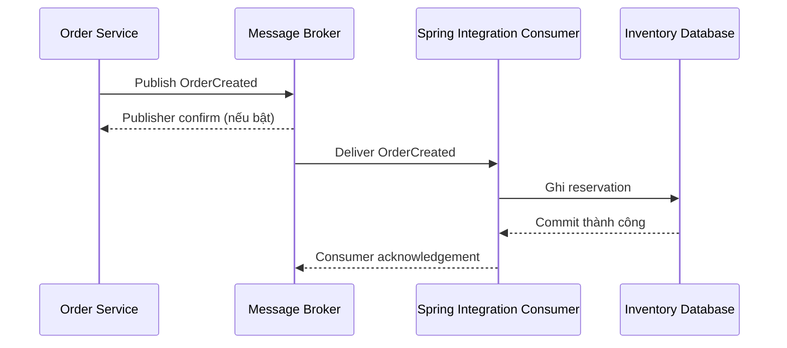
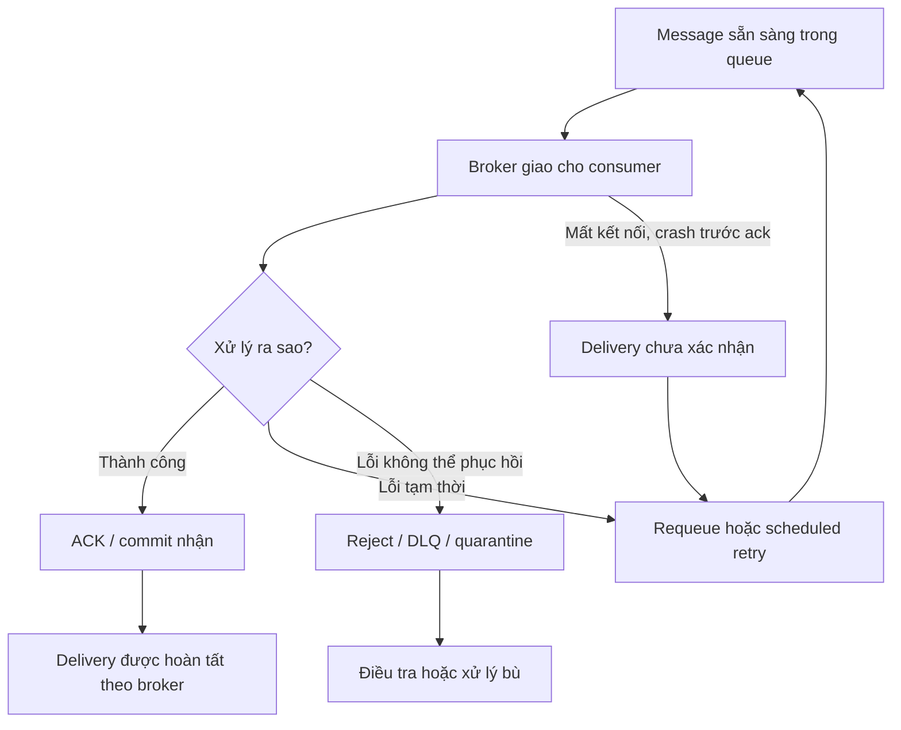
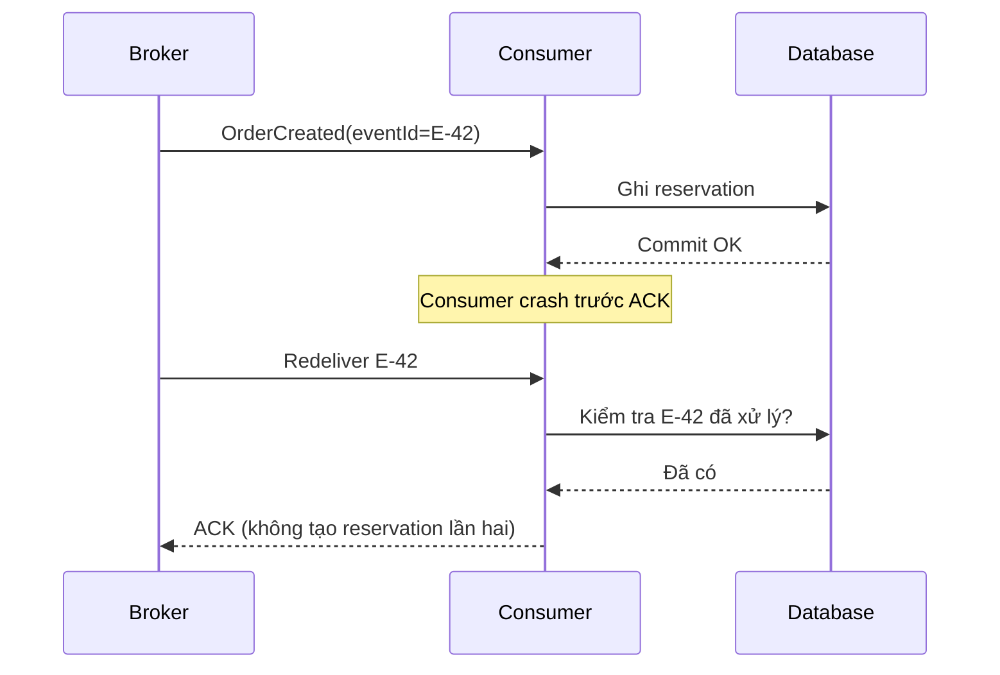
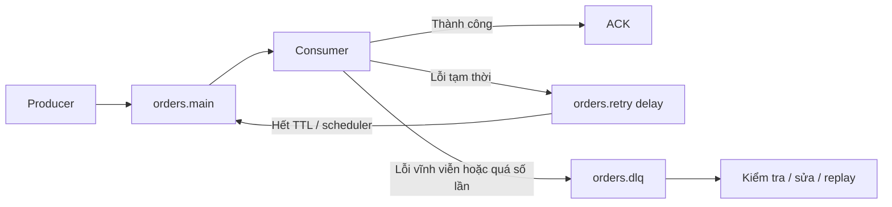
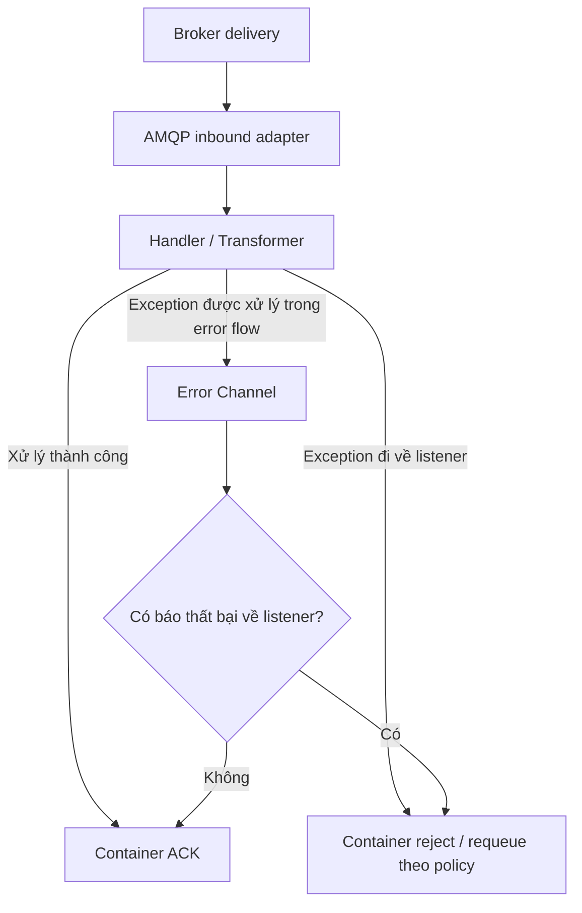

# Acknowledgement và redelivery

Trong chương **Message broker** của module **SPRING_INTEGRATION_PATTERN**, ứng dụng gửi và nhận thông điệp qua broker để xây dựng các luồng ít phụ thuộc, dễ mở rộng. Spring Integration giúp ghép **Channel**, **Router**, **Filter**, **Transformer**, **Service Activator**, **Gateway**, retry, error channel và correlation thành các bước xử lý có thể kiểm thử. Nhưng khi hệ thống nhận một message từ broker, câu hỏi quan trọng luôn là: **khi nào có thể xác nhận message đã được tiêu thụ và nếu xử lý thất bại thì broker làm gì với message đó?**

Hai khái niệm chính:

- **Acknowledgement (ack):** phía consumer xác nhận với broker rằng delivery đã được xử lý theo cam kết của consumer. Việc xác nhận được thực hiện bằng giao thức/cơ chế cụ thể của broker.
- **Redelivery:** broker giao lại message đã từng được giao nhưng chưa được xác nhận thành công, hoặc giao lại theo cơ chế retry/recover của hệ thống. Điều này có thể xảy ra khi consumer chết, mất kết nối, rollback hoặc chủ động yêu cầu giao lại.

Hiểu hai cơ chế này giúp tránh **mất message**, **xử lý trùng**, **lặp retry vô hạn** và sự nhầm lẫn giữa “đã nhận được message” với “nghiệp vụ đã hoàn tất”.

Sau bài học, bạn có thể giải thích vòng đời message, lựa chọn chính sách ack, triển khai Spring Integration với AMQP/RabbitMQ theo cơ chế AUTO acknowledgement, nhận biết khi cần MANUAL, thiết kế retry và dead-letter queue (DLQ), kiểm soát idempotency và lập kịch bản kiểm thử lỗi.

## 1. Đặt acknowledgement đúng vị trí trong luồng

Ví dụ dịch vụ tồn kho nhận sự kiện `OrderCreated` từ broker để trừ lượng tồn đã giữ chỗ:



**Publisher confirm** và **consumer acknowledgement** là hai tín hiệu khác nhau:

| Tín hiệu | Ai phát? | Xác nhận điều gì? | Không bảo đảm điều gì? |
| --- | --- | --- | --- |
| Publisher confirm | Broker gửi về producer (khi giao thức/cấu hình hỗ trợ) | Broker đã xử lý việc publish đến mức cam kết của cơ chế confirm | Không nói consumer đã thực hiện nghiệp vụ |
| Consumer acknowledgement | Consumer gửi cho broker hoặc được container/transaction thực hiện | Delivery có thể được đánh dấu hoàn tất theo chính sách nhận | Không tự chứng minh giao dịch database hay gọi dịch vụ ngoài đã commit |
| Business acknowledgement | Dịch vụ nghiệp vụ phát sự kiện/trả response riêng, nếu được thiết kế | Một trạng thái nghiệp vụ cụ thể đã hoàn tất | Không thay thế ack của broker |

Ví dụ: producer nhận publisher confirm không có nghĩa tồn kho đã được giữ chỗ. Ngược lại, consumer gửi ack trước khi database commit có thể khiến broker xóa delivery trong khi ghi dữ liệu thất bại.

**Nguyên tắc:** xác định “xử lý thành công” theo hợp đồng nghiệp vụ trước, rồi mới chọn lúc ack. Với luồng ghi DB, thông thường chỉ coi message thành công sau khi thao tác DB đã commit hoặc một cơ chế giao dịch phù hợp đã xác nhận.

## 2. Vòng đời delivery, ACK, NACK và reject

Tên lệnh phụ thuộc broker, nhưng các chuyển trạng thái khái niệm thường như sau:



### ACK

Khi consumer xác nhận, broker có thể loại delivery khỏi tập đang chờ xác nhận. Trong RabbitMQ, `basicAck` xác nhận delivery tag trên channel. Với JMS, việc acknowledgement hoặc commit phụ thuộc session mode/transaction. Với Kafka, tương đương về mặt vận hành thường là commit offset của consumer group, có ngữ nghĩa khác ACK từng message trên queue.

### NACK/reject

RabbitMQ cung cấp `basicNack` và `basicReject`. Nếu `requeue=true`, message có thể được đưa trở lại hàng đợi, nhưng **không được hứa rằng nó sẽ được xử lý ngay và theo đúng thứ tự cũ**. Nếu `requeue=false` và queue được cấu hình dead-lettering, broker có thể chuyển message sang dead-letter exchange/queue; nếu không có nơi nhận phù hợp, message có thể bị loại bỏ.

JMS thường dùng rollback hoặc `Session.recover()` tùy session mode, không dùng đúng các lệnh RabbitMQ. Kafka dùng offset commit và chính sách seek/retry/error handler; không nên diễn giải mọi lỗi Kafka thành một RabbitMQ NACK.

### Consumer chết trước khi ACK

Trong broker hỗ trợ acknowledgement, một delivery chưa xác nhận thường có thể được giao lại khi channel/session/connection bị đóng. Bởi vậy, **nhận được message không đồng nghĩa message đã được xử lý đúng một lần**.

## 3. So sánh ngữ nghĩa acknowledgement theo broker

| Công nghệ | Cơ chế liên quan | Redelivery thường xảy ra khi | Điểm cần nhớ |
| --- | --- | --- | --- |
| **RabbitMQ/AMQP 0-9-1** | `basicAck`, `basicNack`, `basicReject`; chế độ auto/manual của listener | Consumer crash trước ack; NACK/requeue; lỗi khiến delivery bị reject/requeue | Delivery tag có phạm vi của channel; không sử dụng tag cũ trên channel mới |
| **JMS** | `AUTO_ACKNOWLEDGE`, `CLIENT_ACKNOWLEDGE`, transacted session | Rollback/recover, session/connection lỗi trước ack/commit | Với `CLIENT_ACKNOWLEDGE`, acknowledgement có thể tác động đến nhiều message đã nhận trong cùng session |
| **Kafka** | Consumer group offset commit; ack mode của listener container | Consumer khởi động lại hoặc rebalance trước commit offset; seek/retry | Commit offset đánh dấu tiến độ partition; khác acknowledgement từng message trong queue |
| **Broker khác** | Tùy protocol và adapter | Tùy cơ chế lease, visibility timeout hoặc transaction | Cần kiểm tra tài liệu của broker được dùng |

Trong phần thực hành, ta tập trung vào **Spring Integration + RabbitMQ**, vì loại inbound adapter này thể hiện rõ điểm tiếp nhận message và cách listener container điều khiển ack. Khi áp dụng cho JMS/Kafka, cần chuyển chính sách sang cơ chế tương ứng.

## 4. Ba cách nhìn về độ tin cậy khi nhận message

| Chế độ phân phối | Ý nghĩa thực tế | Rủi ro chính |
| --- | --- | --- |
| **At-most-once** | Message không được xử lý lại khi đã coi là tiêu thụ | Có thể mất message nếu xác nhận quá sớm hoặc không retry |
| **At-least-once** | Hệ thống có thể giao lại cho tới khi message được xử lý/xác nhận theo chính sách | Consumer có thể nhận và xử lý trùng |
| **Exactly-once** | Một tác động được thực hiện chính xác một lần trong phạm vi được hệ thống bảo đảm | Không tự xuất hiện từ ACK; cần cơ chế transaction, deduplication hoặc hạn chế phạm vi bảo đảm |

Với các luồng Spring Integration dựa trên broker, **at-least-once + xử lý idempotent** thường là điểm xuất phát thực tế. Không nên tuyên bố “exactly once” cho toàn bộ luồng chỉ vì broker có tính năng transaction hay Kafka có transaction cho một phần pipeline. Ví dụ database và API thanh toán bên ngoài có thể nằm ngoài giao dịch của broker.

### Tình huống điển hình: DB đã commit, ACK chưa tới broker



Sự kiện `E-42` đã tạo tác động ở lần đầu, sau đó vẫn được giao lại. Nếu consumer chỉ gọi `reserveStock()` lần nữa, tồn kho có thể bị trừ hai lần. Vì vậy ACK phải đi kèm **idempotency**, đặc biệt khi nghiệp vụ có tác dụng phụ.

## 5. Spring Integration: nhận message từ RabbitMQ và AUTO acknowledgement

Spring Integration có AMQP inbound adapter dùng listener container của Spring AMQP. Với chế độ `AcknowledgeMode.AUTO` của container, **consumer không gọi `basicAck` bằng tay**; container xác nhận khi quá trình xử lý listener kết thúc thành công. Đây là **AUTO ở phía container**, không nên nhầm với `autoAck=true` của RabbitMQ client vốn có thể được hiểu là broker coi delivery đã nhận ngay.

Ví dụ ứng dụng dùng Java 17+, Spring Integration Java DSL, Spring Integration AMQP và Spring AMQP:

```java
package example.orders;

import org.springframework.amqp.core.AcknowledgeMode;
import org.springframework.amqp.rabbit.connection.ConnectionFactory;
import org.springframework.amqp.rabbit.listener.SimpleMessageListenerContainer;
import org.springframework.context.annotation.Bean;
import org.springframework.context.annotation.Configuration;
import org.springframework.integration.amqp.dsl.Amqp;
import org.springframework.integration.config.EnableIntegration;
import org.springframework.integration.dsl.IntegrationFlow;

@Configuration
@EnableIntegration
class OrderConsumerIntegrationConfig {

    @Bean
    SimpleMessageListenerContainer ordersContainer(
            ConnectionFactory rabbitConnectionFactory) {
        var container =
            new SimpleMessageListenerContainer(rabbitConnectionFactory);
        container.setQueueNames("orders.created");
        container.setAcknowledgeMode(AcknowledgeMode.AUTO);
        container.setDefaultRequeueRejected(false);
        return container;
    }

    @Bean
    IntegrationFlow ordersInboundFlow(
            SimpleMessageListenerContainer ordersContainer,
            OrderProcessor orderProcessor) {
        return IntegrationFlow
            .from(Amqp.inboundAdapter(ordersContainer))
            .handle(String.class, (body, headers) -> {
                orderProcessor.process(body);
                return null; // Luồng sự kiện một chiều, không sinh reply.
            })
            .get();
    }
}

// Bean nghiệp vụ được ứng dụng triển khai.
interface OrderProcessor {
    void process(String body);
}
```

Cách hoạt động:

1. Queue `orders.created` **phải tồn tại** hoặc được khai báo qua cấu hình broker ở phần triển khai; snippet không tự tạo queue hay dead-letter exchange.
2. AMQP inbound adapter nhận delivery và đưa payload vào integration flow.
3. Service Activator `orderProcessor.process(body)` thực hiện xử lý. Ví dụ giả định body đã được converter chuyển thành `String`; các kiểu JSON/byte[] cần converter/Transformer phù hợp.
4. Nếu handler **kết thúc thành công**, container xử lý ACK theo `AcknowledgeMode.AUTO`.
5. Nếu lỗi **được ném ra khỏi xử lý listener**, container xử lý thất bại theo cấu hình. Với `setDefaultRequeueRejected(false)`, delivery thường bị reject không requeue, cho phép dead-lettering **nếu broker đã cấu hình**.

**Điều kiện rất quan trọng:** ví dụ giữ đường xử lý đồng bộ (chẳng hạn `DirectChannel` mặc định trong đoạn flow). Nếu bạn chèn `ExecutorChannel`/queue trung gian khiến adapter gửi message xong trước khi xử lý nghiệp vụ hoàn tất, listener có thể được coi là thành công và ACK trước tác động thực tế. Khi đó phải thiết kế lại điểm ack, giao dịch hoặc cơ chế khôi phục.

Ngoài ra, nếu cấu hình `errorChannel` mà lỗi được consumer lỗi xử lý rồi “nuốt” thay vì ném về listener, kết quả ack/requeue có thể khác với kỳ vọng. **Không thể suy ra chính sách redelivery chỉ từ một ngoại lệ phát sinh bên trong flow**; cần xem ngoại lệ có thực sự quay lại listener container hay không.

### Khi nào dùng AUTO?

AUTO phù hợp khi một delivery có thể được xử lý trong phạm vi lifecycle đồng bộ của listener, và container có đủ thông tin về thành công/thất bại. Các trường hợp cần ack sau một hoạt động kéo dài bất đồng bộ, hoặc cần quyết định ack/nack trên từng delivery theo nhiều nhánh, có thể phù hợp với **MANUAL**, nhưng đổi sang MANUAL đòi hỏi thiết kế chặt chẽ hơn.

## 6. MANUAL acknowledgement: xác nhận sau khi nghiệp vụ đã hoàn tất

Với RabbitMQ, `AcknowledgeMode.MANUAL` cho phép consumer xác định khi nào gọi `basicAck`, `basicNack` hoặc `basicReject`. Trong Spring Integration, phải cấu hình listener container và kiểm tra cách adapter cung cấp delivery tag/channel vào message headers theo phiên bản đang sử dụng; **không tự tạo một delivery tag mới** và không ack trên channel khác.

Pseudocode dưới đây làm rõ quyết định nghiệp vụ (không phải mã Java DSL có thể chạy trực tiếp):

```text
onRabbitDelivery(message, channel, deliveryTag):
    try:
        validateSchema(message)
        processIdempotentlyAndCommit(message)
        channel.basicAck(deliveryTag, multiple=false)
    catch PermanentValidationError:
        channel.basicReject(deliveryTag, requeue=false)
    catch TransientDependencyError:
        # Chỉ requeue trực tiếp nếu policy có backoff/giới hạn phù hợp.
        channel.basicNack(deliveryTag, multiple=false, requeue=true)
    catch UnexpectedError:
        # Tùy policy có thể chuyển vào DLQ/đường điều tra.
        channel.basicNack(deliveryTag, multiple=false, requeue=false)
```

**Những quy tắc bắt buộc khi áp dụng MANUAL:**

- Ack trên **đúng RabbitMQ channel** gắn với delivery; delivery tag không phải ID toàn cục.
- `multiple=false` thường an toàn cho việc xác nhận riêng từng delivery. `multiple=true` xác nhận tất cả tag chưa ack tới mốc chỉ định trên channel đó và có thể nguy hiểm nếu xử lý song song.
- Không ACK ở nhánh `finally` bất kể kết quả; như vậy có thể mất message khi nghiệp vụ thất bại.
- Không được gọi ACK lặp lại cho cùng tag. Ack hoặc nack sai có thể khiến broker đóng channel.
- Nếu xử lý bằng thread khác, cần tính đến lifecycle/thread-safety của channel, ownership của delivery và thời điểm listener trả quyền điều khiển.
- Khi consumer crash sau commit nhưng trước ACK, broker vẫn có thể redeliver: phải idempotent kể cả khi tự ack thủ công.

Nếu không thực sự cần điều khiển ack ở từng delivery, lựa chọn AUTO với một flow đồng bộ, retry/transaction được cấu hình rõ thường dễ vận hành hơn.

## 7. Redelivery là sự kiện bình thường, không chỉ xuất hiện khi có lỗi code

Các trường hợp thường dẫn đến giao lại:

- Consumer nhận message rồi **crash/restart** trước ACK.
- TCP connection/channel bị đóng khi còn delivery **unacknowledged**.
- Handler báo lỗi và container/broker chọn **requeue** hoặc rollback.
- Consumer dùng **MANUAL** rồi gửi `basicNack(..., true)`.
- Một cơ chế **delayed retry** đưa message từ retry queue trở lại queue chính.
- Với consumer group kiểu Kafka, offset chưa commit rồi partition được giao cho consumer khác.

Hai metadata cần hiểu chính xác:

- RabbitMQ có cờ delivery **redelivered** báo message có khả năng đã được giao trước đó; đây không phải bộ đếm số lần xử lý thành công và không đủ làm khóa deduplication.
- Khi dead-lettering trong RabbitMQ, broker có thể thêm header liên quan lịch sử dead-letter (ví dụ `x-death`). Giá trị đó không thay thế hoàn toàn cho một chính sách retry do ứng dụng định nghĩa; cách ghi lịch sử có thể phụ thuộc cơ chế queue và hành trình dead-letter.

Không bảo đảm redelivery đến cùng consumer ban đầu, không bảo đảm đúng thời điểm và không bảo đảm giống thứ tự lần đầu.

## 8. Retry, requeue, delayed retry và dead-letter queue

Các thuật ngữ này dễ nhầm:

| Cơ chế | Ý nghĩa | Ưu/nhược điểm |
| --- | --- | --- |
| **Retry trong consumer** | Thử lại xử lý ngay trong một lần delivery, trước khi ACK/NACK | Giữ delivery chưa ack; hợp với lỗi tạm thời ngắn nhưng có thể giữ tài nguyên |
| **Requeue trực tiếp** | Đưa message chưa xử lý thành công về queue để broker giao lại | Đơn giản nhưng dễ gây vòng lặp nóng, tăng CPU/network |
| **Delayed retry** | Đưa message vào đường retry có thời gian trễ, rồi quay về luồng chính | Kiểm soát backoff tốt hơn; cần thêm topology/policy |
| **Dead-letter queue (DLQ)** | Nơi nhận message bị reject, hết hạn hoặc vượt giới hạn theo cấu hình broker | Giữ message để xem xét/khôi phục; không tự xử lý lỗi nghiệp vụ |
| **Quarantine/parking lot** | Kênh lưu message khó xử lý, kèm lý do và lịch sử | Phù hợp cho lỗi schema hoặc dữ liệu cần can thiệp |

Ví dụ topology retry theo thời gian:



Đây là **sơ đồ logic**. Để triển khai thật cần cấu hình exchange, routing key, TTL hoặc cơ chế delayed-message tương ứng, giới hạn số lần thử và đường dead-letter. Không nên cho rằng một queue được đặt tên `orders.retry` tự tạo backoff hay giới hạn retry.

### Chia lỗi thành nhóm

- **Lỗi tạm thời:** database bị quá tải, HTTP remote trả 503, mất kết nối trong thời gian ngắn. Có thể retry có giới hạn và backoff.
- **Lỗi vĩnh viễn:** JSON sai schema, mã nghiệp vụ không hợp lệ, thiếu trường bắt buộc. Thử lại y nguyên thường vô ích; nên reject/DLQ và lưu lý do.
- **Lỗi chưa phân loại:** bắt đầu bằng giới hạn retry thận trọng, chuyển điều tra khi quá ngưỡng và tránh làm tắc toàn bộ consumer.

Với retry có tác dụng phụ, **không được thử lại một command mà chưa xem xét idempotency**. Một lần timeout không chứng minh thao tác bên dịch vụ ngoài chưa thực hiện.

## 9. Đặt giới hạn retry và tránh vòng lặp vô hạn

Giả sử consumer lỗi vì không tìm thấy một giá trị bắt buộc. Nếu cứ NACK và `requeue=true` ngay, broker có thể lập tức giao lại cùng message, consumer lại lỗi rồi NACK tiếp:

```text
delivery -> validation error -> nack(requeue=true)
         -> redelivery -> validation error -> nack(requeue=true)
         -> ... lặp liên tục
```

Hậu quả là tiêu hao CPU, tạo log lớn, đẩy latency của message hợp lệ lên cao, làm hoạt động của broker thiếu ổn định.

Một chính sách ví dụ:

1. **Attempt 1:** xử lý thường.
2. **Attempt 2:** retry sau khoảng trễ ngắn.
3. **Attempt 3:** retry với khoảng trễ dài hơn.
4. Nếu vẫn lỗi: chuyển DLQ và ghi nhận nguyên nhân, không lặp vô hạn.

Con số chỉ minh họa; sản phẩm thực tế cần xác định theo latency mục tiêu, số lượng message, năng lực remote service và loại lỗi. Đặc biệt, một số RabbitMQ queue type/policy có giới hạn delivery riêng, nhưng **không phải mọi queue đều có sẵn giới hạn ba lần thử**.

### Lỗi khi “chuyển message sang retry queue rồi ACK message gốc”

Nếu ứng dụng tự publish một bản sao sang retry queue và ngay lập tức ACK message ban đầu, có khoảng thời gian bản sao chưa được broker chấp nhận bền vững. Nếu publish thất bại nhưng ACK gốc đã tới broker, message có thể mất.

Giải pháp phải xem xét thứ tự/publisher confirms, transaction hoặc kiến trúc phù hợp để đảm bảo thông điệp gốc không bị bỏ trước khi bản sao đã được lưu chắc chắn. Dead-lettering do broker quản lý và republish do ứng dụng quản lý là hai đường đi có giới hạn bảo đảm khác nhau; không giả định cả hai luôn là một giao dịch nguyên tử.

## 10. Idempotency: nền tảng để redelivery an toàn

Với at-least-once, **một message có thể đến nhiều lần nhưng cùng một nghiệp vụ chỉ nên tạo tác động một lần**. Vì vậy, phải chọn khóa nghiệp vụ ổn định như `eventId`, `commandId` hoặc cặp `source + id`. Không dựa vào delivery tag vì tag chỉ có ý nghĩa với channel/phiên giao nhận; cũng không tạo UUID mới cho mỗi lần redelivery.

Một thiết kế phổ biến là lưu sự kiện đã xử lý cùng transaction dữ liệu nghiệp vụ.

```sql
-- Ví dụ PostgreSQL
CREATE TABLE processed_events (
    consumer_name TEXT NOT NULL,
    event_id TEXT NOT NULL,
    processed_at TIMESTAMPTZ NOT NULL DEFAULT now(),
    PRIMARY KEY (consumer_name, event_id)
);
```

Pseudocode cho xử lý giao dịch:

```text
BEGIN DATABASE TRANSACTION
    INSERT (consumer_name, event_id) IF NOT EXISTS
    IF event_id already exists:
        COMMIT  # Trùng; kết quả nghiệp vụ đã có.
        ACK
        RETURN

    APPLY business update (reserve stock / save order)
COMMIT DATABASE TRANSACTION
ACK MESSAGE
```

Cụ thể hơn với `JdbcTemplate`/PostgreSQL:

```java
package example.inventory;

import org.springframework.jdbc.core.JdbcTemplate;
import org.springframework.stereotype.Service;
import org.springframework.transaction.annotation.Transactional;

@Service
class InventoryEventService {

    private final JdbcTemplate jdbc;

    InventoryEventService(JdbcTemplate jdbc) {
        this.jdbc = jdbc;
    }

    @Transactional
    public void apply(StockReserved event) {
        int inserted = jdbc.update("""
            INSERT INTO processed_events (consumer_name, event_id)
            VALUES (?, ?)
            ON CONFLICT DO NOTHING
            """, "inventory-reservation", event.eventId());

        if (inserted == 0) {
            return; // Message được giao lại, đã áp dụng trước đó.
        }

        jdbc.update("""
            UPDATE stock SET reserved = reserved + ?
            WHERE sku = ?
            """, event.quantity(), event.sku());
    }
}

record StockReserved(String eventId, String sku, int quantity) {}
```

**Giả định của ví dụ:** bảng `stock`/khóa sản phẩm tồn tại, số lượng hợp lệ đã được validate, và toàn bộ thao tác DB chạy trong **cùng transaction** do `@Transactional` quản lý. Ứng dụng thật cần kiểm tra số dòng UPDATE và ràng buộc tồn kho; nếu cập nhật thất bại thì phải ném lỗi để rollback cả ghi nhận `processed_events`. Ví dụ chỉ minh họa nơi đặt khóa deduplication, không phải mã hoàn chỉnh cho nghiệp vụ giữ chỗ.

Nếu tác dụng phụ nằm ở **một API ngoài**, transaction database cục bộ không thể rollback API đó. Cần idempotency key được remote service hỗ trợ, outbox/inbox, saga/compensation hoặc cơ chế truy vấn trạng thái phù hợp. Dedupe trên DB nội bộ chưa tự bảo đảm exactly-once của thao tác ngoài.

## 11. Mối quan hệ giữa ACK, Spring Integration error channel và Retry Advice

Trong Spring Integration, ngoại lệ có thể phát sinh tại Transformer, Filter, Service Activator hoặc HTTP Gateway nằm sau inbound adapter. Khi cần broker redeliver, phải xét **exception đi tới listener container như thế nào**.



Sơ đồ là cách suy nghĩ về **ranh giới hoàn tất xử lý**, không khẳng định mọi adapter và error flow đều trả về đúng lệnh ACK/NACK như nhau. Cấu hình Spring Integration, loại channel và listener container thực tế quyết định đường đi.

Các điểm cần kiểm tra:

- **Synchronous DirectChannel:** exception thường có thể lan truyền về adapter; đây là điều kiện thuận tiện để container quyết định ack/reject dựa trên kết quả xử lý.
- **ExecutorChannel/QueueChannel:** thông điệp có thể được bàn giao thành công cho bước sau trong khi nghiệp vụ thật vẫn đang chạy. ACK có thể xảy ra trước bước sau hoàn tất.
- **ErrorChannel:** hữu ích để ghi log, phân loại, gửi cảnh báo hoặc chuyển DLQ. Nhưng nếu error flow nhận lỗi rồi kết thúc “thành công”, listener có thể không còn biết tác vụ nghiệp vụ đã thất bại.
- **Retry advice:** có thể thử lại handler trong cùng delivery; phải có số lần thử/backoff và cách xử lý khi exhausted. Việc retry tại consumer khác với broker redelivery.
- **Filter:** filter bỏ message có thể được xem là xử lý bình thường và sẽ ACK. Nếu nghiệp vụ cần giữ message để thử lại, không nên dùng lọc bỏ như một cách biểu đạt thất bại.

Ở hệ thống thật, hãy ghi rõ *lỗi nào retry tại handler*, *lỗi nào để container ném lại broker*, *lỗi nào sang DLQ* và *lỗi nào ACK như một sự kiện hợp lệ đã bị bỏ qua theo chính sách*.

## 12. Monitoring và điều tra message bị giao lại

Broker cung cấp metrics về queue, consumer và delivery; ứng dụng cần bổ sung metrics về nghiệp vụ. Nên theo dõi:

| Tín hiệu | Mục đích |
| --- | --- |
| Số message **ready**, **unacknowledged** | Phân biệt còn chờ giao và đã giao nhưng chưa ACK |
| Consumer count, throughput | Phát hiện thiếu consumer hoặc nghẽn xử lý |
| ACK/reject/redelivery rates | Phát hiện nhiều message bị giao lại hoặc reject |
| Retry attempt, retry delay | Quan sát vòng lặp retry và áp lực lên hệ thống phụ thuộc |
| DLQ depth/oldest age | Biết số message cần điều tra và mức tồn đọng |
| Processing latency, DB/remote latency | Xác định xử lý chậm là nguyên nhân giữ unacked |
| Idempotency duplicate count | Đo số message đã từng xử lý được giao lại |
| Error count theo loại | Phân biệt lỗi schema, lỗi hạ tầng và lỗi nghiệp vụ |

Có thể gắn `eventId`, `requestId`, `correlationId` và `traceId` theo hợp đồng để liên kết producer, consumer và tác động DB. Tránh log nguyên payload nếu chứa dữ liệu nhạy cảm. Đừng dùng riêng cờ `redelivered` để quyết định bỏ xử lý: một delivery có cờ đó vẫn có thể chưa được xử lý nghiệp vụ lần nào.

### Khi DLQ tăng liên tục

1. Xem loại lỗi và thông tin phiên bản schema của các message mới nhất.
2. Kiểm tra sự thay đổi của consumer/dependency cùng thời điểm.
3. Xem retry topology có tạo vòng lặp từ DLQ về main queue hay không.
4. Tạm kiểm soát tốc độ replay, sửa nguyên nhân, bảo đảm deduplication.
5. Replay có giám sát và đo outcome, tránh xả toàn bộ DLQ vào production ngay lập tức.

## 13. Kiểm thử acknowledgement và redelivery

Một bài kiểm thử đúng cần kiểm tra **hành vi của broker** chứ không chỉ unit test handler trả thành công.

| Kịch bản | Cách tạo tình huống | Điều cần xác minh |
| --- | --- | --- |
| Xử lý thành công | Consumer cập nhật DB và trả về bình thường | Broker nhận ACK; message không redeliver khi không có lỗi |
| Lỗi nhất thời | Dependency trả lỗi một số lần | Retry/backoff đúng policy; cuối cùng ACK hoặc DLQ |
| Lỗi schema | Message thiếu trường bắt buộc | Không requeue vô hạn; đưa đúng đường điều tra |
| Crash trước commit | Dừng consumer trước khi lưu kết quả | Message được giao lại theo cơ chế broker |
| Crash sau commit trước ACK | Cố ý gây lỗi ở ranh giới ACK | Redelivery không tạo tác động DB lần hai |
| Duplicate event | Publish cùng `eventId` nhiều lần | Dedupe theo khóa nghiệp vụ |
| Mất kết nối consumer | Ngắt channel khi có unacked delivery | Delivery được broker tái phân phối |
| Không có DLX | NACK/reject không requeue | Xác minh nguy cơ message bị loại bỏ theo cấu hình thực tế |
| Error flow nuốt exception | Handler lỗi nhưng error flow trả bình thường | Xác nhận liệu container ACK hay reject, sửa policy nếu sai |
| Channel bất đồng bộ | Chèn `ExecutorChannel` trước handler nghiệp vụ | Phát hiện ack có xảy ra quá sớm không |
| Replay DLQ | Đưa một message đã sửa lại vào main | Message được xử lý đúng, giữ idempotency và trace |

Một bài test integration hữu ích có thể dùng RabbitMQ test instance/container, một database thử nghiệm và điểm chặn lỗi có điều khiển. Test nên chờ theo **điều kiện observable** (ACK/redelivery, DB row count, queue state) thay vì phụ thuộc vào `Thread.sleep` hay thứ tự tuyệt đối của consumer. Phải kiểm tra cả **số lần tác động nghiệp vụ** và **số lần giao message**: redelivery nhiều lần vẫn có thể chấp nhận nếu tác động nghiệp vụ chỉ diễn ra một lần.

### Kịch bản minh họa với event `E-42`

```text
Given broker queue orders.created và consumer nhận StockReserved(E-42)
When lần đầu DB COMMIT thành công nhưng connection đóng trước ACK
Then broker có thể redeliver E-42
When consumer nhận lại E-42
Then processed_events chỉ có 1 row cho (inventory-reservation, E-42)
And stock.reserved chỉ tăng đúng một lần
And delivery sau được ACK theo chính sách thành công
```

Kịch bản này đo đúng ranh giới quan trọng của at-least-once. Không nên coi bài test pass nếu chỉ quan sát “message biến mất khỏi queue” mà chưa kiểm tra trạng thái dữ liệu.

## 14. Checklist khi thiết kế ACK và redelivery

1. Xác định broker, adapter, listener container và acknowledgement mode đang sử dụng.
2. Viết rõ **tiêu chí xử lý thành công**, đặc biệt khi có giao dịch DB hoặc API bên ngoài.
3. Chọn **AUTO** khi xử lý đồng bộ và exception có thể lan về listener; chỉ dùng **MANUAL** khi cần điều khiển chính xác lifecycle delivery.
4. Không ACK trước khi hoàn tất tác động nghiệp vụ; kiểm tra ranh giới của channel bất đồng bộ.
5. Có khóa **idempotency** ổn định qua redelivery và retry.
6. Phân loại lỗi tạm thời/vĩnh viễn, giới hạn số lần thử và có backoff.
7. Cấu hình DLX/DLQ/quarantine cụ thể; xác định xử lý khi không có nơi nhận dead letter.
8. Không dùng requeue trực tiếp cho lỗi vĩnh viễn để tránh retry storm.
9. Kiểm tra cách `errorChannel`, Retry Advice, Filter và Router ảnh hưởng đến kết quả listener.
10. Theo dõi unacked, redelivery, retry, DLQ và số lần tác động nghiệp vụ bị trùng.
11. Kiểm thử crash trước/sau commit, disconnect, lỗi converter, duplicate và DLQ replay.
12. Không khẳng định exactly-once cho toàn bộ nghiệp vụ khi chưa có bảo đảm qua mọi ranh giới liên quan.

## Kết luận

**Acknowledgement** trả lời câu hỏi broker có thể coi delivery đã được xử lý hay chưa; **redelivery** giúp hệ thống phục hồi khi ACK chưa được ghi nhận hoặc xử lý thất bại. Trong Spring Integration, chính **listener container**, **channel topology**, **exception propagation**, **retry policy** và **đường xử lý lỗi** quyết định thời điểm broker nhận ACK/NACK. Thiết kế tin cậy cần kết hợp acknowledgement đúng thời điểm với **idempotency**, retry có giới hạn, dead-lettering và kiểm thử các thời điểm lỗi khó nhất: trước commit, sau commit nhưng trước ACK. Nhờ đó, luồng message broker có thể mở rộng mà vẫn kiểm soát được thất bại và tác động nghiệp vụ trùng lặp.
