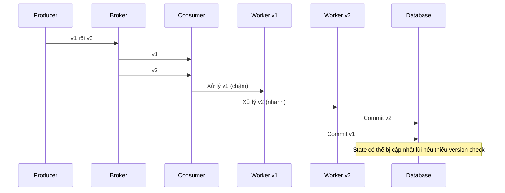
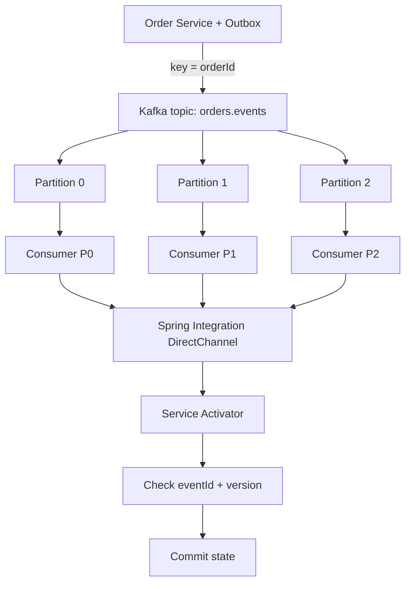
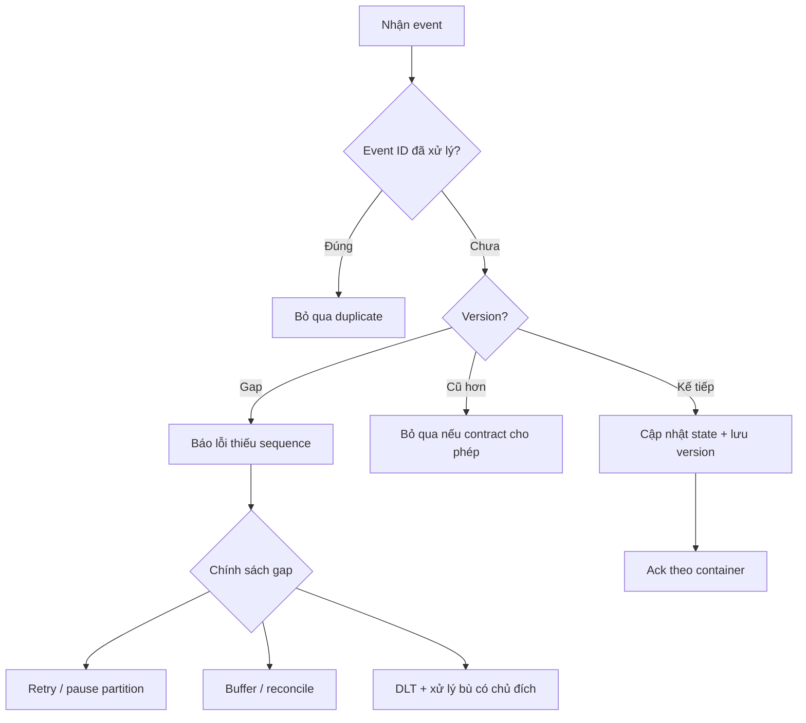

# Message ordering trong broker với Spring Integration

## 1. Vì sao thứ tự message quan trọng?

Trong hệ thống tích hợp bất đồng bộ, producer phát các sự kiện vào **message broker** và consumer nhận chúng để cập nhật trạng thái, gọi dịch vụ hoặc thực hiện tác vụ. Broker giúp giảm phụ thuộc giữa các ứng dụng, hỗ trợ chịu tải và khôi phục sự cố, nhưng thứ tự xử lý không phải lúc nào cũng trùng với thứ tự sự kiện được tạo.

Xét một đơn hàng `O-42` có chuỗi thay đổi:

1. `OrderCreated(orderId=O-42, version=1)`.
2. `OrderPaid(orderId=O-42, version=2)`.
3. `OrderCancelled(orderId=O-42, version=3)`.

Nếu một handler xử lý `OrderCancelled` trước `OrderCreated`, kết quả cập nhật có thể thiếu dữ liệu nền. Nếu trạng thái `PAID` được ghi sau `CANCELLED` mà không kiểm tra version, hệ thống có thể vô tình đưa đơn hàng quay về trạng thái cũ.

**Message ordering** là việc xác định và bảo vệ một trình tự message trong phạm vi mà nghiệp vụ yêu cầu: theo queue, theo partition, theo khóa đối tượng, hoặc theo quan hệ nhân quả giữa các sự kiện. Khi thiết kế, phải trả lời cụ thể **thứ tự của cái gì, được cam kết ở đâu và được kiểm tra tại điểm nào**.

Bài học thuộc chương **Message broker** trong module **SPRING_INTEGRATION_PATTERN**. Mục tiêu của module là học áp dụng Enterprise Integration Patterns với Spring Integration để xây dựng luồng ít phụ thuộc, mở rộng được, có kiểm thử và quan sát. Các thành phần Router, Filter, Transformer, Splitter, Aggregator, Gateway, retry, error channel và correlation đều có thể ảnh hưởng đến ordering.

Sau bài này, bạn có thể:

- Phân biệt thứ tự phát sinh, ghi vào broker, giao cho consumer và commit nghiệp vụ.
- Hiểu giới hạn ordering của Kafka, RabbitMQ và queue/JMS.
- Chọn partition key hoặc routing key để bảo vệ thứ tự theo đối tượng.
- Thiết kế một Spring Integration flow xử lý sự kiện theo chuỗi version.
- Xử lý duplicate, retry, requeue, dead-letter, gap và rebalance mà không cập nhật lùi trạng thái.
- Kiểm thử và đo lường ordering bằng event ID, version, partition/offset và trạng thái cuối.

## 2. Có nhiều loại thứ tự khác nhau

| Thứ tự | Ý nghĩa | Rủi ro |
|---|---|---|
| **Business order** | Thay đổi nào thực sự xảy ra trước theo nghiệp vụ | Clock lệch hoặc nhiều producer cùng thay đổi một đối tượng |
| **Publish order** | Producer phát request/send trước hay sau | Gửi bất đồng bộ, retry hoặc transaction làm thay đổi trình tự |
| **Broker order** | Broker ghi record vào log/queue theo trình tự | Phạm vi ordering thường chỉ ở một partition hoặc queue trong điều kiện nhất định |
| **Delivery order** | Message được giao đến consumer nào trước | Nhiều partition/consumer hoặc redelivery |
| **Processing order** | Handler bắt đầu xử lý event nào trước | Thread pool và các bước bất đồng bộ |
| **Commit order** | Side effect nào cập nhật DB/hệ thống ngoài trước | I/O chậm, timeout, retry và race condition |

Ví dụ broker giao v1 rồi v2, nhưng handler lại khởi tạo hai HTTP call song song. Nếu HTTP call v2 hoàn tất trước v1, **thứ tự giao vẫn đúng nhưng thứ tự side effect đã đảo**.



Vì thế ordering cần được thiết kế từ **nguồn sinh version** đến **nơi commit trạng thái**, không chỉ tại broker.

## 3. Phạm vi ordering ở các broker

### 3.1. Kafka: đảm bảo thứ tự trong partition

Kafka lưu record của một topic trong nhiều **partition**. Mỗi partition là một log có offset tăng dần; các record trong cùng partition được đọc theo thứ tự offset. Kafka **không có một thứ tự toàn cục giữa các partition**.

```text
orders.events
  partition 0: O-42 v1 -> O-42 v2 -> O-42 v3
  partition 1: O-87 v1 -> O-87 v2
  partition 2: O-91 v1 -> O-91 v2

Thứ tự trong từng partition: được xác định bởi offset.
Thứ tự giữa các partition: không có cam kết toàn cục.
```

Nếu producer gửi message với `key = orderId` và partitioning strategy không đổi, các event của cùng đơn hàng thường được định tuyến vào cùng một partition. Vì vậy có thể giữ thứ tự theo `orderId` và vẫn xử lý nhiều đơn hàng song song trên các partition khác nhau.

Cần lưu ý:

- Nhiều producer cùng gửi một key có thể cạnh tranh; thứ tự broker ghi không thay thế version nghiệp vụ được cấp ở nguồn.
- Việc thay số lượng partition có thể thay đổi ánh xạ key sang partition; cần phương án di chuyển nếu ordering liên tục là bắt buộc.
- Producer retry và cấu hình idempotence ảnh hưởng tới khả năng bảo toàn thứ tự khi gửi lỗi. Nên kiểm tra cấu hình producer và dùng idempotent producer khi phù hợp.
- Trong consumer group, mỗi partition thường được giao cho một consumer đang hoạt động tại một thời điểm; rebalancing và redelivery vẫn có thể khiến event được xử lý lại.
- Đọc theo offset **không tự bảo đảm** một side effect bất đồng bộ sẽ hoàn tất theo offset.

### 3.2. RabbitMQ: queue, consumer và requeue

RabbitMQ lưu message trong queue và thường giao theo thứ tự enqueue trong điều kiện thông thường. Nhưng nhiều consumer, prefetch, requeue, redelivery, priority và xử lý bất đồng bộ có thể làm **thứ tự xử lý hoàn tất** khác thứ tự enqueue.

Ví dụ:

- Consumer A nhận message 1 và xử lý chậm.
- Consumer B nhận message 2 và xử lý nhanh.
- B cập nhật DB trước A.
- Message 1 bị `nack/requeue` có thể được giao lại sau hoặc xen với message khác.

Khi cần xử lý tuần tự chặt theo queue, có thể cân nhắc một consumer hoạt động, prefetch phù hợp, xử lý đồng bộ và chiến lược lỗi tránh đưa message trở lại sai trình tự. RabbitMQ có chế độ *single active consumer* cho một số loại queue, nhưng vẫn cần xử lý redelivery và idempotency.

### 3.3. JMS và các queue truyền thống

Các hệ thống JMS có những quy tắc giao message theo session, consumer và provider. Tuy nhiên, nhiều consumer, priority, selector, rollback hoặc redelivery có thể ảnh hưởng tới thứ tự mà ứng dụng quan sát và commit.

Không nên mặc định “queue là FIFO” đồng nghĩa “mọi cập nhật nghiệp vụ được commit theo một thứ tự toàn cục”. Cần đọc hợp đồng của **broker, session, consumer concurrency và acknowledgment** tại deployment thực tế.

### So sánh

| Tiêu chí | Kafka | RabbitMQ / Queue | Quyết định phía ứng dụng |
|---|---|---|---|
| Phạm vi ordering cơ bản | Partition | Queue trong điều kiện giao nhận nhất định | Chọn key/queue đúng phạm vi |
| Mở rộng | Partition và consumer group | Queue sharding và consumer | Song song giữa nhóm độc lập |
| Retry lỗi | Reprocess, seek, retry topic, DLT | Nack/requeue, retry queue, DLQ | Có được phép vượt qua event lỗi không? |
| Duplicate | Có thể do replay/redelivery | Có thể do redelivery | Event ID và idempotency |
| Trật tự commit DB | Không được bảo đảm chỉ nhờ broker | Không được bảo đảm chỉ nhờ broker | Transaction và version check |

## 4. Chọn ordering key theo aggregate

Thông thường không cần giữ thứ tự toàn bộ hệ thống. Thứ tự chỉ bắt buộc giữa các event làm thay đổi **cùng một thực thể nghiệp vụ**.

| Loại event | Key gợi ý | Phạm vi phải tuần tự |
|---|---|---|
| OrderCreated / OrderPaid / OrderCancelled | `orderId` | Một đơn hàng |
| CustomerProfileChanged | `customerId` | Một hồ sơ khách hàng |
| InventoryReserved / InventoryReleased | `sku + warehouseId` | Một mặt hàng tại một kho |
| AccountDebited / AccountCredited | `accountId` hoặc thiết kế sổ cái phù hợp | Một tài khoản |
| ProductPriceChanged | `productId + market` | Một sản phẩm tại một thị trường |

Một key quá rộng, ví dụ chỉ dùng `tenantId`, có thể gây **hot partition**. Một key quá hẹp, ví dụ UUID mới cho từng event, lại tách các event liên quan sang nhiều partition.

Các bước chọn key:

1. Xác định những event nào phải giữ thứ tự với nhau.
2. Chọn định danh ổn định suốt vòng đời đối tượng.
3. Buộc mọi producer của nhóm event đó dùng cùng key.
4. Đánh giá số lượng key, phân bố lưu lượng và khả năng có key nóng.
5. Định nghĩa quy trình khi đổi số partition hoặc topology.

Nếu một thao tác tác động lên **hai aggregate**, ví dụ chuyển tiền giữa hai tài khoản, thứ tự theo một key không tự tạo transaction nguyên tử cho cả hai. Khi đó cần thêm cơ chế nhất quán như database transaction, sổ cái, saga hoặc điều phối phù hợp.

## 5. Ordering trong Spring Integration

Spring Integration đưa message qua `MessageChannel` và các endpoint xử lý. Một số kiểu channel giữ việc gọi handler đồng bộ, một số đưa công việc sang thread khác và làm phát sinh concurrency.

| Thành phần | Ảnh hưởng đến ordering |
|---|---|
| `DirectChannel` | Handler được gọi đồng bộ trên thread gửi; thuận tiện cho xử lý tuần tự trên mỗi consumer thread |
| `ExecutorChannel` | Công việc sang executor; các thread có thể hoàn tất khác thứ tự nhận |
| `QueueChannel` | Có lưu trong queue nội bộ; nhiều poller/consumer vẫn có thể commit khác thứ tự |
| `PublishSubscribeChannel` | Fan-out sang subscriber; không tự có một thứ tự commit chung giữa các nhánh |
| `Router` | Có thể đưa event cùng key tới các nhánh khác nhau; cần bảo vệ thứ tự xuyên nhánh |
| `Filter` | Có thể bỏ event, gây gap nếu event đó nằm trong chuỗi version bắt buộc |
| `Transformer` | Đồng bộ thường giữ trình tự; xử lý async bên trong có thể đảo |
| `Splitter` | Phát nhiều phần tử; thứ tự hoàn tất các nhánh có thể thay đổi |
| `Aggregator` | Gom nhóm theo correlation; thứ tự arrival khác với thứ tự cần phát kết quả |
| `Service Activator` | Thực hiện side effect, cần bảo đảm commit và acknowledgment đúng ranh giới |

**Lưu ý:** một flow có `DirectChannel` chưa mặc nhiên là đơn luồng toàn hệ thống. Nhiều producer hoặc consumer thread vẫn có thể gọi handler đó đồng thời. Tính tuần tự phải xét **theo key/partition và đường đi thực thi**.

### Ordering, correlation và idempotency

Ba khái niệm cần tách biệt:

- **Ordering key:** nhóm các message cần giữ thứ tự với nhau, ví dụ `orderId`.
- **Sequence / version:** chỉ ra vị trí của một event trong chuỗi nghiệp vụ.
- **Correlation ID:** liên kết các message của một nhóm, đặc biệt trong Splitter/Aggregator.
- **Event ID / idempotency key:** nhận diện một sự kiện hoặc thao tác để chống áp dụng trùng.

Một `correlationId` không tự sắp xếp message. Một partition key không tự phát hiện duplicate. Một version cũng không tự làm side effect nguyên tử nếu handler có race condition.

## 6. Thiết kế flow: producer theo key, consumer xử lý tuần tự

Một topology tham khảo:



Các partition được xử lý độc lập; thứ tự giữa các đơn hàng không bắt buộc. Khi nhiều consumer cùng gọi một DirectChannel, handler có thể được chạy đồng thời **cho các partition khác nhau**. Quy tắc key giúp mỗi đơn hàng thuộc một partition, còn version check bảo vệ state khi có retry, replay hoặc lỗi vận hành.

Bài thực hành dưới đây dùng **Spring Boot 3.x, Spring Kafka 3.x, Spring Integration 6.x và Java 17+**. Code là ví dụ học tập; ứng dụng thực cần broker và cơ chế lưu trạng thái bền vững.

### 6.1. Event có key và version

```java
// OrderEvent.java
package com.example.order;

public record OrderEvent(
        String eventId,
        String orderId,
        long version,
        String status
) {
}
```

Một record:

```json
{
  "eventId": "e-002",
  "orderId": "O-42",
  "version": 2,
  "status": "PAID"
}
```

Version phải được cấp theo một cơ chế nhất quán ở nguồn: thường cùng transaction cập nhật aggregate hoặc qua một luồng phát event đã có quy tắc tuần tự. Timestamp máy chủ không phải cách đáng tin cậy để cấp version nếu nhiều producer cạnh tranh.

### 6.2. Producer gửi cùng orderId làm key

```java
// OrderEventPublisher.java
package com.example.order;

import java.util.Objects;
import java.util.concurrent.CompletableFuture;

import org.springframework.kafka.core.KafkaTemplate;
import org.springframework.kafka.support.SendResult;
import org.springframework.stereotype.Component;

@Component
public class OrderEventPublisher {

    private final KafkaTemplate<String, OrderEvent> kafka;

    public OrderEventPublisher(KafkaTemplate<String, OrderEvent> kafka) {
        this.kafka = kafka;
    }

    public CompletableFuture<SendResult<String, OrderEvent>> publish(
            OrderEvent event) {
        Objects.requireNonNull(event, "event");

        if (event.orderId() == null || event.orderId().isBlank()) {
            throw new IllegalArgumentException("orderId is required");
        }

        return kafka.send(
                "orders.events",
                event.orderId(),
                event
        );
    }
}
```

`KafkaTemplate.send(...)` trả `CompletableFuture` trong Spring Kafka 3.x. Caller phải xử lý việc gửi thành công/thất bại; lời gọi `publish()` trả về chưa có nghĩa broker đã xác nhận message.

Producer configuration minh họa:

```yaml
spring:
  kafka:
    bootstrap-servers: localhost:9092
    producer:
      key-serializer: org.apache.kafka.common.serialization.StringSerializer
      value-serializer: org.springframework.kafka.support.serializer.JsonSerializer
      acks: all
      properties:
        enable.idempotence: true
```

Producer idempotence giúp hạn chế một số kiểu duplicate và reorder do retry trong phạm vi producer. Nó không tự giải quyết cạnh tranh giữa nhiều producer gửi event cùng key và cũng không thay thế deduplication ở consumer.

Để phát event cùng với cập nhật DB, thường dùng **transactional outbox**: ghi thay đổi aggregate cùng bản ghi outbox trong một database transaction, rồi publisher phát outbox theo quy tắc thứ tự. Nếu có nhiều publisher instance, vẫn phải điều phối để không phát các version của cùng key lệch thứ tự.

### 6.3. Channel nội bộ của Spring Integration

```java
// OrderChannelConfiguration.java
package com.example.order;

import org.springframework.context.annotation.Bean;
import org.springframework.context.annotation.Configuration;
import org.springframework.integration.channel.DirectChannel;
import org.springframework.integration.config.EnableIntegration;
import org.springframework.messaging.MessageChannel;

@Configuration
@EnableIntegration
public class OrderChannelConfiguration {

    @Bean
    public MessageChannel orderedOrderEvents() {
        return new DirectChannel();
    }
}
```

`DirectChannel` thực thi subscriber trên thread gửi. Trong ví dụ, Kafka listener sẽ chờ handler hoàn tất trước khi method listener kết thúc, miễn là handler **không tự tách tác vụ bất đồng bộ**.

### 6.4. Kafka listener chuyển record vào channel

```java
// KafkaOrderIngress.java
package com.example.order;

import java.util.Objects;

import org.apache.kafka.clients.consumer.ConsumerRecord;
import org.springframework.beans.factory.annotation.Qualifier;
import org.springframework.kafka.annotation.KafkaListener;
import org.springframework.messaging.Message;
import org.springframework.messaging.MessageChannel;
import org.springframework.messaging.support.MessageBuilder;
import org.springframework.stereotype.Component;

@Component
public class KafkaOrderIngress {

    private final MessageChannel orderedOrderEvents;

    public KafkaOrderIngress(
            @Qualifier("orderedOrderEvents") MessageChannel channel) {
        this.orderedOrderEvents = channel;
    }

    @KafkaListener(
            topics = "${app.orders.topic}",
            groupId = "${app.orders.group}",
            concurrency = "1"
    )
    public void onRecord(ConsumerRecord<String, OrderEvent> record) {
        OrderEvent event =
                Objects.requireNonNull(record.value(), "event");

        if (!Objects.equals(record.key(), event.orderId())) {
            throw new IllegalArgumentException(
                    "Kafka key and orderId must match");
        }

        Message<OrderEvent> message = MessageBuilder
                .withPayload(event)
                .setHeader("brokerPartition", record.partition())
                .setHeader("brokerOffset", record.offset())
                .build();

        if (!orderedOrderEvents.send(message)) {
            throw new IllegalStateException(
                    "Cannot deliver to integration flow");
        }
    }
}
```

Annotation sử dụng property placeholder của Spring, ví dụ `topics = "${app.orders.topic}"` sẽ nhận giá trị `orders.events` từ cấu hình.

`concurrency = "1"` chỉ đặt một consumer thread **cho listener container instance này**. Nếu ứng dụng có nhiều replica, mỗi replica vẫn có listener riêng; Kafka consumer group quản lý việc chia partition. Mục tiêu là đảm bảo mỗi partition được xử lý tuần tự, đồng thời không đưa xử lý của từng partition vào executor song song không kiểm soát.

Nếu `DirectChannel` gọi handler và handler ném exception, lỗi có thể trở lại Kafka listener để listener container thực hiện chính sách retry/recovery theo cấu hình.

### 6.5. Service Activator xử lý từng event

```java
// OrderEventHandler.java
package com.example.order;

import org.springframework.integration.annotation.ServiceActivator;
import org.springframework.stereotype.Component;

@Component
public class OrderEventHandler {

    private final OrderProjection projection;

    public OrderEventHandler(OrderProjection projection) {
        this.projection = projection;
    }

    @ServiceActivator(inputChannel = "orderedOrderEvents")
    public void onEvent(OrderEvent event) {
        projection.apply(event);
    }
}
```

Đây là flow **một chiều** tiêu thụ sự kiện; method trả `void` và không cần reply channel. Khác với Messaging Gateway request–reply, message broker consumer này quan tâm đến việc áp dụng event và xác nhận xử lý xong.

### 6.6. Version check và chống cập nhật lùi

Mã dưới đây minh họa với bộ nhớ. Production cần lưu state và dấu vết event đã xử lý vào DB bền vững, có transaction và ràng buộc cạnh tranh.

```java
// OrderProjection.java
package com.example.order;

import java.util.Objects;
import java.util.concurrent.ConcurrentHashMap;
import java.util.concurrent.ConcurrentMap;

import org.springframework.stereotype.Component;

@Component
public class OrderProjection {

    private final ConcurrentMap<String, Snapshot> snapshots =
            new ConcurrentHashMap<>();

    public void apply(OrderEvent event) {
        Objects.requireNonNull(event, "event");

        if (event.orderId() == null || event.orderId().isBlank()
                || event.eventId() == null || event.eventId().isBlank()
                || event.version() <= 0) {
            throw new IllegalArgumentException("Invalid event");
        }

        snapshots.compute(event.orderId(), (id, previous) -> {
            long current = previous == null ? 0 : previous.version();

            if (event.version() < current) {
                // Event cũ không được ghi đè trạng thái mới hơn.
                return previous;
            }

            if (event.version() == current) {
                if (!Objects.equals(
                        previous.eventId(), event.eventId())) {
                    throw new IllegalStateException(
                            "Conflicting event at same version");
                }
                return previous; // Duplicate hợp lệ.
            }

            if (event.version() != current + 1) {
                throw new IllegalStateException(
                        "Version gap: expected " + (current + 1)
                        + ", received " + event.version());
            }

            return new Snapshot(
                    event.version(),
                    event.eventId(),
                    event.status()
            );
        });
    }

    public long currentVersion(String orderId) {
        Snapshot snapshot = snapshots.get(orderId);
        return snapshot == null ? 0 : snapshot.version();
    }

    private record Snapshot(
            long version,
            String eventId,
            String status) {
    }
}
```

Có năm kết quả:

1. Version kế tiếp: áp dụng.
2. Duplicate cùng version và event ID: bỏ qua, không side effect lần hai.
3. Version cũ: bỏ qua đối với projection trạng thái mới nhất.
4. Cùng version nhưng event ID khác: báo xung đột.
5. Version nhảy cóc: báo gap để kích hoạt chính sách retry/reconcile.

**Giới hạn:** thuật toán bỏ qua event cũ phù hợp với projection trạng thái mới nhất, không đủ cho audit đầy đủ hay nghiệp vụ phải áp dụng mọi tác dụng phụ. Bộ nhớ của một process không bảo vệ được state qua restart, không chia sẻ giữa replica, và không tạo transaction cùng database. Trong production, lưu `lastAppliedVersion` cùng state dưới transaction; sử dụng khóa/optimistic locking hoặc unique constraint để tránh race condition.

### 6.7. Consumer configuration và commit offset

```yaml
app:
  orders:
    topic: orders.events
    group: order-projection-v1

spring:
  kafka:
    bootstrap-servers: localhost:9092
    consumer:
      enable-auto-commit: false
      key-deserializer: org.apache.kafka.common.serialization.StringDeserializer
      value-deserializer: org.springframework.kafka.support.serializer.JsonDeserializer
      properties:
        spring.json.value.default.type: com.example.order.OrderEvent
        spring.json.trusted.packages: com.example.order
    listener:
      ack-mode: record
      concurrency: 1
```

Trong chế độ `AckMode.RECORD`, listener container quản lý commit offset sau khi listener xử lý record thành công, theo cơ chế commit container. Commit offset **không tự gắn nguyên tử** với commit DB. Consumer có thể cập nhật DB thành công rồi crash trước khi commit offset, dẫn đến redelivery.

Cấu hình trên chưa định nghĩa riêng `DefaultErrorHandler`, DLT hoặc chiến lược pause partition. **Không suy ra từ ví dụ rằng record lỗi sẽ được giữ mãi cho đến khi thành công**; hành vi sau các lần retry phụ thuộc error handler của listener container. Nếu gap không được phép bị skip, phải cấu hình recovery phù hợp và kiểm thử điều đó.

## 7. Retry, poison message và dead-letter có thể phá ordering

Giả sử partition có ba record theo thứ tự:

```text
offset 100: order O-42, version 1
offset 101: order O-42, version 2  <-- xử lý lỗi
offset 102: order O-42, version 3
```

Nếu v2 lỗi, có một số chiến lược:

| Chiến lược | Ordering | Đánh đổi |
|---|---|---|
| Retry v2 trước khi tiến tiếp | Có cơ hội giữ v1 → v2 → v3 | Poison message có thể chặn cả partition |
| Chuyển v2 sang retry topic, tiếp tục v3 | Có thể đảo thứ tự | Cần buffer/gap detection/reconciliation |
| Đưa v2 sang DLT và bỏ qua | Chuỗi nghiệp vụ có thể thiếu bước | Chỉ hợp lệ nếu contract cho phép xử lý thiếu |
| Pause/park partition để điều tra | Giữ lại điểm lỗi | Tăng lag cho các key khác cùng partition |
| Áp dụng snapshot mới hơn | Có thể bỏ qua bước trung gian | Chỉ đúng với event là trạng thái tuyệt đối, không chứa side effect cần replay |



**Không có một cấu hình retry đúng cho mọi nghiệp vụ.** Thanh toán, sổ cái và tồn kho thường không thể bỏ qua event trung gian. Một projection chỉ lưu trạng thái tuyệt đối cuối cùng có thể có chính sách khác nếu contract cho phép.

### Retry trong Spring Integration và trong broker

Endpoint Spring Integration có thể dùng retry advice; Kafka listener container cũng có retry/recovery. Khi bật đồng thời, số lần thử thực tế có thể nhân lên. Cần định nghĩa ngân sách retry, backoff, timeout và điều kiện được retry ở **cấp luồng**, đồng thời đảm bảo side effect idempotent.

### Redelivery và acknowledgment

Chuỗi thường gặp:

```mermaid
sequenceDiagram
    participant B as Broker
    participant C as Consumer
    participant DB as Database
    B->>C: Event v2
    C->>DB: Commit v2 thành công
    Note over C: Crash trước ack/offset commit
    B->>C: Giao lại Event v2
    C->>DB: Kiểm tra version/event ID
    DB-->>C: Đã áp dụng; không ghi lần nữa
    C-->>B: Ack/commit tiến độ
```

Vì vậy thứ tự đúng không đồng nghĩa “exactly once”. Kafka có idempotence/transaction cho các trường hợp phù hợp, nhưng không tự làm **Kafka offset + side effect tại DB/HTTP ngoài Kafka** trở thành một transaction chung.

## 8. Concurrency và hiệu năng: song song giữa key, tuần tự trong key

Mở rộng hợp lý không nhất thiết là tăng số thread xử lý **cùng một key**. Nhiều key độc lập có thể xử lý song song:

```text
Consumer partition 0: O-42 v1 -> O-42 v2 -> O-42 v3
Consumer partition 1: O-87 v1 -> O-87 v2
Consumer partition 2: O-91 v1 -> O-91 v2
```

Điều cần đảm bảo là mỗi chuỗi thay đổi của cùng aggregate được commit nhất quán, trong khi các aggregate độc lập không phải đợi nhau.

Những tình huống dễ đảo thứ tự:

- Chuyển message sang `ExecutorChannel` có nhiều worker.
- Handler tạo `CompletableFuture` nhưng trả về trước khi side effect hoàn tất.
- Router đưa các phiên bản cùng key sang các flow khác nhau.
- Một queue có nhiều consumer và prefetch lớn.
- Retry message lỗi trên một queue/topic riêng rồi xử lý message mới trước.
- Splitter mở nhiều tác vụ rồi Aggregator sắp theo **arrival order** thay vì sequence.

Nếu cần concurrency theo key, có thể thiết kế **keyed executor/partitioned worker**: cùng key luôn được phân vào một worker tuần tự, khác key có thể chạy đồng thời. Tuy nhiên phải kiểm soát lifecycle, queue đầy, restart, rebalance và cam kết acknowledgment; chỉ dùng hash sang worker mà thiếu state bền vững sẽ chưa đủ.

### Hot key

Nếu một đơn hàng/tài khoản sinh phần lớn lưu lượng, tăng số partition có thể không tăng throughput cho **chính key đó**, vì các thao tác phụ thuộc state vẫn phải được tuần tự hóa. Cần xem lại aggregate boundary, batching hoặc mô hình nghiệp vụ thay vì chỉ tăng thread.

## 9. Filter, Router, Splitter và Aggregator trong flow có thứ tự

### Filter

Nếu các version là một chuỗi bắt buộc, Filter loại v2 nhưng giữ v1 và v3 tạo ra gap. Chỉ lọc event khi chứng minh được rằng event bị loại **không tham gia** vào sequence cần bảo vệ, hoặc có cơ chế thay thế.

### Router

Router chọn nhánh xử lý theo loại event. Nếu v1 và v2 cùng key đi tới hai thread pool khác nhau, commit có thể đảo. Cần một serialization boundary chung hoặc version check đủ mạnh tại nơi lưu state.

### Splitter

Một message chứa nhiều item có thể bị tách và xử lý song song. Nếu output phải giữ thứ tự các item gốc, cần mang theo index/sequence; thứ tự message quay về không nhất thiết là thứ tự item ban đầu.

### Aggregator

Aggregator gom nhiều message theo correlation ID và release strategy. **Correlation** xác định message thuộc nhóm nào; **ordering** xác định các phần tử có thứ tự thế nào khi tạo kết quả. Nếu contract cần danh sách sắp theo sequence, aggregator phải sắp xếp rõ ràng.

### Gateway và flow đồng bộ

Một Gateway request–reply có thể chờ kết quả sau Aggregator. Việc reply đã hoàn thành không chứng minh mọi side effect rời flow theo đúng thứ tự nếu có nhánh bất đồng bộ độc lập. Khi đó cần kiểm tra các điều kiện hoàn tất và commit.

### Error channel

Lỗi trong nhánh bất đồng bộ có thể được đưa sang `errorChannel`. Nếu error flow chỉ ghi log rồi bỏ message, phiên bản sau có thể tiếp tục trong khi bản trước chưa được áp dụng. Cần kết hợp error policy với gap detection và broker acknowledgment phù hợp.

## 10. Kiểm thử ordering

### 10.1. Unit test version logic

```java
// OrderProjectionTest.java
package com.example.order;

import static org.junit.jupiter.api.Assertions.assertEquals;
import static org.junit.jupiter.api.Assertions.assertThrows;

import org.junit.jupiter.api.Test;

class OrderProjectionTest {

    @Test
    void consecutiveVersionsAndDuplicateAreSafe() {
        OrderProjection projection = new OrderProjection();

        OrderEvent v1 =
                new OrderEvent("e-001", "O-42", 1, "CREATED");
        OrderEvent v2 =
                new OrderEvent("e-002", "O-42", 2, "PAID");

        projection.apply(v1);
        projection.apply(v2);
        projection.apply(v2); // At-least-once redelivery.

        assertEquals(2L, projection.currentVersion("O-42"));
    }

    @Test
    void missingIntermediateVersionIsRejected() {
        OrderProjection projection = new OrderProjection();

        projection.apply(
                new OrderEvent("e-001", "O-42", 1, "CREATED"));

        assertThrows(IllegalStateException.class, () ->
                projection.apply(
                        new OrderEvent("e-003", "O-42", 3, "CANCELLED")));
    }

    @Test
    void conflictingSameVersionIsRejected() {
        OrderProjection projection = new OrderProjection();

        projection.apply(
                new OrderEvent("e-001", "O-42", 1, "CREATED"));

        assertThrows(IllegalStateException.class, () ->
                projection.apply(
                        new OrderEvent("other", "O-42", 1, "PAID")));
    }
}
```

Các test này xác minh logic projection, **chưa chứng minh** Kafka partitioning, listener concurrency, error recovery hay DB transaction.

### 10.2. Integration test với broker

Một môi trường thử nghiệm Kafka (ví dụ Testcontainers hoặc Embedded Kafka tương thích phiên bản) có thể xác nhận:

| Kịch bản | Điều cần kiểm chứng |
|---|---|
| Gửi v1, v2, v3 cùng key | Consumer áp dụng đúng chuỗi |
| Nhiều key song song | Không cần thứ tự toàn cục; mỗi key vẫn nhất quán |
| Duplicate event | Không tạo side effect lần hai |
| Version nhảy từ 1 lên 3 | Báo gap; không âm thầm commit trạng thái sai |
| Handler lỗi ở v2 | Policy retry/DLT xử lý như tài liệu thiết kế |
| Crash sau DB commit, trước offset commit | Redelivery được xử lý idempotent |
| Rebalance/scale replicas | Không cập nhật lùi trạng thái |
| Chèn async downstream | Kiểm tra thứ tự commit, không chỉ nhận message |
| Thay số partition | Có kiểm tra ảnh hưởng tới key mapping |
| Một key tạo tải cao | Theo dõi lag và ràng buộc throughput |

Với RabbitMQ, bổ sung test cho multiple consumer, prefetch, requeue, dead-letter, failover và xác nhận thứ tự **side effect hoàn thành**.

### 10.3. Test thứ tự hoàn thành, không chỉ thứ tự nhận

Một test có thể cố tình trì hoãn xử lý v1 để v2 chạy nhanh hơn, sau đó kiểm tra rằng projection không bị hạ version. Nếu test chỉ khẳng định listener nhận v1 trước v2, nó bỏ sót sai lệch ở DB.

Cũng cần kiểm thử khi hai event cùng key đến từ hai producer khác nhau, nhất là khi nguồn phát sinh version và outbox có nhiều instance.

## 11. Quan sát và xử lý sự cố

Khi một đơn hàng bị quay về trạng thái cũ, hãy dựng lại chuỗi sự kiện theo `orderId` và phân biệt:

1. Thời điểm cấp version ở nguồn.
2. Thời điểm publisher gửi và broker xác nhận.
3. Partition/offset của record.
4. Consumer instance và thread nhận record.
5. Thời điểm handler bắt đầu/kết thúc.
6. DB transaction commit/rollback.
7. Offset/ack được ghi nhận.
8. Các lần retry, redelivery và DLT/reconcile.

Nên log các metadata sau theo chính sách bảo vệ dữ liệu:

| Trường | Tác dụng |
|---|---|
| `orderId` hoặc aggregate ID | Nhóm các event liên quan |
| `eventId` | Nhận diện duplicate |
| `version` | Đối chiếu sequence nghiệp vụ |
| `partition` / `offset` | Đối chiếu thứ tự trong Kafka |
| `consumerGroup` / instance | Tìm thành phần xử lý |
| `retryAttempt` | Xác định số lần retry |
| `outcome` | Applied, stale, duplicate, gap, failed |
| Thời gian xử lý và commit | Phân biệt chậm broker, handler và DB |

Theo dõi metric: consumer lag theo partition, tần suất version gap, duplicate, redelivery, DLT, số partition bị pause, độ trễ xử lý p95/p99 và sự mất cân đối tải giữa các partition.

Không log toàn bộ payload nếu chứa dữ liệu khách hàng hay credential; ID và metadata phục vụ debugging phải được kiểm soát quyền truy cập và retention.

## 12. Sai lầm thường gặp

**Sai lầm 1 — “Kafka bảo đảm thứ tự cho toàn topic”.** Kafka có log ordering theo partition. Topic nhiều partition không có thứ tự global.

**Sai lầm 2 — Mỗi event dùng key ngẫu nhiên.** Những event của cùng đối tượng có thể vào các partition khác nhau. Dùng key nghiệp vụ ổn định.

**Sai lầm 3 — Tăng concurrency mà quên downstream.** `ExecutorChannel`, `@Async` hoặc HTTP call song song có thể đảo commit order. Kiểm soát xử lý theo key và version.

**Sai lầm 4 — Chuyển event lỗi sang retry topic rồi tiếp tục bình thường.** Event sau có thể vượt qua event trước. Cần policy xử lý gap.

**Sai lầm 5 — Offset thay cho event ID.** Offset là vị trí trong Kafka log; khi redelivery, bản ghi có thể được xử lý lại. Side effect phải idempotent.

**Sai lầm 6 — Dùng timestamp để bảo đảm sequence.** Clock của nhiều producer không nhất thiết đồng bộ hoặc phản ánh quan hệ nhân quả. Dùng version từ nguồn đáng tin cậy.

**Sai lầm 7 — Tăng partition mà không lập kế hoạch.** Key có thể được ánh xạ sang partition khác sau thay đổi; event cũ và mới có thể bị xử lý song song.

**Sai lầm 8 — Bỏ qua poison message để giảm lag.** Nếu event là bước bắt buộc, các version sau có thể tạo state sai. Có kế hoạch reconcile hoặc replay.

**Sai lầm 9 — Aggregator phát theo arrival order.** Khi contract cần thứ tự đầu vào, phải sắp xếp theo sequence.

**Sai lầm 10 — Cho rằng “exactly once” giải quyết mọi side effect.** Kafka transaction không tự làm atomic update với DB hay API ngoài; cần version, unique constraint và idempotency.

## 13. Quy trình thiết kế ordering cho dự án

1. **Định nghĩa bất biến:** ví dụ trạng thái đơn hàng không bao giờ được cập nhật lùi version.
2. **Xác định phạm vi:** một đơn hàng, tài khoản, kho hay một nhóm thực thể?
3. **Tạo version ở nguồn:** đảm bảo tính đơn điệu, có cơ chế điều phối producer.
4. **Chọn key/partition:** ổn định và không quá lệch tải.
5. **Xác định concurrency:** kiểm tra thread, poller, executor và nhánh async.
6. **Thiết kế transaction:** cập nhật state và dấu vết idempotency một cách bền vững.
7. **Chọn retry/gap policy:** dừng, retry, buffer, DLT hoặc reconcile theo yêu cầu nghiệp vụ.
8. **Bổ sung đo lường:** lag, retry, gap, duplicate và hot partition.
9. **Thử sự cố:** crash, redelivery, rebalance, nhiều producer và thay topology.
10. **Tài liệu hóa cam kết:** nêu rõ ordering theo key/partition và ranh giới hoàn tất.

## 14. Câu hỏi tự kiểm tra

1. Vì sao broker giao đúng thứ tự vẫn có thể làm DB commit sai thứ tự?
2. Kafka đảm bảo ordering ở phạm vi nào và vì sao không phải toàn topic?
3. Khi nào nên chọn `orderId` làm message key? Khi nào key này quá rộng hoặc quá hẹp?
4. Thay số partition có thể tác động tới thứ tự các event cùng key như thế nào?
5. `DirectChannel` và `ExecutorChannel` khác nhau thế nào về thứ tự hoàn tất?
6. Ordering key, correlation ID, sequence và event ID phục vụ việc gì?
7. Nếu version 2 bị retry trên một topic khác, version 3 có thể gặp rủi ro gì?
8. Vì sao consumer vẫn phải idempotent dù Kafka giữ thứ tự partition?
9. Commit offset và commit database có mặc nhiên nằm trong một transaction không?
10. Với RabbitMQ, multiple consumer, prefetch và requeue ảnh hưởng tới processing order thế nào?
11. Aggregator có cần sắp xếp output theo sequence không? Trong trường hợp nào?
12. Hot key giới hạn khả năng tăng throughput ra sao?

## 15. Checklist trước khi triển khai

- [ ] Đã xác định phạm vi ordering (key, partition, queue, aggregate).
- [ ] Producer dùng key ổn định và version từ nguồn đáng tin cậy.
- [ ] Thay đổi partition count/topology có kế hoạch migration.
- [ ] Consumer concurrency và downstream async được kiểm soát.
- [ ] Có transaction hoặc điều kiện update theo version ở nơi ghi state.
- [ ] Có event ID/deduplication để chịu được redelivery.
- [ ] Retry, DLT và gap policy giữ đúng bất biến nghiệp vụ.
- [ ] Ack/commit chỉ phản ánh công việc đã hoàn tất theo hợp đồng.
- [ ] Router, Filter, Splitter, Aggregator có quy tắc tương quan và sequence.
- [ ] Có log/metric cho partition, offset, version, lag và retry.
- [ ] Đã thử duplicate, crash, rebalance, missing version và hot key.
- [ ] Có quy trình replay, đối soát và khôi phục state.

**Ghi nhớ:** message ordering là một cam kết theo **phạm vi** và **điểm hoàn tất**, không phải chỉ một thuộc tính của broker. Với Spring Integration, hãy xác định key nghiệp vụ, giữ đường xử lý tuần tự khi cần, kiểm tra version tại nơi commit và thiết kế retry/idempotency. Nhiều thực thể độc lập vẫn có thể chạy song song mà các thay đổi của từng thực thể được áp dụng nhất quán.
