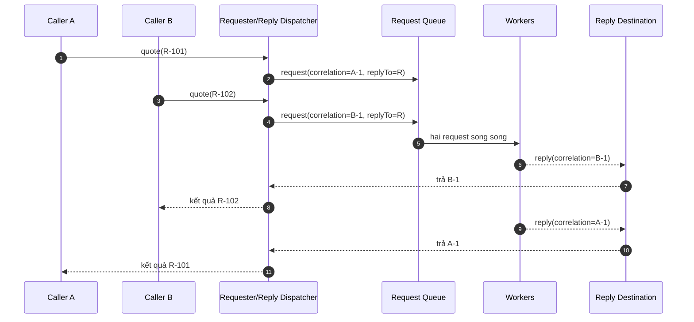
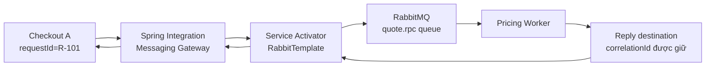
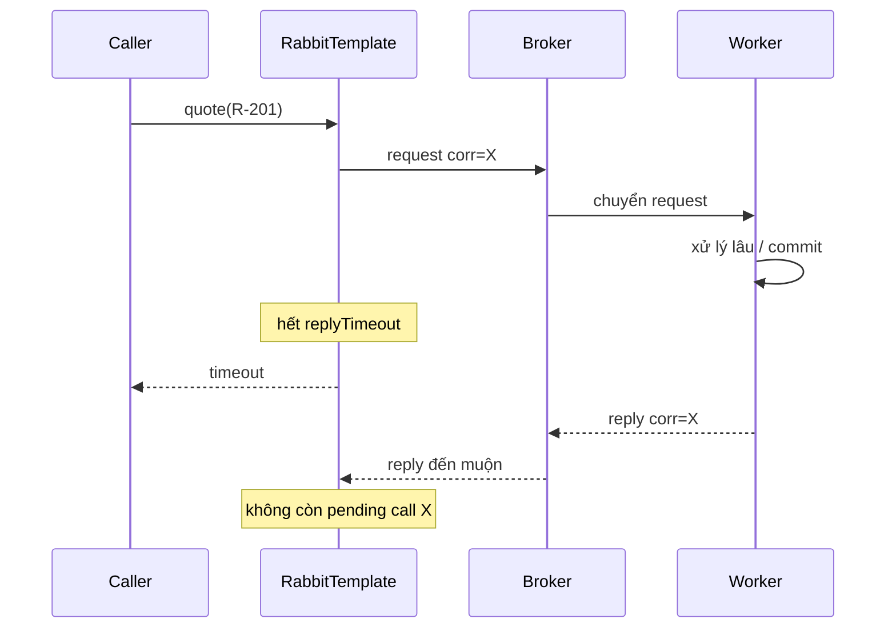

# Correlation khi qua broker trong Spring Integration

## Mục tiêu bài học

Sau bài học, bạn có thể:

- Giải thích vì sao **message ID**, **request ID nghiệp vụ**, **broker correlation ID** và **correlation ID của Aggregator** phục vụ các mục đích khác nhau.
- Thiết kế request–reply qua broker để phản hồi về **đúng yêu cầu**, dù nhiều request xử lý đồng thời và trả kết quả đảo thứ tự.
- Phân biệt `correlationId` với `replyTo`; hiểu cách RabbitMQ, JMS và Kafka biểu diễn các thông tin này.
- Xây dựng một luồng Spring Integration dùng `@MessagingGateway`, `@ServiceActivator` và Spring AMQP `RabbitTemplate` để gọi một worker qua RabbitMQ.
- Xử lý timeout, phản hồi đến muộn, retry, duplicate message, nhiều instance, định tuyến lỗi và yêu cầu về độ bền.
- Xây dựng ca kiểm thử xác nhận tính toàn vẹn của correlation trong các nhánh xử lý.

Bài thuộc chương **Message broker** của mô-đun **SPRING_INTEGRATION_PATTERN**. Khi thực hành Router, Filter, Transformer, Splitter, Aggregator, Gateway, retry và error channel trong Spring Integration, ta cần bảo toàn mối liên hệ giữa các message. Đặc biệt, khi một luồng đi **qua ranh giới broker/process**, không thể dựa vào một Java object trong bộ nhớ hoặc thứ tự xử lý để tìm lại request gốc.

## 1. Bài toán: reply về không theo thứ tự gửi request

Giả sử dịch vụ Checkout gửi hai yêu cầu tính phí vận chuyển tới broker:

| Thời điểm minh họa | Message | Diễn biến |
| --- | --- | --- |
| 0 ms | `R-101` | Checkout A gửi yêu cầu tính phí cho đơn hàng A |
| 5 ms | `R-102` | Checkout B gửi yêu cầu tính phí cho đơn hàng B |
| 50 ms | `R-102` | Worker B xử lý xong trước, trả phí 35.000 đồng |
| 180 ms | `R-101` | Worker A xử lý xong sau, trả phí 42.000 đồng |

Nếu caller ghép reply đầu tiên với request được gửi trước, A sẽ nhận nhầm 35.000 đồng của B. Quy tắc **FIFO ở một queue** không chứng minh thứ tự hoàn tất khi có nhiều consumer, nhiều instance, retry hoặc những nhánh xử lý có độ trễ khác nhau.

**Correlation** là cơ chế gắn một khóa liên hệ vào các message thuộc cùng một phiên trao đổi, để bên nhận có thể khớp đúng response với request mà không phụ thuộc thứ tự.



Điểm cốt lõi là **bên gửi/điều phối reply** có cách ánh xạ `correlation=A-1` đến lời gọi đang chờ của A và `correlation=B-1` đến lời gọi đang chờ của B.

## 2. Tách bạch các loại định danh

| Trường / ID | Phạm vi và mục đích | Có phải khóa correlation qua broker? |
| --- | --- | --- |
| `MessageHeaders.ID` | ID của một Spring Messaging `Message<?>`; một Transformer hoặc adapter có thể tạo message mới | **Không mặc định**; message mới có thể có ID khác |
| `requestId` nghiệp vụ | Mã ổn định của tác vụ, ví dụ `R-101`; dùng truy vết, đối soát, chống trùng theo chính sách ứng dụng | Có thể được ứng dụng dùng làm correlation key nếu quy định rõ |
| AMQP `correlationId` | Thuộc tính của AMQP message để liên hệ request và reply | **Có**, khi requester/reply dispatcher sử dụng trường này |
| AMQP `replyTo` | Địa chỉ đích để consumer gửi reply về | **Không**; xác định **ở đâu**, không xác định **reply thuộc ai** |
| JMS `JMSCorrelationID` | Header liên hệ các message theo quy ước JMS | **Có**, nếu client và responder thống nhất cách đặt/đọc |
| Kafka correlation header | Header được application hoặc helper request–reply sử dụng | **Có**, nếu producer/replier giữ quy ước và reply routing |
| `MessageHeaders.CORRELATION_ID` | Header của Spring Integration cho các nhóm message, đặc biệt Splitter/Aggregator | **Tùy flow**; không giả định sẽ tự ánh xạ thành AMQP/JMS correlation ID |
| `traceId` / `spanId` | Quan sát phân tán trong tracing | **Không nên** dùng thay khóa request–reply hoặc idempotency |

Trong một ứng dụng lớn, **các ID có thể khác nhau nhưng phải có liên hệ tra cứu được**. Ví dụ một request nghiệp vụ có `requestId=R-101`; RabbitTemplate tạo một correlation nội bộ để chờ reply; Splitter lại tạo correlation theo *message group* nếu cần hỏi ba nhà cung cấp. Không được ép tất cả thành cùng một ID rồi mặc định rằng adapter nào cũng hiểu.

### 2.1. `correlationId` khác `replyTo` thế nào?

Một request AMQP có thể mang:

```json
{
  "properties": {
    "correlationId": "rpc-7f91",
    "replyTo": "shipping.reply.instance-a",
    "contentType": "application/json"
  },
  "body": {
    "requestId": "R-101",
    "orderId": "ORDER-101"
  }
}
```

`replyTo` nói worker cần gửi phản hồi đến **đích nào**. `correlationId` nói requester cần hoàn tất **lời gọi nào** khi reply quay về. `requestId` trong body là ID nghiệp vụ, tiện cho logging và đối soát. JSON trên là **biểu diễn minh họa** gồm properties và body, không phải định dạng RabbitMQ thực sự đóng gói trên wire.

Worker phải giữ correlation của request khi trả reply, ví dụ:

```text
Request:
  correlationId = rpc-7f91
  replyTo       = shipping.reply.instance-a

Response:
  correlationId = rpc-7f91
  payload       = { requestId: R-101, amount: 42000 }
  gửi đến       = shipping.reply.instance-a
```

Một message trả về đúng reply queue nhưng thiếu hoặc sai correlation ID vẫn có nguy cơ bị bỏ qua, ghi nhận là reply lạ hoặc không thể hoàn tất request. Ngược lại, một correlation ID đúng nhưng gửi reply sai đích cũng khiến caller không nhận được kết quả.

## 3. Correlation phải vượt qua ranh giới nào?



Có ba ranh giới cần kiểm tra:

1. **Từ Gateway đến outbound adapter:** message chứa payload và headers nội bộ của Spring Integration; reply channel trong cùng JVM có thể là một object kênh do framework quản lý.
2. **Từ outbound adapter sang broker:** adapter/HTTP/JMS/AMQP client phải **serialize** dữ liệu, chọn request destination, ghi correlation và reply destination theo giao thức. Một Java `MessageChannel` object không tự đi qua mạng.
3. **Từ broker quay về Gateway:** reply dispatcher đọc broker correlation ID, tìm lời gọi còn chờ, chuyển kết quả về đúng lời gọi hoặc phát hiện reply trễ/không nhận diện được.

Nếu viết custom adapter và làm rơi metadata ở bước 2, việc giữ `replyChannel` trong một message Spring Integration trước đó không cứu được request. Ngược lại, nếu dùng một thư viện request–reply đã quản lý correlation nội bộ, không nên ghi đè các header nó dùng nếu chưa hiểu vòng đời chờ reply của thư viện.

## 4. Hai phương án thường dùng để ghép request–reply

### 4.1. Template/Gateway quản lý correlation tự động

Spring AMQP `RabbitTemplate.convertSendAndReceive(...)` cung cấp cơ chế RPC trên RabbitMQ: gửi request, bố trí reply destination và dùng correlation để nối reply về đúng lời gọi đang chờ. Với các cấu hình RabbitMQ thông dụng, RabbitTemplate có thể sử dụng **direct reply-to**; cơ chế cụ thể tùy RabbitMQ và cấu hình client.

Ưu điểm là ứng dụng không cần tự quản lý một `ConcurrentHashMap<correlationId, CompletableFuture<...>>`. Tuy vậy, **correlation transport tự động không thay thế request ID nghiệp vụ** dùng xuyên log, retry, đối soát hoặc phát hiện phản hồi sai nội dung.

### 4.2. Tự quản lý pending requests và reply consumer

Khi dùng asynchronous workflow, reply queue riêng, fan-out hoặc một giao thức tùy chỉnh, ứng dụng có thể tự quản lý:

```text
pending[brokerCorrelationId] = { requestId, deadline, future }

1. Lưu pending trước khi publish request.
2. Publish request với correlationId và replyTo.
3. Khi reply về, đọc correlationId.
4. Tìm pending[correlationId], xác minh requestId và kiểu payload.
5. Hoàn tất đúng future; xóa trạng thái pending sau khi hoàn tất/hết hạn.
6. Reply trễ hoặc không khớp: xử lý theo chính sách riêng.
```

Trong trường hợp này phải tự đảm bảo tính nguyên tử khi một reply và một timeout xảy ra gần như đồng thời: chỉ một kết quả được phép hoàn tất lời gọi. Có thể dùng các phép toán điều kiện như `remove(key, expectedValue)` hoặc trạng thái chuyển đổi nguyên tử; đồng thời dọn tài nguyên khi caller hủy, timeout hoặc process khởi động lại.

**Chỉ chọn một thành phần chịu trách nhiệm correlation cho cùng một lượt RPC.** Nếu đã dùng `RabbitTemplate` làm request–reply dispatcher, không đồng thời xây một bảng pending khác rồi cố lấy lại reply trên cùng direct-reply-to destination.

## 5. Ví dụ hoàn chỉnh: Spring Integration gọi worker qua RabbitMQ

Ví dụ sử dụng **Java 17+, Spring Boot 3.x, Spring Integration 6.x và Spring AMQP 3.x**. Ứng dụng requester sử dụng Spring Integration Gateway; ứng dụng responder lắng nghe RabbitMQ và trả một reply. Các class/record `public` được đặt trong file Java tương ứng. Hai ứng dụng có thể chia sẻ cùng một module DTO hoặc cùng quy ước JSON/type mapping.

Các dependency chính là `spring-boot-starter-integration`, `spring-boot-starter-amqp` và `spring-boot-starter-test` cho test; cấu hình kết nối broker thực tế qua `spring.rabbitmq.host`/credentials theo môi trường. RabbitMQ phải đang chạy và queue phải được khai báo trước khi gửi request.

### 5.1. Hợp đồng nghiệp vụ

```java
// QuoteRequest.java
public record QuoteRequest(
        String requestId,
        String sku,
        int quantity
) {}

// QuoteReply.java
import java.math.BigDecimal;

public record QuoteReply(
        String requestId,
        String sku,
        BigDecimal total,
        String errorCode
) {
    public boolean successful() {
        return errorCode == null && total != null;
    }
}
```

`requestId` giữ nguyên từ request sang reply. Lớp requester sẽ kiểm tra lại trường này **sau khi** RabbitTemplate đã ghép reply ở mức transport. Hai phép kiểm tra phục vụ hai mục tiêu khác nhau.

### 5.2. Requester: cấu hình channel và RabbitTemplate

```java
// QuoteRequesterConfig.java (ứng dụng requester)
import org.springframework.amqp.rabbit.connection.ConnectionFactory;
import org.springframework.amqp.rabbit.core.RabbitTemplate;
import org.springframework.amqp.support.converter.Jackson2JsonMessageConverter;
import org.springframework.context.annotation.Bean;
import org.springframework.context.annotation.Configuration;
import org.springframework.integration.annotation.IntegrationComponentScan;
import org.springframework.integration.channel.DirectChannel;
import org.springframework.integration.config.EnableIntegration;
import org.springframework.messaging.MessageChannel;

@Configuration
@EnableIntegration
@IntegrationComponentScan
public class QuoteRequesterConfig {
    @Bean("quoteRpcRequests")
    public MessageChannel quoteRpcRequests() {
        return new DirectChannel();
    }

    @Bean("quoteRpcRabbitTemplate")
    public RabbitTemplate quoteRpcRabbitTemplate(ConnectionFactory connectionFactory) {
        RabbitTemplate rabbitTemplate = new RabbitTemplate(connectionFactory);
        rabbitTemplate.setMessageConverter(new Jackson2JsonMessageConverter());
        rabbitTemplate.setReplyTimeout(3000);
        return rabbitTemplate;
    }
}
```

`setReplyTimeout(3000)` đặt thời gian RabbitTemplate chờ reply từ broker (mili-giây). Đây không phải timeout kết nối RabbitMQ, không giới hạn tác vụ nghiệp vụ của worker và không mặc định hủy request đã gửi.

### 5.3. Messaging Gateway: API của caller

```java
// QuoteGateway.java (ứng dụng requester)
import org.springframework.integration.annotation.MessagingGateway;

@MessagingGateway(
    defaultRequestChannel = "quoteRpcRequests",
    defaultReplyTimeout = "4500"
)
public interface QuoteGateway {
    QuoteReply quote(QuoteRequest request);
}
```

Gateway biến lời gọi `quote(request)` thành message gửi vào `quoteRpcRequests`. Ở ví dụ này channel là `DirectChannel`, nên Service Activator và thao tác `RabbitTemplate.convertSendAndReceive(...)` chạy ngay trong thread caller. **Reply timeout 4.500 ms của Messaging Gateway không phải cách hủy một Service Activator đang chặn trong `send()`**; việc chờ reply qua broker do `RabbitTemplate` kiểm soát ở giới hạn 3.000 ms.

Nếu ứng dụng cần deadline tổng nghiêm ngặt, còn phải đặt timeout cho các pha connection/pool và xử lý downstream, hoặc thiết kế request channel bất đồng bộ có chính sách hủy và resource control riêng.

### 5.4. Service Activator: gọi broker và kiểm tra reply

```java
// QuoteBrokerClient.java (ứng dụng requester)
import org.springframework.amqp.rabbit.core.RabbitTemplate;
import org.springframework.beans.factory.annotation.Qualifier;
import org.springframework.integration.annotation.ServiceActivator;
import org.springframework.stereotype.Component;

@Component
public class QuoteBrokerClient {
    private final RabbitTemplate rabbit;

    public QuoteBrokerClient(
            @Qualifier("quoteRpcRabbitTemplate") RabbitTemplate rabbit) {
        this.rabbit = rabbit;
    }

    @ServiceActivator(inputChannel = "quoteRpcRequests")
    public QuoteReply requestQuote(QuoteRequest request) {
        // Gửi tới queue quote.rpc thông qua default exchange.
        Object response = rabbit.convertSendAndReceive("quote.rpc", request);

        if (response == null) {
            // RabbitTemplate hết thời gian chờ reply ở tầng broker.
            return new QuoteReply(
                request.requestId(), request.sku(), null, "BROKER_REPLY_TIMEOUT");
        }

        if (!(response instanceof QuoteReply reply)) {
            return new QuoteReply(
                request.requestId(), request.sku(), null, "INVALID_REPLY_TYPE");
        }

        if (!request.requestId().equals(reply.requestId())) {
            return new QuoteReply(
                request.requestId(), request.sku(), null, "REQUEST_ID_MISMATCH");
        }

        return reply;
    }
}
```

Phương thức `convertSendAndReceive(...)` trả `null` nếu không có reply trong giới hạn chờ (trường hợp thông thường); các lỗi khác như mất kết nối hoặc chuyển đổi payload có thể ném exception cần được xử lý theo quy tắc lỗi của ứng dụng. Đoạn mã cố ý tách **reply timeout** và **reply mang requestId sai**.

**Không cần tự đặt AMQP correlation ID trong ví dụ này.** RabbitTemplate quản lý tương quan request–reply của nó; ứng dụng giữ `requestId` như khóa nghiệp vụ. Nếu tự thay đổi broker correlation header của message mà RabbitTemplate đã dùng, việc ánh xạ reply có thể bị phá vỡ.

### 5.5. Responder: khai báo queue và JSON converter

```java
// QuoteResponderConfig.java (ứng dụng responder)
import org.springframework.amqp.core.Queue;
import org.springframework.amqp.core.QueueBuilder;
import org.springframework.amqp.rabbit.config.SimpleRabbitListenerContainerFactory;
import org.springframework.amqp.rabbit.connection.ConnectionFactory;
import org.springframework.amqp.rabbit.annotation.EnableRabbit;
import org.springframework.amqp.support.converter.Jackson2JsonMessageConverter;
import org.springframework.context.annotation.Bean;
import org.springframework.context.annotation.Configuration;

@Configuration
@EnableRabbit
public class QuoteResponderConfig {
    @Bean
    public Queue quoteRpcQueue() {
        return QueueBuilder.durable("quote.rpc").build();
    }

    @Bean
    public Jackson2JsonMessageConverter quoteJsonConverter() {
        return new Jackson2JsonMessageConverter();
    }

    @Bean
    public SimpleRabbitListenerContainerFactory rabbitListenerContainerFactory(
            ConnectionFactory connectionFactory,
            Jackson2JsonMessageConverter converter) {
        SimpleRabbitListenerContainerFactory factory =
            new SimpleRabbitListenerContainerFactory();
        factory.setConnectionFactory(connectionFactory);
        factory.setMessageConverter(converter);
        return factory;
    }
}
```

Hai ứng dụng cần thống nhất quy tắc JSON và kiểu DTO. Trong sản phẩm thật, cân nhắc mapping type ID rõ ràng và trusted types nếu producer/consumer dùng package Java khác nhau; không để dữ liệu từ nguồn không tin cậy chỉ định class tùy ý để deserialize.

### 5.6. Responder: xử lý và trả reply

```java
// QuoteWorker.java (ứng dụng responder)
import java.math.BigDecimal;
import org.springframework.amqp.rabbit.annotation.RabbitListener;
import org.springframework.stereotype.Component;

@Component
public class QuoteWorker {
    @RabbitListener(queues = "quote.rpc")
    public QuoteReply handle(QuoteRequest request) {
        if (request.quantity() <= 0) {
            return new QuoteReply(
                request.requestId(), request.sku(), null, "INVALID_QUANTITY");
        }

        BigDecimal unitPrice = switch (request.sku()) {
            case "BOOK-01" -> new BigDecimal("120000");
            case "PEN-02"  -> new BigDecimal("15000");
            default -> null;
        };

        if (unitPrice == null) {
            return new QuoteReply(
                request.requestId(), request.sku(), null, "UNKNOWN_SKU");
        }

        return new QuoteReply(
            request.requestId(),
            request.sku(),
            unitPrice.multiply(BigDecimal.valueOf(request.quantity())),
            null
        );
    }
}
```

Spring AMQP listener infrastructure có thể gửi giá trị trả về tới destination ghi trong request `replyTo` và giữ thông tin tương quan cần thiết để requester hoàn tất lời gọi. Nhờ đó worker không cần biết callback Java, thread, instance hay API caller nào đang chờ.

Trong flow này, một request `requestId=R-101`, `sku=BOOK-01`, `quantity=2` trả tổng **240.000 đồng**. Nếu R-102 xử lý trước R-101, dispatcher ở requester vẫn ghép reply theo correlation transport do RabbitTemplate quản lý.

### 5.7. Caller kiểm tra kết quả nghiệp vụ

```java
// CheckoutService.java (ứng dụng requester)
import org.springframework.stereotype.Service;

@Service
public class CheckoutService {
    private final QuoteGateway quoteGateway;

    public CheckoutService(QuoteGateway quoteGateway) {
        this.quoteGateway = quoteGateway;
    }

    public QuoteReply getQuote() {
        QuoteRequest request = new QuoteRequest("R-101", "BOOK-01", 2);
        QuoteReply reply = quoteGateway.quote(request);

        if (reply == null) {
            throw new IllegalStateException("GATEWAY_REPLY_TIMEOUT");
        }
        if (!reply.successful()) {
            throw new IllegalStateException(reply.errorCode());
        }
        return reply;
    }
}
```

Đây là hợp đồng **RPC trên nền message broker**: người gọi mong đợi một kết quả liên quan đến request hiện tại, dù việc vận chuyển qua RabbitMQ. Việc dùng broker không tự biến lời gọi thành event-driven fire-and-forget.

## 6. Khi tự quản lý correlation ở mức AMQP

Một số kiến trúc cần reply bất đồng bộ hoặc reply queue lâu dài, ví dụ request có thể chạy vài phút và caller nhận kết quả qua một kênh khác. Lúc đó có thể dùng raw AMQP properties:

```java
// Ví dụ minh họa phần tạo message để publish,
// không sử dụng song song trên cùng flow với RabbitTemplate RPC phía trên.
import org.springframework.amqp.core.Message;
import org.springframework.amqp.core.MessageProperties;
import org.springframework.amqp.rabbit.core.RabbitTemplate;

public void publishAsync(
        RabbitTemplate rabbit,
        byte[] jsonPayload,
        String correlationId) {
    MessageProperties properties = new MessageProperties();
    properties.setContentType(MessageProperties.CONTENT_TYPE_JSON);
    properties.setCorrelationId(correlationId);
    properties.setReplyTo("quotes.reply.instance-a");

    Message message = new Message(jsonPayload, properties);
    rabbit.send("", "quote.rpc", message);
}
```

Ở đây `correlationId` phải được ứng dụng tạo và ghi vào bảng pending **trước khi gọi `send()`**. Bên worker cần đọc `replyTo` và sao chép `correlationId` vào message phản hồi. Reply consumer cần:

1. Đọc đúng correlation ID của broker message.
2. Tra cứu pending request đã được đăng ký trước đó.
3. Kiểm tra request ID và schema payload.
4. Chỉ hoàn tất một lần rồi dọn bản ghi pending.
5. Ghi nhận reply không có pending entry, hết hạn, bị trùng hoặc sai đích.

Phần mã trên là **một bước publish minh họa**, chưa bao gồm reply listener, serialization, durable pending store, ack/retry và cấu hình topology đầy đủ. Không dùng nó để thay thế cơ chế RPC quản lý sẵn mà không bổ sung các thành phần còn thiếu.

### 6.1. Reply queue dùng chung và nhiều instance

Một reply queue dùng chung có thể hoạt động nếu mọi consumer đều có khả năng đối chiếu pending request. Nhưng nếu instance A chờ `corr-A` trong bộ nhớ, còn broker giao reply đó cho instance B, B sẽ không tìm được pending entry, trong khi A tiếp tục timeout. Cần chọn một trong các thiết kế có chủ đích:

- **Reply destination gắn với requester/instance:** broker trả về đúng nơi có bảng pending cục bộ; phải quản lý vòng đời queue và tình huống instance chết.
- **Reply dispatcher tập trung:** một thành phần sở hữu việc đọc reply và hoàn tất future/callback tại nơi tương ứng.
- **Lưu trạng thái chờ phân tán:** nhiều instance tra được một trạng thái bền hoặc điều phối reply theo partition/owner; cần thao tác nguyên tử và deadline.
- **Async job contract:** không giữ một Java future chờ qua restart; lưu `requestId` và trạng thái job, phát event kết quả hoặc để client polling.

Các lựa chọn có tính đánh đổi khác nhau. Không thể chỉ thêm một correlation ID rồi mặc nhiên đảm bảo đúng caller trong hệ thống nhiều replica nếu reply được phân phối đến replica không sở hữu request đang chờ.

## 7. Correlation khi qua JMS và Kafka

| Transport | Trường / kỹ thuật phổ biến | Điều cần chú ý |
| --- | --- | --- |
| RabbitMQ (AMQP 0-9-1) | `correlationId`, `replyTo` properties | Response phải đến đúng destination và mang key mà requester đang chờ |
| JMS | `JMSCorrelationID`, `JMSReplyTo`; đôi khi correlation theo `JMSMessageID` của request | Thống nhất quy tắc request ID / message ID; đừng tự suy response ID giống request message ID |
| Kafka | Correlation trong record headers và reply topic/partition; có helper như `ReplyingKafkaTemplate` | Producer/consumer phải giữ header, cấu hình reply listener/topic; Kafka không tự cấp cú pháp RPC cho mọi topic |

Ví dụ với JMS, hai cách xử lý thường gặp là tạo một correlation key riêng ở request, hoặc dùng `JMSMessageID` của request làm correlation ID cho response theo quy ước hai bên. Cách thứ hai chỉ hoạt động khi responder lấy **đúng** ID request và requester hiểu quy tắc đó. Đừng giả định `JMSCorrelationID` luôn bằng `JMSMessageID`.

Với Kafka, reply được publish như một record mới. Nếu dùng `ReplyingKafkaTemplate` hoặc endpoint hỗ trợ request–reply, thư viện quản lý phần ánh xạ tương quan; trong giao thức tự xây, cả producer và consumer phải thống nhất tên header correlation, reply topic, reply partition và nơi giữ pending request. Trường header của Kafka không tự đồng nghĩa với `MessageHeaders.CORRELATION_ID` bên trong một Aggregator Spring Integration.

## 8. Correlation của broker và correlation của Aggregator

Giả sử Checkout gửi một request hỏi giá ba đối tác:

```text
requestId = R-101 (nghiệp vụ)
    |
    v
Splitter -> Vendor A, Vendor B, Vendor C
    |          |          |
    v          v          v
 broker RPC  broker RPC  broker RPC
  corr A      corr B      corr C     (các lượt transport riêng)
    |          |          |
    v          v          v
 reply A     reply B     reply C
    \          |         /
     \         |        /
      Aggregator, groupId = G-101
                |
                v
        SummaryReply(requestId=R-101)
```

Ở đây có ít nhất ba tầng liên hệ:

- `R-101` là **mã request nghiệp vụ** dùng để theo dõi toàn bộ thao tác.
- `corr A/B/C` là **các khóa request–reply ở broker**, cho từng lời gọi tới nhà cung cấp. Chúng có thể được template tự tạo hoặc được giao thức tự quản lý.
- `G-101` là **khóa nhóm** dùng để gom các phản hồi từ các nhánh. Với Splitter/Aggregator của Spring Integration, thông tin nhóm thường đi cùng các header `CORRELATION_ID`, `SEQUENCE_NUMBER` và `SEQUENCE_SIZE`.

Không nhầm broker correlation ID của **một attempt** với correlation ID của **một message group**. Retry một broker RPC có thể tạo correlation transport mới nhưng vẫn thuộc cùng request nghiệp vụ. Nếu ghi đè header của Splitter trong quá trình mapping, Aggregator có thể không gom đủ; nếu ghi đè key của RabbitTemplate, reply có thể không tìm được lời gọi chờ.

Khi flow đi qua Router, Transformer hoặc Filter:

1. Giữ lại ID nghiệp vụ cần thiết cho tracing, retry và idempotency.
2. Kiểm tra header mà từng adapter có thể serialize/deserialize và các header bị lọc.
3. Với Filter loại bỏ một nhánh mà Aggregator vẫn đang đợi, phải có release/timeout strategy phù hợp.
4. Nếu một nhánh trả lỗi, quyết định xem lỗi được tính là một phản hồi có cấu trúc hay gửi vào `errorChannel` để xử lý riêng.

## 9. Timeout, late reply và bản chất “kết quả không xác định”

Giả sử RabbitTemplate đợi tối đa 3 giây. Worker ghi dữ liệu thành công ở giây thứ 4 rồi gửi reply. Khi requester đã timeout:



**Timeout ở requester chỉ nghĩa là requester ngừng chờ.** Nó không chứng minh worker chưa nhận, chưa commit hoặc đã được hủy. Vì thế:

- Không ghép một late reply vào request mới chỉ vì nó là message tiếp theo trong reply queue.
- Nếu có business request ID, có thể lưu lại kết quả đến trễ để đối soát theo quy tắc nghiệp vụ.
- Không retry vô hạn. Mỗi attempt cần deadline, retry policy và idempotency key.
- Với tác vụ có tác dụng phụ (đặt hàng, thanh toán, gửi thông báo), retry cùng operation ID phải tránh tạo kết quả trùng. Đối với read-only query, có thể linh hoạt hơn.
- Phải cấu hình TTL/group expiry/pending cleanup ở những nơi có giữ state; TTL trên broker không tự xóa một future trong ứng dụng.

### 9.1. Duplicate message và khả năng giao nhận

Broker có thể giao lại request khi consumer chết sau khi thực hiện side effect nhưng trước khi ack. Nếu handler chưa chống trùng, cùng `requestId` có thể bị xử lý hai lần:

```text
Consumer nhận R-201 -> commit giao dịch
Consumer chết trước khi ACK
Broker redeliver R-201 -> consumer mới nhận lại
```

Nếu thao tác yêu cầu exactly-once về **hiệu ứng nghiệp vụ**, cần cơ chế idempotency tại nơi phát sinh side effect, ví dụ unique constraint trên operation ID và ghi kết quả xử lý trong cùng transaction. Correlation giải quyết **ghép đúng reply**, không tự tạo exactly-once delivery hay exactly-once business effect.

### 9.2. Lỗi bất đồng bộ và error channel

Trong Spring Integration, lỗi của Service Activator đồng bộ có thể truyền ngược về caller; ở luồng bất đồng bộ, lỗi có thể được chuyển thành `ErrorMessage` qua error channel nếu endpoint/cấu hình hỗ trợ. Trong broker consumer, exception còn tương tác với ack/reject/requeue/dead-letter policy của chính broker adapter.

Vì vậy phải quyết định **ai chịu trách nhiệm trả reply lỗi**:

- Worker trả response có `errorCode`, giữ correlation với request.
- Worker gửi lỗi vào một error/dead-letter flow có khả năng đối soát request, đồng thời requester có timeout rõ ràng nếu không có reply.
- Với lỗi không thể retry, có thể phát một kết quả từ chối nghiệp vụ để request hoàn tất dứt điểm.

Không coi `errorChannel` là `replyChannel`. Nếu chỉ log exception mà không trả reply, caller sẽ không có kết quả nghiệp vụ cho tới khi timeout.

## 10. Kiểm thử correlation qua broker

### 10.1. Kiểm thử hai request hoàn tất đảo thứ tự

Tạo hai request `R-101` và `R-102`; cố ý để worker trả R-102 trước R-101. Đảm bảo:

1. Reply R-102 chỉ hoàn tất lời gọi đang chờ R-102.
2. Reply R-101 chỉ hoàn tất lời gọi đang chờ R-101.
3. Không có request bị hoàn tất hai lần; không có reply thiếu requestId.
4. Mọi call timeout được phát hiện và pending state được dọn dẹp.

Một test tích hợp thực tế phải chạy với RabbitMQ hoặc broker test container phù hợp. Ví dụ khung kiểm thử dưới đây dùng `QuoteGateway` đã khai báo, đồng thời gọi hai request:

```java
import static org.assertj.core.api.Assertions.assertThat;

import java.util.concurrent.ExecutorService;
import java.util.concurrent.Executors;
import java.util.concurrent.Future;
import java.util.concurrent.TimeUnit;
import org.junit.jupiter.api.Test;
import org.springframework.beans.factory.annotation.Autowired;
import org.springframework.boot.test.context.SpringBootTest;

@SpringBootTest
class QuoteBrokerCorrelationTest {
    @Autowired
    private QuoteGateway gateway;

    @Test
    void keepsRepliesWithTheirRequests() throws Exception {
        ExecutorService callers = Executors.newFixedThreadPool(2);
        try {
            Future<QuoteReply> a = callers.submit(() ->
                gateway.quote(new QuoteRequest("R-101", "BOOK-01", 2)));
            Future<QuoteReply> b = callers.submit(() ->
                gateway.quote(new QuoteRequest("R-102", "PEN-02", 5)));

            QuoteReply replyB = b.get(8, TimeUnit.SECONDS);
            QuoteReply replyA = a.get(8, TimeUnit.SECONDS);

            assertThat(replyA).isNotNull();
            assertThat(replyB).isNotNull();
            assertThat(replyA.requestId()).isEqualTo("R-101");
            assertThat(replyB.requestId()).isEqualTo("R-102");
            assertThat(replyA.total()).isEqualByComparingTo("240000");
            assertThat(replyB.total()).isEqualByComparingTo("75000");
        } finally {
            callers.shutdownNow();
        }
    }
}
```

Test này kiểm tra **không ghép nhầm response** khi gọi đồng thời. Để chứng minh trường hợp đảo thứ tự, test responder phải có **độ trễ được điều khiển**: cố ý trì hoãn R-101 lâu hơn R-102 và quan sát thời điểm reply. Với worker mẫu xử lý ngay, hai future chạy song song chưa chứng minh thứ tự hoàn thành đảo.

### 10.2. Các ca cần thêm

| Ca kiểm thử | Cách tạo tình huống | Kết quả kỳ vọng |
| --- | --- | --- |
| Reply thiếu/sai broker correlation ID | Thay thế reply bằng message có key không hợp lệ trong flow manual | Request đúng timeout; reply lạ được ghi nhận, không gán cho request khác |
| Reply có correlation đúng nhưng `requestId` sai | Consumer trả payload sai mã nghiệp vụ | Adapter phát hiện `REQUEST_ID_MISMATCH` |
| Reply đến muộn | Worker chậm hơn reply timeout | Requester đã hết hạn; late reply không hoàn tất request mới |
| Duplicate request/reply | Cố ý redelivery hoặc publish lại | Xử lý idempotent, không hoàn tất nhiều lần |
| Hai requester instance | Hai instance cùng publish và nhận reply | Reply về đúng owner, không rơi vào instance khác |
| Worker gặp exception | Worker lỗi hoặc broker requeue/dead-letter | Chính sách retry/error flow đúng; không đợi vô hạn |
| Restart trong lúc chờ | Dừng requester/consumer | Nếu cần khôi phục, thiết kế persistent job/reply routing có thể đối soát |
| Splitter/Aggregator qua broker | Thêm nhiều nhánh, đảo thứ tự | Correlation group và sequence metadata không mất |

## 11. Theo dõi correlation trong production

Các trường nên ghi ở ranh giới gửi/nhận (không log payload nhạy cảm):

| Trường | Công dụng |
| --- | --- |
| `requestId` / `operationId` | Truy vết tác vụ nghiệp vụ xuyên các lần retry |
| `brokerCorrelationId` (khi được ứng dụng quản lý) | Phát hiện reply gắn với pending RPC nào |
| `replyDestination` | Tìm lỗi gửi sai queue/topic/partition |
| `requestPublishedAt` / `replyReceivedAt` | Đo độ trễ end-to-end |
| `attempt` / `deadlineRemainingMs` | Phân biệt retry và request hết ngân sách |
| `messageGroupId` / `sequenceNumber` | Chẩn đoán Aggregator thiếu thành viên |
| `traceId` / `spanId` | Liên hệ log/trace giữa Gateway, broker và worker |

Metric hữu ích: số pending RPC, tỷ lệ reply timeout, reply đến muộn, reply không tìm được pending entry, duplicate message, consumer lag, dead-letter count và độ trễ p95/p99. Đặc biệt, **đếm nhiều pending tăng liên tục** có thể chỉ ra leak do thiếu cleanup hoặc consumer ngừng trả reply.

## 12. Checklist thiết kế

Trước khi triển khai request–reply đi qua broker, tự kiểm tra:

1. **Ai tạo khóa correlation?** Template/framework hay application? Có một chủ sở hữu rõ ràng không?
2. **Địa chỉ reply là gì?** Direct reply-to, queue theo instance, queue chung hay topic/partition? Ai tiêu thụ?
3. **Broker header có được giữ qua adapter không?** Responder trả lại đúng correlation key chứ?
4. **Request ID nghiệp vụ được bảo toàn không?** Có kiểm tra trùng, sai payload và quyền truy cập reply không?
5. **Khi timeout/late reply xảy ra thì sao?** Ai dọn pending state, ai ghi lại kết quả muộn?
6. **Retry có an toàn không?** Có idempotency key và giao dịch nhất quán cho side effect không?
7. **Nếu chạy nhiều replica thì sao?** Owner của pending call có chắc nhận được reply không?
8. **Nếu Splitter/Aggregator tham gia thì sao?** Group correlation và broker correlation đã được phân biệt, các header sequence có được giữ?
9. **Giám sát và kiểm thử đủ chưa?** Có kịch bản đảo thứ tự, duplicate, reply sai key, worker chết và restart?

## Kết luận

**Correlation khi qua broker** là cơ chế đảm bảo một reply được gắn về **đúng request**, bất kể thứ tự hoàn thành hay số lượng consumer. `replyTo` định tuyến **đến đâu**, còn `correlationId` xác định **thuộc lời gọi nào**; business `requestId` hỗ trợ truy vết, retry và idempotency xuyên hệ thống. Spring Integration có thể cung cấp API kiểu Gateway, trong khi RabbitTemplate hoặc adapter chịu trách nhiệm tương quan ở mức broker. Khi tự quản lý correlation, cần bổ sung pending-state lifecycle, deadline, late reply, xử lý trùng và định tuyến theo instance. Correlation chính xác là điều kiện cần để xây dựng các luồng Message Broker, Router, Splitter/Aggregator và RPC có thể kiểm thử, theo dõi và mở rộng an toàn.
