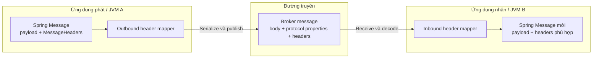
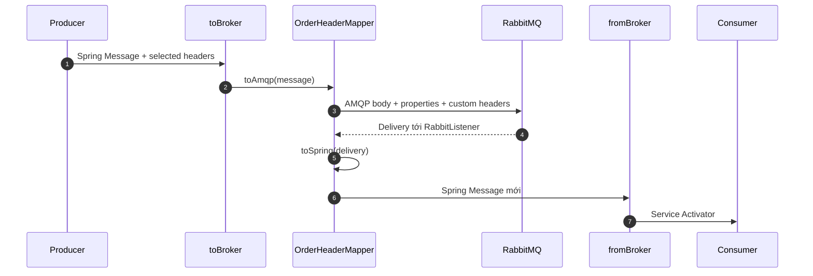
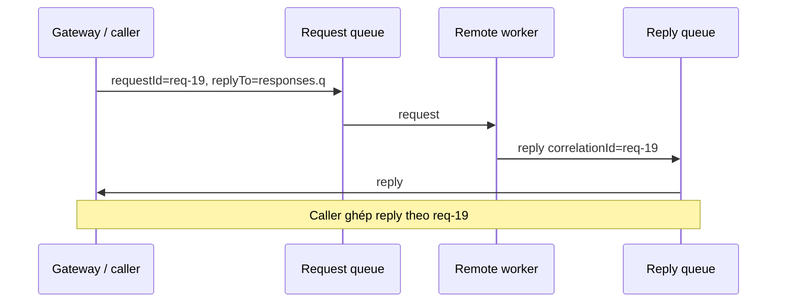

# Message broker — Header mapping qua broker với Spring Integration

## Mục tiêu học tập

Sau bài này, bạn có thể:

- Mô tả cách **header mapping** chuyển metadata giữa Spring Integration `MessageHeaders` và hệ thống message broker; phân biệt payload, application headers và thuộc tính của giao thức vận chuyển.
- Chọn rõ header nào cần đưa qua ranh giới JVM, header nào cần khôi phục từ broker và header nào phải giữ tại ứng dụng.
- Phân biệt `id`, `timestamp`, `replyChannel`, `errorChannel` trong Spring Messaging với `messageId`, `correlationId`, `replyTo` và các delivery metadata trong AMQP.
- Xây dựng bridge Spring Integration ↔ RabbitMQ có **allowlist** cho header, kiểm thử ánh xạ hai chiều và bảo vệ các giá trị không nên đi qua mạng.
- Áp dụng correlation, tracing, schema version, idempotency, retry, error channel và xử lý reply muộn khi nối Router/Transformer/Gateway với broker.

Bài thuộc chương **Message broker** của module **SPRING_INTEGRATION_PATTERN**. Module hướng đến triển khai Enterprise Integration Patterns bằng Spring Integration để luồng xử lý ít phụ thuộc, dễ mở rộng; thực hành Router, Filter, Transformer, Splitter, Aggregator, Gateway, retry, error channel, correlation và theo dõi các nhánh. Header mapping là điểm nối quan trọng bởi một message được xử lý an toàn trong bộ nhớ **chưa chắc có thể chuyển nguyên vẹn sang queue hoặc topic của một tiến trình khác**.

## 1. Header mapping là gì và giải quyết vấn đề nào?

Trong Spring Integration, một message gồm hai phần:

- **Payload**: nội dung nghiệp vụ như `OrderCreated`, chuỗi JSON hoặc một DTO Java.
- **Headers**: thông tin đi kèm để định tuyến, quan sát, tương quan hoặc điều khiển xử lý, ví dụ `correlationId`, `replyChannel` và các khóa do ứng dụng tự đặt.

Ví dụ trong một JVM:

```java
Message<String> event = MessageBuilder.withPayload(
        "{\"orderId\":\"ORD-42\"}")
    .setHeader("eventId", "evt-42")
    .setHeader("correlationId", "req-19")
    .setHeader("schemaVersion", 1)
    .build();
```

Khi message đi qua một kênh nội bộ như `DirectChannel`, Java object của header có thể được giữ trong memory. Nhưng qua RabbitMQ, Kafka hay JMS, dữ liệu phải chuyển thành **thuộc tính/hệ header do giao thức hỗ trợ**, đi qua cơ chế encode/serialize, sau đó được decode ở ứng dụng nhận. Việc chọn, đổi tên, chuyển kiểu và lọc các header là **header mapping**.



Mapper có thể thực hiện cả bốn việc: **chọn trường**, **đổi tên**, **chuyển kiểu** và **bỏ những giá trị không được phép truyền**. Hai đầu producer/consumer phải dùng chung một hợp đồng metadata; trùng tên header thôi chưa đủ bảo đảm tương thích.

## 2. Ba nhóm metadata phải phân biệt

| Nhóm | Ví dụ | Ý nghĩa |
| --- | --- | --- |
| Application headers | `eventId`, `correlationId`, `schemaVersion`, `tenantCode` (nếu có yêu cầu) | Do ứng dụng định nghĩa; cần thống nhất tên, kiểu, phạm vi và độ tin cậy |
| Spring Integration headers | `MessageHeaders.ID`, `MessageHeaders.TIMESTAMP`, `MessageHeaders.REPLY_CHANNEL`, `MessageHeaders.ERROR_CHANNEL` | Metadata cho vòng đời và định tuyến message **trong ứng dụng** |
| Broker / transport properties | RabbitMQ `messageId`, `correlationId`, `replyTo`, routing key, delivery tag; Kafka topic, partition, offset | Thông tin của giao thức gửi/nhận; một phần được producer đặt, phần khác do broker/consumer tạo |

**Không nên sao chép toàn bộ `MessageHeaders` vào broker header table.** Chẳng hạn:

- `replyChannel` có thể là một đối tượng Java `MessageChannel` hoặc một channel name chỉ có nghĩa trong ứng dụng hiện tại. Đầu nhận ở JVM khác không thể gọi một đối tượng channel đã được gửi đi.
- `errorChannel` thường là đường xử lý lỗi nội bộ; qua broker, consumer cần chọn error flow tương ứng của chính mình.
- `id` và `timestamp` của Spring message thể hiện vòng đời **một instance message**. Một lần deserialize vào message mới có thể phát sinh `id`/`timestamp` khác; nếu nghiệp vụ cần định danh ổn định, hãy mang một `eventId` riêng.
- `replyTo` (AMQP/JMS) là **địa chỉ phản hồi của transport**, không phải tương đương trực tiếp một đối tượng `replyChannel` trong JVM.
- `deliveryTag`, `consumerTag`, Kafka `offset` hay các header redelivery chỉ có nghĩa trong lần giao message/consumer cụ thể; không sao chép mù quáng chúng sang một publish mới.

Một số header của broker còn do hệ thống tự tạo, ví dụ `x-death` khi message đi qua dead-letter exchange trong RabbitMQ. Đây là metadata hạ tầng, không nên coi là trường nghiệp vụ do client tùy ý khai báo.

### Hai loại ID có thể cùng tồn tại

```text
Ứng dụng A                        Broker                    Ứng dụng B
Spring Message id=uuid-A   -->   messageId=evt-42   -->   Spring Message id=uuid-B
             \____________________ eventId=evt-42 ___________________/
                                     correlationId=req-19
```

Ở đây `uuid-A` và `uuid-B` có thể khác nhau hoàn toàn; `evt-42` là ID sự kiện ổn định để chống xử lý trùng. `req-19` thể hiện chuỗi nguyên nhân/request–reply mà sự kiện thuộc về. **Correlation ID không tự mang lại idempotency**: đầu nhận phải lưu và kiểm tra khóa sự kiện hoặc khóa nghiệp vụ ở nơi có transaction phù hợp.

## 3. Thiết kế hợp đồng header trước khi cấu hình mapper

Đối với sự kiện `order.created`, ta chủ động công bố một hợp đồng tối giản:

| Metadata | Dạng phía Spring | Dạng qua AMQP | Chính sách |
| --- | --- | --- | --- |
| Payload | JSON `String` UTF-8 | AMQP message body, `contentType=application/json` | Bắt buộc; xác minh schema payload ở consumer |
| `eventId` | `String` | AMQP `messageId` | Bắt buộc; dùng làm ID sự kiện ổn định |
| `correlationId` | `String` | AMQP `correlationId` | Bắt buộc trong ví dụ; liên kết log/flow |
| `eventType` | `String` | Custom AMQP header `eventType` | Bắt buộc; ví dụ `order.created` |
| `schemaVersion` | `Integer` | Custom AMQP header số nguyên | Bắt buộc; giúp kiểm tra compatibility |
| `traceparent` | `String` | Custom AMQP header `traceparent` | Tùy chọn; cần kiểm tra định dạng và độ tin cậy |
| `replyChannel`, `errorChannel` | Có thể là Java object | Không xuất | Không được serialize thành object channel |
| `authorization`, secret, session object | Bất kỳ | Không xuất | Không đưa token/secret nội bộ sang broker |

Các tên và quy tắc trên là **hợp đồng do ứng dụng trong ví dụ tự định nghĩa**. Spring Integration không tự hiểu rằng mọi header tên `eventId` phải trở thành AMQP `messageId`; đó là quyết định cần cấu hình hoặc cài đặt rõ.

Khi một header không có ở message đầu vào, phải quyết định **reject**, **tạo giá trị ở ingress có kiểm soát**, hay **để trống theo giao kèo**. Không nên để producer và consumer tự suy đoán kiểu dữ liệu, ví dụ một bên dùng số `1` còn bên kia kỳ vọng chuỗi `"1"`.

### Nguyên tắc allowlist

Ưu tiên **danh sách cho phép** theo tên header; chỉ gửi những trường consumer cần. Chính sách này giúp:

1. Tránh chuyển header framework không thể serialize.
2. Tránh gửi token, thông tin nội bộ hoặc object lớn.
3. Giữ format ổn định khi upstream thêm header mới.
4. Hạn chế phụ thuộc ngược giữa các service.
5. Giảm khả năng broker phải lưu header lớn hoặc kiểu dữ liệu không hợp lệ.

Đừng dùng `headers.forEach((k, v) -> properties.setHeader(k, v))` cho mọi message nếu chưa có hợp đồng dữ liệu và kiểm tra kiểu/độ dài.

## 4. Spring Integration và cơ chế mapping theo adapter

Khi dùng **Spring Integration AMQP inbound/outbound adapters**, framework có cơ chế `HeaderMapper` để chuyển đổi giữa Spring Message headers và AMQP properties/headers. Những header tiêu chuẩn có thể được xử lý đặc biệt; một số header được đưa qua mặc định hoặc bị loại tùy loại adapter, hướng inbound/outbound và phiên bản.

Điều cần kiểm tra trong dự án là:

- Adapter/gateway thực tế sử dụng **mapper nào** và các header mặc định được hỗ trợ ở hướng nào.
- Mapping có cho phép header custom như `eventId` hoặc `traceparent` không; có yêu cầu khai báo tên/pattern không.
- Broker metadata nào được đưa vào inbound Spring Message và có được giữ lại sau Transformer hoặc Router không.
- Có cơ chế mapping reply destination/correlation cho request–reply qua broker hay không.
- Header framework nào bị loại khi publish; object nào phải chuyển thành string/primitive.

Để thấy chính xác ranh giới, phần thực hành sau **tự viết một mapper nhỏ** với Spring AMQP `MessageProperties` và Spring Messaging `MessageBuilder`. Spring Integration đảm nhiệm các channel/Service Activator, còn `RabbitTemplate` và `@RabbitListener` kết nối broker. Khi chuyển sang adapter AMQP chuyên dụng, giữ nguyên **hợp đồng header** và chuyển cấu hình allowlist tương đương vào mapper của adapter.

## 5. Ví dụ hoàn chỉnh: map header qua RabbitMQ

Bài toán: ứng dụng phát sự kiện đơn hàng, message đi qua `toBroker`, được publish vào RabbitMQ exchange `business.events` với routing key `order.created`; consumer chuyển message nhận được về `fromBroker`. Hai đầu có thể là hai service khác nhau, nhưng ví dụ đặt chung một ứng dụng để minh họa.

Dùng Java 17, Spring Boot với Spring Integration và Spring AMQP. Các dependency cần thiết:

```groovy
dependencies {
    implementation 'org.springframework.boot:spring-boot-starter-integration'
    implementation 'org.springframework.boot:spring-boot-starter-amqp'
    testImplementation 'org.springframework.boot:spring-boot-starter-test'
}
```

Phần code này dùng trực tiếp `RabbitTemplate` và raw AMQP `Message` nên không bắt buộc phụ thuộc `spring-integration-amqp`. Nếu dùng Spring Integration AMQP adapters, thêm module tích hợp tương thích phiên bản Spring Integration của ứng dụng. Cần một RabbitMQ server đang hoạt động và cấu hình kết nối qua Spring Boot. Các class dưới đây ở cùng package để dễ thực hành.

### 5.1. Channel nội bộ và topology

`HeaderMappingConfiguration.java`:

```java
import org.springframework.amqp.core.Binding;
import org.springframework.amqp.core.BindingBuilder;
import org.springframework.amqp.core.Queue;
import org.springframework.amqp.core.QueueBuilder;
import org.springframework.amqp.core.TopicExchange;
import org.springframework.amqp.rabbit.annotation.EnableRabbit;
import org.springframework.context.annotation.Bean;
import org.springframework.context.annotation.Configuration;
import org.springframework.integration.annotation.EnableIntegration;
import org.springframework.integration.channel.DirectChannel;
import org.springframework.messaging.MessageChannel;

@Configuration
@EnableIntegration
@EnableRabbit
public class HeaderMappingConfiguration {

    @Bean("toBroker")
    public MessageChannel toBroker() {
        return new DirectChannel();
    }

    @Bean("fromBroker")
    public MessageChannel fromBroker() {
        return new DirectChannel();
    }

    @Bean
    public TopicExchange businessEvents() {
        return new TopicExchange("business.events", true, false);
    }

    @Bean
    public Queue orderCreatedQueue() {
        return QueueBuilder.durable("orders.created.q").build();
    }

    @Bean
    public Binding orderCreatedBinding(
            Queue orderCreatedQueue, TopicExchange businessEvents) {
        return BindingBuilder.bind(orderCreatedQueue)
            .to(businessEvents)
            .with("order.created");
    }

    @Bean
    public OrderHeaderMapper orderHeaderMapper() {
        return new OrderHeaderMapper();
    }
}
```

`toBroker` và `fromBroker` là các bean `MessageChannel` nội bộ. `business.events` là exchange RabbitMQ; `orders.created.q` là queue RabbitMQ. Queue/exchange/binding được khai báo trên broker khi có `RabbitAdmin`/auto-configuration thích hợp; không thể tạo queue chỉ bằng cách tạo bean `DirectChannel`.

### 5.2. Mapper cho hai chiều

`OrderHeaderMapper.java`:

```java
import java.nio.charset.StandardCharsets;

import org.springframework.amqp.core.MessageProperties;
import org.springframework.amqp.core.MessageDeliveryMode;
import org.springframework.messaging.Message;
import org.springframework.messaging.support.MessageBuilder;

public final class OrderHeaderMapper {

    // Đây là allowlist của hợp đồng order.created.
    public org.springframework.amqp.core.Message toAmqp(
            Message<String> source) {
        String eventId = required(
            source.getHeaders().get("eventId"), "eventId");
        String correlationId = required(
            source.getHeaders().get("correlationId"), "correlationId");
        String eventType = required(
            source.getHeaders().get("eventType"), "eventType");

        Object versionValue = source.getHeaders().get("schemaVersion");
        if (!(versionValue instanceof Integer version) || version < 1) {
            throw new IllegalArgumentException(
                "schemaVersion must be a positive Integer");
        }

        MessageProperties properties = new MessageProperties();
        properties.setContentType("application/json");
        properties.setContentEncoding("UTF-8");
        properties.setDeliveryMode(MessageDeliveryMode.PERSISTENT);
        properties.setMessageId(eventId);
        properties.setCorrelationId(correlationId);
        properties.setHeader("eventType", eventType);
        properties.setHeader("schemaVersion", version);

        Object trace = source.getHeaders().get("traceparent");
        if (trace instanceof String traceparent
                && !traceparent.isBlank()
                && traceparent.length() <= 128) {
            // Sản xuất thực tế còn phải xác minh cú pháp traceparent.
            properties.setHeader("traceparent", traceparent);
        }

        return new org.springframework.amqp.core.Message(
            source.getPayload().getBytes(StandardCharsets.UTF_8),
            properties
        );
    }

    public Message<String> toSpring(
            org.springframework.amqp.core.Message source) {
        MessageProperties properties = source.getMessageProperties();

        if (!"application/json".equalsIgnoreCase(
                properties.getContentType())) {
            throw new IllegalArgumentException(
                "Unsupported content type");
        }
        if (properties.getContentEncoding() != null
                && !"UTF-8".equalsIgnoreCase(
                    properties.getContentEncoding())) {
            throw new IllegalArgumentException(
                "Unsupported content encoding");
        }

        String eventId = required(
            properties.getMessageId(), "messageId");
        String correlationId = required(
            properties.getCorrelationId(), "correlationId");
        String eventType = required(
            properties.getHeaders().get("eventType"), "eventType");

        if (!"order.created".equals(eventType)) {
            throw new IllegalArgumentException(
                "Unsupported event type");
        }

        Object rawVersion =
            properties.getHeaders().get("schemaVersion");
        if (!(rawVersion instanceof Number number)
                || number.intValue() < 1) {
            throw new IllegalArgumentException(
                "Invalid schemaVersion");
        }

        String payload = new String(
            source.getBody(), StandardCharsets.UTF_8);

        MessageBuilder<String> builder =
            MessageBuilder.withPayload(payload)
                .setHeader("eventId", eventId)
                .setHeader("correlationId", correlationId)
                .setHeader("eventType", eventType)
                .setHeader("schemaVersion", number.intValue());

        Object trace =
            properties.getHeaders().get("traceparent");
        if (trace instanceof String traceparent
                && !traceparent.isBlank()
                && traceparent.length() <= 128) {
            builder.setHeader("traceparent", traceparent);
        }

        // Tạo Spring Message mới với ID/timestamp mới;
        // không tái tạo replyChannel/errorChannel nội bộ.
        return builder.build();
    }

    private static String required(Object value, String name) {
        if (!(value instanceof String text) || text.isBlank()) {
            throw new IllegalArgumentException(
                "Missing or invalid " + name);
        }
        return text;
    }
}
```

Đặc điểm của mapper:

- `eventId` được ánh xạ vào **AMQP `messageId`**; `correlationId` đi vào **AMQP `correlationId`**.
- `eventType` và `schemaVersion` đi vào **custom AMQP headers**, trong khi `contentType`/encoding là thuộc tính mô tả body.
- `traceparent` là tùy chọn và chỉ được chuyển khi là chuỗi ngắn; ví dụ này chưa xác minh đầy đủ chuẩn W3C Trace Context.
- Những header như `replyChannel`, `errorChannel`, `authorization`, `id` và `timestamp` **không được chuyển theo kiểu copy-all**. Bên nhận tạo một Spring Message mới.
- Nội dung payload được coi là UTF-8 JSON, nhưng lớp mapper chưa kiểm tra cú pháp JSON/schema. Trong production nên kiểm tra JSON và phiên bản schema trước khi thực hiện side effect.

`MessageDeliveryMode.PERSISTENT` chỉ khai báo chế độ delivery của AMQP message; muốn đánh giá độ bền thực tế còn phải xét queue durable, publisher confirms, topology broker và cấu hình lưu trữ.

### 5.3. Bridge publish/receive

`OrderBrokerBridge.java`:

```java
import org.springframework.amqp.rabbit.annotation.RabbitListener;
import org.springframework.amqp.rabbit.core.RabbitTemplate;
import org.springframework.beans.factory.annotation.Qualifier;
import org.springframework.integration.annotation.ServiceActivator;
import org.springframework.messaging.Message;
import org.springframework.messaging.MessageChannel;
import org.springframework.stereotype.Component;

@Component
public class OrderBrokerBridge {

    private final RabbitTemplate rabbitTemplate;
    private final MessageChannel fromBroker;
    private final OrderHeaderMapper mapper;

    public OrderBrokerBridge(
            RabbitTemplate rabbitTemplate,
            @Qualifier("fromBroker") MessageChannel fromBroker,
            OrderHeaderMapper mapper) {
        this.rabbitTemplate = rabbitTemplate;
        this.fromBroker = fromBroker;
        this.mapper = mapper;
    }

    @ServiceActivator(inputChannel = "toBroker")
    public void publish(Message<String> event) {
        rabbitTemplate.send(
            "business.events",
            "order.created",
            mapper.toAmqp(event)
        );
    }

    @RabbitListener(queues = "orders.created.q")
    public void receive(
            org.springframework.amqp.core.Message delivery) {
        Message<String> mapped = mapper.toSpring(delivery);
        boolean accepted = fromBroker.send(mapped);
        if (!accepted) {
            throw new IllegalStateException(
                "Local inbound channel rejected message");
        }
    }

    @ServiceActivator(inputChannel = "fromBroker")
    public void process(Message<String> event) {
        // Trong hệ thống thật: xử lý theo eventId và kiểm tra dedup.
        System.out.println(
            "Received eventId=" + event.getHeaders().get("eventId")
            + ", correlationId="
            + event.getHeaders().get("correlationId")
        );
    }
}
```

Đường đi:



Vì `fromBroker` là `DirectChannel` và handler xử lý đồng bộ, exception từ consumer có thể lan trở lại listener để container áp dụng chính sách ack/nack. Nếu thay bằng `ExecutorChannel`, `send()` có thể trả về trước khi nghiệp vụ hoàn tất; cần thiết kế lại thời điểm ack để không xác nhận quá sớm.

Cũng cần phân biệt **publish gửi đi thành công** với **broker xác nhận đã nhận và route**, và với **consumer đã commit nghiệp vụ**. `RabbitTemplate.send(...)` không tự chứng minh tất cả các bước sau; muốn mức xác nhận cao hơn, cấu hình publisher confirms/returns, idempotent consumer và cơ chế kết quả nghiệp vụ phù hợp.

### 5.4. Phát một message thử nghiệm

Trong thành phần ứng dụng có thể inject bean `toBroker`:

```java
import org.springframework.beans.factory.annotation.Qualifier;
import org.springframework.messaging.MessageChannel;
import org.springframework.messaging.support.MessageBuilder;
import org.springframework.stereotype.Component;
import java.util.UUID;

@Component
public class OrderEventPublisher {

    private final MessageChannel toBroker;

    public OrderEventPublisher(
            @Qualifier("toBroker") MessageChannel toBroker) {
        this.toBroker = toBroker;
    }

    public void publishOrderCreated(String orderId) {
        String eventId = UUID.randomUUID().toString();
        String json = "{\"orderId\":\"" + orderId + "\"}";

        boolean accepted = toBroker.send(
            MessageBuilder.withPayload(json)
                .setHeader("eventId", eventId)
                .setHeader("correlationId", "req-" + orderId)
                .setHeader("eventType", "order.created")
                .setHeader("schemaVersion", 1)
                .build()
        );
        if (!accepted) {
            throw new IllegalStateException("Cannot send event");
        }
    }
}
```

Đây là cách tối giản để minh họa **header mapping**. Mã thực tế phải tạo JSON bằng serializer an toàn, xác định `eventId` duy nhất cho **từng sự kiện** và giữ ID đó ổn định khi retry publish. Không nối chuỗi trực tiếp với dữ liệu không tin cậy để tạo JSON như ví dụ học thuật này. Nếu đã có message format chung, có thể chuyển cả định nghĩa metadata và JSON schema sang thư viện hợp đồng dùng chung.

## 6. Kiểm thử mapping mà không cần broker đang chạy

Với mapper thuần ở mục 5.2, có thể kiểm tra round-trip bằng JUnit 5. Điều quan trọng là xác minh cả **header được giữ** lẫn **header bị loại**, thay vì chỉ so payload.

`OrderHeaderMapperTest.java`:

```java
import static org.junit.jupiter.api.Assertions.assertEquals;
import static org.junit.jupiter.api.Assertions.assertFalse;
import static org.junit.jupiter.api.Assertions.assertNull;
import static org.junit.jupiter.api.Assertions.assertThrows;

import org.junit.jupiter.api.Test;
import org.springframework.integration.channel.QueueChannel;
import org.springframework.messaging.Message;
import org.springframework.messaging.MessageHeaders;
import org.springframework.messaging.support.MessageBuilder;

class OrderHeaderMapperTest {

    private final OrderHeaderMapper mapper =
        new OrderHeaderMapper();

    @Test
    void mapsOnlyApprovedMetadataAcrossAmqp() {
        Message<String> original = MessageBuilder
            .withPayload("{\"orderId\":\"ORD-42\"}")
            .setHeader("eventId", "evt-42")
            .setHeader("correlationId", "req-19")
            .setHeader("eventType", "order.created")
            .setHeader("schemaVersion", 1)
            .setHeader(MessageHeaders.REPLY_CHANNEL, new QueueChannel(1))
            .setHeader("authorization", "placeholder-secret")
            .build();

        org.springframework.amqp.core.Message outbound =
            mapper.toAmqp(original);

        assertEquals(
            "evt-42", outbound.getMessageProperties().getMessageId());
        assertEquals(
            "req-19",
            outbound.getMessageProperties().getCorrelationId());
        assertEquals(
            1,
            outbound.getMessageProperties().getHeaders()
                .get("schemaVersion"));
        assertFalse(
            outbound.getMessageProperties().getHeaders()
                .containsKey("replyChannel"));
        assertFalse(
            outbound.getMessageProperties().getHeaders()
                .containsKey("authorization"));

        // Giả lập một bên ngoài đưa thêm header không nằm trong hợp đồng.
        outbound.getMessageProperties()
            .setHeader("untrusted-extra", "not-for-app");

        Message<String> received = mapper.toSpring(outbound);

        assertEquals(original.getPayload(), received.getPayload());
        assertEquals("evt-42", received.getHeaders().get("eventId"));
        assertEquals(
            "req-19", received.getHeaders().get("correlationId"));
        assertEquals(1, received.getHeaders().get("schemaVersion"));
        assertNull(
            received.getHeaders().get(MessageHeaders.REPLY_CHANNEL));
        assertNull(received.getHeaders().get("authorization"));
        assertNull(received.getHeaders().get("untrusted-extra"));
    }

    @Test
    void rejectsRequiredHeaderWhenMissing() {
        Message<String> invalid = MessageBuilder
            .withPayload("{}")
            .setHeader("correlationId", "req-20")
            .setHeader("eventType", "order.created")
            .setHeader("schemaVersion", 1)
            .build();

        assertThrows(
            IllegalArgumentException.class,
            () -> mapper.toAmqp(invalid)
        );
    }
}
```

Hai kiểm thử xác minh hợp đồng mapper ở mức object. Chúng **không chứng minh** rằng RabbitMQ có thể route message đúng queue, rằng broker nhận publish bền vững, rằng listener ack sau khi commit, hoặc rằng consumer ở phiên bản cũ hiểu schema mới. Các điều này cần integration test với RabbitMQ/Testcontainers và các kiểm thử tương thích producer–consumer riêng.

### Kiểm thử tích hợp nên bổ sung gì?

1. Phát `eventId=evt-42` qua `toBroker`, đọc delivery từ RabbitMQ và so sánh AMQP `messageId`, `correlationId`, custom headers, `contentType`.
2. Chèn thêm header lạ ở broker và xác nhận consumer không chuyển nó thành thông tin điều khiển nghiệp vụ.
3. Gửi `schemaVersion` không hỗ trợ hoặc content type sai; xác minh listener xử lý theo chính sách reject/DLQ, không tạo vòng lặp requeue vô hạn.
4. Đưa vào payload có ký tự tiếng Việt; kiểm tra UTF-8 được đọc đúng.
5. Giả lập consumer lỗi trước khi ack; xác minh redelivery không tạo side effect lặp nhờ kiểm tra `eventId`.
6. Nếu triển khai request–reply, gửi nhiều request song song; xác minh mỗi reply được ghép đúng `correlationId` và late reply không bị nhầm sang lời gọi sau.

## 7. Mapping với Kafka và JMS: cùng mục đích, khác transport

Không thể sao chép nguyên xi cấu hình AMQP sang mọi broker vì **kiểu và nguồn gốc header** khác nhau.

| Chủ đề | RabbitMQ / AMQP | Apache Kafka | JMS |
| --- | --- | --- | --- |
| Body/payload | AMQP message body và content type | Record value (bytes theo serializer) | Text/Bytes/Object message tùy API và converter |
| Application headers | AMQP field table với kiểu dữ liệu hỗ trợ | Kafka record headers chứa `byte[]`; có thể có nhiều giá trị cùng tên | Message properties theo kiểu JMS hỗ trợ |
| Correlation | AMQP `correlationId` property hoặc header theo hợp đồng | Không có correlation property bắt buộc của broker; ứng dụng chọn header/record metadata | `JMSCorrelationID` chuẩn của JMS |
| Reply destination | AMQP `replyTo` | Thường tự thiết kế reply topic/key/correlation | `JMSReplyTo` chuẩn JMS |
| Routing | Exchange + routing key + queue | Topic, partition và record key | Destination queue/topic và selector |
| Received metadata | Delivery tag, redelivered, consumer info | Received topic, partition, offset | `JMSMessageID`, redelivered, delivery properties |

Đối với **Spring Integration Kafka**, các adapter và Spring Kafka có cơ chế ánh xạ record headers sang message headers. Header Kafka truyền trên wire dưới dạng bytes nên phải có quy tắc mã hóa/giải mã (ví dụ UTF-8 hoặc JSON) cho `correlationId`/`schemaVersion`; không nên mặc định một `Integer` nội bộ xuất hiện y hệt sau khi đi qua mạng. Tên một số header nhận được như topic, partition, offset là **thông tin transport** do consumer adapter bổ sung, không nên tái sử dụng chúng để publish như metadata nghiệp vụ.

Đối với **JMS**, header chuẩn `JMSCorrelationID` và `JMSReplyTo` có vai trò trực tiếp trong request–reply. Custom properties chịu ràng buộc về tên và kiểu dữ liệu mà JMS hỗ trợ; gửi arbitrary object từ `MessageHeaders` có thể lỗi hoặc biến đổi không như mong đợi.

Một quy tắc xuyên broker: **định nghĩa hợp đồng trung lập ở mức nghiệp vụ**, sau đó viết adapter mapping riêng cho AMQP, Kafka hoặc JMS. Ví dụ `eventId` vẫn là ID sự kiện, nhưng mỗi transport có thể cần representation khác nhau.

## 8. Correlation, Reply Channel và Error Channel khi qua broker

### 8.1. Correlation không đồng nghĩa đường phản hồi

Với lời gọi Request–Reply nội bộ, gateway có thể đặt `replyChannel` để handler biết nơi gửi kết quả. Qua broker, thường cần thiết kế rõ:



- **Reply destination**: queue/topic nào sẽ nhận reply; AMQP có `replyTo`, JMS có `JMSReplyTo`, Kafka thường cần thỏa thuận riêng.
- **Correlation ID**: khóa giúp ghép reply với request, đặc biệt khi nhiều request dùng chung reply destination.
- **Timeout**: thời điểm caller ngừng chờ. Reply đến sau deadline là **late reply** và phải được xử lý rõ.
- **Idempotency key**: chống thực thi side effect trùng do retry/redelivery; đây là một vấn đề riêng với correlation.

Trong ví dụ publish sự kiện một chiều ở mục 5, chúng ta **không mapping `replyChannel` sang `replyTo`**. Nếu xây dựng RPC qua AMQP, hãy khai báo hợp đồng `replyTo` và correlation riêng, hoặc dùng outbound gateway/adapter có hỗ trợ request–reply với cấu hình phù hợp. Một Java object `replyChannel` không thể dùng trực tiếp ở JVM khác.

### 8.2. Lỗi tại ranh giới

Lỗi có thể phát sinh ở nhiều nơi:

| Vị trí | Ví dụ | Hướng xử lý |
| --- | --- | --- |
| Outbound mapper | Header thiếu, loại sai, không encode được | Reject trước publish; ghi lỗi có correlation |
| Publish | Broker ngừng hoạt động, request bị trả về | Backoff, publisher confirm/return, outbox nếu cần |
| Inbound mapper | Schema version hoặc content type không hỗ trợ | Phân loại lỗi vĩnh viễn, reject/DLQ, không retry vô hạn |
| Consumer handler | Remote API 503, DB timeout | Retry có giới hạn, idempotency, DLQ khi hết lượt |
| Reply path | Reply destination sai hoặc caller đã timeout | Correlation, xử lý late reply, lưu trạng thái kết quả |

`errorChannel` của Spring Integration thu `ErrorMessage` từ những endpoint/adapter hỗ trợ hoặc được cấu hình phù hợp. Nó không thay thế chính sách **ack/nack/requeue/DLQ** của broker. Khi inbound listener ném exception, RabbitMQ listener container sẽ quyết định acknowledgement/redelivery dựa trên cấu hình và loại lỗi; nếu exception bị bắt và nuốt, container có thể xem xử lý đã thành công dù nghiệp vụ thất bại.

Với message không hợp lệ do header mapping, hãy tránh requeue ngay vô hạn. Nên ghi thông tin tối thiểu (event ID nếu đọc được, nguồn, loại lỗi, schema version), quyết định reject hoặc dead-letter và cung cấp quy trình replay sau khi sửa dữ liệu/consumer.

## 9. Bảo mật và tính tương thích của header

Header từ broker là **dữ liệu đầu vào ở biên hệ thống**, kể cả khi broker do doanh nghiệp sở hữu. Những quyết định quan trọng:

- **Không tin các header để xác thực người dùng** nếu không có cơ chế bảo vệ nguồn phát, xác thực broker và chính sách truyền identity. Token truy cập, cookie, session hay secret nội bộ không nên chuyển theo kiểu copy-all.
- Giới hạn **tên, kiểu, độ dài và số lượng header**. Không chấp nhận tùy tiện Java object, map sâu hoặc payload lớn nhét vào header table.
- Đối với `traceparent`, cần kiểm tra chuỗi đúng chuẩn và chỉ nối trace qua miền tin cậy phù hợp; không lấy trace ID do client không tin cậy đưa vào làm quyền truy cập.
- Version hóa schema payload và hợp đồng header. Khi đổi một header từ `String` sang số hoặc đổi tên, producer/consumer phải có chiến lược tương thích.
- Làm rõ header nào do **producer đặt**, header nào do **broker tự đặt**, header nào do **adapter nhận thêm**. Không cho external publisher tự tạo trường hệ thống với ý nghĩa quyền hạn.
- Không dựa vào thứ tự các custom headers; AMQP, Kafka và JMS có quy tắc transport khác nhau. Kafka có thể lưu nhiều header trùng tên.
- Tránh ghi toàn bộ headers vào log nếu có thể chứa dữ liệu nhạy cảm. Chỉ đưa ra các trường phù hợp như `eventId`, `correlationId`, `eventType`, `schemaVersion`.

### Mapping không đảm bảo exactly-once

Kể cả khi header mapping đúng, broker có thể redeliver cùng một event nếu consumer chết sau khi commit dữ liệu nhưng trước khi ack. Khi đó message mới nhận có thể mang header system khác hoặc được tạo thành Spring message với ID mới; **`eventId` phải giữ nguyên để consumer phát hiện trùng**.

Bên nhận nên lưu `eventId` đã xử lý với ràng buộc duy nhất trong cùng transaction tạo side effect. Với nghiệp vụ tạo đơn hoặc thanh toán, không thể chỉ dựa vào correlation ID hoặc `MessageHeaders.ID` để đảm bảo đúng một lần xử lý.

## 10. Quan sát, chẩn đoán và checklist triển khai

### Truy vết một message mẫu

```text
[producer] eventId=evt-42 corr=req-19 schema=1
    -> Spring Message id=uuid-A
[outbound mapper] messageId=evt-42 correlationId=req-19
    -> AMQP body + properties
[broker] exchange=business.events routingKey=order.created
    -> queue=orders.created.q
[inbound mapper] eventId=evt-42 corr=req-19 schema=1
    -> Spring Message id=uuid-B
[consumer] eventId=evt-42 handled=true
```

Nếu sự kiện bị mất hoặc xử lý lỗi, đối chiếu từng bước bằng **ID nghiệp vụ ổn định**. Không chỉ so `MessageHeaders.ID` vì message có thể được dựng lại nhiều lần.

| Triệu chứng | Nguyên nhân có thể | Cách kiểm tra |
| --- | --- | --- |
| Consumer không thấy `correlationId` | Outbound không map, đổi tên hoặc inbound không đưa vào Spring header | Kiểm tra AMQP properties thực tế và hợp đồng mapper |
| Java object trong header gây lỗi serialization | Copy-all `replyChannel`/DTO/exception | Áp dụng allowlist, mã hóa sang kiểu transport hỗ trợ |
| Dùng `id` để dedup nhưng vẫn xử lý trùng | Spring Message ID thay đổi khi deserialize | Dùng `eventId` ổn định qua retry/redelivery |
| Consumer hiểu `schemaVersion` sai | Một phía gửi `"1"`, phía khác đợi `Integer` | Chốt kiểu và kiểm thử tương thích |
| Header lạ làm thay đổi quyền/định tuyến | Tin dữ liệu không đáng tin từ broker | Kiểm tra origin, xác thực, allowlist và quy tắc định tuyến |
| Reply đi sai caller | Không mapping replyTo/correlation đúng | Kiểm tra request–reply contract và pending registry |
| Message lỗi lặp mãi | Inbound mapper ném exception nhưng broker requeue vô hạn | Phân loại lỗi, nack/DLQ, metric retry |
| Bật tracing nhưng không nối được span | `traceparent` bị loại hoặc truyền sai định dạng | Kiểm tra mapper/propagator ở cả hai đầu |

Trong production, nên có metric cho: lỗi mapping outbound/inbound, message thiếu header bắt buộc, phiên bản schema không hỗ trợ, publish failure, redelivery, dedup hit, DLQ, late reply và độ trễ từng đoạn. Dùng `correlationId` để nối log; dùng `eventId` để phân biệt **một sự kiện cụ thể** với các lần giao lại.

## 11. Bài tập thực hành

**Bài 1 — Cho phép và loại header.** Mở rộng `OrderHeaderMapperTest` với `traceparent` hợp lệ, `authorization` và một object `replyChannel`. Xác nhận chỉ các trường trong allowlist có mặt trên AMQP message, và phía nhận không tự phục hồi header nội bộ.

**Bài 2 — Đổi kiểu dữ liệu.** Cho phía phát gửi `schemaVersion="1"` dưới dạng chuỗi. Kiểm tra mapper có reject theo hợp đồng. Sau đó đề xuất chính sách migration nếu phải hỗ trợ đồng thời chuỗi và số.

**Bài 3 — Kafka hoặc JMS.** Thiết kế bảng mapping tương đương cho `eventId`, `correlationId`, `schemaVersion`. Chỉ ra ít nhất hai khác biệt về kiểu header hoặc thuộc tính protocol so với AMQP.

**Bài 4 — Redelivery.** Dùng RabbitMQ và mô phỏng consumer ghi DB xong rồi lỗi trước ack. Đảm bảo `eventId` được bảo toàn khi message giao lại; chứng minh xử lý lặp không gây side effect trùng.

**Bài 5 — Request–reply.** Bổ sung `replyTo` và correlation ID cho một yêu cầu từ gateway; tạo hai request song song, ghép đúng reply và định nghĩa xử lý khi reply tới sau timeout.

**Bài 6 — Quan sát lỗi mapping.** Tạo message với content type sai, thiếu correlation ID hoặc schema version không hỗ trợ. Đảm bảo listener đưa lỗi vào quy trình dead-letter được cấu hình, không tạo vòng lặp requeue vô hạn.

**Tiêu chí hoàn thành:** với một sự kiện có `eventId` và `correlationId` cụ thể, bạn chỉ ra được từng phép ánh xạ hai chiều, giá trị nào được giữ, giá trị nào bị loại, vì sao các ID hệ thống thay đổi và cách kiểm chứng trong kiểm thử.

## 12. Ghi nhớ

- **Header mapping** là hợp đồng chuyển metadata giữa Spring Integration Message và message theo giao thức broker; không thể giả định mọi header được truyền nguyên vẹn.
- Phân biệt application headers, Spring internal headers và broker properties. `replyChannel`/`errorChannel` nội bộ không tự trở thành địa chỉ hợp lệ ở process khác.
- Ưu tiên **allowlist**, kiểm tra kiểu, encoding, độ dài và schema. `eventId` ổn định giúp dedup; `correlationId` giúp ghép đường đi/request–reply.
- AMQP, Kafka và JMS đều hỗ trợ metadata, nhưng kiểu dữ liệu và thuộc tính chuẩn khác nhau; thiết kế mapping theo từng transport.
- Kiểm thử cả header **được chuyển** và **bị loại**, đồng thời kiểm thử qua broker để xác minh routing, acknowledgement, retry, error channel và tương thích giữa các service.
