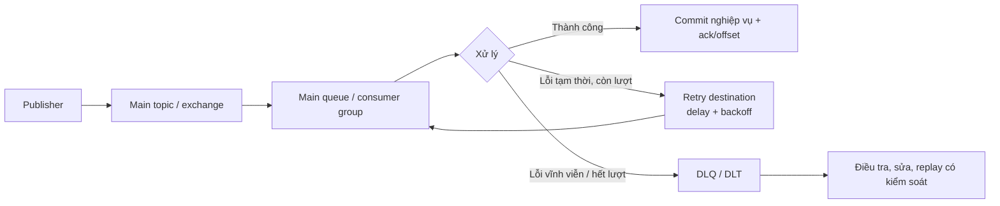
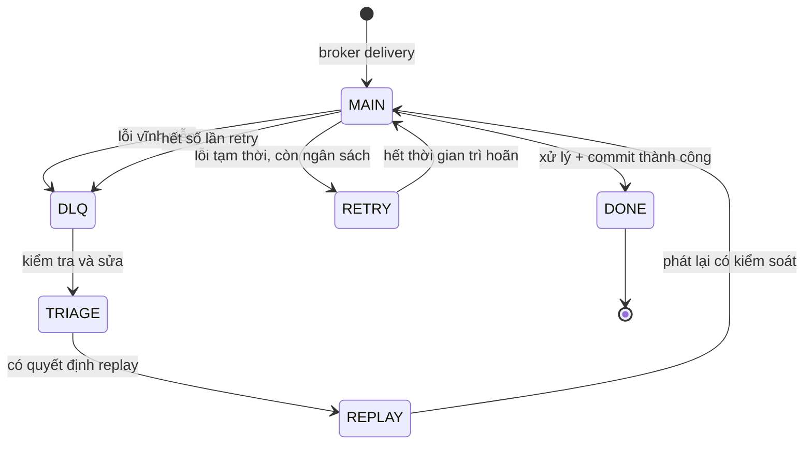
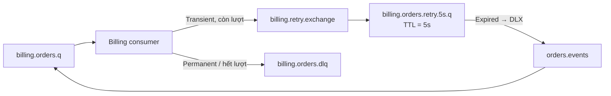
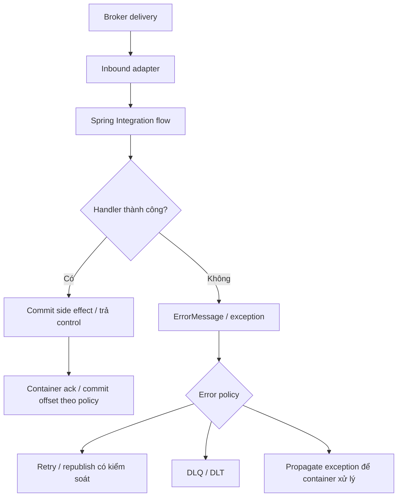

# Dead-letter queue và retry topic trong Spring Integration

## 1. Bài toán: thông điệp lỗi sẽ đi đâu?

Trong chương **Message broker** của mô-đun **SPRING_INTEGRATION_PATTERN**, ta học cách áp dụng **Enterprise Integration Patterns** với Spring Integration để xây dựng luồng thông điệp ít phụ thuộc và dễ mở rộng. Các thành phần như Gateway, Router, Filter, Transformer, Splitter, Aggregator, retry, error channel và correlation giúp đưa dữ liệu qua nhiều bước xử lý; broker giữ vai trò nhận và giao thông điệp giữa các hệ thống.

Khi consumer gặp lỗi, có ba lựa chọn phổ biến: thử lại ngay, thử lại sau một khoảng trễ, hoặc chuyển thông điệp sang nơi cách ly để xử lý riêng. Hai công cụ thường được dùng là:

- **Dead-letter queue (DLQ)**: queue nhận những thông điệp không còn được xử lý trên đường chính theo chính sách, ví dụ sau khi hết retry, bị reject không requeue, không hợp lệ hoặc quá hạn.
- **Retry topic / retry queue**: đích trung gian dành cho những thông điệp có khả năng xử lý lại sau một khoảng trễ. Tên gọi và cơ chế cụ thể phụ thuộc broker; Kafka thường dùng *retry topic*, RabbitMQ thường dùng *retry queue* kết hợp TTL/dead-letter exchange hoặc một cơ chế delayed delivery.

Giả sử dịch vụ Billing nhận sự kiện `OrderPlaced`. Lúc nhận sự kiện, cơ sở dữ liệu Billing đang tạm mất kết nối. Nếu consumer lập tức requeue và đọc lại hàng nghìn lần mỗi giây, broker và database có thể bị quá tải. Ngược lại, nếu payload sai schema và không thể đọc, retry vô hạn sẽ không tự sửa được dữ liệu.

Ta cần một **chính sách xử lý lỗi** giúp thông điệp tạm lỗi có cơ hội phục hồi, đồng thời cô lập thông điệp không thể tự sửa và tránh mất dữ liệu hoặc nhân đôi tác động nghiệp vụ.



Trong bài này, **DLQ/DLT** là nơi lưu thông điệp có vấn đề; **retry destination** là nơi trì hoãn một lần thử tiếp theo. Sơ đồ mô tả ý tưởng, không hàm ý mọi broker có cùng cấu hình hoặc cùng tính chất giao nhận.

### Kết quả mong đợi

Sau khi học, bạn có thể:

1. Phân biệt lỗi tạm thời, lỗi dữ liệu, lỗi nghiệp vụ và lỗi có kết quả chưa xác định.
2. Chọn retry đồng bộ trong consumer, retry qua broker, retry topic và DLQ/DLT.
3. Cấu hình ví dụ RabbitMQ dead-letter exchange/queue, retry queue có TTL với Spring Integration AMQP.
4. Hiểu cách Spring Kafka hỗ trợ retry topic và dead-letter topic, và cách kết nối listener với Spring Integration Gateway.
5. Tránh vòng lặp requeue vô hạn, mất message tại ranh giới ack và xử lý trùng khi redelivery.
6. Quan sát, kiểm thử và replay thông điệp lỗi theo một quy trình an toàn.

## 2. Những thuật ngữ không nên dùng lẫn nhau

| Khái niệm | Dùng để làm gì? | Điểm cần lưu ý |
| --- | --- | --- |
| **Retry in-process** | Chạy lại handler trong cùng lần delivery | Có thể giữ thread/consumer, làm tăng thời gian xử lý |
| **Broker retry queue** | Giữ message tạm thời trước khi chuyển lại queue chính | RabbitMQ thường dùng TTL + DLX hoặc delayed delivery |
| **Kafka retry topic** | Publish record sang topic trung gian rồi consume sau | Thay đổi cách offset/partition được xử lý và có thể mất thứ tự tương đối |
| **Dead-letter queue (DLQ)** | Lưu message không được xử lý tiếp trên luồng chính | Thường dùng thuật ngữ queue ở RabbitMQ/JMS |
| **Dead-letter topic (DLT)** | Topic giữ record thất bại sau retry | Thuật ngữ quen thuộc của Kafka; vẫn là một topic bình thường |
| **Reject/Nack** | Consumer thông báo delivery không được chấp nhận | Kết quả requeue/dead-letter phụ thuộc cấu hình và broker |
| **Ack / offset commit** | Ghi nhận tiến độ delivery/consume | Không tự chứng minh side effect nghiệp vụ đã commit |
| **Poison message** | Message luôn làm handler lỗi với code/contract hiện tại | Cần cách ly hoặc xử lý thay đổi dữ liệu/code |
| **Idempotent consumer** | Xử lý lặp cùng một logical event mà không nhân đôi side effect | Cần nơi lưu trạng thái/khóa nguyên tử phù hợp |

**RabbitMQ DLQ** không giống **Kafka DLT** về cách broker giao và lưu message. Đối với RabbitMQ, dead lettering thường thực hiện bằng việc publish từ queue nguồn sang **dead-letter exchange (DLX)**, rồi định tuyến vào queue nhận. Với Kafka, các chương trình/framework thường **publish một record mới** sang retry topic hoặc DLT; Kafka không tự động chuyển một record lỗi sang DLT chỉ vì listener ném exception.

## 3. Phân loại lỗi trước khi quyết định retry

Không thể thiết kế retry tốt nếu mọi exception đều bị coi là giống nhau.

| Nhóm lỗi | Ví dụ | Chính sách gợi ý |
| --- | --- | --- |
| **Transient** | DB unavailable, mất kết nối mạng ngắn, HTTP 503 tạm thời | Retry hữu hạn, có backoff và giới hạn thời gian |
| **Validation/schema** | JSON không hợp lệ, thiếu trường, schema version chưa hỗ trợ | Không retry vô hạn; chuyển DLQ/quarantine để điều tra |
| **Business rejection** | Đơn đã hủy, không đủ điều kiện xử lý | Ghi nhận kết quả nghiệp vụ; quyết định ack và event từ chối theo contract |
| **Concurrency/conflict tạm thời** | Optimistic lock conflict hoặc lock timeout | Có thể retry có giới hạn nếu thao tác idempotent |
| **Unknown outcome** | Remote đã nhận lệnh thanh toán nhưng reply bị mất | Đối soát theo idempotency key trước khi thử lại lệnh có side effect |
| **Lỗi lập trình** | NullPointerException do code sai, mapping contract sai | Alert và sửa lỗi nguồn; không che lấp bằng retry vô hạn |

Một lỗi `IOException` chưa chắc là transient trong mọi hoàn cảnh. Một lỗi timeout **trước khi gửi lệnh** khác với read timeout sau khi remote có thể đã commit. Chính sách phải xét **ngữ nghĩa nghiệp vụ và điểm phát sinh side effect**, không chỉ tên exception.

### Ba câu hỏi cho mỗi lỗi

1. **Tự phục hồi được không?** Nếu sửa code hoặc dữ liệu mới thành công, đưa sang DLQ/DLT.
2. **Thử lại có an toàn không?** Nếu handler đã thực hiện một phần nghiệp vụ, cần idempotency và trạng thái bền vững.
3. **Được thử lại trong bao lâu?** Đặt tối đa số lần, deadline, backoff, và giới hạn tài nguyên.

Các trạng thái phản hồi phù hợp có thể là `PROCESSED`, `REJECTED`, `RETRY_SCHEDULED`, `DEAD_LETTERED` và `UNKNOWN`. Đừng gán `FAILED` cho một giao dịch mà outcome thực sự chưa được xác định.

## 4. Thiết kế vòng đời của message lỗi

Một vòng đời mong muốn:



Những mốc nên lưu hoặc truyền:

- `eventId`/**operationId**: danh tính nghiệp vụ ổn định của message.
- `correlationId` và `traceId`: phục vụ theo dõi một luồng và các lần thử.
- `attempt`: số lần thử theo **định nghĩa nhất quán**, chẳng hạn lần xử lý đầu tiên là 1.
- `firstSeenAt`, `lastErrorAt`, `nextRetryAt` và thời hạn retry.
- `errorCode` đã chuẩn hóa, `originTopic/queue`, `consumerName`, `schemaVersion`.
- Payload gốc hoặc tham chiếu bền vững tới payload, kèm quyền truy cập và thời hạn lưu phù hợp.

Không dùng một exception message không chuẩn hóa làm khóa retry, vì nội dung thông báo có thể thay đổi theo phiên bản. Không tự tạo `eventId` mới cho mỗi retry của cùng một sự kiện; nếu làm vậy, consumer không nhận ra duplicate.

### Backoff và retry budget

Ví dụ chính sách retry: xử lý lần đầu tại `t=0`; nếu lỗi transient, chờ 5 giây, rồi 30 giây, rồi 2 phút; sau khi hết các lần thử thì chuyển DLQ. Tổng số lần xử lý và thời hạn phải được xác định rõ.

| Lần xử lý | Khoảng chờ trước lần đó | Nếu thất bại |
| --- | ---: | --- |
| 1 | 0 giây | Lên lịch lần 2 |
| 2 | 5 giây | Lên lịch lần 3 |
| 3 | 30 giây | Lên lịch lần 4 |
| 4 | 2 phút | Chuyển DLQ |

Backoff theo cấp số nhân thường có lợi khi hệ thống downstream bị quá tải; **jitter** giúp tránh hàng nghìn consumer đồng thời retry đúng cùng một thời điểm. Retry queue có TTL cố định cung cấp một khoảng trễ xấp xỉ; nếu cần lịch chính xác hoặc nhiều cấp độ, cần thiết kế topology/consumer thích hợp.

## 5. RabbitMQ: dead-letter exchange và dead-letter queue

Với RabbitMQ, dead lettering thường xảy ra khi message bị reject/nack mà không requeue, message hết TTL, queue vượt giới hạn độ dài, hoặc trong một số trường hợp giới hạn delivery của loại queue hỗ trợ. Broker **không tự tạo DLQ**; bạn phải khai báo DLX, queue đích và binding (hoặc policy tương ứng).

Luồng minh họa:

```text
orders.events (topic exchange)
      |
      | routing key = order.placed
      v
billing.orders.q
      |
      | reject / nack requeue=false
      v
billing.dead.exchange (direct)
      |
      | routing key = billing.dead
      v
billing.orders.dlq
```

### 5.1. Khai báo topology bằng Spring AMQP

Trong ứng dụng Spring Boot, cần Spring Integration và Spring AMQP; ví dụ Gradle:

```groovy
dependencies {
    implementation 'org.springframework.boot:spring-boot-starter-integration'
    implementation 'org.springframework.boot:spring-boot-starter-amqp'
    implementation 'org.springframework.integration:spring-integration-amqp'
}
```

Cấu hình topology Java:

```java
import org.springframework.amqp.core.Binding;
import org.springframework.amqp.core.BindingBuilder;
import org.springframework.amqp.core.DirectExchange;
import org.springframework.amqp.core.Queue;
import org.springframework.amqp.core.QueueBuilder;
import org.springframework.amqp.core.TopicExchange;
import org.springframework.context.annotation.Bean;
import org.springframework.context.annotation.Configuration;

@Configuration
public class BillingBrokerTopology {

    public static final String EVENTS_EXCHANGE = "orders.events";
    public static final String MAIN_QUEUE = "billing.orders.q";
    public static final String MAIN_ROUTING_KEY = "order.placed";
    public static final String DLX = "billing.dead.exchange";
    public static final String DLQ = "billing.orders.dlq";
    public static final String DEAD_ROUTING_KEY = "billing.dead";

    @Bean
    public TopicExchange ordersEventsExchange() {
        return new TopicExchange(EVENTS_EXCHANGE, true, false);
    }

    @Bean
    public DirectExchange billingDeadExchange() {
        return new DirectExchange(DLX, true, false);
    }

    @Bean
    public Queue billingOrdersQueue() {
        return QueueBuilder.durable(MAIN_QUEUE)
            .deadLetterExchange(DLX)
            .deadLetterRoutingKey(DEAD_ROUTING_KEY)
            .build();
    }

    @Bean
    public Queue billingDeadQueue() {
        return QueueBuilder.durable(DLQ).build();
    }

    @Bean
    public Binding ordersToBilling() {
        return BindingBuilder.bind(billingOrdersQueue())
            .to(ordersEventsExchange())
            .with(MAIN_ROUTING_KEY);
    }

    @Bean
    public Binding billingToDeadLetterQueue() {
        return BindingBuilder.bind(billingDeadQueue())
            .to(billingDeadExchange())
            .with(DEAD_ROUTING_KEY);
    }
}
```

`x-dead-letter-exchange` và `x-dead-letter-routing-key` của queue nguồn được Spring AMQP builder tạo tương ứng. Khi message bị dead-letter, nó được định tuyến qua DLX; DLQ là một queue được bind với exchange đó.

**Lưu ý khi vận hành:** các argument của một queue đã tồn tại có thể không thay đổi được bằng redeclare. Trong production, RabbitMQ policy thường hữu ích để quản lý cấu hình dead-letter, và cần kế hoạch migration cho topology đang chạy. Một queue bền vững không có nghĩa mọi message chắc chắn đã được lưu bền: còn phụ thuộc publish mode, confirm, loại queue, replication và broker policy.

### 5.2. Consume bằng Spring Integration inbound adapter

Ví dụ dùng `SimpleMessageListenerContainer` có `AUTO` acknowledgment theo **container**: khi xử lý hoàn tất, container thực hiện ack theo cơ chế của nó; khi exception thoát ra khỏi listener, chính sách requeue/reject áp dụng.

```java
import org.springframework.amqp.core.AcknowledgeMode;
import org.springframework.amqp.rabbit.connection.ConnectionFactory;
import org.springframework.amqp.rabbit.listener.SimpleMessageListenerContainer;
import org.springframework.context.annotation.Bean;
import org.springframework.context.annotation.Configuration;
import org.springframework.integration.amqp.dsl.Amqp;
import org.springframework.integration.config.EnableIntegration;
import org.springframework.integration.dsl.IntegrationFlow;

@Configuration
@EnableIntegration
public class BillingConsumerFlow {

    @Bean
    public SimpleMessageListenerContainer billingContainer(
            ConnectionFactory connectionFactory) {

        SimpleMessageListenerContainer container =
            new SimpleMessageListenerContainer(connectionFactory);

        container.setQueueNames(BillingBrokerTopology.MAIN_QUEUE);
        container.setAcknowledgeMode(AcknowledgeMode.AUTO);
        container.setDefaultRequeueRejected(false);
        container.setConcurrentConsumers(2);
        container.setPrefetchCount(10);
        return container;
    }

    @Bean
    public IntegrationFlow billingInboundFlow(
            SimpleMessageListenerContainer billingContainer,
            BillingMessageHandler handler) {

        return IntegrationFlow
            .from(Amqp.inboundAdapter(billingContainer))
            .handle(handler, "process")
            .get();
    }
}
```

Định nghĩa handler nghiệp vụ:

```java
import org.springframework.stereotype.Component;

@Component
public class BillingMessageHandler {
    private final BillingUseCase billing;

    public BillingMessageHandler(BillingUseCase billing) {
        this.billing = billing;
    }

    public void process(String json) {
        // Parse + validate schema; ném exception khi dữ liệu không hợp lệ.
        // BillingUseCase áp dụng inbox/idempotency trong transaction.
        billing.applyJsonEventOnce(json);
    }
}
```

`BillingUseCase` là lớp nghiệp vụ của ứng dụng cần triển khai; code phía trên là ví dụ cấu trúc luồng, không phải dự án độc lập. Trong triển khai thật cần converter phù hợp content type, xác thực payload và mã tương quan.

Nếu `process` ném exception và lỗi được truyền trở lại listener container, `defaultRequeueRejected(false)` cho biết **không mặc định đưa delivery lỗi về lại main queue**. Với topology đã khai báo, những delivery bị reject/nack theo cách này được đưa qua DLX sang DLQ. Chính xác exception nào được adapter chuyển tới error channel, có bị tiêu thụ hay không và container sẽ ack/nack ra sao **phải được kiểm thử trên cấu hình thực tế**. Nếu error flow bắt rồi “nuốt” exception, container có thể thấy việc xử lý đã thành công.

### 5.3. Phân biệt `AUTO` và `NONE`

`AcknowledgeMode.AUTO` của Spring AMQP nghĩa là **container quyết định ack/nack theo kết quả callback**. Nó **không** giống AMQP `autoAck=true` hoặc `AcknowledgeMode.NONE`, nơi broker coi message đã giao và không đợi acknowledgment theo cách tương đương.

Trong flow xử lý nghiệp vụ có database, cách thường chọn là commit transaction/idempotent side effect trước khi container ack. Nếu tiến trình chết sau DB commit nhưng trước ack, broker có thể giao lại: **consumer phải chấp nhận duplicate**.

## 6. RabbitMQ retry queue bằng TTL và DLX

DLQ thường là điểm kết thúc dành cho lỗi không phục hồi hoặc đã hết lượt. Với lỗi tạm thời, ta có thể đưa message vào **retry queue** để trì hoãn rồi dead-letter ngược về main exchange khi TTL hết.



Đây là một **cấu trúc xử lý lỗi**: retry tạm thời đi đến retry destination; terminal failure đi đến DLQ. Hai đường cần được tách rõ trong logic ứng dụng.

### 6.1. Khai báo retry destination

Ví dụ bổ sung vào cấu hình RabbitMQ:

```java
import org.springframework.amqp.core.Binding;
import org.springframework.amqp.core.BindingBuilder;
import org.springframework.amqp.core.DirectExchange;
import org.springframework.amqp.core.Queue;
import org.springframework.amqp.core.QueueBuilder;
import org.springframework.context.annotation.Bean;
import org.springframework.context.annotation.Configuration;

@Configuration
public class BillingRetryTopology {
    public static final String RETRY_EXCHANGE =
        "billing.retry.exchange";
    public static final String RETRY_QUEUE =
        "billing.orders.retry.5s.q";
    public static final String RETRY_ROUTING_KEY =
        "billing.retry.5s";

    @Bean
    public DirectExchange billingRetryExchange() {
        return new DirectExchange(RETRY_EXCHANGE, true, false);
    }

    @Bean
    public Queue billingRetryQueue() {
        return QueueBuilder.durable(RETRY_QUEUE)
            .ttl(5_000)
            .deadLetterExchange(BillingBrokerTopology.EVENTS_EXCHANGE)
            .deadLetterRoutingKey(BillingBrokerTopology.MAIN_ROUTING_KEY)
            .build();
    }

    @Bean
    public Binding billingRetryBinding() {
        return BindingBuilder.bind(billingRetryQueue())
            .to(billingRetryExchange())
            .with(RETRY_ROUTING_KEY);
    }
}
```

Khi một message được **publish có chủ đích** vào `billing.retry.exchange` với routing key `billing.retry.5s`, nó vào retry queue. Khi TTL hết, broker có thể dead-letter về `orders.events` để tới lại `billing.orders.q`.

Thời gian 5 giây là **giá trị trì hoãn dự kiến**, không phải cam kết chính xác tuyệt đối tới mili giây. Tình trạng queue, broker và lịch xử lý ảnh hưởng thời điểm delivery thực tế. Hãy điều chỉnh TTL, dung lượng queue, throughput và retention theo tải thực.

### 6.2. Ai quyết định chuyển đến retry queue?

Cấu hình ở phần 5 quy định **reject từ main queue đi đến DLQ**, nên muốn retry có trì hoãn, ứng dụng cần **chọn nhánh retry và publish vào retry exchange**. Việc tạo thêm retry queue **không tự động** làm mọi exception transient được đưa tới đó.

Ví dụ helper chỉ minh họa hành vi publish sang retry destination:

```java
import org.springframework.amqp.rabbit.core.RabbitTemplate;
import org.springframework.stereotype.Component;

@Component
public class BillingRetryPublisher {
    private final RabbitTemplate rabbitTemplate;

    public BillingRetryPublisher(RabbitTemplate rabbitTemplate) {
        this.rabbitTemplate = rabbitTemplate;
    }

    public void scheduleRetry(
            String originalJson,
            String eventId,
            int nextAttempt) {

        rabbitTemplate.convertAndSend(
            BillingRetryTopology.RETRY_EXCHANGE,
            BillingRetryTopology.RETRY_ROUTING_KEY,
            originalJson,
            amqpMessage -> {
                amqpMessage.getMessageProperties()
                    .setHeader("eventId", eventId);
                amqpMessage.getMessageProperties()
                    .setHeader("retryAttempt", nextAttempt);
                return amqpMessage;
            });
    }
}
```

Trong một luồng thực, handler/Router/Recoverer phân loại exception và gọi `scheduleRetry` **chỉ nếu còn budget retry**. Việc copy body phải giữ cùng event ID, schema và metadata cần thiết; đừng đưa token hoặc header không serializable sang broker.

**Ranh giới tin cậy quan trọng:** `convertAndSend` trả về **không chứng minh** message retry đã được broker lưu và định tuyến đúng. Nếu consumer ack message gốc rồi việc publish retry thất bại, có thể mất việc. Với luồng yêu cầu độ tin cậy cao, cần publisher confirm/return, chính sách xử lý kết quả publish, hoặc outbox bền vững trước khi coi delivery gốc đã được giải quyết. Nếu publish retry thành công nhưng ack message gốc bị mất, có thể xuất hiện duplicate; inbox/idempotency là bắt buộc.

### 6.3. Tránh vòng lặp retry vô hạn

Nếu một queue chính có DLX trỏ thẳng tới retry queue, rồi retry queue hết TTL quay về main queue, poison message có thể chạy vòng mãi. RabbitMQ có thể cung cấp header `x-death` với các lần dead-letter, nhưng đây là metadata của **sự kiện dead-letter theo queue/reason** chứ không phải counter nghiệp vụ thống nhất của mọi lần xử lý. Một message được ứng dụng republish theo cách mới có thể có metadata khác với message dead-letter nguyên bản.

Để dừng đúng hạn, nên:

- Định nghĩa thống nhất `attempt` từ lần nhận đầu tiên; giữ nguyên khi redelivery và tăng khi thực hiện **một lần xử lý mới**.
- Giới hạn `maxAttempts` và `maxElapsedTime`.
- Phân biệt lỗi permanent ngay lần đầu và lỗi transient còn budget.
- Khi hết budget, chuyển đến terminal DLQ qua đường có bảo đảm và lưu nguyên nhân.
- Dùng idempotent consumer để chịu được duplicate từ các khoảng crash và ack.
- Theo dõi retry rate và DLQ growth để nhận ra bão retry.

Có thể dùng nhiều retry queue theo các mức 5 giây, 30 giây, 2 phút; logic điều phối chọn queue dựa trên attempt. **Không mặc định rằng một queue TTL sẽ tự tăng khoảng chờ cho mỗi lần thất bại.**

## 7. Kafka retry topic và dead-letter topic

Với Kafka, dữ liệu nằm trong topic partition; consumer group lưu tiến độ qua offset. Khi listener xử lý một record lỗi, retry không tự xảy ra chỉ vì Kafka broker nhận được exception. Ứng dụng hoặc framework phải quyết định chờ/retry tại chỗ hay **publish record mới** sang retry topic và sau cùng sang DLT.

Ví dụ ý tưởng:

```text
billing.order-events
       |
       v
Billing listener (attempt 1)
       |
       +-- transient --> billing.order-events-retry-1000
                            |
                            v
                         attempt 2
                            |
                            +-- transient --> billing.order-events-retry-2000
                                                 |
                                                 v
                                              attempt 3
                                                 |
                                                 +-- exhausted --> billing.order-events-dlt
```

Tên topic chỉ để minh họa; tên thật do cấu hình framework, suffix và chiến lược tái sử dụng topic quyết định. Những retry topic phải tồn tại hoặc được tạo bằng cấu hình được phép. Broker không tự tạo retry topic chỉ từ tên gọi có chữ `retry`.

### 7.1. Phân biệt blocking và non-blocking retry

| Kiểu | Cách hoạt động | Hệ quả |
| --- | --- | --- |
| **Blocking retry** | Giữ record hiện tại, chờ rồi gọi listener lại trước khi tiến tiếp | Có thể giữ chậm một partition/consumer; thuận lợi hơn cho thứ tự cục bộ |
| **Non-blocking retry topic** | Publish record lỗi sang retry topic, tiếp tục tiến độ đọc main topic | Giúp thông điệp khác đi tiếp nhưng **không bảo đảm giữ thứ tự** với record đang retry |
| **DLT** | Publish record hết cơ hội xử lý sang topic cách ly | Cần quy trình vận hành, replay và retention riêng |

Với một số domain yêu cầu thứ tự nghiêm ngặt (ví dụ cập nhật số dư tuần tự theo tài khoản), non-blocking retry topic có thể làm `BalanceChanged v2` được xử lý trước `v1`. Khi đó cần thiết kế sequence/version, partitioning, hoặc chọn chiến lược retry phù hợp hơn.

### 7.2. Ví dụ Spring Kafka `@RetryableTopic` kết nối với Spring Integration

**Spring Kafka** có cơ chế retry topic không chặn thông qua `@RetryableTopic` trên `@KafkaListener`. Đây là tính năng của **Spring Kafka listener infrastructure**, không phải annotation đặt trực tiếp lên mọi `IntegrationFlow` của Spring Integration.

Ta có thể cho Kafka listener nhận record và gọi một Spring Integration messaging gateway để tận dụng các pattern Router, Transformer, Filter, Service Activator. Để exception quay lại listener cho retry topic xử lý, đoạn gateway/handler ở ví dụ này dùng đường **đồng bộ**.

Gateway:

```java
import org.springframework.integration.annotation.MessagingGateway;

@MessagingGateway(defaultRequestChannel = "billingFromKafka")
public interface BillingFlowGateway {
    void process(String eventJson);
}
```

Flow:

```java
import org.springframework.context.annotation.Bean;
import org.springframework.context.annotation.Configuration;
import org.springframework.integration.annotation.IntegrationComponentScan;
import org.springframework.integration.config.EnableIntegration;
import org.springframework.integration.dsl.IntegrationFlow;

@Configuration
@EnableIntegration
@IntegrationComponentScan
public class BillingFlowConfiguration {

    @Bean
    public IntegrationFlow billingProcessingFlow(
            BillingMessageHandler handler) {

        return IntegrationFlow
            .from("billingFromKafka")
            // Handler phải báo lỗi khi nghiệp vụ chưa hoàn tất.
            .handle(handler, "process")
            .get();
    }
}
```

Kafka listener với retry topic:

```java
import org.springframework.kafka.annotation.DltHandler;
import org.springframework.kafka.annotation.KafkaListener;
import org.springframework.kafka.annotation.RetryableTopic;
import org.springframework.kafka.support.KafkaHeaders;
import org.springframework.messaging.handler.annotation.Header;
import org.springframework.retry.annotation.Backoff;
import org.springframework.stereotype.Component;

@Component
public class BillingKafkaListener {

    private final BillingFlowGateway gateway;
    private final BillingQuarantineService quarantine;

    public BillingKafkaListener(
            BillingFlowGateway gateway,
            BillingQuarantineService quarantine) {
        this.gateway = gateway;
        this.quarantine = quarantine;
    }

    @RetryableTopic(
        attempts = "4",
        backoff = @Backoff(delay = 1_000, multiplier = 2.0),
        autoCreateTopics = "false"
    )
    @KafkaListener(
        topics = "billing.order-events",
        groupId = "billing"
    )
    public void onEvent(String json) {
        gateway.process(json);
    }

    @DltHandler
    public void onDlt(
            String json,
            @Header(KafkaHeaders.RECEIVED_TOPIC) String topic) {

        quarantine.record(topic, json);
    }
}
```

`BillingQuarantineService` là nghiệp vụ cần triển khai để lưu thông tin, truy vết và cho phép điều tra. Cần bổ sung Spring Kafka/Spring Retry dependency và cấu hình consumer, serializer/deserializer, topic/partition, listener container và producer theo phiên bản đang dùng. Khi `autoCreateTopics=false`, các topic retry/DLT cần được khai báo/khởi tạo **trước**; tên và số lượng chính xác phụ thuộc chính sách topic suffix/reuse của Spring Kafka.

**Giới hạn của ví dụ:** annotation minh họa retry theo số lần/backoff, chưa phân loại exception. Trong production cần cấu hình include/exclude hoặc chính sách phân loại lỗi được hỗ trợ bởi phiên bản Spring Kafka, để invalid schema không đi qua các retry vô ích. Cũng phải bảo đảm lỗi từ Spring Integration gateway/handler được đưa về listener theo dạng exception có thể phân loại; các wrapper như `MessagingException` có thể khiến cần kiểm tra chuỗi cause.

### 7.3. Khi nào retry topic không hoạt động như mong đợi?

Một số nguyên nhân:

- Bắt exception trong listener rồi chỉ log; listener trả bình thường, nên framework coi record là xử lý thành công.
- Thay gateway bằng một flow bất đồng bộ trả ngay; worker lỗi sau đó nhưng Kafka listener đã hoàn tất.
- Không tạo topic retry/DLT, thiếu ACL publish/consume, hoặc serializer không gửi lại được record.
- Consumer group/partition topology không phù hợp hoặc retry metadata bị mất.
- Có retry ở nhiều lớp cùng lúc khiến số attempts tăng ngoài dự tính.
- Áp dụng non-blocking retry nhưng nghiệp vụ thực sự đòi thứ tự xử lý tuyệt đối.

Khi dùng Kafka inbound channel adapter trực tiếp của Spring Integration (thay vì `@KafkaListener`), phải cấu hình error flow, Kafka error handler/recoverer và việc commit offset thích hợp cho adapter đó. Không thể giả định `@RetryableTopic` sẽ điều khiển một adapter độc lập chỉ vì cùng ứng dụng có Spring Kafka dependency.

## 8. Error channel của Spring Integration và settlement của broker

Spring Integration có `ErrorMessage` và `errorChannel` để đưa lỗi vào một message flow theo cấu hình. Đây là nơi hợp lý để ghi log, phân loại exception, đếm metric, phát cảnh báo hoặc điều phối recovery. Nhưng **xử lý lỗi ở tầng messaging** và **quyết định ack/offset tại broker** là hai trách nhiệm liên quan mà không đồng nhất.



Một error handler có dạng:

```java
import org.springframework.integration.annotation.ServiceActivator;
import org.springframework.messaging.support.ErrorMessage;
import org.springframework.stereotype.Component;

@Component
public class BillingErrorObserver {

    @ServiceActivator(inputChannel = "billingErrors")
    public void observe(ErrorMessage errorMessage) {
        Throwable error = errorMessage.getPayload();

        // Ghi loại lỗi, request/event ID, flow, attempt, timestamp.
        // Không tự đồng nhất việc log lỗi với một retry hoặc nack.
    }
}
```

Ví dụ chỉ cho thấy cách quan sát `ErrorMessage`; cấu hình đẩy lỗi vào `billingErrors` phải được nối tại adapter/endpoint tương ứng. Một handler trả `void` hoặc tiêu thụ exception có thể làm lỗi không còn lan tới container. Trong thiết kế thật, phải kiểm tra **kết quả cuối cùng**: broker ack, requeue, dead-letter, hay Kafka offset commit/republish, không chỉ kiểm tra log.

## 9. Idempotency: thành phần bắt buộc khi dùng retry

Không có retry đáng tin cậy nếu consumer có thể tạo lại side effect mỗi lần message được giao.

Ví dụ Billing đã ghi hóa đơn, sau đó process chết trước khi broker nhận ack. Broker giao lại `OrderPlaced`. Nếu consumer không kiểm tra `eventId`, hóa đơn có thể bị tạo hai lần.

### 9.1. Inbox đặt cùng transaction với side effect

Một ví dụ PostgreSQL:

```sql
CREATE TABLE billing_inbox (
    subscriber_id VARCHAR(80) NOT NULL,
    event_id VARCHAR(160) NOT NULL,
    processed_at TIMESTAMPTZ NOT NULL DEFAULT now(),
    PRIMARY KEY (subscriber_id, event_id)
);

CREATE TABLE billing_invoices (
    event_id VARCHAR(160) PRIMARY KEY,
    order_id VARCHAR(160) NOT NULL,
    amount_cents BIGINT NOT NULL
);
```

Với mỗi event, chạy trong **một database transaction**:

```sql
INSERT INTO billing_inbox (subscriber_id, event_id)
VALUES ('billing', :eventId)
ON CONFLICT (subscriber_id, event_id) DO NOTHING;
```

Chỉ khi insert tạo dòng mới mới áp dụng side effect và commit chung transaction. Nếu insert invoice thất bại, rollback cả inbox claim; lần nhận lại có thể thử tiếp. Nếu inbox đã có event ID, kiểm tra payload fingerprint/contract nếu cần rồi bỏ qua tác động trùng.

Một mã sự kiện không nên được tái sử dụng cho nội dung khác. Phải có scope `subscriberId`/tenant phù hợp, constraint nguyên tử và chính sách retention đủ dài để chịu được các lần replay rất muộn.

### 9.2. Lỗi “đã xử lý nhưng chưa nhận được phản hồi”

Nếu consumer còn gọi API thanh toán, một read timeout có thể xảy ra **sau khi remote đã hoàn thành**. Inbox ở DB Billing không tự chứng minh side effect của HTTP call diễn ra đúng một lần. Cần idempotency key được remote hỗ trợ, hoặc trạng thái operation và API tra cứu/đối soát.

Chọn retry dựa trên bằng chứng:

- Có bằng chứng chưa gửi request: có thể thử lại cùng key.
- Remote hỗ trợ idempotency key và còn trong cửa sổ hiệu lực: có thể retry có kiểm soát bằng cùng key.
- Kết quả chưa xác định và remote không hỗ trợ chống trùng: chuyển sang trạng thái `UNKNOWN` và đối soát trước khi lặp thao tác.

Không đưa một lệnh thanh toán `UNKNOWN` vào retry topic rồi để consumer phát lệnh mới vô điều kiện.

### 9.3. Outbox dành cho publish retry quan trọng

Nếu việc publish sang retry topic/queue là bước khôi phục **không được mất**, bạn phải giải quyết khoảng thời gian giữa:

1. Ghi trạng thái nghiệp vụ hoặc đánh dấu message sẽ retry.
2. Publish record sang retry destination.
3. Ack/commit tiến độ của message gốc.

Không có transaction nguyên tử xuyên database và broker, có thể xảy ra duplicate hoặc mất message nếu chỉ gọi hai API nối tiếp nhau. Transactional outbox giúp ghi một “retry intent” bền vững trong transaction local, publisher gửi lại khi cần; consumer vẫn cần idempotency vì lần publish có thể trùng.

## 10. Retry và thứ tự xử lý

Ví dụ stream theo một đơn hàng:

```text
OrderPlaced(orderId=O-1, version=1)
OrderPaid(orderId=O-1, version=2)
OrderCancelled(orderId=O-1, version=3)
```

Nếu event version 1 gặp lỗi và được chuyển sang retry topic, record version 2 có thể đi tiếp trên main topic rồi được xử lý **trước** version 1. Vấn đề không chỉ là duplicate mà còn là **reordering**.

Các giải pháp:

- Dùng aggregate key như `orderId` làm partition key khi phù hợp; lưu ý retry sang topic khác vẫn có thể thay đổi thứ tự liên topic.
- Gắn `aggregateVersion` hoặc sequence vào event, kiểm tra điều kiện cập nhật state ở consumer.
- Buffer/reconcile event đến sớm hoặc thiết kế các lệnh độc lập không phụ thuộc thứ tự.
- Với nghiệp vụ buộc xử lý nghiêm ngặt theo thứ tự, cân nhắc blocking retry hoặc một luồng xử lý tuần tự có state bền vững.
- Không dùng retry queue chung như một cách bảo đảm FIFO xuyên nhiều consumer và nhiều lần requeue.

## 11. Vận hành DLQ/DLT: nơi cách ly chứ không phải nơi bỏ quên

DLQ có ý nghĩa khi có người và hệ thống theo dõi nó.

### 11.1. Metadata nên có

Mỗi message chuyển DLQ/DLT nên giữ được:

| Metadata | Ý nghĩa |
| --- | --- |
| `eventId`, `correlationId`, `tenantId` | Liên kết message với nghiệp vụ và trace |
| Source topic/queue, partition/offset nếu có | Xác định nguồn phát |
| Payload/schemaVersion | Phân tích lỗi contract |
| `errorCode`, exception class, timestamp | Phân loại nguyên nhân |
| Attempts, first failure, last failure | Biết lịch sử retry |
| Consumer name/version | Biết code nào không xử lý được |
| Next action/owner | Có quy trình sửa và replay |

RabbitMQ có thể bổ sung `x-death` khi dead-letter; Kafka retry/DLT tooling thường bổ sung các header về topic gốc, offset và exception. Header cụ thể phụ thuộc phiên bản/config, nên consumer DLQ phải có cách xử lý khi metadata thiếu. Không phụ thuộc một header duy nhất để đánh giá ý nghĩa nghiệp vụ.

**Bảo mật:** DLQ có thể giữ lại dữ liệu nhạy cảm lâu hơn main queue. Phải phân quyền xem/replay, mã hóa phù hợp, có chính sách retention và log được ai thao tác với dữ liệu.

### 11.2. Quy trình triage

1. **Phát hiện**: alert khi DLQ tăng nhanh, age lớn hoặc tỷ lệ lỗi vượt ngưỡng.
2. **Khoanh vùng**: nhóm theo error code, event type, schema version, producer/consumer version.
3. **Xác định nguyên nhân**: thiếu dữ liệu, bug, downstream outage hay cấu hình routing sai.
4. **Xử lý nguồn**: sửa code/schema/dữ liệu hoặc khôi phục downstream trước khi replay.
5. **Dry-run hoặc canary**: chọn một số message để kiểm tra tác động sau sửa.
6. **Replay có kiểm soát**: phát lại bằng cùng event ID, giới hạn tốc độ và ghi audit.
7. **Đối soát**: xác nhận side effect cuối cùng, metric và DLQ không tăng trở lại.

Không nên tạo một job “replay tất cả DLQ mỗi phút”: nó có thể biến poison messages thành bão xử lý và nhân đôi side effect. DLQ cần người chịu trách nhiệm, thời hạn xử lý, dashboard và runbook.

### 11.3. Kịch bản replay an toàn

Ví dụ một event `OrderPlaced` bị đưa vào DLQ vì consumer chưa hỗ trợ `schemaVersion=2`. Sau khi deploy consumer hỗ trợ version 2:

- Lấy event có `eventId` gốc.
- Kiểm tra trước xem hóa đơn đã được tạo chưa, bằng inbox/ledger.
- Replay một lượng nhỏ vào main destination hoặc endpoint reprocessor.
- Ghi audit: ai replay, vì sao, lúc nào, số lần.
- Xác minh consumer có thể đọc, xử lý và ack; giám sát duplicate và thời gian xử lý.
- Chỉ mở rộng batch sau khi canary đạt kết quả mong muốn.

Khi payload thuộc dữ liệu cá nhân hoặc thông tin tài chính, không xuất thô sang máy cá nhân để debug. Dùng môi trường và quyền hạn được thiết kế cho triage.

## 12. Quan sát và cảnh báo

Một hệ thống có retry topic và DLQ cần theo dõi **cả sức khỏe luồng chính lẫn sức khỏe luồng hồi phục**.

Các metric đáng có:

- Số message publish/consume và số handler thành công trên main destination.
- Retry attempts, tỷ lệ retry thành công, số message hết budget.
- Queue depth/age hoặc Kafka consumer lag trên main, retry và DLT.
- DLQ/DLT ingress rate và oldest-message age.
- Số lỗi theo nhóm transient/permanent/unknown outcome.
- Số duplicate bị inbox/idempotency ngăn.
- Lỗi publisher confirm/return, unroutable message và số outbox record tồn.
- Latency từ `occurredAt` tới lúc nghiệp vụ hoàn tất, kể cả thời gian retry.
- Số lần consumer restart, partition rebalance, saturation của DB/downstream.

Một chuỗi log minh họa:

```text
08:00:00.000 eventId=evt-501 flow=billing attempt=1 result=DB_UNAVAILABLE
08:00:00.010 eventId=evt-501 action=RETRY_SCHEDULED delayMs=5000
08:00:05.042 eventId=evt-501 flow=billing attempt=2 result=DB_UNAVAILABLE
08:00:05.050 eventId=evt-501 action=RETRY_SCHEDULED delayMs=30000
08:00:35.110 eventId=evt-501 flow=billing attempt=3 result=PROCESSED
08:00:35.130 eventId=evt-501 state=ACKED correlationId=order-202
```

Đây là ví dụ thời gian tương đối; hệ thống không bảo đảm xử lý đúng ở giây thứ năm. Log phải ghi thời gian thực tế và loại transport/partition/queue để phân tích sai lệch.

### Cảnh báo nên hướng tới hành động

- **DLQ tăng liên tục**: kiểm tra contract/schema, release gần đây và lỗi hệ thống.
- **Retry backlog tăng nhưng DLQ không tăng**: có thể downstream đang chậm hoặc cấu hình retry kéo dài khiến tiến độ thực tế ngừng lại.
- **Duplicate tăng cao**: kiểm tra broker redelivery, consumer crash, publisher/retry republish và các khoảng ack.
- **Latency end-to-end tăng**: không chỉ nhìn handler latency; tính cả thời gian message nằm ở retry destination.

## 13. Ma trận kiểm thử cần có

Kiểm thử chỉ dùng mock handler không thể chứng minh broker dead-letter/commit đúng. Nên bổ sung integration test với RabbitMQ/Kafka thực hoặc Testcontainers, database có constraint và các tình huống restart.

| Kịch bản | Cách tạo lỗi | Điều phải xác minh |
| --- | --- | --- |
| Message hợp lệ | Consumer xử lý và commit được | Ack/offset tiến lên, không vào DLQ |
| Payload sai schema | Gửi malformed JSON | Đi đường lỗi permanent, không retry vô hạn |
| Downstream mất kết nối tạm thời | Đóng kết nối DB trong thời gian ngắn | Retry theo budget, sau khi phục hồi xử lý thành công |
| Retry hết lượt | Buộc lỗi transient liên tục | Terminal DLQ/DLT, có metadata và cảnh báo |
| TTL retry queue | Đưa message vào retry queue | Không nhận lại ngay; sau TTL được chuyển tới main |
| RabbitMQ không có DLX/binding đúng | Cố tình misconfigure trong test | Phát hiện tình trạng unroutable/mất đường recovery |
| Duplicate delivery | Publish lại cùng `eventId` | Side effect nghiệp vụ chỉ một lần |
| DB commit rồi consumer chết trước ack | Giả lập kill sau commit | Redelivery có thể xảy ra; inbox ngăn nhân đôi |
| Publish retry thành công, ack gốc thất bại | Giả lập rớt connection | Có thể duplicate; idempotency bảo vệ |
| Ack gốc trước publish retry | Giả lập retry publish thất bại | Test chứng minh nguy cơ mất message và cần confirm/outbox |
| Kafka retry topic | Listener ném transient exception | Record đi qua topic retry theo backoff; sau đó xử lý hoặc vào DLT |
| Kafka retry với ordering | Cho event v1 retry, v2 thành công | Consumer xử lý được reordering hoặc chọn chiến lược bảo đảm thứ tự |
| Reprocess DLQ | Sửa lỗi rồi replay cùng event ID | Có audit, canary, không nhân đôi side effect |
| Error channel “nuốt lỗi” | Handler lỗi, error flow chỉ log | Phát hiện thực tế broker ack hay dead-letter đúng theo policy |
| DLQ permission/retention | Truy cập bằng role không được cấp | Người không có quyền không đọc hoặc replay được |

### Ví dụ kiểm tra classifier (JUnit 5)

Một unit test hữu ích là kiểm tra policy trước khi ghép với broker. Mẫu dưới đây chỉ là logic phân loại, còn publisher/consumer cần integration test riêng.

```java
public enum ErrorClass {
    TRANSIENT,
    PERMANENT,
    UNKNOWN_OUTCOME
}

public enum RecoveryAction {
    RETRY,
    DEAD_LETTER,
    RECONCILE
}

public final class RecoveryPolicy {
    private final int maxAttempts;

    public RecoveryPolicy(int maxAttempts) {
        if (maxAttempts < 1) {
            throw new IllegalArgumentException("maxAttempts must be >= 1");
        }
        this.maxAttempts = maxAttempts;
    }

    public RecoveryAction decide(
            ErrorClass errorClass, int currentAttempt) {
        return switch (errorClass) {
            case PERMANENT -> RecoveryAction.DEAD_LETTER;
            case UNKNOWN_OUTCOME -> RecoveryAction.RECONCILE;
            case TRANSIENT ->
                currentAttempt < maxAttempts
                    ? RecoveryAction.RETRY
                    : RecoveryAction.DEAD_LETTER;
        };
    }
}
```

```java
import static org.junit.jupiter.api.Assertions.assertEquals;
import org.junit.jupiter.api.Test;

class RecoveryPolicyTest {
    private final RecoveryPolicy policy = new RecoveryPolicy(4);

    @Test
    void transientErrorRetriesUntilBudgetExhausted() {
        assertEquals(
            RecoveryAction.RETRY,
            policy.decide(ErrorClass.TRANSIENT, 1));
        assertEquals(
            RecoveryAction.DEAD_LETTER,
            policy.decide(ErrorClass.TRANSIENT, 4));
    }

    @Test
    void permanentFailureBypassesRetry() {
        assertEquals(
            RecoveryAction.DEAD_LETTER,
            policy.decide(ErrorClass.PERMANENT, 1));
    }

    @Test
    void unknownOutcomeRequiresReconciliation() {
        assertEquals(
            RecoveryAction.RECONCILE,
            policy.decide(ErrorClass.UNKNOWN_OUTCOME, 1));
    }
}
```

Để triển khai trọn vẹn, classifier phải chuyển exception/cause từ adapter thành `ErrorClass` theo contract. Luồng còn cần cách tạo/duy trì attempt count, publish an toàn sang retry/DLQ, cập nhật trạng thái và đảm bảo idempotency. Unit test trên **không** chứng minh độ bền của broker hoặc transaction.

## 14. Những sai lầm thường gặp

**Ném exception rồi nghĩ message tự vào DLQ.** RabbitMQ cần DLX/queue/binding và hành vi nack phù hợp; Kafka cần error handler/recoverer hoặc retry topic infrastructure.

**Cho mọi lỗi retry với delay bằng 0.** Poison message lặp vô hạn, chiếm thread và làm downstream quá tải.

**Chỉ đếm `x-death` rồi coi đó là số lần xử lý nghiệp vụ.** Header phản ánh dead-letter events theo queue/reason và có thể không tồn tại theo dự kiến khi ứng dụng tự republish.

**Ack message gốc trước khi chắc chắn retry đã được ghi nhận.** Nếu publish retry thất bại, công việc có thể mất.

**Tạo event ID mới khi chuyển sang retry topic.** Consumer mất khả năng nhận diện cùng logical event và có thể tạo side effect trùng.

**Bắt lỗi trong error channel rồi vô tình ack.** Phải xác định error flow có làm exception lan ngược ra broker listener hay không.

**Không phân biệt lỗi chưa xác định của remote operation.** Retry mù một lệnh có side effect có thể gây hai lần thanh toán/chuyển tiền.

**Trông chờ retry topic giữ nguyên thứ tự.** Non-blocking retry có thể cho record sau đi trước record lỗi.

**Để DLQ tăng mãi mà không có owner.** Cần dashboard, alert, retention, triage, canary replay và audit.

**Chỉ kiểm thử đường thành công.** Những khoảng crash sau DB commit trước ack, sau publish retry trước ack và lỗi chuyển DLT mới thể hiện rõ độ tin cậy của thiết kế.

## 15. Bài thực hành

1. Dựng RabbitMQ thử nghiệm với `orders.events`, `billing.orders.q`, `billing.dead.exchange` và `billing.orders.dlq`.
2. Cho Billing handler ném exception khi gặp payload sai schema. Xác nhận message thực sự đến DLQ theo policy, không đọc lại vô hạn.
3. Thêm `billing.orders.retry.5s.q` có TTL và DLX quay về main exchange. Publish thử một message vào retry exchange; đo khoảng trì hoãn thực tế.
4. Viết một `RecoveryPolicy` phân loại lỗi permanent/transient/unknown. Chỉ retry transient khi còn số lần và deadline.
5. Thêm inbox table có unique constraint cho `eventId`. Giả lập redelivery; xác minh dữ liệu chỉ ghi một lần.
6. Kết nối Kafka listener với Spring Integration Gateway; thử `@RetryableTopic` trên môi trường test có sẵn retry/DLT topics.
7. Tạo sự kiện v1 lỗi và v2 thành công của cùng một aggregate. Quan sát thay đổi thứ tự khi non-blocking retry và bổ sung version check.
8. Xây quy trình replay một message DLQ sau khi sửa consumer, có lưu người thực hiện, lý do và kết quả.
9. Tạo dashboard theo dõi main backlog, retry backlog, DLT/DLQ ingress, retry attempts và độ trễ end-to-end.

**Câu hỏi tự đánh giá:** Consumer đã ghi invoice thành công nhưng chết trước khi ack; broker giao lại event. Điều gì ngăn tạo invoice thứ hai? Nếu consumer còn gọi API thanh toán ngoài database và chỉ nhận read timeout, tại sao không thể tự động đưa lệnh thanh toán mới vào retry topic mà không có idempotency hoặc đối soát?

## Ghi nhớ

- **Retry destination** phục vụ lỗi có thể khôi phục; **DLQ/DLT** cách ly message không thể xử lý tiếp hoặc đã hết budget.
- RabbitMQ chủ yếu định tuyến dead-letter qua **DLX → DLQ**; retry queue với TTL cần thiết kế đường publish/chuyển trở lại và cách dừng vòng lặp.
- Kafka retry topic thường là các topic chứa record được framework/ứng dụng phát lại; `@RetryableTopic` thuộc Spring Kafka listener infrastructure, cần cấu hình và kiểm thử đúng phiên bản.
- **Ack, offset commit, publisher confirm và DB commit là những mốc khác nhau**. Khoảng crash giữa chúng làm message có thể mất hoặc lặp nếu thiếu cơ chế bảo vệ.
- Retry chỉ an toàn khi có **idempotency**, trạng thái bền vững và chính sách phân loại lỗi; outcome chưa xác định cần đối soát.
- Spring Integration Router, Filter, Transformer, Gateway, error channel và correlation giúp tổ chức error flow, còn độ tin cậy đến từ contract nghiệp vụ, broker topology, transaction boundary và kiểm thử thực tế.
