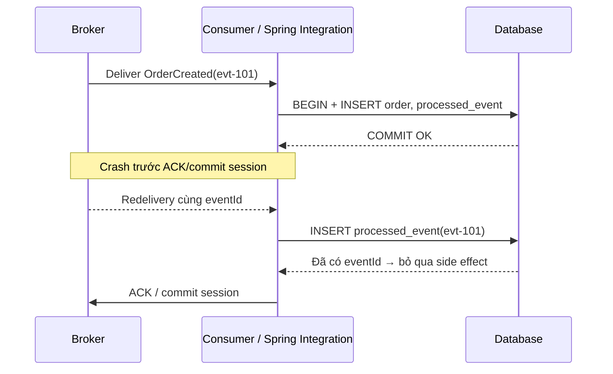
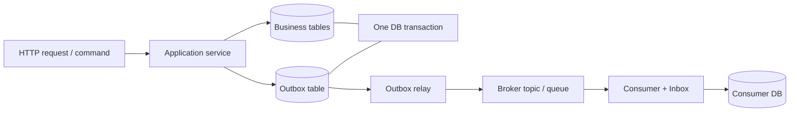
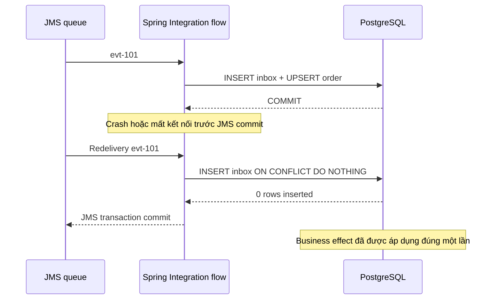

# Transaction giữa broker và ứng dụng

## 1. Vấn đề: hai hệ thống, hai lần commit

Trong kiến trúc dùng **Message Broker**, ứng dụng trao đổi công việc qua queue hoặc topic thay vì gọi trực tiếp mọi dịch vụ. Với Spring Integration, một inbound adapter có thể nhận message, chuyển qua channel, dùng Transformer, Router, Filter và Service Activator để xử lý, rồi gửi kết quả qua outbound adapter. Cách tổ chức này giúp giảm phụ thuộc và mở rộng luồng xử lý; tuy nhiên, khi **broker** và **database (DB)** đều tham gia, câu hỏi quan trọng là: *khi nào hệ thống được phép xác nhận message đã xử lý thành công?*

Ví dụ, dịch vụ đơn hàng nhận `OrderCreated` từ broker, ghi đơn vào PostgreSQL rồi xác nhận (acknowledge) message:

1. Broker giao một message có `eventId = evt-101`.
2. Ứng dụng bắt đầu transaction trên DB và ghi đơn hàng.
3. DB commit thành công.
4. Ứng dụng xác nhận message với broker.
5. Broker ghi nhận việc xử lý đã hoàn tất.

Nếu tiến trình chết **giữa bước 3 và bước 4**, DB đã chứa đơn hàng nhưng broker có thể phát lại message. Nếu ứng dụng không chống xử lý trùng, đơn hàng có thể bị cộng tiền hoặc phát sinh nghiệp vụ lần hai. Đây là lý do phải hiểu rõ transaction ở **ranh giới broker–ứng dụng**, chứ không chỉ đặt `@Transactional` vào một phương thức.

Bài học thuộc module `SPRING_INTEGRATION_PATTERN`: học triển khai Enterprise Integration Patterns bằng Spring Integration để xây dựng luồng thông điệp ít phụ thuộc và dễ mở rộng. Nội dung tập trung vào ranh giới giao dịch với broker; retry, error channel, correlation, kiểm thử và quan sát được xem xét trong chính vòng đời đó.

**Sau bài học, bạn cần làm được:**

- Phân biệt transaction của DB, session/acknowledgment của broker và transaction ở luồng xử lý message.
- Nhận ra các khoảng lỗi giữa ghi DB, publish message và commit/ack của broker.
- Thiết kế consumer **at-least-once + idempotency** và producer **transactional outbox**.
- Biết phạm vi bảo đảm của JMS transaction, Kafka transaction và giới hạn của “exactly once”.
- Kiểm thử crash, rollback, redelivery, duplicate và DLQ theo những điểm lỗi có thật.

## 2. Transaction bao trùm những tài nguyên nào?

Một transaction phải có **resource manager** (nơi duy trì trạng thái) và một cơ chế commit/rollback. Trong luồng message, các tài nguyên có thể độc lập với nhau:

| Tài nguyên | Đơn vị giao dịch thường gặp | Commit/rollback tác động đến |
| --- | --- | --- |
| Database quan hệ | JDBC/JPA transaction | Thay đổi dữ liệu trong DB đó. |
| JMS broker | JMS transacted `Session` | Các lần nhận/gửi message trong JMS session tương ứng. |
| Kafka broker | Producer transaction và offset được đưa vào transaction | Bản ghi Kafka được sản xuất và các offset tiêu thụ được đưa vào **cùng Kafka transaction**, khi cấu hình đúng. |
| HTTP/gRPC service khác | Thường không có transaction chung | Gọi từ xa có thể đã tạo side effect dù caller timeout. |
| Spring Integration channel | Phụ thuộc implementation và thread | `DirectChannel` chuyển giao đồng bộ; `ExecutorChannel` hoặc queue có thể tách luồng, làm thay đổi phạm vi transaction. |

**`@Transactional` không tự động tạo một transaction ACID chung cho DB + broker.** Chẳng hạn, `DataSourceTransactionManager` chỉ quản lý kết nối JDBC; broker có session/producer transaction riêng. Transaction dùng chung thực sự có thể cần XA/JTA (khi cả hai resource hỗ trợ enlistment và quản lý 2-phase commit), kéo theo nhiều chi phí và ràng buộc triển khai. Phần lớn kiến trúc messaging hiện đại lựa chọn **transaction cục bộ + xử lý lặp an toàn + outbox/inbox**.

### 2.1. Ba khái niệm thường dễ nhầm

**Acknowledgment / offset commit:** đánh dấu mức độ xử lý message đối với broker/consumer group. Với JMS, acknowledgment có thể gắn với commit của transacted session; với Kafka, vị trí tiêu thụ được thể hiện qua offset. Ack/commit quá sớm có thể làm mất công việc sau lỗi.

**DB commit:** xác nhận thay đổi nghiệp vụ thành dữ liệu bền vững. DB commit thành công không có nghĩa broker cũng đã được xác nhận.

**Publish confirmation / broker transaction commit:** xác nhận việc publish message tới broker hoặc hoàn tất transaction của broker. Điều này không kéo theo commit của DB trừ khi có một cơ chế phối hợp giao dịch được cấu hình rõ ràng.

### 2.2. Minh họa ranh giới lỗi



Thông điệp quan trọng của sơ đồ: **redelivery là hành vi có thể xảy ra sau khi DB đã commit**. Consumer phải phân biệt message mới và bản phát lại bằng định danh sự kiện bền vững.

## 3. Delivery semantics và ma trận tình huống lỗi

| Cách xác nhận | Ưu điểm | Hệ quả cần chấp nhận |
| --- | --- | --- |
| Ack/commit offset **trước** xử lý DB | Ít trùng lặp do redelivery. | Nếu ứng dụng chết trước DB commit, message có thể bị xem là đã xử lý: **mất công việc**. |
| Ack/commit offset **sau** DB commit | Có thể retry khi DB thất bại. | Nếu ứng dụng chết trước ack, message bị phát lại: **trùng lặp**. |
| Transaction chung thực sự giữa tài nguyên | Có thể phối hợp commit/rollback trên các tài nguyên tham gia. | Phải có hỗ trợ XA/JTA và cấu hình đúng; chi phí, vận hành phức tạp. |
| DB transaction + inbox, sau đó ack | Redelivery không gây lặp side effect trong DB. | Phải lưu định danh ổn định và xử lý đúng các giới hạn idempotency. |

Một mô hình thường được chọn là **at-least-once delivery với xử lý idempotent**. Broker có thể phát cùng message nhiều lần; ứng dụng bảo đảm việc áp dụng hiệu ứng nghiệp vụ trong DB tối đa một lần cho mỗi `eventId` và mỗi consumer nghiệp vụ. Đó là bảo đảm ở **tầng ứng dụng**, không phải “broker sẽ không bao giờ phát lại”.

Bảng kiểm tra điểm lỗi cho consumer:

| Điểm xảy ra lỗi | Trạng thái DB | Broker có thể làm gì? | Thiết kế cần đáp ứng |
| --- | --- | --- | --- |
| Trước DB commit | Chưa ghi bền vững; DB rollback. | Phát lại. | Xử lý lại an toàn. |
| Sau DB commit, trước broker ack | Đã ghi. | Phát lại. | Inbox/idempotency loại bản trùng. |
| Sau broker ack thành công | Đã ghi. | Thường không phát lại do chính lần giao đó; vẫn có thể replay theo vận hành. | Không dựa vào giả định “vĩnh viễn không bao giờ trùng”. |
| Exception bị flow bắt rồi trả thành công | Có thể chưa ghi hoặc ghi một phần tùy transaction. | Có thể xem message đã xử lý. | Không nuốt lỗi trước khi chính sách retry/DLQ quyết định. |
| Consumer gửi RPC ngoài DB rồi mới rollback | Side effect RPC có thể đã xảy ra. | Phát lại message. | Dùng idempotency key của RPC hoặc workflow bù trừ. |

## 4. JMS transaction quanh một inbound flow của Spring Integration

Với JMS, `sessionTransacted=true` khiến việc nhận message chạy trong **local JMS transaction**: khi listener xử lý thành công và session commit, broker xác nhận message; khi listener ném lỗi dẫn đến rollback, broker có thể redeliver theo chính sách. Điều này chỉ nói về **JMS session** và những thao tác JMS nằm trong session đó.

Trong một flow dùng `DirectChannel` và xử lý đồng bộ, lỗi từ Service Activator có thể lan ngược về message listener, giúp JMS session rollback. Nếu chuyển xử lý sang thread khác (ví dụ `ExecutorChannel`) trước khi công việc hoàn tất, thời điểm listener return có thể sớm hơn xử lý DB thực tế. Khi đó transaction/ack của listener **không còn bao bọc đầy đủ** phần xử lý bất đồng bộ.

### 4.1. Ví dụ consumer: JMS inbound → Service Activator → PostgreSQL

Giả sử queue `orders.in` chứa `TextMessage` đơn giản với payload `evt-101|order-42`. Định dạng có dấu `|` chỉ để bài học ngắn gọn; production nên dùng schema có version, trường `eventId`, `occurredAt`, `orderId`, và quy tắc tương thích.

Ví dụ hướng tới **Java 17+, Spring Boot 3.x, Spring Integration 6.x**, Spring JMS và Spring JDBC, với một `ConnectionFactory` JMS, `DataSource` PostgreSQL, `JdbcTemplate` và transaction manager cho JDBC đã cấu hình.

```java
import jakarta.jms.ConnectionFactory;

import org.springframework.context.annotation.Bean;
import org.springframework.context.annotation.Configuration;
import org.springframework.integration.config.EnableIntegration;
import org.springframework.integration.dsl.IntegrationFlow;
import org.springframework.integration.jms.dsl.Jms;

@Configuration
@EnableIntegration
class OrderConsumerFlow {

    @Bean
    IntegrationFlow ordersInbound(ConnectionFactory connectionFactory,
                                  OrderProjectionService service) {
        return IntegrationFlow
                .from(Jms.messageDrivenChannelAdapter(connectionFactory)
                        .destination("orders.in")
                        .configureListenerContainer(
                                c -> c.sessionTransacted(true)))
                .handle(String.class, (payload, headers) -> {
                    service.apply(payload);
                    return null; // Consumer một chiều, không sinh reply.
                })
                .get();
    }
}
```

`messageDrivenChannelAdapter` nhận message theo kiểu event-driven. Handler xử lý **trong cùng luồng gọi đồng bộ** ở ví dụ trên; không thêm `ExecutorChannel` giữa JMS listener và handler khi đang trông cậy vào rollback JMS dựa trên exception.

Đây là ví dụ **JMS local transaction**; `@Transactional` của service DB bên dưới là một transaction khác. Hai transaction không tự nhập làm một.

### 4.2. Inbox/idempotency nằm cùng DB transaction với nghiệp vụ

Tạo hai bảng PostgreSQL:

```sql
CREATE TABLE processed_event (
    event_id TEXT PRIMARY KEY,
    processed_at TIMESTAMPTZ NOT NULL DEFAULT CURRENT_TIMESTAMP
);

CREATE TABLE order_projection (
    order_id TEXT PRIMARY KEY,
    status TEXT NOT NULL
);
```

Cột `event_id` có ràng buộc `PRIMARY KEY`; đó là chốt chống xử lý trùng tại DB. Với một bảng inbox dùng chung cho nhiều subscriber nghiệp vụ, nên sử dụng khóa ghép `(consumer_name, event_id)` để một sự kiện có thể được áp dụng độc lập bởi mỗi subscriber.

```java
import org.springframework.jdbc.core.JdbcTemplate;
import org.springframework.stereotype.Service;
import org.springframework.transaction.annotation.Transactional;

@Service
class OrderProjectionService {
    private final JdbcTemplate jdbc;

    OrderProjectionService(JdbcTemplate jdbc) {
        this.jdbc = jdbc;
    }

    @Transactional
    public void apply(String body) {
        int separator = body.indexOf('|');
        if (separator <= 0 || separator == body.length() - 1
                || body.indexOf('|', separator + 1) >= 0) {
            throw new IllegalArgumentException(
                    "Payload must be eventId|orderId");
        }

        String eventId = body.substring(0, separator);
        String orderId = body.substring(separator + 1);

        // INSERT và thay đổi nghiệp vụ cùng 1 DB transaction.
        int inserted = jdbc.update(
                "INSERT INTO processed_event(event_id) VALUES (?) " +
                "ON CONFLICT (event_id) DO NOTHING",
                eventId);

        if (inserted == 0) {
            return; // Event này đã commit thành công trước đó.
        }

        jdbc.update(
                "INSERT INTO order_projection(order_id, status) " +
                "VALUES (?, ?) " +
                "ON CONFLICT (order_id) DO UPDATE " +
                "SET status = EXCLUDED.status",
                orderId, "RECEIVED");
    }
}
```

Cách hoạt động:

1. Lần đầu nhận `evt-101`, DB insert `processed_event` thành công rồi upsert `order_projection`. `@Transactional` commit **cả hai thao tác cùng lúc**.
2. Nếu DB gặp lỗi sau insert inbox nhưng trước upsert, transaction rollback, **cả inbox lẫn dữ liệu nghiệp vụ đều không được commit**. Exception lan về listener; JMS session có thể rollback để broker phát lại.
3. Nếu DB commit thành công nhưng JMS session chưa commit, lần redelivery tiếp theo bị chặn bởi `PRIMARY KEY` và bỏ qua upsert. Listener return thành công, JMS session có thể commit.
4. Hai consumer xử lý trùng đồng thời vẫn được DB unique constraint phối hợp; tránh dùng `SELECT ... WHERE NOT EXISTS` rồi mới insert vì tồn tại race condition.

**Giới hạn của ví dụ:** upsert `status = RECEIVED` là projection đơn giản. Trong thực tế, nếu sự kiện đến **sai thứ tự** (ví dụ `OrderCancelled` trước `OrderCreated`), idempotency theo `eventId` **không** giải quyết ordering; cần version/sequence hoặc quy tắc chuyển trạng thái phù hợp. Nếu cùng transaction còn gọi HTTP, gửi email hay thanh toán bên ngoài DB, các side effect đó không được rollback cùng PostgreSQL.

**Cấu hình cần kiểm tra thực tế:** annotation `@Transactional` phải được AOP proxy áp dụng qua lời gọi từ bean khác; transaction manager phải trỏ vào DB phù hợp; đường chuyển message phải giữ đồng bộ nếu dùng JMS listener transaction như ví dụ. Tùy phiên bản Spring Integration, các tùy chọn adapter/listener có thể được cấu hình bằng bean container tương đương.

### 4.3. Hai local transaction không tạo atomic commit toàn cục

Trình tự thông thường là:

```text
JMS listener bắt đầu session transaction
  -> Spring Integration chuyển message vào handler
     -> OrderProjectionService @Transactional bắt đầu DB transaction
     -> INSERT inbox + UPDATE business data
     -> DB commit
  -> handler return
JMS session commit (ack message)
```

Sau DB commit và trước JMS commit luôn có một khoảng mà lỗi tiến trình có thể tạo duplicate. Đây chính là lý do inbox/idempotency vẫn cần thiết dù cả **JMS session** lẫn **DB** đều có transaction.

Không gắn `@Transactional` rồi tuyên bố “exactly once giữa JMS và PostgreSQL”. Chỉ một transaction manager thực sự enlist cả hai tài nguyên mới có thể tiến tới atomic commit xuyên tài nguyên; ví dụ hiện tại cố ý dùng **local transactions** và giải quyết duplicate tại ứng dụng.

## 5. Publish message sau khi ghi DB: Transactional Outbox

Ở chiều ngược lại, dịch vụ cần **ghi đơn hàng và phát `OrderCreated`**. Có hai thứ tự dễ sai:

- **Publish trước, DB commit sau:** broker đã có event nhưng DB rollback; hệ khác quan sát sự kiện về một đơn hàng không tồn tại.
- **DB commit trước, publish sau:** DB có đơn hàng nhưng tiến trình chết trước publish; sự kiện bị thất lạc.

Đưa lệnh publish broker vào giữa transaction JDBC không tự làm hai hệ thống commit cùng nhau.

**Transactional Outbox** lưu thông điệp cần gửi vào **chính DB transaction của dữ liệu nghiệp vụ**. Một relay riêng đọc các bản ghi chưa gửi và publish đến broker.



Schema minh họa:

```sql
CREATE TABLE outbox_event (
    event_id UUID PRIMARY KEY,
    aggregate_id TEXT NOT NULL,
    event_type TEXT NOT NULL,
    payload_json JSONB NOT NULL,
    created_at TIMESTAMPTZ NOT NULL DEFAULT CURRENT_TIMESTAMP,
    published_at TIMESTAMPTZ NULL
);

CREATE INDEX ix_outbox_pending
    ON outbox_event (created_at)
    WHERE published_at IS NULL;
```

Trong một service method `@Transactional`, lưu thay đổi nghiệp vụ **và** insert `outbox_event` bằng cùng `DataSource` và transaction manager. Khi transaction rollback, cả hai biến mất. Relay thực hiện:

1. Chọn một lô bản ghi `published_at IS NULL` với cơ chế claim/lock tránh nhiều relay cùng lấy một bản ghi (ví dụ PostgreSQL `FOR UPDATE SKIP LOCKED` hoặc lease có timeout).
2. Publish từng event bằng `event_id` cố định; chỉ coi publish là đạt khi có xác nhận phù hợp từ producer/broker.
3. Cập nhật `published_at`, cho phép những event chưa xong được chọn lại.
4. Nếu crash **sau publish nhưng trước cập nhật `published_at`**, relay publish lại. Consumer phải deduplicate bằng inbox/idempotency.

**Outbox cho bảo đảm không mất ý định phát sự kiện khi DB commit**, nhưng không mặc nhiên bảo đảm một event chỉ được publish đúng một lần. Nên thiết kế consumer chấp nhận duplicate và giám sát backlog (số event chưa gửi, tuổi event cũ nhất, số lần thử).

Đối với yêu cầu giữ thứ tự trên cùng aggregate, relay cần chiến lược order/partition key và sequence; không suy ra thứ tự toàn cục chỉ từ `created_at` khi có nhiều worker hoặc nhiều partition.

## 6. Kafka transaction có thể bảo đảm điều gì?

Kafka có transaction cho producer và cơ chế đưa **consumer offsets** vào transaction của producer. Trong một pipeline `Kafka topic A → xử lý → Kafka topic B`, cấu hình đúng có thể bảo đảm bản ghi output và offsets của input được commit cùng **Kafka transaction**. Khi transaction abort, bản ghi output chưa commit sẽ không hiển thị với consumer downstream ở chế độ `isolation.level=read_committed`.

```text
Kafka input topic
  -> poll record at offset N
  -> transform / filter
  -> transactional producer writes output records
  -> send consumed offset N+1 into Kafka transaction
  -> Kafka transaction commit
```

Nếu transaction abort, output của transaction đó không trở thành bản ghi đã commit và offset cũng không được commit theo transaction. Khi chạy lại, input có thể được đọc lại. Cơ chế này rất hữu ích cho các luồng **consume–transform–produce trong Kafka**.

Tuy nhiên:

- Kafka transaction **không tự bao gồm** transaction của PostgreSQL, MySQL hoặc một API HTTP độc lập.
- Nếu DB commit rồi Kafka transaction abort, message sẽ được đọc lại; DB cần idempotency.
- Nếu Kafka transaction commit rồi DB rollback, việc đồng bộ không được bảo đảm chỉ bởi producer transaction; cần lựa chọn thứ tự/cơ chế phối hợp rõ ràng.
- “Exactly-once processing” trong tài liệu Kafka nói về **phạm vi bảo đảm được Kafka hỗ trợ**, không phải mọi side effect ngoài broker trong cả hệ thống.

Với Spring Kafka và Spring Integration Kafka adapters, chọn transaction manager, listener container, producer và `isolation.level` theo phiên bản thư viện đang dùng. Không suy luận rằng bật một cờ transaction là đủ cho Kafka + DB. Nếu cần phát sự kiện ứng với DB commit, outbox vẫn là giải pháp ứng dụng dễ kiểm chứng; nếu chỉ xử lý Kafka → Kafka, có thể dùng Kafka transactions.

## 7. XA/JTA và khi nào cân nhắc giao dịch phân tán

Một **XA transaction** (với transaction manager JTA và resource hỗ trợ XA) có thể phối hợp nhiều tài nguyên qua cơ chế prepare/commit để đạt tính nguyên tử ở phạm vi được hỗ trợ. Điều này đòi hỏi:

- JMS broker/driver và DB driver có XA support tương thích.
- Transaction manager có quản lý recovery, transaction log và xử lý trường hợp crash lúc commit.
- Quy ước timeout, tài nguyên bị lock, khả năng phục hồi khi một bên tạm mất kết nối.
- Kiểm thử vận hành, failover và recovery trong môi trường giống production.

Không phải broker hoặc client nào cũng hỗ trợ một giao dịch XA với DB theo mong muốn; đặc biệt, không coi Kafka producer transaction như một XA resource phổ quát. Nếu môi trường không có XA, **đừng “giả lập” 2-phase commit** bằng hai lần gọi commit độc lập.

Trong đa số hệ thống microservice, việc dùng inbox/outbox với retry có giới hạn và theo dõi backlog thường là lựa chọn dễ mở rộng, dễ phục hồi và dễ chứng minh kết quả hơn.

## 8. Retry, error channel và dead-letter queue (DLQ)

Một consumer không chỉ có hai trạng thái “xử lý xong” và “bị lỗi”. Nên phân loại:

| Loại lỗi | Ví dụ | Chính sách xử lý |
| --- | --- | --- |
| Tạm thời | DB mất kết nối, timeout, broker/network gián đoạn | Rollback, redelivery có giới hạn, backoff/jitter phù hợp. |
| Dữ liệu không hợp lệ | Payload thiếu trường bắt buộc, schema không tương thích | Không retry vô hạn; chuyển DLQ/quarantine với nguyên nhân và context an toàn. |
| Lỗi nghiệp vụ vĩnh viễn | Đơn không hợp lệ theo quy tắc đã xác định | Phản hồi/đưa vào luồng nghiệp vụ riêng; ghi nhận quyết định xử lý. |
| Side effect ngoài DB không xác định | HTTP timeout sau khi server có thể đã xử lý | Dùng idempotency key/kiểm tra trạng thái, không retry mù quáng. |
| Bản phát lại đã xử lý | `eventId` tồn tại trong inbox | No-op và ack/commit bình thường. |

Trong Spring Integration, **error channel** là cơ chế định tuyến `ErrorMessage`; nó **không thay thế transaction**. Nếu handler/flow bắt exception và chỉ ghi log vào error channel rồi kết thúc bình thường, JMS listener có thể commit message dù nghiệp vụ chưa thành công. Nếu muốn rollback, exception cần được truyền về phạm vi listener/transaction hoặc phải có chính sách quyết định rõ ràng khi nào được ack.

Cần xác định:

- Số lần redelivery tối đa do broker hoặc listener container quản lý, thời gian delay, exponential backoff và jitter.
- Điểm chuyển DLQ, cấu trúc metadata như `eventId`, original destination, exception category, số lần thử và trace/correlation ID.
- Ai sẽ xem DLQ, khi nào replay, và replay có duy trì `eventId`/idempotency key không.
- Khi nào cần ngừng tiêu thụ tạm thời (pause consumer) để bảo vệ một dependency, thay vì dồn quá nhiều message vào retry liên tục.

Với JMS, cơ chế redelivery và DLQ cụ thể khác nhau theo broker. Với Kafka, retry topic/DLT và offset commit có cách hoạt động khác JMS; cần cấu hình theo adapter/container và chính sách xử lý lỗi cụ thể, không áp chung quy tắc acknowledgment của JMS cho Kafka.

## 9. Correlation, observability và kiểm thử tình huống crash

**Correlation ID** giúp biết message nào thuộc một request/flow, còn **idempotency key/event ID** xác định một hiệu ứng nghiệp vụ đã được áp dụng chưa. Hai định danh có thể trùng trong một luồng đơn giản nhưng có mục đích khác nhau. Trong Splitter/Aggregator, một request có thể tạo nhiều message con có cùng correlation ID nhưng **phải có event ID riêng** nếu mỗi message tạo ra hiệu ứng khác nhau.

Nên đưa các thông tin sau vào trace và log có kiểm soát: event ID, correlation ID, broker destination, consumer group/subscriber, attempt/redelivery count, outcome, duration, transaction state ở thời điểm quan sát, và DLQ reason. Không đưa payload nhạy cảm hoặc customer ID làm nhãn metric có cardinality cao.

Các chỉ số hữu ích: consumer lag/queue depth, số lần redelivery, số message đưa DLQ, duplicate bị inbox loại bỏ, DB rollback, lỗi publish outbox, tuổi bản ghi outbox chưa gửi và độ trễ end-to-end. Một biểu đồ “đã nhận N message” không đủ để khẳng định “đã xử lý bền vững N nghiệp vụ”.

### 9.1. Bộ tình huống kiểm thử bắt buộc

| Kịch bản | Cách tạo điều kiện | Điều phải xác nhận |
| --- | --- | --- |
| Thành công một lần | Gửi `evt-101` mới. | DB có đúng một hiệu ứng; broker đã ack/commit. |
| DB lỗi trước commit | Giả lập SQL exception giữa insert inbox và cập nhật đơn. | Cả hai thay đổi rollback; message có thể redeliver. |
| Crash sau DB commit, trước JMS commit | Fault injection tại mốc trước ack/commit broker. | Message được phát lại; inbox ngăn hiệu ứng lặp. |
| Hai consumer cùng nhận một event | Gửi duplicate hoặc replay đồng thời. | Unique constraint ngăn hai lần áp dụng. |
| Event lỗi định dạng | Gửi payload thiếu `eventId`. | Không ack như thành công; vào retry/DLQ theo chính sách. |
| Publish outbox lỗi trước broker ACK | Relay publish thất bại. | Bản ghi outbox vẫn chưa đánh dấu gửi, lần sau thử tiếp. |
| Crash sau broker ACK, trước mark published | Inject crash ngay sau publish được xác nhận. | Có thể publish lại; consumer vẫn idempotent. |
| Thứ tự sự kiện đảo | Gửi event version cao trước version thấp. | Projection áp dụng policy version/order, không ghi đè trạng thái mới bằng bản cũ. |
| Flow tách thread | Chèn `ExecutorChannel` trong test cấu trúc flow. | Xác nhận transaction boundary thay đổi; thiết kế ack phải được điều chỉnh. |
| DLQ và replay | Gây lỗi vĩnh viễn vượt ngưỡng, sau đó sửa và replay. | Giữ event ID, có dấu vết và không phát sinh side effect trùng. |

Có thể kiểm thử với broker thật bằng Testcontainers hoặc môi trường tích hợp chuyên dụng và PostgreSQL thật để xác nhận unique constraint, rollback và redelivery. Unit test thuần Java khó chứng minh thời điểm ack giữa **hai resource manager**, nên cần ít nhất một vài integration test có fault injection vào đúng khoảng lỗi.

### 9.2. Ví dụ ngắn về “đã commit DB nhưng chưa ack”



Phép kiểm tra nên đo **số thay đổi nghiệp vụ thực tế** (ví dụ số bản ghi hợp lệ hoặc số lần tăng số dư), không chỉ đếm số message xử lý thành công. Tổng số message nhận có thể lớn hơn số hiệu ứng nghiệp vụ hợp lệ vì duplicate là bình thường trong at-least-once delivery.

## 10. Checklist thiết kế trước khi đưa vào vận hành

1. **Xác định tài nguyên:** DB nào, broker nào, loại queue/topic nào, và transaction manager chịu trách nhiệm cho từng tài nguyên?
2. **Chốt ack boundary:** lúc nào broker được phép đánh dấu message đã xử lý; có điểm chuyển thread/asynchronous nào vượt ranh giới này?
3. **Định nghĩa idempotency:** event ID ổn định, khóa unique trong inbox, xử lý đồng thời và hạn lưu bản ghi dedup; có chính sách version/order?
4. **Chọn phương thức publish:** ghi DB rồi phát event bằng outbox, hoặc Kafka-only pipeline với transaction và offset được quản lý phù hợp.
5. **Quy định failure policy:** lỗi nào retry, lỗi nào DLQ, bao nhiêu lần, backoff ra sao, ai được replay và có giữ nguyên event ID?
6. **Phân biệt correlation với dedup:** request/trace ID phục vụ truy vết; event ID phục vụ tính đúng đắn khi redelivery.
7. **Kiểm chứng bằng fault injection:** đặc biệt hai cửa sổ “DB commit trước ack” và “broker publish trước mark outbox”.
8. **Giám sát phục hồi:** backlog, redelivery, duplicate, DLQ, độ trễ outbox và dấu hiệu side effect không nhất quán.

Khi tích hợp **Message Broker** vào Spring Integration, transaction hữu ích nhất khi bạn biết rõ **nó quản lý tài nguyên nào và kết thúc ở thời điểm nào**. Đối với broker và DB độc lập, cách thiết kế vững chắc thường là commit dữ liệu nghiệp vụ cùng inbox/outbox trong DB, để broker có thể redeliver/retry, và bảo đảm thao tác xử lý lại không làm thay đổi kết quả ngoài mong muốn.
