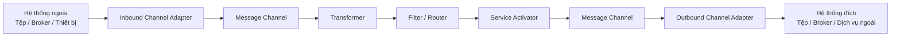
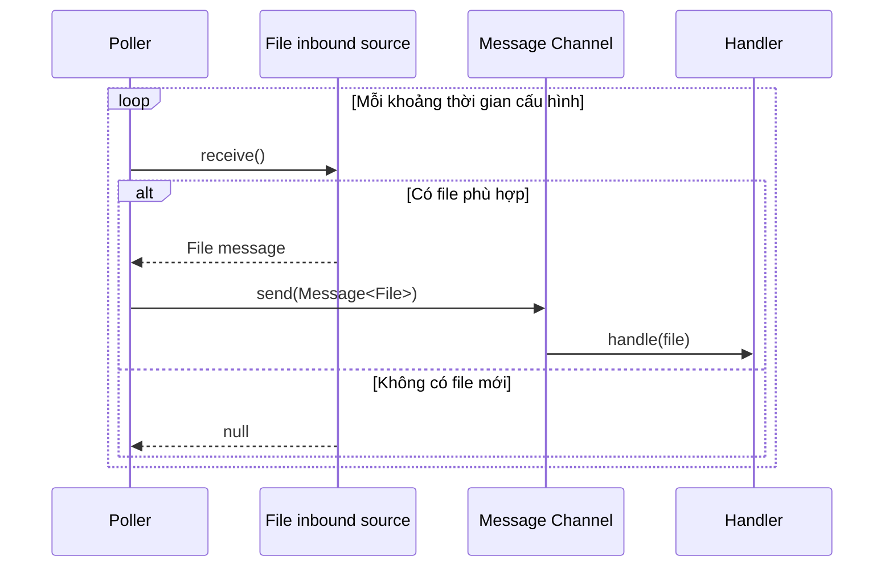
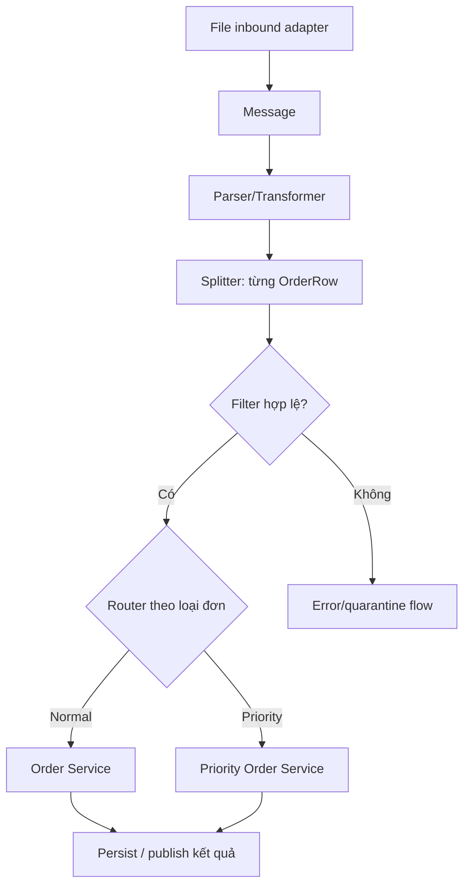
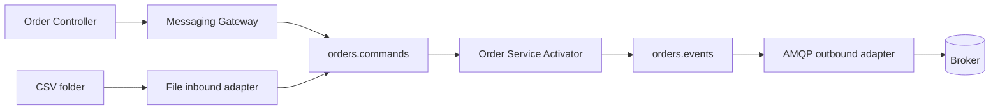

# Channel Adapter nối hệ thống ngoài với message flow

Trong chương **Channel adapter** của module **SPRING_INTEGRATION_PATTERN**, ta học cách đưa dữ liệu từ hệ thống bên ngoài vào luồng Spring Integration và đưa kết quả của luồng ra môi trường bên ngoài. Đây là một phần cốt lõi của **Enterprise Integration Patterns (EIP)**: các thành phần nghiệp vụ giao tiếp qua `Message` và `MessageChannel`, còn phần phụ thuộc vào tệp, HTTP, broker hoặc giao thức khác được đặt tại **Channel Adapter**.

Trong một hệ thống xử lý đơn hàng, ứng dụng có thể cần đọc tệp CSV từ thư mục đối tác, chuyển mỗi dòng thành lệnh nhập kho, lọc dữ liệu sai, định tuyến theo loại đơn, sau đó xuất tệp kết quả hoặc phát sự kiện sang broker. Channel Adapter là cửa ra/vào của toàn bộ quy trình đó.

Mục tiêu của bài học:

- Giải thích vai trò **inbound** và **outbound channel adapter**, phân biệt với **Messaging Gateway** và **Integration Gateway**.
- Phân biệt inbound adapter hoạt động bằng **polling** với adapter nhận sự kiện kiểu **message-driven**.
- Xây dựng ví dụ thực tế bằng Spring Integration Java DSL với **File inbound adapter**, xử lý message và **File outbound adapter**.
- Nhận biết ý nghĩa của payload, headers, converter, polling, retry, error channel và bảo đảm giao nhận.
- Xác định ranh giới kiểm thử và các lỗi thường gặp khi kết nối một hệ thống ngoài với message flow.

## 1. Vì sao cần Channel Adapter?

Nếu mỗi service nghiệp vụ đều gọi trực tiếp API, đọc tệp, nhận JMS message hoặc truy cập thiết bị riêng, code nghiệp vụ sẽ bị gắn chặt với hạ tầng. Thay đổi định dạng từ CSV sang JSON hoặc chuyển từ tệp sang AMQP có thể kéo theo thay đổi lớn ở nhiều lớp.

Channel Adapter **đặt logic giao tiếp với hệ thống ngoài ở biên của message flow**. Khi message đã đi vào luồng, các bước ở giữa có thể sử dụng lại các EIP quen thuộc:

- **Transformer:** chuyển payload bên ngoài thành DTO/domain event.
- **Filter:** bỏ hoặc từ chối message không thỏa quy tắc.
- **Router:** đưa message sang nhánh xử lý thích hợp.
- **Splitter:** chia một file/batch thành nhiều message con.
- **Aggregator:** tổng hợp các kết quả có cùng correlation.
- **Service Activator:** thực thi logic nghiệp vụ.
- **Error channel và retry:** xử lý lỗi theo đúng ranh giới, có giới hạn.

Sơ đồ hai adapter bao quanh một luồng:



Giá trị chính nằm ở việc **phân chia trách nhiệm**: adapter biết giao thức và cơ chế nhận/gửi; các handler bên trong biết định dạng message đã thống nhất và luật nghiệp vụ.

Tuy vậy, adapter không tự bảo đảm dữ liệu đúng, giao dịch nhất quán hoặc “exactly once”. Các bảo đảm đó còn phụ thuộc broker/file system, transaction, retry và idempotency của consumer.

## 2. Inbound adapter và outbound adapter

Channel Adapter đi theo một hướng:

| Thành phần | Luồng dữ liệu | Trách nhiệm | Ví dụ |
| --- | --- | --- | --- |
| **Inbound Channel Adapter** | Hệ thống ngoài → message flow | Nhận/đọc dữ liệu bên ngoài; xây dựng message và gửi đến channel nội bộ | Đọc file, nhận JMS message, nhận dữ liệu từ MQTT |
| **Outbound Channel Adapter** | Message flow → hệ thống ngoài | Nhận message nội bộ rồi gửi/ghi dữ liệu ra hệ thống ngoài | Ghi file, publish AMQP, gửi một thông điệp JMS |
| **Inbound Gateway** | Request ngoài → flow → reply ra ngoài | Có hợp đồng request–reply cho từng lần gọi | HTTP inbound gateway trả HTTP response |
| **Outbound Gateway** | Flow → request ngoài → reply vào flow | Gọi hệ thống ngoài và nhận kết quả tương ứng | HTTP outbound gateway gọi REST API |
| **Messaging Gateway** | Method Java ↔ message flow | Cho caller một giao diện Java để gửi message, nhận reply nếu method yêu cầu | `@MessagingGateway` |

**Outbound Channel Adapter không đồng nghĩa Outbound Gateway.** Gửi thành công vào queue chỉ chứng minh thao tác gửi được chấp nhận theo cơ chế của transport; nó **không mặc nhiên trả kết quả nghiệp vụ** từ consumer.

**Inbound Channel Adapter không mặc nhiên có reply channel hướng ra bên ngoài.** Nếu một HTTP client cần nhận kết quả trong cùng HTTP request, lựa chọn phù hợp thường là **HTTP inbound gateway**. Nếu chỉ ghi nhận thông báo một chiều, inbound adapter có thể hợp lý hơn.

Ví dụ:

```text
File system -> File inbound adapter -> orders.in -> business flow
business flow -> orders.events -> AMQP outbound adapter -> exchange
Java caller -> @MessagingGateway -> business flow -> Java return value
HTTP caller -> HTTP inbound gateway -> business flow -> HTTP response
```

Các thành phần đều xử lý message, nhưng **ngữ nghĩa thành công và thời điểm trả lời khác nhau**.

## 3. Polling adapter và message-driven adapter

Không phải hệ thống ngoài nào cũng chủ động đẩy dữ liệu tới ứng dụng. Cần chọn mô hình nhận đúng với nguồn dữ liệu.

### 3.1. Polling: chủ động kiểm tra nguồn

Một **polling inbound adapter** sử dụng `MessageSource`: mỗi lần poll, adapter thử lấy một message từ nguồn. Ví dụ: đọc tệp mới trong thư mục hoặc kiểm tra bảng dữ liệu có bản ghi chưa xử lý.



Các tham số quan trọng:

| Thuộc tính | Ý nghĩa |
| --- | --- |
| Fixed delay / fixed rate | Khoảng cách giữa các chu kỳ poll; có hệ quả khác nhau khi xử lý chậm |
| `maxMessagesPerPoll` | Giới hạn số message nhận trong một chu kỳ poll |
| Scheduler/thread pool | Nơi chạy các tác vụ poll; giới hạn song song và năng lực hệ thống |
| File/filter state | Quy tắc nhận file nào, đã nhận file nào và khi nào cho phép nhận lại |
| Transaction/advice | Cách bao quanh công đoạn nhận/gửi khi cần xử lý lỗi |
| Error channel | Nơi nhận lỗi từ poller/flow theo cấu hình thực tế |

Polling quá dày có thể làm tăng I/O vô ích. Polling quá thưa làm tăng độ trễ. Nếu xử lý nặng, cần xem cả giới hạn nhận và độ song song, tránh biến poller thành nút nghẽn.

### 3.2. Message-driven: nhận khi có dữ liệu

Một **message-driven inbound adapter** đăng ký listener/callback với nguồn. Ví dụ adapter nhận delivery từ RabbitMQ hoặc JMS listener container rồi đưa payload vào Spring Integration channel. Tần suất xử lý chủ yếu đến từ sự kiện bên ngoài, prefetch và năng lực consumer, thay vì một poller chạy theo chu kỳ trong ứng dụng.

```text
Broker delivery
    -> Listener container
    -> Inbound channel adapter
    -> MessageChannel
    -> Transformer / Router / Service Activator
```

Ở trường hợp này phải quan tâm cơ chế **ACK, NACK, redelivery, transaction và backpressure** do listener container/adapter và broker áp dụng. Nếu message được chuyển tiếp vào một channel bất đồng bộ rồi listener kết thúc, việc xác nhận delivery có thể diễn ra trước khi nghiệp vụ cuối cùng hoàn thành; cần thiết kế phù hợp.

**Không nên suy ra một adapter là polling chỉ dựa vào tên công nghệ.** Một hệ thống có thể cung cấp cả nguồn poll và listener, tùy module Spring Integration cụ thể.

## 4. Message envelope ở ranh giới kết nối

Spring Integration dùng khái niệm `Message<T>` gồm **payload** và **headers**.

```text
Message<File>
  payload:
    File("orders-2026-11-21.csv")
  headers:
    id: UUID
    timestamp: ...
    file_name: ...
    contentType: ... (nếu có)
    correlationId / traceId: ... (nếu được truyền/ánh xạ)
```

Thông tin thường được xem xét:

- **Payload:** dữ liệu nghiệp vụ được giao cho bước tiếp theo. File inbound adapter có thể tạo payload là đối tượng `java.io.File`, chưa phải nội dung CSV đã parse.
- **Headers:** metadata như định danh message, tên file, content type và khóa nghiệp vụ nếu được ánh xạ.
- **Kiểu dữ liệu:** các handler sau adapter cần biết payload thực tế là `File`, `byte[]`, `String` hay DTO.
- **Biên giao thức:** header nội bộ như `replyChannel` thường không thể đưa nguyên một đối tượng `MessageChannel` qua mạng. Cần mapping rõ những field được phép trao đổi.
- **Message ID và nghiệp vụ:** ID của một message có thể thay đổi trong quá trình tái tạo message. Với xử lý trùng/retry xuyên hệ thống, dùng khóa nghiệp vụ bền vững như `eventId` hoặc `importId`.

Ví dụ một tệp CSV có thể chứa nhiều dòng. File inbound adapter ban đầu có thể tạo **một** message mang `File`; muốn xử lý từng dòng, cần Transformer/parser hoặc Splitter do flow bổ sung. Channel Adapter không tự biến mọi cấu trúc dữ liệu thành domain object.

## 5. Thực hành: kết nối thư mục CSV vào flow

Giả sử đối tác đặt file `orders-001.csv` vào thư mục `data/inbox`. Ứng dụng cần kiểm tra nguồn theo chu kỳ và gửi file cho một service chuyên nhập đơn. Ví dụ dùng Java 17+, Spring Integration Core + File module và Java DSL.

### 5.1. Một inbound flow đơn giản

```java
package example.imports;

import java.io.File;
import java.time.Duration;

import org.springframework.context.annotation.Bean;
import org.springframework.context.annotation.Configuration;
import org.springframework.integration.config.EnableIntegration;
import org.springframework.integration.dsl.IntegrationFlow;
import org.springframework.integration.dsl.Pollers;
import org.springframework.integration.file.dsl.Files;

@Configuration
@EnableIntegration
class OrderImportFlow {

    @Bean
    IntegrationFlow importOrderFiles(OrderFileImporter importer) {
        File inbox = new File("data/inbox");

        return IntegrationFlow
            .from(
                Files.inboundAdapter(inbox)
                    .autoCreateDirectory(true)
                    .patternFilter("*.csv"),
                endpoint -> endpoint.poller(
                    Pollers.fixedDelay(Duration.ofSeconds(5))
                        .maxMessagesPerPoll(10)
                )
            )
            .handle(File.class, (file, headers) -> {
                importer.importCsv(file);
                return null; // Không tạo reply; đây là luồng một chiều.
            })
            .get();
    }
}

// Thành phần nghiệp vụ do ứng dụng cài đặt.
interface OrderFileImporter {
    void importCsv(File csvFile);
}
```

Diễn giải theo từng bước:

1. `Files.inboundAdapter(inbox)` dựng nguồn file cho inbound adapter.
2. `patternFilter("*.csv")` lọc file theo tên. Các file không phải CSV bị bỏ khỏi nguồn.
3. Poller chạy khoảng 5 giây một lần, giới hạn tối đa 10 message mỗi lần poll.
4. Với mỗi file được nhận, flow gửi một message có payload `File` tới handler.
5. `OrderFileImporter` đọc/parse CSV, validate và xử lý nghiệp vụ. Hàm trả `null` từ handler minh họa rằng **không phát reply**.
6. Sau này có thể thay service handler bằng Transformer → Splitter → Router mà vẫn giữ File inbound adapter làm cổng nhận.

**Giới hạn của ví dụ:** đây là cấu hình nhập file minh họa, chưa có bảo đảm nhập đúng một lần. Ứng dụng thật phải có quy ước **file hoàn chỉnh** (chẳng hạn đối tác ghi vào tên tạm, đóng file rồi rename nguyên tử), chính sách di chuyển file thành công/thất bại, phát hiện file trùng và cách khôi phục khi crash.

### 5.2. Thêm Transformer và xử lý phân nhánh

Có thể mở rộng như sau:



Đây là **sơ đồ logic**: Filter bỏ message mặc định chưa chắc đẩy message tới nhánh lỗi; nếu muốn đưa dữ liệu sai vào quarantine, phải cấu hình discard channel hoặc một bước điều phối lỗi rõ ràng.

Nếu parse cả file rồi mới chia thành nhiều row, một row lỗi có thể đặt ra câu hỏi: **có rollback cả file hay chỉ bỏ dòng lỗi?** Quyết định này là hợp đồng nghiệp vụ của importer và flow, không phải tính năng tự động của File inbound adapter.

## 6. Outbound Channel Adapter: đưa kết quả ra hệ thống ngoài

Một trường hợp đối xứng là hệ thống đã xử lý xong một đơn hàng, cần xuất kết quả dạng chuỗi vào thư mục `data/outbox` để đối tác nhận.

```java
package example.exports;

import java.io.File;

import org.springframework.context.annotation.Bean;
import org.springframework.context.annotation.Configuration;
import org.springframework.integration.config.EnableIntegration;
import org.springframework.integration.dsl.IntegrationFlow;
import org.springframework.integration.file.dsl.Files;

@Configuration
@EnableIntegration
class OrderExportFlow {

    @Bean
    IntegrationFlow exportOrderResults() {
        return IntegrationFlow.from("orders.export.files")
            .handle(
                Files.outboundAdapter(new File("data/outbox"))
                    .autoCreateDirectory(true)
                    .fileNameGenerator(message ->
                        "export-" + message.getHeaders().getId() + ".txt")
            )
            .get();
    }
}
```

Ở ví dụ này, flow kỳ vọng message đầu vào chứa payload dạng `String` hoặc dữ liệu mà FileWritingMessageHandler có thể ghi. Một thành phần trước đó phải tạo/serialize nội dung cần xuất rồi gửi vào channel `orders.export.files`.

Ví dụ phát message từ một thành phần cùng Spring context:

```java
package example.exports;

import org.springframework.messaging.MessageChannel;
import org.springframework.messaging.support.MessageBuilder;

class ExportPublisher {
    private final MessageChannel exportChannel;

    ExportPublisher(MessageChannel exportChannel) {
        this.exportChannel = exportChannel;
    }

    void publish(String serializedOrder) {
        boolean accepted = exportChannel.send(
            MessageBuilder.withPayload(serializedOrder).build()
        );
        if (!accepted) {
            throw new IllegalStateException("Không gửi được message vào channel");
        }
    }
}
```

Khi tích hợp thật, bean channel phải được inject bằng tên/qualifier thích hợp, ví dụ channel tên `orders.export.files`. `MessageChannel.send()` trả thành công chỉ phản ánh cơ chế send tới channel; với kênh đồng bộ handler có thể đã chạy, còn với kênh bất đồng bộ xử lý có thể tiếp tục sau đó. Không coi boolean `true` là bảo đảm đối tác bên ngoài đã nhận và nhập file.

**Chú ý về an toàn và tính bền vững:**

- Tạo tên file duy nhất hoặc có quy tắc chống ghi đè; ví dụ trên dùng ID message để minh họa.
- Khi ghi file lớn, cân nhắc cơ chế viết file tạm rồi đổi tên khi hoàn tất để bên nhận không đọc file đang ghi.
- Cấu hình quyền thư mục, dung lượng đĩa, xử lý khi không ghi được và chính sách dọn file.
- Nếu cần biết đối tác đã xử lý thành công, phải bổ sung một **acknowledgement nghiệp vụ** riêng, ví dụ file phản hồi hoặc sự kiện kết quả.

## 7. Phân biệt Channel Adapter và Messaging Gateway trong cùng hệ thống

Một hệ thống có thể đồng thời dùng:



Các luồng vào đều hướng tới nghiệp vụ xử lý đơn, nhưng kỳ vọng khác nhau:

| Nguồn | Bên gọi mong đợi gì? | Thành phần phù hợp |
| --- | --- | --- |
| Java service gửi lệnh và cần nhận DTO | Reply tương ứng với lần gọi | `@MessagingGateway` |
| Thư mục xuất hiện file mới | Đưa file vào luồng theo chu kỳ | File inbound channel adapter |
| RabbitMQ đẩy sự kiện | Consumer lắng nghe delivery | AMQP inbound channel adapter |
| Ứng dụng phát `OrderCreated` ra broker | Gửi sự kiện một chiều | AMQP outbound channel adapter |
| Dịch vụ ngoài trả response cho một request HTTP | Một reply có correlation với request | HTTP outbound gateway |

Thiết kế đúng là chọn **ngữ nghĩa tích hợp** trước (một chiều hay request-reply), rồi chọn endpoint/adapter tương ứng. Chỉ đổi tên một outbound adapter thành “gateway” không khiến nó tự biết chờ phản hồi.

## 8. Xử lý lỗi và retry tại ranh giới adapter

Thông điệp có thể thất bại ở nhiều vị trí:

| Nơi lỗi | Ví dụ | Hướng xử lý |
| --- | --- | --- |
| Nguồn inbound | File bị khóa, không có quyền đọc, broker mất kết nối | Poller/listener cần báo lỗi, backoff hoặc reconnect theo chính sách |
| Chuyển đổi payload | CSV sai định dạng, JSON thiếu trường | Validate, quarantine/DLQ, lưu lý do; không retry vô hạn cùng dữ liệu |
| Business handler | Database tạm thời không truy cập được | Retry có giới hạn, backoff, transaction và idempotency |
| Outbound adapter | Ghi file thất bại, publish broker thất bại | Không báo hoàn tất khi chưa xác nhận theo cơ chế outbound |
| Phía hệ thống đích | Đối tác chưa xử lý dù file đã xuất | Tách giao nhận kỹ thuật khỏi xác nhận nghiệp vụ |

### 8.1. Đồng bộ và bất đồng bộ ảnh hưởng kết quả lỗi

Nếu từ adapter tới service sử dụng `DirectChannel`, lời gọi handler thường diễn ra trong thread của bên gửi. Ngoại lệ có thể lan về poller hoặc listener container. Nhưng nếu có `ExecutorChannel` hoặc `QueueChannel`, đoạn đầu có thể hoàn tất việc **bàn giao message** trong khi các bước sau vẫn đang xử lý. Điều này ảnh hưởng đến ACK, transaction và khả năng retry/redelivery.

Ví dụ với broker inbound listener: nếu listener xác nhận delivery ngay sau khi chuyển thành công vào channel bất đồng bộ, một lỗi business ở bước sau không mặc nhiên khiến broker redeliver. Thiết kế at-least-once cần cân nhắc vị trí ACK hoặc một hàng đợi bền vững ở ranh giới chuyển giao.

### 8.2. Retry có giới hạn và lỗi vĩnh viễn

**Retry thích hợp** cho sự cố tạm thời như timeout mạng hoặc DB bị quá tải. **Retry vô ích** cho CSV có schema sai hoặc field bắt buộc thiếu nếu dữ liệu không thay đổi.

```text
Inbound adapter
  -> validate
      -> OK -> process -> outbound adapter
      -> lỗi schema -> quarantine + cảnh báo
  -> lỗi hạ tầng tạm thời -> retry (giới hạn + backoff)
  -> vượt giới hạn -> xử lý lỗi / DLQ / can thiệp
```

Trong Spring Integration, có thể sử dụng `RequestHandlerRetryAdvice` ở endpoint phù hợp và định tuyến lỗi qua `errorChannel`. Tuy nhiên, khi một error flow **nuốt ngoại lệ**, bên nhận có thể coi việc xử lý đã thành công. Cần kiểm tra exception có thực sự quay về adapter/listener hay không, đặc biệt với ACK của broker.

### 8.3. File inbound không có ACK broker

File system không phải message broker và không cung cấp cùng cơ chế ACK/NACK. File inbound adapter có thể dùng filter nhận một lần trong lifecycle, nhưng **đã phát message** không có nghĩa file đã được nhập an toàn vào DB.

Muốn bảo đảm quy trình nhập file có thể phục hồi, có thể thiết kế:

1. Đối tác ghi vào thư mục staging, sau khi ghi xong mới chuyển sang thư mục inbox.
2. Importer tính một khóa nhập ổn định (tên file kết hợp checksum hoặc ID nghiệp vụ).
3. Ghi trạng thái nhập và dữ liệu trong transaction phù hợp.
4. Khi thành công, di chuyển file sang `processed`; khi lỗi không thể sửa, chuyển sang `rejected` cùng lý do.
5. Có job khôi phục/truy hồi các file đang dở, xử lý trùng bằng idempotency key.

Mỗi hệ thống có thể chọn quy trình khác, nhưng cần định nghĩa rõ khi crash ở từng bước và khi file được nhận lại.

## 9. Headers, serialization và an toàn dữ liệu

Đưa message qua ranh giới hệ thống không chỉ là chuyển một đối tượng Java:

- **Định dạng:** xác định CSV/JSON/Avro/byte[], encoding, timezone và quy tắc số thập phân.
- **Schema/version:** hai phía có thể nâng cấp độc lập; cần chính sách tương thích.
- **Header mapping:** chỉ truyền các header có ý nghĩa và được cho phép; loại bỏ tham chiếu nội bộ/secret không nên ra ngoài.
- **Định danh:** dùng `eventId`, `requestId`, `correlationId` hợp đồng để đối chiếu. `MessageHeaders.ID` của từng message không nhất thiết là khóa giao dịch bền vững.
- **Bảo mật:** giới hạn quyền thư mục, bảo vệ endpoint, xác thực broker, dùng TLS khi phù hợp, không log payload chứa dữ liệu nhạy cảm.
- **Kiểm soát kích thước:** quy định kích thước file, số dòng, độ lớn message, timeout và năng lực tiêu thụ để tránh làm nghẽn hệ thống.

Ví dụ hợp đồng sự kiện sau khi đã parse file:

```json
{
  "eventId": "order-import-20261121-001-row-17",
  "schemaVersion": 1,
  "source": "partner-csv",
  "order": {
    "orderId": "O-1042",
    "sku": "SKU-10",
    "quantity": 3
  }
}
```

Đây là một **domain event do hệ thống định nghĩa**, không phải payload mặc định của File inbound adapter. Việc tạo khóa event ổn định cần dựa trên dữ liệu thực, đặc biệt khi file bị đổi tên hoặc nạp lại.

## 10. Giám sát luồng Channel Adapter

Khi một adapter hoạt động nhưng dữ liệu “không đến nơi”, hãy đo cả nguồn, kênh và đích:

| Chỉ số/dấu hiệu | Câu hỏi giúp trả lời |
| --- | --- |
| Số file đang chờ, tuổi file lâu nhất | Poller có bị chậm hoặc bị kẹt? |
| Số message nhận/phát theo adapter | Dữ liệu có đi qua ranh giới hệ thống? |
| Latency từ nguồn đến xử lý hoàn tất | Độ trễ phát sinh ở poller, channel hay handler? |
| Error count theo exception/channel | Bước nào gây lỗi? |
| Retry count, retry exhausted | Có lỗi lặp, backoff có đủ? |
| Số bản ghi quarantine/DLQ | Có message không thể xử lý? |
| Backlog của queue/consumer | Năng lực bên nhận có theo kịp? |
| Duplicate count theo `eventId` | Dữ liệu bị giao/nhận lại có gây tác động trùng? |
| Output files / publish confirms | Đích có nhận thao tác gửi ở mức vận chuyển? |

Log nên gắn khóa theo dõi có nghĩa nghiệp vụ, thời điểm, tên adapter/channel và kết quả. Tránh chỉ log “Received message” mà không biết đã parse, commit và phát ra ngoài hay chưa.

## 11. Kiểm thử Channel Adapter đúng ranh giới

Để kiểm tra một message flow, có thể test **logic nội bộ** bằng cách gửi message trực tiếp vào channel, rồi test **adapter** bằng dữ liệu/giao thức thật hoặc mô phỏng phù hợp.

| Kịch bản | Thiết lập | Kết quả cần xác minh |
| --- | --- | --- |
| File hợp lệ | Đặt file `*.csv` đã ghi hoàn tất vào inbox | Poller nhận file, importer xử lý đúng một lần theo chính sách |
| File không khớp filter | Đặt `.tmp` hoặc file khác | Không tạo message nghiệp vụ |
| Thư mục không tồn tại | Chạy trong thư mục test mới | Chính sách auto-create được áp dụng |
| File chưa ghi xong | Mô phỏng producer đang ghi | Không parse dữ liệu chưa hoàn tất nhờ giao thức staging |
| CSV sai schema | Thiếu field bắt buộc | Lỗi có hướng xử lý; không tạo đơn sai |
| DB lỗi tạm thời | Importer ném lỗi | Retry/khôi phục theo chính sách, không mất dữ liệu |
| App restart | Restart sau khi nhận file nhưng trước commit | Có thể khôi phục và không tạo tác động trùng |
| Outbound file thành công | Gửi payload `String` vào channel export | File được tạo đúng tên/nội dung |
| Outbound file thất bại | Quyền ghi bị từ chối hoặc hết đĩa | Lỗi được ghi nhận, không báo thành công giả |
| Broker redelivery | Consumer crash trước ACK | Message được giao lại; nghiệp vụ idempotent |
| Channel bất đồng bộ | Dùng `ExecutorChannel` | Xác nhận thời điểm hoàn tất/ACK phù hợp |

Khi viết integration test cho file, có thể dùng thư mục tạm và đợi điều kiện quan sát được (file xuất hiện, row trong DB, metrics) với timeout. Không nên chỉ chờ `Thread.sleep()` cố định rồi giả định mọi tác vụ đã hoàn tất. Nếu kiểm thử RabbitMQ/JMS, cần quan sát ack/redelivery theo transport thực tế thay vì chỉ gọi handler Java.

### Kịch bản mẫu end-to-end

```text
Given:
  Thư mục data/inbox chứa orders-001.csv hoàn chỉnh
  File có hai dòng hợp lệ, một dòng bị từ chối theo quy tắc
  IntegrationFlow nhận file theo poller
When:
  Poller chạy và importer đọc file
Then:
  Hai đơn hợp lệ được ghi với khóa nhập ổn định
  Dòng không hợp lệ được ghi nhận để điều tra
  Hệ thống xuất một file báo cáo ở data/outbox
  Restart ứng dụng không tạo thêm đơn trùng
```

Kịch bản này đòi hỏi các bước Transformer/Splitter, persistence và error handling bổ sung ngoài hai adapter mẫu. Đó chính là ưu điểm thiết kế: **adapter đóng vai trò cổng kết nối**, còn hợp đồng nghiệp vụ nằm trong các thành phần của message flow.

## 12. Các lỗi thiết kế thường gặp

**Nhầm channel adapter với message channel.** Adapter nối vào hệ thống ngoài; channel chuyển message giữa endpoint bên trong. Cần cả hai để có một flow rõ ràng.

**Nhầm outbound adapter với outbound gateway.** Một thao tác gửi sự kiện không có reply nghiệp vụ; muốn chờ remote response phải dùng gateway hoặc một luồng correlation được thiết kế.

**Cho rằng polling đồng nghĩa xử lý đúng một lần.** Polling chỉ quyết định khi nào thử đọc nguồn; duplicate và recovery cần trạng thái bền vững hoặc idempotency.

**Đọc file đang ghi dở.** File inbound adapter có thể nhìn thấy file trước khi producer ghi xong nếu không có quy ước staging/rename.

**Nuốt lỗi trước khi broker quyết định ACK.** Error flow kết thúc bình thường có thể khiến listener tưởng message thành công dù nghiệp vụ thất bại.

**Bỏ qua kiểu payload.** Adapter phát `File`, handler lại ép thành `String` hoặc DTO mà chưa chuyển đổi; runtime sẽ lỗi ở bước sau.

**Đưa tác vụ chậm trực tiếp vào poller/consumer mà không giới hạn.** Điều này tăng latency và giữ tài nguyên; cần thiết kế concurrency, batching và backpressure.

**Tin rằng ghi file xong là đối tác đã xử lý.** File xuất hiện hoặc broker nhận publish không xác nhận kết quả nghiệp vụ của bên nhận.

**Không có lộ trình xử lý trùng.** Crash, retry hoặc restart có thể làm nguồn được quét/giao lại; nghiệp vụ có tác dụng phụ phải idempotent.

## 13. Checklist triển khai

1. Xác định hệ thống ngoài và **ngữ nghĩa tích hợp**: một chiều hay request-reply.
2. Chọn **inbound/outbound adapter** hoặc **gateway** theo kỳ vọng kết quả.
3. Quy định hợp đồng payload, header và schema ở ranh giới.
4. Nếu là polling, xác định chu kỳ, số message mỗi poll, filter và trạng thái đã nhận.
5. Nếu là message-driven, xác định consumer concurrency, ACK/redelivery và backpressure.
6. Thêm Transformer, Filter, Router, Splitter/Aggregator khi thực sự cần xử lý dữ liệu.
7. Thiết lập timeout, retry có giới hạn, error channel và đường quarantine/DLQ phù hợp.
8. Thiết kế idempotency và cơ chế khôi phục sau crash, nhất là ở bước ghi DB hoặc gọi API ngoài.
9. Bổ sung metrics/log theo nguồn, adapter, channel, handler và đích.
10. Kiểm thử cả bên trong flow và ranh giới file/broker/remote, bao gồm lỗi và dữ liệu trùng.

## Kết luận

**Channel Adapter** là cầu nối giữa **hệ thống bên ngoài** và **message flow** của Spring Integration. **Inbound adapter** đưa dữ liệu từ bên ngoài vào channel; **outbound adapter** gửi dữ liệu từ channel ra ngoài. Chúng giúp phần còn lại của hệ thống tập trung vào Transformer, Router, Filter, Splitter/Aggregator và Service Activator. Để một luồng tích hợp thật sự tin cậy, cần chọn đúng polling hay message-driven, xác định hợp đồng dữ liệu, kiểm soát retry/lỗi, thiết kế idempotency và kiểm thử ranh giới vận chuyển lẫn tác động nghiệp vụ.
