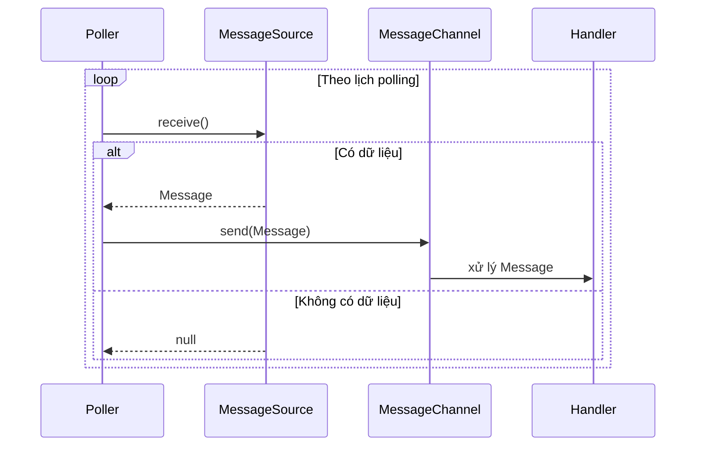
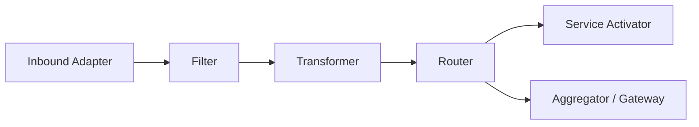

# Inbound channel adapter trong Spring Integration

## 1. Inbound channel adapter giải quyết bài toán gì?

Trong một hệ thống tích hợp, dữ liệu thường xuất hiện bên ngoài ứng dụng: file mới được đưa vào thư mục, bản ghi có sẵn trong cơ sở dữ liệu, thông điệp đến từ broker hoặc sự kiện phát sinh từ một dịch vụ khác. Các nguồn này có cách truy cập, thời điểm phát dữ liệu và định dạng khác nhau. Nếu mỗi bước xử lý nghiệp vụ trực tiếp đọc từng nguồn, luồng xử lý sẽ bị gắn chặt với công nghệ đầu vào.

**Inbound channel adapter** là thành phần ở **ranh giới đi vào** của Spring Integration. Nó nhận hoặc chủ động lấy dữ liệu từ một hệ thống bên ngoài, tạo một Spring Messaging `Message<?>` rồi **gửi vào một `MessageChannel`** để các endpoint phía sau xử lý. Đây là cách ứng dụng thực hiện ý tưởng *Channel Adapter* trong Enterprise Integration Patterns (EIP): che giấu giao thức hoặc API riêng của nguồn và đưa dữ liệu vào một luồng thông điệp thống nhất.

Ví dụ: một hệ thống nhận đơn hàng dưới dạng file `.txt`. Thay vì buộc dịch vụ xử lý đơn hàng liên tục quét thư mục, ta bố trí một inbound file adapter đọc file và đẩy message lên channel. Sau đó Transformer có thể chuyển nội dung thành dữ liệu đơn hàng, Filter loại bản ghi không hợp lệ, Router chọn nhánh và Service Activator thực hiện nghiệp vụ. Những thành phần này không cần biết dữ liệu ban đầu đến từ thư mục hay một nguồn khác.

### Kết quả học tập

Sau bài này, bạn có thể:

- Giải thích vai trò và vị trí của inbound channel adapter trong một integration flow.
- Phân biệt **polling inbound adapter** với **message-driven inbound adapter**, và adapter với gateway.
- Cấu hình `@InboundChannelAdapter`, `MessageSource`, `@Poller` và `MessageChannel` cho một ví dụ thực tế.
- Chọn chiến lược xử lý trùng lặp, lỗi, tải lớn và theo dõi vận hành phù hợp với nguồn dữ liệu.

## 2. Vị trí trong kiến trúc thông điệp


Một inbound adapter có trách nhiệm chính là **đưa dữ liệu vào hệ thống thông điệp**. Nó không nhất thiết hiểu nghiệp vụ của payload và **không được thiết kế để chờ một kết quả trả về cho nguồn**, khác với inbound gateway.

Các thành phần thường gặp:

| Thành phần | Vai trò |
| --- | --- |
| Nguồn ngoài | Nơi tồn tại hoặc phát sinh dữ liệu, ví dụ file, hàng đợi, kết nối mạng. |
| Inbound adapter | Đọc/nhận dữ liệu và phát `Message` vào channel. |
| `MessageSource<T>` | Hợp đồng cung cấp message cho **polling adapter**; phương thức `receive()` trả về message hoặc `null` khi chưa có dữ liệu. |
| `Poller` | Quyết định lúc nào gọi nguồn polling và có thể giới hạn số message trong một lượt. |
| `MessageChannel` | Đường truyền nội bộ giữa producer và consumer, giúp tách nguồn ra khỏi xử lý. |
| Endpoint tiêu thụ | Ví dụ `@ServiceActivator`, Transformer, Filter hoặc Router nhận và xử lý message. |

Một `Message` gồm **payload** và **headers**. Với file inbound adapter, payload thường là đối tượng `File`, tức đường dẫn và thông tin file; muốn đọc nội dung hoặc parse đơn hàng, consumer phải thực hiện bước đó. Headers có thể chứa metadata do adapter bổ sung. Không nên mặc định payload đã là chuỗi hoặc JSON.

## 3. Hai cơ chế đưa dữ liệu vào hệ thống

### 3.1. Polling inbound channel adapter

Với nguồn cần được chủ động kiểm tra (thư mục file, bảng dữ liệu được truy vấn định kỳ...), adapter thường dùng `MessageSource<?>` và một poller. Mỗi lần được kích hoạt, poller gọi `receive()`; nếu có message, adapter gửi nó vào channel; nếu nguồn chưa có dữ liệu, lượt polling kết thúc hoặc tiếp tục theo cấu hình.



Các tham số hay gặp:

- `fixedDelay`: khoảng trễ giữa các lượt thực thi của tác vụ polling; phù hợp khi thời gian xử lý thay đổi.
- `fixedRate`: lập lịch theo nhịp định kỳ; cần cân nhắc concurrency và tải khi xử lý lâu.
- `cron`: chủ động chọn các mốc thời gian chạy.
- `maxMessagesPerPoll`: giới hạn số message được lấy trong một lần kích hoạt; tránh để một lượt lấy dữ liệu vô hạn.

**Lưu ý:** Tốc độ poll cao không đảm bảo throughput cao. Nếu channel hoặc consumer xử lý chậm, poller vẫn chịu áp lực từ tầng sau; còn khi dùng `QueueChannel`, cần thiết kế dung lượng hàng đợi và consumer phù hợp.

### 3.2. Message-driven inbound channel adapter

Với nguồn có khả năng đẩy sự kiện, một listener hoặc callback có thể nhận dữ liệu ngay khi sự kiện đến, rồi phát message lên channel. Ví dụ là adapter dựa trên cơ chế listener cho JMS/AMQP. Cơ chế này không cần định kỳ quét nguồn theo cách của `MessageSource`.

Điểm khác biệt nằm ở **cách adapter được kích hoạt**, chứ không phải ở vai trò trong luồng: cả polling và message-driven đều đưa message từ bên ngoài vào `MessageChannel`. Với broker, cần xét thêm acknowledgement, prefetch, concurrency và cơ chế redelivery theo transport; không thể suy diễn các bảo đảm giao nhận chỉ từ tên *inbound adapter*.

### 3.3. Phân biệt adapter, gateway và outbound adapter

| Thành phần | Hướng tương tác | Có mong chờ phản hồi đồng bộ? | Tình huống |
| --- | --- | --- | --- |
| **Inbound channel adapter** | Nguồn ngoài → Channel | Thông thường **không** | Đọc file mới, nhận sự kiện từ broker. |
| **Inbound gateway** | Nguồn ngoài → Channel → phản hồi ra ngoài | **Có**, theo mô hình request–reply | HTTP request cần response, lời gọi RPC. |
| **Outbound channel adapter** | Channel → hệ thống ngoài | Thông thường **không** | Ghi file, gửi thông báo tới broker. |
| **Outbound gateway** | Channel → hệ thống ngoài → Channel | **Có**, theo mô hình request–reply | Gọi HTTP service và lấy kết quả. |

Một inbound adapter không tự động biến thành gateway chỉ vì consumer bên trong tạo ra kết quả. Nếu giao thức bên ngoài cần phản hồi tương ứng với một request, hãy chọn inbound gateway và thiết kế reply channel, timeout, correlation thích hợp.

## 4. Ví dụ thực hành: đọc file mới bằng polling adapter

Giả sử dịch vụ nhận file đơn hàng từ thư mục `./inbox` và chuyển chúng vào một channel có tên `fileInputChannel`. Consumer nhận `File` và ghi thông tin file ra log/console. Đây là ví dụ đơn giản để nhìn thấy rõ ranh giới giữa **nhận dữ liệu** và **xử lý nghiệp vụ**.

### 4.1. Phụ thuộc

Với ứng dụng Spring Boot 3.x dùng Java 17+ và dependency management của Spring Boot, thêm các dependency Maven sau:

```xml
<dependencies>
    <dependency>
        <groupId>org.springframework.boot</groupId>
        <artifactId>spring-boot-starter-integration</artifactId>
    </dependency>
    <dependency>
        <groupId>org.springframework.integration</groupId>
        <artifactId>spring-integration-file</artifactId>
    </dependency>
</dependencies>
```

Spring Integration 6.x phù hợp với hệ sinh thái Spring Framework 6/Spring Boot 3. Trong dự án thực tế, dùng phiên bản các dependency được BOM của Spring Boot quản lý để tránh lệch phiên bản.

### 4.2. Cấu hình ứng dụng

Tạo lớp `src/main/java/com/example/integration/ChannelAdapterApplication.java`:

```java
package com.example.integration;

import java.io.File;
import java.io.IOException;
import java.nio.file.Files;
import java.nio.file.Path;

import org.springframework.boot.SpringApplication;
import org.springframework.boot.autoconfigure.SpringBootApplication;
import org.springframework.context.annotation.Bean;
import org.springframework.integration.annotation.InboundChannelAdapter;
import org.springframework.integration.annotation.Poller;
import org.springframework.integration.annotation.ServiceActivator;
import org.springframework.integration.channel.DirectChannel;
import org.springframework.integration.core.MessageSource;
import org.springframework.integration.file.FileReadingMessageSource;
import org.springframework.integration.file.filters.AcceptOnceFileListFilter;
import org.springframework.integration.file.filters.CompositeFileListFilter;
import org.springframework.integration.file.filters.SimplePatternFileListFilter;
import org.springframework.messaging.MessageChannel;

@SpringBootApplication
public class ChannelAdapterApplication {

    public static void main(String[] args) {
        SpringApplication.run(ChannelAdapterApplication.class, args);
    }

    @Bean
    public MessageChannel fileInputChannel() {
        return new DirectChannel();
    }

    @Bean
    @InboundChannelAdapter(
        channel = "fileInputChannel",
        poller = @Poller(fixedDelay = "2000", maxMessagesPerPoll = "5")
    )
    public MessageSource<File> fileReadingMessageSource() throws IOException {
        Path inbox = Path.of("./inbox");
        Files.createDirectories(inbox);

        FileReadingMessageSource source = new FileReadingMessageSource();
        source.setDirectory(inbox.toFile());

        CompositeFileListFilter<File> filters = new CompositeFileListFilter<>();
        filters.addFilter(new SimplePatternFileListFilter("*.txt"));
        filters.addFilter(new AcceptOnceFileListFilter<>());
        source.setFilter(filters);

        return source;
    }

    @ServiceActivator(inputChannel = "fileInputChannel")
    public void processFile(File file) {
        System.out.println("Đã nhận: " + file.getName());
        // Bước tiếp theo có thể đọc, validate, parse và lưu đơn hàng.
    }
}
```

**Đọc cấu hình theo luồng xử lý:**

1. `fileInputChannel()` tạo `DirectChannel`. Channel này thường chuyển giao message trực tiếp cho subscriber trong cùng luồng thực thi, nên lỗi của handler có thể ảnh hưởng đến lượt polling.
2. `fileReadingMessageSource()` khai báo nguồn đọc thư mục. `FileReadingMessageSource` cung cấp message chứa `File` khi tìm được file phù hợp.
3. `@InboundChannelAdapter` gắn nguồn với `fileInputChannel`. `@Poller` yêu cầu chạy với độ trễ 2 giây và lấy tối đa 5 message mỗi lượt.
4. `SimplePatternFileListFilter("*.txt")` chỉ chọn file đuôi `.txt`. `AcceptOnceFileListFilter` tránh chọn lại cùng file đã được ghi nhận trong vòng đời của bộ lọc.
5. `@ServiceActivator` đăng ký consumer cho channel. Khi message đến, Spring Integration truyền payload tương thích kiểu `File` vào phương thức `processFile`.

`@InboundChannelAdapter` là cấu hình cho **producer endpoint**. Phương thức `@Bean` trả về một `MessageSource`; framework tạo và quản lý việc polling, chuyển message vào channel theo khai báo.

### 4.3. Chạy thử và quan sát

Từ thư mục gốc ứng dụng:

1. Khởi động ứng dụng bằng `mvn spring-boot:run` (hoặc chạy lớp main trong IDE).
2. Tạo file `inbox/order-001.txt` với nội dung bất kỳ, chẳng hạn `orderId=123`.
3. Quan sát console: sau một lượt polling có thể thấy `Đã nhận: order-001.txt`.
4. Đặt thêm `inbox/order-002.txt`: consumer nhận file mới trong lượt polling tiếp theo.
5. Tạo file `inbox/note.json`: file này bị bộ lọc `*.txt` bỏ qua.

Trong **cùng một lần chạy ứng dụng**, ví dụ trên sẽ không liên tục in lại một file đã được `AcceptOnceFileListFilter` ghi nhận. Tuy nhiên, khi **khởi động lại ứng dụng**, bộ nhớ của filter mặc định không còn, nên các file cũ còn nằm trong thư mục có thể được xử lý lại.

Ngoài ra, consumer trong ví dụ chỉ in tên file; nó chưa di chuyển file vào thư mục lưu trữ, xác nhận xử lý thành công, lưu trạng thái bền vững hay xử lý lỗi nghiệp vụ.

## 5. Quyết định thiết kế khi đưa adapter vào hệ thống thật

### 5.1. Chọn channel và phân phối tải

`DirectChannel` đơn giản, dễ quan sát và phù hợp khi consumer xử lý nhanh, đồng bộ. Nhưng consumer chạy lâu cũng kéo dài lượt polling. Nếu cần tách nhịp nhận dữ liệu khỏi nhịp xử lý, có thể dùng `QueueChannel` với capacity hữu hạn và một consumer có poller riêng, hoặc đưa công việc sang cơ chế hàng đợi/broker thích hợp.

Không nên mặc định việc thay `DirectChannel` bằng channel bất đồng bộ sẽ giải quyết mọi vấn đề. Khi có thêm hàng đợi và luồng xử lý, thứ tự message, điểm bắt lỗi, giao dịch, backpressure và cách tắt ứng dụng đều cần được thiết kế lại.

### 5.2. Tránh đọc file đang được ghi dở

Bộ lọc `*.txt` chỉ kiểm tra tên; nó không chứng minh file đã được ghi xong. Nếu hệ thống gửi file ghi trực tiếp vào `inbox`, poller có thể bắt gặp file trước khi producer hoàn tất.

Hai cách thường dùng:

- Producer ghi ra file tạm, đóng file rồi **đổi tên nguyên tử** sang `.txt` trong cùng filesystem khi hoàn tất.
- Chỉ chọn file đáp ứng điều kiện đã ổn định trong một khoảng thời gian, sau đó mới đưa vào luồng xử lý.

Trường hợp cần độ tin cậy cao, ưu tiên hợp đồng bàn giao rõ ràng giữa bên tạo file và bên nhận file.

### 5.3. Chống trùng lặp và khởi động lại

`AcceptOnceFileListFilter` trong ví dụ phù hợp để học cơ chế cơ bản, nhưng trạng thái lọc mặc định lưu trong bộ nhớ. Nó không đảm bảo exactly-once xuyên suốt các lần khởi động, lỗi xử lý, nhiều instance hoặc sự cố giữa hai bước *nhận* và *hoàn tất nghiệp vụ*.

Đối với sản xuất, cân nhắc:

- Bộ lọc lưu metadata bền vững (ví dụ bộ lọc persistent accept-once với `MetadataStore` phù hợp).
- Bước nhận và bước xử lý có trạng thái rõ ràng: mới, đang xử lý, hoàn thành, lỗi.
- Consumer **idempotent** dựa trên khóa nghiệp vụ/file ID để xử lý lại mà không tạo tác dụng phụ trùng.
- Di chuyển/đánh dấu file sau thành công và có chính sách retry hoặc khu vực quarantine cho file lỗi.
- Khi chạy nhiều instance, xác định cách phối hợp, khóa hoặc chia nguồn để không cùng nhận một file.

**Cảnh báo quan trọng:** lọc “đã thấy file” và xử lý “đơn hàng đã thành công” là hai sự kiện khác nhau. Nếu handler thất bại sau khi adapter ghi nhận file là đã thấy, hệ thống cần cơ chế retry/recovery được thiết kế riêng; filter trong bộ nhớ không tự đảm bảo xử lý lại.

### 5.4. Lỗi, retry và error channel

Một inbound flow thường có hai nhóm lỗi:

| Vị trí lỗi | Ví dụ | Hướng xử lý |
| --- | --- | --- |
| Lấy dữ liệu từ nguồn | Thư mục không truy cập được, lỗi quyền, DB không phản hồi | Log đủ ngữ cảnh, giới hạn retry, theo dõi sức khỏe nguồn. |
| Xử lý sau khi message đã vào channel | Parse sai, validation thất bại, dịch vụ nghiệp vụ lỗi | Phân loại lỗi tạm thời/vĩnh viễn, retry có giới hạn, dead-letter/quarantine và idempotency. |

Với polling adapter, có thể cấu hình cơ chế xử lý lỗi cho poller và định tuyến `ErrorMessage` qua `errorChannel`. Cách lỗi lan truyền còn phụ thuộc loại channel, executor và điểm chạy bất đồng bộ. Không nên coi việc có `errorChannel` là tự động bảo đảm retry hoặc hoàn trả message về nguồn.

Các lỗi do dữ liệu vĩnh viễn không hợp lệ nên được xử lý dứt điểm (ví dụ đưa file vào khu vực lỗi và ghi nguyên nhân). Retry vô hạn cùng một file lỗi thường làm kẹt luồng hoặc tạo nhiều log không hữu ích.

### 5.5. Chọn lịch polling

Tốc độ xử lý cần dựa trên tần suất nguồn phát sinh và năng lực consumer:

| Tình huống | Cách cân nhắc |
| --- | --- |
| Nguồn cập nhật thưa, chấp nhận trễ vài giây | `fixedDelay` dài hơn để giảm lượng lần kiểm tra rỗng. |
| Nguồn tăng đột biến | Giới hạn `maxMessagesPerPoll` và có khả năng scale consumer; đo backlog trước khi tăng poll rate. |
| Chỉ xử lý tại giờ định trước | `cron`, kết hợp xử lý tránh chồng lấp. |
| Source hoặc downstream có thao tác chặn | Thiết lập timeout ở đúng tầng, giới hạn concurrency và theo dõi thời gian xử lý. |

Polling quá dày có thể gây tải không cần thiết lên database hoặc remote API. Polling quá thưa tạo độ trễ đầu vào. Nên đo thực tế thay vì đặt lịch ngẫu nhiên.

## 6. Kiểm thử và quan sát vận hành

Trong dự án thực tế, bài kiểm thử tốt cần xác minh hành vi của **toàn bộ luồng**, không chỉ việc đối tượng `FileReadingMessageSource` được tạo ra:

- **Happy path:** đặt file hợp lệ, kiểm tra consumer nhận đúng file và dữ liệu nghiệp vụ được ghi.
- **Lọc đầu vào:** đặt `.json` hoặc file tạm, kiểm tra chúng không được xử lý.
- **Trùng lặp:** một file không bị lặp trong cùng phiên chạy; thử khởi động lại để đánh giá cơ chế persistent dedup nếu có.
- **Lỗi xử lý:** cho consumer báo lỗi, quan sát retry, error channel, trạng thái file và khả năng phục hồi.
- **Tải:** đẩy nhiều file, đo backlog, độ trễ từ lúc file sẵn sàng đến lúc xử lý xong, và mức tiêu thụ tài nguyên.
- **Ghi file dở:** mô phỏng producer ghi file chậm để xác nhận quy tắc bàn giao file đã hoàn tất.

Khi triển khai, nên có metric/cảnh báo tối thiểu cho số message nhận được, số message xử lý thành công hoặc thất bại, độ trễ xử lý, backlog và thời điểm nhận dữ liệu gần nhất. Log cần đủ khóa tương quan như tên file hoặc mã đơn hàng, nhưng tránh ghi dữ liệu nhạy cảm nguyên văn.

## 7. Lỗi hiểu nhầm thường gặp

**“Adapter sẽ trả kết quả về hệ thống nguồn.”** Inbound adapter là luồng một chiều đưa message vào channel. Nguồn cần response thì xem xét inbound gateway.

**“Nhận file nghĩa là đã xử lý xong file.”** Việc tạo và gửi `Message<File>` chỉ là bước đầu. Handler có thể thất bại hoặc xử lý bất đồng bộ; cần một chính sách xác nhận hoàn thành riêng.

**“Có AcceptOnce nên chắc chắn exactly-once.”** Filter trong bộ nhớ chỉ giúp hạn chế chọn lại trong phạm vi bộ lọc; đảm bảo nghiệp vụ cần cơ chế bền vững và idempotency.

**“Muốn tăng tốc chỉ cần giảm fixedDelay.”** Nếu nút thắt ở consumer, tăng nhịp polling sẽ không tự giải quyết tải. Hãy đo thời gian xử lý, số lượng message chờ và giới hạn tài nguyên.

**“Mỗi nguồn đều cần poller.”** Nguồn có listener/callback có thể dùng message-driven inbound adapter; poller chủ yếu dành cho nguồn phải chủ động `receive()`.

## 8. Liên hệ với các Enterprise Integration Patterns khác

Inbound channel adapter thường là **điểm bắt đầu** của một integration flow. Sau khi nhận dữ liệu:



Chẳng hạn, file đơn hàng đi qua Filter để bỏ file thiếu điều kiện, Transformer để đọc nội dung và chuyển thành đối tượng `Order`, Router để rẽ nhánh theo loại đơn, rồi Service Activator thực thi nghiệp vụ. Các bước có thể được kiểm thử độc lập nhờ giao tiếp qua message/channel.

Inbound channel adapter vì vậy là nền tảng để tách **cách dữ liệu đi vào ứng dụng** khỏi **cách ứng dụng xử lý dữ liệu**, phù hợp với mục tiêu xây dựng luồng thông điệp ít phụ thuộc, có thể mở rộng, kiểm thử và quan sát của module Spring Integration Pattern.
