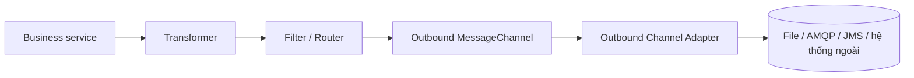
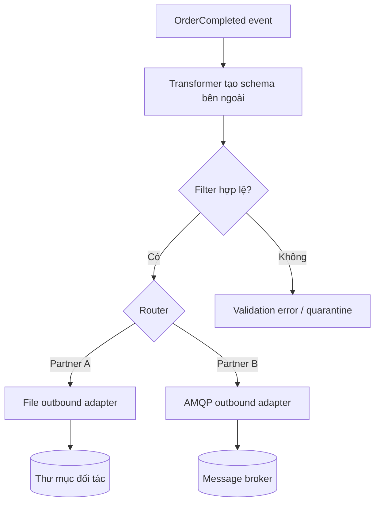
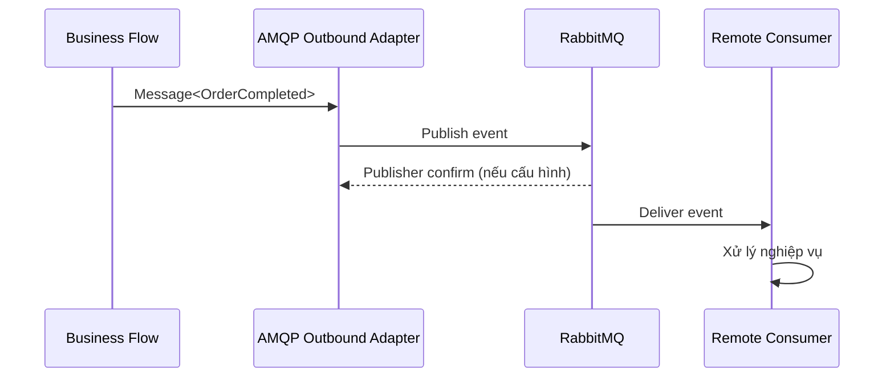
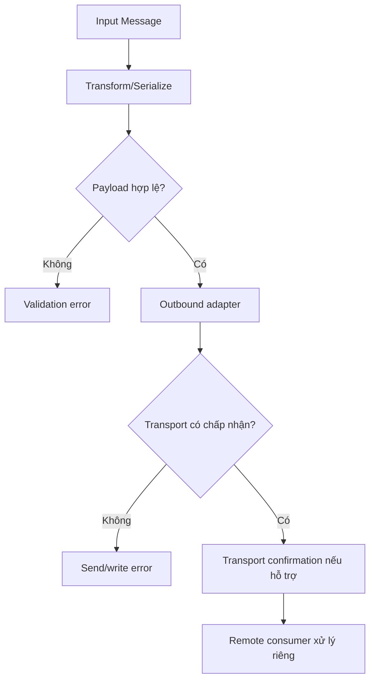
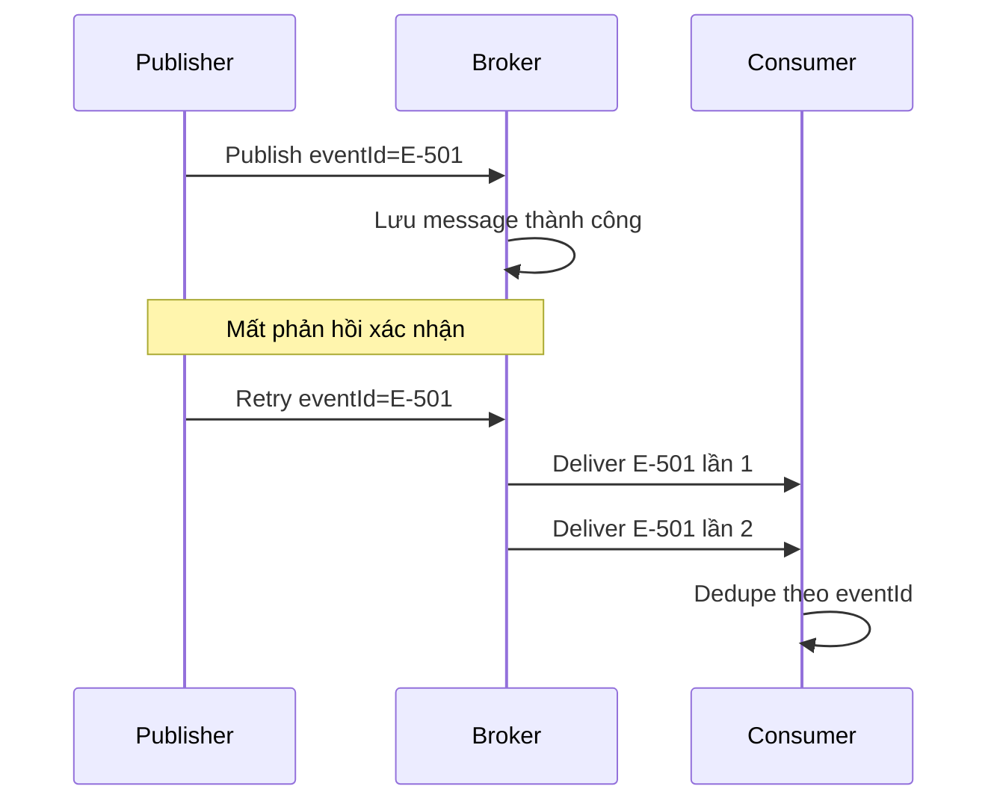
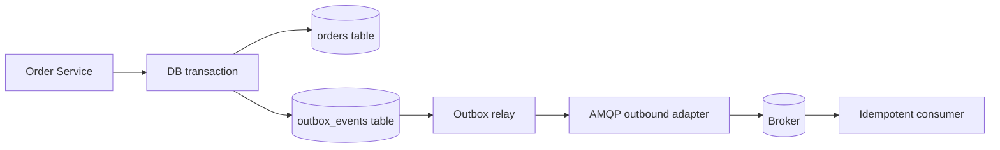

# Outbound channel adapter

Trong chương **Channel adapter** của module **SPRING_INTEGRATION_PATTERN**, chúng ta tìm hiểu cách đưa message từ luồng Spring Integration ra một hệ thống bên ngoài. Module tập trung triển khai các **Enterprise Integration Patterns** bằng Spring Integration để các thành phần xử lý ít phụ thuộc vào giao thức, có thể mở rộng qua Router, Filter, Transformer, Splitter, Aggregator, Gateway, retry, error channel và correlation. **Outbound channel adapter** là một endpoint nhận message từ `MessageChannel` bên trong và thực hiện thao tác **gửi hoặc ghi dữ liệu ra ngoài**, thường theo ngữ nghĩa một chiều (*one-way*).

Ví dụ: hệ thống xử lý đơn hàng đã xác nhận giao dịch, sau đó cần phát sự kiện `OrderCompleted` lên RabbitMQ, gửi bản ghi sang JMS hoặc xuất một tệp CSV cho đối tác. Trong cả ba trường hợp, logic nghiệp vụ nên tập trung tạo **thông điệp đúng hợp đồng**; outbound channel adapter phụ trách cách thông điệp được đưa đến hệ thống đích.

Sau bài học, bạn có thể:

- Phân biệt outbound channel adapter với inbound adapter, outbound gateway và Messaging Gateway.
- Ghép Transformer, Filter, Router, Service Activator và outbound adapter thành một flow có thể kiểm thử.
- Viết ví dụ Spring Integration Java DSL để **ghi file** và **publish message AMQP**.
- Nhận biết ranh giới giữa `MessageChannel.send()`, gửi thành công ở transport, broker publisher confirm và **xử lý nghiệp vụ ở hệ thống nhận**.
- Thiết kế retry, xử lý lỗi, idempotency, outbox, bảo mật và quan sát đối với luồng gửi một chiều.

## 1. Outbound channel adapter là gì?

Theo mô hình Enterprise Integration Patterns, **Channel Adapter** biến sự tương tác với một tài nguyên hay giao thức ngoài thành thao tác trên **Message Channel**. Đối với chiều outbound:



Một message trong ứng dụng có thể mang:

```text
Message<OrderCompleted>
  payload:
    OrderCompleted(orderId="O-501", completedAt=...)
  headers:
    id
    timestamp
    eventId
    correlationId (nếu có)
    contentType (nếu có)
```

Outbound adapter nhận message từ channel, chọn dữ liệu cần gửi và dùng một cơ chế vận chuyển phù hợp, chẳng hạn ghi file hoặc publish AMQP. Adapter **không có nghĩa vụ phải nhận phản hồi nghiệp vụ** từ phía đích tương ứng với từng message.

Điều này không ngăn adapter trả về lỗi **kỹ thuật** của thao tác gửi/ghi. Ví dụ ghi file không có quyền, broker mất kết nối hoặc serialization thất bại. Tuy nhiên, một thao tác publish thành công không chứng minh consumer phía sau đã cập nhật database.

### Ba ranh giới cần phân biệt

1. **Đưa vào channel nội bộ:** `channel.send(message)` có được hệ thống nhắn tin nội bộ chấp nhận không?
2. **Đưa ra transport:** adapter có ghi file hoặc chuyển message đến broker theo cơ chế được cấu hình không?
3. **Bên nhận hoàn thành nghiệp vụ:** consumer/đối tác đã xử lý thành công và commit thay đổi chưa?

Ba mốc này có thể khác thời điểm và cần cơ chế xác nhận khác nhau. Nếu quy trình bắt buộc biết mốc thứ ba, hãy thiết kế sự kiện kết quả, đối soát trạng thái hoặc request-reply riêng.

## 2. Phân biệt với các endpoint gần giống

| Thành phần | Hướng xử lý | Có reply nghiệp vụ cho từng request? | Ví dụ |
| --- | --- | --- | --- |
| **Inbound channel adapter** | Ngoài → message flow | Thông thường không | File inbound adapter đọc dữ liệu vào flow |
| **Outbound channel adapter** | Message flow → ngoài | Thông thường không | Ghi tệp kết quả, publish `OrderCompleted` |
| **Outbound gateway** | Flow → ngoài → flow | Có cơ chế request-reply | HTTP outbound gateway gọi API và nhận response |
| **Inbound gateway** | Ngoài → flow → ngoài | Có cơ chế request-reply | HTTP inbound gateway trả HTTP response |
| **Messaging Gateway** | Java method ↔ message flow | Tùy kiểu method và hợp đồng | `@MessagingGateway` chuyển lời gọi Java thành message |

Ví dụ, controller muốn **gửi email thông báo** và không chờ người nhận đọc email thì outbound adapter có thể phù hợp. Controller cần **tra cứu giá** từ dịch vụ ngoài và sử dụng kết quả ngay thì outbound gateway mới thể hiện đúng yêu cầu.

**Cẩn thận với từ “acknowledgement”.** Outbound adapter gửi thành công đến broker có thể gắn với publisher confirm; đó vẫn không phải response nghiệp vụ từ consumer. Một command gửi qua outbound adapter muốn biết kết quả phải có luồng reply với correlation hoặc kiến trúc xử lý bất đồng bộ khác.

## 3. Đặt adapter ở cuối flow và giữ handler độc lập với giao thức

Một thiết kế đơn giản:



Các bước có trách nhiệm riêng:

- **Service Activator:** quyết định rằng một tác vụ nghiệp vụ đã hoàn tất và có thể phát sự kiện.
- **Transformer:** tạo đúng payload/serializer cho hợp đồng ngoài. Đừng giả định một Java DTO có thể được gửi nguyên trạng sang mọi broker hay lưu thành file.
- **Filter:** chỉ cho phép dữ liệu hợp lệ hoặc có quyền được gửi. Nếu message sai phải được điều tra thì cấu hình discard/error flow rõ ràng; Filter mặc định bỏ message không tự chuyển vào DLQ.
- **Router:** lựa chọn adapter theo loại đích. Nếu cần gửi cho nhiều bên, dùng flow phù hợp với fan-out/multicast và định nghĩa kết quả khi chỉ một đích lỗi.
- **Outbound adapter:** thực hiện lời gọi/ghi transport. Luồng phía trước không cần biết chi tiết kết nối khi đã thống nhất hợp đồng message.

Nhờ cách này, chuyển đích xuất từ file sang broker thường chỉ làm thay đổi adapter và bước mapping bên ngoài. Nhưng **bảo đảm giao nhận, retry, thứ tự và transaction** của hai transport vẫn khác nhau, cần đánh giá lại khi thay.

## 4. Thực hành 1: File outbound channel adapter

Giả sử một ứng dụng cần xuất dữ liệu đã xử lý thành tệp CSV trong thư mục `data/outbox`. File outbound adapter nhận payload từ flow, chọn tên file và ghi ra file system.

### 4.1. Flow Java DSL

Ví dụ Java 17+, Spring Integration Core và Spring Integration File:

```java
package example.exports;

import java.io.File;

import org.springframework.context.annotation.Bean;
import org.springframework.context.annotation.Configuration;
import org.springframework.integration.annotation.IntegrationComponentScan;
import org.springframework.integration.config.EnableIntegration;
import org.springframework.integration.dsl.IntegrationFlow;
import org.springframework.integration.file.dsl.Files;
import org.springframework.integration.file.support.FileExistsMode;

@Configuration
@EnableIntegration
@IntegrationComponentScan
class CsvExportIntegrationConfig {

    @Bean
    IntegrationFlow csvExportFlow() {
        return IntegrationFlow.from("exports.csv")
            .handle(
                Files.outboundAdapter(new File("data/outbox"))
                    .autoCreateDirectory(true)
                    .fileNameGenerator(message ->
                        "export-" + message.getHeaders().getId() + ".csv")
                    .fileExistsMode(FileExistsMode.FAIL)
            )
            .get();
    }
}
```

Ý nghĩa:

1. Channel `exports.csv` nhận message do thành phần trước gửi.
2. `Files.outboundAdapter(...)` cấu hình endpoint ghi tệp.
3. `autoCreateDirectory(true)` cho phép tạo thư mục đích nếu cần.
4. `fileNameGenerator(...)` tạo tên tệp cho mỗi message; ví dụ dùng `MessageHeaders.ID` để tránh nhiều message ghi cùng một tên.
5. `FileExistsMode.FAIL` thể hiện chính sách **không ghi đè một tệp đã có**. Ứng dụng thực tế có thể chọn cơ chế ghi khác nếu hợp đồng yêu cầu.
6. Handler ở cuối flow là endpoint **một chiều**; không có DTO reply từ đối tác chỉ vì file đã được tạo.

**Ghi chú về khóa dữ liệu:** `MessageHeaders.ID` là định danh của message tại thời điểm tạo. Khi hệ thống retry bằng cách **tạo message mới**, ID có thể thay đổi. Nếu cần idempotency xuyên restart, nên dùng khóa nghiệp vụ bền vững như `exportId` làm tên file hoặc bản ghi trạng thái thay vì chỉ dựa vào ID message.

### 4.2. Gửi dữ liệu bằng Java interface

Nếu code nghiệp vụ muốn gọi một method thay vì tự tạo message, có thể đặt **Messaging Gateway** trước channel:

```java
package example.exports;

import org.springframework.integration.annotation.MessagingGateway;

@MessagingGateway(defaultRequestChannel = "exports.csv")
interface CsvExportGateway {

    void writeCsv(String csvContent);
}
```

Ở code gọi:

```java
String content = "orderId,total\nO-501,250000\n";
csvExportGateway.writeCsv(content);
```

`CsvExportGateway` là giao diện Java đưa payload vào message flow; **file outbound adapter** mới là thành phần thực hiện ghi file. Với đường đi đồng bộ như `DirectChannel`, exception từ file writing handler thường có thể lan về caller. Với channel bất đồng bộ, lời gọi method có thể hoàn tất trước khi file ghi xong.

Ví dụ dùng chuỗi CSV cố định cho dễ theo dõi. Ứng dụng thật phải escape dấu phẩy, dấu nháy, dòng mới và encoding đúng theo chuẩn CSV, tránh tự nối chuỗi dữ liệu đầu vào chưa được validate.

### 4.3. Tính toàn vẹn file và bàn giao cho bên nhận

Tệp có thể được nhìn thấy ngay khi đang ghi. Nếu đối tác bắt đầu đọc quá sớm, họ có thể nhận nội dung chưa hoàn tất. Thiết kế tin cậy thường cần:

- Quy định tên tệp tạm, ghi hoàn tất và **đổi tên/di chuyển** sang thư mục sẵn sàng theo khả năng của file system và cấu hình handler.
- Tạo tên/khóa xuất ổn định để tránh ghi lại không chủ đích.
- Kiểm tra quyền ghi, dung lượng đĩa, chính sách file tồn tại, encoding và kích thước.
- Lưu trạng thái nghiệp vụ của việc xuất; một tệp tồn tại không chứng minh đối tác đã nhập thành công.
- Nếu cần nhận kết quả từ đối tác, tạo inbound flow nhận file ACK hoặc một event trạng thái.

Không được giả định mọi file system/hệ điều hành hoặc giao thức chia sẻ mạng hỗ trợ rename nguyên tử theo cùng cách. Phải kiểm chứng chính sách bàn giao trên môi trường thực tế.

## 5. Thực hành 2: AMQP outbound adapter phát sự kiện

Trong kiến trúc sự kiện, một đơn hàng hoàn tất có thể phát thông báo `OrderCompleted` sang RabbitMQ để những dịch vụ khác tự xử lý.

### 5.1. Sự kiện và hợp đồng

Ví dụ schema độc lập với Java implementation:

```json
{
  "eventId": "order-completed-O-501-v1",
  "schemaVersion": 1,
  "eventType": "OrderCompleted",
  "payload": {
    "orderId": "O-501",
    "totalAmount": 250000,
    "currency": "VND"
  }
}
```

`eventId` được thiết kế ổn định cho **cùng sự kiện nghiệp vụ**; giúp consumer deduplicate nếu publisher gửi lại. `schemaVersion` mô tả hợp đồng được publish, không phải phiên bản Spring Integration.

### 5.2. Flow sử dụng RabbitTemplate

Ví dụ dưới đây minh họa Spring Integration AMQP Java DSL. Ứng dụng phải cung cấp `RabbitTemplate`/`ConnectionFactory` phù hợp; exchange và binding cần được khai báo riêng trên RabbitMQ.

```java
package example.events;

import org.springframework.amqp.rabbit.core.RabbitTemplate;
import org.springframework.context.annotation.Bean;
import org.springframework.context.annotation.Configuration;
import org.springframework.integration.amqp.dsl.Amqp;
import org.springframework.integration.config.EnableIntegration;
import org.springframework.integration.dsl.IntegrationFlow;

@Configuration
@EnableIntegration
class OrderEventPublisherConfig {

    @Bean
    IntegrationFlow publishOrderEvents(RabbitTemplate rabbitTemplate) {
        return IntegrationFlow.from("events.order.completed")
            .handle(Amqp.outboundAdapter(rabbitTemplate)
                .exchangeName("orders.events")
                .routingKey("order.completed"))
            .get();
    }
}
```

Luồng này:

1. Nhận message từ channel `events.order.completed`.
2. AMQP outbound adapter sử dụng `RabbitTemplate` để publish tới exchange `orders.events` với routing key `order.completed`.
3. RabbitMQ dựa vào binding để quyết định queue nào nhận message.
4. Consumer ở dịch vụ khác nhận event và xử lý theo chính sách riêng.

**Phụ thuộc quan trọng:** `RabbitTemplate` cần message converter được cấu hình tương thích với payload. Nếu producer muốn gửi JSON, hãy serialize thành một biểu diễn đã thống nhất hoặc cấu hình JSON converter phù hợp. Đừng giả định chỉ vì payload là Java `record` thì broker đã lưu đúng JSON.

AMQP outbound adapter không tự biết các consumer đã xử lý thành công hay không. Kể cả khi publish tới exchange thành công, một message không có binding phù hợp có thể **không được route tới queue** theo cấu hình RabbitMQ. Khi cần phát hiện trường hợp unroutable, xem cơ chế `mandatory`/returns và publisher confirms của Spring AMQP.

### 5.3. Outbound adapter khác outbound gateway



Không có mũi tên **reply nghiệp vụ** quay về Adapter ở sơ đồ này. Nếu request cần phản hồi từ remote consumer, nên dùng **AMQP outbound gateway** hoặc tự thiết kế return path/correlation/timeout.

## 6. Những loại outbound adapter phổ biến

| Đích | Endpoint outbound thường gặp | Payload và ranh giới cần chú ý |
| --- | --- | --- |
| **File system** | File outbound channel adapter | Nội dung file, filename, encoding, file tồn tại, atomic handoff |
| **RabbitMQ/AMQP** | AMQP outbound channel adapter | Exchange, routing key, converter, confirms/returns, độ bền của message |
| **JMS** | JMS outbound channel adapter | Destination, delivery mode, transaction, type mapping |
| **Kafka** | Kafka outbound producer/handler theo phiên bản module | Topic, key, partition, send result, ordering, callback |
| **MQTT** | MQTT outbound adapter | Topic, QoS, retained flag, reconnect/session |
| **Mail** | Mail outbound adapter | Recipient, subject/body, mail server và trạng thái giao nhận |
| **SFTP/FTP** | Outbound file transfer adapter | Kết nối, thư mục đích, ghi tạm, quyền và retry |
| **HTTP** | HTTP outbound channel adapter (khi dùng cho gửi một chiều) | HTTP status, request factory và chính sách xử lý response transport |

Tùy phiên bản Spring Integration, tên factory/spec API và khả năng xác nhận gửi của từng endpoint có thể khác nhau. Khi triển khai, dùng đúng module dependency, converter và cấu hình transport cho loại adapter được chọn.

## 7. Gửi một chiều không có nghĩa không phát sinh lỗi

Sự khác biệt quan trọng: **không trả reply nghiệp vụ** khác với **không kiểm tra kết quả gửi**.

Các bước có thể gặp lỗi:



| Giai đoạn | Ví dụ lỗi | Phản ứng phù hợp |
| --- | --- | --- |
| Trước adapter | JSON schema sai, thiếu `orderId` | Validate, chuyển đường lỗi dữ liệu, không gửi |
| Serialization | Converter không hỗ trợ kiểu payload | Sửa contract/converter, không retry nguyên message vô hạn |
| File writing | Không có quyền, đĩa đầy, tên file đã có | Báo lỗi, bảo toàn trạng thái để có thể thử lại |
| Broker publish | Mất kết nối, exchange không tồn tại | Retry có giới hạn, điều tra cấu hình |
| Broker routing | Không có binding/queue phù hợp | Dùng returns/monitoring để phát hiện theo cơ chế broker |
| Remote consumer | Consumer lỗi sau khi broker nhận event | Thuộc vòng đời consumer/redelivery; cần quan sát riêng |

Nếu code nghiệp vụ cần nhận biết “đã publish tới broker”, thiết kế publisher confirms và cách xử lý callback/timeout phù hợp. Nếu cần nhận biết “người nhận đã xử lý xong”, thiết kế **business outcome message** hoặc workflow trạng thái; publisher confirm không giải quyết yêu cầu này.

## 8. Channel topology quyết định thời điểm thấy lỗi

Khi gửi từ flow tới outbound adapter, loại channel giữa các bước ảnh hưởng trực tiếp tới lan truyền lỗi:

| Channel | Hành vi thường gặp | Hệ quả |
| --- | --- | --- |
| `DirectChannel` | Gọi handler đồng bộ trong thread sender | Exception từ adapter có thể lan về nơi gửi |
| `ExecutorChannel` | Đưa việc dispatch sang executor | Caller có thể hoàn tất trước khi adapter chạy; lỗi ở worker thread |
| `QueueChannel` | Đưa message vào queue nội bộ để consumer poll | `send()` có thể chỉ chứng minh đã vào queue; cần xét độ bền của queue |
| `PublishSubscribeChannel` | Phát đến nhiều subscriber | Một đích lỗi có thể tác động tới đích khác theo cấu hình executor/error handling |

Ví dụ:

```text
Business Service
  -> DirectChannel
  -> File outbound adapter
  -> (file được ghi đồng bộ hoặc exception có thể lan về caller)
```

So với:

```text
Business Service
  -> ExecutorChannel
  -> File outbound adapter
  -> (caller có thể hoàn tất khi file chưa được ghi)
```

Với flow bất đồng bộ, phải có **error channel** nhận lỗi, cơ chế retry/giám sát và chính sách khôi phục. Một queue trong bộ nhớ không mặc nhiên tồn tại sau restart.

**Đặc biệt:** nếu inbound adapter từ broker chuyển delivery vào channel bất đồng bộ rồi ACK trước khi outbound adapter thật sự hoàn tất, sự cố outbound có thể không còn kích hoạt redelivery từ broker đầu vào. Hệ thống cần xác định điểm chuyển giao bền vững hoặc thiết kế giao dịch/outbox phù hợp.

## 9. Retry, idempotency và thông điệp gửi trùng

Một lỗi mạng có thể xảy ra **sau khi broker đã nhận message nhưng trước khi producer nhận được xác nhận**. Lúc ấy publisher không chắc liệu lần gửi trước thành công hay thất bại. Gửi lại có thể tạo message trùng.



Thiết kế đúng thường gồm:

- **Khóa message nghiệp vụ ổn định** như `eventId` hoặc `commandId`. Retry cùng sự kiện phải giữ khóa đó.
- **Giới hạn retry**, backoff và phân loại lỗi tạm thời/vĩnh viễn.
- **Idempotency ở consumer:** cùng event ID không được tạo tác động nghiệp vụ hai lần.
- **Khả năng đối soát:** nếu không rõ publish thành công, đọc trạng thái outbox/broker hoặc dùng quy trình khôi phục thay vì giả định.
- **Cẩn trọng với lệnh có tác dụng phụ:** nếu gửi command đặt hàng/thanh toán, cần idempotency ở phía xử lý và không coi ACK transport là hoàn tất lệnh.

### Khi nào dùng RequestHandlerRetryAdvice?

Spring Integration hỗ trợ gắn retry advice cho endpoint/handler thích hợp. Retry có thể hữu ích với lỗi network ngắn, nhưng phải đặt:

- Số lần thử tối đa, backoff và deadline.
- Bộ phân loại exception; lỗi sai schema không nên retry y nguyên.
- Recovery sau khi hết retry: lỗi về caller, đưa DLQ/quarantine hoặc ghi outbox trạng thái lỗi.
- Idempotency: adapter có thể gửi thành công rồi client vẫn nhận lỗi do mất kết nối.

Không thể chỉ bật retry rồi kết luận các message không mất hoặc không bị gửi hai lần.

## 10. Outbox pattern để phát sự kiện sau khi giao dịch DB hoàn tất

Một bài toán thường gặp:

1. Service cập nhật trạng thái đơn hàng trong DB.
2. Service publish `OrderCompleted` qua outbound adapter.
3. Nếu ứng dụng crash giữa hai bước, database đã commit nhưng sự kiện chưa đến broker.

Vì database và broker có thể không cùng một giao dịch phân tán, cách thiết kế phổ biến là **Transactional Outbox**:



**Trong cùng transaction DB**, lưu thay đổi nghiệp vụ và bản ghi outbox. Một relay nền đọc các bản ghi chưa gửi, đưa message sang adapter, đánh dấu trạng thái dựa trên bảo đảm publish thích hợp và thử lại khi lỗi. Cách này làm cho sự kiện có thể khôi phục sau crash, nhưng **relay vẫn có thể publish trùng**, nên consumer cần idempotent.

Ví dụ bảng outbox mang những thông tin tối thiểu:

```sql
CREATE TABLE outbox_events (
    event_id VARCHAR(100) PRIMARY KEY,
    event_type VARCHAR(100) NOT NULL,
    payload_json TEXT NOT NULL,
    status VARCHAR(30) NOT NULL,
    created_at TIMESTAMP NOT NULL DEFAULT CURRENT_TIMESTAMP
);
```

Một bản ghi outbox có thể mang:

```json
{
  "eventId": "order-completed-O-501-v1",
  "eventType": "OrderCompleted",
  "payloadJson": "{...}",
  "status": "PENDING"
}
```

Để relay hoạt động trong sản xuất còn cần cách claim/lock bản ghi khi nhiều instance chạy, giới hạn retry, xử lý poison event và cơ chế đánh dấu đã publish sau khi có tín hiệu phù hợp. Việc đánh dấu `SENT` trước khi broker nhận chắc chắn có thể gây mất message; đánh dấu sau khi broker nhận có thể để lại message trùng nếu crash trước khi cập nhật DB.

Outbox giúp quản lý **atomicity giữa trạng thái nghiệp vụ và ý định phát sự kiện**, nhưng không tự biến toàn bộ đường truyền thành exactly-once.

## 11. Gửi tới nhiều đích và xử lý một phần thành công

Giả sử một sự kiện phải xuất tệp cho đối tác A và publish RabbitMQ cho đối tác B.

```text
Message<OrderCompleted>
    |
    +--> File outbound adapter ------> Partner A
    |
    +--> AMQP outbound adapter ------> Partner B
```

Nếu ghi file thành công nhưng publish broker lỗi, không thể tự động rollback file chỉ bằng exception của flow. Các lựa chọn cần cân nhắc:

- **Fan-out với trạng thái từng đích:** lưu `eventId` cùng kết quả gửi tới A, B; retry riêng đích thất bại.
- **Nhiều subscriber qua PublishSubscribeChannel:** hữu ích cho kết nối thành phần nhưng phải hiểu hành vi exception và thứ tự dispatch.
- **Outbox theo destination:** mỗi đích có trạng thái gửi và retry riêng.
- **Saga/compensation:** khi cần hoàn tác thay đổi nghiệp vụ đã gây ra ở hệ thống ngoài, dùng hành động bù trừ theo hợp đồng.

Không đặt kỳ vọng tất cả outbound adapter cùng tham gia một transaction nguyên tử nếu chúng ghi ra các hệ thống độc lập.

## 12. Headers, serialization, schema và an toàn

Payload Java bên trong thường không phải định dạng giao tiếp ngoài. Cần quy định contract tại **ranh giới adapter**:

| Khía cạnh | Câu hỏi thiết kế |
| --- | --- |
| **Payload** | Gửi text, byte[], JSON, CSV, Avro hay định dạng nào? |
| **Schema/version** | Có `schemaVersion` và chính sách tương thích hai bên không? |
| **Content type/encoding** | Phía nhận biết parse như thế nào? Có dùng UTF-8 không? |
| **Routing key/filename/topic** | Dựa vào config hay dữ liệu nào, có cần giới hạn giá trị? |
| **Correlation và event ID** | Phía nhận nhận diện cùng một nghiệp vụ qua retry bằng khóa nào? |
| **Header mapping** | Header nội bộ nào được phép đưa ra transport? |
| **Bảo mật** | Credential, TLS, ACL, file permission và dữ liệu nhạy cảm được bảo vệ ra sao? |
| **Giới hạn tải** | Kích thước message/file, throughput, timeout, rate limit? |

Ví dụ header nội bộ `replyChannel` có thể chứa đối tượng `MessageChannel` của JVM, không phải địa chỉ phản hồi dùng được tại hệ thống ngoài. Đừng serialize nguyên bộ `MessageHeaders` và gửi ra broker/HTTP. Chỉ ánh xạ trường được hợp đồng cho phép.

**Định tuyến không dựa trên URL hoặc đường dẫn tùy ý từ payload chưa xác thực.** Nếu message đưa vào adapter có thể quyết định đường file/topic/recipient, cần validate, giới hạn danh sách đích hợp lệ và tránh path traversal/SSRF.

Với file CSV, cần quan tâm encoding, escape ký tự phân cách và cách xử lý giá trị đầu dòng có thể bị chương trình spreadsheet hiểu như công thức khi mở file. Với JSON, cần xác thực trường bắt buộc và kiểu số, không coi converter chạy thành công là bảo đảm hợp đồng nghiệp vụ đúng.

## 13. Quan sát outbound adapter và xác nhận kết quả

Một dòng log “message sent” chưa đủ để biết thành công ở mốc nào. Nên thu thập các tín hiệu:

| Chỉ số / log | Mục đích |
| --- | --- |
| Số message vào channel outbound | Biết có message từ nghiệp vụ vào flow |
| Số message đã serialize/validate | Phân biệt lỗi payload với lỗi transport |
| Send attempt, success, failure | Đo kết quả kỹ thuật của adapter |
| Publisher confirms / returns (nếu hỗ trợ) | Phân biệt broker chấp nhận và message không route |
| File creation/size/rename errors | Quan sát bàn giao file |
| Retry count, retry exhausted | Phát hiện đích đang lỗi hoặc retry storm |
| Outbox backlog và tuổi bản ghi cũ nhất | Biết sự kiện có bị kẹt trước khi publish |
| Consumer processing result (nếu có) | Quan sát tác động nghiệp vụ cuối cùng qua kênh kết quả riêng |
| `eventId`, `correlationId`, trace ID | Ghép các lần gửi và hệ thống liên quan |

Một log minh họa:

```text
eventId=order-completed-O-501-v1
adapter=amqp-outbound
destination=orders.events/order.completed
stage=publish
outcome=ACCEPTED_BY_BROKER
attempt=2
```

Chỉ ghi `ACCEPTED_BY_BROKER` khi có tín hiệu phù hợp từ broker; khi `RabbitTemplate` chỉ hoàn tất lời gọi gửi, log một trạng thái chính xác hơn như `SEND_RETURNED` nếu publisher confirms chưa được quan sát. Không log access token, thông tin thanh toán hoặc toàn bộ payload chỉ để theo dõi việc gửi.

## 14. Kiểm thử outbound adapter

Kiểm thử nên được chia thành ba lớp:

1. **Unit test** của Transformer/Router/validator: đảm bảo payload và đích đúng, không cần broker/file system.
2. **Integration test adapter:** đảm bảo file thực sự được ghi hoặc broker nhận đúng exchange/routing key/schema.
3. **End-to-end test:** consumer/đối tác nhận và xử lý theo hợp đồng, bao gồm tác động nghiệp vụ và retry.

| Kịch bản | Cách kiểm thử | Kết quả kỳ vọng |
| --- | --- | --- |
| File outbound hợp lệ | Gửi CSV tới channel `exports.csv` và dùng thư mục tạm | File có tên và nội dung đúng, encoding đúng |
| File tồn tại | Gửi hai message cùng filename với mode FAIL | Lần ghi thứ hai báo lỗi theo chính sách |
| Không có quyền ghi | Dùng thư mục không ghi được | Exception/error flow được ghi nhận |
| AMQP publish thành công | Broker thử nghiệm có exchange/binding | Message đến đúng queue với schema/headers hợp lệ |
| Không có binding | Broker chấp nhận exchange nhưng không route | Phát hiện qua returns/monitoring khi cấu hình hỗ trợ |
| Broker mất kết nối | Ngắt kết nối trước/trong publish | Retry có giới hạn, lỗi được báo và có recovery |
| Publish trùng | Retry cùng `eventId` | Consumer chỉ tạo tác động nghiệp vụ một lần |
| Schema sai | Thiếu trường bắt buộc | Không publish, chuyển đúng nhánh lỗi |
| Channel bất đồng bộ | Chèn `ExecutorChannel` | Caller không bị hiểu nhầm là đã ghi/publish hoàn tất |
| Fan-out một đích lỗi | File thành công nhưng broker thất bại | Trạng thái từng đích rõ, retry chỉ đích cần gửi lại |
| Crash giữa DB commit và publish | Khởi động lại relay sau lỗi | Outbox phục hồi và không mất ý định phát event |
| Crash sau publish trước `SENT` | Relay khởi động lại | Có thể gửi trùng nhưng consumer idempotent |

### Kịch bản mẫu cho integration test

```text
Given:
  exchange orders.events và queue thử nghiệm có binding order.completed
  eventId = "order-completed-O-501-v1"
  outbound flow gửi JSON qua AMQP
When:
  ứng dụng publish event
Then:
  broker nhận message với routing key order.completed
  payload parse được theo schema đã thỏa thuận
  eventId giữ nguyên từ flow đến consumer
  consumer áp dụng nghiệp vụ đúng một lần dù publish lại cùng eventId
```

Với file system, có thể dùng thư mục tạm, gửi message qua channel rồi đợi điều kiện quan sát được. Với RabbitMQ, dùng broker thử nghiệm/isolated topology để xác nhận exchange, binding và publisher confirm theo chính sách. Tránh chỉ unit test method `RabbitTemplate.convertAndSend(...)` đã bị mock rồi kết luận toàn bộ việc routing/giao nhận đều đúng.

## 15. Các lỗi thiết kế thường gặp

**Dùng outbound channel adapter khi caller cần kết quả đồng bộ.** Nếu cần tính toán từ remote service và trả DTO cho request hiện tại, hãy dùng outbound gateway hoặc workflow reply rõ ràng.

**Cho rằng gửi vào `MessageChannel` là đã gửi đến bên ngoài.** Với channel bất đồng bộ, `send()` có thể hoàn tất khi message mới được xếp vào executor/queue trong JVM.

**Đánh đồng publisher confirm với xử lý nghiệp vụ hoàn tất.** Broker xác nhận publish không nói consumer đã commit DB.

**Không có schema/serializer rõ ràng.** Cùng một Java object có thể trở thành bytes, text hoặc dạng serialize khác khi qua adapter/converter; cần contract và test với dữ liệu thật.

**Gửi lại không giữ event ID.** Nếu retry sinh UUID mới, consumer khó phát hiện message trùng, có thể tạo tác động lặp.

**Chỉ lưu DB rồi publish mà không có recovery.** Crash giữa commit và publish làm thiếu event; outbox hoặc cơ chế khôi phục tương đương cần được thiết kế.

**Ghi file trực tiếp vào thư mục đối tác đang quét.** Bên nhận có thể đọc tệp chưa hoàn tất; cần quy ước staging/handoff.

**Không kiểm soát fan-out.** Một trong hai outbound adapter lỗi để lại trạng thái gửi không đồng nhất; cần theo dõi kết quả từng destination.

**Retry mọi lỗi vô hạn.** Sai schema, path không hợp lệ hoặc broker exchange sai tên sẽ tiếp tục lỗi; phân loại lỗi và giới hạn retry.

**Không quan sát ranh giới ack/confirmation.** Khi sự cố xuất hiện, không phân biệt được đã vào channel, đã publish, đã route hay đã được consumer xử lý.

## 16. Checklist triển khai outbound channel adapter

1. Xác nhận nghiệp vụ chỉ cần **gửi một chiều** hay cần request-reply.
2. Chọn transport và adapter phù hợp: file, AMQP, JMS, SFTP, MQTT hoặc hệ khác.
3. Khai báo channel inbound của outbound adapter và các Transformer/Router/Filter cần thiết.
4. Chuẩn hóa payload, schema version, content type, encoding và routing/filename.
5. Thiết kế retry có giới hạn, phân loại lỗi, error channel và cách khôi phục khi adapter thất bại.
6. Xác định thời điểm hoàn tất: vào channel, gửi transport, publisher confirm hay tác động nghiệp vụ từ remote.
7. Đảm bảo idempotency key bền vững qua retry và crash.
8. Khi publish sau giao dịch DB, cân nhắc outbox hoặc phương án bảo đảm không mất ý định phát message.
9. Kiểm soát channel bất đồng bộ, queue độ bền, backpressure và các thao tác gửi chậm.
10. Nếu gửi tới nhiều đích, có trạng thái gửi và retry riêng từng đích.
11. Thêm metrics/log theo `eventId`, endpoint, attempt, lỗi và backlog.
12. Kiểm thử file/broker thật, duplicate, mất kết nối, lỗi schema, fan-out một phần và restart.

## Kết luận

**Outbound channel adapter** đưa thông điệp từ **message flow của Spring Integration** ra một hệ thống bên ngoài và là thành phần phù hợp khi luồng cần **ghi hoặc gửi một chiều**. Nó cho phép code nghiệp vụ được tách khỏi File, AMQP, JMS và các giao thức khác, trong khi Transformer, Router, Filter và Service Activator vẫn xử lý dữ liệu theo các Enterprise Integration Patterns. Để việc gửi thật sự đáng tin cậy, cần xác định hợp đồng dữ liệu, phân biệt kết quả ở channel/transport/consumer, kiểm soát retry và lỗi, thiết kế idempotency cùng outbox khi cần và kiểm thử cả đường gửi lẫn tác động bên nhận.
