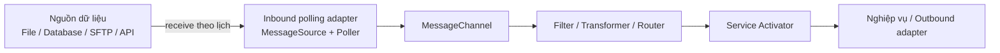

# Polling adapter và lịch đọc trong Spring Integration

## Mục tiêu bài học

Sau bài này, bạn có thể:

- Giải thích **polling channel adapter** là gì, khi nào cần chủ động đọc dữ liệu thay vì chờ hệ thống ngoài đẩy thông điệp.
- Phân biệt **inbound polling adapter**, **polling consumer** trên `PollableChannel` và **event-driven inbound adapter**.
- Chọn lịch đọc `fixedDelay`, `fixedRate` hoặc `cron`; hiểu tác dụng của `initialDelay` và `maxMessagesPerPoll`.
- Xây dựng một luồng Spring Integration đọc dữ liệu định kỳ bằng `MessageSource`, `@InboundChannelAdapter`, `@Poller` và `@ServiceActivator`.
- Cấu hình lịch đọc file bằng Java DSL, đồng thời nhận biết những khác biệt khi polling database, SFTP hoặc API.
- Thiết kế kiểm soát tải, xử lý lỗi, retry, chống đọc trùng và theo dõi tiến độ polling.

Trong mô-đun **SPRING_INTEGRATION_PATTERN**, chúng ta thực hành *Enterprise Integration Patterns* bằng Spring Integration để xây dựng các luồng thông điệp ít phụ thuộc, dễ mở rộng. Chủ đề **Channel adapter** tập trung vào cách kết nối thế giới bên ngoài với `MessageChannel`. Polling adapter đặc biệt hữu ích khi nguồn dữ liệu không có khả năng push sự kiện hoặc khi ứng dụng cần kiểm soát tần suất và số lượng bản ghi được đọc. Sau khi vào hệ thống, message vẫn có thể đi qua Filter, Transformer, Router, Splitter, Aggregator, Gateway, retry và error channel.

## 1. Polling adapter giải quyết vấn đề gì?

Giả sử một hệ thống kế toán cứ vài phút xuất file CSV vào một thư mục, hoặc một bảng `outbox_events` lưu các sự kiện đang chờ gửi. Nguồn này không gọi trực tiếp API của ứng dụng tiêu thụ. Muốn xử lý bản ghi mới, ứng dụng phải **chủ động kiểm tra nguồn theo lịch**:



**Inbound polling adapter** kết hợp hai trách nhiệm:

1. **Message source** biết cách lấy phần tử tiếp theo từ nguồn, thường qua `MessageSource.receive()`. Khi chưa có dữ liệu, nó có thể trả `null`.
2. **Poller** quyết định *khi nào* gọi source và *mỗi lượt* được lấy tối đa bao nhiêu message; sau đó chuyển message đến channel đầu vào.

Lịch polling không đồng nghĩa với việc dữ liệu mới chắc chắn xuất hiện đúng lúc. Nếu poller chạy mỗi 10 giây mà nguồn chưa có dữ liệu, lần đọc đó có thể không phát message nào. Nếu một lần đọc quá chậm, lịch thực tế cũng có thể chậm theo.

### 1.1. So sánh với event-driven adapter

| Đặc điểm | Polling inbound adapter | Event-driven inbound adapter |
| --- | --- | --- |
| Ai khởi xướng nhận dữ liệu? | Ứng dụng chủ động gọi `receive()` theo lịch | Hệ thống ngoài/callback/listener đẩy thông điệp đến |
| Ví dụ | Thư mục file, bảng JDBC, nguồn FTP/SFTP quét định kỳ | HTTP webhook, listener RabbitMQ/JMS, TCP receiver |
| Khi không có dữ liệu | Một lượt poll có thể trả `null` | Không có callback mới để xử lý |
| Độ trễ phát hiện | Phụ thuộc chu kỳ poll và thời gian xử lý | Phụ thuộc cơ chế phát/nhận của nguồn |
| Tải lên nguồn | Có thể có truy vấn vô ích khi nguồn rỗng | Phụ thuộc tốc độ sự kiện đến và cơ chế backpressure |
| Chịu lỗi và đọc trùng | Cần state/cursor, ack hoặc bộ lọc đã xử lý | Vẫn cần cơ chế ack, retry, idempotency theo transport |

Polling là một cách **thu nhận message**, không quyết định nghiệp vụ phía sau phải đồng bộ hay bất đồng bộ. Adapter có thể gửi message vào `DirectChannel` để xử lý ngay, vào `ExecutorChannel` để chuyển cho worker, hoặc vào một luồng có broker.

## 2. Poller được sử dụng ở đâu trong Spring Integration?

Spring Integration có hai vị trí polling rất dễ nhầm:

| Tình huống | Thành phần thực hiện | Ý nghĩa |
| --- | --- | --- |
| Đọc dữ liệu từ nguồn ngoài | `SourcePollingChannelAdapter` cùng `MessageSource` | Mỗi nhịp poll gọi source, lấy message rồi gửi tới output channel |
| Đọc message đã nằm trong kênh có thể poll | `PollingConsumer` cùng `PollableChannel` (ví dụ `QueueChannel`) | Mỗi nhịp poll lấy message từ channel rồi gọi handler |
| Nhận message từ kênh push | `EventDrivenConsumer` cùng `SubscribableChannel` (ví dụ `DirectChannel`) | Handler được gọi khi message được gửi, không cần lịch poll của consumer |

Ví dụ, đặt một `ServiceActivator` sau `DirectChannel` **không cần tự tạo poller thứ hai**, vì lịch đọc đã nằm ở inbound adapter. Nếu adapter gửi vào `QueueChannel` và handler được nối bằng polling consumer, khi đó có **hai nhịp điều phối**: nhịp lấy từ nguồn ngoài và nhịp lấy từ queue. Cần hiểu rõ độ trễ/tải của từng lớp trước khi thêm một poller nữa.

Luồng cơ bản được minh họa:

```text
TaskScheduler
    | mỗi 2 giây (fixedDelay, thời gian thực tế phụ thuộc lượt chạy)
    v
SourcePollingChannelAdapter
    | gọi MessageSource.receive()
    | -- null --> kết thúc lượt vì không có message
    | -- Message<PendingOrder> --> pendingOrders (DirectChannel)
                                     |
                                     v
                               Service Activator
                                     |
                                     v
                               Xử lý nghiệp vụ
```

`TaskScheduler` lập lịch cho poller. Nếu handler nằm sau `DirectChannel` và chạy lâu, thời gian xử lý cũng tiêu tốn thời gian của lượt polling, vì send/handle có thể diễn ra đồng bộ trong luồng poller.

## 3. Chọn lịch đọc: fixed delay, fixed rate hay cron?

Ba chiến lược phổ biến:

| Cấu hình | Cách hiểu | Dùng khi nào | Cẩn trọng |
| --- | --- | --- | --- |
| `fixedDelay = "2000"` | Đợi khoảng 2 giây **sau khi lượt chạy trước kết thúc** rồi chạy lượt tiếp | Nguồn đọc đều, muốn tránh truy vấn dồn dập khi một lượt lâu | Chu kỳ giữa hai lần bắt đầu sẽ lớn hơn 2 giây nếu việc xử lý mất thời gian |
| `fixedRate = "2000"` | Nhắm tới thời điểm khởi chạy định kỳ mỗi 2 giây | Cần nhịp gần cố định, thời gian poll dự đoán được | Nếu scheduler quá tải, lượt chạy vẫn có thể trễ; không mặc nhiên bảo đảm song song |
| `cron = "0 */5 * * * *"` | Vào giây 0 của mỗi phút chia hết cho 5 | Công việc theo đồng hồ: kiểm tra mỗi 5 phút, lịch giờ hành chính | Múi giờ, DST, lịch trùng giờ và việc ứng dụng ngừng chạy |

**Fixed delay** phù hợp mặc định cho nhiều inbound polling adapter vì một lượt xử lý chậm sẽ đẩy lùi lượt tiếp, giảm nguy cơ nguồn bị hỏi liên tục. **Fixed rate** phù hợp khi có yêu cầu nhịp kiểm tra đều và đã kiểm soát thời gian thực thi. **Cron** thích hợp nếu bài toán nói “8 giờ sáng các ngày làm việc” hoặc “mỗi 5 phút theo giờ của hệ thống”.

Spring cron thường dùng **sáu trường**: `giây phút giờ ngày-tháng tháng ngày-tuần`. Ví dụ:

```text
0 */5 * * * *       # Mỗi 5 phút, tại giây 0
0 0 8 * * MON-FRI  # 08:00 từ thứ Hai tới thứ Sáu
0 15 1 * * *       # 01:15 hằng ngày
```

Khi dùng cron, giờ tính toán phụ thuộc timezone của scheduler/trigger. Nếu nghiệp vụ yêu cầu giờ Việt Nam, phải cấu hình scheduler hoặc `CronTrigger` với `Asia/Ho_Chi_Minh` một cách tường minh; tránh dựa vào timezone mặc định của máy chủ. Với lịch chạy ở khu vực có đổi giờ mùa hè, xác định chính sách cho mốc bị lặp hoặc bị bỏ qua. Nếu tiến trình ngừng vào thời điểm cron kích hoạt, một poller thông thường **không tự chạy bù tất cả lịch đã lỡ**; nguồn dữ liệu hoặc trạng thái công việc phải cho phép đọc bù.

### 3.1. `initialDelay` và `maxMessagesPerPoll`

- `initialDelay` đặt thời gian trì hoãn trước lượt poll đầu tiên với lịch hỗ trợ tham số này.
- `maxMessagesPerPoll` giới hạn **số lần nhận được message** trong một lượt polling (hoặc số lần lấy từ source theo cấu hình), không phải số hàng nằm bên trong payload của **một message**.
- Nếu `MessageSource.receive()` trả `null`, lượt polling thường dừng sớm vì không còn message khả dụng.
- Đặt giới hạn hợp lý giúp poller nhường thời gian cho các tác vụ khác; không để một nguồn liên tục có dữ liệu chiếm tài nguyên bằng vòng đọc quá dài.

**Ví dụ ước lượng:** với `fixedDelay = 2.000 ms` và `maxMessagesPerPoll = 5`, một lượt nhiều nhất phát 5 message. Nếu thời gian xử lý coi như bằng 0 và luôn có đủ dữ liệu, tốc độ lý thuyết khoảng **2,5 message/giây**. Nếu xử lý 5 message mất thêm 1 giây, mỗi chu kỳ từ lúc bắt đầu lượt này đến lượt sau dài khoảng 3 giây, nên thông lượng thực tế thấp hơn. Một `Message<List<Row>>` có 100 hàng vẫn là **một** message đối với giới hạn này.

## 4. Ví dụ 1: Inbound polling adapter đọc hàng đợi dữ liệu giả lập

Để học cơ chế mà không cần broker hoặc database, ta dùng một hàng đợi trong bộ nhớ đóng vai trò nguồn dữ liệu. Ví dụ dành cho **Java 17+, Spring Boot 3.x, Spring Integration 6.x** với dependency Spring Integration tương ứng. Các `public` type nằm trong các file Java riêng trong cùng package, dưới phạm vi component scan của Spring Boot.

Hàng đợi trong bộ nhớ được dùng **chỉ để học**: lấy phần tử bằng `poll()` là loại nó khỏi bộ nhớ; nếu handler thất bại hoặc ứng dụng restart, phần tử có thể mất. Phần sau sẽ trình bày những điều cần thay đổi ở hệ thống thật.

### 4.1. Định nghĩa dữ liệu

```java
// PendingOrder.java
import java.time.Instant;

public record PendingOrder(
        String orderId,
        Instant createdAt
) {}
```

### 4.2. Khai báo source, lịch đọc và input channel

```java
// OrderPollingConfiguration.java
import java.util.Queue;
import java.util.concurrent.ConcurrentLinkedQueue;

import org.springframework.context.annotation.Bean;
import org.springframework.context.annotation.Configuration;
import org.springframework.integration.annotation.InboundChannelAdapter;
import org.springframework.integration.annotation.Poller;
import org.springframework.integration.channel.DirectChannel;
import org.springframework.integration.config.EnableIntegration;
import org.springframework.integration.core.MessageSource;
import org.springframework.messaging.MessageChannel;
import org.springframework.messaging.support.MessageBuilder;

@Configuration
@EnableIntegration
public class OrderPollingConfiguration {
    private final Queue<PendingOrder> pending =
            new ConcurrentLinkedQueue<>();

    public void enqueue(PendingOrder order) {
        pending.add(order);
    }

    @Bean
    public MessageChannel pendingOrders() {
        return new DirectChannel();
    }

    @Bean
    @InboundChannelAdapter(
        channel = "pendingOrders",
        poller = @Poller(
            initialDelay = "500",
            fixedDelay = "2000",
            maxMessagesPerPoll = "5"
        )
    )
    public MessageSource<PendingOrder> orderMessageSource() {
        return () -> {
            PendingOrder order = pending.poll();
            return order == null
                    ? null
                    : MessageBuilder.withPayload(order).build();
        };
    }
}
```

Các thành phần hoạt động như sau:

1. Spring tạo bean `orderMessageSource` dưới dạng `MessageSource<PendingOrder>` và inbound endpoint thông qua `@InboundChannelAdapter`.
2. Poller chờ lần đầu 500 ms, rồi lấy tối đa 5 message mỗi lượt, sử dụng fixed delay 2.000 ms giữa các lượt.
3. Mỗi lần `receive()` trả một `Message<PendingOrder>`, endpoint gửi nó tới `pendingOrders`.
4. Khi hàng đợi rỗng, `receive()` trả `null`; poller dừng lượt hiện tại rồi chờ lịch tiếp theo.

Điểm dễ sai: một phương thức đánh dấu `@InboundChannelAdapter` trong ví dụ này **trả về `MessageSource`** để Spring Integration chủ động gọi `receive()` theo lịch. Không nhầm nó với `@ServiceActivator`, là endpoint **xử lý message đã được gửi vào channel**.

### 4.3. Xử lý message qua Service Activator

```java
// OrderPollingHandler.java
import java.util.Queue;
import java.util.concurrent.ConcurrentLinkedQueue;

import org.springframework.integration.annotation.ServiceActivator;
import org.springframework.stereotype.Component;

@Component
public class OrderPollingHandler {
    private final Queue<String> processedIds =
            new ConcurrentLinkedQueue<>();

    @ServiceActivator(inputChannel = "pendingOrders")
    public void handle(PendingOrder order) {
        // Minh họa: thực tế thay bằng nghiệp vụ có idempotency.
        processedIds.add(order.orderId());
    }

    public boolean wasHandled(String orderId) {
        return processedIds.contains(orderId);
    }
}
```

Handler này không trả reply vì luồng được thiết kế **one-way**. Khi adapter đọc và gửi thành công, logic xử lý diễn ra trên thread của luồng polling vì `DirectChannel` gọi subscriber đồng bộ. Với tác vụ I/O nặng, cần tính thời gian xử lý và concurrency, thay vì mặc định polling một source là bất đồng bộ.

### 4.4. Điều khiển lịch bằng cấu hình

Một hệ thống thật thường cần đổi lịch mà không biên dịch lại. Chẳng hạn thay annotation poller trong ví dụ bằng:

```java
@InboundChannelAdapter(
    channel = "pendingOrders",
    poller = @Poller(
        fixedDelay = "${orders.poll.delay-ms:2000}",
        maxMessagesPerPoll = "${orders.poll.batch-size:5}"
    )
)
```

Khi đó thuộc tính như `orders.poll.delay-ms` có thể được cấp từ cấu hình ứng dụng. Đoạn trên là **phần annotation thay thế**, không phải khai báo thêm một adapter thứ hai; nếu đồng thời có hai adapter đọc cùng nguồn, bạn có thể vô tình tạo ra hai lượt đọc tranh chấp.

Thay lịch fixed delay bằng cron (chọn **một** cấu hình cho một endpoint):

```java
@InboundChannelAdapter(
    channel = "pendingOrders",
    poller = @Poller(
        cron = "0 */5 * * * *",
        maxMessagesPerPoll = "20"
    )
)
```

Với cấu hình này, poller thực hiện một lượt đọc vào các mốc 5 phút. `maxMessagesPerPoll=20` không có nghĩa nguồn sẽ được quét liên tục trong cả 5 phút; nó giới hạn số message nhận trong **một lượt**.

## 5. Ví dụ 2: Polling thư mục CSV bằng Java DSL

Một tình huống thực tế hơn là ứng dụng mỗi 10 giây quét thư mục chứa file CSV. Spring Integration cung cấp inbound file adapter để kết nối hệ thống file với message flow.

```java
// CsvPollingFlowConfiguration.java
import java.io.File;
import java.time.Duration;

import org.springframework.context.annotation.Bean;
import org.springframework.context.annotation.Configuration;
import org.springframework.integration.dsl.IntegrationFlow;
import org.springframework.integration.dsl.Pollers;
import org.springframework.integration.file.dsl.Files;

@Configuration
public class CsvPollingFlowConfiguration {

    @Bean
    public IntegrationFlow csvPollingFlow() {
        return IntegrationFlow.from(
                Files.inboundAdapter(new File("./incoming"))
                    .autoCreateDirectory(true)
                    .patternFilter("*.csv"),
                endpoint -> endpoint.poller(
                    Pollers.fixedDelay(Duration.ofSeconds(10))
                        .maxMessagesPerPoll(10)
                )
            )
            .handle(File.class, (file, headers) -> {
                // Minh họa adapter phát File, không tự parse CSV.
                System.out.println("Detected: " + file.getName());
                return null;
            })
            .get();
    }
}
```

**Phân tích luồng:**

- `Files.inboundAdapter(...)` tạo một file message source. Payload phổ biến ở ví dụ này là `java.io.File`.
- `patternFilter("*.csv")` lọc tên file; nó không xác minh file đã ghi xong hay nội dung hợp lệ.
- `Pollers.fixedDelay(Duration.ofSeconds(10))` đặt nhịp quét.
- `maxMessagesPerPoll(10)` giới hạn 10 message/file được phát trong một lượt nếu nguồn có đủ file.
- `handle(File.class, ...)` nhận `File`. Logic production phải tự mở, kiểm tra, parse, xử lý và ghi nhận trạng thái.

Đoạn mã chỉ phát hiện tên file để tập trung vào polling. **Không dùng việc in ra tên file làm bằng chứng rằng dữ liệu CSV đã được ghi bền hoặc xử lý xong.**

### 5.1. Vì sao polling file dễ xử lý trùng hoặc đọc thiếu?

Một tiến trình ngoài có thể đang ghi `daily-orders.csv` trong lúc poller quét. Nếu adapter mở file quá sớm, nó chỉ thấy dữ liệu một phần. Giải pháp thường dùng là producer ghi file tạm rồi **đổi tên atomically** sang `.csv` sau khi ghi xong (trong điều kiện filesystem hỗ trợ), hoặc dùng marker file `.done` và kiểm tra tính ổn định theo nghiệp vụ.

File inbound adapter có thể dùng bộ lọc *accept-once* để hạn chế phát lại file trong vòng đời một process. Tuy vậy, **bộ lọc trong bộ nhớ không phải bằng chứng đã xử lý nghiệp vụ thành công**, và trạng thái có thể mất khi restart. Để kiểm soát chặt hơn, cân nhắc metadata store bền và bộ lọc như `FileSystemPersistentAcceptOnceFileListFilter`, cùng cơ chế chuyển file sang thư mục đã xử lý chỉ khi business transaction hoàn tất.

Đối với SFTP/FTP cũng phải tính đến file đang upload, đồng bộ thời gian sửa file, đứt kết nối và cơ chế đồng bộ tệp từ remote xuống local. Polling thành công ở remote adapter không đồng nghĩa downstream đã xử lý file thành công.

## 6. Polling database hoặc outbox: đọc phải có trạng thái

Một cách triển khai phổ biến là polling bảng chứa các công việc chưa xử lý:

```text
outbox_events
  id | payload | status     | available_at | attempt
  51 | {...}   | READY      | ...          | 0
  52 | {...}   | PROCESSING | ...          | 1
  53 | {...}   | DONE       | ...          | 1

Poller -> claim bản ghi READY -> xử lý -> đánh dấu DONE
                                |
                                +-- thất bại --> retry với backoff / dead-letter
```

Một câu `SELECT ... WHERE status='READY'` rồi xử lý theo từng message **chưa đủ** khi nhiều instance cùng polling. Hai instance có thể cùng đọc một hàng trước khi bất kỳ bên nào đánh dấu đang xử lý.

Với PostgreSQL, một mẫu **claim công việc mang tính minh họa** là:

```sql
WITH picked AS (
    SELECT id
    FROM outbox_events
    WHERE status = 'READY'
      AND available_at <= CURRENT_TIMESTAMP
    ORDER BY id
    FOR UPDATE SKIP LOCKED
    LIMIT :batch_size
)
UPDATE outbox_events AS e
SET status = 'PROCESSING',
    attempt = e.attempt + 1
FROM picked
WHERE e.id = picked.id
RETURNING e.id, e.payload, e.attempt;
```

Đây là SQL **đặc thù PostgreSQL**, không phải một câu lệnh được mọi database hỗ trợ. Thao tác claim phải chạy trong transaction phù hợp để nhiều worker không đồng thời claim cùng bản ghi. Sau khi claim, worker xử lý nghiệp vụ và cập nhật `DONE`; khi thất bại, chuyển sang trạng thái có thể retry với `available_at` mới hoặc sang bảng dead-letter.

**Các vấn đề cần giải quyết khi chuyển sang production:**

1. **Lease / recovery:** nếu process chết sau khi chuyển sang `PROCESSING`, phải có thời hạn thuê hoặc job phục hồi, tránh kẹt bản ghi vĩnh viễn.
2. **Idempotency:** nếu đã tạo side effect nhưng chưa kịp cập nhật `DONE`, job có thể được chạy lại. Cần khóa thao tác nghiệp vụ và bảo vệ trùng.
3. **Transaction boundary:** không tự suy rằng một transaction database bao trùm được API ngoài, file hoặc broker. Polling + delivery có thể yêu cầu outbox pattern và trạng thái gửi độc lập.
4. **Batch size:** có thể đọc 100 row trong **một message mang list**, nên `maxMessagesPerPoll` không trực tiếp giới hạn số row nếu `MessageSource` được thiết kế kiểu batch.
5. **Index và tải:** điều kiện `status, available_at` phải được index phù hợp; lịch poll quá nhanh tạo tải truy vấn vô ích.

Spring Integration có các thành phần JDBC inbound polling trong module JDBC, nhưng cấu hình cụ thể phụ thuộc phiên bản thư viện và kiểu dữ liệu cần map. Dù dùng adapter có sẵn hay `MessageSource` tùy chỉnh, **lịch đọc và cơ chế claim/ack là hai trách nhiệm tách biệt**.

## 7. Thông lượng, backpressure và số lượng worker

Lịch polling liên quan trực tiếp đến tải xử lý. Với mỗi lượt, ta cần cân nhắc:

| Biến số | Ý nghĩa |
| --- | --- |
| `T` | Khoảng nghỉ giữa các lượt hoặc khoảng kỳ vọng khởi chạy |
| `M` | Số message tối đa một lượt qua `maxMessagesPerPoll` |
| `S` | Thời gian để source lấy dữ liệu và downstream xử lý message |
| `W` | Số worker thực sự có thể xử lý đồng thời |
| `Q` | Số message/công việc đang chờ trong hàng đợi |

Ví dụ `T = 2 giây`, `M = 5` và message phải xử lý đồng bộ 200 ms/message, một lượt phát và xử lý 5 message cần khoảng 1 giây chưa kể I/O đọc nguồn. Với fixed delay, thời gian giữa hai lượt bắt đầu xấp xỉ 3 giây, tức khoảng **1,67 message/giây** khi luôn đủ dữ liệu, thấp hơn mức 2,5 message/giây nếu coi thời gian xử lý bằng 0.

Đẩy message sang `ExecutorChannel` có thể giúp poller không phải chờ tất cả nghiệp vụ hoàn tất, nhưng phải giới hạn thread pool, queue capacity và backpressure. Nếu poller sản xuất nhanh hơn downstream tiêu thụ, hàng đợi phình to hoặc executor từ chối message. Không tăng tốc poller khi chỉ số queue lag đã tăng liên tục.

### 7.1. Khi nào thay đổi lịch đọc?

- **Có nhiều dữ liệu chờ nhưng CPU/IO dư:** cân nhắc giảm `fixedDelay` hoặc tăng `maxMessagesPerPoll` có đo lường.
- **Nguồn database bị tải cao:** tăng khoảng nghỉ, giảm batch, thêm index và điều kiện chọn dữ liệu phù hợp.
- **Downstream chậm:** giảm tốc thu nhận hoặc dùng queue bền, retry/backoff, bulkhead.
- **Nguồn hầu như luôn rỗng:** lịch thưa hơn hoặc dùng cơ chế thông báo/push nếu nguồn hỗ trợ.
- **Cần xử lý đúng giờ:** dùng cron theo timezone rõ ràng; lưu trạng thái để xử lý bù sau downtime.

## 8. Lỗi ở poller và ranh giới xử lý retry

Giả sử adapter đọc một file/bản ghi rồi handler ném exception. Kết quả phụ thuộc cách nguồn xác nhận đã đọc:

| Kiểu nguồn | Rủi ro khi handler lỗi | Hướng xử lý |
| --- | --- | --- |
| Queue trong bộ nhớ `poll()` | Phần tử đã bị lấy ra và có thể mất | Chỉ minh họa; production dùng nguồn bền, ack/transaction phù hợp |
| File với accept-once filter | Có thể đã đánh dấu file được phát nhưng chưa xử lý nghiệp vụ | Chuyển trạng thái file sau thành công; lưu metadata/điểm kiểm soát bền |
| Bảng JDBC không claim | Poll sau có thể đọc lại; nhiều worker đọc trùng | Claim nguyên tử, idempotency, retry state |
| Bảng JDBC claim nhưng không có lease | Instance chết gây kẹt bản ghi `PROCESSING` | Lease timeout, recovery và retry có giới hạn |
| SFTP/remote poll | Đứt mạng hoặc nhận file chưa hoàn tất | Cơ chế tải lại, đối soát checksum/marker, filter bền |

Trong Spring Integration, lỗi từ task polling có thể được đưa vào luồng xử lý lỗi qua các thành phần `ErrorMessage`/`errorChannel` khi cấu hình phù hợp. Không mặc định mọi exception của handler đều làm source **tự động trả message về** hay phát lại chính bản ghi đã xóa khỏi nguồn.

Một thiết kế xử lý lỗi rõ ràng bao gồm:

1. Xác định khi nào nguồn coi dữ liệu là **đã nhận**, **đang xử lý** và **đã hoàn tất**.
2. Đặt thời hạn cho thao tác I/O, tránh poller bị treo vì một nguồn quá chậm.
3. Dùng retry có giới hạn và backoff cho lỗi tạm thời; không lặp vô hạn với dữ liệu sai cấu trúc.
4. Khi hết retry, đưa lỗi vào trạng thái theo dõi/dead-letter và lưu đủ mã nguồn/correlation để đối soát.
5. Bảo vệ **idempotency** của tác dụng phụ để redelivery hoặc polling lặp không gây xử lý hai lần.

Với các luồng Splitter/Aggregator, một message đã poll có thể tạo nhiều message con. Lúc này cần giữ `correlationId` và các header sequence; poller chỉ biết đã phát message đầu vào, không tự biết mọi nhánh đã hoàn tất. Nếu Filter bỏ một message, cần bảo đảm hành vi đó đúng hợp đồng nghiệp vụ; với request–reply thì việc không có reply có thể gây timeout.

## 9. Quan sát hoạt động polling

Đừng chỉ nhìn số lần job chạy. Nên ghi nhận **đã đọc gì, bao nhiêu, mất bao lâu và xử lý tới đâu**.

| Metric / log | Giải thích |
| --- | --- |
| `poll.invocations` | Số lần poller thực sự chạy |
| `poll.empty` | Số lượt không lấy được message |
| `poll.duration` | Thời gian của lượt poll, bao gồm phần đồng bộ nếu có |
| `poll.messages` | Số message được phát mỗi lượt |
| `source.read.errors` | Lỗi khi đọc nguồn |
| `downstream.processing.errors` | Lỗi sau khi đã nhận message |
| `pending/queue.depth` | Khối lượng công việc đang chờ |
| `oldest.pending.age` | Tuổi của bản ghi đang chờ lâu nhất |
| `retry.count` / `deadletter.count` | Tần suất xử lý lại và lỗi không thể hoàn tất |
| `duplicate.suppressed` | Số bản ghi bị bỏ vì idempotency |

Đặt `requestId`, file ID/path, row ID hoặc job ID vào tracing/log phù hợp để đối soát; tránh ghi dữ liệu cá nhân hay toàn bộ payload nhạy cảm. Một poller chạy đều mà `oldest.pending.age` tăng liên tục là tín hiệu hệ thống đang bị tụt lại, ngay cả khi số lỗi kỹ thuật gần bằng không.

## 10. Kiểm thử polling adapter

### 10.1. Test luồng dữ liệu đầu cuối trong bộ nhớ

Với ví dụ `OrderPollingConfiguration` và `OrderPollingHandler` ở trên, một integration test có thể đưa item vào nguồn, đợi poller xử lý và xác nhận kết quả:

```java
// OrderPollingFlowTest.java
import static org.assertj.core.api.Assertions.assertThat;

import java.time.Instant;
import java.util.concurrent.TimeUnit;

import org.junit.jupiter.api.Test;
import org.springframework.beans.factory.annotation.Autowired;
import org.springframework.boot.test.context.SpringBootTest;

@SpringBootTest
class OrderPollingFlowTest {
    @Autowired
    private OrderPollingConfiguration source;

    @Autowired
    private OrderPollingHandler handler;

    @Test
    void pollsAvailableOrderAndSendsItToHandler() throws Exception {
        String orderId = "ORD-" + System.nanoTime();
        source.enqueue(new PendingOrder(orderId, Instant.now()));

        long deadline = System.nanoTime() + TimeUnit.SECONDS.toNanos(7);
        while (!handler.wasHandled(orderId)
                && System.nanoTime() < deadline) {
            Thread.sleep(25);
        }

        assertThat(handler.wasHandled(orderId)).isTrue();
    }
}
```

Test trên dùng chờ có thời hạn để xác nhận luồng source → channel → handler. Nó không kiểm thử durability hoặc exactly-once trong hệ thống ngoài. Khi test đặt thời gian nhỏ, CI có thể trễ vì scheduler; chọn ngân sách test hợp lý, tránh khẳng định chính xác tuyệt đối thời điểm scheduler sẽ chạy.

### 10.2. Những trường hợp cần kiểm chứng thêm

| Ca kiểm thử | Tình huống | Kỳ vọng |
| --- | --- | --- |
| Không có dữ liệu | `receive()` trả `null` | Không phát message giả; scheduler tiếp tục hoạt động |
| Có nhiều hơn batch | Đưa 12 item với `maxMessagesPerPoll=5` | Không quá 5 message trong một lượt; các lượt sau tiếp tục đọc |
| Handler chậm | Xử lý lâu hơn chu kỳ dự kiến | Đo độ trễ thực tế; fixed delay không tạo lịch nhanh hơn khả năng xử lý |
| Nhiều instance polling DB | Hai instance cố claim cùng bản ghi | Một bản ghi không bị hai instance claim đồng thời theo transaction đã chọn |
| Khởi động lại | Dừng tiến trình giữa lúc xử lý | Đọc bù/khôi phục theo trạng thái bền đã thiết kế |
| File đang ghi dở | Producer chưa đổi tên/đánh dấu `done` | Không xử lý file chưa hoàn tất |
| Lỗi tạm thời | API/SFTP/DB mất kết nối | Retry/backoff có giới hạn, lỗi được ghi nhận |
| Cron giờ địa phương | Giờ định nghĩa ở timezone nghiệp vụ | Kích hoạt đúng mốc mong muốn; xác định hành vi sau downtime |

Không thể dùng test với hàng đợi in-memory để chứng minh JDBC row-claim, AMQP ack hay SFTP file synchronization. Những đặc tính đó cần integration tests với nguồn thật hoặc test container phù hợp.

## 11. Những lỗi thiết kế thường gặp

**Nhầm `maxMessagesPerPoll` với kích thước batch dữ liệu.** Nếu một lần `receive()` trả message chứa 100 bản ghi, giới hạn 5 message có thể tương ứng tới 500 bản ghi. Cần kiểm soát batch ở cả source và poller.

**Dùng fixed rate với nguồn chậm rồi mặc định sẽ chạy song song để bắt kịp.** Concurrency phụ thuộc scheduler/executor và cấu hình endpoint; phải đo thực tế và thiết kế giới hạn song song thay vì suy từ tên lịch.

**Poll file ngay khi thấy tên hợp lệ.** Tên file `.csv` không chứng minh dữ liệu đã ghi xong. Dùng quy ước file tạm → rename hoặc dấu hiệu hoàn tất.

**Đánh dấu dữ liệu đã xử lý ngay sau khi đọc.** “Đã nhận từ source” và “đã commit nghiệp vụ” là hai mốc khác nhau. Khi nguồn có thể gửi lại, xử lý phải idempotent.

**Chạy poll quá nhanh vì sợ trễ dữ liệu.** Poll liên tục vào database rỗng làm tăng chi phí I/O; một queue hoặc cơ chế push có thể phù hợp hơn nếu nguồn hỗ trợ.

**Cho rằng cron sẽ tự chạy bù mọi lần lỡ khi ứng dụng offline.** Poller thông thường chỉ lập lịch khi tiến trình hoạt động. Nếu cần catch-up, phải lưu con trỏ, timestamp hoặc trạng thái pending công việc trong nguồn.

## 12. Checklist triển khai

1. **Nguồn dữ liệu là gì?** File, JDBC, SFTP, API hay một `PollableChannel`? Có thể dùng push thay polling không?
2. **Một message đại diện cho gì?** Một file, một row, một batch hay cả một công việc? Phân biệt rõ với `maxMessagesPerPoll`.
3. **Đọc khi nào?** Fixed delay, fixed rate hay cron? Timezone, initial delay và hành vi sau downtime đã rõ chưa?
4. **Nguồn bảo đảm độ bền ra sao?** Có checkpoint, filter persistent, claim/lease và recovery không?
5. **Khi lỗi giữa chừng?** Có retry, idempotency, dead-letter và trạng thái hoàn tất được ghi nhận đúng thời điểm chưa?
6. **Tải có được kiểm soát?** Giới hạn batch, thread pool, queue, backpressure và truy vấn nguồn đã được đo chưa?
7. **Có quan sát được tiến độ?** Ghi số lượt poll rỗng, số message, latency, oldest pending, retry và lỗi?
8. **Đã kiểm thử ranh giới?** Nguồn rỗng, backlog lớn, file chưa hoàn tất, mất kết nối, nhiều instance và restart?

## Kết luận

**Polling channel adapter** là cầu nối cho nguồn dữ liệu cần được đọc chủ động theo lịch, còn **poller** quyết định nhịp chạy và số message lấy trong một lượt. Trong Spring Integration, `MessageSource` kết hợp `@InboundChannelAdapter`/`@Poller` hoặc Java DSL giúp triển khai rõ ràng luồng nguồn ngoài → message channel → xử lý nghiệp vụ. Chọn fixed delay, fixed rate hay cron cần dựa trên độ trễ mục tiêu, tải nguồn và thời gian xử lý thực tế. Đối với hệ thống production, lịch đọc chỉ là phần khởi đầu: checkpoint, claim/ack, chống trùng, retry, backpressure, khả năng phục hồi và giám sát mới bảo đảm dữ liệu được xử lý đầy đủ và có thể đối soát.
