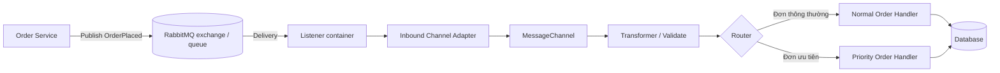
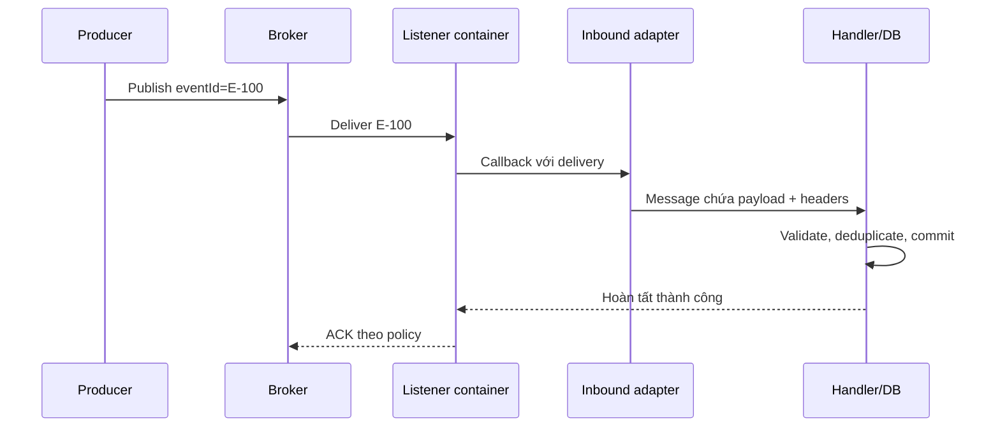
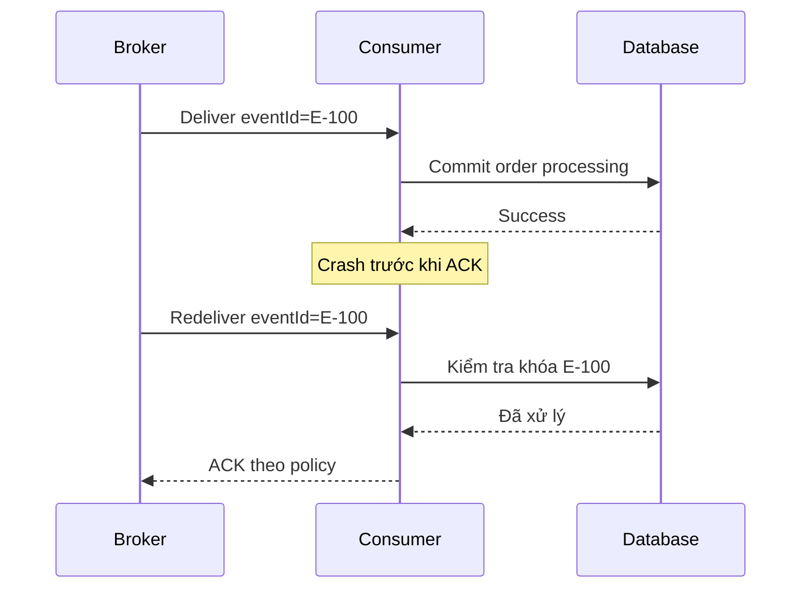
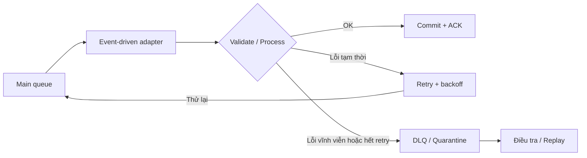

# Event-driven adapter

Trong chương **Channel adapter** của module **SPRING_INTEGRATION_PATTERN**, chúng ta kết nối nguồn sự kiện bên ngoài với luồng thông điệp Spring Integration. Module hướng tới thực hành **Enterprise Integration Patterns** (Router, Filter, Transformer, Splitter, Aggregator, Gateway), cùng retry, error channel, correlation, kiểm thử và quan sát các nhánh xử lý. **Event-driven adapter** là thành phần tại ranh giới hệ thống phản ứng khi có thông điệp/sự kiện mới, thay vì liên tục tự hỏi nguồn dữ liệu xem đã có dữ liệu hay chưa.

Ví dụ: khi đơn hàng được tạo, message broker gửi sự kiện `OrderPlaced` cho consumer. Inbound adapter nhận delivery, chuyển thành `Message<?>`, rồi đưa nó vào `MessageChannel` của Spring Integration. Các bước sau có thể kiểm tra schema, lọc, định tuyến, lưu database hoặc gửi thông báo. Phần tiếp nhận từ broker nằm tại adapter; luật nghiệp vụ vẫn ở các handler độc lập.

Sau bài học, bạn có thể:

- Phân biệt **event-driven/message-driven adapter**, **polling adapter**, **event-driven consumer** và **gateway request-reply**.
- Giải thích vòng đời của một sự kiện qua broker, inbound adapter, channel và handler.
- Tạo luồng **AMQP inbound channel adapter** bằng Spring Integration Java DSL, có listener container.
- Thiết kế đúng điểm ACK, retry, redelivery, dead-letter queue (DLQ), idempotency và error channel.
- Kiểm tra concurrency, ordering, backpressure, khả năng quan sát và trường hợp consumer bị lỗi.

## 1. Event-driven adapter giải quyết vấn đề gì?

Khi phần mềm phải nhận thay đổi từ hệ thống ngoài, có hai cách tiếp cận thường gặp:

1. **Polling:** ứng dụng định kỳ kiểm tra nguồn, ví dụ mỗi 5 giây đọc thư mục xem có file mới.
2. **Event-driven:** nguồn dữ liệu hoặc thành phần trung gian chủ động báo có dữ liệu, ví dụ message broker chuyển một delivery đến consumer đã đăng ký.

Với event-driven, thời điểm nhận message bắt nguồn từ sự kiện của nguồn và trạng thái sẵn sàng của consumer. Thời gian phản ứng thường thấp hơn khi không cần đợi chu kỳ poll, nhưng không có nghĩa không có queue, buffer, network delay hay kiểm soát tốc độ.



Trong sơ đồ, **listener container** quản lý việc nhận delivery từ RabbitMQ; **inbound adapter** là cầu nối đưa delivery vào hệ thống message của Spring Integration. Router và handler không cần tự thao tác AMQP channel để xử lý nghiệp vụ.

Lợi ích của cách tách này:

- Dịch vụ phát sự kiện không cần biết người nhận đang hoạt động tại thời điểm publish, nếu broker có cơ chế lưu trữ/giao nhận thích hợp.
- Luồng nội bộ có thể thay đổi Transformer hoặc Router mà không buộc producer sửa code nghiệp vụ.
- Có thể mở rộng consumer, theo dõi backlog và cấu hình retry tại ranh giới phù hợp.
- Có thể xây dựng đường xử lý lỗi riêng cho sự kiện không hợp lệ hoặc lỗi hạ tầng.

Tuy nhiên, event-driven **không tự tạo tính bền vững**, không tự bảo đảm đúng một lần, không loại bỏ sự kiện trùng và không biến một adapter một chiều thành RPC.

## 2. Những khái niệm cần phân biệt

| Khái niệm | Cách hoạt động | Ví dụ trong Spring Integration |
| --- | --- | --- |
| **Inbound channel adapter** | Chuyển dữ liệu từ hệ thống ngoài vào message flow, thường một chiều | AMQP inbound channel adapter, JMS message-driven adapter |
| **Outbound channel adapter** | Chuyển message nội bộ ra hệ thống ngoài, thường một chiều | AMQP outbound adapter phát event |
| **Message-driven inbound adapter** | Được callback/listener khi bên ngoài có delivery | AMQP listener container nhận message từ broker |
| **Polling inbound adapter** | Chủ động gọi nguồn ở các chu kỳ cấu hình | File inbound adapter với Poller |
| **Event-driven consumer** | Handler được kích hoạt khi message đi qua một channel có khả năng push, ví dụ `SubscribableChannel` | Service Activator đăng ký lên `DirectChannel` |
| **Polling consumer** | Handler chủ động nhận từ `PollableChannel` theo lịch | Consumer đọc `QueueChannel` bằng Poller |
| **Inbound/outbound gateway** | Xử lý request-reply qua một ranh giới hệ thống | HTTP inbound gateway và HTTP outbound gateway |

**Điểm dễ nhầm:** “event-driven adapter” là cách nguồn kích hoạt việc nhận; “event-driven consumer” còn là một khái niệm của EIP bên **trong** ứng dụng, ví dụ handler được gọi khi một message tới `DirectChannel`. Hai khái niệm liên quan nhưng không đồng nhất.

Tương tự, “event-driven” không buộc phải có RabbitMQ. Webhook HTTP, JMS listener, MQTT subscriber hay callback của một SDK cũng có thể đưa sự kiện vào message flow khi được hỗ trợ và cấu hình. Mỗi nguồn có ngữ nghĩa giao nhận và lỗi riêng.

## 3. Polling và event-driven: lựa chọn theo nguồn và yêu cầu

| Tiêu chí | Polling adapter | Event-driven adapter |
| --- | --- | --- |
| Ai khởi phát việc đọc? | Bộ lập lịch phía ứng dụng | Nguồn/transport thông báo hoặc đẩy delivery |
| Độ trễ | Bị ảnh hưởng bởi chu kỳ poll | Bị ảnh hưởng bởi broker, mạng, listener và hàng đợi |
| Nguồn phù hợp | File system, bảng DB cần quét, endpoint chỉ hỗ trợ đọc định kỳ | Broker, subscription, webhook, nguồn có callback |
| Điều khiển tải | Poll interval, `maxMessagesPerPoll`, concurrency | Prefetch, consumer concurrency, flow control, broker policy |
| Khôi phục | Checkpoint, filter/state của nguồn, idempotency | ACK/offset/visibility timeout và idempotency tùy transport |
| Khi nguồn không có dữ liệu | Vẫn có thể chạy poll rỗng | Thường không có delivery mới |
| Rủi ro | Bỏ sót thay đổi giữa lần quét nếu checkpoint sai; I/O dư thừa | Message trùng, thứ tự thay đổi, consumer backlog hoặc retry storm |

Lựa chọn theo năng lực thật của nguồn. Một API chỉ hỗ trợ `GET /updates` có thể cần polling dù nghiệp vụ được gọi là “nhận sự kiện”. Ngược lại, một broker có khả năng push delivery thì thường dùng listener thay vì tự polling queue bằng một timer không cần thiết.

Với file system, thông báo thay đổi từ hệ điều hành không đồng nghĩa tệp đã ghi hoàn chỉnh. Có thể kết hợp watcher với bước kiểm tra tính ổn định/staging, tùy cách nguồn cung cấp sự kiện.

## 4. Vòng đời message qua một inbound event-driven adapter

Một message đi từ broker vào Spring Integration thường qua các ranh giới:



1. **Producer publish:** cần hiểu publish confirm của broker nếu bên gửi cần biết message đã được nhận ở mức transport.
2. **Broker nhận/routing:** exchange, topic, subscription hoặc queue quyết định message tới consumer nào.
3. **Listener nhận delivery:** container quản lý connection, callback, concurrency và acknowledgement.
4. **Adapter tạo Spring Message:** payload và metadata được chuyển sang biểu diễn mà Spring Integration hiểu.
5. **Channel giao message:** có thể đồng bộ như `DirectChannel` hoặc bất đồng bộ như `ExecutorChannel`.
6. **Handler xử lý:** Transformer, Filter, Router, Service Activator và persistence quyết định kết quả nghiệp vụ.
7. **ACK/rollback/requeue:** container và broker áp dụng chính sách xử lý delivery theo thành công/thất bại.

Một delivery được nhận không nhất thiết đã được lưu vào DB. Một ACK chỉ nói delivery đã hoàn tất theo **chính sách consumer**, không phải mọi hệ thống liên quan đều đã hoàn tất nghiệp vụ của chúng.

## 5. Thực hành Spring Integration với AMQP inbound adapter

Ta xây dựng một consumer nhận `OrderPlaced` từ RabbitMQ rồi xử lý đơn hàng. Ví dụ dùng Java 17+, Spring Integration Java DSL, Spring Integration AMQP và Spring AMQP; các dependency, queue/exchange và kết nối RabbitMQ cần được cấu hình trong ứng dụng thực tế.

### 5.1. Hợp đồng sự kiện

Ví dụ producer phát JSON:

```json
{
  "eventId": "E-100",
  "orderId": "ORD-100",
  "customerTier": "PRIORITY",
  "amount": 120000
}
```

Với consumer, `eventId` là khóa ổn định xuyên các lần giao lại, còn `orderId` là định danh nghiệp vụ. Đừng lấy một delivery tag của broker làm khóa nghiệp vụ dài hạn.

```java
package example.orders;

import java.math.BigDecimal;

public record OrderPlaced(
    String eventId,
    String orderId,
    String customerTier,
    BigDecimal amount
) {}
```

### 5.2. Cấu hình listener container và integration flow

```java
package example.orders;

import org.springframework.amqp.core.AcknowledgeMode;
import org.springframework.amqp.rabbit.connection.ConnectionFactory;
import org.springframework.amqp.rabbit.listener.SimpleMessageListenerContainer;
import org.springframework.context.annotation.Bean;
import org.springframework.context.annotation.Configuration;
import org.springframework.integration.amqp.dsl.Amqp;
import org.springframework.integration.config.EnableIntegration;
import org.springframework.integration.dsl.IntegrationFlow;

@Configuration
@EnableIntegration
class OrderEventIntegrationConfig {

    @Bean
    SimpleMessageListenerContainer orderEventsContainer(
            ConnectionFactory connectionFactory) {
        var container = new SimpleMessageListenerContainer(connectionFactory);
        container.setQueueNames("orders.events");
        container.setAcknowledgeMode(AcknowledgeMode.AUTO);
        container.setDefaultRequeueRejected(false);
        container.setConcurrentConsumers(2);
        container.setMaxConcurrentConsumers(4);
        container.setPrefetchCount(10);
        return container;
    }

    @Bean
    IntegrationFlow orderEventsFlow(
            SimpleMessageListenerContainer orderEventsContainer,
            OrderEventProcessor processor) {
        return IntegrationFlow
            .from(Amqp.inboundAdapter(orderEventsContainer))
            .handle(message -> processor.process(message.getPayload()))
            .get();
    }
}
```

Ở đây, `OrderEventProcessor` là một bean do ứng dụng triển khai để **decode, validate và xử lý** payload. Đoạn cấu hình trên không tự tạo queue `orders.events` và không tự tạo DLQ. Nếu queue không tồn tại, cần khai báo bằng cấu hình AMQP hoặc quản trị broker trước khi chạy theo chính sách ứng dụng.

**Điểm cần kiểm tra khi triển khai:**

- `AcknowledgeMode.AUTO` của **Spring AMQP listener container** nghĩa là container điều khiển ACK sau khi listener xử lý thành công. Nó khác `autoAck=true` của RabbitMQ client.
- `setDefaultRequeueRejected(false)` làm container mặc định reject lỗi mà không requeue khi exception đi tới container; có thể bị điều chỉnh bởi loại exception/chính sách khác. Nếu broker không cấu hình dead-lettering, message bị reject có thể bị loại bỏ.
- `setConcurrentConsumers(2)` và `setMaxConcurrentConsumers(4)` là cấu hình mức đồng thời ví dụ, không phải khuyến nghị áp dụng cho mọi workload.
- `setPrefetchCount(10)` giới hạn số delivery chưa ACK mà consumer có thể nhận trước; cấu hình thực tế phải cân đối memory, thời gian xử lý và fairness.
- Flow ví dụ dùng xử lý trực tiếp trong cùng đường lời gọi listener. Chèn một channel bất đồng bộ có thể thay đổi ý nghĩa của thời điểm ACK.

### 5.3. Giải mã, validate và xử lý payload

Adapter có thể nhận `byte[]` hoặc `String` tùy AMQP message converter và content type. Để tránh giả định message đã là DTO, một processor minh họa có thể chuyển payload thành JSON rồi parse:

```java
package example.orders;

import java.io.IOException;
import java.nio.charset.StandardCharsets;

import com.fasterxml.jackson.databind.ObjectMapper;
import org.springframework.stereotype.Service;

@Service
class OrderEventProcessor {

    private final ObjectMapper objectMapper;
    private final OrderApplicationService service;

    OrderEventProcessor(
            ObjectMapper objectMapper,
            OrderApplicationService service) {
        this.objectMapper = objectMapper;
        this.service = service;
    }

    public void process(Object payload) {
        byte[] bytes;
        if (payload instanceof byte[] rawBytes) {
            bytes = rawBytes;
        } else if (payload instanceof String text) {
            bytes = text.getBytes(StandardCharsets.UTF_8);
        } else {
            throw new IllegalArgumentException(
                "Unsupported event payload type: "
                    + payload.getClass().getName()
            );
        }

        try {
            OrderPlaced event = objectMapper.readValue(
                bytes, OrderPlaced.class
            );
            if (event.eventId() == null || event.eventId().isBlank()
                    || event.orderId() == null || event.orderId().isBlank()
                    || event.amount() == null) {
                throw new IllegalArgumentException(
                    "OrderPlaced thiếu trường bắt buộc"
                );
            }

            service.applyIdempotently(event);
        } catch (IOException exception) {
            throw new IllegalArgumentException(
                "Không đọc được JSON OrderPlaced", exception
            );
        }
    }
}

// Bean nghiệp vụ được triển khai riêng, có transaction và deduplication.
interface OrderApplicationService {
    void applyIdempotently(OrderPlaced event);
}
```

Ví dụ dùng Jackson `ObjectMapper` do Spring context cung cấp. Khi cấu hình AMQP converter chuyển thẳng JSON thành `OrderPlaced`, có thể bỏ bước chuyển thủ công và nhận DTO đã kiểm tra, nhưng phải cấu hình type mapping và trusted types rõ ràng. Không tin bất kỳ header kiểu Java do bên ngoài gửi lên mà chưa đánh giá rủi ro deserialization.

`OrderApplicationService.applyIdempotently` phải có implementation là bean được inject trong ứng dụng. Nếu tác động nghiệp vụ nằm trong database, phương án phổ biến là lưu `eventId` cùng thay đổi dữ liệu trong **cùng transaction**, dùng unique constraint để chống xử lý lặp. Một exception phải được chuyển ra khỏi handler khi cần container coi delivery thất bại.

### 5.4. Tại sao handler không tạo reply?

Luồng này xử lý sự kiện **một chiều**, nên `.handle(message -> ...)` không cần tạo reply nghiệp vụ. Nếu producer yêu cầu phản hồi ngay cho từng request, nên dùng **AMQP inbound/outbound gateway** hoặc thiết kế hai luồng có correlation. Việc broker gửi delivery và consumer ACK không tự tạo response mang kết quả cho producer.

## 6. Event-driven consumer trong nội bộ ứng dụng

Message vào ứng dụng có thể tiếp tục đi qua `SubscribableChannel`. Ví dụ cấu hình một channel để handler được kích hoạt ngay khi có message:

```java
import org.springframework.context.annotation.Bean;
import org.springframework.integration.channel.DirectChannel;
import org.springframework.messaging.MessageChannel;

@Bean
MessageChannel incomingEvents() {
    return new DirectChannel();
}
```

Nếu adapter đẩy vào `incomingEvents` và Service Activator đăng ký nhận message từ đó, handler thường chạy trong thread của sender theo ngữ nghĩa `DirectChannel`. Điều này thuận tiện khi cần lỗi lan ngược về listener để quyết định ACK/requeue.

Ngược lại, `ExecutorChannel` có thể chuyển việc xử lý sang thread khác. Nó giúp tách thời gian phản hồi ở phía gửi khỏi nghiệp vụ nhưng cũng thay đổi ranh giới thành công: thao tác **bàn giao message** có thể hoàn tất trước khi handler commit DB. Đừng giả định message-driven luôn đồng bộ, hoặc luôn bất đồng bộ; phải xem channel topology.

| Kiểu channel | Hành vi thường gặp | Tác động đến nhận sự kiện |
| --- | --- | --- |
| `DirectChannel` | Gọi subscriber đồng bộ trong thread gửi | Exception có thể lan về inbound adapter/listener |
| `ExecutorChannel` | Dispatch qua executor tới subscriber | Exception thường xử lý trong worker thread; ACK có thể sớm |
| `QueueChannel` | Lưu message vào hàng đợi nội bộ để consumer lấy sau | Cần Poller/receiver; cần đánh giá tính bền vững và backpressure |
| `PublishSubscribeChannel` | Phát message cho nhiều subscriber | Phải xác định mỗi subscriber cần xử lý đến đâu trước khi coi toàn luồng thành công |

Bản thân `MessageChannel` trong bộ nhớ không mặc nhiên bền vững sau restart. Nếu cần chống mất dữ liệu giữa adapter và xử lý phía sau, hãy chọn chiến lược giao nhận, trạng thái bền vững và transaction phù hợp.

## 7. Acknowledgement, redelivery và idempotency

Một consumer nhận event có thể crash ở bất kỳ thời điểm nào:



Đây là lý do các thiết kế event-driven với **at-least-once delivery** phải chấp nhận redelivery. Một sự kiện có thể đã tạo tác động nghiệp vụ nhưng vẫn được broker giao lại khi ACK chưa được ghi nhận.

### 7.1. Phân biệt các loại xác nhận

| Tín hiệu | Điều được xác nhận |
| --- | --- |
| Publisher confirm | Broker đã chấp nhận publish theo cơ chế confirm được cấu hình |
| Consumer ACK | Delivery được coi là đã xử lý theo chính sách nhận |
| NACK/reject | Delivery không được chấp nhận; có thể requeue hoặc dead-letter |
| Business outcome event | Nghiệp vụ phát một kết quả cụ thể sau khi hoàn tất |

Các tín hiệu này không thay thế nhau. `ACK` không nhất thiết có nghĩa downstream đã nhận event khác được publish sau đó, và publisher confirm không có nghĩa consumer đã commit DB.

### 7.2. Làm idempotency bằng khóa nghiệp vụ

Ví dụ dùng một bảng có unique key `(consumer_name, event_id)`:

```sql
CREATE TABLE processed_events (
    consumer_name VARCHAR(100) NOT NULL,
    event_id VARCHAR(100) NOT NULL,
    processed_at TIMESTAMP NOT NULL DEFAULT CURRENT_TIMESTAMP,
    PRIMARY KEY (consumer_name, event_id)
);
```

Pseudocode giao dịch:

```text
BEGIN DB TRANSACTION
  INSERT processed_events(consumer_name, event_id)
  IF ALREADY EXISTS:
      COMMIT
      RETURN  # Không tạo tác động lần hai.

  APPLY BUSINESS CHANGE
  COMMIT
# Handler hoàn tất, listener container mới xác nhận delivery.
```

Phải rollback cả **marker đã xử lý** và thay đổi nghiệp vụ nếu thao tác thất bại. Nếu tác động nằm ở hệ thống ngoài không cùng transaction DB, cần idempotency key của remote service, outbox/inbox hoặc thiết kế bù trừ; database nội bộ không tự đảm bảo “exactly once” xuyên nhiều hệ thống.

### 7.3. MANUAL acknowledgement khi thật sự cần

Có thể cấu hình `AcknowledgeMode.MANUAL` để tự ACK/NACK delivery qua đúng RabbitMQ channel và delivery tag. Đây không phải bước bắt buộc cho mọi event-driven adapter. Khi dùng MANUAL:

- Xác nhận mỗi delivery **sau** khi nghiệp vụ đạt điều kiện thành công.
- Không ACK trong `finally` cho cả nhánh lỗi.
- Không dùng tag của channel đã đóng hoặc ACK lặp lại.
- Xác định chính sách khi callback chạy bất đồng bộ và khi consumer crash trước ACK.
- Hiểu `basicNack(..., requeue=true)` có thể tạo vòng lặp giao lại nóng nếu lỗi vĩnh viễn.

Nếu flow xử lý đồng bộ và lỗi được lan đúng về listener container, chế độ AUTO thường dễ vận hành hơn.

## 8. Retry, error channel và dead-letter queue

Lỗi event-driven có ít nhất ba nhóm:

| Loại lỗi | Ví dụ | Ứng xử thường phù hợp |
| --- | --- | --- |
| Lỗi dữ liệu vĩnh viễn | JSON không parse, thiếu `eventId`, schema không tương thích | Đánh dấu lỗi, đưa DLQ/quarantine; không retry y nguyên vô hạn |
| Lỗi hạ tầng tạm thời | DB timeout, service phụ thuộc trả 503 | Retry giới hạn, có backoff; sau ngưỡng chuyển xử lý lỗi |
| Lỗi không rõ trạng thái | Timeout khi gọi lệnh ghi ở remote, mất kết nối sau commit | Kiểm tra trạng thái/idempotency trước khi thử lại |

Một chiến lược retry hợp lý có thể gồm:

1. Thử lại một vài lần ngay trong handler cho lỗi kết nối ngắn.
2. Khi chưa thành công, đưa qua đường retry có trì hoãn và số lần thử được theo dõi.
3. Khi dữ liệu sai hoặc quá giới hạn, chuyển DLQ cùng nguyên nhân và thông tin correlation.
4. Sau khi sửa nguyên nhân, replay có kiểm soát, vẫn giữ `eventId` để chống trùng.



Sơ đồ thể hiện **chính sách logic**; không phải cấu hình broker đầy đủ. RabbitMQ cần cấu hình dead-letter exchange, routing key, queue, retry TTL/delayed-message strategy nếu chọn retry qua broker. Nếu `setDefaultRequeueRejected(false)` nhưng không có dead-lettering, message lỗi có thể bị loại bỏ, thay vì xuất hiện trong DLQ.

### 8.1. Error channel không tự quyết định NACK

Với Spring Integration, exception có thể đi qua `errorChannel`. Nếu handler lỗi được xử lý và hoàn tất mà không báo thất bại về listener, container có thể coi delivery là **thành công** rồi ACK. Điều đó đôi khi đúng (message sai schema đã lưu được vào quarantine), nhưng đôi khi gây mất message (nghiệp vụ lỗi và chưa được ghi nhận ở đâu).

Hãy xác định rõ mỗi đường lỗi:

- Lỗi được **nén thành trạng thái xử lý xong**: đã lưu dữ liệu lỗi bền vững hoặc quyết định cố ý bỏ, nên ACK phù hợp.
- Lỗi **cần redelivery**: phải để listener/broker biết delivery thất bại hoặc có chiến lược retry bền vững trước khi ACK gốc.
- Lỗi **vượt số lần thử**: đưa DLQ/quarantine và ghi nhận metadata, xác nhận theo cách broker/consumer được cấu hình.

Đừng cấu hình error channel chỉ để log rồi mặc định mọi lỗi sẽ kích hoạt broker redelivery.

### 8.2. Phân biệt retry bên trong và broker redelivery

**Retry advice** áp dụng quanh handler có thể thử lại nhiều lần trong cùng **một delivery**. **Redelivery từ broker** là broker gửi lại sau reject/requeue, restart hoặc lỗi connection. Hai số lần thử này khác nhau và cần theo dõi riêng; nếu kết hợp không kiểm soát, một event có thể thực hiện nhiều lần hơn dự tính.

Với command có tác dụng phụ như trừ tiền, reserve stock hay gửi hóa đơn, phải có idempotency trước khi bật retry.

## 9. Concurrency, ordering và backpressure

Event-driven không có nghĩa mọi event được xử lý theo đúng thứ tự publish. Thứ tự thực tế phụ thuộc partition, queue, số consumer, prefetch, retry và thời gian xử lý từng handler.

Giả sử `E-1` và `E-2` thuộc cùng đơn hàng:

```text
T1: broker giao E-1 cho consumer A
T2: broker giao E-2 cho consumer B
T3: consumer B hoàn tất E-2 trước
T4: consumer A hoàn tất E-1 sau
```

Nếu nghiệp vụ cần xử lý tuần tự theo một khóa (ví dụ `orderId`), phải thiết kế phân vùng/định tuyến hoặc cơ chế kiểm tra version trạng thái. Không đặt mục tiêu “global order” khi dùng nhiều consumer và retry nếu hệ thống không bảo đảm.

| Cơ chế | Lợi ích | Rủi ro/cân nhắc |
| --- | --- | --- |
| Consumer concurrency | Tăng throughput khi các message độc lập | Có thể thay đổi thứ tự hoàn tất |
| Prefetch | Giảm round-trip, duy trì pipeline | Delivery unacked nhiều; một consumer có thể giữ nhiều message |
| Backpressure / rate limit | Bảo vệ DB và dịch vụ phụ thuộc | Cần quan sát backlog và độ trễ |
| Partition theo khóa | Hỗ trợ giữ thứ tự trong phạm vi partition | Có thể tạo hot key hoặc mất cân bằng tải |
| Batch xử lý | Giảm overhead với khối lượng lớn | Khó xác định ack và xử lý lỗi từng phần |

**Queue và channel trong JVM không tự cung cấp backpressure xuyên toàn hệ thống.** Phải đo năng lực broker, bộ nhớ, thread pool, connection pool, database và độ lớn backlog; từ đó đặt concurrency/prefetch/timeout phù hợp.

## 10. Chọn công nghệ event-driven và cơ chế delivery

| Nguồn bên ngoài | Hình thức nhận sự kiện | Đặc điểm cần kiểm tra |
| --- | --- | --- |
| RabbitMQ / AMQP | Listener container nhận delivery | ACK/NACK, requeue, DLX/DLQ, prefetch, concurrency |
| JMS broker | Message listener và session | AUTO/CLIENT acknowledgement, transaction, redelivery policy |
| Kafka | Listener dựa trên consumer group | Offset commit, partition ordering, rebalance, retry/error handler |
| MQTT | Subscription/callback | QoS, retained messages, session, reconnect, trùng lặp |
| HTTP webhook | Endpoint nhận HTTP request | Trả HTTP status đúng hạn, xác thực nguồn, xử lý idempotent |
| TCP/WebSocket | Callback/connection adapter | Framing, kết nối, reconnect, ACK nghiệp vụ nếu cần |

Tên module API và cách cấu hình phụ thuộc **phiên bản Spring Integration và thư viện transport**. Một event-driven adapter cho MQTT không mặc nhiên dùng cơ chế ACK giống RabbitMQ. Kafka commit offset cũng khác RabbitMQ ACK từng delivery; chỉ chuyển cùng **mục tiêu xử lý tin cậy**, không copy nguyên cấu hình giữa các transport.

HTTP webhook thường có request-response tại giao thức HTTP, dù dữ liệu truyền là một sự kiện. Nếu chỉ xác nhận HTTP đã nhận yêu cầu rồi xử lý bất đồng bộ, cần bảo đảm message đã vào kho bền vững trước khi trả thành công khi nghiệp vụ yêu cầu chống mất event.

## 11. Theo dõi event-driven flow

Để xác định sự kiện có bị kẹt ở đâu, nên đo trạng thái tại **broker**, **adapter/channel** và **business handler**:

| Chỉ số/log | Giúp giải đáp |
| --- | --- |
| Queue depth / lag | Sự kiện còn tồn đọng bao nhiêu? |
| Consumer count / active threads | Có đủ consumer đang nhận delivery? |
| Ready vs unacknowledged | Broker chưa giao hay đã giao nhưng đang chờ ACK? |
| Delivery / redelivery / reject rate | Có vòng retry hoặc lỗi lặp không? |
| Handler latency p95/p99 | Nút nghẽn ở xử lý nào? |
| Error count theo loại | Lỗi schema, kết nối hay nghiệp vụ? |
| DLQ depth / oldest age | Có message cần xử lý thủ công? |
| Duplicate event count | Deduplication đang kích hoạt bao nhiêu lần? |
| End-to-end latency | Từ thời điểm tạo event tới khi nghiệp vụ hoàn tất mất bao lâu? |

Nên truyền và log `eventId`, `orderId`, `correlationId` hoặc `traceId` khi có hợp đồng tương ứng. Không log nguyên payload khách hàng, token hoặc thông tin nhạy cảm để xác định một lỗi. Header Java nội bộ cũng không tự được truyền qua broker/HTTP nếu không cấu hình mapping.

Một bản ghi log minh họa:

```text
eventId=E-100 orderId=ORD-100 source=rabbitmq.orders.events
stage=order-handler outcome=PROCESSED attempt=1 durationMs=42
```

Cần phân biệt **event đã được nhận**, **event đã được commit nghiệp vụ** và **delivery đã ACK**. Nếu các mốc này không được quan sát tách biệt, sẽ khó điều tra lỗi xảy ra giữa commit và ACK.

## 12. Kiểm thử event-driven adapter

Unit test cho `OrderEventProcessor` rất hữu ích nhưng chưa chứng minh listener nhận, ACK và broker redelivery đúng. Nên kiểm thử cả hai lớp:

**Unit test:** payload parsing, validation, mapping, routing và idempotency khi nhận event trùng.

**Integration test:** kết nối broker, producer publish, listener nhận delivery, exception propagation, ACK/requeue, DLQ, concurrency và restart.

| Kịch bản | Cách mô phỏng | Kết quả cần xác minh |
| --- | --- | --- |
| Event hợp lệ | Publish JSON `OrderPlaced` đầy đủ | Handler chạy; DB có trạng thái đúng; delivery được ACK |
| Event JSON lỗi | Publish bytes không parse được | Không tạo thay đổi nghiệp vụ; đi vào DLQ/quarantine theo policy |
| Event thiếu khóa | Không có `eventId` | Bị từ chối có kiểm soát |
| Lỗi DB tạm thời | Cho DB ném lỗi rồi khôi phục | Retry có giới hạn, xử lý cuối cùng đúng một lần về mặt nghiệp vụ |
| Consumer crash trước commit | Dừng consumer khi message chưa ACK | Broker có thể redeliver; không mất event |
| Consumer crash sau commit trước ACK | Gây crash tại ranh giới ACK | Redelivery không tạo tác động nghiệp vụ trùng |
| Publish event trùng | Gửi cùng `eventId` hai lần | Unique key/idempotency ngăn ghi hai lần |
| Nhiều consumer | Tăng concurrency, gửi nhiều event | Mỗi event được xử lý; không giả định thứ tự hoàn tất toàn cục |
| Async channel | Chèn `ExecutorChannel` sau adapter | Xác minh điểm ACK và xử lý lỗi phù hợp |
| Retry exhaustion | Dependency luôn lỗi | DLQ có record và nguyên nhân; không requeue vô hạn |
| Restart service | Dừng/khởi động lại consumer | Message tồn đọng được xử lý lại theo chính sách |

### 12.1. Kiểm thử failure boundary quan trọng

```text
Given:
  RabbitMQ queue orders.events có eventId=E-100
  Consumer dùng at-least-once, DB có deduplication key E-100
When:
  Consumer ghi thành công vào DB
  Consumer bị dừng trước khi ACK tới broker
Then:
  Broker có thể redeliver E-100
  Consumer chạy lại không tạo đơn hàng thứ hai
  Delivery tiếp theo được ACK theo policy
  Metrics có thể ghi nhận redelivery/duplicate
```

Kiểm tra cả **số lần delivery** lẫn **số lần tác động nghiệp vụ**. Một message được giao hai lần có thể là hành vi mong đợi; thành công là dữ liệu không bị áp dụng sai hai lần.

Với test bất đồng bộ, nên chờ bằng điều kiện quan sát được (dữ liệu DB, queue state, latch/test fixture có timeout) thay vì giả định độ trễ cố định bằng `Thread.sleep()`. Với broker test, cấu hình retry và dead-letter topology gần với môi trường thật để phát hiện lỗi ACK trước khi triển khai.

## 13. Các lỗi thiết kế thường gặp

**Nhầm event-driven adapter với polling adapter.** Đăng ký listener nhận delivery và chạy một poller đọc nguồn theo lịch là hai cơ chế khác nhau; cấu hình sai gây lãng phí tài nguyên hoặc bỏ lỡ sự kiện.

**Nhầm một chiều với request-reply.** Consumer ACK không phải kết quả xử lý cho producer. Khi nghiệp vụ cần reply, phải xây dựng gateway hoặc hợp đồng phản hồi/correlation riêng.

**Đẩy vào channel bất đồng bộ rồi ACK quá sớm.** Listener có thể kết thúc thành công ngay sau khi giao message cho worker khác, trong khi worker vẫn có thể lỗi. Cần thiết kế ranh giới giao nhận bền vững.

**Requeue mọi lỗi vĩnh viễn.** JSON sai schema sẽ tiếp tục lỗi; requeue ngay có thể gây vòng lặp nóng và làm đầy log.

**Không có idempotency.** Consumer có thể chết sau commit nhưng trước ACK; redelivery sẽ làm phát sinh tác động trùng nếu không có khóa nghiệp vụ.

**Coi header redelivered là đủ để bỏ sự kiện.** Cờ này không chứng minh nghiệp vụ đã commit trước đó; cần kiểm tra trạng thái đã xử lý theo khóa event.

**Bỏ qua khả năng đảo thứ tự.** Nhiều consumer, retry và độ trễ khác nhau có thể khiến event hoàn tất khác thứ tự publish.

**Chỉ test handler không test broker.** Chưa phát hiện sai queue/routing key, thiếu DLX, lỗi converter, consumer restart và điểm ACK.

**Không kiểm soát áp lực xử lý.** Prefetch cao, nhiều consumer và DB pool nhỏ có thể làm backlog chuyển từ broker vào bộ nhớ/thread của ứng dụng.

## 14. Checklist triển khai

1. Xác định nguồn thực sự hỗ trợ event-driven listener/callback hay chỉ có polling.
2. Chọn inbound adapter và channel theo ngữ nghĩa message **một chiều** hay request-reply.
3. Định nghĩa schema, content type, version, `eventId` và validation cho nguồn ngoài.
4. Khai báo queue/subscription và chính sách routing/dead-letter theo transport.
5. Cấu hình concurrency, prefetch, timeout và năng lực xử lý dựa trên tải thực tế.
6. Chọn ACK/AUTO/MANUAL phù hợp với đường xử lý và bảo đảm transaction.
7. Xem lại mọi channel bất đồng bộ, error channel và retry advice trước khi tin rằng broker có thể redeliver.
8. Thực hiện idempotency bằng khóa nghiệp vụ bền vững, đặc biệt cho thao tác ghi.
9. Phân loại lỗi tạm thời/vĩnh viễn; giới hạn retry, có backoff và DLQ/quarantine.
10. Đo backlog, unacked, redelivery, DLQ, latency và duplicate count.
11. Kiểm thử crash trước/sau commit, fail schema, retry exhaustion và replay.
12. Ghi rõ quy trình vận hành: điều tra DLQ, replay an toàn, rollback và nâng cấp consumer.

## Kết luận

**Event-driven adapter** là cầu nối phản ứng khi hệ thống ngoài phát sự kiện và chuyển sự kiện đó vào **message flow** của Spring Integration. Nó giúp ghép nguồn broker/subscription với Transformer, Router, Filter, Service Activator và các pattern khác mà không trộn giao thức vận chuyển vào code nghiệp vụ. Để luồng đáng tin cậy, cần thiết kế đúng thời điểm ACK, phân biệt retry với redelivery, giới hạn lỗi, xử lý idempotent, quan sát backlog và kiểm thử những ranh giới giữa **delivery**, **commit** và **acknowledgement**.
