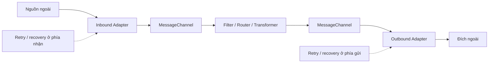
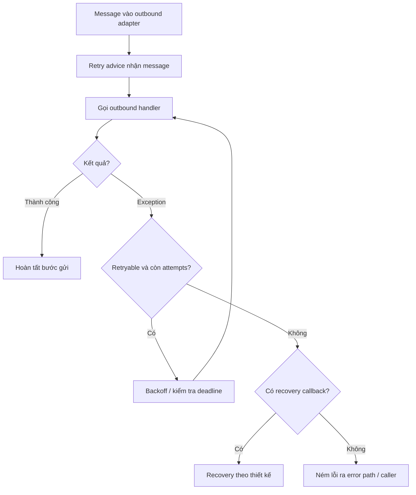
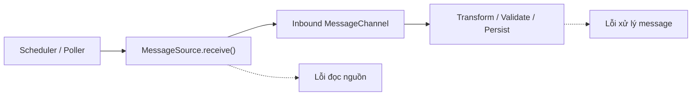
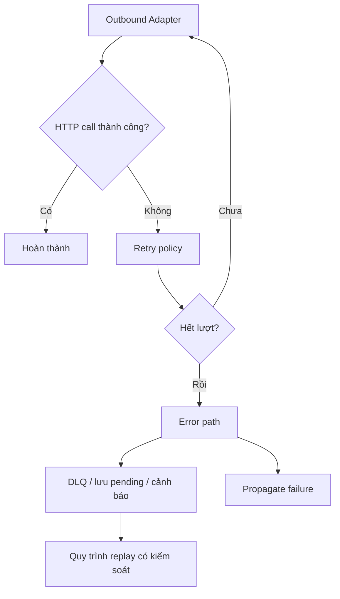

# Retry ở adapter boundary trong Spring Integration

## 1. Vì sao cần retry ở ranh giới adapter?

Trong một hệ thống tích hợp, phần nghiệp vụ thường trao đổi dữ liệu với nguồn bên ngoài thông qua **Channel Adapter**: đọc file qua SFTP, lấy bản ghi từ message broker, đẩy dữ liệu qua HTTP, ghi vào hệ thống bên thứ ba hoặc nhận thay đổi từ một dịch vụ khác.

Ở các ranh giới này, lỗi xảy ra ngay cả khi mã nghiệp vụ đúng: kết nối mạng bị ngắt tạm thời, một API trả `503 Service Unavailable`, broker chuyển sang node khác, dịch vụ lưu trữ bị khóa trong thời gian ngắn hoặc request hết thời gian chờ.

Nếu bỏ message ngay ở lần thử đầu tiên, hệ thống có thể mất tác vụ cần thực hiện. Nhưng nếu retry vô hạn hoặc retry một lệnh tạo thanh toán mà không chống trùng, hệ thống có thể gây tắc nghẽn hay tạo dữ liệu sai.

**Retry ở adapter boundary** là việc đặt chính sách thử lại quanh một thao tác giao tiếp với hệ thống ngoài tại vị trí mà Spring Integration chuyển từ message flow nội bộ sang nguồn/đích bên ngoài. Mục tiêu là vượt qua lỗi *có khả năng tạm thời* mà vẫn giữ hợp đồng xử lý, giới hạn tài nguyên và tính đúng đắn nghiệp vụ.

Bài thuộc chương **Channel adapter** của module **SPRING_INTEGRATION_PATTERN**. Module hướng tới việc triển khai Enterprise Integration Patterns bằng Spring Integration: Router, Filter, Transformer, Splitter, Aggregator, Gateway, retry, error channel và correlation, cùng kiểm thử và quan sát từng nhánh xử lý. Retry là một phần trong thiết kế đó, chứ không phải thuộc tính có thể bật một lần cho mọi trường hợp.

Sau bài học, bạn có thể:

- Xác định đúng adapter boundary và nơi phát sinh lỗi cần xử lý.
- Phân biệt retry của **inbound adapter**, **outbound adapter**, handler và broker.
- Cấu hình `RequestHandlerRetryAdvice` cho một HTTP outbound channel adapter.
- Chọn lỗi retry được, `maxAttempts`, backoff, timeout và recovery.
- Giải thích vì sao retry có thể tạo duplicate và cách sử dụng idempotency.
- Kiểm tra số lần thử, lỗi cuối cùng và đường xử lý sau khi hết lượt retry.

## 2. Adapter boundary là ranh giới nào?

**Channel Adapter** nối một hệ thống bên ngoài với hệ thống thông điệp của ứng dụng. Trong Spring Integration, adapter một chiều thường có hai dạng:

- **Inbound Channel Adapter:** nhận/lấy dữ liệu từ một nguồn ngoài rồi phát `Message<?>` vào channel nội bộ.
- **Outbound Channel Adapter:** lấy message từ channel nội bộ và gửi dữ liệu đến đích ngoài; bản thân adapter không có hợp đồng trả về message nghiệp vụ như một gateway.

Khi cần nhận phản hồi từ hệ thống đích, thường sử dụng **inbound/outbound Gateway** với ngữ nghĩa request–reply. Các nguyên tắc retry vẫn liên quan, nhưng hợp đồng reply và timeout cần được xét thêm.



Một điều quan trọng: **lỗi ở đâu thì cần cơ chế bao quanh thao tác ở đó**.

Ví dụ, retry advice quanh outbound HTTP handler có thể thử lại khi handler gọi API thất bại. Nó không tự thử lại việc một SFTP inbound adapter không thể lấy file ở bước `receive()`. Tương tự, retry của Kafka listener container không thay thế được idempotency của Service Activator ghi database.

### Các vị trí retry và trách nhiệm

| Vị trí | Thao tác được thử lại | Ví dụ lỗi | Công cụ / cơ chế thường dùng |
|---|---|---|---|
| Inbound source / poller | Thăm dò nguồn ngoài hoặc nhận dữ liệu | SFTP disconnect, đọc nguồn lỗi | Poller/source-specific retry, poller advice, scheduler/error handling |
| Message handler / outbound adapter | Xử lý một message và gửi ra ngoài | HTTP 503, timeout, lỗi kết nối | `RequestHandlerRetryAdvice` / Spring Retry |
| Broker listener | Nhận và xử lý một delivery/record | Handler lỗi hoặc broker redelivery | Retry/error handler của Kafka, RabbitMQ hoặc JMS |
| Business service | Thực hiện nghiệp vụ, cập nhật state | Optimistic lock hoặc conflict tạm thời | Transaction/retry ở lớp nghiệp vụ |
| Toàn bộ workflow | Một chuỗi bước dài | Một nhánh thất bại sau nhiều bước | Saga, compensation, trạng thái công việc, scheduler |

Không nên chồng nhiều tầng retry mà không tính tổng số lần thực thi. Nếu adapter thử ba lần, listener thử thêm bốn lần, một message có thể được đưa tới remote endpoint tới **12 lần** trong tình huống cụ thể.

## 3. Retry không có nghĩa là thực thi chắc chắn một lần

Giả sử một outbound adapter gửi `POST /payments`:

1. Client gửi yêu cầu thanh toán.
2. Server ghi thanh toán thành công.
3. Kết nối mất trước khi client nhận response.
4. Client thấy read timeout.
5. Adapter retry request.

Ở bước 3, phía gọi **không biết chắc** thao tác bên ngoài đã xảy ra hay chưa. Retry có thể tạo thêm một thanh toán nếu hệ thống đích không xử lý lệnh trùng.

```mermaid
sequenceDiagram
    participant F as Integration Flow
    participant A as Outbound Adapter
    participant S as Remote Service
    participant DB as Remote Database
    F->>A: Payment command (operationId=pay-42)
    A->>S: POST /payments
    S->>DB: Ghi thanh toán
    DB-->>S: Commit OK
    Note over A,S: Response bị mất trên mạng
    A--xS: Read timeout
    Note over A: Retry có thể thực thi lại side effect
    A->>S: POST /payments (operationId=pay-42)
    S->>DB: Kiểm tra idempotency key
    DB-->>S: Đã xử lý; trả kết quả cũ
    S-->>A: Phản hồi hợp lệ
```

Vì vậy cần phân biệt:

- **Retry:** gửi/thi hành lại thao tác sau lỗi.
- **At-least-once:** thao tác có thể được thực hiện nhiều hơn một lần.
- **Idempotency:** thực hiện lặp cùng một yêu cầu không tạo thêm tác dụng phụ.
- **Exactly-once:** một cam kết phải nêu rõ phạm vi và hệ thống được bao phủ; không tự xuất hiện chỉ vì dùng Spring Retry.

Retry chỉ có ý nghĩa khi **hành động thử lại an toàn** hoặc có cơ chế kiểm soát hậu quả của duplicate.

## 4. Phân loại lỗi trước khi retry

Không phải exception nào cũng nên được thử lại. Một lỗi do input sai hoặc thiếu quyền hiếm khi được sửa bằng việc gửi lại cùng request vài trăm mili giây sau.

| Lỗi | Retry? | Lý do / hành động |
|---|---|---|
| HTTP `400 Bad Request` | Thường không | Dữ liệu hoặc contract sai; cần sửa request |
| HTTP `401/403` | Không retry mù | Kiểm tra credential, token, scope hoặc quyền |
| HTTP `404` | Tùy hợp đồng | Có thể là tài nguyên chưa được tạo, hoặc lỗi vĩnh viễn |
| HTTP `408`, timeout kết nối/đọc | Có thể | Lỗi tạm thời, nhưng kết quả remote có thể đã được commit |
| HTTP `429 Too Many Requests` | Có thể | Backoff theo chính sách và `Retry-After` nếu có |
| HTTP `502/503/504` | Thường có thể | Lỗi hạ tầng/đích tạm thời, cần giới hạn số lần |
| HTTP `500` | Tùy trường hợp | Có thể là bug hoặc lỗi tạm thời; không tự động retry mọi 500 |
| DNS/TCP/TLS lỗi | Tùy nguyên nhân | Sự cố mạng tạm thời khác với certificate/hostname sai |
| JSON/schema sai | Thường không | Retry không sửa được contract |
| Validation exception | Không | Phải sửa dữ liệu đầu vào |
| Deadlock / optimistic lock | Có thể | Khi giao dịch an toàn để chạy lại |
| Lỗi xác thực token đã hết hạn | Có thể làm mới token một lần | Cần cơ chế refresh rõ ràng, tránh vòng lặp |

Đối với adapter dùng một thư viện HTTP cụ thể, exception gốc có thể được bọc bởi exception của Spring Messaging hoặc Spring Integration. Khi phân loại lỗi, cần xét **cause chain** và mã HTTP thực tế, tránh chỉ kiểm tra lớp exception ngoài cùng.

### Retryable, non-retryable và unknown

Thực hành tốt là phân thành ba nhóm:

1. **Retryable:** đã biết lỗi có thể hồi phục và thao tác an toàn để lặp.
2. **Non-retryable:** hợp đồng không hợp lệ, thiếu quyền, dữ liệu lỗi, thao tác không an toàn.
3. **Unknown:** chưa biết kết quả remote; cần tra cứu trạng thái, reconciliation hoặc xử lý thủ công nếu có side effect.

Không nên đánh đồng “không biết kết quả” với “chắc chắn chưa thành công”.

## 5. Chính sách retry gồm những gì?

Một policy đầy đủ cần ít nhất:

| Thành phần | Câu hỏi phải trả lời |
|---|---|
| Điều kiện retry | Exception/status nào được thử lại? |
| `maxAttempts` | Tổng tối đa bao nhiêu lần gọi, gồm lần đầu? |
| Backoff | Chờ bao lâu giữa các lần? |
| Jitter | Có phân tán thời điểm retry giữa nhiều instance? |
| Timeout/deadline | Đến mốc nào thì ngừng dù còn lượt thử? |
| Idempotency | Lặp request có làm trùng side effect không? |
| Recovery | Sau lần cuối, trả lỗi, lưu DLQ hay lập lịch xử lý? |
| Quan sát | Đếm được attempt, latency, exception và kết quả không? |

### Đếm số lần thử

Nếu `maxAttempts = 3` thì có **tối đa ba lần** thực hiện: lần ban đầu và nhiều nhất hai lần retry. Không phải “ba lần retry sau lần đầu”.

```text
attempt 1 -> lỗi tạm thời
  backoff 250 ms
attempt 2 -> lỗi tạm thời
  backoff 250 ms
attempt 3 -> thành công hoặc thất bại cuối cùng
```

### Backoff và jitter

Fixed backoff dễ minh họa, nhưng nhiều instance cùng thất bại rồi retry vào một thời điểm có thể gây **retry storm**. Với tải đáng kể, cân nhắc exponential backoff có giới hạn và jitter.

Ví dụ lịch chờ minh họa:

| Lần sau lỗi | Exponential backoff cơ sở | Jitter minh họa |
|---|---:|---|
| Trước attempt 2 | 200 ms | 150–250 ms |
| Trước attempt 3 | 400 ms | 300–500 ms |
| Trước attempt 4 | 800 ms | 600–1.000 ms |

Đây là ví dụ chính sách, không phải giá trị mặc định của Spring Integration. Với HTTP 429, cần tôn trọng các chỉ dẫn backoff của phía cung cấp dịch vụ theo contract.

### Deadline và tác động của thời gian chờ

Một request có connect timeout 2 giây, read timeout 4 giây và ba attempts có thể chiếm thời gian đáng kể. Backoff còn cộng thêm vào tổng thời gian.

Đối với `DirectChannel`, retry có thể diễn ra **đồng bộ trên thread gửi**. Tăng `maxAttempts` hoặc backoff có thể làm Gateway/caller bị chặn lâu hơn. Phải đặt thời gian chờ HTTP client và ngân sách tổng phù hợp; `replyTimeout` của Messaging Gateway không tự cắt mọi thao tác I/O đang chạy đồng bộ.

## 6. Ví dụ Spring Integration: retry ở HTTP outbound channel adapter

Ta xây dựng một flow đẩy yêu cầu tạo đơn hàng sang API đối tác:

```text
OrderSubmissionService
    |
    v
ordersToPartner (DirectChannel)
    |
    v
HTTP Outbound Channel Adapter
    |
    +-- RequestHandlerRetryAdvice (max 3 attempts, fixed backoff)
    |
    v
POST https://partner.example/api/orders
```

Đây là **outbound channel adapter một chiều**: ứng dụng gửi một tác vụ ra ngoài; nó không phát một response message nghiệp vụ vào flow như `Http.outboundGateway`. Adapter vẫn có thể nhận HTTP status hoặc exception từ HTTP client khi thực hiện request.

Ví dụ hướng tới **Java 17+, Spring Boot 3.x, Spring Integration 6.x, Spring Retry tương thích**. Cần các dependency tương ứng cho Spring Integration, Spring Integration HTTP, Spring Retry, Spring Web/Jackson và JUnit 5 nếu chạy ví dụ kiểm thử.

### 6.1. DTO có định danh thao tác ổn định

```java
// PartnerOrderCommand.java
package com.example.integration;

public record PartnerOrderCommand(
        String operationId,
        String orderId,
        String sku,
        int quantity
) {
}
```

Ở đây `operationId` dùng để phân biệt **một thao tác nghiệp vụ**. Ví dụ: nếu request phải retry, tất cả các lần thử cần giữ nguyên `operationId` để đối tác có thể chống tạo đơn trùng.

Điều đó chỉ có tác dụng nếu API đối tác **thực sự hỗ trợ deduplication** theo contract đã thỏa thuận. Nếu API yêu cầu một HTTP header riêng như `Idempotency-Key`, cần cấu hình outbound HTTP header mapping hoặc HTTP client interceptor phù hợp; không giả định bất kỳ Spring Integration header nào cũng tự trở thành HTTP header.

### 6.2. Tạo channel và retry advice

```java
// PartnerOutboundConfiguration.java
package com.example.integration;

import java.util.HashMap;
import java.util.Map;

import org.springframework.context.annotation.Bean;
import org.springframework.context.annotation.Configuration;
import org.springframework.http.HttpMethod;
import org.springframework.integration.channel.DirectChannel;
import org.springframework.integration.config.EnableIntegration;
import org.springframework.integration.dsl.IntegrationFlow;
import org.springframework.integration.handler.advice.RequestHandlerRetryAdvice;
import org.springframework.integration.http.dsl.Http;
import org.springframework.messaging.MessageChannel;
import org.springframework.retry.backoff.FixedBackOffPolicy;
import org.springframework.retry.policy.SimpleRetryPolicy;
import org.springframework.retry.support.RetryTemplate;
import org.springframework.web.client.HttpClientErrorException;
import org.springframework.web.client.HttpServerErrorException;
import org.springframework.web.client.ResourceAccessException;

@Configuration
@EnableIntegration
public class PartnerOutboundConfiguration {

    @Bean
    public MessageChannel ordersToPartner() {
        return new DirectChannel();
    }

    @Bean
    public RequestHandlerRetryAdvice partnerRetryAdvice() {
        Map<Class<? extends Throwable>, Boolean> retryable =
                new HashMap<>();

        // Lỗi transport hoặc một số HTTP status có thể tạm thời.
        retryable.put(ResourceAccessException.class, true);
        retryable.put(HttpServerErrorException.class, true);
        retryable.put(
                HttpClientErrorException.TooManyRequests.class,
                true);

        // Ba attempts TỔNG CỘNG (1 lần đầu + tối đa 2 retry).
        // traverseCauses=true: xét exception gốc nếu handler bọc lỗi.
        SimpleRetryPolicy retryPolicy =
                new SimpleRetryPolicy(3, retryable, true);

        FixedBackOffPolicy backOff = new FixedBackOffPolicy();
        backOff.setBackOffPeriod(250L);

        RetryTemplate retryTemplate = new RetryTemplate();
        retryTemplate.setRetryPolicy(retryPolicy);
        retryTemplate.setBackOffPolicy(backOff);

        RequestHandlerRetryAdvice advice =
                new RequestHandlerRetryAdvice();
        advice.setRetryTemplate(retryTemplate);

        return advice;
    }

    @Bean
    public IntegrationFlow sendOrdersToPartner(
            RequestHandlerRetryAdvice partnerRetryAdvice) {
        return IntegrationFlow.from("ordersToPartner")
                .handle(
                    Http.outboundChannelAdapter(
                            "https://partner.example/api/orders")
                        .httpMethod(HttpMethod.POST),
                    endpoint -> endpoint.advice(partnerRetryAdvice)
                )
                .get();
    }
}
```

**Giải thích thiết kế:**

- `DirectChannel` gọi outbound handler trong đường thực thi đồng bộ.
- `Http.outboundChannelAdapter(...)` gửi payload ra HTTP POST.
- `RequestHandlerRetryAdvice` bao quanh thao tác của message handler.
- `SimpleRetryPolicy(3, retryable, true)` giới hạn tổng số attempts và cho phép tìm lỗi bên trong cause chain.
- `FixedBackOffPolicy` chèn thời gian chờ giữa các lần thất bại.
- Khi lỗi không được retry hoặc đã hết lượt, exception đi theo error handling của endpoint/luồng; không có một “success reply” được tự sinh ra.

**Cần điều chỉnh cho production:** nhóm `HttpServerErrorException` ở đây bao gồm các HTTP 5xx và có thể rộng hơn điều bạn muốn. Hãy phân loại theo contract của đối tác (ví dụ chỉ 502/503/504, không phải mọi 500), đọc `Retry-After` nếu có, thêm jitter và deadline tổng. Với thao tác tạo đơn, phải xác nhận hỗ trợ idempotency trước khi cho retry lỗi mà kết quả từ xa chưa rõ.

Hostname `partner.example` chỉ để minh họa; cần cấu hình URL và credential từ môi trường tin cậy. Không đưa secret vào mã nguồn hoặc log.

### 6.3. Gửi message từ ứng dụng nghiệp vụ

```java
// OrderSubmissionService.java
package com.example.integration;

import org.springframework.beans.factory.annotation.Qualifier;
import org.springframework.messaging.MessageChannel;
import org.springframework.messaging.support.MessageBuilder;
import org.springframework.stereotype.Service;

@Service
public class OrderSubmissionService {

    private final MessageChannel outboundOrders;

    public OrderSubmissionService(
            @Qualifier("ordersToPartner") MessageChannel outboundOrders) {
        this.outboundOrders = outboundOrders;
    }

    public void submit(PartnerOrderCommand command) {
        if (command == null
                || command.operationId() == null
                || command.operationId().isBlank()
                || command.orderId() == null
                || command.orderId().isBlank()
                || command.quantity() <= 0) {
            throw new IllegalArgumentException("Invalid order command");
        }

        boolean sent = outboundOrders.send(
                MessageBuilder.withPayload(command).build());

        if (!sent) {
            throw new IllegalStateException(
                    "Cannot dispatch order to outbound adapter");
        }
    }
}
```

Trong ví dụ dùng `DirectChannel`, lời gọi `send()` đi qua handler đồng bộ. Nếu HTTP client thất bại và retry kết thúc bằng exception, exception có thể lan về `submit()`. **Giá trị boolean của `send()` không đồng nghĩa remote side effect đã được bảo đảm chính xác một lần**, nhất là khi có lỗi kết nối hoặc response bị mất.

Để chạy được, ứng dụng cần các bean và dependency tương thích, HTTP client converter xử lý JSON request, TLS/credential của đối tác và endpoint thực. API minh họa không phải hệ thống có thể gọi ngay.

### 6.4. Khi nào dùng HTTP outbound Gateway?

Nếu ứng dụng **cần nội dung phản hồi** của đối tác để quyết định nghiệp vụ, nên dùng:

```java
Http.outboundGateway("https://partner.example/api/orders")
    .httpMethod(HttpMethod.POST)
    .expectedResponseType(PartnerOrderResponse.class)
```

Đây là **phương án thay thế** cho outbound channel adapter một chiều, không nên đăng ký thêm một handler cạnh tranh trên cùng channel chỉ vì muốn đọc response.

Gateway có thể trả một message chứa payload của HTTP response; `RequestHandlerRetryAdvice` vẫn có thể bao quanh handler nếu đặt phù hợp. Tuy nhiên, retry của một request–reply cần xét thêm việc tạo reply, status code, timeout và khả năng trả nhiều kết quả khi một request bị thực thi lặp ở hệ thống đích.

## 7. Cơ chế hoạt động của RequestHandlerRetryAdvice

Khi một message handler được bao quanh bởi `RequestHandlerRetryAdvice`, cơ chế tổng quát là:

1. Nhận message.
2. Mở retry context theo policy.
3. Gọi xử lý của handler.
4. Nếu thành công, kết thúc.
5. Nếu ném exception và policy cho phép, đợi backoff rồi gọi lại.
6. Nếu lỗi không retry được hoặc hết lượt, chuyển sang recovery callback nếu có; nếu không, lỗi đi theo cơ chế propagation của flow.



### Stateful hay stateless retry?

Một cấu hình retry **stateless** thường thử lại nhiều lần trong cùng lời gọi handler, phù hợp nhiều tác vụ đồng bộ. Một số loại lỗi cần rollback/transaction rồi redelivery thành một invocation khác; khi đó có thể cần stateful retry theo khóa message hoặc để broker/container quản lý lần giao lại.

Chỉ cấu hình stateful retry nếu hiểu rõ identity của message, ranh giới transaction, cleanup context, cơ chế redelivery và API phù hợp. Không cần stateful retry cho một outbound HTTP call đồng bộ đơn giản chỉ vì muốn đếm số attempts.

### Recovery callback cần quyết định ngữ nghĩa

Sau khi hết attempts, có thể:

- Ném exception để bên gọi hoặc listener container xử lý.
- Chuyển message sang một luồng **DLQ/quarantine** với metadata lỗi đã được lọc.
- Lưu trạng thái `FAILED_RETRYABLE` để scheduler xử lý sau.
- Trả response lỗi cho request–reply Gateway theo contract.

Nếu recovery callback chỉ ghi log rồi trả thành công trong khi việc gửi chưa hề thành công, upstream có thể tưởng message đã hoàn tất và commit/ack quá sớm. Điều này dễ dẫn tới mất công việc. Recovery phải làm rõ message đã được **xử lý thành công, bàn giao để xử lý sau, hay thất bại cần lan lỗi**.

## 8. Retry ở inbound adapter khác outbound adapter thế nào?

Không phải mọi adapter đều nhận message chủ động từ caller. **Polling Inbound Channel Adapter** có thể chạy định kỳ để đọc file, polling database, lấy dữ liệu SFTP hoặc gọi API lấy danh sách công việc.



Có hai nhóm lỗi:

- **Lỗi đọc nguồn:** ví dụ không kết nối được SFTP trước khi tạo ra message. Retry advice đặt ở downstream handler **không** bao phủ `receive()`.
- **Lỗi xử lý sau khi đã nhận:** ví dụ lưu DB thất bại, Transformer ném exception hoặc outbound adapter đích tạm thời không hoạt động. Policy của handler/flow có thể áp dụng, nhưng phải xét trạng thái đã đánh dấu message là nhận/xử lý hay chưa.

### Poller và giới hạn thời gian

Một poller nên có tần suất phù hợp, `maxMessagesPerPoll` khi cần, số thread/poller concurrency kiểm soát được và error handling quan sát được. Nếu lần poll lỗi, có thể để lịch poll tiếp theo thực hiện lại, hoặc cấu hình advice quanh poll operation. Chọn cách nào phụ thuộc nguồn dữ liệu: polling lại một bản ghi đã đánh dấu đã xử lý khác với đọc lại file chưa được move/archive.

Đối với poller, **RequestHandlerRetryAdvice trên một Service Activator không đồng nghĩa retry toàn bộ poll cycle**. Khi cần xử lý lỗi trước lúc message được tạo, phải đặt retry ở source/poller, hoặc dùng cơ chế retry của adapter cụ thể.

### Acknowledgment, commit và redelivery

Khi inbound adapter nhận từ Kafka/RabbitMQ/JMS, cần hiểu broker/container định nghĩa thời điểm ack/commit:

- Nếu xác nhận quá sớm rồi downstream lỗi, message có thể bị mất cơ hội xử lý lại.
- Nếu xử lý xong nhưng crash trước ack, message có thể được giao lại.
- Nếu retry ở cả listener container và downstream handler, số attempts có thể tăng ngoài dự kiến.
- Nếu đưa record lỗi sang retry topic, có thể phá thứ tự theo key/partition khi message mới vượt qua message cũ.

Không được suy ra từ tên “inbound adapter” rằng nó tự bảo đảm exactly-once hoặc commit nguyên tử với database.

## 9. Error channel và retry cần được phối hợp

Trong Spring Integration, error handling phụ thuộc vào channel type, endpoint và ranh giới đồng bộ/bất đồng bộ.

### Luồng đồng bộ

Với `DirectChannel` và outbound handler đồng bộ, exception sau khi hết retry thường có thể được ném trở lại luồng gửi message. Caller hoặc listener container nhận được lỗi để quyết định bước tiếp theo.

### Luồng bất đồng bộ

Với `ExecutorChannel` hoặc poller, exception có thể được chuyển thành `ErrorMessage` trên error channel theo cấu hình. Một error channel chỉ ghi log rồi bỏ exception không tự tạo lại message hay đảm bảo upstream còn giữ quyền retry.



### Khi recovery gửi sang DLQ

Một quy trình DLQ tốt cần lưu đủ thông tin để replay: `operationId`, ID đối tượng, mã lỗi, số attempts, thời điểm, trace/correlation ID và phiên bản payload. Nhưng không nên lưu thừa credential, secret hoặc dữ liệu nhạy cảm trong headers/exception.

**DLQ không phải tự động thành công.** Cần rõ ai giám sát, ai quyết định replay, làm thế nào giữ idempotency và có cần trả trạng thái “pending” cho hệ thống nguồn hay không.

## 10. Tránh retry chồng lớp và mất thứ tự

Ví dụ một message từ Kafka chạy qua:

```text
Kafka Listener
    |
    +-- DefaultErrorHandler / retry container (4 lần)
    |
    v
Spring Integration Flow
    |
    +-- RequestHandlerRetryAdvice (3 attempts)
    |
    v
HTTP Outbound Adapter
    |
    +-- HTTP client tự retry (nếu được bật)
    |
    v
Remote API
```

Nếu mỗi tầng lặp lại toàn bộ thao tác ở phía dưới, tổng số lần gọi remote có thể tăng theo tích các giới hạn, cùng với backoff. Đó là lý do cần **quy định một tầng chịu trách nhiệm retry chính** và ghi rõ chính sách của các tầng còn lại.

### Trường hợp ordering

Với các sự kiện cùng `orderId`, nếu event version 2 lỗi và được chuyển sang retry queue, event version 3 có thể được xử lý trước. Consumer cần version/gap detection hoặc một chính sách chặn tiến trình theo key/partition cho tới khi v2 được xử lý. Retry không được phá vỡ bất biến của nghiệp vụ.

### Trường hợp fan-out

Nếu Splitter tạo nhiều request tới các đối tác và Aggregator gom kết quả, cần xác định retry theo **mỗi request con** hay theo **toàn bộ nhóm**. Retry toàn bộ nhóm có thể gửi lại các nhánh đã thành công. Mỗi nhánh nên có operation ID riêng hoặc cơ chế idempotency tương ứng; Aggregator dùng correlation và release strategy để biết đã nhận đủ kết quả hay chưa.

## 11. Idempotency: điều kiện quan trọng của retry an toàn

Giả sử một outbound adapter phát lệnh tạo đơn với `operationId = "op-42"`. Khi timeout, cùng lệnh được gửi lại.

Phía hệ thống đích nên có hành vi như sau:

```text
Attempt 1:
  operationId = op-42
  server tạo đơn hàng P-900
  response bị mất

Attempt 2:
  operationId = op-42
  server thấy key đã xử lý
  trả lại kết quả P-900, không tạo đơn mới
```

Để có được điều này, contract của hệ thống đích phải định nghĩa cách nhận diện idempotency key, thời gian lưu key, cách so sánh body, phản hồi khi payload khác nhưng key trùng và cách xử lý request đang thực hiện.

### Khi thao tác không thể idempotent

Nếu remote API không hỗ trợ idempotency cho hành động có tác dụng phụ, cân nhắc:

- Tra cứu trạng thái theo định danh nghiệp vụ trước khi retry.
- Sử dụng một quy trình xác nhận/đối soát với đối tác.
- Lưu trạng thái `UNKNOWN` thay vì tự động tạo tác vụ mới.
- Thiết kế saga/compensation nếu hậu quả có thể đảo ngược theo nghiệp vụ.
- Cần can thiệp thủ công khi không có cách xác minh an toàn.

**Lưu ý:** HTTP `GET` thường được kỳ vọng không có side effect nghiệp vụ theo chuẩn HTTP, nhưng điều đó vẫn cần xác nhận với API thực tế. Còn `POST` không mặc nhiên có idempotency.

## 12. Timeout và circuit breaker là các cơ chế bổ sung

Retry chỉ hiệu quả khi lỗi có khả năng hồi phục. Nếu remote API ngừng hoạt động hàng chục phút, retry dồn dập có thể làm tình trạng xấu thêm.

Một thiết kế ổn định thường kết hợp:

- **Timeout:** chặn việc chờ mạng vô hạn.
- **Retry có điều kiện:** thử lại lỗi tạm thời một số lần giới hạn.
- **Backoff/jitter:** giảm đồng bộ các lần thử.
- **Circuit breaker:** tạm dừng lời gọi đến dịch vụ đang lỗi liên tục và thử phục hồi theo chính sách.
- **Bulkhead/concurrency limit:** ngăn một đối tác chậm chiếm hết thread hoặc kết nối.
- **Rate limit:** tôn trọng khả năng phục vụ của hệ thống đích.
- **Fallback:** chỉ dùng nếu có dữ liệu thay thế giữ đúng hợp đồng nghiệp vụ.

Thứ tự áp dụng retry và circuit breaker ảnh hưởng kết quả. Nếu breaker đếm **từng attempt**, nhiều retry có thể mở breaker nhanh. Nếu breaker bọc toàn bộ chuỗi retry, nó có thể đếm **một lời gọi logic**. Cần chọn thứ tự advice/filter theo mục tiêu đo lường và cách ứng dụng báo lỗi.

## 13. Kiểm thử retry ở adapter boundary

Một bài kiểm thử đúng không chỉ khẳng định “đã gọi hàm ba lần”. Cần xác nhận chính sách retry áp dụng đúng exception, giữ nguyên request/idempotency key qua các attempts và có recovery khi hết lượt.

### 13.1. Unit test cho cơ chế RetryTemplate

Ví dụ JUnit 5 minh họa retry thành công sau hai lỗi tạm thời:

```java
// RetryPolicyTest.java
package com.example.integration;

import static org.junit.jupiter.api.Assertions.assertEquals;

import java.util.concurrent.atomic.AtomicInteger;

import org.junit.jupiter.api.Test;
import org.springframework.retry.backoff.NoBackOffPolicy;
import org.springframework.retry.policy.SimpleRetryPolicy;
import org.springframework.retry.support.RetryTemplate;

class RetryPolicyTest {

    @Test
    void succeedsOnThirdAttempt() {
        RetryTemplate retry = new RetryTemplate();
        retry.setRetryPolicy(new SimpleRetryPolicy(3));
        retry.setBackOffPolicy(new NoBackOffPolicy());

        AtomicInteger attempts = new AtomicInteger();

        String result = retry.execute(context -> {
            if (attempts.incrementAndGet() < 3) {
                throw new IllegalStateException("Temporary failure");
            }
            return "OK";
        });

        assertEquals("OK", result);
        assertEquals(3, attempts.get());
    }
}
```

Test này chỉ minh họa cách đếm attempts của Spring Retry; nó **không** chứng minh adapter HTTP thực sự được bao quanh bởi advice hoặc HTTP 400 không được retry. Cần test tích hợp để chứng minh các hành vi đó.

### 13.2. Kiểm thử với HTTP stub

Có thể dùng một HTTP test server như WireMock hoặc MockWebServer để ghi nhận request thực tế từ outbound adapter. Ví dụ stub được cấu hình:

1. Attempt đầu trả HTTP 503.
2. Attempt thứ hai trả HTTP 503.
3. Attempt thứ ba trả HTTP 200.

Điều cần assert:

- Có đúng ba HTTP requests.
- Cả ba có cùng `operationId` và cùng nội dung nghiệp vụ.
- Delay giữa attempts phù hợp chính sách backoff.
- Outbound flow hoàn tất khi attempt thứ ba thành công.
- Không có dữ liệu nhạy cảm/credential trong log thử nghiệm.

Sau đó kiểm tra trường hợp HTTP 400: adapter phải thất bại ngay theo retry policy đã định nghĩa, chỉ có **một** request.

### 13.3. Ma trận test đầy đủ

| Test case | Điều cần xác nhận |
|---|---|
| HTTP 200 ngay lần đầu | Chỉ một attempt; không backoff |
| HTTP 503 rồi 200 | Retry đúng số lần, giữ payload |
| HTTP 400 | Không retry theo policy đã chọn |
| HTTP 429 | Tôn trọng backoff/Retry-After theo thiết kế |
| Hết `maxAttempts` | Failure được propagate hoặc đưa sang recovery rõ ràng |
| HTTP read timeout sau commit remote | Duplicate không tạo tác dụng phụ lần hai |
| Lỗi certificate hoặc hostname | Không retry vô nghĩa và không tắt TLS verification |
| Source SFTP lỗi trước khi có message | Retry tại source/poller, không nhầm với handler advice |
| Kafka redelivery sau DB commit | Consumer idempotent; không ghi state trùng |
| Chạy nhiều instance | Backoff có jitter, tránh retry storm |
| Retry + circuit breaker | Số attempt/metric đúng theo thứ tự advice |
| Splitter nhiều nhánh | Retry nhánh lỗi, không gửi lại nhánh thành công không cần thiết |
| Replay từ DLQ | Giữ operation ID và có audit, đối soát |

Đối với ứng dụng có side effect lớn, nên test trong môi trường cô lập có một server giả lập **lưu idempotency key**, nhờ đó có thể mô phỏng trường hợp request đã commit nhưng response bị mất.

## 14. Quan sát và vận hành retry

Mỗi attempt cần có thông tin để liên kết với lời gọi logic ban đầu:

| Metadata | Mục đích |
|---|---|
| `operationId` / `eventId` | Ghép các lần retry của cùng thao tác |
| `correlationId` | Theo dõi message qua các nhánh flow |
| `attemptNumber` | Xác định lần gửi thứ mấy |
| `adapterName` / `destination` | Biết boundary gặp lỗi |
| `exceptionType` / `httpStatus` | Phân loại nguyên nhân |
| `durationMs` | Phát hiện remote call chậm |
| `retryDecision` | Retry, skip, recover, fail |
| `outcome` | Success, exhausted, pending, unknown |

Các metric hữu ích gồm tỷ lệ retryable errors, số attempts trung bình, tỷ lệ hết lượt, độ trễ p95/p99, tần suất DLQ, queue lag và circuit breaker state.

**Không log access token, API key, cookie hoặc payload chứa dữ liệu nhạy cảm.** Error message có thể mang failed message và headers; khi lưu DLQ cần có chính sách redaction, quyền truy cập và thời gian lưu trữ.

### Phân biệt thành công và đã bàn giao

Một message được **đưa vào DLQ thành công** không có nghĩa tác vụ nghiệp vụ đã hoàn tất. Dashboard và trạng thái upstream nên phân biệt:

- `SUCCESS`: remote operation đã được xác nhận theo contract.
- `PENDING_RETRY`: còn lịch thử lại.
- `UNKNOWN`: đã gửi nhưng chưa biết remote side effect.
- `FAILED_FINAL`: không thể tự phục hồi theo chính sách.
- `QUARANTINED`: cần đối soát hoặc can thiệp.

## 15. Các sai lầm thường gặp

**Sai lầm 1 — Retry mọi exception.** Lỗi validation và HTTP 401 không biến mất vì thử thêm. Hãy phân loại exception/status cụ thể.

**Sai lầm 2 — Nhầm `maxAttempts = 3` là ba lần retry sau lần đầu.** Đó là ba attempts tổng cộng theo chính sách minh họa.

**Sai lầm 3 — Chỉ cấu hình retry nhưng quên HTTP timeout.** Một attempt treo lâu có thể giữ thread trước khi retry được kích hoạt.

**Sai lầm 4 — Dùng retry để thay thế idempotency.** Khi response bị mất, remote server có thể đã commit. Retry không tự bảo vệ chống trùng.

**Sai lầm 5 — Gắn advice vào downstream handler rồi nghĩ nguồn inbound được retry.** Lỗi xảy ra khi `receive()` cần một chính sách tại source/poller.

**Sai lầm 6 — Kết hợp retry ở broker, flow và HTTP client mà không tính ngân sách.** Số lần gọi có thể nhân lên; thời gian xử lý và tải hệ thống tăng mạnh.

**Sai lầm 7 — Recovery chỉ ghi log rồi nuốt lỗi.** Upstream có thể ack message và bỏ mất công việc chưa thực hiện.

**Sai lầm 8 — Bỏ qua ordering khi chuyển message lỗi sang retry topic.** Event mới có thể vượt event cũ; cần version/gap handling nếu nghiệp vụ yêu cầu thứ tự.

**Sai lầm 9 — Retry cả một nhóm Splitter khi chỉ một nhánh lỗi.** Những nhánh đã thành công có thể bị gửi lại; nên xác định idempotency và boundary retry theo từng thao tác.

**Sai lầm 10 — Không có metric và replay policy.** Khi nhiều message nằm ở DLQ, không ai biết nguyên nhân, số lần thử hay cách xử lý an toàn.

## 16. Quy trình thiết kế retry cho một adapter

1. **Xác định operation:** adapter đọc, gửi một chiều hay request–reply? Có side effect không?
2. **Xác định boundary:** exception phát sinh tại `receive()`, handler, client transport hay broker listener?
3. **Phân loại lỗi:** retryable, non-retryable và uncertain outcome.
4. **Đặt ranh giới thời gian:** connect/read timeout, deadline và backoff.
5. **Xác định attempts:** số lần tối đa, có jitter và giới hạn concurrency.
6. **Thiết kế idempotency:** operation ID, deduplication, đối soát trạng thái.
7. **Thiết kế recovery:** propagate, DLQ, scheduler, cảnh báo hoặc compensation.
8. **Phối hợp acknowledgment:** không ack quá sớm và chịu được redelivery.
9. **Giữ ordering/correlation:** nhất là khi dùng Router, Splitter, Aggregator và retry topic.
10. **Kiểm thử lỗi thực tế:** timeout sau commit, 429/503, lỗi không retry được, crash và retry storm.
11. **Quan sát:** metric, log đã lọc, tracing và trạng thái kết quả.
12. **Tài liệu hóa hợp đồng:** trường hợp nào người dùng có thể nhận kết quả không chắc chắn hoặc cần xử lý sau.

## 17. Câu hỏi ôn tập

1. Adapter boundary khác gì với ranh giới Service Activator xử lý nghiệp vụ nội bộ?
2. Vì sao retry advice trên outbound handler không tự retry lỗi `receive()` của inbound adapter?
3. `maxAttempts = 3` được tính như thế nào?
4. HTTP 400, 429, 503 và read timeout khác nhau thế nào về quyết định retry?
5. Vì sao retry một POST có tác dụng phụ có thể làm tạo trùng dữ liệu?
6. Khi nào cần idempotency key và nó phải ổn định qua những lần thử nào?
7. `DirectChannel` ảnh hưởng tới thời gian chặn caller khi backoff ra sao?
8. Error channel, DLQ và recovery callback đóng vai trò gì sau khi hết lượt retry?
9. Vì sao chồng retry ở Kafka listener, Spring Integration advice và HTTP client có thể nguy hiểm?
10. Khi một event được đưa sang retry topic, ordering cùng key có thể bị ảnh hưởng thế nào?
11. Nếu một nhánh trong Splitter thất bại, retry cả nhóm có thể gây hậu quả gì?
12. Cần metric và metadata nào để chứng minh một lệnh remote đã thành công hay còn ở trạng thái không chắc chắn?

## 18. Checklist trước khi triển khai

- [ ] Đã xác định đúng inbound/outbound adapter và nơi lỗi phát sinh.
- [ ] Có danh sách exception/status được retry, không retry và cần đối soát.
- [ ] Có `maxAttempts`, backoff, jitter và timeout/deadline.
- [ ] Đã kiểm soát tổng attempts của broker, flow và HTTP client.
- [ ] Có operation ID hoặc idempotency key cho tác vụ có tác dụng phụ.
- [ ] Đã xác định hành vi khi response mất sau khi remote xử lý thành công.
- [ ] Có recovery có thể quan sát, không nuốt lỗi vô điều kiện.
- [ ] Ack/commit của inbound adapter phù hợp với ranh giới hoàn tất.
- [ ] Retry topic/DLQ không vô tình phá ordering của những event liên quan.
- [ ] Có phân biệt trạng thái thành công, pending, unknown và failed.
- [ ] Có test retryable/non-retryable, retry exhaustion, duplicate và replay.
- [ ] Log/tracing không lộ credential hoặc dữ liệu nhạy cảm.
- [ ] Có giới hạn concurrency/rate và cơ chế bảo vệ khi dịch vụ đích ngừng hoạt động.

**Ghi nhớ:** Retry ở adapter boundary giúp integration flow chịu được lỗi tạm thời khi giao tiếp với hệ thống bên ngoài. Cấu hình tốt phải biết **thử lại thao tác nào, trong điều kiện nào, tối đa bao nhiêu lần, sau thất bại sẽ đi đâu và lặp lại có an toàn hay không**. Spring Integration cùng Spring Retry cung cấp cơ chế cần thiết; idempotency, acknowledgment, ordering, recovery và kiểm thử quyết định hệ thống có thực sự đáng tin cậy hay không.
