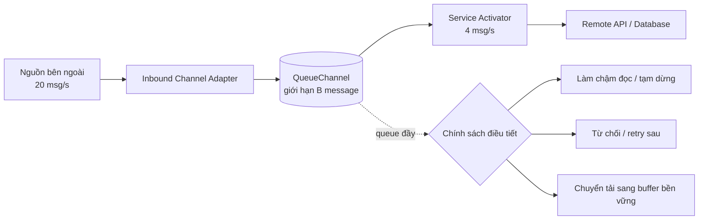
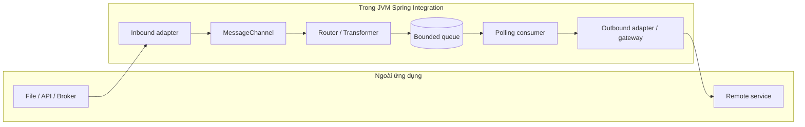
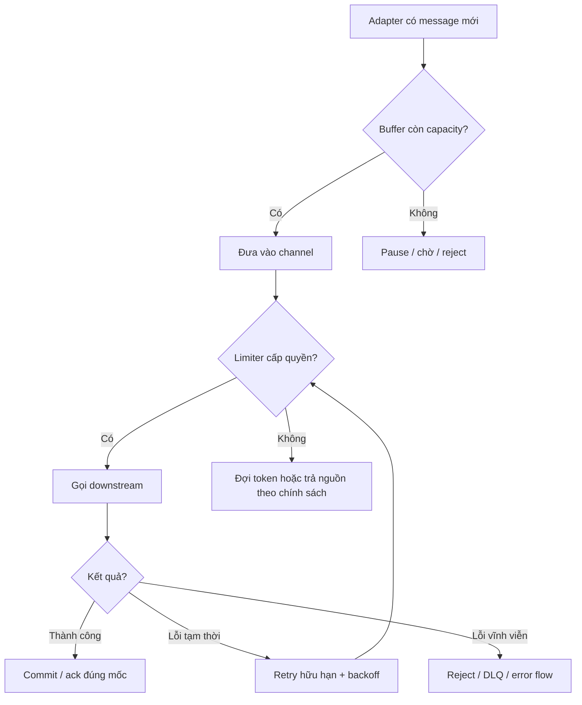
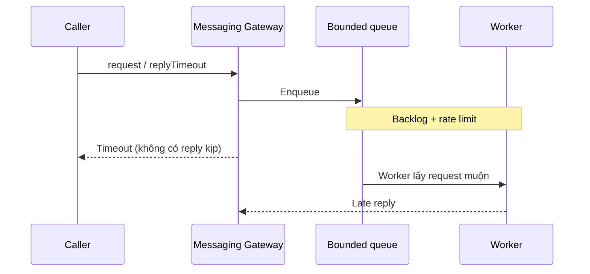

# Channel adapter — Backpressure và giới hạn tốc độ trong Spring Integration

## Mục tiêu học tập

Sau bài này, bạn có thể:

- Giải thích **backpressure**, **rate limiting**, **buffering** và **load shedding** khi Channel Adapter kết nối hệ thống bên ngoài với luồng Spring Integration.
- Chỉ ra điểm nghẽn khi nguồn gửi nhanh hơn bên xử lý, và lý do một `ExecutorChannel` hoặc hàng đợi trong bộ nhớ không tự giải quyết được tải kéo dài.
- Cấu hình `@InboundChannelAdapter` và `@Poller` để điều tiết tần suất đọc dữ liệu; dùng `QueueChannel` có giới hạn dung lượng để quản lý hàng đợi.
- Phân biệt việc giới hạn tốc độ ở đầu vào với giới hạn số lời gọi thực sự tới API/broker ở đầu ra; biết khi nào cần token bucket, semaphore hoặc giới hạn dùng chung giữa nhiều instance.
- Kiểm thử hành vi khi queue đầy, nêu rõ chính sách từ chối, retry, acknowledgement, timeout và quan sát theo `correlationId` để không mất hoặc xử lý trùng message.

Bài thuộc chương **Channel adapter** của module **SPRING_INTEGRATION_PATTERN**. Module sử dụng Enterprise Integration Patterns để ghép các bước Router, Filter, Transformer, Splitter, Aggregator, Gateway, retry, error channel và correlation thành các luồng message ít phụ thuộc, dễ mở rộng và có thể kiểm thử, theo dõi. Khi một adapter đọc từ file, HTTP, database, Kafka/RabbitMQ hoặc đẩy dữ liệu tới hệ thống khác, tốc độ nguồn và tốc độ đích thường khác nhau. Đó là nơi **backpressure và giới hạn tốc độ** trở thành yêu cầu thiết kế cụ thể.

## 1. Vấn đề: nguồn nhanh hơn đích

Giả sử một inbound adapter nhận trung bình **20 message/giây**, còn service xử lý chỉ hoàn thành **4 message/giây**. Nếu không kiểm soát tốc độ hoặc kích thước hàng đợi, số message đang đợi có thể tăng thêm khoảng **16 message/giây** trong giai đoạn tải ổn định.



Một queue có dung lượng 8 message, nếu thực sự nhận vào 20 message/giây và đẩy ra 4 message/giây, sẽ đầy sau khoảng **8 / (20 − 4) = 0,5 giây** kể từ trạng thái rỗng. Đây là ước lượng khi tốc độ đều; trong thực tế tốc độ theo từng đợt, thời gian xử lý, scheduler và nhiều consumer đều làm kết quả thay đổi.

Hàng đợi giúp **hấp thụ các đợt tăng tải ngắn**. Nó không thể xử lý sự mất cân bằng kéo dài nếu năng lực phía đích liên tục nhỏ hơn tốc độ phía nguồn.

### Backpressure khác rate limiting như thế nào?

| Khái niệm | Mục đích | Ví dụ trong Spring Integration |
| --- | --- | --- |
| **Backpressure** | Khi downstream không đủ năng lực, phản hồi áp lực ngược lên upstream để ngừng/chậm gửi | `QueueChannel` có capacity hữu hạn khiến `send` chờ hoặc trả thất bại theo timeout; adapter tạm dừng đọc theo cơ chế nguồn |
| **Rate limiting** | Giới hạn số sự kiện hoặc số request trong một khoảng thời gian | Poller đọc một message mỗi 250 ms; limiter cấp tối đa 100 request/giây cho API |
| **Buffering** | Giữ message tạm để cân bằng những đợt tăng tải | `QueueChannel(8)` hoặc broker queue có giới hạn và chính sách lưu trữ |
| **Concurrency limiting** | Giới hạn số tác vụ đồng thời | Thread pool hữu hạn, semaphore cho tối đa 10 HTTP calls in flight |
| **Load shedding** | Chủ động từ chối/bỏ việc khi đã quá tải, theo quy tắc được chấp nhận | Trả HTTP 429/503, reject một nhóm sự kiện không quan trọng hoặc gửi DLQ phù hợp |

**Backpressure không nhất thiết làm nguồn bên ngoài tự chậm lại.** Một `MessageChannel` đầy có thể làm thread gọi `send()` bị chặn; nhưng nếu nguồn là broker, HTTP push hay một listener độc lập, phải có cơ chế tương ứng để **nack/requeue, pause, tạm ngừng polling hoặc trả lỗi**. Mỗi adapter/transport có hợp đồng riêng.

## 2. Channel Adapter nằm ở đâu trong luồng?

Một **inbound channel adapter** đưa dữ liệu từ bên ngoài thành Spring `Message` và gửi vào `MessageChannel`. Một **outbound channel adapter** nhận Spring Message rồi gửi payload/headers sang hệ thống ngoài; nhiều adapter kiểu này mang tính một chiều, trong khi outbound **gateway** thường tham gia request–reply.



Trong thiết kế, có ít nhất ba nơi cần nhìn:

1. **Trước inbound adapter:** nguồn có giữ được message khi adapter tạm dừng không? Nếu không, cần buffering phù hợp hoặc cơ chế báo từ chối.
2. **Giữa các endpoint:** channel có capacity, chính sách gửi/chờ và consumer phù hợp không?
3. **Trước outbound adapter:** hệ thống đích chịu được tối đa bao nhiêu lời gọi đồng thời và bao nhiêu lời gọi/giây? Có hỗ trợ `429 Retry-After` không?

Không nên chỉ tăng thread pool khi thấy backlog. Điều đó có thể đẩy nhiều lời gọi hơn tới dependency đã quá tải, làm latency và tỷ lệ lỗi tăng.

## 3. Các công cụ điều tiết trong Spring Integration

### 3.1. Polling inbound adapter và `@Poller`

Một polling inbound adapter **chủ động hỏi** nguồn xem có dữ liệu mới hay không. Poller có thể giới hạn số lần poll và số message lấy trong mỗi lần kích hoạt:

```java
@InboundChannelAdapter(
    channel = "boundedJobs",
    poller = @Poller(fixedDelay = "50", maxMessagesPerPoll = "1")
)
public String nextJob() {
    return externalSource.poll();
}
```

Giải nghĩa:

- `fixedDelay = "50"`: poller chờ khoảng 50 ms **sau khi một lượt poll kết thúc** trước lượt tiếp theo. Giá trị là mili giây trong cấu hình annotation minh họa.
- `maxMessagesPerPoll = "1"`: mỗi lượt kích hoạt poller xử lý tối đa một message do source trả về.
- Khi source trả `null`, adapter hiểu rằng lúc này chưa có message; không tạo message nghiệp vụ mới.
- Nếu việc gửi downstream bị chặn do queue đầy, lượt poll có thể bị kéo dài; thời gian thực tế không còn chính xác 50 ms.

Các thông số trên tạo ra một **giới hạn nhịp poll xấp xỉ**, không phải bộ khống chế QPS chính xác. Kể cả cấu hình mỗi lần chỉ lấy một message, nhiều instance chạy song song có thể cùng poll nguồn và tổng số message/giây sẽ tăng. Muốn áp hạn mức chung cho một API hoặc tenant, cần bộ điều tiết dùng chung.

### 3.2. Bounded `QueueChannel`

`QueueChannel` là `PollableChannel`, có thể đặt capacity:

```java
@Bean("boundedJobs")
public QueueChannel boundedJobs() {
    return new QueueChannel(8);
}
```

Khi queue đầy, hành vi của bên gửi phụ thuộc overload/timeout:

- `send(message, 0)` là thử gửi **không chờ**; nếu chưa có chỗ, nó có thể trả `false`.
- `send(message, 500)` cho phép chờ tối đa khoảng 500 ms để có chỗ, rồi trả kết quả theo hợp đồng channel.
- `send(message)` và các endpoint tự động có thể dùng timeout mặc định khác nhau; không giả định chúng luôn fail fast khi đầy.
- Message đã nằm trong queue **chưa phải** đã được xử lý thành công. Với queue mặc định trong RAM, message còn có thể mất khi JVM dừng.

**Capacity** bảo vệ bộ nhớ tại **một queue cụ thể**. Nó không tự giới hạn số message tích tụ ở hệ thống upstream, số request đang xử lý hay lượng backlog trên broker.

### 3.3. Polling consumer để giới hạn nhịp xử lý

Service Activator có thể poll từ `QueueChannel` theo nhịp riêng:

```java
@ServiceActivator(
    inputChannel = "boundedJobs",
    poller = @Poller(fixedDelay = "250", maxMessagesPerPoll = "1")
)
public void dispatch(String jobId) {
    downstreamService.process(jobId);
}
```

Nếu chỉ có một consumer, một message mỗi lượt và `fixedDelay=250` ms, nhịp hoàn tất danh nghĩa **không vượt khoảng bốn lượt/giây** khi xử lý rất nhanh. Vì fixed delay được tính sau khi poll kết thúc, nếu service chạy 100 ms mỗi lượt thì nhịp thực tế có thể còn thấp hơn.

Đây là cách đơn giản để làm **thưa** lượt gọi khi một outbound service có thể xử lý tuần tự. Nó không tự giải quyết giới hạn như “cho phép burst 20 request, trung bình 5 request/giây”, “200 request/giây tính trên 5 instance” hoặc “10 request đồng thời”. Những yêu cầu đó nên có limiter/bulkhead chuyên dụng.

### 3.4. `DirectChannel` và `ExecutorChannel` ảnh hưởng thế nào?

| Channel | Khi consumer chậm | Lưu ý về backpressure |
| --- | --- | --- |
| `DirectChannel` | Thread gửi thường chạy handler đồng bộ | Caller có thể bị giữ lâu; không có hàng đợi đệm riêng |
| `QueueChannel` hữu hạn | Message đợi cho consumer poll; queue có thể đầy | Có thể trả false hoặc chặn send theo timeout; cần chính sách nguồn |
| `ExecutorChannel` | Handler chạy ở executor khác | Executor và work queue có thể vẫn tăng; cần giới hạn pool/queue và chính sách từ chối |
| `PublishSubscribeChannel` | Một message có thể đến nhiều subscriber | Một subscriber chậm/lỗi có thể ảnh hưởng fan-out theo executor và cấu hình |
| Broker queue | Message nằm ngoài JVM theo cấu hình broker | Cần kiểm soát unacked, prefetch, ack/nack, backlog và quota |

Không có một loại channel nào tự bảo đảm **end-to-end flow control** giữa mọi service. Cần kết hợp channel, adapter, chính sách transport và giới hạn tại đích.

## 4. Ví dụ: inbound adapter, bounded queue và consumer có nhịp riêng

Ta thiết kế một luồng minh họa:

- `PendingJobSource` nhận ID công việc vào hàng đợi nội bộ (giả lập nguồn bên ngoài).
- `@InboundChannelAdapter` poll mỗi 50 ms, tối đa một job mỗi lượt, đưa vào `boundedJobs`.
- `QueueChannel(8)` đệm tối đa tám message.
- `@ServiceActivator` poll một job mỗi 250 ms và xử lý.
- Khi hàng đợi downstream đầy, inbound send có thể bị chặn hoặc hết timeout tùy cấu hình endpoint; **không được xem việc lấy job khỏi nguồn đồng nghĩa nó đã được xử lý**.

Dùng Java 17 và Spring Boot với `spring-boot-starter-integration`. Ví dụ tách thành ba class trong cùng package, minh họa đúng cơ chế poll và queue; phần xử lý downstream chỉ in log để không cần hệ thống ngoài.

### 4.1. Cấu hình channel và đăng ký hai endpoint

`FlowControlConfiguration.java`:

```java
import org.springframework.context.annotation.Bean;
import org.springframework.context.annotation.Configuration;
import org.springframework.integration.annotation.EnableIntegration;
import org.springframework.integration.channel.QueueChannel;

@Configuration
@EnableIntegration
public class FlowControlConfiguration {

    @Bean("boundedJobs")
    public QueueChannel boundedJobs() {
        return new QueueChannel(8);
    }

    @Bean
    public PendingJobSource pendingJobSource() {
        return new PendingJobSource();
    }

    @Bean
    public JobDispatcher jobDispatcher() {
        return new JobDispatcher();
    }
}
```

Không cần một `DirectChannel` trung gian cho ví dụ; adapter sẽ gửi trực tiếp vào bean `boundedJobs` và consumer sẽ poll từ chính channel này.

### 4.2. Inbound adapter đọc source

`PendingJobSource.java`:

```java
import java.util.concurrent.ArrayBlockingQueue;
import java.util.concurrent.BlockingQueue;

import org.springframework.integration.annotation.InboundChannelAdapter;
import org.springframework.integration.annotation.Poller;

public class PendingJobSource {

    // Chỉ để minh họa; nguồn RAM sẽ mất sau restart.
    private final BlockingQueue<String> waiting =
        new ArrayBlockingQueue<>(200);

    public boolean offer(String jobId) {
        return waiting.offer(jobId);
    }

    @InboundChannelAdapter(
        channel = "boundedJobs",
        poller = @Poller(
            fixedDelay = "50",
            maxMessagesPerPoll = "1"
        )
    )
    public String nextJob() {
        return waiting.poll();  // null khi chưa có job
    }
}
```

`waiting` cũng có capacity hữu hạn để tránh một hàng đợi upstream vô hạn trong demo. Phương thức `offer` trả `false` khi nguồn giả lập đã đầy; phía gọi phải kiểm tra kết quả đó và chọn reject/retry hoặc lưu bền vững.

**Giới hạn quan trọng:** `waiting.poll()` lấy job ra khỏi nguồn RAM **trước khi** adapter gửi thành công vào `boundedJobs`. Nếu JVM chết hoặc quá trình gửi lỗi giữa hai bước, job có thể mất. Không dùng demo này như một cơ chế giao hàng tin cậy. Khi tích hợp broker, database hoặc file thực tế, phải thiết kế theo khả năng ack/commit/rollback/re-read của nguồn. Với tác vụ có giá trị nghiệp vụ, chỉ xác nhận nguồn khi đã hoàn tất điểm bàn giao được bảo đảm theo hợp đồng.

### 4.3. Consumer poll chậm hơn nguồn

`JobDispatcher.java`:

```java
import org.springframework.integration.annotation.Poller;
import org.springframework.integration.annotation.ServiceActivator;

public class JobDispatcher {

    @ServiceActivator(
        inputChannel = "boundedJobs",
        poller = @Poller(
            fixedDelay = "250",
            maxMessagesPerPoll = "1"
        )
    )
    public void dispatch(String jobId) {
        // Trong hệ thống thật: gửi tới API hoặc xử lý nghiệp vụ.
        System.out.println("Processed job: " + jobId);
    }
}
```

Để nạp một loạt job vào source trong một ứng dụng Spring Boot:

```java
@Bean
ApplicationRunner seed(PendingJobSource source) {
    return args -> {
        for (int i = 1; i <= 40; i++) {
            boolean accepted = source.offer("JOB-" + i);
            if (!accepted) {
                throw new IllegalStateException(
                    "Source queue full at job " + i
                );
            }
        }
    };
}
```

Đoạn `ApplicationRunner` là một bean tùy chọn trong một lớp `@Configuration` của Spring Boot; cần import `org.springframework.boot.ApplicationRunner` và `org.springframework.context.annotation.Bean`. Việc nhận 40 job vào `waiting` thành công **không** có nghĩa 40 job đã được gửi tới channel hoặc xử lý xong.

Trong ví dụ này, tốc độ inbound danh nghĩa khoảng 20 lượt poll/giây trong điều kiện lý tưởng, còn consumer hoàn thành khoảng bốn lượt/giây khi handler rất nhanh. `boundedJobs` sẽ có xu hướng đầy. Tuy nhiên thread adapter có thể bị chặn khi gửi vào channel đầy; khi đó tốc độ đọc thực tế giảm. Đây chính là sự lan truyền áp lực trong phạm vi ứng dụng, nhưng cơ chế đảm bảo **không mất job** vẫn phải được thiết kế riêng như đã nêu.

### 4.4. Kiểm thử queue đầy không mất thời gian chờ

Kiểm thử JUnit 5 này kiểm tra capacity và cách gửi không chờ. Nó độc lập với poller, nên kết quả không phụ thuộc thời điểm scheduler:

```java
import static org.junit.jupiter.api.Assertions.assertEquals;
import static org.junit.jupiter.api.Assertions.assertFalse;
import static org.junit.jupiter.api.Assertions.assertNotNull;
import static org.junit.jupiter.api.Assertions.assertTrue;

import org.junit.jupiter.api.Test;
import org.springframework.integration.channel.QueueChannel;
import org.springframework.messaging.Message;
import org.springframework.messaging.support.MessageBuilder;

class BoundedChannelTest {

    @Test
    void rejectsNewMessageWhenCapacityIsExhausted() {
        QueueChannel channel = new QueueChannel(2);

        assertTrue(channel.send(
            MessageBuilder.withPayload("JOB-1").build(), 0));
        assertTrue(channel.send(
            MessageBuilder.withPayload("JOB-2").build(), 0));

        // Không còn chỗ; gửi với timeout=0 phải trả false.
        assertFalse(channel.send(
            MessageBuilder.withPayload("JOB-3").build(), 0));

        Message<?> first = channel.receive(0);
        assertNotNull(first);
        assertEquals("JOB-1", first.getPayload());

        // Sau khi một slot trống, có thể nhận thêm job.
        assertTrue(channel.send(
            MessageBuilder.withPayload("JOB-3").build(), 0));
    }
}
```

Kiểm thử này chứng minh `QueueChannel` giới hạn độ dài hàng đợi. Nó **không chứng minh** giới hạn QPS end-to-end, việc ack sau xử lý, độ bền sau restart hay không có message trùng khi retry. Các đặc tính đó cần kiểm thử bổ sung trên adapter/transport thật.

## 5. Từ giới hạn nhịp poll đến giới hạn tốc độ thực sự

### 5.1. Vì sao `fixedDelay` không phải rate limiter toàn cục?

Xét yêu cầu “API ngoài chỉ cho phép 100 request/giây trên toàn hệ thống”:

- Một instance Spring Integration poll một message mỗi 10 ms có thể tạo khoảng 100 lượt/giây trong điều kiện lý tưởng, nhưng thời gian xử lý không cố định.
- Ba instance cùng cấu hình có thể gửi gần 300 lượt/giây.
- Một handler có retry nội bộ hai lần có thể tạo **ba HTTP request cho một message** dù poller chỉ phát một message.
- Một message có thể qua Splitter tạo nhiều lời gọi hoặc qua Router fan-out sang nhiều nhánh.

Vì vậy phải giới hạn ngay **điểm phát request thực tế** (hoặc một nhóm điểm phát có chung quota), tính cả retry và phân nhánh. Dùng token bucket hoặc quota phân tán nếu có nhiều instance và cần giới hạn tổng. Cấu hình poller chỉ là một phần của bài toán.

### 5.2. Token bucket, leaky bucket và semaphore

| Cơ chế | Bảo đảm chính | Khi nên dùng |
| --- | --- | --- |
| Poller theo `fixedDelay` / `maxMessagesPerPoll` | Giới hạn nhịp lấy message tại endpoint cụ thể | Nguồn polling đơn giản, tốc độ gần đều |
| **Token bucket** | Bình chứa token được nạp theo tốc độ; cho phép burst tối đa theo capacity | API có quota request/giây và cho phép burst |
| **Leaky bucket / paced queue** | Xả công việc đều theo lịch | Dịch vụ đích không thích burst |
| **Semaphore / bulkhead** | Giới hạn số request **đang chạy đồng thời** | API phản hồi chậm nhưng quota QPS riêng |
| **Distributed limiter** | Chia sẻ quota giữa nhiều JVM | Nhiều replica chung một hạn mức của nhà cung cấp |

Giả sử chính sách: nạp 10 token/giây, bình có tối đa 20 token. Ban đầu một burst có thể dùng tối đa 20 token; về lâu dài tốc độ trung bình bị giới hạn bởi tốc độ nạp. Nhưng **20 request đồng thời** lại là một giới hạn khác và cần semaphore, vì dù trung bình thấp vẫn có thể dồn nhiều request trong một thời điểm.

Đặt limiter trước HTTP call/AMQP publish, kể cả khi call đang chạy trong `@ServiceActivator` hoặc outbound gateway. Nếu limiter không cấp quyền kịp deadline, phải **đợi, retry theo lịch, từ chối hoặc giữ lại message** theo chính sách rõ ràng; tránh xóa message khỏi nguồn rồi bỏ qua silently.

### 5.3. HTTP 429 và `Retry-After`

Nếu API đích trả `429 Too Many Requests`, client nên xem xét header `Retry-After` (số giây hoặc HTTP date) và dùng backoff phù hợp. Tuy nhiên:

- Không retry vô hạn trong cùng handler khi hệ thống liên tục bị throttling.
- Không để các tầng (Gateway, HTTP SDK, Spring Retry, queue consumer) cùng retry mà không tính ngân sách tổng.
- Không vượt deadline nghiệp vụ hoặc `replyTimeout` của caller khi có request–reply đồng bộ.
- Nếu lệnh có side effect, retry phải mang lại cùng idempotency key; read timeout không chứng minh remote chưa thực hiện.
- Ghi số lượt retry, thời gian đợi token và số lần bị 429 để xác định liệu quota đang là nút thắt.

Ví dụ API giới hạn 50 request/giây và mỗi message retry tối đa ba lần: nếu limiter chỉ đếm **message**, số HTTP request thực tế vẫn có thể vượt quota. Token phải được cấp cho **mỗi attempt** thực tế.

## 6. Chính sách khi queue đầy: chặn, từ chối hay lưu ngoài?

Khi buffer bão hòa, chọn một trong các hướng phù hợp với nguồn:

| Phương án | Ưu điểm | Giới hạn/rủi ro |
| --- | --- | --- |
| **Block sender có timeout** | Truyền áp lực ngược nếu upstream có thể chờ | Có thể giữ thread và tạo thread starvation |
| **Reject / fail fast** | Giới hạn RAM và latency; báo rõ quá tải | Upstream phải xử lý lỗi và retry an toàn |
| **Pause polling** | Chủ động giảm tải trước khi lấy message từ nguồn | Phụ thuộc loại adapter/source; cần resume và quan sát |
| **Buffer trên broker/durable store** | Giữ backlog ngoài JVM, hỗ trợ crash/restart theo cấu hình | Phải quản trị backlog, storage quota, TTL và DLQ |
| **Drop có chủ đích** | Bảo vệ hệ thống với dữ liệu không quan trọng | Không chấp nhận được cho lệnh tài chính hoặc sự kiện bắt buộc |

Một lỗi phổ biến là dùng `Executors.newCachedThreadPool()` hoặc unbounded work queue để “giải quyết quá tải”. Cách này chỉ dời điểm nghẽn sang thread, heap hoặc downstream; khi tải kéo dài, memory và latency vẫn tăng.

Nếu áp dụng **CallerRunsPolicy** với một executor hữu hạn, thread của bên gửi có thể phải tự chạy việc xử lý, tạo một dạng áp lực ngược. Nhưng với HTTP listener, broker listener hoặc poller scheduler, giữ thread như vậy có thể làm giảm responsiveness hoặc gây lỗi timeout. Cần đánh giá điểm gọi và hợp đồng ack trước khi chọn chính sách.

### Quy tắc dành cho inbound adapter

Tùy nguồn, việc giảm tải có ý nghĩa rất khác:

- **JDBC / file polling:** điều chỉnh nhịp poll, batch size; tránh đánh dấu bản ghi là đã xử lý trước khi bàn giao thành công.
- **Kafka consumer:** cân nhắc pause/resume, số records mỗi poll, `max.poll.interval.ms`, offset commit và cách giữ nhịp heartbeat khi xử lý chậm. Chỉ commit sau khi điểm xử lý phù hợp đã hoàn tất.
- **RabbitMQ listener:** điều chỉnh `prefetch`, số consumer, ack/nack/requeue và DLQ. Một queue nội bộ đầy không tự khiến RabbitMQ chậm đi nếu listener đã ack trước khi xử lý.
- **HTTP inbound:** không thể yêu cầu client luôn tự chậm bằng một `QueueChannel`; cần giới hạn concurrency và trả 429/503 (nếu hợp đồng API cho phép) kèm hướng dẫn retry.
- **Stream source:** nếu API có cơ chế yêu cầu số phần tử (demand) hoặc pause/resume, có thể truyền áp lực theo khả năng transport. Không mặc định mọi adapter của Spring Integration đều hỗ trợ Reactive Streams backpressure.

**Nguyên tắc delivery:** một nguồn có ack/commit phải giữ quyền giao lại hoặc lưu kết quả bền vững cho đến khi phần xử lý tương ứng đạt mốc an toàn. Nếu ack trước khi message được đảm bảo, sự cố giữa các bước có thể làm mất việc.

## 7. Quan hệ với retry, error channel và request–reply

### 7.1. Backpressure không phải retry

Backpressure nói **chưa nên gửi thêm bao nhiêu hoặc nhanh thế nào**. Retry nói **một attempt thất bại có nên làm lại hay không**.



Một hệ thống vận hành tốt phải giới hạn cả **số message mới**, **số retry**, **số lời gọi đồng thời** và **backlog**. Nếu chỉ giảm nhịp inbound mà handler có retry không giới hạn, đích vẫn có thể bị quá tải.

### 7.2. Error channel

Trong Spring Integration, `errorChannel` dùng để xử lý `ErrorMessage` ở các luồng có cơ chế chuyển lỗi vào channel đó. Hành vi lỗi khác nhau giữa xử lý đồng bộ và bất đồng bộ:

- `DirectChannel` thường cho exception từ handler lan về caller đồng bộ.
- `ExecutorChannel` hoặc polling endpoint chạy trong thread khác; lỗi có thể chuyển qua cơ chế error handler/error channel theo cấu hình.
- Nếu handler ở poller bị lỗi sau khi đã lấy message khỏi một `QueueChannel` trong RAM, cần xem lại cơ chế retry/recovery; không nên mặc định message được tái đưa vào queue.
- Error channel của ứng dụng **không thay thế** nack/requeue của RabbitMQ, offset commit của Kafka hoặc transaction của database.

Khi overload khiến việc gửi vào channel không thành công, cần log có cấu trúc và đưa message sang xử lý thích hợp. Không nuốt exception rồi đánh dấu source message đã xử lý.

### 7.3. Gateway timeout và late reply

Một caller có thể đợi reply tối đa 300 ms, trong khi request đứng chờ trong queue 1 giây. Gateway sẽ có nguy cơ timeout trước khi handler tạo reply. Nếu xử lý tiếp tục chạy bất đồng bộ, reply sau đó là **late reply**:



Timeout của Gateway không tự hủy công việc trong queue. Khi dùng request–reply qua broker, cần correlation ID, reply destination, mốc deadline và chính sách xử lý late reply. Với lệnh có side effect, caller retry sau timeout có thể khiến công việc chạy hai lần nếu không có idempotency.

Nếu nghiệp vụ thường dài hơn thời hạn chờ đồng bộ, nên tách thành lệnh bất đồng bộ: trả `requestId`, lưu trạng thái và cho caller hỏi lại hoặc nhận thông báo sau.

## 8. Sizing buffer và giới hạn tải

Đặt:

- `λ`: tốc độ đến trung bình (message/giây).
- `μ`: tốc độ xử lý bền vững của consumer (message/giây).
- `B`: dung lượng buffer (message).

Nếu `λ > μ` liên tục, tồn đọng tăng theo tốc độ gần `λ − μ` message/giây trước khi biện pháp chặn/từ chối có hiệu lực. Thời gian lấp đầy ước lượng từ queue rỗng:

\[
t_{\text{full}} \approx \frac{B}{\lambda-\mu}
\]

Ví dụ `λ=20`, `μ=4`, `B=8` thì `t_full≈0,5` giây, như đầu bài. Khi `λ < μ` về dài hạn, hệ thống có khả năng rút backlog, nhưng không đồng nghĩa sẽ không có đợt burst tạm gây đầy buffer.

Định luật Little (`L = λW`) có thể giúp ước lượng số tác vụ trung bình trong hệ thống ở **trạng thái ổn định**, với `L` là số message đang ở hệ thống, `λ` là throughput đã hoàn tất và `W` là thời gian trung bình của một message. Không áp dụng trực tiếp nó cho một hệ thống đang quá tải tăng backlog vô hạn hoặc xem nó là công thức chọn capacity chỉ từ giá trị trung bình.

Trong thực tế, cần xem **p95/p99 latency**, độ dài hàng đợi theo thời gian, arrival burst, số worker, tốc độ remote trả lỗi/429 và retry amplification. Sizing buffer dựa trên mục tiêu thời gian chờ chấp nhận được, không chỉ dựa trên lượng RAM còn trống.

## 9. Kiểm thử áp lực và khả năng phục hồi

Ngoài `BoundedChannelTest`, cần các bài kiểm thử có ý nghĩa:

1. **Saturation:** tạo burst lớn hơn `B`, xác minh queue không tăng vô hạn và producer có hành vi rõ ràng khi đầy.
2. **Rate limiting:** dùng clock/limiter có thể điều khiển trong test; xác minh số *HTTP attempts* trong một cửa sổ thời gian phù hợp. Không khẳng định QPS chính xác chỉ từ `fixedDelay`.
3. **Downstream chậm:** làm remote mất 2 giây mỗi request, đo backlog, số inflight và thời gian caller chờ.
4. **HTTP 429:** giả lập `Retry-After`; xác minh retry có backoff và tổng attempt không vượt budget.
5. **Crash giữa source read và send:** kiểm tra thông điệp không bị mất hoặc quy định rõ giới hạn nếu nguồn RAM không bền vững.
6. **Crash sau side effect trước ack:** bảo đảm redelivery không gây ghi trùng, dùng idempotency key hoặc event ID.
7. **Multi-instance:** tăng số replica, kiểm tra giới hạn toàn hệ thống thay vì chỉ giới hạn từng poller.
8. **Request–reply:** cho backlog lớn hơn `replyTimeout`, quan sát timeout và late reply, không gửi reply cũ sang request mới.

Với RabbitMQ/Kafka, test tích hợp phải chạy trên broker có cấu hình phù hợp và xác minh ack/offset thật. Với HTTP, có thể dùng MockWebServer hoặc stub server có thể đo số request. Các phép thử trên được dành cho giai đoạn kiểm thử tích hợp/chất lượng chuyên môn tiếp theo; bài hiện tập trung minh họa cơ chế và cách thiết kế.

### Chỉ số vận hành cần theo dõi

| Nhóm | Metric / dấu hiệu | Ý nghĩa |
| --- | --- | --- |
| Nguồn | Arrival rate, poll duration, source backlog | Nguồn đang đẩy nhanh hơn mức xử lý? |
| Channel | Queue depth, capacity utilization, thời gian `send()` bị chặn, rejected send | Đã xuất hiện backpressure hay mất khả năng tiếp nhận? |
| Consumer | Throughput, processing latency p95/p99, số inflight | Nút thắt là CPU, I/O hay giới hạn đồng thời? |
| Remote | 429/503, connect/read timeout, retry attempts | Rate limit và overload của dependency |
| Delivery | Ack latency, redelivery, DLQ, dedup hit | Có mất/trùng việc do cơ chế delivery không? |
| Request–reply | Gateway timeout, late reply, correlation mismatch | Caller chờ quá hạn hoặc reply đi sai đường |

Gắn `correlationId`/`eventId` phù hợp vào log/trace để nối từ inbound adapter đến outbound gateway hoặc broker consumer. Không ghi toàn bộ payload hoặc header chứa secret chỉ để debug quá tải.

## 10. Những sai lầm phổ biến

| Sai lầm | Hậu quả | Cách khắc phục |
| --- | --- | --- |
| Dùng `QueueChannel` không giới hạn để “giải quyết” tải | Memory tăng, latency tích tụ | Bounded queue, áp lực ngược hoặc buffer bền vững |
| Coi `fixedDelay=100` là chính xác 10 request/giây toàn cluster | Nhiều replica/retry làm vượt quota | Limiter tại điểm phát attempt và quota dùng chung |
| Chỉ giảm nhịp inbound nhưng handler retry liên tục | Remote vẫn nhận nhiều request | Giới hạn cả attempt và backoff |
| Đọc message khỏi nguồn rồi mới phát hiện queue đầy | Có thể mất message giữa read và send | Ack sau điểm an toàn, retry/redelivery hoặc transaction phù hợp |
| Ack RabbitMQ trước khi xử lý ở executor xong | Message có thể mất khi worker chết | Ack sau commit hoặc lưu công việc bền vững trước ack |
| Thấy `send()` trả `true` rồi báo “đã hoàn tất” | Nhầm chấp nhận vào channel với hoàn thành nghiệp vụ | Xác minh kết quả ở consumer hoặc durable status |
| Tăng số thread khi remote đang 429/503 | Làm áp lực lên remote tăng | Limiter, bulkhead, backoff, circuit breaker |
| Timeout Gateway được hiểu là đã hủy request | Worker vẫn thực hiện side effect | Correlation, idempotency, late reply policy |
| Drop message khi đầy mà không thống kê | Mất dữ liệu khó phát hiện | Quy định drop rõ ràng, metric, cảnh báo và DLQ nếu phù hợp |
| Một poller bị block giữ hết thread scheduler | Các poller khác trễ hoặc ngừng tiến | Giới hạn block time, quản lý scheduler pool, phân chia tài nguyên |

## 11. Bài tập thực hành

**Bài 1 — Đo tốc độ tiêu thụ.** Chạy `PendingJobSource` và `JobDispatcher`. Gửi 40 job, đo số job xử lý mỗi giây và độ sâu queue theo thời gian. So sánh với kỳ vọng khoảng bốn lượt/giây trong điều kiện handler nhanh.

**Bài 2 — Điều chỉnh buffer.** Đổi `QueueChannel(8)` thành `QueueChannel(2)`. Xác minh gửi không chờ bằng `send(message, 0)` có thể thất bại khi đủ hai phần tử và hoạt động lại sau khi consumer lấy ra một phần tử.

**Bài 3 — Giới hạn outbound.** Thay `System.out.println` bằng gọi một HTTP API giả lập chỉ cho phép năm request/giây, trả 429 khi vượt ngưỡng. So sánh chỉ dùng poller và dùng limiter tại từng HTTP attempt.

**Bài 4 — Nhiều instance.** Giả lập ba worker instance cùng gửi tới một API có quota toàn cluster. Thiết kế token bucket/quota chung và giải thích tại sao ba limiter cục bộ chưa đủ.

**Bài 5 — Failure và ack.** Dùng broker thử nghiệm. Tạo lỗi sau khi handler ghi DB nhưng trước khi ack. Thiết kế redelivery cùng `eventId` và cơ chế dedup trong transaction.

**Bài 6 — Request–reply bị nghẽn.** Cho gateway chờ 500 ms nhưng queue backlog khiến handler xử lý sau hơn một giây. Ghi log correlation, nhận diện late reply và trình bày chính sách trả trạng thái bất đồng bộ.

**Tiêu chí hoàn thành:** giải thích được nơi phát sinh áp lực, cách upstream nhận biết hoặc bị từ chối, capacity và tốc độ có giới hạn ở đâu, mốc ack/commit an toàn, cũng như hệ quả khi source hoặc worker crash.

## 12. Ghi nhớ

- **Backpressure** điều chỉnh upstream khi downstream không theo kịp; **rate limiting** áp trần tốc độ; **buffering** chỉ hấp thụ tải tạm thời; **load shedding** chủ động bỏ/từ chối tải theo hợp đồng.
- `@InboundChannelAdapter` với `@Poller` hỗ trợ điều chỉnh nhịp đọc; `QueueChannel` hữu hạn giúp giới hạn backlog trong một JVM. Không mặc định chúng tạo quota QPS toàn cluster.
- `maxMessagesPerPoll` là giới hạn message trong **một lượt kích hoạt**, còn `fixedDelay` là khoảng chờ giữa các lượt; tốc độ thực tế còn phụ thuộc thời gian xử lý và concurrency.
- Khi broker hoặc API nằm ở ranh giới, phải phối hợp pause, ack/nack, commit, retry, error channel, correlation, idempotency và deadline; một queue nội bộ đầy không tự giải quyết delivery semantics.
- Cần đo queue depth, latency, retry attempts và 429/503 ở điểm phát request thực tế. Nếu `λ > μ` kéo dài, phải giảm nguồn, tăng năng lực đích trong giới hạn cho phép hoặc điều chỉnh nhu cầu nghiệp vụ.
