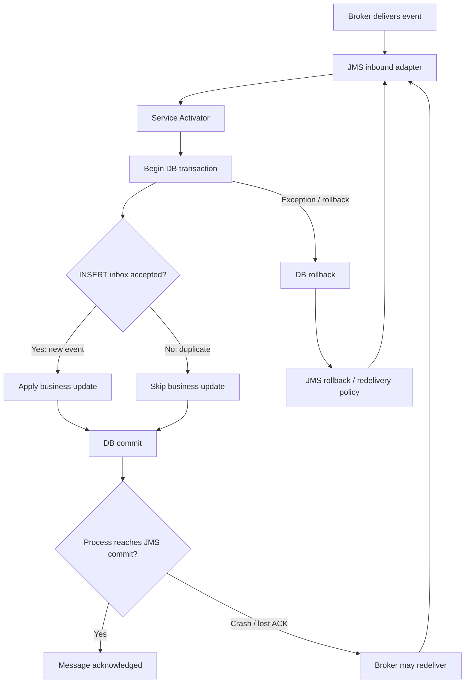
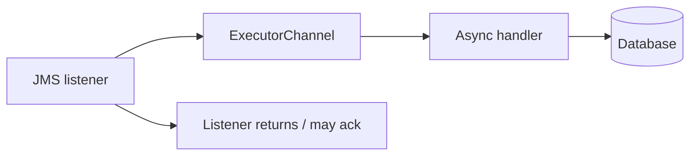

# Idempotency khi adapter redeliver

## 1. Bối cảnh: một sự kiện có thể được nhận nhiều lần

Trong Spring Integration, **Channel Adapter** nối hệ thống bên ngoài (message broker, tệp, FTP/SFTP, cơ sở dữ liệu, v.v.) với một luồng `Message`. Inbound adapter lấy hoặc nhận dữ liệu rồi chuyển thành message qua channel; outbound adapter chuyển message ra hệ thống đích. Sau đó, `Filter`, `Transformer`, `Router`, `Service Activator` hoặc các endpoint khác xử lý theo cấu trúc Enterprise Integration Patterns (EIP).

Khi một inbound adapter kết nối tới broker, cùng **một sự kiện nghiệp vụ** có thể được giao lại (*redelivery*). Nếu handler cộng điểm thưởng, trừ tồn kho hoặc tạo hóa đơn mỗi lần được gọi, một sự kiện có thể gây nhiều lần thay đổi dữ liệu dù phía phát chỉ muốn tạo một hiệu ứng.

**Idempotency** là tính chất: áp dụng cùng một thao tác nhiều lần vẫn cho **kết quả nghiệp vụ tương đương áp dụng một lần**, trong phạm vi khóa và thời gian đã thiết kế. Ví dụ, với sự kiện `evt-501: cộng 50 điểm cho tài khoản A`, xử lý lần thứ hai phải không cộng thêm 50 điểm.

Bài này thuộc chương **Channel adapter** của module `SPRING_INTEGRATION_PATTERN`, nơi học triển khai Router, Filter, Transformer, Splitter, Aggregator, Gateway, retry, error channel và correlation trong các luồng Spring Integration ít phụ thuộc, dễ kiểm thử và theo dõi. Trọng tâm là bảo vệ dữ liệu khi adapter đưa lại message; khái niệm transaction và retry được xét tại **ranh giới nhận message**.

Sau bài học, bạn có thể:

- Giải thích vì sao redelivery xuất hiện ngay cả khi consumer đã ghi DB thành công.
- Chọn **định danh idempotency ổn định**, tách biệt ID của lần giao và ID phục vụ correlation.
- Dùng **transactional inbox** và unique constraint để chống xử lý trùng, kể cả khi nhiều consumer chạy song song.
- Hiểu vị trí, ích lợi và giới hạn của `IdempotentReceiverInterceptor`, `MetadataStore` và các filter của polling adapter.
- Kiểm thử crash, retry, duplicate, xử lý bất đồng bộ và quan sát hiệu quả dedup.

## 2. Redelivery là gì, khác duplicate thế nào?

**Redelivery** là hệ thống nguồn giao lại cùng message/event vì chưa có xác nhận xử lý đáng tin cậy, do timeout, consumer bị dừng, transaction rollback, broker rebalance hoặc chính sách retry. **Duplicate** là những lần xử lý trùng cùng một *ý định nghiệp vụ*; duplicate có thể do redelivery, producer gửi lặp, relay outbox publish lại hoặc thao tác phát lại thủ công.

Trong thiết kế hệ thống, đừng đồng nhất hai thứ:

| Hiện tượng | Điều quan sát được | Ý nghĩa |
| --- | --- | --- |
| Broker redelivery | Cùng message được consumer nhận lại sau lần trước chưa ack/commit thành công. | Giao lại thường được broker/container quản lý. |
| Producer duplicate | Hai message riêng nhưng cùng `eventId` hoặc cùng ý định nghiệp vụ. | Chống trùng dựa vào ID do ứng dụng định nghĩa. |
| Replay vận hành | Người vận hành phát lại sự kiện từ DLQ, Kafka offset cũ hoặc lưu trữ. | Có thể xảy ra rất lâu sau lần xử lý đầu tiên. |
| Retry nội bộ | Handler hoặc lời gọi RPC được thử lại ngay trong một lần nhận. | Không nhất thiết có một lần broker redelivery mới. |

Các nguồn hay gặp:

- **JMS/AMQP:** consumer chưa xác nhận, transacted session rollback, mất kết nối trước ack/commit hoặc broker trả message về queue.
- **Kafka:** consumer đã thực hiện side effect nhưng chưa commit offset; một consumer khác nhận lại partition khi rebalance hoặc khởi động lại.
- **Polling adapter** như file/SFTP/JDBC: poll lặp lại cùng nguồn khi chưa có watermark/checkpoint, filter bị reset hoặc trạng thái “đã nhìn thấy” không được lưu bền vững.
- **HTTP/webhook adapter:** phía gửi có thể retry khi không nhận được phản hồi rõ ràng dù server đã xử lý.

### 2.1. Khoảng lỗi điển hình

```mermaid
sequenceDiagram
    participant B as Broker
    participant A as Inbound channel adapter
    participant H as Service Activator
    participant D as PostgreSQL
    B->>A: Deliver evt-501
    A->>H: Message(evt-501)
    H->>D: Commit cộng 50 điểm và lưu evt-501
    D-->>H: COMMIT OK
    Note over A,B: Process crash trước broker ACK
    B->>A: Redeliver evt-501
    A->>H: Message(evt-501) lần hai
    H->>D: Kiểm tra khóa evt-501
    D-->>H: Đã xử lý; không cộng lần nữa
    H-->>A: Success
    A-->>B: ACK / commit
```

Khi chỉ có **DB transaction** và một **broker transaction/ack** độc lập, luôn tồn tại khả năng DB đã commit nhưng broker chưa ghi nhận thành công. Việc redeliver trong tình huống này là hành vi phục hồi có thể dự kiến. Nhiệm vụ của idempotent consumer là biến nó thành thao tác **an toàn**.

## 3. Xác định khóa idempotency đúng với nghiệp vụ

Giải pháp chống trùng phụ thuộc vào **cách nhận diện hai lần giao thuộc cùng một hiệu ứng**.

Đối với event `LoyaltyPointsGranted`, khóa có thể là `(consumerName, eventId)`. Đối với API “tạo thanh toán”, khóa có thể là `(merchantId, idempotencyKey)` kèm thông tin hash nội dung request để phát hiện cùng khóa nhưng payload khác. Đối với cập nhật trạng thái theo version, có thể cần thêm `aggregateId` và `sequence` để xử lý thứ tự.

| Định danh | Vai trò phù hợp | Cảnh báo |
| --- | --- | --- |
| `eventId` do producer cấp và giữ nguyên khi retry/replay | Nhận diện một sự kiện nghiệp vụ qua nhiều lần giao. | Cần quy ước uniqueness và chống thay đổi ID khi phát lại. |
| `(consumerName, eventId)` | Cho phép nhiều consumer nghiệp vụ độc lập xử lý cùng event. | Không dùng một khóa toàn hệ thống nếu hai consumer có hiệu ứng riêng. |
| `orderId` hoặc `paymentId` | Nhận diện thực thể nghiệp vụ. | Một thực thể có thể có nhiều sự kiện hợp lệ, nên thường không đủ để dedup event. |
| `MessageHeaders.ID` của Spring Integration | Theo dõi instance message được tạo trong integration flow. | Có thể được tạo mới ở lần chuyển đổi/giao khác; không dùng làm khóa dedup ổn định. |
| Broker delivery tag / consumer offset | Theo dõi lần giao hoặc vị trí đọc. | Không đại diện cho cùng ý định nghiệp vụ ở các lần publish độc lập. |
| `correlationId` / trace ID | Ghép các nhánh request, split/aggregate và truy vết. | Nhiều sự kiện khác nhau có thể cùng một correlation ID. |

**Nguyên tắc:** khóa idempotency phải tồn tại *trước* khi message đi vào adapter và được bảo toàn qua retry, redelivery, chuyển DLQ và replay. Nếu producer không có event ID, phải định nghĩa khóa từ dữ liệu nghiệp vụ bất biến với chính sách va chạm rõ ràng; tránh hash toàn payload khi những trường như timestamp, attempt hay tracing thay đổi theo mỗi lần phát.

Ví dụ:

```json
{
  "eventId": "evt-501",
  "eventType": "LoyaltyPointsGranted",
  "accountId": "A-17",
  "points": 50,
  "occurredAt": "2026-11-21T05:00:00Z",
  "correlationId": "checkout-88"
}
```

Nếu event này giao lại 3 lần, cả 3 lần phải mang cùng `eventId`. Một sự kiện cấp thêm 50 điểm *khác* cho cùng tài khoản phải có `eventId` khác.

## 4. Chọn vị trí thực thi idempotency

Có nhiều tầng có thể phát hiện message đã gặp:

| Cơ chế | Thích hợp | Giới hạn chính |
| --- | --- | --- |
| **Transactional inbox** (DB unique constraint + business update trong cùng transaction) | Side effect là cập nhật DB cần bảo đảm xử lý đúng một lần cho mỗi khóa. | Không tự bao gồm HTTP/email/DB khác trong cùng ACID transaction. |
| `IdempotentReceiverInterceptor` + `MetadataStore` | Chặn hoặc gắn nhãn message lặp ở endpoint, thuận tiện cho policy dựa vào metadata. | Thời điểm ghi dấu dedup có thể không cùng transaction với business side effect. |
| Accept-once/persistent filter ở polling adapter | Tránh poll lặp lại cùng file/bản ghi nguồn. | “Đã thấy nguồn” chưa chắc “đã xử lý thành công”; cần policy recovery. |
| Natural idempotency | Ví dụ `SET status='PAID'` thay vì `INCREMENT count`, dùng version/condition update. | Không đủ khi handler còn side effect khác. |
| Unique key ở API đích | Chống trùng khi gọi payment/RPC bên ngoài. | Cần API đích hỗ trợ lưu kết quả/nhận diện request lặp. |

**Cấp nào là quyết định?** Nếu một handler thay đổi DB, cách tin cậy thường là đặt việc “đánh dấu event đã xử lý” **trong cùng DB transaction với chính thay đổi đó**. Filter/interceptor trước handler giúp giảm tải nhưng chỉ nên xem là lớp bổ sung nếu trạng thái filter không có cùng cam kết nguyên tử với nghiệp vụ.

Tùy nghiệp vụ có thể chấp nhận duplicate *delivery* nhưng phải chống duplicate *effect*. Hai khái niệm này nên được đo tách biệt.

## 5. Ví dụ hoàn chỉnh: JMS inbound adapter + transactional inbox

Giả sử broker gửi message văn bản vào queue `loyalty.grants` với nội dung:

```text
evt-501|A-17|50
```

Ứng dụng cần cộng 50 điểm cho `A-17` đúng một lần, ngay cả khi message giao lại. Ví dụ dùng Java 17+, Spring Boot 3.x, Spring Integration 6.x, Spring JMS, Spring JDBC và PostgreSQL. `ConnectionFactory`, `DataSource`, `JdbcTemplate` và JDBC transaction manager cần được cấu hình trong ứng dụng thực tế.

### 5.1. Schema của business state và inbox

```sql
CREATE TABLE loyalty_wallet (
    account_id TEXT PRIMARY KEY,
    points BIGINT NOT NULL DEFAULT 0
);

CREATE TABLE processed_message (
    consumer_name TEXT NOT NULL,
    event_id TEXT NOT NULL,
    processed_at TIMESTAMPTZ NOT NULL DEFAULT CURRENT_TIMESTAMP,
    PRIMARY KEY (consumer_name, event_id)
);
```

Bảng `processed_message` là **inbox**. Ràng buộc khóa chính bảo vệ cả hai trường hợp: một consumer nhận lại message sau crash và hai consumer chạy song song cùng lấy được bản sao của sự kiện.

Chọn tên consumer ổn định, ví dụ `loyalty-points-projector`. Không dùng hostname hoặc instance ID ngẫu nhiên vì mỗi replica sẽ tạo vùng khóa riêng và không chống trùng được trên toàn nhóm.

### 5.2. Xử lý trùng bằng insert có ràng buộc unique

```java
import org.springframework.jdbc.core.JdbcTemplate;
import org.springframework.stereotype.Service;
import org.springframework.transaction.annotation.Transactional;

@Service
public class LoyaltyGrantService {

    private static final String CONSUMER = "loyalty-points-projector";
    private final JdbcTemplate jdbc;

    public LoyaltyGrantService(JdbcTemplate jdbc) {
        this.jdbc = jdbc;
    }

    @Transactional
    public void apply(String payload) {
        // Demo đơn giản; production nên dùng DTO/schema có version.
        String[] columns = payload.split("\\|", -1);
        if (columns.length != 3
                || columns[0].isBlank()
                || columns[1].isBlank()) {
            throw new IllegalArgumentException("Invalid loyalty event");
        }

        String eventId = columns[0];
        String accountId = columns[1];
        long points = Long.parseLong(columns[2]);

        if (points <= 0) {
            throw new IllegalArgumentException("points must be positive");
        }

        // Dedup và thay đổi nghiệp vụ phải dùng cùng DB transaction.
        int claimed = jdbc.update(
                "INSERT INTO processed_message(consumer_name, event_id) " +
                "VALUES (?, ?) ON CONFLICT DO NOTHING",
                CONSUMER, eventId);

        if (claimed == 0) {
            return;  // Event đã commit trước đó, không cộng điểm lần nữa.
        }

        jdbc.update(
                "INSERT INTO loyalty_wallet(account_id, points) " +
                "VALUES (?, ?) " +
                "ON CONFLICT (account_id) DO UPDATE " +
                "SET points = loyalty_wallet.points + EXCLUDED.points",
                accountId, points);
    }
}
```

Cả `INSERT processed_message` và `INSERT/UPDATE loyalty_wallet` phải nằm trong **cùng transaction**. Nếu cập nhật ví lỗi, transaction rollback cả dấu dedup; lần giao kế tiếp có quyền thử lại. Nếu DB commit rồi ứng dụng chết trước broker ack, lần giao kế tiếp gặp khóa trùng và không cộng điểm lần hai.

Đoạn code đơn giản hóa định dạng payload để tập trung vào atomicity. Đối với event có thể không đáng tin cậy, hãy thêm schema validation, giới hạn kích thước, xác thực nguồn, kiểm tra overflow điểm và cơ chế phát hiện **cùng `eventId` nhưng nội dung khác** (ví dụ lưu hash payload và đối chiếu). Nếu sự kiện tác động nhiều bảng, đặt mọi thay đổi liên quan trong cùng transaction đó.

### 5.3. JMS message-driven channel adapter

```java
import jakarta.jms.ConnectionFactory;
import org.springframework.context.annotation.Bean;
import org.springframework.context.annotation.Configuration;
import org.springframework.integration.config.EnableIntegration;
import org.springframework.integration.dsl.IntegrationFlow;
import org.springframework.integration.jms.dsl.Jms;

@Configuration
@EnableIntegration
public class LoyaltyInboundFlow {

    @Bean
    IntegrationFlow loyaltyGrantsInbound(
            ConnectionFactory connectionFactory,
            LoyaltyGrantService service) {

        return IntegrationFlow
                .from(Jms.messageDrivenChannelAdapter(connectionFactory)
                        .destination("loyalty.grants")
                        .configureListenerContainer(
                                c -> c.sessionTransacted(true)))
                .handle(String.class, (payload, headers) -> {
                    service.apply(payload);
                    return null; // One-way consumer, không sinh reply.
                })
                .get();
    }
}
```

Adapter nhận JMS text message, chuyển thành Spring Integration message rồi xử lý đồng bộ trong handler. `sessionTransacted(true)` minh họa **JMS local transaction**: listener xử lý thành công thì JMS session commit; exception thoát ra đến listener có thể khiến session rollback và broker giao lại theo cấu hình broker/container.

`@Transactional` ở `LoyaltyGrantService` quản lý **DB transaction riêng**. Lời gọi đến service phải đi qua Spring transaction proxy (ở đây là bean được inject từ flow), transaction manager phải dùng đúng `DataSource`, và lỗi từ DB không được bị “nuốt” trước khi quay về listener.

### 5.4. Hai commit độc lập và điểm redelivery



Bảng diễn giải:

| Thời điểm lỗi | Trạng thái DB | Hành động tiếp theo |
| --- | --- | --- |
| Trước `INSERT inbox` | Chưa có hiệu ứng. | Redelivery xử lý như message mới. |
| Sau insert inbox nhưng trước DB commit | Cả inbox và business update rollback khi transaction thất bại. | Redelivery thử lại đầy đủ. |
| Sau DB commit, trước JMS commit | Inbox và business update đã bền vững. | Redelivery thấy khóa tồn tại và bỏ qua hiệu ứng. |
| Sau JMS commit | Broker đã xác nhận lần giao. | Không cần xử lý lại lần giao đó; replay thủ công vẫn được bảo vệ nếu giữ `eventId`. |

Không được suy ra rằng `sessionTransacted(true)` và `@Transactional` tạo một transaction XA thống nhất. Transactional inbox là cơ chế **bù lại khoảng hở giữa hai lần commit**.

## 6. Idempotent Receiver và MetadataStore trong Spring Integration

Spring Integration hỗ trợ **Idempotent Receiver pattern**, thường kết hợp `IdempotentReceiverInterceptor` và `MetadataStoreSelector`. Ý tưởng là trích một khóa ổn định từ message, kiểm tra/đánh dấu khóa trong `MetadataStore` rồi quyết định xử lý hay loại/chuyển hướng bản trùng.

Một chuỗi khái niệm:

```text
Inbound adapter
  -> enrich headers: eventId từ payload hoặc header gốc
  -> IdempotentReceiverInterceptor
       -> MetadataStore(key=consumerName:eventId)
       -> new key: cho phép xử lý
       -> existing key: đánh dấu hoặc loại duplicate theo cấu hình
  -> Handler
```

Các store thường gặp:

- `SimpleMetadataStore`: hữu ích để thử nghiệm tại một JVM; không thích hợp khi cần giữ dấu sau restart hoặc dùng nhiều instance.
- `JdbcMetadataStore` hoặc `RedisMetadataStore`: hỗ trợ lưu metadata ra hệ thống bên ngoài, phù hợp hơn để chia sẻ giữa các instance. Cần kiểm tra bảo đảm atomic compare-and-set của implementation và cấu hình store tương ứng.
- `ConcurrentMetadataStore` là hợp đồng thao tác có điều kiện (ví dụ put-if-absent) giúp xử lý tranh chấp khóa; **đọc rồi ghi bằng hai thao tác độc lập** không phải cơ chế dedup an toàn khi nhiều worker chạy song song.

### 6.1. Vì sao interceptor không thay thế transactional inbox?

Giả sử interceptor ghi `eventId=evt-501` vào Redis **trước** khi handler cập nhật PostgreSQL. Sau đó handler lỗi và transaction DB rollback. Nếu dấu Redis vẫn còn, redelivery có thể bị coi là duplicate và bị bỏ qua **dù nghiệp vụ chưa hoàn thành**.

Tình huống ngược lại cũng có thể xảy ra: DB commit thành công nhưng metadata chưa cập nhật bền vững, dẫn đến redelivery và thực thi nghiệp vụ lại.

Vì vậy cần chọn một trong các hướng có bảo đảm phù hợp:

1. Đặt dedup record cùng DB transaction với thay đổi nghiệp vụ (như ví dụ phần 5), dùng interceptor chỉ để lọc sớm nhằm giảm tải khi không ảnh hưởng tính đúng đắn.
2. Thiết kế cơ chế claim có trạng thái `PROCESSING` / `COMPLETED`, lease expiration và recovery rõ ràng; việc đánh dấu `COMPLETED` phải phản ánh transaction nghiệp vụ thực sự đã commit.
3. Nếu side effect hoàn toàn idempotent ở downstream, interceptor có thể là tối ưu hóa, còn lớp đích vẫn xác nhận khóa idempotency.

**Không xem một record “đã thấy message” là bằng chứng “đã xử lý thành công”.** Cần xác định chính xác thời điểm metadata được ghi và các phương án phục hồi sau crash.

### 6.2. Khóa và thời hạn lưu dedup

Metadata hoặc inbox không thể được xóa tùy tiện sau một khoảng TTL rất ngắn nếu broker cho phép retry muộn hoặc người vận hành có thể replay sự kiện cũ. Một chính sách retention cần xét:

- Thời gian broker giữ message, thời gian retry tối đa, thời gian lưu DLQ.
- Thời gian cho phép replay vận hành.
- Quy định lưu dữ liệu và chi phí tăng trưởng của bảng/store.
- Nguy cơ cùng key được producer tái sử dụng về sau.

Nếu bản ghi dedup hết hạn trong khi một bản sao cũ còn có thể xuất hiện, hệ thống có thể xử lý lại. Với dữ liệu tài chính hoặc các side effect quan trọng, cân nhắc khóa nghiệp vụ bền vững, compact/tombstone có policy rõ ràng hoặc lưu đủ lâu theo yêu cầu đúng đắn.

## 7. Polling adapter: nhận cùng nguồn nhiều lần

Không phải mọi channel adapter đều có broker cung cấp acknowledgment. Với **File Reading**, FTP/SFTP hoặc JDBC polling adapter, một nguồn có thể được đọc nhiều lần do restart, filter không lưu trạng thái hoặc watermark được đặt lại.

Spring Integration có các kiểu *accept-once filter*, trong đó các phiên bản persistent có thể lưu key trong metadata store. Những filter này giảm khả năng poll lại cùng file, nhưng điều kiện **“đã lấy file”** khác với điều kiện **“đã xử lý thành công nội dung file”**.

Ví dụ chuỗi xử lý:

```text
SFTP inbound synchronizer / polling adapter
  -> accept-once filter ghi dấu file
  -> local file message
  -> parser
  -> update PostgreSQL
```

Nếu filter đã đánh dấu file là “seen” nhưng parser hoặc DB thất bại, lần poll sau có thể không nhận lại file. Quyết định vận hành phụ thuộc adapter và policy rollback/requeue; không thể chỉ đổi sang persistent filter rồi mặc định được at-least-once processing.

**Thiết kế phù hợp cho file/SFTP:**

- Xác định danh tính file: đường dẫn + version/hash/checksum hoặc định danh batch do upstream cấp. Chỉ dựa vào tên file sẽ sai khi upstream ghi đè file cùng tên.
- Lưu trạng thái **đã xử lý nghiệp vụ** trong DB cùng transaction với dữ liệu mục tiêu; với mỗi dòng có side effect, cân nhắc khóa `(fileId, rowId)`.
- Di chuyển hoặc đánh dấu file hoàn thành **sau** khi nghiệp vụ commit, với cơ chế recover khi bước move/mark thất bại; thao tác trên filesystem không tự nằm trong JDBC transaction.
- Với lượng dữ liệu lớn, quản lý checkpoint, chunk size, retry và thao tác resume; một file được xử lý từng phần cần mô hình tiến độ rõ ràng.
- Phân biệt filter chống poll trùng với inbox chống **hiệu ứng nghiệp vụ trùng**.

Tương tự, nếu JDBC polling source chỉ `SELECT WHERE processed=false` rồi update cờ `processed=true` mà không có locking hoặc claim an toàn, nhiều instance có thể lấy cùng row. Dùng transaction/locking theo DB và idempotency ở đích để chịu được lặp.

## 8. Retry, error channel và giới hạn transaction

Idempotency và retry bổ sung cho nhau: **retry** giúp sự cố tạm thời có cơ hội thành công; **idempotency** ngăn lần thử lại gây thêm hiệu ứng sai. Nhưng cấu hình không đúng có thể làm mất message hoặc retry vô hạn.

| Loại lỗi | Ví dụ | Hướng xử lý |
| --- | --- | --- |
| Lỗi tạm thời | DB timeout, mất mạng, lock timeout | Cho phép rollback, redelivery có giới hạn và backoff. |
| Lỗi payload vĩnh viễn | Thiếu `eventId`, sai schema, points âm | Không retry vô hạn; chuyển DLQ/quarantine theo policy. |
| Duplicate đã commit | Inbox có cùng `(consumerName,eventId)` | Bỏ qua business update và cho phép ack/commit thành công. |
| Trùng ID nhưng payload khác | Producer dùng lại key không đúng | Ghi nhận conflict; không âm thầm coi hai event khác nhau là một. |
| Side effect ngoài DB có kết quả không rõ | HTTP request timeout nhưng downstream có thể đã xử lý | Gửi cùng idempotency key đến downstream hoặc kiểm tra trạng thái. |

### 8.1. Error channel có thể ảnh hưởng acknowledgment

Với message-driven adapter và `DirectChannel` đồng bộ, exception có thể lan ngược về listener; nếu không bị xử lý như thành công, broker session thường rollback hoặc có chính sách xử lý lỗi tương ứng.

Nếu luồng bắt exception, đẩy tới `errorChannel` rồi **return bình thường**, listener có thể hiểu việc xử lý đã hoàn tất và commit/ack. Spring Integration `ErrorMessage` là biểu diễn lỗi để định tuyến, **không tự đồng nghĩa với broker rollback**.

Trước khi dùng error flow, cần quyết định một trong ba kết quả:

1. **Đã xử lý thành công:** cho ack/commit.
2. **Lỗi tạm thời cần redelivery:** để lỗi quay về ranh giới listener/transaction và áp dụng retry policy.
3. **Poison message đã được chuyển an toàn vào DLQ/quarantine:** xác nhận message nguồn theo chiến lược đã thiết kế để không lặp vô hạn. Việc publish DLQ và ack nguồn có thể là hai tài nguyên khác nhau nên vẫn cần tính đến cửa sổ lỗi.

### 8.2. Khi channel chuyển sang bất đồng bộ

`DirectChannel` gọi handler trên luồng sender, thường giúp exception truyền về adapter ngay trong phạm vi listener. `ExecutorChannel`, `QueueChannel` hoặc các bước giao nhận bất đồng bộ có thể làm handler chạy sau khi listener đã return; khi đó transaction/ack ở đầu vào không còn chờ business DB commit.



Nếu chọn xử lý bất đồng bộ, hãy thiết kế **durable handoff**: ví dụ adapter ghi message vào inbox/queue nội bộ bền vững trước ack, sau đó worker xử lý và cập nhật trạng thái theo transaction riêng. Không đơn giản đưa `ExecutorChannel` vào một flow đồng bộ rồi giả định acknowledgment vẫn xảy ra sau mọi side effect.

### 8.3. Ordering, correlation và phân tách hiệu ứng

Inbox chống xử lý **cùng event ID** nhiều lần. Nó không tự xử lý:

- Event của cùng aggregate đến sai thứ tự (ví dụ `OrderCancelled` rồi `OrderCreated`).
- Hai event khác ID nhưng cùng nghiệp vụ do producer tạo sai.
- Side effect email, HTTP, thanh toán, ghi DB khác ngoài cùng transaction.

Để bảo vệ thứ tự, dùng `aggregateId` + `version/sequence` và quy tắc so sánh trạng thái. Với Splitter/Aggregator, nhiều message con có thể chung `correlationId` nhưng cần khóa idempotency riêng cho từng hiệu ứng; không gộp tất cả dưới một correlation ID duy nhất.

Với outbound API hỗ trợ idempotency key, truyền cùng key qua retry và kiểm tra hợp đồng lưu kết quả của API đích. Nếu nghiệp vụ bắt buộc phát một event sau DB commit, dùng **transactional outbox**: lưu ý định publish trong cùng DB transaction rồi phát bất đồng bộ, chấp nhận publish lặp và yêu cầu consumer downstream idempotent.

## 9. Kiểm thử theo điểm lỗi, không chỉ test “nhận 2 lần”

Cần kiểm chứng ở cả **tầng DB** và **tầng adapter/ack**. Unit test phương thức `apply()` hữu ích nhưng không chứng minh được broker redelivery khi transaction commit thất bại.

| Kịch bản | Thao tác trong bài test | Kết quả phải xác nhận |
| --- | --- | --- |
| Nhận event lần đầu | Gửi `evt-501|A-17|50`. | `loyalty_wallet.points` tăng 50 và inbox có một khóa. |
| Gửi event trùng sau thành công | Gửi lại cùng `eventId`. | Điểm không tăng thêm; message có thể được ack bình thường. |
| DB exception trước commit | Giả lập SQL error sau insert inbox. | Cả inbox và wallet rollback; redelivery có thể áp dụng thành công. |
| Crash sau DB commit, trước broker ack | Fault injection tại ranh giới listener. | Redelivery được chặn bởi khóa inbox; không nhân đôi điểm. |
| Hai worker đua cùng event | Cho hai consumer xử lý bản sao đồng thời. | Unique constraint khiến chỉ một transaction tạo hiệu ứng. |
| Payload không hợp lệ | Gửi points âm/thiếu event ID. | Không ghi inbox là hoàn thành; đi vào retry/DLQ theo policy. |
| Same key, different payload | Cùng event ID, số điểm khác. | Hệ thống phát hiện conflict nếu đã bật kiểm tra payload hash. |
| Polling restart | Khởi động lại file adapter, đọc lại file cũ. | Không tạo tác động trùng trong DB. |
| Async boundary | Dùng `ExecutorChannel` thử với fault injection. | Nhận biết ack sớm và áp dụng durable handoff nếu cần. |
| Replay từ DLQ sau nhiều ngày | Gửi lại message với event ID cũ. | Retention dedup đủ bảo vệ, có dấu vết replay. |

Một kiểm thử tích hợp có thể dùng broker JMS thử nghiệm và PostgreSQL Testcontainers, cố ý tạo crash ở đúng hai ranh giới: trước DB commit và sau DB commit/trước JMS commit. Đo **số lần hiệu ứng nghiệp vụ thực sự xảy ra**, không chỉ số lần handler được gọi.

### 9.1. Các invariant có thể kiểm chứng

Cho một khóa `(consumerName, eventId)` hợp lệ:

- Nếu transaction cập nhật nghiệp vụ **chưa commit**, sẽ không tồn tại dấu `COMPLETED` bền vững trong inbox của cùng transaction.
- Sau khi đã commit, mọi lần giao lại không áp dụng thêm thay đổi nghiệp vụ của event đó.
- Hai instance đồng thời không thể cùng commit hiệu ứng tương ứng cùng khóa.
- Broker có thể giao lại mà ứng dụng vẫn giữ dữ liệu đúng.
- Một event mới có event ID mới vẫn được xử lý, dù `accountId` giống event cũ.

Đây là tiêu chí kiểm thử thực dụng của idempotent consumer trong phạm vi **một DB**. Không tuyên bố “exactly once end-to-end” nếu các side effect qua dịch vụ khác chưa được bảo vệ.

## 10. Quan sát vận hành và checklist triển khai

Nên theo dõi metrics/logs theo tên adapter, consumer và loại nghiệp vụ, trong đó có: số message nhận, số message xử lý lần đầu, số duplicate bị bỏ qua, tỷ lệ DB rollback, số redelivery, số lỗi payload, số DLQ, độ trễ từ lúc broker phát tới lúc DB commit, và kích thước/tuổi dữ liệu inbox.

**Phân biệt duplicate và failure:** duplicate được phát hiện sau một lần xử lý thành công có thể là outcome bình thường; số duplicate đột ngột tăng có thể báo hiệu consumer crash liên tục, ack trễ hoặc producer phát trùng. Không gắn `eventId` hoặc `accountId` vào label metrics có cardinality cao; lưu định danh đó trong log/trace phù hợp để đối chiếu.

Checklist trước khi đưa flow vào production:

1. **Nguồn redelivery:** adapter nào, broker/file/polling nào, điều kiện ack/commit hoặc checkpoint nào?
2. **Khóa ổn định:** producer bảo toàn `eventId` qua retry, replay, DLQ và tracing ra sao?
3. **Ranh giới atomicity:** dedup record và business update có cùng DB transaction không? Lỗi làm rollback cả hai chứ?
4. **Concurrency:** unique constraint hoặc atomic claim có ngăn nhiều instance cùng áp dụng hiệu ứng không?
5. **Side effect ngoài DB:** API/payment/email có idempotency key, outbox hoặc cơ chế kiểm tra kết quả không?
6. **Retry và DLQ:** lỗi nào retry, lỗi nào cách ly, có backoff và thời hạn replay rõ ràng không?
7. **Bất đồng bộ:** `DirectChannel` hay `ExecutorChannel`; thời điểm adapter ack so với thời điểm DB commit?
8. **Retention:** dấu dedup được giữ đủ dài cho mọi bản phát lại hợp lệ?
9. **Quan sát và kiểm thử:** có test crash giữa DB commit và broker ack, duplicate đồng thời và cảnh báo redelivery spike không?

Điểm then chốt khi adapter redeliver là **chấp nhận khả năng message được giao nhiều lần và bảo vệ hiệu ứng nghiệp vụ bằng khóa, transaction và quy tắc xử lý lặp rõ ràng**. Spring Integration giúp định tuyến và phối hợp message qua các endpoint; tính đúng đắn của lần xử lý lặp cần được giữ nhất quán tại ranh giới dữ liệu và giao thức acknowledgment của adapter.
