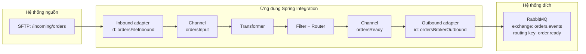
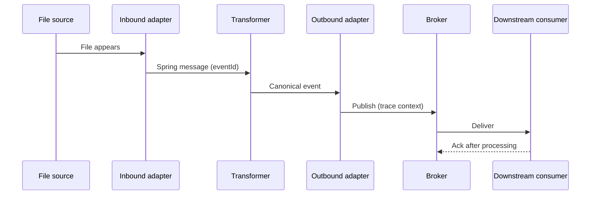
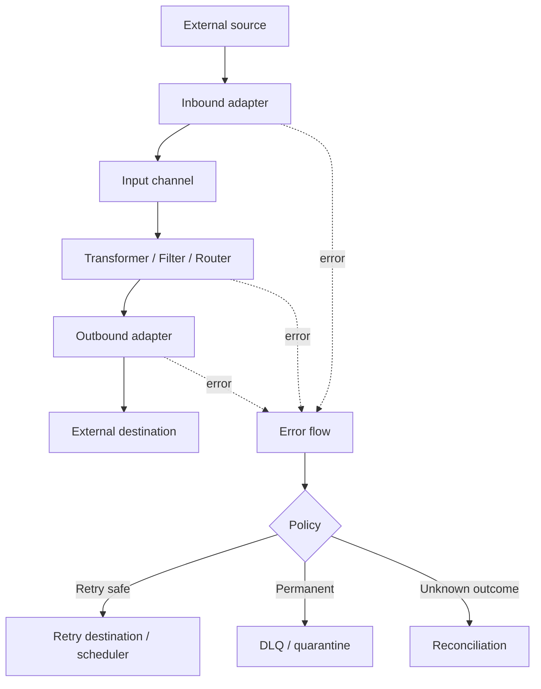

# Theo dõi nguồn và đích của adapter trong Spring Integration

## 1. Vì sao cần biết message đến từ đâu và đi đến đâu?

Trong chương **Channel adapter** của mô-đun **SPRING_INTEGRATION_PATTERN**, ta học cách kết nối hệ thống bên ngoài với các luồng **Enterprise Integration Patterns** của Spring Integration. Router, Filter, Transformer, Splitter, Aggregator, Gateway, retry, error channel và correlation giúp xử lý message qua nhiều bước; còn **channel adapter** là điểm nối giữa một giao thức hoặc tài nguyên bên ngoài và message channel nội bộ.

Ví dụ, ứng dụng đọc tệp đơn hàng từ thư mục SFTP, kiểm tra dữ liệu, chuyển đổi định dạng rồi gửi kết quả sang RabbitMQ. Khi đối tác báo thiếu đơn hàng, chỉ biết “ứng dụng vẫn chạy” không đủ. Người vận hành cần xác định:

- Adapter nào lấy dữ liệu? Nguồn thực là thư mục, queue, topic, endpoint HTTP hay câu truy vấn nào?
- Lần gần nhất adapter có dữ liệu là khi nào? Nó có đang poll, bị tắt, lỗi xác thực hay không có nguồn mới?
- Message được đưa vào channel nào? Có bị Filter loại, Router chuyển nhánh khác hoặc Transformer ném exception?
- Adapter nào gửi ra ngoài? Destination là exchange/routing key, queue, bucket, thư mục hay URL nào?
- Gửi thành công ở tầng adapter có đồng nghĩa hệ thống đích đã lưu hoặc xử lý thành công không?
- Nếu xử lý bị retry hoặc redelivery, làm thế nào nhận ra cùng một sự kiện nghiệp vụ?

**Theo dõi nguồn và đích của adapter** là theo dõi cả *topology đã cấu hình* lẫn *hành vi tại thời điểm chạy*: adapter ID, source/destination identity, message identity, thời gian, lỗi, số liệu và ranh giới xác nhận.

### Kết quả học tập

Sau bài này, bạn có thể:

1. Xác định hướng **inbound** và **outbound**, phân biệt source/destination bên ngoài với channel nội bộ.
2. Gắn định danh ổn định cho adapter và nguồn/đích phục vụ log, metric và trace.
3. Tạo một ví dụ Spring Integration Java DSL đọc tệp, biến đổi nội dung và ghi sang đích khác.
4. Dùng channel interceptor, message history, Micrometer/Actuator và tracing phù hợp để quan sát đường đi.
5. Phân tích sự cố poller, error channel, backpressure, duplicate, mất reply và lỗi gửi tới hệ thống đích.
6. Thiết kế dashboard, cảnh báo và kiểm thử để chứng minh message đã đi tới ranh giới mong muốn.

## 2. Nguồn, đích, adapter và channel là những thực thể khác nhau

### 2.1. Inbound channel adapter

Inbound adapter **nhận/đọc** dữ liệu từ bên ngoài rồi **phát** một Spring `Message<?>` vào channel nội bộ.

```text
Nguồn bên ngoài       Inbound adapter       Message channel
SFTP / file / JMS  --> đọc/nhận/convert --> ordersInput
HTTP / AMQP / DB
```

Trong trường hợp này:

- **Source thực**: một thư mục, một queue, một endpoint, một truy vấn hoặc một hệ thống cung cấp message.
- **Adapter**: component Spring Integration nối source đó vào message flow.
- **Destination nội bộ của inbound adapter**: message channel mà adapter gửi message vào, ví dụ `ordersInput`.
- **Consumer tiếp theo**: Filter, Transformer, Router, Service Activator hoặc một handler khác subscribe vào channel.

Không nên gọi `ordersInput` là “source bên ngoài”; đó chỉ là ranh giới truyền message **trong ứng dụng**.

### 2.2. Outbound channel adapter

Outbound adapter **nhận** Spring message từ channel nội bộ rồi **gửi/ghi** dữ liệu ra bên ngoài.

```text
Message channel      Outbound adapter       Đích bên ngoài
ordersReady      --> convert/gửi/ghi  --> Kafka / RabbitMQ / file / HTTP
```

Trong trường hợp này:

- **Source nội bộ của outbound adapter**: channel, ví dụ `ordersReady`.
- **Adapter**: endpoint nhận message và gọi client/tài nguyên bên ngoài.
- **Destination thực**: topic + partition/key, exchange + routing key, queue, URL, thư mục đích, bảng dữ liệu hoặc một hệ thống tương đương.
- **Bằng chứng gửi**: kết quả ở tầng adapter và giao thức; cần kiểm tra xem đó là enqueue cục bộ, network write, broker confirm, transaction commit hay phản hồi nghiệp vụ.

### 2.3. Sơ đồ đầy đủ



Sơ đồ cung cấp **hai loại thông tin** cần lưu:

1. **Topology**: các bean ID, tên channel, adapter type và mapping từ endpoint tới tài nguyên bên ngoài.
2. **Runtime evidence**: một message với `eventId` cụ thể đã được poll/nhận, đi qua các bước nào, được xử lý lúc nào và nhận phản hồi/xác nhận nào.

Topology chỉ chứng minh đường đi có **thể** tồn tại. Log/trace/metric và trạng thái nghiệp vụ mới giúp xác minh thông điệp cụ thể **đã** đi tới đâu.

## 3. Adapter không phải lúc nào cũng hoạt động giống nhau

### 3.1. Polling inbound adapter

File, SFTP, JDBC hoặc nhiều nguồn khác thường dùng poller:

```text
Scheduler --> Poller --> MessageSource.receive()
                         |--> có dữ liệu: publish Message
                         +--> không có dữ liệu: null / idle
```

Quan sát cần có:

- Adapter/poller đang chạy hay bị dừng.
- Thời điểm poll gần nhất, thời lượng poll và số lần poll.
- Lần gần nhất phát được message, số message mỗi poll.
- Exception khi truy cập nguồn, kết nối, parse hoặc gửi vào channel.
- Số bản ghi/tệp đang tồn đọng, nếu protocol hỗ trợ đo.
- `maxMessagesPerPoll`, poll interval và độ trễ scheduler.

**Một poll trả về không có dữ liệu không mặc định là lỗi.** Tuy nhiên, nếu SLA mong đợi dữ liệu mỗi năm phút, 40 phút không thấy message có thể đáng cảnh báo. Cần phân biệt *nguồn yên lặng hợp lệ* với *adapter bị hỏng hoặc mất khả năng đọc*.

### 3.2. Message-driven inbound adapter

AMQP, JMS, Kafka và một số protocol có listener nhận message khi broker giao. Chúng không nhất thiết có một poller của Spring Integration giống file adapter.

Cần theo dõi:

- Connection/session/container và subscriber/consumer state.
- Queue depth, consumer lag, unacked delivery hoặc offset.
- Số message nhận, ack/nack/requeue, redelivery và DLQ/DLT.
- Consumer concurrency, prefetch, partition assignment và tình trạng rebalance (tùy broker).
- Lỗi deserialize/convert và lỗi downstream handler.

Với Kafka, “đọc từ topic nào” thường chưa đủ: phải biết **consumer group, partition, offset** và key. Với RabbitMQ, cần exchange, queue binding và routing key. Broker nào cũng có semantics riêng; không dùng chung một giả định ack cho mọi adapter.

### 3.3. Outbound adapter và outbound gateway

- **Outbound channel adapter** thường dùng để gửi dữ liệu mà không đợi một reply nghiệp vụ trên cùng flow.
- **Outbound gateway** phù hợp khi cần request–reply và xử lý phản hồi từ hệ thống ngoài.

Chẳng hạn một HTTP outbound gateway trả response từ API; một outbound adapter có thể chỉ thực hiện ghi hoặc gửi mà không trả dữ liệu nghiệp vụ về caller. Nhưng **phương thức send đã trả** chưa chắc đã có nghĩa bên ngoài đã xử lý thành công. Cần đọc contract của adapter/client và giao thức, bao gồm transaction, publisher confirms hoặc acknowledgment.

## 4. Bộ nhận diện tối thiểu cho một luồng adapter

Không nên dùng riêng `MessageHeaders.ID` làm danh tính nghiệp vụ: message mới có thể được sinh ở Transformer, lần retry hoặc lần publish lại. Thay vào đó, phân chia rõ:

| Định danh | Ví dụ | Mục đích |
| --- | --- | --- |
| `adapterId` | `ordersFileInbound` | Xác định component trong Spring context/topology |
| `sourceId` | `partnerA.orders.inbound` | Định danh logic nguồn bên ngoài |
| `destinationId` | `billing.events.rabbit` | Định danh logic hệ thống đích |
| `messageId` | Header ID của Spring message | Theo dõi một instance message trong flow |
| `eventId` | `evt-501` | Định danh sự kiện nghiệp vụ để dedup |
| `correlationId` | `order-781` | Kết nối các message của cùng một quy trình |
| `traceId` / `spanId` | Giá trị tracing | Theo dõi một hành trình thực thi |
| `attempt` | `1`, `2`, ... | Phân biệt các lần xử lý lại |

**Source ID và destination ID nên là tên logic ổn định**, có thể ánh xạ tới URL/topic/queue/đường dẫn thật qua registry cấu hình. Không nên ghi credential, query string nhạy cảm, toàn bộ payload hoặc dữ liệu cá nhân vào metric labels.

Một bản ghi quan sát tối thiểu:

```json
{
  "eventId": "evt-501",
  "correlationId": "order-781",
  "adapterId": "ordersFileInbound",
  "sourceId": "partnerA.orders.inbound",
  "internalChannel": "ordersInput",
  "stage": "ADAPTER_RECEIVED",
  "outcome": "SUCCESS",
  "timestamp": "2026-11-21T03:00:00Z"
}
```

Đây là **log contract minh họa của ứng dụng**, không phải payload log tự sinh mặc định của Spring Integration.

## 5. Ví dụ: theo dõi inbound và outbound file adapter bằng Java DSL

Để nhìn rõ từng ranh giới, ví dụ sử dụng nguồn và đích là **thư mục nội bộ**. Khi chuyển sang SFTP, JDBC, AMQP hoặc Kafka, hình thức source/destination và xác nhận giao nhận sẽ khác, nhưng tư duy giám sát vẫn giống nhau.

Giả định Java 17+ và Spring Integration với các module file, core, logging và Micrometer/Actuator nếu cần. Đường dẫn `/data/orders/in` và `/data/orders/archive` chỉ là ví dụ; cần tồn tại và có quyền đọc/ghi tại runtime, điều chỉnh trên Windows/Linux theo môi trường.

### 5.1. Khai báo dependency minh họa

```groovy
dependencies {
    implementation 'org.springframework.boot:spring-boot-starter-integration'
    implementation 'org.springframework.integration:spring-integration-file'
    implementation 'org.springframework.boot:spring-boot-starter-actuator'
    implementation 'io.micrometer:micrometer-registry-prometheus'
}
```

Dùng Spring Boot BOM phù hợp để quản lý version. Những bean ví dụ có thể đặt trong package được Spring quét; đường xử lý dùng `DirectChannel` nên xử lý downstream diễn ra đồng bộ theo thread gửi.

### 5.2. Định danh kênh và inbound adapter

```java
import java.io.File;
import java.time.Duration;

import org.springframework.context.annotation.Bean;
import org.springframework.context.annotation.Configuration;
import org.springframework.integration.channel.DirectChannel;
import org.springframework.integration.config.EnableIntegration;
import org.springframework.integration.dsl.IntegrationFlow;
import org.springframework.integration.dsl.Pollers;
import org.springframework.integration.file.dsl.Files;
import org.springframework.messaging.MessageChannel;

@Configuration
@EnableIntegration
public class FileAdapterFlows {

    @Bean("ordersInput")
    public MessageChannel ordersInput() {
        return new DirectChannel();
    }

    @Bean("ordersReady")
    public MessageChannel ordersReady() {
        return new DirectChannel();
    }

    @Bean
    public IntegrationFlow ordersFileInboundFlow() {
        return IntegrationFlow
            .from(
                Files.inboundAdapter(new File("/data/orders/in"))
                    .patternFilter("*.json"),
                endpoint -> endpoint
                    .id("ordersFileInbound")
                    .poller(Pollers.fixedDelay(Duration.ofSeconds(5)))
            )
            .enrichHeaders(headers -> headers
                .header("source.adapterId", "ordersFileInbound")
                .header("source.id", "partnerA.orders.inbound")
                .headerFunction(
                    "source.fileName",
                    message -> ((File) message.getPayload()).getName()
                )
            )
            .channel("ordersInput")
            .get();
    }
}
```

Giải thích:

- `Files.inboundAdapter(...)` đọc tệp đáp ứng pattern từ thư mục nguồn, tạo message có payload kiểu `File`.
- Poller chạy theo fixed delay để kiểm tra nguồn theo chu kỳ.
- `id("ordersFileInbound")` cung cấp tên endpoint ổn định khi xem graph, log và metric có hỗ trợ.
- Header `source.adapterId` và `source.id` là **metadata do ứng dụng bổ sung**. Spring Integration không tự sinh các header có tên này.
- `source.fileName` giúp quan sát mà không cần ghi toàn bộ đường dẫn tuyệt đối ra log.
- Message đi từ adapter tới channel nội bộ `ordersInput`.

Việc một file đã từng được nhận không tự bảo đảm không bao giờ được xử lý lại. Bộ lọc file, metadata store, restart, rename, lock và đối tác ghi file chưa xong đều ảnh hưởng đến duplicate và tính toàn vẹn. Với nguồn SFTP/remote, cần thêm quy tắc file-ready, atomic rename hoặc bộ lọc persist metadata theo yêu cầu.

### 5.3. Transformer và channel phía outbound

Thêm một flow đọc nội dung UTF-8 của file rồi gửi dữ liệu sang `ordersReady`:

```java
import java.io.File;
import java.io.IOException;
import java.io.UncheckedIOException;
import java.nio.charset.StandardCharsets;

import org.springframework.context.annotation.Bean;
import org.springframework.context.annotation.Configuration;
import org.springframework.integration.dsl.IntegrationFlow;

@Configuration
public class FileProcessingFlow {

    @Bean
    public IntegrationFlow readOrderFileFlow() {
        return IntegrationFlow
            .from("ordersInput")
            .transform(File.class, file -> {
                try {
                    return java.nio.file.Files.readString(
                        file.toPath(), StandardCharsets.UTF_8
                    );
                } catch (IOException ex) {
                    throw new UncheckedIOException(ex);
                }
            })
            .channel("ordersReady")
            .get();
    }
}
```

Flow này chỉ chuyển `File` thành `String`, chưa kiểm tra schema JSON và chưa có giao dịch nghiệp vụ. Trong production, thêm Filter/Transformer/Validator và định tuyến lỗi theo contract. Một exception đọc file có thể làm poller/endpoint báo lỗi; luồng lỗi cần được cấu hình tương ứng với ranh giới xử lý.

### 5.4. Outbound file adapter và định danh đích

```java
import java.io.File;

import org.springframework.context.annotation.Bean;
import org.springframework.context.annotation.Configuration;
import org.springframework.integration.dsl.IntegrationFlow;
import org.springframework.integration.file.dsl.Files;

@Configuration
public class ArchiveAdapterFlow {

    @Bean
    public IntegrationFlow archiveOutboundFlow() {
        return IntegrationFlow
            .from("ordersReady")
            .enrichHeaders(headers -> headers
                .header("destination.adapterId", "ordersArchiveOutbound")
                .header("destination.id", "orders.archive.filesystem")
            )
            .handle(
                Files.outboundAdapter(new File("/data/orders/archive"))
                    .fileNameGenerator(message ->
                        "processed-" +
                        message.getHeaders().get(
                            "source.fileName", String.class
                        )
                    ),
                endpoint -> endpoint.id("ordersArchiveOutbound")
            )
            .get();
    }
}
```

Khi hoạt động, flow đọc file từ thư mục input, chuyển nội dung sang String và ghi file mang tên `processed-<tên-file-gốc>` vào thư mục archive.

Một số lưu ý:

- Đây là ví dụ **một source và một destination**, dùng để minh họa việc gắn metadata tại hai ranh giới.
- Header mới do `enrichHeaders` thêm vào message; không phải tất cả adapter ngoài sẽ tự truyền mọi header qua một broker/protocol. Khi nối qua network boundary, phải cấu hình header mapper nếu cần.
- File name cần được kiểm tra/chuẩn hóa trong ứng dụng thật (đặc biệt nếu lấy từ dữ liệu bên ngoài); không tin mọi tên file là an toàn.
- Nếu chạy lại cùng file, file name có thể xung đột. Chọn rõ chính sách tồn tại: từ chối, thay thế có kiểm soát hoặc dùng tên phiên bản. Không mặc định ghi lại an toàn hoặc idempotent.
- Kết quả ghi file chứng minh ứng dụng đã thao tác với filesystem theo contract; không chứng minh một tiến trình khác đã đọc và xử lý file đó.
- Với dữ liệu quan trọng, cân nhắc ghi file tạm rồi rename nguyên tử khi filesystem hỗ trợ, checksum và nơi lưu trạng thái xử lý.

### 5.5. Những gì có thể xác minh từ ví dụ

| Vị trí | Bằng chứng có thể thu | Điều chưa được bảo đảm |
| --- | --- | --- |
| Poller `ordersFileInbound` | Có lần poll/đọc ra file | File hoàn chỉnh theo contract đối tác |
| Channel `ordersInput` | Message có đi vào channel | Transformer hoàn tất |
| Handler đọc file | Nội dung đã đọc thành String | JSON hợp lệ về nghiệp vụ |
| Channel `ordersReady` | Payload đã sẵn sàng gửi ra | Filesystem đích đã ghi xong |
| Adapter `ordersArchiveOutbound` | Thao tác ghi file thành công hoặc có exception | Hệ thống downstream đã tiêu thụ file |

**Không nên đánh đồng số message nhận được với số nghiệp vụ hoàn tất.** Mỗi bước là một ranh giới cần đo riêng.

## 6. Ghi log có cấu trúc tại các ranh giới

### 6.1. Cách đặt tên event vận hành

Một tập hợp tên ngắn, nhất quán:

| Event | Khi phát | Trường hữu ích |
| --- | --- | --- |
| `ADAPTER_POLL_STARTED` | Bắt đầu một lần poll | adapterId, sourceId, timestamp |
| `ADAPTER_MESSAGE_RECEIVED` | Inbound adapter phát message | eventId, sourceId, messageId |
| `CHANNEL_HANDOFF` | Gửi qua channel nội bộ | channelId, messageId, correlationId |
| `ADAPTER_SEND_STARTED` | Outbound adapter chuẩn bị gửi | adapterId, destinationId |
| `ADAPTER_SEND_COMPLETED` | Tầng adapter/client xác nhận xong theo contract | outcome, duration, destinationId |
| `ADAPTER_SEND_FAILED` | Lỗi gửi/ghi ra ngoài | errorCode, attempt, destinationId |
| `BUSINESS_COMPLETED` | Side effect nghiệp vụ hoàn tất | eventId, businessState, duration |

Tên event trên là quy ước log **do đội phát triển định nghĩa**. Không nên kỳ vọng Spring Integration tự log sẵn đúng các trường này.

Mỗi event nên mang timestamp, component identity và thông tin correlation. Khi có cùng event ID đi qua nhiều lần retry, thêm `attempt` hoặc delivery ID để không nhầm lẫn giữa các lần thử.

### 6.2. ChannelInterceptor để quan sát handoff

`ChannelInterceptor` giúp quan sát hành vi của message channel mà không buộc mọi handler tự ghi log.

```java
import org.slf4j.Logger;
import org.slf4j.LoggerFactory;
import org.springframework.messaging.Message;
import org.springframework.messaging.MessageChannel;
import org.springframework.messaging.support.ChannelInterceptor;

public final class AdapterHandoffLoggingInterceptor
        implements ChannelInterceptor {

    private static final Logger log =
        LoggerFactory.getLogger(AdapterHandoffLoggingInterceptor.class);

    @Override
    public Message<?> preSend(
            Message<?> message,
            MessageChannel channel) {

        log.info(
            "stage=CHANNEL_HANDOFF messageId={} sourceId={} destinationId={}",
            message.getHeaders().getId(),
            message.getHeaders().get("source.id"),
            message.getHeaders().get("destination.id")
        );
        return message;
    }
}
```

Gắn interceptor vào một channel do ứng dụng quản lý:

```java
@Bean("ordersInput")
public MessageChannel ordersInput() {
    DirectChannel channel = new DirectChannel();
    channel.addInterceptor(new AdapterHandoffLoggingInterceptor());
    return channel;
}
```

Đây là **phương án thay thế** cho bean `ordersInput()` ở phần 5.2, không đăng ký đồng thời hai bean trùng tên.

Điều interceptor chứng minh: một message đã bước vào ranh giới `preSend` của channel. Nó **không** chứng minh downstream handler đã hoàn tất, cũng không chứng minh remote broker đã xác nhận lưu message. Nếu cần xác định send thành công, xem thêm lifecycle callback như `afterSendCompletion` cùng trạng thái gửi; vẫn phải hiểu ranh giới của loại channel cụ thể.

Tránh log toàn bộ payload hoặc thêm công việc nặng vào interceptor. Một interceptor chặn đồng bộ có thể làm chậm mọi message đi qua channel.

### 6.3. WireTap cho nhánh kiểm toán

**Wire Tap pattern** cho phép sao chép message sang một channel quan sát mà flow chính vẫn có đường xử lý riêng.

```text
ordersInput ---> Transformer ---> ordersReady
     |
     +---- wire tap ----> auditEvents ---> Audit handler
```

Có thể lắp wire tap bằng cấu hình interceptor hoặc DSL phù hợp. Nhưng hãy lưu ý:

- Một tap xử lý trực tiếp trên thread gửi có thể tăng latency của luồng chính.
- Nếu đưa tap qua kênh bất đồng bộ để giảm ảnh hưởng, phải kiểm soát queue capacity, lỗi ghi audit và khả năng mất dữ liệu audit.
- Tap không tự biến audit thành giao dịch nguyên tử với side effect của consumer.
- Một message có dữ liệu nhạy cảm sẽ đi thêm một nhánh; cần giới hạn nội dung và quyền truy cập.

Với yêu cầu audit bắt buộc và không được mất, dùng cơ chế lưu bền (ví dụ outbox/transaction) thay cho chỉ dựa vào một tap trong bộ nhớ.

## 7. Message history: xem message đã qua những component nào

Spring Integration có khả năng ghi **message history** vào header của message khi được bật và khi các thành phần tham gia hỗ trợ cơ chế này. Một cấu hình minh họa:

```java
import org.springframework.context.annotation.Configuration;
import org.springframework.integration.config.EnableMessageHistory;

@Configuration
@EnableMessageHistory
public class MessageHistoryConfiguration {
}
```

Message history giúp kiểm tra hành trình như:

```text
ordersFileInbound
  -> ordersInput
  -> readOrderFileFlow
  -> ordersReady
  -> ordersArchiveOutbound
```

Danh sách trên chỉ là **đường đi dự kiến**, không phải bản dump thực của header. Nội dung và cách biểu diễn history phụ thuộc component, Spring Integration version và mức bật theo dõi.

Cần hiểu giới hạn:

- History không phải distributed trace hoàn chỉnh: một message đi qua RabbitMQ/Kafka/HTTP có thể được chuyển thành message mới hoặc mất header khi qua ranh giới protocol.
- Lưu history trên mỗi message làm tăng kích thước header, công việc xử lý và nguy cơ lộ topology nội bộ nếu truyền nguyên header ra ngoài.
- History có thể giúp trả lời “đã đi qua component nào” nhưng không tự cung cấp business commit ở mỗi bước.
- Đối với throughput lớn, bật/tắt có chủ đích và đo overhead trước khi triển khai rộng.

Để truy vết end-to-end qua nhiều ứng dụng, kết hợp history nội bộ với event ID/correlation ID và distributed tracing.

## 8. Micrometer, Actuator và Integration Graph

Spring Integration có các điểm mở rộng giám sát, và Spring Boot Actuator/Micrometer có thể cung cấp metric/endpoint phục vụ quan sát runtime. Phạm vi metric và tên cụ thể thay đổi theo phiên bản Spring Integration, Spring Boot, Micrometer, dependency và cấu hình management.

### 8.1. Cấu hình Actuator minh họa

```yaml
management:
  endpoints:
    web:
      exposure:
        include: health,info,metrics,prometheus,integrationgraph
```

Khi ứng dụng có các dependency/configuration tương ứng, các endpoint thường được dùng là:

- `/actuator/health`: sức khỏe ứng dụng và các thành phần có health indicator.
- `/actuator/metrics`: duyệt các metric đã được đăng ký tại runtime.
- `/actuator/prometheus`: scrape metric qua registry Prometheus, nếu được cấu hình.
- `/actuator/integrationgraph`: xem đồ thị thành phần Spring Integration khi endpoint hỗ trợ và được bật.

**Cần kiểm tra tại runtime**, vì một endpoint không xuất hiện chỉ từ việc thêm tên vào danh sách `exposure.include`. Phải có dependency, auto-configuration và điều kiện bật tương ứng. Không mở các endpoint quản trị hoặc topology công khai trên Internet; cần xác thực, phân quyền và giới hạn mạng, đặc biệt khi graph làm lộ tên queue, channel và endpoint.

### 8.2. Dùng Integration Graph để tìm source/destination

Graph cho phép kiểm tra cấu trúc:

1. Tìm component ID `ordersFileInbound`.
2. Theo cạnh từ adapter tới channel `ordersInput`.
3. Theo bước Transformer/Handler tới `ordersReady`.
4. Tìm endpoint `ordersArchiveOutbound`.
5. Đối chiếu ID đó với registry cấu hình để biết nguồn/đích logic và địa chỉ thực của mỗi connector.

Graph rất hữu ích để kiểm tra bean/flow **đã được đăng ký**; không thể dùng graph một mình để kết luận message có chạy hay không hoặc broker đã nhận dữ liệu chưa.

Nếu adapter tạo thành phần con tự động, các tên có thể dựa trên bean/flow ID. Đặt ID ổn định cho endpoint do ứng dụng quản lý để việc truy vết giữa môi trường và phiên bản deploy đáng tin cậy hơn.

### 8.3. Metric nên xem

| Nhóm đo | Ví dụ | Câu hỏi trả lời |
| --- | --- | --- |
| **Ingress** | Số message inbound phát ra theo adapter | Nguồn có gửi dữ liệu không? |
| **Poller** | Poll count, duration, empty poll, error | Adapter polling hoạt động đều không? |
| **Handoff** | Send success/failure, channel latency | Message có bị chặn trong flow nội bộ? |
| **Processing** | Handler duration, exception, retry count | Đoạn nào chậm/lỗi? |
| **Egress** | Số lần gửi, lỗi, timeout, broker confirm | Đích có nhận theo contract? |
| **Backlog** | Queue depth, unacked, lag, oldest age | Luồng có bị dồn việc không? |
| **Business** | Đơn hàng ghi thành công, trạng thái cuối | Dữ liệu đã tạo tác động mong muốn chưa? |

Một số version Spring Integration cung cấp metric liên quan `spring.integration.*`, nhưng **không nên hard-code tên, tag hoặc loại metric chỉ theo ví dụ**. Hãy truy vấn `/actuator/metrics` và registry thực tế để xác nhận tên và dimensions. Nhiều chỉ số đặc thù như poll không ra message, external queue lag, số DLQ và business commit phải được bổ sung từ broker/client instrumentation hoặc code nghiệp vụ.

### 8.4. Thiết kế metric tags an toàn

Nhãn có cardinality thấp, ổn định:

```text
adapter_id="ordersFileInbound"
adapter_type="file-inbound"
source_id="partnerA.orders.inbound"
destination_id="orders.archive.filesystem"
outcome="success"
```

Tránh đặt `eventId`, `orderId`, `traceId`, filename ngẫu nhiên hoặc URL có token vào metric labels. Chúng tạo hàng triệu chuỗi time series và làm hệ thống metric tốn chi phí. Những giá trị động nên nằm trong log/traces có sampling/retention phù hợp.

### 8.5. Dashboard gợi ý

Một dashboard cho luồng source → destination nên thể hiện:

- **Ingress rate**: số dữ liệu nhận theo source ID mỗi phút.
- **Idle age**: thời gian từ lần nhận gần nhất, kết hợp lịch nguồn dự kiến.
- **Processing rate**: số message đã xử lý thành công/thất bại.
- **Egress rate**: số lần gửi thành công theo destination ID.
- **End-to-end latency**: từ `occurredAt` đến business completion, bao gồm queueing/polling delay.
- **Backlog**: queue depth/lag, số file chưa đọc, số item trong outbox.
- **Error distribution**: lỗi lấy nguồn, parse, transform, route, send và lỗi ở phía đích.
- **Duplicate/retry**: attempt count, redelivery, DLQ/DLT, duplicate bị idempotency chặn.

Ví dụ tính tỷ lệ xử lý theo ranh giới trong cùng một khoảng quan sát:

```text
ingress_count = 10 000
business_completed = 9 920
business_rejected = 40
in_flight = 30
unexplained_gap = 10
```

Không được suy rằng “thiếu 80 message” chỉ từ hiệu hai counter nếu có retry, duplicate hoặc message đang nằm trong queue. Muốn đối soát chính xác, cần thống nhất **đơn vị đếm**: logical event ID, delivery attempt hay bản ghi nghiệp vụ. Tính toán trên ví dụ cho thấy 10 event chưa giải thích, nhưng chỉ chính xác khi các nhóm là tập rời, không có trùng và cùng cửa sổ thời gian đối soát.

## 9. Distributed tracing: đi qua adapter và network boundary

Một trace có thể gồm nhiều span:



Trong hệ thống có Micrometer Observation/Tracing hoặc OpenTelemetry được tích hợp phù hợp, span/trace giúp nối các ranh giới khi trace context được truyền qua header/protocol hỗ trợ. Cần kiểm tra mapping của AMQP, Kafka, JMS, HTTP, SFTP hoặc adapter custom cụ thể.

**Không phải mọi adapter tự truyền trace context.** Đặc biệt, message do file poller tạo từ một file có thể là *đầu của trace mới* nếu file không mang trace ID. Muốn liên kết với hoạt động upstream, bổ sung event ID/correlation ID trong nội dung tệp hoặc metadata ngoài.

Phân biệt:

- **Trace**: thời gian từng hoạt động trong một hoặc nhiều ứng dụng.
- **Message history**: lịch sử component trên message trong Spring Integration flow.
- **Business audit**: bằng chứng thao tác nào đã thực hiện, kết quả cuối cùng là gì.

Một trace hoàn chỉnh chưa chứng minh giao dịch ngoài đã commit trừ khi có span/event ghi nhận bước commit dựa trên contract đúng.

## 10. Theo dõi nguồn/đích theo từng loại adapter

### 10.1. File/SFTP inbound và file/SFTP outbound

| Cần quan sát | Inbound | Outbound |
| --- | --- | --- |
| Nguồn/đích | Host và logical directory / pattern | Logical directory / remote folder |
| Trạng thái | Kết nối, auth, poller, file-ready | Kết nối, quyền ghi, rename |
| Tiến độ | Số file chờ, file mới, file đã xử lý | Số file đã ghi, lỗi ghi |
| Duplicate | Metadata store, tên/size/checksum | Idempotency key, chính sách overwrite |
| Thành công | File được nhận/đọc theo contract | File đã ghi/rename theo contract |

Đừng lấy đường dẫn SFTP đầy đủ có credential từ URL rồi in vào log. Đặt `sourceId` ổn định và dùng config/secret manager để tra cứu host/path thật.

Một file lớn có thể vẫn đang được đối tác ghi khi poller nhìn thấy. Cần chiến lược file readiness như staging + atomic rename, khóa hoặc bộ lọc phù hợp. Việc poll thấy file chưa chắc nội dung đã hoàn chỉnh.

### 10.2. AMQP/RabbitMQ

Inbound:

- Queue name, consumer ID/container, connection/vhost và số consumer.
- Số delivery, ack/nack, requeue, unacked, redelivery.
- Queue depth và DLQ count.

Outbound:

- Exchange, routing key, destination mapping và publisher connection.
- Publisher confirm/return nếu ứng dụng cần xác nhận broker đã xử lý publish.
- Số message unroutable, NACK, timeout hoặc connection reset.

Publisher confirm **không tương đương consumer xử lý xong**. Cũng cần tách queue và exchange: outbound adapter thường publish vào exchange, còn queue nhận do binding quyết định.

### 10.3. Kafka

Inbound:

- Topic, consumer group, partition và offset.
- Consumer lag, rebalance, deserialize errors và retry/DLT.
- Thời điểm event tạo so với thời điểm consumer xử lý.

Outbound:

- Topic, partition key, producer acknowledgment và delivery exception.
- Retry, duplicate, ordering và transaction semantics.

Lưu ý offset đã commit không nhất thiết khớp business commit nếu ack/transaction boundary chưa thiết kế đúng. Retry topic có thể thay đổi thứ tự giữa các record cùng aggregate.

### 10.4. JDBC

Inbound polling thường đọc dữ liệu theo truy vấn:

- Logical query ID, data source ID, poll duration, row count và watermark/high-water mark.
- Transaction isolation, lock contention, exception và số record bị bỏ qua.
- Cơ chế đánh dấu “đã lấy” hoặc “đã xử lý” để tránh duplicate qua restart.

Outbound ghi dữ liệu cần theo dõi transaction commit/rollback, row count, constraint violations và idempotency. “JDBC call trả về update count” chưa tự chứng minh downstream service khác đã tiêu thụ dữ liệu.

### 10.5. HTTP

HTTP inbound/outbound có request path/method/status, connect/response timeout và latency. Khi là outbound gateway, response có thể trả vào reply flow; khi là adapter gửi một chiều, nên phân biệt lỗi network với phản hồi nghiệp vụ. Đừng đưa query string có secret, authorization header hoặc dữ liệu nhạy cảm vào metric.

### 10.6. JMS

Cần theo dõi destination queue/topic, listener container, session/transaction, redelivery count, dead-letter policy và selector nếu có. Semantics của JMS provider và mode acknowledgment/transaction phải được kiểm tra theo broker đang dùng.

## 11. Error channel và retry: xác định message bị dừng ở đâu

Một flow có thể có nhiều loại lỗi:



### 11.1. Source lỗi

Ví dụ adapter file không đọc được vì quyền truy cập hoặc adapter Kafka không kết nối broker. Cần phân biệt:

- Poller **chưa chạy**.
- Poller chạy nhưng nguồn **chưa có dữ liệu**.
- Poller chạy nhưng **lỗi khi truy cập**.
- Đã nhận message nhưng **không gửi vào channel** do lỗi capacity/exception.

Một cảnh báo “không có message trong 20 phút” không cho biết nguyên nhân; phải ghép nó với liveness của poller/connection và lỗi truy cập nguồn.

### 11.2. Middle flow lỗi

Filter có thể loại message hợp lệ theo chính sách, Router chọn nhánh khác, Transformer ném exception, Splitter tạo nhiều nhánh hoặc Aggregator đang chờ đủ group. Vì vậy, **khác biệt counter giữa source và destination không nhất thiết là mất message**.

Muốn đối soát, định nghĩa rõ:

- Loại message nào **được phép loại** và vì sao.
- Một input có thể tạo bao nhiêu output qua Splitter.
- Khi nào Aggregator phát kết quả, có cho phép partial result không.
- Correlation ID nào liên kết các nhánh.
- Outcome cuối cùng của từng logical event là gì.

### 11.3. Destination lỗi

Outbound adapter có thể thất bại ở:

- Serialize/convert payload.
- Lấy connection hoặc gửi request.
- Broker từ chối publish/unroutable.
- HTTP timeout sau khi remote có thể đã commit.
- File ghi dở hoặc DB transaction rollback.

Hết thời gian chờ phản hồi không đồng nghĩa remote chưa thực hiện side effect. Nếu có retry, giữ nguyên `eventId` hoặc idempotency key và đối soát trạng thái chưa chắc chắn trước khi gọi lại thao tác ghi.

### 11.4. Error channel không tự hoàn thành workflow

Spring Integration có cơ chế `ErrorMessage`/`errorChannel` và advice/retry ở endpoint phù hợp. Error flow có thể ghi log, phát metric, route sang DLQ hoặc tạo reply thay thế. Tuy nhiên:

- Lỗi đồng bộ qua `DirectChannel` có thể lan theo call stack.
- Lỗi trên `ExecutorChannel`/listener có thể cần error handler riêng tại async boundary.
- Một error handler chỉ log rồi trả bình thường có thể làm upstream hiểu sai rằng đã xử lý xong.
- Nếu error flow tạo reply nhưng caller đã timeout, reply có thể đến muộn.

Cần xác minh thực tế **ack/nack, offset commit, transaction và reply delivery**, không chỉ thấy một dòng `ERROR` trong log.

## 12. Chọn SLO và cảnh báo phù hợp nguồn/đích

Một SLO liên quan adapter nên đo thời gian từ **dữ liệu sẵn sàng ở nguồn** đến **kết quả đã xác minh ở đích**, không chỉ thời gian thực thi một handler.

Ví dụ chính sách:

| Chỉ tiêu | Cách hiểu | Hành động khi vượt ngưỡng |
| --- | --- | --- |
| Source freshness | Dữ liệu mới nhất đã được adapter nhìn thấy cách hiện tại bao lâu | Kiểm tra nguồn, poller và lịch phát |
| Poll success ratio | Số lần poll không lỗi / tổng số lần poll | Kiểm tra connection, credential và scheduler |
| Ingress throughput | Logical events nhận mỗi phút | So với tải kỳ vọng |
| End-to-end latency p95 | Thời gian từ phát sinh đến xác nhận kết quả cuối | Tìm điểm nghẽn queue/handler/đích |
| Egress failure ratio | Tỷ lệ gửi lỗi theo destination | Kiểm tra downstream/broker |
| Oldest backlog age | Tuổi message/tệp đang chờ lâu nhất | Scale, khôi phục hoặc giảm tải nguồn |
| Unexplained event count | Event chưa có outcome hợp lệ sau thời hạn | Đối soát, cảnh báo mất dữ liệu |
| DLQ/DLT count | Message đang bị cách ly | Triage và replay có kiểm soát |

Một ví dụ giả định: luồng nhận 1.000 đơn mỗi phút, p95 end-to-end mục tiêu dưới 2 phút, và cảnh báo nếu event quá 10 phút chưa có kết quả. Các con số phải được điều chỉnh dựa trên nhu cầu nghiệp vụ, công suất và đặc tính nguồn.

Cảnh báo về source yên lặng phải cân nhắc lịch làm việc, ngày nghỉ và dữ liệu theo batch; cảnh báo về queue backlog nên dựa trên cả **tuổi message** và **tốc độ tiêu thụ**, không chỉ số lượng.

### Tính latency không nhầm thời điểm

Có ba mốc thường dùng:

```text
occurredAt   : sự kiện thực sự phát sinh
ingestedAt   : inbound adapter nhận vào ứng dụng
completedAt  : xử lý đích hoàn tất theo contract
```

Từ đó:

- **Ingress delay** = `ingestedAt - occurredAt`.
- **Processing + egress delay** = `completedAt - ingestedAt`.
- **End-to-end latency** = `completedAt - occurredAt`.

Nếu clock giữa hệ thống lệch nhau hoặc event không có timestamp đáng tin cậy, cần ghi mức độ sai số và dùng metric của broker hoặc đồng hồ monotonic trong từng process khi đo duration nội bộ.

## 13. Kiểm thử theo nguồn và đích

Không nên chỉ viết một unit test gọi handler thành công rồi kết luận adapter hoạt động. Cần kiểm thử đủ ranh giới, dùng tài nguyên test thực (thư mục tạm, broker trong môi trường test hoặc Testcontainers) khi cần xác minh behavior.

| Kịch bản | Đầu vào | Điều cần kiểm chứng |
| --- | --- | --- |
| Poll file hợp lệ | Tạo một file JSON vào inbound directory | Adapter phát message với đúng source ID và filename |
| Không có file | Thư mục rỗng | Poller vẫn chạy, không tạo business error |
| File chưa ghi xong | Ghi file theo nhiều lần | Chính sách file-ready ngăn xử lý dữ liệu dở |
| File không đọc được | Quyền hoặc I/O exception | Có lỗi ở inbound adapter, không coi là no-data |
| Transformer lỗi | File không đúng encoding | Error flow biết bước lỗi và source ID |
| Filter loại message | Dữ liệu không hợp lệ | Có outcome `REJECTED` hoặc policy rõ |
| Router chuyển nhánh | Event type khác nhau | Đi đúng destination đã định |
| Outbound ghi thành công | Payload hợp lệ | File xuất hiện với nội dung và tên mong đợi |
| Outbound write error | Đích không có quyền ghi | Có lỗi có thể quan sát, không báo thành công giả |
| Retry sau lỗi | Gửi lại cùng logical event | Giữ event ID và không nhân đôi side effect |
| Crash sau commit trước ack | Dừng worker đúng thời điểm | Redelivery được idempotency xử lý |
| Broker unroutable | Exchange không có binding phù hợp | Có publisher return/alert theo cấu hình |
| Channel interceptor | Gửi message qua channel | Log đúng message ID/source ID; không rò payload |
| Message history | Bật history ở môi trường test | Truy được component nội bộ theo khả năng hỗ trợ |
| Metrics/graph | Chạy với Actuator/Micrometer | Endpoint/metric thực sự xuất hiện và được bảo vệ |
| Trace across broker | Publish và consume | Trace/correlation được nối hoặc có fallback business ID |

### 13.1. Một phép kiểm tra có giá trị hơn “file đã tồn tại”

Với flow phần 5, một test tích hợp nên:

1. Tạo file nguồn trong một thư mục tạm được cấu hình cho adapter.
2. Chờ kết quả có giới hạn thời gian, tránh `Thread.sleep` cố định sát ranh giới trên CI.
3. Xác minh file archive chứa nội dung kỳ vọng.
4. Xác minh có log/event quan sát tương ứng với ID của inbound và outbound.
5. Đổi quyền ghi hoặc mô phỏng lỗi đích; xác minh lỗi được phân loại đúng và không bị báo thành công.
6. Chạy lại cùng file hoặc restart ứng dụng; kiểm tra duplicate policy rõ ràng.

Để thực hành này chạy trên CI, nên lấy source/destination path từ cấu hình hoặc environment, không hard-code `/data/orders` trong test. Một test thư mục tạm có thể kiểm tra file adapter, nhưng không thay thế test broker/HTTP nơi cần publisher confirm, acknowledgment hoặc timeout thực.

### 13.2. Kiểm tra nguồn và đích đang được ánh xạ đúng

Khi có nhiều adapter cùng loại, test cấu hình phải kiểm tra:

- Mỗi adapter có ID độc lập, không trùng bean name.
- Source ID khớp đường dẫn/queue/topic mà config định nghĩa.
- Destination ID khớp client/exchange/routing key thực tế.
- Flow nối đúng input/output channel, không gửi nhầm giữa hai tenant.
- Credential và policy được lấy từ nguồn cấu hình bảo mật, không đưa vào log.
- Tất cả channel được dùng có subscriber/bridge phù hợp.

Đây là kiểm tra của **topology**, khác với kiểm tra runtime message có di chuyển thành công. Cả hai đều cần cho một hệ thống lớn.

## 14. Runbook xử lý sự cố: không thấy dữ liệu ở đích

Giả sử Billing báo chưa nhận được event `evt-501` từ adapter.

**Bước 1 — Xác minh nguồn.** Dữ liệu có xuất hiện trong SFTP/queue/topic đầu vào hay không? Kiểm tra tên nguồn logic, phiên bản cấu hình, quyền đọc và mốc phát sinh.

**Bước 2 — Xác minh inbound adapter.** Adapter có chạy không, poll gần nhất lúc nào, có lỗi connection/deserialize không? Tìm `eventId`/`sourceId` trong log và xem ingress counter.

**Bước 3 — Truy vết channel và các pattern giữa luồng.** Kiểm tra history/trace, Filter, Router, Splitter/Aggregator. Sự kiện có bị loại theo quy tắc hay đang chờ group không?

**Bước 4 — Xác minh outbound adapter.** Kiểm tra destination logic, routing key hoặc path thật, lỗi chuyển đổi payload, retries và confirm/return nếu có.

**Bước 5 — Xác minh hệ thống đích.** Broker đã định tuyến vào queue nào? Consumer có nhận, xử lý, ack hay chuyển DLQ? Nếu là HTTP/DB, có record/result xác định không?

**Bước 6 — Đối soát trước khi replay.** Dùng event ID/idempotency key và trạng thái nghiệp vụ để tránh side effect trùng. Khi outcome chưa rõ, tra cứu trước khi gửi lệnh mới.

**Bước 7 — Khắc phục và giám sát.** Sửa nguồn, config, code hoặc destination; replay có giới hạn nếu an toàn; xác nhận backlog giảm, độ trễ về mức bình thường và không phát sinh lỗi mới.

### Các dấu hiệu dễ gây kết luận sai

| Dấu hiệu | Kết luận vội vàng | Kiểm tra cần thêm |
| --- | --- | --- |
| Không thấy ingress log | Source không có dữ liệu | Log sampling, poller state, connection, quyền đọc |
| Có message trên input channel | Công việc hoàn tất | Handler/Filter/Router/transaction |
| Adapter outbound trả bình thường | Downstream đã xử lý | Confirm/ack/reply/DB commit và business status |
| Queue depth bằng 0 | Không mất message | DLQ, unacked, consumer lag, outcome của event |
| Cùng event ID xuất hiện hai lần | Đã xử lý trùng | Redelivery/retry và idempotency effect |
| Gateway timeout | Remote thất bại | Trạng thái remote và kết quả đối soát |

## 15. Bài thực hành

1. Xây dựng inbound file adapter đọc `*.json`, đặt ID `ordersFileInbound` và đi qua channel `ordersInput`.
2. Thêm Transformer chuyển `File` thành String, định tuyến sang outbound adapter ghi file; đặt ID `ordersArchiveOutbound`.
3. Gắn `source.id`, `source.fileName` và `destination.id` vào header, ghi log có cấu trúc tại hai ranh giới mà không in toàn bộ payload.
4. Gắn một `ChannelInterceptor` vào `ordersInput`; quan sát khác biệt giữa “đã gọi preSend” và “outbound đã ghi file”.
5. Bật message history và xem đường đi qua các component; giải thích vì sao history chưa đủ để chứng minh remote commit.
6. Bật Actuator và kiểm tra `metrics`/`integrationgraph` trong phiên bản thực; lập bảng mapping adapter ID → channel → source/destination.
7. Giả lập destination ghi file thất bại, thiết kế error flow và ghi metric phân biệt inbound error với outbound error.
8. Thay outbound file adapter bằng AMQP/Kafka tại môi trường thử nghiệm; thêm metric confirm, retry, DLQ và correlation xuyên broker.
9. Cho cùng một event được giao lại; kiểm tra cơ chế chống trùng trước khi thực hiện side effect.
10. Viết một runbook ngắn giải thích cách tìm nguyên nhân khi ingress tăng nhưng egress không tăng.

**Câu hỏi tự đánh giá:** Một sự kiện đã xuất hiện trong log `ordersInput` nhưng đối tác không thấy dữ liệu ở destination. Bạn cần các bằng chứng nào để xác định lỗi nằm ở Transformer, outbound adapter, broker routing hay consumer phía đích? Tại sao một timestamp `ADAPTER_SEND_COMPLETED` chưa đủ để kết luận tác động nghiệp vụ đã thành công?

## Ghi nhớ

- **Inbound adapter** lấy dữ liệu từ source ngoài và phát vào channel nội bộ; **outbound adapter** lấy message từ channel nội bộ và gửi tới destination ngoài.
- Theo dõi adapter cần cả topology đã cấu hình lẫn bằng chứng runtime; một channel name không tự mô tả tài nguyên ngoài.
- Adapter ID, source/destination ID, event ID, correlation ID và trace ID giải quyết các bài toán khác nhau và nên được định nghĩa nhất quán.
- Channel interceptor, Wire Tap, message history, Micrometer/Actuator và distributed tracing cung cấp nhiều góc quan sát bổ sung; không công cụ nào thay thế trạng thái nghiệp vụ cuối cùng.
- Polling, message-driven và outbound adapter có thời điểm xác nhận khác nhau; phải đo đúng polling result, ack/offset, confirm, transaction và reply.
- Khi retry/redelivery hoặc outcome chưa xác định, cần idempotency và đối soát trước khi tạo side effect mới.
- Hệ thống chỉ thực sự quan sát được khi có metric, log, trace, dashboard, cảnh báo và test đủ để trả lời: **message từ nguồn nào, qua những bước nào, đến đích nào, và kết quả đã được xác minh ở mức nào?**
