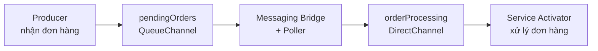
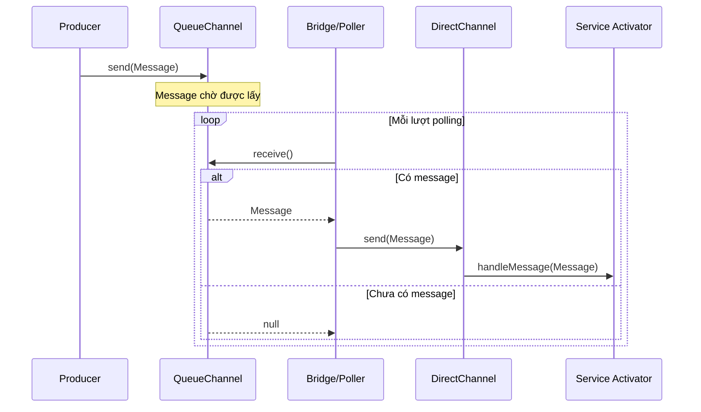
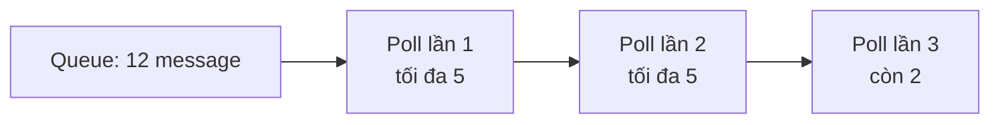
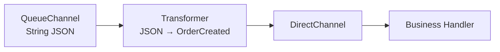

# Message Bridge nối hai channel tương thích trong Spring Integration

## 1. Message Bridge là gì?

Trong mô hình **Enterprise Integration Patterns (EIP)**, *Messaging Bridge* là một endpoint nhận message từ một kênh và chuyển tiếp sang kênh khác. Trong Spring Integration, bridge giúp nối hai `MessageChannel` khi dữ liệu đã có hình thức phù hợp để đi tiếp mà không cần thực hiện phép biến đổi nghiệp vụ.

Ví dụ, dữ liệu đơn hàng đã được chuẩn hóa thành message được đưa vào `QueueChannel`. Ở phía xử lý, các thành phần như `Filter`, `Router`, `Service Activator` chỉ cần đăng ký nhận qua `DirectChannel`. **Bridge** đứng giữa hai channel: nó lấy message từ queue theo lịch polling, rồi chuyển tới channel của phía xử lý. Các consumer không cần biết queue được đọc thế nào.



Đây là một bài trong chương **Bridge** của module **SPRING_INTEGRATION_PATTERN**, tiếp nối cách tổ chức luồng EIP bằng channel, adapter, router, filter và các endpoint khác. Mục tiêu là hiểu chính xác **khi nào hai channel có thể nối trực tiếp**, cách cấu hình bridge, kiểm tra đường đi của message và nhận diện giới hạn vận hành của kết nối này.

Sau bài học, bạn có thể:

- Phân biệt bridge với transformer, router, gateway và channel adapter.
- Nối `PollableChannel` sang `SubscribableChannel` bằng `@BridgeFrom` hoặc Java DSL.
- Sử dụng poller và `maxMessagesPerPoll` để giới hạn lượng message được chuyển mỗi lượt.
- Kiểm tra payload, headers, luồng lỗi và hành vi khi tải tăng.
- Biết khi nào cần cơ chế xử lý trùng lặp, lưu trữ bền vững hoặc chuyển đổi dữ liệu ngoài bridge.

## 2. Vai trò và ranh giới trách nhiệm

Spring Integration biểu diễn dữ liệu thành một `Message<?>` gồm:

- **Payload**: nội dung chính, ví dụ `OrderCreated`, `String`, `byte[]` hoặc `File`.
- **Headers**: metadata, ví dụ `correlationId`, khóa truy vết, loại sự kiện, thời điểm phát sinh.

Một message bridge là **endpoint chuyển tiếp** giữa channel đầu vào và channel đầu ra. Bridge không tự làm sạch payload, không parse JSON thành đối tượng Java, không lựa chọn nhánh dựa trên điều kiện nghiệp vụ và không gửi yêu cầu tới hệ thống ngoài theo mô hình request–reply.

| Thành phần | Chức năng chính | Khi phù hợp |
| --- | --- | --- |
| **Message Bridge** | Chuyển tiếp message giữa hai channel | Dữ liệu đủ tương thích; chỉ cần nối hai đoạn flow hoặc thêm nhịp polling. |
| **Transformer** | Thay đổi cấu trúc, kiểu hoặc cách biểu diễn payload | Phía sau cần `Order` nhưng phía trước phát `String` JSON. |
| **Filter** | Cho đi tiếp hoặc loại bỏ message theo điều kiện | Chỉ nhận đơn hàng hợp lệ. |
| **Router** | Chọn channel/nhánh đích theo nội dung hoặc headers | Chuyển đơn hàng theo khu vực hay trạng thái. |
| **Channel Adapter** | Đưa dữ liệu vào hoặc ra khỏi ranh giới ứng dụng | Đọc file, nhận broker message, gửi dữ liệu tới hệ thống ngoài. |
| **Gateway** | Tạo điểm giao tiếp theo request–reply | Bên gọi cần một kết quả phản hồi tương ứng. |

Một bridge đơn giản thường có thể chuyển tiếp message mà không biến đổi payload. Tuy nhiên, **nó không cung cấp mặc định** cơ chế chuyển đổi dữ liệu, khử trùng lặp, ghi giao dịch bền vững, retry nghiệp vụ hoặc exactly-once.

### Khi nào gọi là “hai channel tương thích”?

`MessageChannel` là lớp trừu tượng chung, nên “tương thích” ở đây không chỉ là việc hai bean cùng có kiểu Java `MessageChannel`. Cần xét **hợp đồng dữ liệu và hành vi** của hai đoạn flow.

| Khía cạnh | Câu hỏi cần kiểm tra |
| --- | --- |
| Payload | Consumer phía sau có hiểu kiểu, cấu trúc và encoding do producer gửi không? |
| Headers | Những khóa bắt buộc như `correlationId` hay khóa routing có được mang theo không? |
| Cách nhận | Channel đầu vào là pollable hay subscribable; endpoint có poller phù hợp chưa? |
| Tải và thời gian | Downstream có xử lý kịp tốc độ bridge chuyển tiếp không? |
| Lỗi và giao dịch | Khi downstream thất bại, message được retry, giữ lại hay mất theo cấu hình nào? |
| Đích đến | Có consumer đăng ký trên channel đích và tên channel có đúng không? |

**Ví dụ tương thích:** phía trước và phía sau cùng dùng payload `OrderCreated`, headers cần thiết đã sẵn có và chỉ cần đổi nhịp nhận message.

**Ví dụ chưa tương thích:** phía trước gửi `String` chứa CSV còn consumer yêu cầu `OrderCreated`. Trong trường hợp này cần Transformer hoặc bước parse/validate phù hợp trước khi xử lý. Bridge không tự chuyển CSV thành đối tượng Java.

## 3. Bridge hoạt động như thế nào?

Một bridge có đầu vào gắn với channel nguồn và đầu ra gắn với channel đích. Trong Spring Integration, `BridgeHandler` là handler chuyên dùng cho việc chuyển tiếp này. Framework có các cách cấu hình như `@BridgeFrom`, `@BridgeTo`, `@ServiceActivator` kết hợp `BridgeHandler` hoặc Java DSL `.bridge()`.

### 3.1. PollableChannel → SubscribableChannel

Đây là trường hợp nổi bật nhất:

- `PollableChannel`, chẳng hạn `QueueChannel`, lưu message để một consumer gọi `receive()` lấy ra.
- `SubscribableChannel`, chẳng hạn `DirectChannel`, đẩy message tới handler đã subscribe.
- Bridge đứng giữa và dùng **poller** để lấy message từ queue. Sau khi lấy được, nó gửi message sang channel đích.



**Điểm quan trọng:** consumer phía sau chỉ lắng nghe `DirectChannel`. Nó không tự viết lịch polling để kiểm tra `QueueChannel`.

### 3.2. SubscribableChannel → SubscribableChannel

Bridge cũng có thể nối hai channel đều hỗ trợ subscriber, ví dụ `DirectChannel` đầu vào tới `DirectChannel` đầu ra. Khi đó thông thường không cần poller ở bridge, vì đầu vào đã chủ động chuyển message tới subscriber.

Trường hợp này hữu ích khi hai phần ứng dụng được thiết kế thành những flow độc lập, có ranh giới channel rõ ràng. Nếu chỉ cần một luồng nối tiếp đơn giản và không có ranh giới cần quản lý, dùng chung channel có thể gọn hơn việc thêm endpoint bridge.

### 3.3. Polling có phải là message transformation?

Không. Poller chỉ định *khi nào và bao nhiêu message* được nhận từ một nguồn pollable; transformer thay đổi dữ liệu. Nếu consumer cần thay đổi payload hoặc headers có chủ đích, hãy dùng Transformer trước hoặc sau bridge theo hợp đồng của luồng.

## 4. Ví dụ thực hành với Java Configuration

Xây dựng luồng nhận đơn hàng minh họa:

1. Producer gửi một message có payload `ORDER-001` vào `pendingOrders`.
2. `pendingOrders` là `QueueChannel` có capacity 100.
3. Bridge dùng poller định kỳ lấy tối đa 5 message mỗi lượt và chuyển sang `orderProcessing`.
4. `orderProcessing` là `DirectChannel`; Service Activator nhận message và in payload cùng `correlationId`.

Ví dụ dùng Java 17 trở lên và Spring Boot với Spring Integration. Trong dự án Spring Boot, hãy dùng dependency management/BOM phù hợp với phiên bản Boot đang triển khai.

### 4.1. Dependencies Maven

```xml
<dependencies>
    <dependency>
        <groupId>org.springframework.boot</groupId>
        <artifactId>spring-boot-starter-integration</artifactId>
    </dependency>
</dependencies>
```

Ví dụ này chỉ sử dụng các channel và endpoint lõi của Spring Integration, chưa cần adapter cho file hoặc broker.

### 4.2. Cấu hình bridge bằng @BridgeFrom

Đặt lớp `OrderBridgeConfiguration.java` trong package được Spring Boot component scan:

```java
package com.example.integration;

import org.springframework.boot.CommandLineRunner;
import org.springframework.context.annotation.Bean;
import org.springframework.context.annotation.Configuration;
import org.springframework.beans.factory.annotation.Qualifier;
import org.springframework.integration.annotation.BridgeFrom;
import org.springframework.integration.annotation.Poller;
import org.springframework.integration.annotation.ServiceActivator;
import org.springframework.integration.channel.DirectChannel;
import org.springframework.integration.channel.QueueChannel;
import org.springframework.integration.config.EnableIntegration;
import org.springframework.messaging.Message;
import org.springframework.messaging.MessageChannel;
import org.springframework.messaging.MessageHandler;
import org.springframework.messaging.PollableChannel;
import org.springframework.messaging.SubscribableChannel;
import org.springframework.messaging.support.MessageBuilder;

@Configuration
@EnableIntegration
public class OrderBridgeConfiguration {

    @Bean
    public PollableChannel pendingOrders() {
        return new QueueChannel(100);
    }

    @Bean
    @BridgeFrom(
        value = "pendingOrders",
        poller = @Poller(fixedDelay = "1000", maxMessagesPerPoll = "5")
    )
    public SubscribableChannel orderProcessing() {
        return new DirectChannel();
    }

    @Bean
    @ServiceActivator(inputChannel = "orderProcessing")
    public MessageHandler orderHandler() {
        return message -> System.out.printf(
            "Received payload=%s, correlationId=%s%n",
            message.getPayload(),
            message.getHeaders().get("correlationId")
        );
    }

    @Bean
    public CommandLineRunner sampleProducer(
            @Qualifier("pendingOrders") MessageChannel pendingOrders) {
        return args -> {
            Message<String> order = MessageBuilder
                    .withPayload("ORDER-001")
                    .setHeader("correlationId", "corr-001")
                    .build();

            if (!pendingOrders.send(order)) {
                throw new IllegalStateException("Queue không nhận message");
            }
        };
    }
}
```

Để chạy ứng dụng, dùng lớp main cùng package gốc:

```java
package com.example.integration;

import org.springframework.boot.SpringApplication;
import org.springframework.boot.autoconfigure.SpringBootApplication;

@SpringBootApplication
public class BridgeApplication {

    public static void main(String[] args) {
        SpringApplication.run(BridgeApplication.class, args);
    }
}
```

Khởi động bằng `mvn spring-boot:run` (nếu dự án đã có Maven project đầy đủ). Sau khi producer gửi message và poller hoạt động, console sẽ có dòng tương tự:

```text
Received payload=ORDER-001, correlationId=corr-001
```

Thời điểm xuất hiện phụ thuộc lịch poller và việc khởi động ứng dụng.

### 4.3. Giải thích từng cấu phần

- `pendingOrders()` tạo một `QueueChannel`, giúp producer đưa message vào hàng đợi và consumer lấy ra theo nhịp riêng. Capacity 100 giới hạn số message chờ trong queue của ví dụ.
- `@BridgeFrom("pendingOrders")` đặt trên bean channel **đích** `orderProcessing`; Spring Integration tạo bridge nhận từ `pendingOrders` và gửi tới `orderProcessing`.
- `@Poller(fixedDelay = "1000", maxMessagesPerPoll = "5")` cấu hình lượt polling theo độ trễ 1.000 ms, tối đa 5 message trong một lượt. Đây là giới hạn **theo lượt**, không phải SLA cứng “chính xác 5 message/giây”.
- `orderProcessing()` trả về `DirectChannel`, nên khi bridge gửi thành công, handler thường được gọi đồng bộ trên luồng gửi.
- `@ServiceActivator` đăng ký consumer nhận `Message` từ channel đích. Payload và header `correlationId` đi qua bridge mà không cần bước chuyển đổi.
- `CommandLineRunner` chỉ dùng để tạo message mẫu khi khởi động. Trong ứng dụng thật, producer có thể là adapter đọc file, endpoint HTTP, listener từ broker hoặc thành phần nghiệp vụ.

**Lưu ý:** Ví dụ trên dùng cấu hình Java thông thường. Không định nghĩa thêm một bridge khác nối cùng hai channel trong cùng context, vì nhiều consumer/bridge cùng lấy dữ liệu từ nguồn sẽ làm thay đổi cách phân phối message.

## 5. Hai cách cấu hình khác cho cùng một mục tiêu

### 5.1. Spring Integration Java DSL

Có thể thay phần khai báo `@BridgeFrom` bằng một flow DSL rõ ràng. Khi dùng phương án này, hãy khai báo hai bean channel riêng, không đặt `@BridgeFrom` lên channel đích:

```java
@Bean
public IntegrationFlow bridgeFlow() {
    return IntegrationFlow.from("pendingOrders")
            .bridge(e -> e.poller(
                    Pollers.fixedDelay(1000).maxMessagesPerPoll(5)))
            .channel("orderProcessing")
            .get();
}
```

Các type sử dụng thuộc `org.springframework.integration.dsl.IntegrationFlow` và `org.springframework.integration.dsl.Pollers`. DSL phù hợp khi phần kết nối là một đoạn trong flow lớn, chẳng hạn nối queue với Transformer, Filter hoặc Router sau này.

### 5.2. XML bridge

Với dự án dùng cấu hình XML trong Spring Integration, biểu thức tương đương là:

```xml
<int:bridge input-channel="pendingOrders"
            output-channel="orderProcessing">
    <int:poller fixed-delay="1000" max-messages-per-poll="5"/>
</int:bridge>
```

Snippet dùng namespace `int` của Spring Integration; cần khai báo namespace/schema tương ứng trong XML cấu hình đầy đủ. Nó thể hiện trực tiếp hai channel và poller ở giữa.

### 5.3. Dùng BridgeHandler

Trong cấu hình Java theo phong cách endpoint handler, có thể dùng `BridgeHandler` kèm `@ServiceActivator`:

```java
@Bean
@ServiceActivator(
    inputChannel = "pendingOrders",
    poller = @Poller(fixedDelay = "1000", maxMessagesPerPoll = "5")
)
public BridgeHandler bridgeHandler() {
    BridgeHandler bridge = new BridgeHandler();
    bridge.setOutputChannelName("orderProcessing");
    return bridge;
}
```

`BridgeHandler` thuộc `org.springframework.integration.handler.BridgeHandler`. Cách này cho phép chỉ rõ handler, nhưng thường dài hơn `@BridgeFrom` hoặc DSL.

**Ba cách trên là phương án thay thế**, không phải ba bridge cần kích hoạt đồng thời. Nếu cấu hình nhiều bridge độc lập cùng đọc một `QueueChannel`, message trong queue sẽ được consumer cạnh tranh nhận; không nên giả định mỗi bridge đều nhận bản sao của tất cả message.

## 6. Bridge và giới hạn tốc độ chuyển tiếp

Khi bridge nhận message từ `PollableChannel`, poller kiểm soát lịch đọc. Hai tham số đáng chú ý:

| Thuộc tính | Tác dụng | Ví dụ |
| --- | --- | --- |
| `fixedDelay` | Khoảng trễ giữa các lần thực thi polling | 1.000 ms. |
| `fixedRate` | Lập lịch theo nhịp định kỳ | Mỗi 5.000 ms. |
| `cron` | Chọn các mốc kích hoạt theo biểu thức lịch | Chạy vào những khung giờ xác định. |
| `maxMessagesPerPoll` | Giới hạn số message được lấy trong mỗi lần kích hoạt poller | 5 message/lượt. |

Nếu trong queue có 12 message và `maxMessagesPerPoll=5`, một chuỗi lượt polling có thể lấy tối đa 5, rồi 5, rồi 2 message, **giả sử** không có message mới, không có lỗi và consumer theo kịp. Đây chỉ là ví dụ về giới hạn theo lượt; tổng thời gian còn phụ thuộc lịch scheduler và thời gian xử lý downstream.



Không nên xem poller là hệ thống rate limiting chính xác theo từng giây. Nếu cần đảm bảo quota của API, số request trên một khoảng thời gian hoặc phân phối tải nhiều instance, hãy dùng thêm cơ chế rate limit/backpressure được thiết kế cho yêu cầu đó.

### Backpressure và capacity

`QueueChannel(100)` giúp giới hạn số message tồn đọng trong bộ nhớ. Khi hàng đợi đầy, producer phải xử lý kết quả `send()` hoặc chọn cách chờ, retry hay báo lỗi phù hợp. Đừng chỉ tăng capacity vô hạn nếu downstream xử lý chậm: cần đo backlog và thời gian chờ.

Mặt khác, khi bridge gửi tới `DirectChannel`, handler thường chạy đồng bộ. Nếu handler mất nhiều thời gian hoặc báo lỗi, lượt polling có thể bị kéo dài hoặc lỗi lan về endpoint đang poll. Thay thành channel bất đồng bộ sẽ làm thay đổi thời điểm hoàn thành, nơi lỗi được báo và các yêu cầu quản lý shutdown.

## 7. Những bảo đảm mà Bridge không tự cung cấp

### 7.1. Message delivery và khôi phục sau sự cố

`QueueChannel` trong ví dụ dùng bộ nhớ; dữ liệu trong hàng đợi không tự nhiên tồn tại sau khi tiến trình chết. Bridge cũng không tự ghi transaction log hay biến việc lấy message từ queue và xử lý nghiệp vụ thành một giao dịch nguyên tử.

Một message có thể đã được lấy khỏi queue nhưng downstream xử lý lỗi. Cơ chế khôi phục phụ thuộc loại channel, transaction manager, advice/retry, error flow và hệ thống nguồn. Nếu cần độ tin cậy cao, có thể cân nhắc broker bền vững, message store, retry có giới hạn, dead-letter và xử lý idempotent.

### 7.2. Headers và correlation

Bridge được dùng khi muốn **chuyển tiếp message hiện có**, nên những thông tin như payload, header `correlationId` và khóa theo dõi được đưa qua ranh giới channel. Tuy nhiên, các interceptor, component bổ sung hoặc việc tái tạo message trong toàn bộ flow có thể tác động tới metadata. Khi kiểm thử, hãy xác minh những header bắt buộc theo hợp đồng thay vì mặc định mọi message object phải giữ cùng identity Java.

Bridge không sinh hoặc quản lý `correlationId` theo quy tắc nghiệp vụ. Với Splitter/Aggregator, nếu cần gom nhóm message, thông tin correlation và sequence phải được tạo, bảo toàn và xử lý ở các endpoint liên quan.

### 7.3. Không có chuyển đổi dữ liệu tự động

Nếu queue chứa `Message<String>` còn consumer đòi payload `OrderCreated`, một bridge thuần túy không tự parse dữ liệu. Luồng phù hợp có thể là:



Khi cần biến đổi, dùng Transformer như một endpoint thực hiện đúng việc đó. Nếu chỉ cần nối hai phần flow nhận cùng payload, bridge là lựa chọn gọn hơn.

### 7.4. Không có request–reply tự động

Bridge không phải Gateway. Dù message có header `replyChannel`, việc dùng bridge để chuyển tiếp không mặc định biến nó thành lời gọi đồng bộ có response. Khi chưa cấu hình kênh output cụ thể, `BridgeHandler` có thể dựa vào `replyChannel` trong message nếu header này có sẵn; nếu cả hai đều không có thì việc định tuyến output sẽ thất bại. Với luồng cần lời gọi có trả kết quả, nên thiết kế Gateway cùng reply channel, timeout và error handling thích hợp.

## 8. Kiểm thử đường đi của message

Khi triển khai bridge trong dự án thật, hãy kiểm thử **đường đi từ channel nguồn sang handler đích**. Những tình huống cần kiểm tra gồm:

| Tình huống | Hành vi mong đợi |
| --- | --- |
| Gửi một `Message<String>` vào `pendingOrders` | Handler `orderHandler` nhận đúng payload và `correlationId`. |
| Không có message trong queue | Poller hoạt động nhưng không tạo message giả hoặc gọi handler không cần thiết. |
| Đưa nhiều hơn 5 message vào queue | Mỗi lượt poll chỉ nhận tối đa 5; những message còn lại chờ lượt kế tiếp. |
| Consumer chậm | Độ trễ tăng; monitor backlog và thời gian xử lý. |
| Consumer ném exception | Quan sát error flow/retry đã cấu hình, không giả định message sẽ tự quay lại queue. |
| Producer tiếp tục gửi khi queue đầy | Kết quả `send` hoặc timeout được xử lý rõ ràng. |

Một kiểm thử tích hợp có thể dùng `CountDownLatch` hoặc một hàng đợi kết quả test để chờ consumer được gọi, rồi assert payload và header. Tránh dùng `Thread.sleep()` cố định để “đoán” thời điểm polling, vì test sẽ dễ thất bại ngẫu nhiên khi máy chậm.

Các metric hữu ích gồm **số message nhận vào**, **số message chuyển thành công**, **lỗi downstream**, **số message tồn trong queue**, **độ trễ end-to-end** và **lượt poll không có dữ liệu**. Với nhiều instance, nên thống nhất cách phân chia nguồn và cách tính message đã xử lý để số liệu không bị đếm sai.

## 9. Những lỗi cấu hình thường gặp

**Nhầm tên channel:** `@BridgeFrom(value = "pendingOrders")` phải tham chiếu đúng bean source; `@ServiceActivator(inputChannel = "orderProcessing")` phải trỏ tới channel đích. Tên sai có thể khiến application context không tạo được endpoint hoặc message không đi đến nơi dự kiến.

**Quên poller cho nguồn pollable:** `QueueChannel` không chủ động đẩy message như `DirectChannel`. Endpoint nhận từ nó cần cơ chế polling thích hợp.

**Thêm nhiều bridge trên cùng queue:** Queue là kiểu competing-consumer. Hai bridge đọc cùng một queue thường chia nhau message, không tự multicast. Nếu muốn broadcast, hãy thiết kế `PublishSubscribeChannel` hoặc kiến trúc phân phối tương ứng.

**Giả định throttling chính xác theo thời gian:** `maxMessagesPerPoll` hạn chế số message trong mỗi lượt, không cam kết tốc độ cố định trên mọi khoảng một giây.

**Bỏ qua lỗi downstream:** Chuyển tiếp không thay thế retry, giao dịch hay idempotency. Phải thiết kế recovery phù hợp, đặc biệt khi nguồn dữ liệu có giá trị nghiệp vụ.

**Dùng bridge khi dữ liệu chưa tương thích:** Bridge không chuyển payload từ CSV sang JSON, từ `String` sang domain object, hoặc đổi schema. Hãy dùng Transformer khi thật sự cần thay đổi dữ liệu.

## 10. Tổng kết kiến thức và câu hỏi tự kiểm tra

Message Bridge là endpoint **kết nối hai channel tương thích**, thường giúp chuyển message từ `PollableChannel` sang `SubscribableChannel`. Lịch poller và giới hạn số message mỗi lượt nằm tại bridge, trong khi consumer phía sau chỉ phụ thuộc channel đích. Trong kiến trúc Spring Integration Pattern, cách tổ chức này giúp tách phần tiếp nhận/điều tiết message khỏi Filter, Transformer, Router, Service Activator và các bước nghiệp vụ.

Hãy tự trả lời ba câu hỏi trước khi kết thúc bài:

1. Vì sao `QueueChannel` thường cần poller khi nối tới `DirectChannel`, còn hai `DirectChannel` có thể nối qua bridge mà không cần poller?
2. Khi producer gửi payload `String` JSON nhưng consumer muốn `OrderCreated`, vì sao chỉ thêm bridge là chưa đủ?
3. Nếu handler phía sau bridge xử lý lỗi sau khi một message đã rời khỏi queue, những cơ chế nào quyết định message có thể được xử lý lại?

**Tài liệu tham khảo chính thức:** [Spring Integration Reference — Messaging Bridge](https://docs.spring.io/spring-integration/reference/bridge.html). Phần cấu hình ở đây sử dụng những API được tài liệu Spring Integration mô tả: `@BridgeFrom`, `@BridgeTo`, `BridgeHandler` và Java DSL `.bridge()`.
